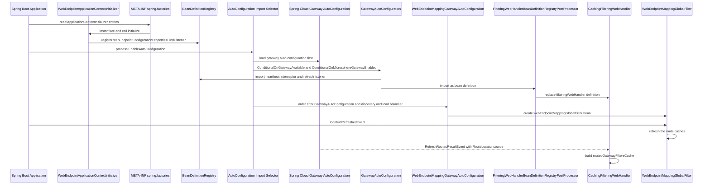

# Developer Guide — the `0.1.x` Maintenance Line

This guide describes how the `0.1.x` line of **Microsphere Gateway** is built, how its code actually works, and what it
takes to change it safely. It documents the `release-1.x` branch only.

| Fact | Value |
|---|---|
| Branch | `release-1.x` |
| Version line | `0.1.x` |
| Maven `revision` | `0.1.19-SNAPSHOT` (root `pom.xml`) |
| Latest published release | `0.1.18` |
| Group id | `io.github.microsphere-projects` |
| Java baseline | JDK 8 (`maven.compiler.source`/`target` inherited from the build root) |
| CI matrix | Java `8`, `11`, `17`, `21`, `25` × profiles `spring-cloud-hoxton`, `spring-cloud-2020`, `spring-cloud-2021` |
| Parent chain | `microsphere-gateway` → `microsphere-spring-cloud-parent:0.1.26` |
| Modules | `microsphere-gateway-parent`, `microsphere-gateway-dependencies`, `microsphere-spring-cloud-gateway-commons`, `microsphere-spring-cloud-gateway-server-webflux` |

There is **no** `microsphere-spring-cloud-gateway-server-webmvc` module on this line — the four modules above are the
complete reactor (`pom.xml`, `<modules>`). Servlet-based gateway support belongs to the current line; see
[../../current/developer-guide/README.md](../../current/developer-guide/README.md).

## Document Index

| Document | Subject |
|---|---|
| [README.md](README.md) | This index: scope, architecture at a glance, build and test entry point, line-maintenance rules |
| [microsphere-gateway-parent.md](microsphere-gateway-parent.md) | Build architecture of the parent POM: `${revision}`, BOM import chain, profile and plugin inheritance |
| [microsphere-gateway-dependencies.md](microsphere-gateway-dependencies.md) | Build architecture of the published BOM and version propagation across the reactor |
| [microsphere-spring-cloud-gateway-commons.md](microsphere-spring-cloud-gateway-commons.md) | Commons module: conditional annotations, `WebEndpointConfig`, `ConfigUtils`, the bind listener, constants |
| [microsphere-spring-cloud-gateway-server-webflux.md](microsphere-spring-cloud-gateway-server-webflux.md) | WebFlux module: auto-configuration, the `we://` filter, the caching `FilteringWebHandler`, refresh events |

For runtime behaviour and configuration from a user's point of view, read the sibling
[User Guide](../user-guide/README.md).

## Architecture at a Glance

The `0.1.x` line adds one idea on top of Spring Cloud Gateway: a route whose URI uses the custom `we` scheme
(`uri: we://all`, `uri: we://orders-service,payments-service`) is resolved at request time against the web endpoints
published by discovered service instances, instead of against a static path/URI pair. Everything else in the codebase
serves that idea:

- `microsphere-spring-cloud-gateway-commons` owns the vocabulary (`RouteConstants.SCHEME`, the `web-endpoint` metadata
  key, the rewrite-path exchange attribute), the kill-switch annotations and the typed
  `spring.cloud.gateway.routes[n].metadata.web-endpoint` configuration model plus the binder that materialises it.
- `microsphere-spring-cloud-gateway-server-webflux` owns the reactive integration: two auto-configuration classes, the
  `GlobalFilter` that performs the rewrite and match, a caching replacement for Spring Cloud Gateway's
  `FilteringWebHandler`, and two event-level components that control when routes are re-read.

Startup wiring happens in three places, all of them declarative:
`microsphere-spring-cloud-gateway-server-webflux/src/main/resources/META-INF/spring.factories` (auto-configurations plus
the `ApplicationContextInitializer`),
`microsphere-spring-cloud-gateway-server-webflux/src/main/resources/META-INF/spring/org.springframework.boot.autoconfigure.AutoConfiguration.imports`
(the same two auto-configuration classes in the newer Boot location) and
`META-INF/config/default/features.yaml` in both jar modules (the Microsphere feature-declaration registry).

## Module Dependency Graph

The same graph is repeated in every document of this guide. Solid edges are parent/aggregator/compile relationships,
dashed edges are dependency management. `optional` marks Maven `<optional>true</optional>` dependencies — on this line
they are the norm, so a consumer must bring its own Spring Boot/Spring Cloud classpath.

```mermaid
flowchart TD
    subgraph reactor["Microsphere Gateway 0.1.x reactor"]
        ROOT["microsphere-gateway (pom, root aggregator)"]
        PARENT["microsphere-gateway-parent (pom)"]
        BOM["microsphere-gateway-dependencies (BOM, pom)"]
        COMMONS["microsphere-spring-cloud-gateway-commons (jar)"]
        WEBFLUX["microsphere-spring-cloud-gateway-server-webflux (jar)"]
    end

    subgraph microsphere["Microsphere artifacts"]
        MSCP["microsphere-spring-cloud-parent 0.1.26"]
        MSCD["microsphere-spring-cloud-dependencies 0.1.26"]
        MSBOOT["microsphere-spring-boot-dependencies 0.1.34"]
        MSCC["microsphere-spring-cloud-commons"]
        MSBW["microsphere-spring-boot-webflux"]
        MSAP["microsphere-annotation-processor"]
        MSBT["microsphere-spring-boot-test"]
    end

    subgraph spring["Spring and Bean Validation artifacts"]
        SBA["spring-boot-starter"]
        SBACT["spring-boot-starter-actuator"]
        SBWF["spring-boot-starter-webflux"]
        SBCP["spring-boot-configuration-processor"]
        SBAP["spring-boot-autoconfigure-processor"]
        SCGW["spring-cloud-starter-gateway"]
        SCCC["spring-cloud-commons"]
        SCLB["spring-cloud-loadbalancer"]
        SPW["spring-web"]
        JVA["javax.validation validation-api"]
        JUP["junit-jupiter"]
        HVAL["hibernate-validator"]
    end

    ROOT -->|"parent"| MSCP
    MSBOOT -->|"imported by"| MSCP
    MSCD -->|"BOM import"| PARENT
    ROOT -->|"aggregates"| PARENT
    ROOT -->|"aggregates"| BOM
    ROOT -->|"aggregates"| COMMONS
    ROOT -->|"aggregates"| WEBFLUX
    PARENT -->|"parent"| BOM
    PARENT -->|"parent"| COMMONS
    PARENT -->|"parent"| WEBFLUX
    BOM -.->|"manages version of"| COMMONS
    BOM -.->|"manages version of"| WEBFLUX
    COMMONS -->|"optional"| MSAP
    COMMONS -->|"optional"| MSCC
    COMMONS -->|"optional"| SBA
    COMMONS -->|"optional"| SBACT
    COMMONS -->|"optional"| SBCP
    COMMONS -->|"optional"| SBAP
    COMMONS -->|"optional"| SCCC
    COMMONS -->|"optional"| SCLB
    COMMONS -->|"optional"| SPW
    COMMONS -->|"optional"| JVA
    COMMONS -->|"test"| MSBT
    COMMONS -->|"test"| JUP
    COMMONS -->|"test"| HVAL
    WEBFLUX -->|"compile"| COMMONS
    WEBFLUX -->|"optional"| MSAP
    WEBFLUX -->|"optional"| MSCC
    WEBFLUX -->|"optional"| MSBW
    WEBFLUX -->|"optional"| SCGW
    WEBFLUX -->|"optional"| SCCC
    WEBFLUX -->|"optional"| SCLB
    WEBFLUX -->|"optional"| SBWF
    WEBFLUX -->|"optional"| SBA
    WEBFLUX -->|"optional"| SBACT
    WEBFLUX -->|"optional"| SBCP
    WEBFLUX -->|"optional"| SBAP
    WEBFLUX -->|"test"| JUP
    WEBFLUX -->|"compile scope, test library"| MSBT
```



## Startup, Auto-Configuration and Route Init



The order matters and is enforced by annotations, not by luck: `GatewayAutoConfiguration` is
`@AutoConfigureAfter(name = "org.springframework.cloud.gateway.config.GatewayAutoConfiguration")`, and
`FilteringWebHandlerBeanDefinitionRegistryPostProcessor` runs as a `BeanDefinitionRegistryPostProcessor`, i.e. before
any `FilteringWebHandler` is instantiated. `WebEndpointApplicationContextInitializer` runs before the context refreshes
so that `GatewayProperties` binding is already advised by `WebEndpointConfigurationPropertiesBindListener`.

## Building and Testing This Line

Requirements: JDK 8 or newer, Maven 3.9+ (`.mvn/wrapper/maven-wrapper.properties` pins Apache Maven `3.9.15`, wrapper
version `3.3.4`, `distributionType=only-script`) or the checked-in `mvnw`/`mvnw.cmd`.

```bash
# full reactor, default Spring Cloud profile
./mvnw package

# unit and integration tests with the build-conventions profiles enabled
./mvnw test -Ptest,spring-cloud-2021

# the exact CI combination for one leg of the matrix
mvn --batch-mode --update-snapshots --file pom.xml -Drevision=0.0.1-SNAPSHOT test \
  --activate-profiles test,coverage,spring-cloud-2021

# a single module
./mvnw test -pl microsphere-spring-cloud-gateway-commons -Ptest,spring-cloud-2021
```

Maven profiles that matter on this line:

| Profile | Effect |
|---|---|
| `spring-cloud-hoxton` | Spring Boot `2.3.12.RELEASE`, Spring Cloud `Hoxton.SR12`, Spring Cloud Alibaba `2.2.10` |
| `spring-cloud-2020` | Spring Boot `2.4.13`, Spring Cloud `2020.0.5`, Spring Cloud Alibaba `2021.1` |
| `spring-cloud-2021` | Spring Boot `2.6.15`, Spring Cloud `2021.0.9`, Spring Cloud Alibaba `2021.0.6.1` — `activeByDefault` |
| `test` | activates `maven-surefire-plugin`, `maven-failsafe-plugin` and `maven-checkstyle-plugin` |
| `coverage` | activates `jacoco-maven-plugin` |
| `ci`, `publish`, `release` | deploy/sign path used by `.github/workflows/maven-publish.yml` |
| `testcontainers` | sets the `testcontainers.enabled` surefire system property |

The Spring Cloud version properties above live in the inherited `microsphere-spring-cloud-parent:0.1.26` POM, not in
this repository; see [microsphere-gateway-parent.md](microsphere-gateway-parent.md).

`.github/workflows/maven-build.yml` runs `mvn … -Drevision=0.0.1-SNAPSHOT test --activate-profiles
test,coverage,<spring-cloud profile>` over the Java 8/11/17/21/25 × hoxton/2020/2021 matrix on pushes to `dev-1.x` and
on pull requests targeting `dev-1.x` or `release-1.x`, then uploads coverage to Codecov.

Test classes on this line (all named from the sources, not invented):

- `microsphere-spring-cloud-gateway-commons`: `ConditionalOnMicrosphereGatewayEnabledTest`,
  `ConditionalOnMicrosphereWebEndpointMappingEnabledTest`, `ConfigUtilsTest`,
  `WebEndpointConfigurationPropertiesBindListenerTest`, `CommonConstantsTest`, `CommonsPropertyConstantsTest`,
  `RouteConstantsTest`, driven by `microsphere-spring-cloud-gateway-commons/src/test/resources/META-INF/config/default/test.yaml`.
- `microsphere-spring-cloud-gateway-server-webflux`: `GatewayAutoConfigurationTest`,
  `WebEndpointMappingGatewayAutoConfigurationTest`, `WebEndpointMappingGatewayAutoConfigurationIntegrationTest`,
  `WebEndpointMappingGlobalFilterTest`, `WebEndpointMappingGlobalFilterStaticTest`, `DefaultGatewayFilterChainTest`,
  `CachingFilteringWebHandlerTest`, `DisabledHeartbeatEventRouteRefreshListenerInterceptorTest`,
  `PropagatingRefreshRoutesEventApplicationListenerTest`, `GatewayPropertyConstantsTest`, `GatewayUtilsTest`, plus the
  `NoOpGatewayFilter` helper, driven by
  `microsphere-spring-cloud-gateway-server-webflux/src/test/resources/META-INF/config/default/test.yaml`
  (profiles `gateway`, `simple-service-registry`, nacos/eureka/zookeeper/consul/kubernetes).

Note: `CONTRIBUTING.md` on this branch says "targets Java 17+" and references a `spring-cloud-2025` profile. That text
was merged from another line and does not describe this branch; the POM and `maven-build.yml` are authoritative here
(JDK 8 baseline, hoxton/2020/2021 profiles). Fixing `CONTRIBUTING.md` is itself a valid `0.1.x` documentation change.

## Maintenance Rules for the `0.1.x` Line

Appropriate on `0.1.x` (behaviour-preserving or bug-fixing):

- Fixes inside the classes listed in this guide — for example a null-guard around
  `routedExcludedRequestMappingInfoCache`, or removing the unused `WebEndpointMappingGlobalFilter.buildPath`.
- POM hygiene that does not change the resolved Spring Boot/Spring Cloud versions for existing users, e.g. dropping the
  accidental compile-scope `microsphere-spring-boot-test` dependency from the WebFlux module.
- Documentation, tests, Javadoc, and `@ConfigurationProperty` metadata.
- Adding new optional dependencies, constants or conditional annotations in a binary-compatible way.

Push to `0.2.x` instead:

- Anything requiring Jakarta EE (`jakarta.*`): this line binds Bean Validation through `javax.validation`
  (`microsphere-spring-cloud-gateway-commons/src/main/java/io/microsphere/spring/cloud/gateway/commons/config/WebEndpointConfig.java`),
  and the highest Boot version reachable from its profiles is `2.6.15`.
- Anything that needs the servlet/WebMVC gateway module, which does not exist on this line.
- Changes that alter the filter order (`10149`), the `we` scheme, the `msgw-we-rewrite-path` attribute name, the
  `microsphere.spring.cloud.gateway.*` property names, or the shape of `metadata.web-endpoint` — users already configure
  these.
- Removing the blocking `choose()` call inside `WebEndpointMappingGlobalFilter.filter(...)` is an architectural change to
  the reactive contract, not a local fix; it belongs to the current line unless it is provably bug-free to do here.

Releases on this line are automated: `.github/workflows/maven-publish.yml` triggers on pushes to `release-1.x` or
`workflow_dispatch`, validates a `major.minor.patch` input, deploys with `./mvnw … -Drevision=<input> -Dgpg.skip=true
deploy --activate-profiles publish,ci`, tags the input version, appends generated notes to `release-notes.md`, rewrites
the `<revision>` property in the root `pom.xml` to the next `-SNAPSHOT` patch, and merges `release-1.x` into `dev-1.x`.
Do not hand-edit the version in a feature PR; the workflow owns it.

## Conventions Used in This Guide

- Source references are repo-relative paths, e.g.
  `microsphere-spring-cloud-gateway-server-webflux/src/main/java/io/microsphere/spring/cloud/gateway/server/webflux/handler/CachingFilteringWebHandler.java`.
- Every statement is taken from the `release-1.x` snapshot; where a conclusion is reasoning rather than code, it is
  labelled *Inference*.
- Mermaid labels are quoted wherever they contain `:`, `//`, `()`, `,`, `{}` or a version, so the diagrams stay valid.
- See the [repository README](../../../README.md) for the product-level overview.

## 中文

[microsphere-gateway-parent.md](zh/microsphere-gateway-parent.md) 等本文档集各篇的中文版本位于 `zh/` 目录，本文件的中文版为
[zh/README.md](zh/README.md)。
