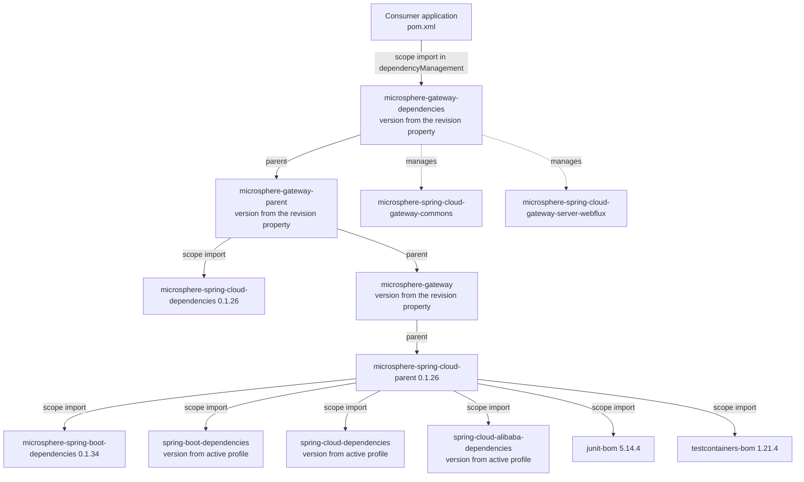

# `microsphere-gateway-dependencies`

Maven module of the `0.1.x` line (`release-1.x` branch). Packaging `pom`, coordinates
`io.github.microsphere-projects:microsphere-gateway-dependencies:${revision}`. This is the **published BOM** — the
artifact downstream applications import. It has no Java sources and no resources; POM:
`microsphere-gateway-dependencies/pom.xml`.

- [Guide index](README.md)
- [microsphere-gateway-parent.md](microsphere-gateway-parent.md)
- [microsphere-spring-cloud-gateway-commons.md](microsphere-spring-cloud-gateway-commons.md)
- [microsphere-spring-cloud-gateway-server-webflux.md](microsphere-spring-cloud-gateway-server-webflux.md)

## Build Architecture

### Role in the system

The BOM is the only artifact a consumer is expected to put in `<dependencyManagement>`. It exists so an application can
write:

```xml
<dependency>
    <groupId>io.github.microsphere-projects</groupId>
    <artifactId>microsphere-spring-cloud-gateway-server-webflux</artifactId>
</dependency>
```

without repeating the Microsphere Gateway version in two places. Because on this line there is exactly one gateway server
implementation (WebFlux), the BOM currently manages two coordinates:

```xml
<dependencyManagement>
    <dependencies>
        <dependency>
            <groupId>io.github.microsphere-projects</groupId>
            <artifactId>microsphere-spring-cloud-gateway-commons</artifactId>
            <version>${revision}</version>
        </dependency>
        <dependency>
            <groupId>io.github.microsphere-projects</groupId>
            <artifactId>microsphere-spring-cloud-gateway-server-webflux</artifactId>
            <version>${revision}</version>
        </dependency>
    </dependencies>
</dependencyManagement>
```

No other element is present: no `<properties>`, no `<modules>`, no `<build>`, no profile. Everything it "knows" comes from
its parent, `microsphere-gateway-parent`.

### Parent, inheritance and the BOM import chain



Two consequences of this chain, both structural rather than incidental:

1. Maven applies POM inheritance to an imported BOM before taking its `dependencyManagement`. Since this module's parent
   is `microsphere-gateway-parent`, which imports `microsphere-spring-cloud-dependencies:0.1.26` (and through the parent
   chain `microsphere-spring-boot-dependencies:0.1.34`, `spring-boot-dependencies`, `spring-cloud-dependencies`,
   `spring-cloud-alibaba-dependencies`, `junit-bom`, `testcontainers-bom`), a consumer that imports
   `microsphere-gateway-dependencies` also gets the versions of every Spring and Microsphere artifact used to build this
   line. *This is standard Maven BOM semantics; the set of imported BOMs is verified in the parent chain.*
2. The Spring Boot and Spring Cloud versions inside that chain are profile-selected (`spring-cloud-hoxton`,
   `spring-cloud-2020`, `spring-cloud-2021`). A BOM is flattened with `flattenMode=resolveCiFriendliesOnly`, so build-time
   properties are resolved, but a consumer still chooses the release train by its own dependency management. Contributors
   must therefore treat "which Boot version does the published BOM imply" as *documentation of the build that produced it*,
   not as a guarantee.

### What the BOM does not do

- It does **not** re-export compile dependencies. In both jar modules every Microsphere/Spring dependency is
  `<optional>true</optional>`; e.g. `spring-cloud-starter-gateway` and `spring-boot-starter-webflux` must be added by the
  application itself.
- It does **not** import `microsphere-spring-cloud-dependencies` itself; the import lives in `microsphere-gateway-parent`.
  It is reached through the parent, which is why this POM is eight lines of XML plus the two managed entries.
- It is **not** used inside the reactor. The WebFlux module declares its sibling with an explicit
  `<version>${revision}</version>` (`microsphere-spring-cloud-gateway-server-webflux/pom.xml`) rather than importing the
  BOM it is built next to. That keeps the reactor self-contained and means a mistake in this BOM cannot break the build of
  this line — it only affects consumers.

## Design Patterns (Build Level)

| Pattern | Location | Rationale | Benefit | Cost |
|---|---|---|---|---|
| Consumer-facing BOM | `microsphere-gateway-dependencies/pom.xml` | One coordinate to align the line's artifacts | Applications import once, upgrade once | An extra POM hop for consumers; versions are invisible at the use site |
| Internal-only parent | `microsphere-gateway-parent/pom.xml` | Keep build policy out of the published contract | The BOM body stays tiny and stable | Reading the BOM alone does not explain the managed versions |
| Version by `${revision}` | both entries in `dependencyManagement` | The BOM can never disagree with the modules it manages | Single source of truth per release | Only correct for same-reactor artifacts |
| Optional-everywhere dependency model | both jar POMs | The line extends Spring Cloud Gateway, it does not own it | No classpath imposition on applications | Consumers must assemble the stack themselves, and version drift becomes their problem |

## Module Dependency Graph

```mermaid
flowchart TD
    subgraph reactor["Microsphere Gateway 0.1.x reactor"]
        ROOT["microsphere-gateway (pom, root aggregator)"]
        PARENT["microsphere-gateway-parent (pom)"]
        BOM["microsphere-gateway-dependencies (BOM, pom)"]
        COMMONS["microsphere-spring-cloud-gateway-commons (jar)"]
        WEBFLUX["microsphere-spring-cloud-gateway-server-webflux (jar)"]
    end

    subgraph microsphere["Microsphere artifacts"]
        MSCP["microsphere-spring-cloud-parent 0.1.26"]
        MSCD["microsphere-spring-cloud-dependencies 0.1.26"]
        MSBOOT["microsphere-spring-boot-dependencies 0.1.34"]
        MSCC["microsphere-spring-cloud-commons"]
        MSBW["microsphere-spring-boot-webflux"]
        MSAP["microsphere-annotation-processor"]
        MSBT["microsphere-spring-boot-test"]
    end

    subgraph spring["Spring and Bean Validation artifacts"]
        SBA["spring-boot-starter"]
        SBACT["spring-boot-starter-actuator"]
        SBWF["spring-boot-starter-webflux"]
        SBCP["spring-boot-configuration-processor"]
        SBAP["spring-boot-autoconfigure-processor"]
        SCGW["spring-cloud-starter-gateway"]
        SCCC["spring-cloud-commons"]
        SCLB["spring-cloud-loadbalancer"]
        SPW["spring-web"]
        JVA["javax.validation validation-api"]
        JUP["junit-jupiter"]
        HVAL["hibernate-validator"]
    end

    ROOT -->|"parent"| MSCP
    MSBOOT -->|"imported by"| MSCP
    MSCD -->|"BOM import"| PARENT
    ROOT -->|"aggregates"| PARENT
    ROOT -->|"aggregates"| BOM
    ROOT -->|"aggregates"| COMMONS
    ROOT -->|"aggregates"| WEBFLUX
    PARENT -->|"parent"| BOM
    PARENT -->|"parent"| COMMONS
    PARENT -->|"parent"| WEBFLUX
    BOM -.->|"manages version of"| COMMONS
    BOM -.->|"manages version of"| WEBFLUX
    COMMONS -->|"optional"| MSAP
    COMMONS -->|"optional"| MSCC
    COMMONS -->|"optional"| SBA
    COMMONS -->|"optional"| SBACT
    COMMONS -->|"optional"| SBCP
    COMMONS -->|"optional"| SBAP
    COMMONS -->|"optional"| SCCC
    COMMONS -->|"optional"| SCLB
    COMMONS -->|"optional"| SPW
    COMMONS -->|"optional"| JVA
    COMMONS -->|"test"| MSBT
    COMMONS -->|"test"| JUP
    COMMONS -->|"test"| HVAL
    WEBFLUX -->|"compile"| COMMONS
    WEBFLUX -->|"optional"| MSAP
    WEBFLUX -->|"optional"| MSCC
    WEBFLUX -->|"optional"| MSBW
    WEBFLUX -->|"optional"| SCGW
    WEBFLUX -->|"optional"| SCCC
    WEBFLUX -->|"optional"| SCLB
    WEBFLUX -->|"optional"| SBWF
    WEBFLUX -->|"optional"| SBA
    WEBFLUX -->|"optional"| SBACT
    WEBFLUX -->|"optional"| SBCP
    WEBFLUX -->|"optional"| SBAP
    WEBFLUX -->|"test"| JUP
    WEBFLUX -->|"compile scope, test library"| MSBT
```



## Building and Testing

There are no sources to compile and no tests to run; the module is validated by the reactor build and by POM resolution:

```bash
# install the whole line, then look at the flattened BOM that consumers resolve
./mvnw -DskipTests install
grep -A4 microsphere-spring-cloud-gateway-commons \
  ~/.m2/repository/io/github/microsphere-projects/microsphere-gateway-dependencies/0.1.19-SNAPSHOT/*.pom

# the release-shaped build used by the publish workflow
./mvnw --batch-mode -Drevision=0.1.19 -Dgpg.skip=true deploy --activate-profiles publish,ci
```

Because the BOM is deployed, a change to it is a change to the published contract:

- Add an entry when a new module joins the line (that is what a future WebMVC module would need on the line that has
  one).
- Never assign an external version here; let `microsphere-gateway-parent` and the profile-selected BOMs do it.
- Keep `<version>${revision}</version>` for internal modules; hard-coding would decouple the BOM from the reactor.

## Maintenance Notes for `0.1.x`

Safe here:

- Documenting or re-ordering entries; adding a managed entry for an artifact that already exists on this line.
- Keeping the BOM in sync when the root `revision` is bumped by the release workflow (nothing to do manually — `${revision}`
  does the work).

Not here:

- Managing versions for artifacts that only exist on the `0.2.x` line, such as a WebMVC gateway server module; this line's
  `<modules>` list has four entries only. See
  [../../current/developer-guide/README.md](../../current/developer-guide/README.md) for the current-line BOM.
- Switching the BOM to import `spring-boot-dependencies` directly to "help" consumers: on this line the Boot version is a
  profile decision, and freezing it in the BOM would make `spring-cloud-hoxton` and `spring-cloud-2020` users resolve a
  Boot release they did not choose.

Repository-wide context and product overview: [../../../README.md](../../../README.md).

## 中文

[zh/microsphere-gateway-dependencies.md](zh/microsphere-gateway-dependencies.md)
