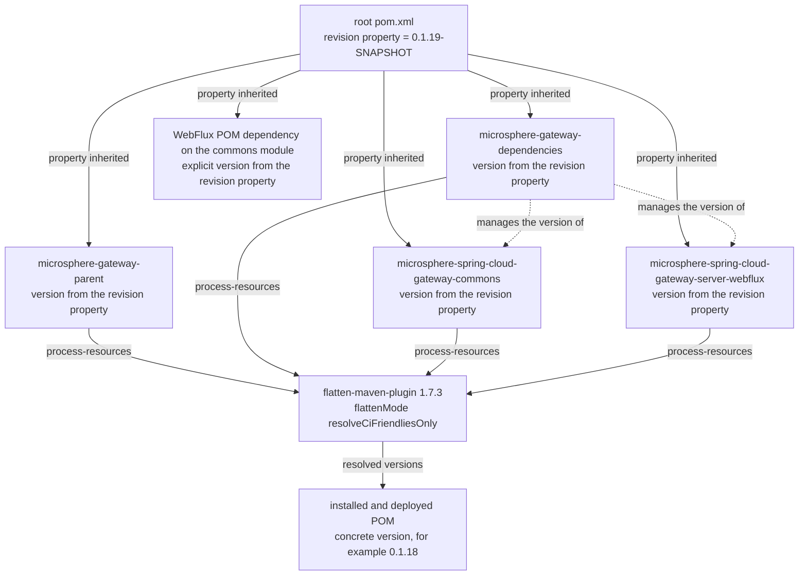

# `microsphere-gateway-parent`

Maven module of the `0.1.x` line (`release-1.x` branch). Packaging `pom`, coordinates
`io.github.microsphere-projects:microsphere-gateway-parent:${revision}`. It contains no Java sources; its whole job is
build architecture. POM: `microsphere-gateway-parent/pom.xml`.

- [Guide index](README.md)
- [microsphere-gateway-dependencies.md](microsphere-gateway-dependencies.md)
- [microsphere-spring-cloud-gateway-commons.md](microsphere-spring-cloud-gateway-commons.md)
- [microsphere-spring-cloud-gateway-server-webflux.md](microsphere-spring-cloud-gateway-server-webflux.md)

## Build Architecture

### Position in the reactor

`microsphere-gateway-parent` plays two roles at once:

1. It is a **module of the root aggregator** — `pom.xml` lists it first in `<modules>`, so `./mvnw package` builds it as
   part of the reactor.
2. It is the **parent POM of the other three modules** — `microsphere-gateway-dependencies`,
   `microsphere-spring-cloud-gateway-commons` and `microsphere-spring-cloud-gateway-server-webflux` all declare it with
   `<relativePath>../microsphere-gateway-parent/pom.xml</relativePath>`.

Its own parent is the root `microsphere-gateway` POM, which in turn inherits
`io.github.microsphere-projects:microsphere-spring-cloud-parent:0.1.26`. The full inheritance chain, verified from the
POMs and from the resolved `microsphere-spring-cloud-parent-0.1.26.pom` in the local repository:

```
microsphere-gateway-parent:${revision}
    ↑ parent
microsphere-gateway:${revision}                     (this repository, root pom.xml)
    ↑ parent
microsphere-spring-cloud-parent:0.1.26              (external, microsphere-spring-cloud project)
    ↑ parent
microsphere-spring-cloud:0.1.26                     (external aggregator POM)
    ↑ parent
microsphere-build:0.3.14                            (external build-conventions POM)
```

The consequence for contributors: plugin configuration, compiler settings, publishing rules and most Maven profiles are
**not** defined in this repository. They are inherited, and the only build decisions this POM makes are the
`microsphere-spring-cloud-dependencies` BOM import and the `microsphere-spring-cloud.version` property.

### What the POM declares

```xml
<properties>
    <!-- BOM versions -->
    <microsphere-spring-cloud.version>0.1.26</microsphere-spring-cloud.version>
</properties>

<dependencyManagement>
    <dependencies>
        <dependency>
            <groupId>io.github.microsphere-projects</groupId>
            <artifactId>microsphere-spring-cloud-dependencies</artifactId>
            <version>${microsphere-spring-cloud.version}</version>
            <type>pom</type>
            <scope>import</scope>
        </dependency>
    </dependencies>
</dependencyManagement>
```

That single import is what lets `microsphere-spring-cloud-gateway-commons/pom.xml` and
`microsphere-spring-cloud-gateway-server-webflux/pom.xml` write
`io.github.microsphere-projects:microsphere-spring-cloud-commons` and
`io.github.microsphere-projects:microsphere-spring-boot-webflux` **without a `<version>`**.
`microsphere-spring-cloud-dependencies:0.1.26` manages, in turn, `microsphere-spring-cloud-commons` and
`microsphere-spring-cloud-openfeign` at `0.1.26`; the sibling `microsphere-spring-boot-*` artifacts (`0.1.34`) are managed
by `microsphere-spring-boot-dependencies:0.1.34`, imported by `microsphere-spring-cloud-parent:0.1.26`, and therefore
already in scope through inheritance.

The same parent also imports `spring-boot-dependencies`, `spring-cloud-dependencies`,
`spring-cloud-alibaba-dependencies`, `junit-bom` (`5.14.4`) and `testcontainers-bom` (`1.21.4`) with versions taken from
the active Spring Cloud profile, which is why no module in this repository states a Spring or Spring Boot version.

### `${revision}` and POM flattening

Every POM in the repository — root, parent, BOM and both jars — uses:

```xml
<version>${revision}</version>
```

with the property defined **only** in the root `pom.xml`:

```xml
<properties>
    <revision>0.1.19-SNAPSHOT</revision>
</properties>
```

This is Maven's CI-friendly versioning. Nothing else in the reactor hard-codes a version, which is what makes the
publish workflow able to release any patch number by passing `-Drevision=0.1.19` on the command line, and what lets CI
build with `-Drevision=0.0.1-SNAPSHOT` without touching a file.

`${revision}` must not leak into published POMs, otherwise consumers could not resolve the parent. Flattening is handled
by the inherited build conventions, not by this repository: `microsphere-build:0.3.14` declares
`flatten-maven-plugin` `1.7.3` with `<flattenMode>resolveCiFriendliesOnly</flattenMode>` and an execution `flatten`
bound to the `process-resources` phase, and `.gitignore` contains the `# flatten ignore` / `.flattened-pom.xml` entries.
`resolveCiFriendliesOnly` rewrites `${revision}` (and `${sha1}`/`${changelist}`) in the installed/deployed POM and leaves
the rest of the POM — including `<parent>` and `<dependencyManagement>` — structurally intact, which is exactly why
importing `microsphere-gateway-dependencies` still works for downstream users.

*Inference:* the flatten configuration itself lives outside this repository, so if the published `microsphere-gateway`
POMs ever keep an unresolved `${revision}`, the fix belongs to the upstream `microsphere-build` POM, not to a module POM.

### Version propagation across the reactor



Two facts to keep in mind when editing versions:

- `microsphere-gateway-dependencies/pom.xml` manages the two jar artifacts with `<version>${revision}</version>`, so the
  BOM, the modules and the root property can never drift apart inside one build.
- `microsphere-spring-cloud-gateway-server-webflux/pom.xml` also declares
  `microsphere-spring-cloud-gateway-commons` with an explicit `<version>${revision}</version>` instead of relying on the
  BOM. That is deliberate — the BOM (`microsphere-gateway-dependencies`) is *not* imported by
  `microsphere-gateway-parent`, so within the reactor only the property is available.

*Inference:* adding an internal module version property here would be a change of build strategy and does not match the
current single-`${revision}` design.

## Design Patterns (Build Level)

| Pattern | Location | Rationale | Benefit | Cost |
|---|---|---|---|---|
| Parent POM aggregator | `microsphere-gateway-parent/pom.xml` | Separate "what the build inherits" from "what the reactor contains" | Modules stay three lines of XML deep with no plugin noise | Two POM hops before you find the real setting |
| BOM import for a family | `dependencyManagement` + `<scope>import</scope>` | Pin the whole Microsphere Spring Cloud family to one coordinate | One property (`microsphere-spring-cloud.version`) upgrades `microsphere-spring-cloud-commons` and friends | BOM import order wins over local entries; silent overrides possible |
| CI-friendly `${revision}` | root `pom.xml`, referenced by all modules | Publish any version without editing files | Automated patch releases in `maven-publish.yml` | Requires flattening; IDEs resolve `${revision}` only after a Maven import |
| Convention inheritance | `microsphere-build:0.3.14` (external) | Compile/test/publish behaviour identical across Microsphere projects | No duplicated plugin XML | Upstream changes land here without a commit in this repo |

## Module Dependency Graph

```mermaid
flowchart TD
    subgraph reactor["Microsphere Gateway 0.1.x reactor"]
        ROOT["microsphere-gateway (pom, root aggregator)"]
        PARENT["microsphere-gateway-parent (pom)"]
        BOM["microsphere-gateway-dependencies (BOM, pom)"]
        COMMONS["microsphere-spring-cloud-gateway-commons (jar)"]
        WEBFLUX["microsphere-spring-cloud-gateway-server-webflux (jar)"]
    end

    subgraph microsphere["Microsphere artifacts"]
        MSCP["microsphere-spring-cloud-parent 0.1.26"]
        MSCD["microsphere-spring-cloud-dependencies 0.1.26"]
        MSBOOT["microsphere-spring-boot-dependencies 0.1.34"]
        MSCC["microsphere-spring-cloud-commons"]
        MSBW["microsphere-spring-boot-webflux"]
        MSAP["microsphere-annotation-processor"]
        MSBT["microsphere-spring-boot-test"]
    end

    subgraph spring["Spring and Bean Validation artifacts"]
        SBA["spring-boot-starter"]
        SBACT["spring-boot-starter-actuator"]
        SBWF["spring-boot-starter-webflux"]
        SBCP["spring-boot-configuration-processor"]
        SBAP["spring-boot-autoconfigure-processor"]
        SCGW["spring-cloud-starter-gateway"]
        SCCC["spring-cloud-commons"]
        SCLB["spring-cloud-loadbalancer"]
        SPW["spring-web"]
        JVA["javax.validation validation-api"]
        JUP["junit-jupiter"]
        HVAL["hibernate-validator"]
    end

    ROOT -->|"parent"| MSCP
    MSBOOT -->|"imported by"| MSCP
    MSCD -->|"BOM import"| PARENT
    ROOT -->|"aggregates"| PARENT
    ROOT -->|"aggregates"| BOM
    ROOT -->|"aggregates"| COMMONS
    ROOT -->|"aggregates"| WEBFLUX
    PARENT -->|"parent"| BOM
    PARENT -->|"parent"| COMMONS
    PARENT -->|"parent"| WEBFLUX
    BOM -.->|"manages version of"| COMMONS
    BOM -.->|"manages version of"| WEBFLUX
    COMMONS -->|"optional"| MSAP
    COMMONS -->|"optional"| MSCC
    COMMONS -->|"optional"| SBA
    COMMONS -->|"optional"| SBACT
    COMMONS -->|"optional"| SBCP
    COMMONS -->|"optional"| SBAP
    COMMONS -->|"optional"| SCCC
    COMMONS -->|"optional"| SCLB
    COMMONS -->|"optional"| SPW
    COMMONS -->|"optional"| JVA
    COMMONS -->|"test"| MSBT
    COMMONS -->|"test"| JUP
    COMMONS -->|"test"| HVAL
    WEBFLUX -->|"compile"| COMMONS
    WEBFLUX -->|"optional"| MSAP
    WEBFLUX -->|"optional"| MSCC
    WEBFLUX -->|"optional"| MSBW
    WEBFLUX -->|"optional"| SCGW
    WEBFLUX -->|"optional"| SCCC
    WEBFLUX -->|"optional"| SCLB
    WEBFLUX -->|"optional"| SBWF
    WEBFLUX -->|"optional"| SBA
    WEBFLUX -->|"optional"| SBACT
    WEBFLUX -->|"optional"| SBCP
    WEBFLUX -->|"optional"| SBAP
    WEBFLUX -->|"test"| JUP
    WEBFLUX -->|"compile scope, test library"| MSBT
```



## Building and Testing

The parent contributes no tests of its own (`src/` does not exist). It is exercised indirectly:

```bash
# verify the effective version and inherited dependencyManagement
./mvnw -N help:effective-pom -f microsphere-gateway-parent/pom.xml -Pspring-cloud-2021 | grep -A2 microsphere-spring-cloud-dependencies

# reactor build through the parent, exactly as CI does for one matrix leg
mvn --batch-mode --update-snapshots --file pom.xml -Drevision=0.0.1-SNAPSHOT test \
  --activate-profiles test,coverage,spring-cloud-2021
```

Rules to keep the build honest on this line:

- Never hard-code a version in a module POM except `${revision}` for internal modules; external versions come from
  profiles or BOMs.
- Changing `microsphere-spring-cloud.version` is a dependency upgrade for the whole line; it must be validated against
  all three Spring Cloud profiles, because each profile also selects a different Spring Boot release (`2.3.12.RELEASE`,
  `2.4.13`, `2.6.15`).
- `--activate-profiles test` is required to run surefire/failsafe/checkstyle: outside the `test` profile those plugins are
  configured but not activated by the build conventions.

## Maintenance Notes for `0.1.x`

Safe here:

- Bumping `microsphere-spring-cloud.version` to a newer `0.1.x` Microsphere Spring Cloud release that keeps Boot 2.x and
  JDK 8 support.
- Adding another `<scope>import</scope>` BOM to `dependencyManagement` when a new external family is needed.
- Build metadata (name, description) edits.

Not here:

- Moving the reactor to Boot 3 / Jakarta or raising the Java baseline — the `0.2.x` line owns that
  ([../../current/developer-guide/README.md](../../current/developer-guide/README.md)).
- Adopting a multi-`revision` scheme or replacing the flattening inherited from `microsphere-build`.
- Editing plugin XML that this repository does not own; an upstream change is an issue for
  `microsphere-spring-cloud` / `microsphere-build`, not a commit here.

Repository-wide context and product overview: [../../../README.md](../../../README.md).

## 中文

[zh/microsphere-gateway-parent.md](zh/microsphere-gateway-parent.md)
