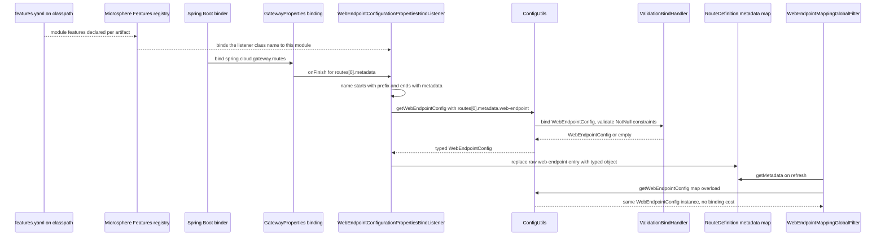
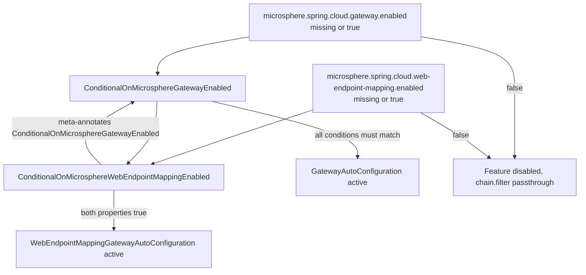

# `microsphere-spring-cloud-gateway-commons`

Jar module of the `0.1.x` line (`release-1.x` branch). Coordinates
`io.github.microsphere-projects:microsphere-spring-cloud-gateway-commons:${revision}` (`0.1.19-SNAPSHOT` in the reactor,
latest published release `0.1.18`). POM: `microsphere-spring-cloud-gateway-commons/pom.xml`.

- [Guide index](README.md)
- [microsphere-spring-cloud-gateway-server-webflux.md](microsphere-spring-cloud-gateway-server-webflux.md)

## Architecture Design

### Role in the system

Commons is the vocabulary and configuration-model layer shared by the gateway modules. It holds no request-processing
logic; it defines *what a web-endpoint route means* and *how its configuration is materialised*, and it defines the
switches that turn the feature off. The reactive module
(`microsphere-spring-cloud-gateway-server-webflux`) is its only consumer inside this repository, declaring it as a plain
compile dependency.

Everything the commons module declares is `optional` or `test` scoped. That is a deliberate design: the module compiles
against Spring Boot, Spring Cloud and Bean Validation but refuses to push any of them onto a consumer. On a line where all
runtime integration lives in the WebFlux module, that keeps the commons jar reusable and free of version pressure.

### Package layout

```
microsphere-spring-cloud-gateway-commons/src/main/java/io/microsphere/spring/cloud/gateway/commons/
├── annotation/
│   ├── ConditionalOnMicrosphereGatewayEnabled.java
│   └── ConditionalOnMicrosphereWebEndpointMappingEnabled.java
├── config/
│   ├── ConfigUtils.java
│   ├── WebEndpointConfig.java
│   └── WebEndpointConfigurationPropertiesBindListener.java
└── constants/
    ├── CommonConstants.java
    ├── CommonsPropertyConstants.java
    └── RouteConstants.java

microsphere-spring-cloud-gateway-commons/src/main/resources/
└── META-INF/config/default/features.yaml
```

There is no `spring.factories`, no
`META-INF/spring/…AutoConfiguration.imports`, no `@AutoConfiguration`/`@Configuration` class and no
`@Component`/`@Bean` anywhere in this module. A grep of the module's main sources finds zero `@Configuration` types: the
commons layer contributes **no auto-configuration of its own**. Its only runtime hook is a class that the *WebFlux*
module registers (`WebEndpointConfigurationPropertiesBindListener`, wired by
`WebEndpointApplicationContextInitializer` there).

### How the `@Conditional` annotations are meant to be used

Both conditional annotations are meta-annotated with `@ConditionalOnProperty`, so the Spring Boot condition machinery is
what evaluates them; nothing custom is registered:

| Annotation | Property | `matchIfMissing` | Effective when the property is absent |
|---|---|---|---|
| `ConditionalOnMicrosphereGatewayEnabled` | `microsphere.spring.cloud.gateway.enabled` | `true` | enabled |
| `ConditionalOnMicrosphereWebEndpointMappingEnabled` | `microsphere.spring.cloud.web-endpoint-mapping.enabled` | `true` | enabled, and also requires the gateway switch |

`ConditionalOnMicrosphereWebEndpointMappingEnabled` composes `ConditionalOnMicrosphereGatewayEnabled` **plus** its own
`@ConditionalOnProperty`. Spring's `ConditionEvaluator` collects every `@Conditional` reachable through meta-annotations
and requires *all* of them to match, short-circuiting on the first failure; the evaluation order between the collected
conditions is not specified, so neither property may be assumed to win a tie. Practical effect for maintainers: turning
`microsphere.spring.cloud.gateway.enabled=false` off also disables everything guarded by the web-endpoint-mapping
annotation. This hierarchy is asserted by `ConditionalOnMicrosphereWebEndpointMappingEnabledTest` (three nested contexts:
default, explicit `true`, explicit `false`).

### Bean-override strategy on this line

Commons does not override any bean. The only bean it can produce is created elsewhere, and the coordination is by
**name**, not by type:

```java
public static final String BEAN_NAME = "webEndpointConfigurationPropertiesBindListener";
```

`WebEndpointApplicationContextInitializer` in the WebFlux module registers the definition under exactly that constant.
The strategy is therefore "one well-known bean name, registered as early as possible, never re-registered" rather than
the `@ConditionalOnMissingBean` idiom — which is absent from the whole `0.1.x` codebase (verified: zero
`ConditionalOnMissingBean` occurrences in main sources), as is
`spring.main.allow-bean-definition-overriding`. If an application defines its own bean under that name, the initializer's
registration would clash; that is a consumer-side concern, not something this module guards against.

### Java 8 and `javax`-era constraints

- Bean Validation is bound through `javax.validation` (`WebEndpointConfig` imports `javax.validation.Valid` and
  `javax.validation.constraints.NotNull`). There is no `jakarta.*` import anywhere in the repository, and the reactor's
  highest reachable Spring Boot release is `2.6.15` (profile-selected), so a Jakarta migration cannot be expressed on this
  line.
- The sources are Java 8 only: no `var`, no `List.of`/`Map.of`, no `Optional`-chaining idioms; `Stream.of(...)` in
  `WebEndpointMappingGlobalFilter.RequestMappingContext` is the most "modern" construct used.
- `WebEndpointConfig` uses `org.springframework.web.bind.annotation.RequestMethod` from `spring-web` (declared optional),
  and `ConfigUtils` uses `org.springframework.validation.beanvalidation.LocalValidatorFactoryBean`, i.e. the Spring 5
  javax-bridge validator.
- `java.util.LinkedList`, `java.util.ArrayList`, arrays instead of records: mutable Java-8 idioms chosen for JDK 8 plus
  constructor binding compatibility.

*Consequence:* a fix that would need `jakarta.validation` or a Java 11+ API must be routed to `0.2.x`.

## Source Analysis

### `constants.CommonConstants`

`microsphere-spring-cloud-gateway-commons/src/main/java/io/microsphere/spring/cloud/gateway/commons/constants/CommonConstants.java`

An `interface` used as a constant holder. One member:
`APPLICATION_NAME_URI_TEMPLATE_VARIABLE_NAME = "application"`. It is the contract between a route predicate such as
`Path=/{application}/**` and the code that reads the matched URI-template variable in the WebFlux module. Invariant: the
value must stay `application`, otherwise every existing `we://` route predicate silently stops resolving an application
name (the filter then logs a trace and passes the exchange down the chain).

### `constants.CommonsPropertyConstants`

`…/commons/constants/CommonsPropertyConstants.java`

Property-name vocabulary, built by string concatenation from constants owned by the Microsphere stack:

| Constant | Value |
|---|---|
| `MICROSPHERE_GATEWAY_SPRING_CLOUD_PROPERTY_NAME_PREFIX` | `microsphere.spring.cloud.gateway.` |
| `MICROSPHERE_GATEWAY_ENABLED_PROPERTY_NAME` | `microsphere.spring.cloud.gateway.enabled` |
| `DEFAULT_MICROSPHERE_GATEWAY_ENABLED` | `true` |
| `MICROSPHERE_WEB_ENDPOINT_MAPPING_PROPERTY_NAME_PREFIX` | `microsphere.spring.cloud.web-endpoint-mapping.` |
| `MICROSPHERE_WEB_ENDPOINT_MAPPING_ENABLED_PROPERTY_NAME` | `microsphere.spring.cloud.web-endpoint-mapping.enabled` |

Note the deliberate *name collision*: the gateway's own `CommonsPropertyConstants` static-imports
`MICROSPHERE_SPRING_CLOUD_PROPERTY_NAME_PREFIX` from `io.microsphere.spring.cloud.commons.constants.CommonsPropertyConstants`
(a different interface with the same simple name, from `microsphere-spring-cloud-commons`). Any edit here must keep that
fully-qualified import intact, otherwise the two interfaces shadow each other.

Both `enabled` constants are annotated with Microsphere's `@ConfigurationProperty(type = boolean.class, defaultValue =
"true", source = APPLICATION_SOURCE)`. That annotation is metadata consumed by `microsphere-annotation-processor`
(optional dependency) to publish configuration-property information; it has no runtime effect on binding.

### `constants.RouteConstants`

`…/commons/constants/RouteConstants.java`

The `we://` protocol contract:

| Constant | Value | Used for |
|---|---|---|
| `SCHEME` | `we` | route URI scheme that marks a web-endpoint route |
| `ALL_SERVICES` | `all` | wildcard host meaning "every discovered service" |
| `ID_KEY` | `id` | route metadata/property key, also used to detect `…routes[n].id` changes |
| `METADATA_KEY` | `metadata` | suffix of `spring.cloud.gateway.routes[n].metadata` |
| `WEB_ENDPOINT_KEY` | `web-endpoint` | key of the web-endpoint block inside route metadata |
| `WEB_ENDPOINT_REWRITE_PATH_ATTRIBUTE_NAME` | `msgw-we-rewrite-path` | `ServerWebExchange` attribute carrying the rewritten path |

All six values are asserted verbatim by `RouteConstantsTest`; they are effectively public API even though they are
`String` constants.

### `annotation.ConditionalOnMicrosphereGatewayEnabled`

`…/commons/annotation/ConditionalOnMicrosphereGatewayEnabled.java`

```java
@Retention(RUNTIME)
@Target({TYPE, METHOD})
@Documented
@ConditionalOnProperty(name = MICROSPHERE_GATEWAY_ENABLED_PROPERTY_NAME, matchIfMissing = true)
public @interface ConditionalOnMicrosphereGatewayEnabled {
}
```

No members. `@Target` allows class- and method-level use, so it guards both configuration classes and individual `@Bean`
methods. `GatewayAutoConfiguration` in the WebFlux module carries it. Because `matchIfMissing = true`, the whole line is
opt-out, not opt-in.

### `annotation.ConditionalOnMicrosphereWebEndpointMappingEnabled`

`…/commons/annotation/ConditionalOnMicrosphereWebEndpointMappingEnabled.java`

Same shape, but it also meta-annotates `@ConditionalOnMicrosphereGatewayEnabled` and references
`io.microsphere.spring.web.metadata.WebEndpointMapping` in its Javadoc and imports. The `WebEndpointMapping` import is a
documentation-only dependency on the Microsphere web metadata type (it comes from the Microsphere Spring web stack pulled
in transitively through `microsphere-spring-cloud-commons`), and it is the reason this annotation is *not* dependency-free:
removing that import would be a compile-time change, not a cosmetic one.

Known documentation drift (safe to fix on this line): its Javadoc `@see` references
`CommonsPropertyConstants#MICROSPHERE_GATEWAY_ENABLED_PROPERTY_NAME` although the annotation guards
`MICROSPHERE_WEB_ENDPOINT_MAPPING_ENABLED_PROPERTY_NAME`.

### `config.WebEndpointConfig`

`…/commons/config/WebEndpointConfig.java`

The typed model of `spring.cloud.gateway.routes[n].metadata.web-endpoint`, annotated `@Validated`:

- `@NotNull @Valid private List<Mapping> excludes = new LinkedList<>();` — the field is initialised, so a route with no
  `web-endpoint` block still binds to an object with an empty exclusion list rather than failing validation.
- Nested `public static class Mapping` mirrors the Spring request-mapping attributes: `patterns` (`@NotNull @Valid
  String[]`), `methods`, `params`, `headers`, `consumes`, `produces` — all `String[]`/`RequestMethod[]` and all nullable
  except `patterns`.

Two non-obvious normalising getters define behaviour, and both exist because `RequestMappingInfo.Builder.headers(...)`
cannot take `null`:

```java
@Nonnull
public RequestMethod[] getMethods() {
    if (isEmpty(methods)) {
        return values();          // RequestMethod.values()
    }
    return methods;
}

@Nonnull
public String[] getHeaders() {
    if (isEmpty(headers)) {
        return EMPTY_STRING_ARRAY;
    }
    return headers;
}
```

Invariants worth remembering:

1. An `excludes` entry without `methods` excludes the path for **every** HTTP method — the default is permissive-by-design
   (a "block this path" rule, not a "match only GET" rule).
2. `params`, `consumes` and `produces` stay `null` when unset, while `headers` becomes an empty array. That asymmetry is
   visible in `ConfigUtilsTest`, which asserts `assertSame(EMPTY_STRING_ARRAY, exclude.getHeaders())` and
   `assertNull(exclude.getParams())`.
3. `Mapping` is a mutable JavaBean (getters and setters), because Spring Boot's binder needs setters; it is not thread
   safe and must be treated as read-only after binding.

### `config.ConfigUtils`

`…/commons/config/ConfigUtils.java`

`public abstract class ConfigUtils implements Utils` with a private constructor — the Microsphere utility-class idiom
(`io.microsphere.util.Utils` is a marker interface). Two overloads, both `@Nullable`:

```java
Binder binder = get(environment, springValidatorBindHandler);
return binder.bind(configPrefix, WEB_ENDPOINT_CONFIG_BINDABLE).orElse(null);
```

```java
Object webEndpoint = metadata.get(WEB_ENDPOINT_KEY);
return webEndpoint instanceof WebEndpointConfig ? (WebEndpointConfig) webEndpoint : null;
```

Design points:

- `WEB_ENDPOINT_CONFIG_BINDABLE` is a `static final` `Bindable<WebEndpointConfig>`; `Bindable` objects are immutable value
  holders, so sharing one is safe.
- The `ValidationBindHandler` is created **once** in a static initializer, together with a `LocalValidatorFactoryBean`
  whose `afterPropertiesSet()` is called manually. That means validation is available without an application context, but
  it also means: (a) the cost is paid at first class load; (b) there is no `ApplicationContext`-managed `Validator`, so no
  message interpolation or constraint customisation from the application; (c) if no Bean Validation provider is on the
  classpath, Spring's `LocalValidatorFactoryBean` falls back to a no-op validator and constraints silently stop being
  enforced (Spring framework behaviour; on this line the provider is only a test-scope dependency of the commons module —
  `hibernate-validator` plus `tomcat-embed-el` for the Expression Language).
- The map-based overload **never parses** a raw map; it only returns a value that was already converted. That is the
  handoff created by the bind listener below, and it is why a route's metadata can be read as a typed object at request
  time without any binding cost.

### `config.WebEndpointConfigurationPropertiesBindListener`

`…/commons/config/WebEndpointConfigurationPropertiesBindListener.java`

```java
public class WebEndpointConfigurationPropertiesBindListener implements BindListener, EnvironmentAware {
```

It implements Microsphere's `io.microsphere.spring.boot.context.properties.bind.BindListener` (from
`microsphere-spring-boot-core`), which is the callback contract used by `ListenableBindHandlerAdapter` so that a bind
advisor can be attached to `@ConfigurationProperties` binding through Spring Boot's
`ConfigurationPropertiesBindHandlerAdvisor` SPI (named in the Javadoc as the collaborating contract). Only `onFinish` is
implemented:

```java
String propertyName = name.toString();
if (propertyName.startsWith(gatewayRoutesPropertyNamePrefix) && propertyName.endsWith(METADATA_KEY) && result != null) {
    ConfigurationPropertyName webEndpointName = name.append(WEB_ENDPOINT_KEY);
    WebEndpointConfig webEndpointConfig = getWebEndpointConfig(environment, webEndpointName.toString());
    if (webEndpointConfig != null) {
        Map<String, Object> metadata = (Map<String, Object>) result;
        metadata.put(WEB_ENDPOINT_KEY, webEndpointConfig);
    }
}
```

Reading it precisely:

- The constructor asserts a non-blank prefix (`Assert.assertNotBlank`); the WebFlux module passes
  `GatewayPropertyConstants.GATEWAY_ROUTES_PROPERTY_NAME_PREFIX`, i.e. `spring.cloud.gateway.routes`.
- `ConfigurationPropertyName.toString()` renders the *canonical* dashed form, so matching against a dotted literal prefix
  works for `spring.cloud.gateway.routes` but relies on canonical naming (indexed segments appear as
  `spring.cloud.gateway.routes[0].metadata`).
- Only the `metadata` node is intercepted, and only when the binder produced a non-`null` result; the result is then
  **mutated in place** — the raw `Map` bound by Spring Boot keeps its identity, and only the `web-endpoint` entry is
  replaced by a typed `WebEndpointConfig`.
- The unchecked cast to `Map<String, Object>` is safe for `RouteDefinition.metadata` (Spring Boot binds a YAML/properties
  map), and it would throw `ClassCastException` for any other route-metadata representation. A defensive `instanceof` would
  be a legitimate `0.1.x` bug fix.
- If a route has no `web-endpoint` block, `getWebEndpointConfig(...)` returns `null` and the raw map is left untouched.

Because the class is a `BindListener`/advisor rather than a bean of interest to the application, it produces no visible
bean; its only observable effect is the type of the `web-endpoint` value inside `RouteDefinition.getMetadata()`.

### `META-INF/config/default/features.yaml`

`microsphere-spring-cloud-gateway-commons/src/main/resources/META-INF/config/default/features.yaml`

```yaml
microsphere:
  spring:
    cloud:
      features:
        abstract:
          microsphere-spring-cloud-gateway-commons:
            - io.microsphere.spring.cloud.gateway.commons.config.WebEndpointConfigurationPropertiesBindListener
```

This is the Microsphere **feature-declaration registry**, not a property-defaults file: each jar module ships a
`META-INF/config/default/features.yaml` listing the classes that constitute that module's features, keyed by module name,
split into `abstract` (feature types) and `named` (name → type). The consumer lives in `microsphere-spring-cloud-commons`
(`io.microsphere.spring.cloud.client.actuator.*`, e.g. `FeaturesUtils`, `FeaturesProperties`,
`ConfigurationPropertyHasFeaturesAutoConfiguration`), which ships its own `META-INF/config/default/features.yaml` with the
same structure — verified from the artifact's resource listing. Only one class is registered here: the bind listener. The
constants and conditional annotations are not registered, which is consistent with "features are the classes that other
code hooks into".

*Inference:* nothing inside `microsphere-spring-cloud-gateway-commons` reads this file; a change to it only takes effect
through the actuator-side feature reporting on the application classpath.

## Design Patterns

| Pattern | Location | Rationale | Benefit | Cost |
|---|---|---|---|---|
| Custom `Condition` meta-annotation composition | `annotation/ConditionalOnMicrosphereGatewayEnabled.java`, `annotation/ConditionalOnMicrosphereWebEndpointMappingEnabled.java` | Encode a kill switch once, as a name, instead of repeating `@ConditionalOnProperty(name = "…")` | Human-readable guards; feature sub-switches inherit the master switch automatically | AND-semantics across meta-annotations are easy to misread; conditions are invisible in `@ConditionalOnProperty` debug output unless you know the property |
| Constants interface as shared vocabulary | `constants/RouteConstants.java`, `constants/CommonConstants.java`, `constants/CommonsPropertyConstants.java` | Strings such as `we`, `metadata`, `msgw-we-rewrite-path` must be identical in the binder and the filter | One place to change; tests pin every value | Public `interface` constants are permanent API; no type safety |
| Configuration-resolution helper | `config/ConfigUtils.java` | Binding `WebEndpointConfig` needs a validated `Binder`; the two call sites (startup binding, request time) must agree | Static, allocation-light (`Bindable` cached), validated, returns `null` instead of throwing | Static initializer with a manually initialised validator; no provider → silent no validation |
| Bind-lifecycle observer (typed substitution) | `config/WebEndpointConfigurationPropertiesBindListener.java` | Turn `metadata.web-endpoint` from a raw map into a typed object without a custom converter or a post-process hook | Works for every route bound through `GatewayProperties`; zero request-time cost | Mutates a bound map in place; unchecked cast; prefix matching is string-based |
| Null-object / permissive defaults | `WebEndpointConfig.Mapping.getMethods()`, `getHeaders()` | Make an exclusion rule behave like a rule, and satisfy `RequestMappingInfo` builder non-null requirements | YAML stays minimal (`patterns: /internal/**` alone is valid) | Surprising asymmetry between `headers` and `params`/`consumes`/`produces` |
| Optional-only dependency surface | `microsphere-spring-cloud-gateway-commons/pom.xml` | The module must be usable without Spring Cloud on the classpath | No version imposition on applications | Compilation succeeds while runtime `NoClassDefFoundError` is the consumer's problem |

## Complex Flows

### Feature declaration and route-metadata binding



The diagram's key point is the two different `ConfigUtils` overloads: the `Environment`-based one is used exactly once per
route at binding time, and the `Map`-based one is used repeatedly at request/refresh time and performs no binding at all.

### Conditional guard hierarchy



*Reading note:* the arrow labelled "meta-annotates" is the composition direction; the arrow labelled "all conditions must
match" is the evaluation direction. Both are needed because a composed annotation matches only when every reachable
`@Conditional` matches.

## Module Dependency Graph

```mermaid
flowchart TD
    subgraph reactor["Microsphere Gateway 0.1.x reactor"]
        ROOT["microsphere-gateway (pom, root aggregator)"]
        PARENT["microsphere-gateway-parent (pom)"]
        BOM["microsphere-gateway-dependencies (BOM, pom)"]
        COMMONS["microsphere-spring-cloud-gateway-commons (jar)"]
        WEBFLUX["microsphere-spring-cloud-gateway-server-webflux (jar)"]
    end

    subgraph microsphere["Microsphere artifacts"]
        MSCP["microsphere-spring-cloud-parent 0.1.26"]
        MSCD["microsphere-spring-cloud-dependencies 0.1.26"]
        MSBOOT["microsphere-spring-boot-dependencies 0.1.34"]
        MSCC["microsphere-spring-cloud-commons"]
        MSBW["microsphere-spring-boot-webflux"]
        MSAP["microsphere-annotation-processor"]
        MSBT["microsphere-spring-boot-test"]
    end

    subgraph spring["Spring and Bean Validation artifacts"]
        SBA["spring-boot-starter"]
        SBACT["spring-boot-starter-actuator"]
        SBWF["spring-boot-starter-webflux"]
        SBCP["spring-boot-configuration-processor"]
        SBAP["spring-boot-autoconfigure-processor"]
        SCGW["spring-cloud-starter-gateway"]
        SCCC["spring-cloud-commons"]
        SCLB["spring-cloud-loadbalancer"]
        SPW["spring-web"]
        JVA["javax.validation validation-api"]
        JUP["junit-jupiter"]
        HVAL["hibernate-validator"]
    end

    ROOT -->|"parent"| MSCP
    MSBOOT -->|"imported by"| MSCP
    MSCD -->|"BOM import"| PARENT
    ROOT -->|"aggregates"| PARENT
    ROOT -->|"aggregates"| BOM
    ROOT -->|"aggregates"| COMMONS
    ROOT -->|"aggregates"| WEBFLUX
    PARENT -->|"parent"| BOM
    PARENT -->|"parent"| COMMONS
    PARENT -->|"parent"| WEBFLUX
    BOM -.->|"manages version of"| COMMONS
    BOM -.->|"manages version of"| WEBFLUX
    COMMONS -->|"optional"| MSAP
    COMMONS -->|"optional"| MSCC
    COMMONS -->|"optional"| SBA
    COMMONS -->|"optional"| SBACT
    COMMONS -->|"optional"| SBCP
    COMMONS -->|"optional"| SBAP
    COMMONS -->|"optional"| SCCC
    COMMONS -->|"optional"| SCLB
    COMMONS -->|"optional"| SPW
    COMMONS -->|"optional"| JVA
    COMMONS -->|"test"| MSBT
    COMMONS -->|"test"| JUP
    COMMONS -->|"test"| HVAL
    WEBFLUX -->|"compile"| COMMONS
    WEBFLUX -->|"optional"| MSAP
    WEBFLUX -->|"optional"| MSCC
    WEBFLUX -->|"optional"| MSBW
    WEBFLUX -->|"optional"| SCGW
    WEBFLUX -->|"optional"| SCCC
    WEBFLUX -->|"optional"| SCLB
    WEBFLUX -->|"optional"| SBWF
    WEBFLUX -->|"optional"| SBA
    WEBFLUX -->|"optional"| SBACT
    WEBFLUX -->|"optional"| SBCP
    WEBFLUX -->|"optional"| SBAP
    WEBFLUX -->|"test"| JUP
    WEBFLUX -->|"compile scope, test library"| MSBT
```



## Building and Testing This Module

```bash
./mvnw test -pl microsphere-spring-cloud-gateway-commons -Ptest,spring-cloud-2021
./mvnw test -pl microsphere-spring-cloud-gateway-commons -Ptest,spring-cloud-2020
./mvnw test -pl microsphere-spring-cloud-gateway-commons -Ptest,spring-cloud-hoxton
./mvnw -pl microsphere-spring-cloud-gateway-commons -Ptest,coverage verify
```

Coverage of the existing tests, by class:

| Test | What pins it down |
|---|---|
| `ConditionalOnMicrosphereGatewayEnabledTest` | default/`true`/`false` behaviour of the master switch on a `@Configuration`-like class |
| `ConditionalOnMicrosphereWebEndpointMappingEnabledTest` | same three cases for the web-endpoint-mapping switch |
| `CommonConstantsTest`, `CommonsPropertyConstantsTest`, `RouteConstantsTest` | literal values of every constant; they are the contract with the WebFlux module and with user YAML |
| `ConfigUtilsTest` | `Environment`-based binding of `metadata.web-endpoint` into three `Mapping` objects, method defaults (`RequestMethod.values()`), `EMPTY_STRING_ARRAY` for headers, `null` for absent config, and the `Map` overload's `instanceof` gate |
| `WebEndpointConfigurationPropertiesBindListenerTest` | `onFinish` fires for `routes[0].metadata` (which carries a `web-endpoint` block) and is inert for `routes[1]`, `routes[2]` and `spring.cloud` |

Fixtures: `microsphere-spring-cloud-gateway-commons/src/test/resources/META-INF/config/default/test.yaml` — it deliberately
declares both a top-level `metadata.web-endpoint` tree and a `spring.cloud.gateway.routes` list, and `ConfigUtilsTest`
loads it with `YamlPropertySourceLoader` plus `ConfigurationPropertySources.attach(environment)`; any new test that binds
configuration must attach the same way or `Binder.get(environment)` will not see canonical names. The file also contains a
`request_size_route` with `metadata: a: 1` — the case that must **not** be converted.

The test-scoped `hibernate-validator` and `org.apache.tomcat.embed:tomcat-embed-el` dependencies are what make
`ConfigUtils`' `ValidationBindHandler` actually validate in tests; without them the same tests would pass while enforcing
nothing. `microsphere-spring-boot-test` (test scope here) supplies the assertion-friendly bind helpers used by
`WebEndpointConfigurationPropertiesBindListenerTest` (`BindUtils.bind`).

## Maintenance Notes for `0.1.x`

Safe here:

- Null-safety hardening in `WebEndpointConfigurationPropertiesBindListener` (`instanceof Map` before the cast).
- Javadoc corrections, e.g. the `@see` drift in `ConditionalOnMicrosphereWebEndpointMappingEnabled`.
- New constants or new conditional annotations composed from the existing ones, as long as values stay additive.
- Registering more feature classes in `features.yaml` when this module gains a hookable class.
- Tests, and moving a genuinely shared helper from the WebFlux module down into `commons`.

Locked (would break users; belongs to `0.2.x`):

- Any change to `SCHEME` (`we`), `ALL_SERVICES` (`all`), `WEB_ENDPOINT_KEY` (`web-endpoint`),
  `WEB_ENDPOINT_REWRITE_PATH_ATTRIBUTE_NAME` (`msgw-we-rewrite-path`) or the two `enabled` property names.
- Changing `Mapping.getMethods()`'s permissive default: `/internal/**` without `methods` means "all methods" today, and
  users depend on that.
- Replacing `javax.validation` with `jakarta.validation`, or raising the Java baseline.
- Making the commons module non-optional (adding required compile dependencies) — it would change transitive resolution
  for every consumer of `0.1.x`.

Related documents: [README.md](README.md),
[microsphere-spring-cloud-gateway-server-webflux.md](microsphere-spring-cloud-gateway-server-webflux.md),
[microsphere-gateway-dependencies.md](microsphere-gateway-dependencies.md),
[repo root README](../../../README.md),
[current-line developer guide](../../current/developer-guide/README.md).

## 中文

[zh/microsphere-spring-cloud-gateway-commons.md](zh/microsphere-spring-cloud-gateway-commons.md)
