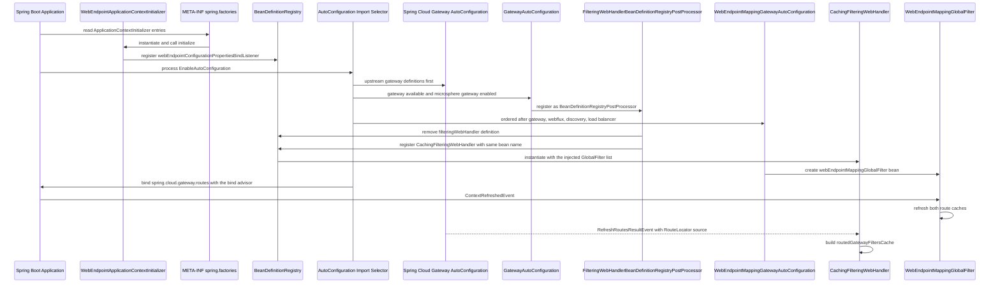
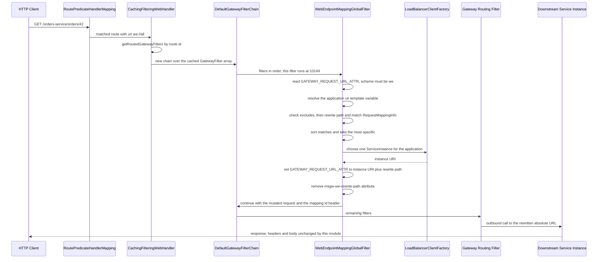
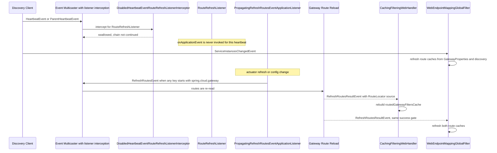
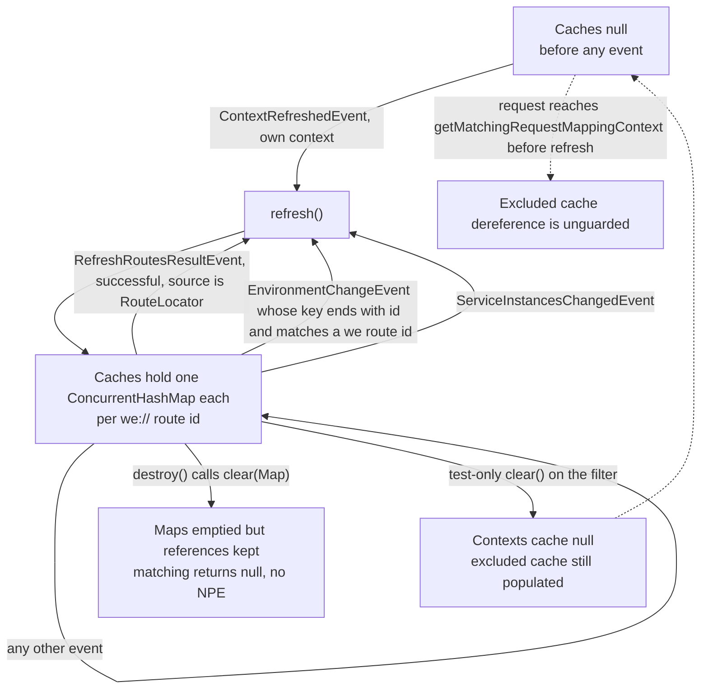
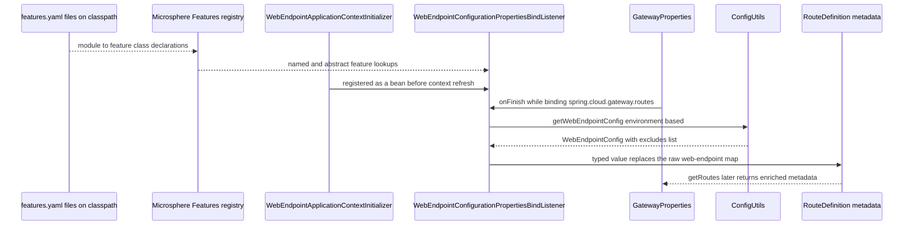

# `microsphere-spring-cloud-gateway-server-webflux`

Jar module of the `0.1.x` line (`release-1.x` branch). Coordinates
`io.github.microsphere-projects:microsphere-spring-cloud-gateway-server-webflux:${revision}` (`0.1.19-SNAPSHOT` in the
reactor, latest published release `0.1.18`). This is the only runtime module on the line: it contains every class that
touches a request. POM: `microsphere-spring-cloud-gateway-server-webflux/pom.xml`.

- [Guide index](README.md)
- [microsphere-spring-cloud-gateway-commons.md](microsphere-spring-cloud-gateway-commons.md)
- [microsphere-gateway-parent.md](microsphere-gateway-parent.md)
- [microsphere-gateway-dependencies.md](microsphere-gateway-dependencies.md)

## Architecture Design

### Role in the system

The module turns a Spring Cloud Gateway (WebFlux) instance into a discovery-driven gateway for Microsphere web endpoints.
A route such as

```yaml
spring:
  cloud:
    gateway:
      routes:
        - id: web-endpoint-mapping
          uri: we://all
          predicates:
            - Path=/{application}/**
          metadata:
            web-endpoint:
              excludes:
                - patterns: /internal/**
```

is matched by the ordinary Spring Cloud Gateway predicate machinery, and then this module's `GlobalFilter` replaces the
`we://all` request URL with a concrete `http://<instance>` URL derived from the service instance's published
`WebEndpointMapping` metadata.

Two cross-cutting optimisations sit around that filter:

- `CachingFilteringWebHandler` pre-computes, per route id, the ordered `GatewayFilter[]` that Spring Cloud Gateway would
  otherwise assemble for every request.
- The two event components (`DisabledHeartbeatEventRouteRefreshListenerInterceptor`,
  `PropagatingRefreshRoutesEventApplicationListener`) change *when* route data is re-read, so that discovery heartbeats no
  longer cause route refreshes while configuration changes still do.

### Package layout

```
microsphere-spring-cloud-gateway-server-webflux/src/main/java/io/microsphere/spring/cloud/gateway/server/webflux/
├── annotation/     ConditionalOnGatewayAvailable, ConditionalOnGatewayEnabled
├── autoconfigure/  GatewayAutoConfiguration, WebEndpointMappingGatewayAutoConfiguration
├── constants/      GatewayPropertyConstants
├── context/        WebEndpointApplicationContextInitializer
├── event/          DisabledHeartbeatEventRouteRefreshListenerInterceptor,
│                   PropagatingRefreshRoutesEventApplicationListener
├── filter/         DefaultGatewayFilterChain, WebEndpointMappingGlobalFilter
├── handler/        CachingFilteringWebHandler, FilteringWebHandlerBeanDefinitionRegistryPostProcessor
└── util/           GatewayUtils

microsphere-spring-cloud-gateway-server-webflux/src/main/resources/
├── META-INF/config/default/features.yaml
├── META-INF/spring.factories
└── META-INF/spring/org.springframework.boot.autoconfigure.AutoConfiguration.imports
```

### Auto-configuration hooks on this line

`META-INF/spring.factories` carries two keys:

```properties
org.springframework.boot.autoconfigure.EnableAutoConfiguration=\
io.microsphere.spring.cloud.gateway.server.webflux.autoconfigure.GatewayAutoConfiguration,\
io.microsphere.spring.cloud.gateway.server.webflux.autoconfigure.WebEndpointMappingGatewayAutoConfiguration

org.springframework.context.ApplicationContextInitializer=\
io.microsphere.spring.cloud.gateway.server.webflux.context.WebEndpointApplicationContextInitializer
```

`META-INF/spring/org.springframework.boot.autoconfigure.AutoConfiguration.imports` carries the same two
auto-configuration classes, one per line, and nothing else.

The duplication is intentional on a line whose profiles select Spring Boot `2.3.12.RELEASE`, `2.4.13` and `2.6.15` — all
of which discover auto-configurations from `spring.factories` — while `AutoConfiguration.imports` is the location used by
Spring Boot 2.7+ and 3.x (Spring framework behaviour, not something this repository can verify). Keeping both files means
one artifact works on both discovery mechanisms. The `ApplicationContextInitializer` key, however, only works through
`spring.factories`: there is no `AutoConfiguration.imports` equivalent for initializers, so removing `spring.factories`
from this module would silently break `WebEndpointApplicationContextInitializer`. That is the single most important
build-time invariant of this module's resources.

`microsphere-spring-cloud-gateway-commons` registers **no** auto-configuration; everything declarative lives here.

`META-INF/config/default/features.yaml` is the Microsphere feature registry (not a property source):

```yaml
microsphere:
  spring:
    cloud:
      features:
        abstract:
          microsphere-spring-cloud-gateway-server-webflux:
            - io.microsphere.spring.cloud.gateway.server.webflux.handler.CachingFilteringWebHandler
            - io.microsphere.spring.cloud.gateway.server.webflux.filter.WebEndpointMappingGlobalFilter
            - io.microsphere.spring.cloud.gateway.server.webflux.event.DisabledHeartbeatEventRouteRefreshListenerInterceptor
            - io.microsphere.spring.cloud.gateway.server.webflux.event.PropagatingRefreshRoutesEventApplicationListener
        named:
          microsphere-spring-cloud-gateway-server-webflux:
            - WebEndpointApplicationContextInitializer=io.microsphere.spring.cloud.gateway.server.webflux.context.WebEndpointApplicationContextInitializer
```

The four classes in `abstract` are the ones an application could replace or extend; the initializer, which is wired by
Spring Boot rather than by Microsphere, is registered under `named`.

### `@Conditional` evaluation order

Every guard in this module is composed of Spring Boot conditions; there is no custom `Condition` class.

`GatewayAutoConfiguration` requires, all at once:

1. `@ConditionalOnGatewayEnabled` → `spring.cloud.gateway.enabled` missing or `true` (inherited through
   `@ConditionalOnGatewayAvailable`)
2. `@ConditionalOnWebFluxAvailable` (from `microsphere-spring-boot-webflux`, inherited)
3. `@ConditionalOnClass(name = "org.springframework.cloud.gateway.config.GatewayProperties")` (inherited)
4. `@ConditionalOnMicrosphereGatewayEnabled` → `microsphere.spring.cloud.gateway.enabled` missing or `true`

`WebEndpointMappingGatewayAutoConfiguration` stacks, in addition to 1–4 (via `@ConditionalOnGatewayAvailable` and
`@ConditionalOnMicrosphereWebEndpointMappingEnabled`):

5. `@ConditionalOnDiscoveryEnabled` and `@ConditionalOnReactiveDiscoveryEnabled` (Spring Cloud Commons)
6. `@ConditionalOnClass(name = { "org.springframework.cloud.client.discovery.ReactiveDiscoveryClient",
   "org.springframework.cloud.loadbalancer.support.LoadBalancerClientFactory" })`
7. on the `@Bean` method: `@ConditionalOnEnabledGlobalFilter` (Spring Cloud Gateway's own "is this global filter enabled"
   condition) and `@ConditionalOnBean(value = { ReactiveDiscoveryClientAdapter.class, LoadBalancerClientFactory.class },
   search = CURRENT)`

Spring collects all reachable `@Conditional` meta-annotations and requires all of them to match, stopping at the first
failure; the order in which the collected conditions are tested is not defined. Two consequences that matter when editing:

- Because `@ConditionalOnClass` is used with `name = {...}` (string form) everywhere, these classes are safe to load even
  when Spring Cloud Gateway, Discovery or LoadBalancer are absent — the module's optional dependencies never cause
  `NoClassDefFoundError` at condition-evaluation time.
- `@ConditionalOnBean` on a `@Bean` method only sees beans whose definitions were **already** processed, which is why the
  class also declares a long `@AutoConfigureAfter` list (both by value and by name):

```java
@AutoConfigureAfter(
        value = {
                GatewayAutoConfiguration.class,
                WebFluxAutoConfiguration.class,
                ReactiveDiscoveryClientAutoConfiguration.class
        },
        name = {
                "org.springframework.cloud.gateway.config.GatewayAutoConfiguration",
                "org.springframework.cloud.loadbalancer.config.LoadBalancerAutoConfiguration",
                "org.springframework.cloud.client.discovery.composite.reactive.ReactiveCompositeDiscoveryClientAutoConfiguration"
        }
)
```

The `value` entries are Microsphere/own classes; the `name` entries are upstream classes referenced symbolically so that
this configuration still loads when those artifacts are missing. This "value for what we compile against, name for what we
only hope is there" split is the module's core ordering idiom.

### Bean-override strategy

The module never uses `@ConditionalOnMissingBean` (zero occurrences in the main sources of the whole repository) and never
asks for `spring.main.allow-bean-definition-overriding`. Instead it overrides upstream beans **structurally**:

- `FilteringWebHandlerBeanDefinitionRegistryPostProcessor` removes the existing `FilteringWebHandler` bean definition(s)
  and re-registers the same bean name(s) with `CachingFilteringWebHandler` as the bean class.
- `GatewayAutoConfiguration` `@Import`s that post-processor (plus the two event components), so the replacement travels
  with the auto-configuration and disappears whenever any guard above fails.
- Everything the module adds of its own (`webEndpointMappingGlobalFilter`) is a new bean name, not a redefinition.

The `WebEndpointConfigurationPropertiesBindListener` bean is registered even earlier, by the
`ApplicationContextInitializer`, under the fixed name `webEndpointConfigurationPropertiesBindListener`.

### Java 8 / `javax`-era constraints

- The build baseline is JDK 8, and the sources show it: no `var`, no `List.of`, no text blocks; `Stream.of` in one place
  only.
- There is no `jakarta.*` reference in the module; the validation model it consumes comes from
  `microsphere-spring-cloud-gateway-commons` via `javax.validation`.
- Reactive types are Reactor 3 (`Mono`, `Flux`) and the Spring 5 WebFlux API (`ServerWebExchange`,
  `org.springframework.web.reactive.result.method.RequestMappingInfo`). Using `RequestMappingInfo` — a *WebFlux* class —
  for matching is what pins this module to Spring 5 WebFlux and the `we://` matching semantics.
- The module supports Spring Cloud Gateway `2.2.9.RELEASE` (profile `spring-cloud-hoxton`) through `3.1.9`
  (profile `spring-cloud-2021`) — the versions selected by the release trains named in the parent POM. Any fix must
  therefore compile and behave against Boot 2.3/2.4/2.6 and Gateway 2.2/3.0/3.1 simultaneously.

## Source Analysis

### `constants.GatewayPropertyConstants`

`microsphere-spring-cloud-gateway-server-webflux/src/main/java/io/microsphere/spring/cloud/gateway/server/webflux/constants/GatewayPropertyConstants.java`

Two derived constants:

| Constant | Composition | Value |
|---|---|---|
| `GATEWAY_ENABLED_PROPERTY_NAME` | `GatewayProperties.PREFIX + DOT + ENABLED_PROPERTY_NAME` | `spring.cloud.gateway.enabled` |
| `GATEWAY_ROUTES_PROPERTY_NAME_PREFIX` | `GatewayProperties.PREFIX + DOT + "routes"` | `spring.cloud.gateway.routes` |

`PREFIX` is taken from Spring Cloud Gateway itself
(`org.springframework.cloud.gateway.config.GatewayProperties.PREFIX`), so the module follows upstream renames
automatically — but it also means this module's compile-time dependency on Gateway is not optional-free: the class is
imported directly, not by name string. `GatewayPropertyConstantsTest` asserts both compositions.

The `@ConfigurationProperty` annotation on `GATEWAY_ENABLED_PROPERTY_NAME` documents the switch as `boolean`, default
`"true"`, `APPLICATION_SOURCE`, for Microsphere's property metadata tooling.

### `annotation.ConditionalOnGatewayEnabled`

`…/webflux/annotation/ConditionalOnGatewayEnabled.java`

`@ConditionalOnProperty(name = GATEWAY_ENABLED_PROPERTY_NAME, matchIfMissing = true)`, `@Target({TYPE, METHOD})`,
`RUNTIME`, `@Documented`. It reuses the **upstream** property, so `spring.cloud.gateway.enabled=false` disables Microsphere
Gateway exactly as it disables Spring Cloud Gateway.

### `annotation.ConditionalOnGatewayAvailable`

`…/webflux/annotation/ConditionalOnGatewayAvailable.java`

Composition of three conditions — `@ConditionalOnGatewayEnabled`, `@ConditionalOnWebFluxAvailable` and
`@ConditionalOnClass(name = "org.springframework.cloud.gateway.config.GatewayProperties")` — with the Javadoc carrying
copy-and-paste usage examples for both a configuration class and a `@Bean` method. This annotation is the module's "am I
allowed to touch gateway types at all?" gate, and it is used on both auto-configuration classes.

### `autoconfigure.GatewayAutoConfiguration`

`…/webflux/autoconfigure/GatewayAutoConfiguration.java`

An empty-bodied `@Configuration(proxyBeanMethods = false)` that is purely a wiring declaration:

```java
@Configuration(proxyBeanMethods = false)
@ConditionalOnGatewayAvailable
@ConditionalOnMicrosphereGatewayEnabled
@EnableEventExtension
@AutoConfigureAfter(name = {
        "org.springframework.cloud.gateway.config.GatewayAutoConfiguration"
})
@Import(value = {
        DisabledHeartbeatEventRouteRefreshListenerInterceptor.class,
        PropagatingRefreshRoutesEventApplicationListener.class,
        FilteringWebHandlerBeanDefinitionRegistryPostProcessor.class
})
public class GatewayAutoConfiguration {
}
```

Notes a maintainer needs:

- `proxyBeanMethods = false` is applied consistently in this module; none of the two configuration classes express
  inter-bean method calls, so there is no reason to change it.
- `@EnableEventExtension` is what makes `ApplicationListenerInterceptor` implementations (the heartbeat interceptor) take
  part in event dispatch. Without it the interceptor bean would exist but never be consulted.
- The three imported classes are registered as beans, not as `@Bean` methods. `FilteringWebHandlerBeanDefinitionRegistryPostProcessor`
  is a `BeanDefinitionRegistryPostProcessor`, and it works because Spring runs all `postProcessBeanDefinitionRegistry`
  callbacks (including for post-processors registered by configuration classes) before the single
  `postProcessBeanFactory` phase — by which time upstream's `FilteringWebHandler` definition exists.
- `@AutoConfigureAfter` here is a *name* reference only, so nothing breaks if the upstream class is absent.

### `autoconfigure.WebEndpointMappingGatewayAutoConfiguration`

`…/webflux/autoconfigure/WebEndpointMappingGatewayAutoConfiguration.java`

One bean, heavily guarded:

```java
@Bean
@ConditionalOnEnabledGlobalFilter
@ConditionalOnBean(value = {ReactiveDiscoveryClientAdapter.class, LoadBalancerClientFactory.class}, search = CURRENT)
public WebEndpointMappingGlobalFilter webEndpointMappingGlobalFilter(ReactiveDiscoveryClientAdapter reactiveDiscoveryClient,
                                                                     LoadBalancerClientFactory loadBalancerClientFactory,
                                                                     GatewayProperties gatewayProperties) {
    return new WebEndpointMappingGlobalFilter(reactiveDiscoveryClient, loadBalancerClientFactory, gatewayProperties);
}
```

- `search = CURRENT` means the two required beans must be in this context, not in a parent context — relevant for tests
  and for applications using child contexts (e.g. LoadBalancer child contexts).
- The parameter type is Microsphere's `ReactiveDiscoveryClientAdapter` while the filter's constructor parameter type is
  Spring Cloud's `DiscoveryClient`; the adapter therefore satisfies the `DiscoveryClient` contract (compile-time fact).
  The adapter exists so that a *reactive* discovery client can serve the blocking lookups the filter performs.
- `GatewayProperties` is injected because the filter reads `getRoutes()` on every refresh.

### `context.WebEndpointApplicationContextInitializer`

`…/webflux/context/WebEndpointApplicationContextInitializer.java`

```java
public class WebEndpointApplicationContextInitializer extends ConfigurableApplicationContextInitializer {

    @Override
    protected void initialize(ConfigurableApplicationContext context, ConfigurableEnvironment environment) {
        ConfigurableListableBeanFactory beanFactory = context.getBeanFactory();
        BeanDefinitionRegistry registry = (BeanDefinitionRegistry) beanFactory;
        registerBeanDefinition(registry, BEAN_NAME,
                WebEndpointConfigurationPropertiesBindListener.class, GATEWAY_ROUTES_PROPERTY_NAME_PREFIX);
    }
}
```

Responsibility: make the route-metadata bind advisor exist **before** `GatewayProperties` is bound. A
`ConfigurationPropertiesBindHandlerAdvisor` bean can only influence binding if it is already in the bean factory when the
first `@ConfigurationProperties` object is bound, which is why this cannot be an auto-configuration.

Non-obvious behaviour worth flagging:

- It is registered through `spring.factories`, so it is **unconditional**: it runs even when
  `spring.cloud.gateway.enabled=false`, even when Spring Cloud Gateway is absent, and even when
  `microsphere.spring.cloud.gateway.enabled=false`. The registered bean is inert in those cases because
  `WebEndpointConfigurationPropertiesBindListener.onFinish` is name-gated to `spring.cloud.gateway.routes…metadata`.
- The `ConfigurableApplicationContextInitializer` base class (from `microsphere-spring-context`) supplies the
  `initialize(context, environment)` split; this subclass never uses `environment`.
- The cast `context.getBeanFactory()` → `BeanDefinitionRegistry` holds for every Spring Boot `ConfigurableApplicationContext`.
- It registers the class with one constructor argument (`spring.cloud.gateway.routes`), matching the listener's only
  public constructor, which asserts non-blankness.

### `event.DisabledHeartbeatEventRouteRefreshListenerInterceptor`

`…/webflux/event/DisabledHeartbeatEventRouteRefreshListenerInterceptor.java`

```java
if (INTERCEPTED_CLASS.equals(listenerClass) && matchesHeartbeatEvent(eventClass)) {
    logger.trace("The ApplicationListener[{}] with event[{}] is disabled", listenerClass, eventClass);
    return;
}
chain.intercept(applicationListener, event);
```

An `ApplicationListenerInterceptor` that swallows `HeartbeatEvent` and `ParentHeartbeatEvent` **only** when they are
addressed to `RouteRefreshListener`. Two exactness details are deliberate:

- `INTERCEPTED_CLASS.equals(listenerClass)` is an exact-class test, not `isAssignableFrom`: subclasses of
  `RouteRefreshListener` are not intercepted.
- `matchesHeartbeatEvent` compares with `equals` too, so a subclass of `HeartbeatEvent` still reaches
  `RouteRefreshListener`.

The purpose (stated in the class Javadoc: "to disable `RouteRefreshListener`' `HeartbeatEvent`") is to stop periodic
discovery heartbeats from triggering a full route refresh. This module does not need route refreshes on heartbeats:
`we://` routes resolve service instances lazily through `ServiceInstancesChangedEvent` and the load balancer, not through
`RouteDefinition` reloads. Invariant: the interceptor returns **without** calling `chain.intercept(...)` when it swallows,
so the listener is skipped entirely rather than being invoked with a filtered event.

### `event.PropagatingRefreshRoutesEventApplicationListener`

`…/webflux/event/PropagatingRefreshRoutesEventApplicationListener.java`

```java
public void onApplicationEvent(EnvironmentChangeEvent event) {
    Set<String> keys = event.getKeys();
    if (containsGatewayPropertyName(keys)) {
        context.publishEvent(new RefreshRoutesEvent(this));
    }
}
```

An observer that converts a Spring Cloud `EnvironmentChangeEvent` into a gateway `RefreshRoutesEvent` when any changed key
starts with `GatewayProperties.PREFIX` (`spring.cloud.gateway`). Notes:

- The test is `startsWith(key, PREFIX)`, i.e. **any** gateway property change — not only `routes` — triggers a route
  refresh (`spring.cloud.gateway.httpclient.*` included). Narrowing this to the routes prefix would be a behaviour change.
- The event source is `this` (the listener), and the class has a `ApplicationContext` constructor parameter, so it is
  registered as a bean by `@Import` and resolved by type.
- It is *not* filtered by the interceptor above, because the interceptor only matches `RouteRefreshListener`.
- This file is the only main source in the repository without the Apache License header — a `0.1.x`-safe cleanup.

### `filter.DefaultGatewayFilterChain`

`…/webflux/filter/DefaultGatewayFilterChain.java`

A chain-of-responsibility implementation of Spring Cloud Gateway's `GatewayFilterChain` over a fixed array:

```java
public Mono<Void> filter(ServerWebExchange exchange) {
    if (position < length) {
        GatewayFilter gatewayFilter = this.gatewayFilters[position++];
        return defer(() -> gatewayFilter.filter(exchange, this));
    }
    return empty();
}
```

- The constructor asserts a non-null array with no null elements; `new DefaultGatewayFilterChain()` with an empty vararg
  array is legal and yields an immediately-empty chain (`DefaultGatewayFilterChainTest` checks both).
- `position` is mutable and the instance is **single-use and not thread-safe**; a new chain must be created per request,
  which is exactly what `CachingFilteringWebHandler.handle` does. Calling `filter` twice on an exhausted chain returns
  `Mono.empty()` (`assertSame(empty(), ...)` in the test).
- `Mono.defer(...)` is the reactive detail that matters: the next filter is not invoked until the returned `Mono` is
  subscribed, so a filter that composes `chain.filter(exchange)` with `then(...)` still gets correct ordering, and the
  whole array is never walked eagerly.
- Empty `Mono<Void>` on completion is the "chain finished" signal; there is no "call next handler" concept here, which is
  why this class is only usable as the *filter* chain of a matched route.

### `filter.WebEndpointMappingGlobalFilter`

`…/webflux/filter/WebEndpointMappingGlobalFilter.java`

The heart of the module. One class wearing six contracts: `GlobalFilter`, `SmartApplicationListener`,
`ApplicationContextAware`, `EnvironmentAware`, `DisposableBean`, `Ordered`.

State:

```java
volatile Map<String, Collection<RequestMappingContext>> routedRequestMappingContextsCache = null;
volatile Map<String, Collection<RequestMappingInfo>> routedExcludedRequestMappingInfoCache = null;
```

Keyed by **route id**, holding per-route request-mapping knowledge derived from remote service metadata.

**`filter(ServerWebExchange, GatewayFilterChain)`** — the request path, in order:

1. Read `GATEWAY_REQUEST_URL_ATTR`; if the URI is not a `we` scheme (`isWebEndpointRoute`), pass through.
2. Read URI template variables; require the `application` variable (`CommonConstants.APPLICATION_NAME_URI_TEMPLATE_VARIABLE_NAME`);
   blank → pass through.
3. `getMatchingRequestMappingContext(applicationName, exchange)`; `null` → pass through.
4. `choose(applicationName)` for a load-balanced `ServiceInstance`; `null` → pass through.
5. On success: remove the `msgw-we-rewrite-path` attribute, build `targetURI = create(instanceUri + rewritePath)`, add the
   `WebEndpointMapping.ID_HEADER_NAME` header carrying the matched mapping id, write the new `GATEWAY_REQUEST_URL_ATTR`
   and continue the chain with the mutated request.

**`getMatchingRequestMappingContext(String applicationName, String routeId, ServerWebExchange exchange)`** — the matching
core (package-private so tests can call it directly):

- Exclusion check first, then a `null`-cache check, then a per-route lookup.
- `String rewritePath = substringAfter(path, SLASH_CHAR + applicationName);` — the first `/{application}` segment is
  stripped; the result is stashed in the exchange attribute and used to build a *temporary* mutated exchange for matching,
  so patterns are compared against the downstream path, not the gateway path.
- All candidate contexts are matched with `RequestMappingInfo.getMatchingCondition(exchange) != null`, collected, then
  `matchesRequestMappings.sort((v1, v2) -> v1.compareTo(v2, newExchange))` and `first(...)` wins — Spring's own
  most-specific-mapping comparator is reused rather than reimplemented.

**Cache building — `refresh()`:**

- `getWebEndpointRoutes()` filters `gatewayProperties.getRoutes()` down to `we` scheme URIs.
- For each such route: `buildRequestMappingContexts(routeUri)` (subscription list from `getSubscribedServices`) and
  `buildExcludedRequestMappingInfoSet(webEndpointRoutes, routeId)`.
- `getSubscribedServices(URI)`: host `all` → `discoveryClient.getServices()`; otherwise
  `commaDelimitedListToSet(host)` — which is what makes `we://orders-service,payments-service` work.
- Per subscribed service, **one** sample instance is chosen and its `WebEndpointMapping` collection (read from instance
  metadata via `ServiceInstanceUtils.getWebEndpointMappings`) becomes the whole route's mapping set.
- Both maps are built as fresh `ConcurrentHashMap`s and published inside `synchronized (this)`, so readers see either the
  old pair or the new pair, never a half-built one.

**Listener behaviour — `supportsEventType`/`onApplicationEvent`:** `ContextRefreshedEvent` (own context only, compared by
identity with `this.context`), `RefreshRoutesResultEvent` (only successful ones whose source is a `RouteLocator`, via
`GatewayUtils.isSuccessRouteLocatorEvent`), `EnvironmentChangeEvent` (own narrowing rule) and
`ServiceInstancesChangedEvent` (always refresh).

`matchesEvent(EnvironmentChangeEvent)` is the subtle one:

```java
if (key.startsWith(GATEWAY_ROUTES_PROPERTY_NAME_PREFIX)) {
    int lastIndex = key.lastIndexOf(ID_KEY);
    if (lastIndex == (key.length() - ID_KEY.length())) {
        String propertyValue = this.environment.getProperty(key);
        for (RouteDefinition route : routes) {
            if (route.getId().equals(propertyValue)) { return true; }
        }
    }
}
```

It refreshes only when a changed key *ends with* `id` under the routes prefix **and** its value equals the id of an
existing `we://` route. Editing, say, `spring.cloud.gateway.routes[0].metadata.web-endpoint.excludes[0].patterns` does not
match this rule by itself — the route reload path (upstream `GatewayPropertiesRefreshListener` → `RefreshRoutesEvent` →
`RefreshRoutesResultEvent`) is what covers it. Also note the guard `isEmpty(keys) ? emptyList() : getWebEndpointRoutes()`
which skips route enumeration for an empty event.

**Reactive and threading concerns:**

- `choose(String)` is **blocking**: `clientFactory.getInstance(...)`, then `getValue(mono)` on the load balancer's
  `Mono<Response<ServiceInstance>>`. It is used both on the request path (step 4) and inside `refresh()` for every
  subscribed service. Blocking inside a WebFlux filter is the module's largest architectural compromise; the class even
  declares `public boolean supportsAsyncExecution()` returning `false`. (*Inference:* no `@Override` is present and no
  other main source calls the method, so whether upstream treats it as an override depends on the Spring Cloud Gateway
  version — the module compiles against Gateway `2.2.9.RELEASE`–`3.1.9`.)
- `refresh()` is invoked from event dispatch threads; a refresh triggered by a discovery event therefore runs the
  blocking `choose()` loop for every service on that thread.
- The mutable maps are never cleared in place — `refresh()` swaps whole maps. `destroy()` calls the static
  `clear(Map)` helper, which **empties** the maps but keeps the (now empty) instances referenced, so after `destroy()` the
  caches are non-null and empty. The package-private `clear()` (used only by tests) instead sets
  `routedRequestMappingContextsCache = null`.
- `isExcludedRequest(...)` dereferences `routedExcludedRequestMappingInfoCache` without a null check, and it is evaluated
  before the `routedRequestMappingContexts == null` check. The two caches are therefore ordered: `ContextRefreshedEvent`
  must have fired before the first `we://` request reaches this filter, otherwise a `NullPointerException` is reachable in
  principle.
- `buildExcludedRequestMappingInfoSet` dereferences the config returned by `findWebEndpointConfig(...)`, which is `null`
  when a `we://` route has no typed `metadata.web-endpoint`. A `we://all` route without that metadata block is therefore a
  refresh-time failure path; every YAML fixture in this repository does declare `metadata.web-endpoint`, so the case is
  untested.

**Nested `RequestMappingContext`:** wraps a `RequestMappingInfo` plus the remote mapping `id`; two static builders — one
from a `WebEndpointConfig.Mapping` (exclusion rules, `RequestMethod.values()` when unset) and one from a
`WebEndpointMapping` (remote endpoint, `RequestMethod.valueOf(String)` over the published method names). `compareTo(other,
exchange)` delegates to `RequestMappingInfo.compareTo`, i.e. specificity ordering, not declaration order.

**`static String buildPath(ServiceInstance, URI)`** strips a leading `/<serviceId>/` and re-prefixes the instance's
`WEB_CONTEXT_PATH_METADATA_NAME` context path. It is **not** called from `filter(...)` or `refresh()`; its only caller in
the repository is `WebEndpointMappingGlobalFilterStaticTest`. Treat it as reserved/unused logic on this line — deleting it
is a visible API change (it is package-visible, so *not* public API), and wiring it into the rewrite path would change
target URIs for services with a non-root context path.

### `handler.CachingFilteringWebHandler`

`…/webflux/handler/CachingFilteringWebHandler.java`

Extends Spring Cloud Gateway's `FilteringWebHandler` and implements `DisposableBean`.

```java
@Override
public Mono<Void> handle(ServerWebExchange exchange) {
    Route route = exchange.getRequiredAttribute(GATEWAY_ROUTE_ATTR);
    GatewayFilter[] routedGatewayFilters = getRoutedGatewayFilters(route);
    return new DefaultGatewayFilterChain(routedGatewayFilters).filter(exchange);
}
```

- Constructor simply forwards `List<GlobalFilter>` to `super`, i.e. the same input the upstream handler receives; that is
  what makes the definition swap safe.
- `combineGatewayFilters(Route)` merges the parent's global filters with `route.getFilters()`, sorts with
  `AnnotationAwareOrderComparator.sort`, and copies into an array using the shared `EMPTY_FILTER_ARRAY`. The array is what
  is cached per route id.
- `globalFilters()` reads the superclass's **private** field `globalFilters` by name:
  `getFieldValue(true, this, "globalFilters")`. This is the module's single strongest coupling to upstream internals: a
  rename of that private field in a newer Spring Cloud Gateway breaks this class at runtime, and only a runtime break, not
  a compile error.
- Population is event-driven: `@EventListener(RefreshRoutesResultEvent.class)` +
  `GatewayUtils.isSuccessRouteLocatorEvent(event)`; the source is cast to `RouteLocator` and walked with
  `routeLocator.getRoutes().subscribe(route -> ...).dispose()`. That is an intentionally synchronous read of a `Flux` into
  a plain `HashMap`, which is then published through the `volatile routedGatewayFiltersCache` field.
  (*Inference:* if a `RouteLocator` emits asynchronously, the map can be published before all routes are present; no test
  in this repository exercises an asynchronous locator — `CachingFilteringWebHandlerTest` stubs `getRoutes()` with
  `Flux.empty()`.)
- `getRoutedGatewayFilters(Route)` returns `EMPTY_FILTER_ARRAY` when the cache is `null` or the route id is unknown.
  Combined with `DefaultGatewayFilterChain`, that means **a request to an uncached route executes no filters at all and
  completes as an empty `Mono<Void>`** until a successful route-locator refresh has populated the cache. This is the most
  important behavioural invariant in the module and is directly asserted by
  `assertSame(EMPTY_FILTER_ARRAY, this.webHandler.getRoutedGatewayFilters(null))`.
- `destroy()` clears the cache map, and `CachingFilteringWebHandlerTest` covers both the cleared and never-initialised
  paths, plus the failure path (`new RefreshRoutesResultEvent(routeLocator, throwable)` must not rebuild the cache).

### `handler.FilteringWebHandlerBeanDefinitionRegistryPostProcessor`

`…/webflux/handler/FilteringWebHandlerBeanDefinitionRegistryPostProcessor.java`

```java
@Override
public void postProcessBeanFactory(ConfigurableListableBeanFactory beanFactory) throws BeansException {
    BeanDefinitionRegistry registry = this.registry;
    String[] beanNames = beanFactory.getBeanNamesForType(FilteringWebHandler.class, false, false);
    for (String beanName : beanNames) {
        registry.removeBeanDefinition(beanName);
        registerBeanDefinition(registry, beanName, CachingFilteringWebHandler.class);
    }
}
```

- Decorator-by-substitution rather than decoration: the upstream bean is replaced by a subclass **under the same bean
  name**, so every existing injection point by type (`FilteringWebHandler`, `WebHandler`) keeps working and no overriding
  flag is needed.
- `getBeanNamesForType(FilteringWebHandler.class, false, false)` means *singleton bean definitions only, without eager
  initialization* — the safe form inside a bean-factory post-processor, because it resolves types from definitions rather
  than instantiating beans.
- `postProcessBeanDefinitionRegistry` only caches the registry; doing the work in `postProcessBeanFactory` guarantees all
  configuration classes (including upstream's) have already contributed their definitions.
- No constructor arguments are declared on the replacement definition; the `List<GlobalFilter>` dependency of the
  `CachingFilteringWebHandler` constructor must therefore be resolved by the container. *Inference:* this is exercised for
  real by `WebEndpointMappingGlobalFilterTest`, which boots an auto-configured gateway on a random port, so the resolution
  demonstrably works on the Spring versions this line supports.
- There is no guard against the definition being missing, so if Spring Cloud Gateway's auto-configuration did not run the
  loop simply does nothing — the whole feature degrades to plain upstream behaviour.

### `util.GatewayUtils`

`…/webflux/util/GatewayUtils.java`

`public abstract class GatewayUtils implements Utils` with a private constructor. Three methods:

- `getGatewayProperties(ConfigurableEnvironment)` — flattened properties under `spring.cloud.gateway` via Microsphere's
  `PropertySourcesUtils.getSubProperties`. No caller inside `src/main`; public API for users and tests.
- `getRouteProperties(ConfigurableEnvironment, String routeId)` — finds the property whose **value** equals the route id,
  derives its key prefix with `substringBeforeLast(propertyName, DOT)`, returns every property under that prefix as an
  `unmodifiableMap`, or `emptyMap()` when the id is absent. Non-obvious consequence: with several routes, the first match
  wins and a route id that is a substring-value of another property can mis-associate keys; `GatewayUtilsTest` covers the
  found case (`web-endpoint-mapping`), the not-found case (`web-endpoint-mapping-1`) and the empty-environment case.
- `isSuccessRouteLocatorEvent(RefreshRoutesResultEvent)` — `event != null && event.isSuccess() && source instanceof
  RouteLocator`. This is the shared gate used by both `CachingFilteringWebHandler` and `WebEndpointMappingGlobalFilter`,
  which is why the same event is interpreted identically in two places.

## Design Patterns

| Pattern | Location | Rationale | Benefit | Cost |
|---|---|---|---|---|
| Custom `Condition` meta-annotation composition | `annotation/ConditionalOnGatewayEnabled.java`, `annotation/ConditionalOnGatewayAvailable.java` | One name that means "gateway types exist and are enabled" | Auto-configuration classes read as intent; string-based `@ConditionalOnClass` keeps optional dependencies safe | AND-semantics are hidden in the annotation; debugging requires knowing the composed properties |
| `BeanDefinitionRegistryPostProcessor` bean replacement | `handler/FilteringWebHandlerBeanDefinitionRegistryPostProcessor.java` | Swap an upstream bean the application never declares without bean-override flags | Same name, same type hierarchy, transparent to all injection points | Depends on Spring's post-processor phases; no `@ConditionalOnMissingBean` safety net; breaks silently if the target bean is renamed upstream |
| Caching decorator around `FilteringWebHandler` | `handler/CachingFilteringWebHandler.java` + `filter/DefaultGatewayFilterChain.java` | Route→filter-list composition is per-request work in upstream; the inputs change only on refresh | Per-request allocation drops to one chain object over a pre-sorted array | Reflective read of a private upstream field; cache must be invalidated on every route change; cold cache means "no filters run" |
| Chain of responsibility over an array | `filter/DefaultGatewayFilterChain.java` | Execute a fixed, pre-sorted filter list without building a `List` each time | `Mono.defer` keeps execution lazy and order exact | Single-use, mutable, not thread-safe by design |
| Observer/listener with self-managed caches | `filter/WebEndpointMappingGlobalFilter.java` (`SmartApplicationListener`), `handler/CachingFilteringWebHandler.java` (`@EventListener`) | Both caches depend on route/discovery facts, not on request data | Refresh is push-based and cheap to read afterwards | Four different triggers with three different match rules; ordering assumptions (`ContextRefreshedEvent` first) |
| Chain interception for event suppression | `event/DisabledHeartbeatEventRouteRefreshListenerInterceptor.java` | Remove an upstream listener's reaction to one event without replacing the listener | Targeted, reversible, and no upstream fork needed | Exact-class matching silently misses subclasses; depends on `@EnableEventExtension` |
| Observer with property-name filtering | `event/PropagatingRefreshRoutesEventApplicationListener.java` | Spring Cloud config refresh does not publish `RefreshRoutesEvent` for gateway keys by itself | Editing `spring.cloud.gateway.*` at runtime reloads routes | Prefix-only test refreshes routes for non-route gateway changes |
| Configuration-resolution helper | `util.GatewayUtils.java` + commons `ConfigUtils` | Property flattening and event classification repeated across classes | Single implementation of `isSuccessRouteLocatorEvent` | Two "Utils" classes with methods that are only used by tests |
| Blocking adaptation of a reactive API | `filter.WebEndpointMappingGlobalFilter.choose(...)` | Route/mapping building happens in listener code where a `Mono` is awkward | Simple, synchronous cache construction | Blocks a reactive thread on the request path; assumes one instance's metadata represents the service |

## Complex Flows

### Startup, auto-configuration and route initialisation



### Request lifecycle of a `we://` route



The two failure exits are silent pass-throughs: if the scheme is not `we`, if the `{application}` variable is blank, if no
mapping matches, or if no instance can be chosen, the filter calls `chain.filter(exchange)` with the exchange untouched.

### Refresh-event propagation and heartbeat suppression



### Route-cache population and invalidation



For the handler-side cache the same shape applies with different triggers: `null` → `EMPTY_FILTER_ARRAY` per request, and
only a successful `RefreshRoutesResultEvent` whose source is a `RouteLocator` ever assigns a map.

### `features.yaml` declaration versus configuration binding



*Reading note:* `features.yaml` does not supply property defaults; it declares the feature classes of the module. The
route-metadata defaults come from the user's own `spring.cloud.gateway.routes…metadata.web-endpoint` tree, and the only
built-in default is inside `WebEndpointConfig` itself (an empty `excludes` list, and `RequestMethod.values()` for an
exclusion without methods).

## Module Dependency Graph

```mermaid
flowchart TD
    subgraph reactor["Microsphere Gateway 0.1.x reactor"]
        ROOT["microsphere-gateway (pom, root aggregator)"]
        PARENT["microsphere-gateway-parent (pom)"]
        BOM["microsphere-gateway-dependencies (BOM, pom)"]
        COMMONS["microsphere-spring-cloud-gateway-commons (jar)"]
        WEBFLUX["microsphere-spring-cloud-gateway-server-webflux (jar)"]
    end

    subgraph microsphere["Microsphere artifacts"]
        MSCP["microsphere-spring-cloud-parent 0.1.26"]
        MSCD["microsphere-spring-cloud-dependencies 0.1.26"]
        MSBOOT["microsphere-spring-boot-dependencies 0.1.34"]
        MSCC["microsphere-spring-cloud-commons"]
        MSBW["microsphere-spring-boot-webflux"]
        MSAP["microsphere-annotation-processor"]
        MSBT["microsphere-spring-boot-test"]
    end

    subgraph spring["Spring and Bean Validation artifacts"]
        SBA["spring-boot-starter"]
        SBACT["spring-boot-starter-actuator"]
        SBWF["spring-boot-starter-webflux"]
        SBCP["spring-boot-configuration-processor"]
        SBAP["spring-boot-autoconfigure-processor"]
        SCGW["spring-cloud-starter-gateway"]
        SCCC["spring-cloud-commons"]
        SCLB["spring-cloud-loadbalancer"]
        SPW["spring-web"]
        JVA["javax.validation validation-api"]
        JUP["junit-jupiter"]
        HVAL["hibernate-validator"]
    end

    ROOT -->|"parent"| MSCP
    MSBOOT -->|"imported by"| MSCP
    MSCD -->|"BOM import"| PARENT
    ROOT -->|"aggregates"| PARENT
    ROOT -->|"aggregates"| BOM
    ROOT -->|"aggregates"| COMMONS
    ROOT -->|"aggregates"| WEBFLUX
    PARENT -->|"parent"| BOM
    PARENT -->|"parent"| COMMONS
    PARENT -->|"parent"| WEBFLUX
    BOM -.->|"manages version of"| COMMONS
    BOM -.->|"manages version of"| WEBFLUX
    COMMONS -->|"optional"| MSAP
    COMMONS -->|"optional"| MSCC
    COMMONS -->|"optional"| SBA
    COMMONS -->|"optional"| SBACT
    COMMONS -->|"optional"| SBCP
    COMMONS -->|"optional"| SBAP
    COMMONS -->|"optional"| SCCC
    COMMONS -->|"optional"| SCLB
    COMMONS -->|"optional"| SPW
    COMMONS -->|"optional"| JVA
    COMMONS -->|"test"| MSBT
    COMMONS -->|"test"| JUP
    COMMONS -->|"test"| HVAL
    WEBFLUX -->|"compile"| COMMONS
    WEBFLUX -->|"optional"| MSAP
    WEBFLUX -->|"optional"| MSCC
    WEBFLUX -->|"optional"| MSBW
    WEBFLUX -->|"optional"| SCGW
    WEBFLUX -->|"optional"| SCCC
    WEBFLUX -->|"optional"| SCLB
    WEBFLUX -->|"optional"| SBWF
    WEBFLUX -->|"optional"| SBA
    WEBFLUX -->|"optional"| SBACT
    WEBFLUX -->|"optional"| SBCP
    WEBFLUX -->|"optional"| SBAP
    WEBFLUX -->|"test"| JUP
    WEBFLUX -->|"compile scope, test library"| MSBT
```



POM-level facts behind the graph: `microsphere-spring-cloud-gateway-commons` is the module's only non-optional compile
dependency (`<version>${revision}</version>`), every Spring/Microsphere integration dependency is
`<optional>true</optional>`, and `io.github.microsphere-projects:microsphere-spring-boot-test` is declared **without a
scope**, so it resolves to `compile` — unlike in the commons module, where the same artifact is `<scope>test</scope>`.
That is a published-artifact defect (a test library on consumers' classpath), and `junit-jupiter` and
`spring-boot-starter-test` are the only test-scoped entries here.

## Building and Testing This Module

```bash
# the module alone, default Spring Cloud profile
./mvnw test -pl microsphere-spring-cloud-gateway-server-webflux -Ptest,spring-cloud-2021

# the other matrix legs, all of which must stay green
./mvnw test -pl microsphere-spring-cloud-gateway-server-webflux -Ptest,spring-cloud-2020
./mvnw test -pl microsphere-spring-cloud-gateway-server-webflux -Ptest,spring-cloud-hoxton

# the exact CI invocation for one leg
mvn --batch-mode --update-snapshots --file pom.xml -Drevision=0.0.1-SNAPSHOT test \
  --activate-profiles test,coverage,spring-cloud-2021

# one test class
./mvnw test -pl microsphere-spring-cloud-gateway-server-webflux -Ptest -Dtest=WebEndpointMappingGlobalFilterTest
```

What each test class proves:

| Test | Coverage |
|---|---|
| `GatewayAutoConfigurationTest` | extends Microsphere's `ReactiveWebAutoConfigurationTest`; asserts the imported classes (`DisabledHeartbeatEventRouteRefreshListenerInterceptor`, `PropagatingRefreshRoutesEventApplicationListener`, `FilteringWebHandlerBeanDefinitionRegistryPostProcessor`) appear only when the guards pass, and disappear under `spring.cloud.gateway.enabled=false`, `microsphere.spring.cloud.gateway.enabled=false`, `microsphere.spring.boot.webflux.enabled=false` or when `Flux`, `HandlerMethod`, `DispatcherHandler`, `HandlerMethodInterceptor`, `EnableWebFluxExtension`, `GatewayProperties` are missing |
| `WebEndpointMappingGatewayAutoConfigurationTest` | the same harness for the filter bean, adding `spring.cloud.discovery.reactive.enabled=false` and `microsphere.spring.cloud.web-endpoint-mapping.enabled=false`, and missing `ReactiveDiscoveryClient` / `LoadBalancerClientFactory` / `WebClient` |
| `WebEndpointMappingGatewayAutoConfigurationIntegrationTest` | boots a real `RANDOM_PORT` reactive context, calls the filter with `MockServerWebExchange`, asserts `getOrder() == 10149`, and exercises `destroy()` plus both the success and failure `RefreshRoutesResultEvent` paths |
| `WebEndpointMappingGlobalFilterTest` | the end-to-end path with `@SpringBootTest` on profiles `simple-service-registry,gateway`: `/test-app/test/helloworld` resolves, `/test-1/…`, `/test-2/…` and the `consumes`/`produces` case `/test-3/abc/def` pass through exclusion rules, `ServiceInstancesChangedEvent` and `EnvironmentChangeEvent` trigger refreshes, an unregistered application and a cleared cache both degrade, and `getSubscribedServices(we://test-app)` returns exactly one service |
| `WebEndpointMappingGlobalFilterStaticTest` | `buildPath` with and without the `web-context-path` instance metadata |
| `DefaultGatewayFilterChainTest` | empty chain, null-element rejection, exhaustion returns `Mono.empty()` |
| `CachingFilteringWebHandlerTest` | cold cache returns `EMPTY_FILTER_ARRAY`; `destroy()` with and without prior population; failed refresh events do not rebuild |
| `DisabledHeartbeatEventRouteRefreshListenerInterceptorTest` | with `@EnableEventExtension`, `HeartbeatEvent`/`ParentHeartbeatEvent` are swallowed for `RouteRefreshListener` while an unrelated payload event still reaches its listener |
| `PropagatingRefreshRoutesEventApplicationListenerTest` | an `EnvironmentChangeEvent` containing a `spring.cloud.gateway`-prefixed key publishes `RefreshRoutesEvent` whose source is the listener; an unrelated key publishes nothing |
| `GatewayUtilsTest` | flattened gateway properties, per-route property lookup (found and not found), `isSuccessRouteLocatorEvent` over `null`, wrong source and failure cases |
| `GatewayPropertyConstantsTest` | the two derived property names |
| `NoOpGatewayFilter` | not a test: the chain fixture used by the two filter tests |

Fixtures: `microsphere-spring-cloud-gateway-server-webflux/src/test/resources/META-INF/config/default/test.yaml`
declares `spring.application.name: test-app`, disables nacos/zookeeper/consul/kubernetes/eureka by default, and provides
`gateway`, `simple-service-registry`, `nacos`, `eureka`, `zookeeper`, `consul`, `kubernetes` profiles. The `gateway`
profile contains the `we://all` route with three exclusion entries, which is why `WebEndpointMappingGlobalFilterTest` can
assert both routing and exclusion in one context.

## Maintenance Notes for `0.1.x`

Safe on this line:

- Null-safety and defensive reads, e.g. a `null` check before the excluded-cache dereference, a default
  `WebEndpointConfig` when `metadata.web-endpoint` is absent, or an `instanceof Map` guard in the commons bind listener.
- Restoring the Apache License header on `PropagatingRefreshRoutesEventApplicationListener.java`.
- Removing the compile-scope `microsphere-spring-boot-test` dependency from this module's POM (or setting it to
  `test`), which is a packaging bug with no behavioural impact.
- Extra trace logging, extra tests, and Javadoc; adding guards so that a missing upstream bean makes the module a no-op.
- Fixing the `globalFilters` reflection only in a backwards-compatible way (e.g. try the new upstream accessor first) so
  Gateway `2.2.9.RELEASE`–`3.1.9` all keep working.

Belongs to `0.2.x` — see [../../current/developer-guide/README.md](../../current/developer-guide/README.md):

- Removing the blocking `choose()` from the request path, i.e. making cache construction fully reactive.
- Changing the filter order (`10149`), the `we` scheme, the `{application}` variable name, the
  `msgw-we-rewrite-path` attribute or the `WebEndpointMapping.ID_HEADER_NAME` header injection — all of them are visible
  to users and to downstream services.
- Any Jakarta/Boot 3 work, and any change that assumes a servlet (`webmvc`) gateway module, which does not exist on this
  line.
- Replacing `CachingFilteringWebHandler`'s private-field reflection with a fork or a decorator is an architectural change;
  on `0.1.x` keep the extension and document the coupling.

Known couplings to watch when touching this module:

1. Upstream private field `globalFilters` in `FilteringWebHandler`.
2. `ReactiveLoadBalancerClientFilter`'s order constant, duplicated as `LOAD_BALANCER_CLIENT_FILTER_ORDER = 10150` here.
3. `GatewayProperties.PREFIX`, `RouteDefinition`/`Route.getFilters()`, `RefreshRoutesEvent` and `RefreshRoutesResultEvent`
   shapes across Gateway `2.2.9.RELEASE`, `3.0.6` and `3.1.9` (the versions selected by the three CI profiles).
4. Microsphere `WebEndpointMapping`, `ServiceInstanceUtils.getWebEndpointMappings`, `ReactiveDiscoveryClientAdapter`,
   `BindListener`, `BeanRegistrar`, `ApplicationListenerInterceptor` and `ConfigurableApplicationContextInitializer`, all
   consumed through optional dependencies.

Related documents: [README.md](README.md),
[microsphere-spring-cloud-gateway-commons.md](microsphere-spring-cloud-gateway-commons.md),
[microsphere-gateway-parent.md](microsphere-gateway-parent.md),
[microsphere-gateway-dependencies.md](microsphere-gateway-dependencies.md),
[repo root README](../../../README.md).

## 中文

[zh/microsphere-spring-cloud-gateway-server-webflux.md](zh/microsphere-spring-cloud-gateway-server-webflux.md)
