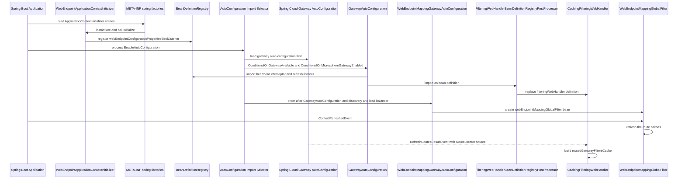

# 开发者指南 —— `0.1.x` 维护版本线

本指南描述 **Microsphere Gateway** 在 `release-1.x` 分支上的维护版本线：`0.1.x` 版本线，Maven `revision` =
`0.1.19-SNAPSHOT`，最新已发布版本 `0.1.18`。指南内容仅覆盖 `release-1.x` 分支。

| 事实 | 取值 |
|---|---|
| 分支 | `release-1.x` |
| 版本线 | `0.1.x` |
| Maven `revision` | `0.1.19-SNAPSHOT`（根 `pom.xml`） |
| 最新已发布版本 | `0.1.18` |
| Group id | `io.github.microsphere-projects` |
| Java 基线 | JDK 8（`maven.compiler.source`/`target` 由构建根 POM 继承而来） |
| CI 矩阵 | Java `8`、`11`、`17`、`21`、`25` × profile `spring-cloud-hoxton`、`spring-cloud-2020`、`spring-cloud-2021` |
| 父级继承链 | `microsphere-gateway` → `microsphere-spring-cloud-parent:0.1.26` |
| 模块 | `microsphere-gateway-parent`、`microsphere-gateway-dependencies`、`microsphere-spring-cloud-gateway-commons`、`microsphere-spring-cloud-gateway-server-webflux` |

本版本线上**没有** `microsphere-spring-cloud-gateway-server-webmvc` 模块——上述四个模块就是完整的 reactor（见
`pom.xml` 的 `<modules>`）。Servlet 网关支持属于当前版本线，参见
[../../../current/developer-guide/README.md](../../../current/developer-guide/README.md)。

## 文档索引

| 文档 | 主题 |
|---|---|
| [README.md](../README.md) | 本索引：范围、架构总览、构建与测试入口、版本线维护规则 |
| [microsphere-gateway-parent.md](../microsphere-gateway-parent.md) | 父 POM 的构建架构：`${revision}`、BOM 导入链、profile 与插件继承 |
| [microsphere-gateway-dependencies.md](../microsphere-gateway-dependencies.md) | 已发布 BOM 的构建架构以及版本在 reactor 中的传播 |
| [microsphere-spring-cloud-gateway-commons.md](../microsphere-spring-cloud-gateway-commons.md) | Commons 模块：条件注解、`WebEndpointConfig`、`ConfigUtils`、绑定监听器、常量 |
| [microsphere-spring-cloud-gateway-server-webflux.md](../microsphere-spring-cloud-gateway-server-webflux.md) | WebFlux 模块：自动配置、`we://` 过滤器、带缓存的 `FilteringWebHandler`、刷新事件 |

如需从使用者视角了解运行时行为与配置，请阅读同级的
[使用者指南](../../user-guide/README.md)。

## 架构总览

`0.1.x` 版本线在 Spring Cloud Gateway 之上只加入了一个思想：URI 使用自定义 `we` scheme 的路由
（`uri: we://all`、`uri: we://orders-service,payments-service`）在请求期通过已发现服务实例发布的 web endpoint
元数据进行解析，而不是一开始就绑定静态的 path/URI。代码库中其余部分都围绕这一思想服务：

- `microsphere-spring-cloud-gateway-commons` 拥有词汇表（`RouteConstants.SCHEME`、`web-endpoint` 元数据键、rewrite-path
  的 exchange 属性名）、总开关注解，以及 `spring.cloud.gateway.routes[n].metadata.web-endpoint` 的强类型配置模型和把它
  真正物化出来的绑定逻辑。
- `microsphere-spring-cloud-gateway-server-webflux` 拥有响应式集成：两个自动配置类、执行 rewrite 与匹配的
  `GlobalFilter`、对 Spring Cloud Gateway `FilteringWebHandler` 的带缓存替代实现，以及两个控制"何时重新读取路由"的事件
  组件。

启动期的装配发生在三个纯声明式的位置：
`microsphere-spring-cloud-gateway-server-webflux/src/main/resources/META-INF/spring.factories`（自动配置类加
`ApplicationContextInitializer`）、
`microsphere-spring-cloud-gateway-server-webflux/src/main/resources/META-INF/spring/org.springframework.boot.autoconfigure.AutoConfiguration.imports`
（同样两个自动配置类在新版 Boot 的位置）以及两个 jar 模块中的
`META-INF/config/default/features.yaml`（Microsphere 的 feature 声明注册表）。

## 模块依赖图

下面这张图在本指南的每篇文档中重复出现。实线表示 parent/aggregator/compile 关系，虚线表示依赖管理。`optional` 标记

```mermaid
flowchart TD
    subgraph reactor["Microsphere Gateway 0.1.x reactor"]
        ROOT["microsphere-gateway (pom, root aggregator)"]
        PARENT["microsphere-gateway-parent (pom)"]
        BOM["microsphere-gateway-dependencies (BOM, pom)"]
        COMMONS["microsphere-spring-cloud-gateway-commons (jar)"]
        WEBFLUX["microsphere-spring-cloud-gateway-server-webflux (jar)"]
    end

    subgraph microsphere["Microsphere artifacts"]
        MSCP["microsphere-spring-cloud-parent 0.1.26"]
        MSCD["microsphere-spring-cloud-dependencies 0.1.26"]
        MSBOOT["microsphere-spring-boot-dependencies 0.1.34"]
        MSCC["microsphere-spring-cloud-commons"]
        MSBW["microsphere-spring-boot-webflux"]
        MSAP["microsphere-annotation-processor"]
        MSBT["microsphere-spring-boot-test"]
    end

    subgraph spring["Spring and Bean Validation artifacts"]
        SBA["spring-boot-starter"]
        SBACT["spring-boot-starter-actuator"]
        SBWF["spring-boot-starter-webflux"]
        SBCP["spring-boot-configuration-processor"]
        SBAP["spring-boot-autoconfigure-processor"]
        SCGW["spring-cloud-starter-gateway"]
        SCCC["spring-cloud-commons"]
        SCLB["spring-cloud-loadbalancer"]
        SPW["spring-web"]
        JVA["javax.validation validation-api"]
        JUP["junit-jupiter"]
        HVAL["hibernate-validator"]
    end

    ROOT -->|"parent"| MSCP
    MSBOOT -->|"imported by"| MSCP
    MSCD -->|"BOM import"| PARENT
    ROOT -->|"aggregates"| PARENT
    ROOT -->|"aggregates"| BOM
    ROOT -->|"aggregates"| COMMONS
    ROOT -->|"aggregates"| WEBFLUX
    PARENT -->|"parent"| BOM
    PARENT -->|"parent"| COMMONS
    PARENT -->|"parent"| WEBFLUX
    BOM -.->|"manages version of"| COMMONS
    BOM -.->|"manages version of"| WEBFLUX
    COMMONS -->|"optional"| MSAP
    COMMONS -->|"optional"| MSCC
    COMMONS -->|"optional"| SBA
    COMMONS -->|"optional"| SBACT
    COMMONS -->|"optional"| SBCP
    COMMONS -->|"optional"| SBAP
    COMMONS -->|"optional"| SCCC
    COMMONS -->|"optional"| SCLB
    COMMONS -->|"optional"| SPW
    COMMONS -->|"optional"| JVA
    COMMONS -->|"test"| MSBT
    COMMONS -->|"test"| JUP
    COMMONS -->|"test"| HVAL
    WEBFLUX -->|"compile"| COMMONS
    WEBFLUX -->|"optional"| MSAP
    WEBFLUX -->|"optional"| MSCC
    WEBFLUX -->|"optional"| MSBW
    WEBFLUX -->|"optional"| SCGW
    WEBFLUX -->|"optional"| SCCC
    WEBFLUX -->|"optional"| SCLB
    WEBFLUX -->|"optional"| SBWF
    WEBFLUX -->|"optional"| SBA
    WEBFLUX -->|"optional"| SBACT
    WEBFLUX -->|"optional"| SBCP
    WEBFLUX -->|"optional"| SBAP
    WEBFLUX -->|"test"| JUP
    WEBFLUX -->|"compile scope, test library"| MSBT
```

Maven `<optional>true</optional>` 依赖——在本版本线上这是常态，因此使用者必须自带 Spring Boot/Spring Cloud classpath。



## 启动、自动配置与路由初始化



这个顺序是靠注解保证的，而不是碰运气：`GatewayAutoConfiguration` 标注了
`@AutoConfigureAfter(name = "org.springframework.cloud.gateway.config.GatewayAutoConfiguration")`，而
`FilteringWebHandlerBeanDefinitionRegistryPostProcessor` 作为 `BeanDefinitionRegistryPostProcessor` 运行，早在任何
`FilteringWebHandler` 被实例化之前完成替换。`WebEndpointApplicationContextInitializer` 在上下文 refresh 之前运行，因此
`GatewayProperties` 绑定时已经处于 `WebEndpointConfigurationPropertiesBindListener` 的增强之下。

## 构建与测试本版本线

前置条件：JDK 8 或更高版本，Maven 3.9+（`.mvn/wrapper/maven-wrapper.properties` 指定 Apache Maven `3.9.15`，wrapper
版本 `3.3.4`，`distributionType=only-script`），或仓库内的 `mvnw`/`mvnw.cmd`。

```bash
# full reactor, default Spring Cloud profile
./mvnw package

# unit and integration tests with the build-conventions profiles enabled
./mvnw test -Ptest,spring-cloud-2021

# the exact CI combination for one leg of the matrix
mvn --batch-mode --update-snapshots --file pom.xml -Drevision=0.0.1-SNAPSHOT test \
  --activate-profiles test,coverage,spring-cloud-2021

# a single module
./mvnw test -pl microsphere-spring-cloud-gateway-commons -Ptest,spring-cloud-2021
```

本版本线上需要关注的 Maven profile：

| Profile | 作用 |
|---|---|
| `spring-cloud-hoxton` | Spring Boot `2.3.12.RELEASE`、Spring Cloud `Hoxton.SR12`、Spring Cloud Alibaba `2.2.10` |
| `spring-cloud-2020` | Spring Boot `2.4.13`、Spring Cloud `2020.0.5`、Spring Cloud Alibaba `2021.1` |
| `spring-cloud-2021` | Spring Boot `2.6.15`、Spring Cloud `2021.0.9`、Spring Cloud Alibaba `2021.0.6.1` —— `activeByDefault` |
| `test` | 激活 `maven-surefire-plugin`、`maven-failsafe-plugin` 与 `maven-checkstyle-plugin` |
| `coverage` | 激活 `jacoco-maven-plugin` |
| `ci`、`publish`、`release` | `.github/workflows/maven-publish.yml` 使用的部署/签名路径 |
| `testcontainers` | 设置 surefire 系统属性 `testcontainers.enabled` |

上述 Spring Cloud 版本属性位于被继承的 `microsphere-spring-cloud-parent:0.1.26` POM 中，而不在本仓库里；见
[microsphere-gateway-parent.md](../microsphere-gateway-parent.md)。

`.github/workflows/maven-build.yml` 会在推送到 `dev-1.x` 以及针对 `dev-1.x` 或 `release-1.x` 的 pull request 上，以
Java 8/11/17/21/25 × hoxton/2020/2021 矩阵执行 `mvn … -Drevision=0.0.1-SNAPSHOT test --activate-profiles
test,coverage,<spring-cloud profile>`，随后把覆盖率上传到 Codecov。

本版本线上的测试类（全部取自源码，未虚构）：

- `microsphere-spring-cloud-gateway-commons`：`ConditionalOnMicrosphereGatewayEnabledTest`、
  `ConditionalOnMicrosphereWebEndpointMappingEnabledTest`、`ConfigUtilsTest`、
  `WebEndpointConfigurationPropertiesBindListenerTest`、`CommonConstantsTest`、`CommonsPropertyConstantsTest`、
  `RouteConstantsTest`，由 `microsphere-spring-cloud-gateway-commons/src/test/resources/META-INF/config/default/test.yaml`
  提供数据。
- `microsphere-spring-cloud-gateway-server-webflux`：`GatewayAutoConfigurationTest`、
  `WebEndpointMappingGatewayAutoConfigurationTest`、`WebEndpointMappingGatewayAutoConfigurationIntegrationTest`、
  `WebEndpointMappingGlobalFilterTest`、`WebEndpointMappingGlobalFilterStaticTest`、`DefaultGatewayFilterChainTest`、
  `CachingFilteringWebHandlerTest`、`DisabledHeartbeatEventRouteRefreshListenerInterceptorTest`、
  `PropagatingRefreshRoutesEventApplicationListenerTest`、`GatewayPropertyConstantsTest`、`GatewayUtilsTest`，外加辅助类
  `NoOpGatewayFilter`，由
  `microsphere-spring-cloud-gateway-server-webflux/src/test/resources/META-INF/config/default/test.yaml` 提供数据
  （profile：`gateway`、`simple-service-registry`、nacos/eureka/zookeeper/consul/kubernetes）。

注意：本分支上的 `CONTRIBUTING.md` 写着 "targets Java 17+"，并引用了一个 `spring-cloud-2025` profile。该文字是从其它分支
合并而来的，并不描述本分支；此处应以 POM 与 `maven-build.yml` 为准（JDK 8 基线，hoxton/2020/2021 profile）。修正
`CONTRIBUTING.md` 本身就是 `0.1.x` 上合理的文档变更。

## `0.1.x` 版本线的维护规则

适合放在 `0.1.x`（保持行为不变或修 bug）：

- 本指南所列类内部的修复——例如给 `routedExcludedRequestMappingInfoCache` 加空值保护，或删除未被使用的
  `WebEndpointMappingGlobalFilter.buildPath`。
- 不改变现有用户所解析到的 Spring Boot/Spring Cloud 版本的 POM 治理，例如去掉 WebFlux 模块里意外以 compile scope 引入的
  `microsphere-spring-boot-test`。
- 文档、测试、Javadoc 与 `@ConfigurationProperty` 元数据。
- 以二进制兼容的方式新增 optional 依赖、常量或条件注解。

应当交给 `0.2.x`：

- 一切需要 Jakarta EE（`jakarta.*`）的改动：本版本线通过 `javax.validation` 绑定校验
  （`microsphere-spring-cloud-gateway-commons/src/main/java/io/microsphere/spring/cloud/gateway/commons/config/WebEndpointConfig.java`），
  且其 profile 能到达的最高 Boot 版本是 `2.6.15`。
- 需要 servlet/WebMVC 网关模块的改动，本版本线不存在该模块。
- 改变过滤器顺序（`10149`）、`we` scheme、`msgw-we-rewrite-path` 属性名、`microsphere.spring.cloud.gateway.*` 属性名，或
  `metadata.web-endpoint` 结构的改动——用户已经在配置这些值。
- 去掉 `WebEndpointMappingGlobalFilter.filter(...)` 中的阻塞 `choose()` 属于对响应式契约的架构级改动，除非能证明在本版本线
  上做同样安全，否则应放到当前版本线。

本版本线的发布是自动化的：`.github/workflows/maven-publish.yml` 由推送到 `release-1.x` 或 `workflow_dispatch` 触发，校验
`major.minor.patch` 输入，使用 `./mvnw … -Drevision=<input> -Dgpg.skip=true deploy --activate-profiles publish,ci` 发布，
为该版本打 tag，把生成的说明追加到 `release-notes.md`，把根 `pom.xml` 的 `<revision>` 属性改写为下一个 `-SNAPSHOT`
patch，并把 `release-1.x` 合并进 `dev-1.x`。功能 PR 不要手工改版本号——版本号由该 workflow 负责。

## 本指南的写作约定

- 源码引用一律使用仓库相对路径，例如
  `microsphere-spring-cloud-gateway-server-webflux/src/main/java/io/microsphere/spring/cloud/gateway/server/webflux/handler/CachingFilteringWebHandler.java`。
- 每条结论都取自 `release-1.x` 快照；属于推理而非代码事实的地方会明确标注 *推理*。
- Mermaid 标签中只要包含 `:`、`//`、`()`、`,`、`{}` 或版本号都会加引号，以保证图可渲染。
- 产品级总览见 [仓库根 README](../../../../README.md)。

## English

[../README.md](../README.md)
