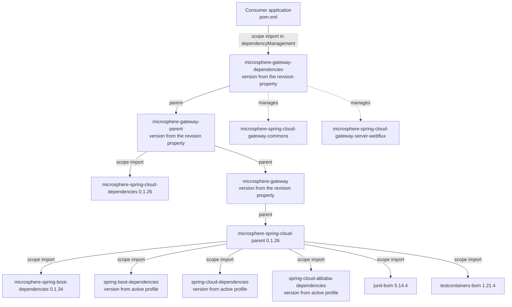

# `microsphere-gateway-dependencies`

`0.1.x` 版本线（`release-1.x` 分支）的 Maven 模块。打包方式 `pom`，坐标
`io.github.microsphere-projects:microsphere-gateway-dependencies:${revision}`。这是**对外发布的 BOM**——下游应用 import 的
就是这个工件。它没有 Java 源码，也没有资源文件。POM：`microsphere-gateway-dependencies/pom.xml`。

- [指南索引](../README.md)
- [microsphere-gateway-parent.md](../microsphere-gateway-parent.md)
- [microsphere-spring-cloud-gateway-commons.md](../microsphere-spring-cloud-gateway-commons.md)
- [microsphere-spring-cloud-gateway-server-webflux.md](../microsphere-spring-cloud-gateway-server-webflux.md)

## 构建架构

### 在体系中的角色

BOM 是唯一一个期望下游放进 `<dependencyManagement>` 的工件。它存在的意义是让应用可以这样写：

```xml
<dependency>
    <groupId>io.github.microsphere-projects</groupId>
    <artifactId>microsphere-spring-cloud-gateway-server-webflux</artifactId>
</dependency>
```

而不必在两个地方重复 Microsphere Gateway 的版本号。由于本版本线只有一个网关服务端实现（WebFlux），这个 BOM 目前管理两个坐标：

```xml
<dependencyManagement>
    <dependencies>
        <dependency>
            <groupId>io.github.microsphere-projects</groupId>
            <artifactId>microsphere-spring-cloud-gateway-commons</artifactId>
            <version>${revision}</version>
        </dependency>
        <dependency>
            <groupId>io.github.microsphere-projects</groupId>
            <artifactId>microsphere-spring-cloud-gateway-server-webflux</artifactId>
            <version>${revision}</version>
        </dependency>
    </dependencies>
</dependencyManagement>
```

除此之外没有任何其他元素：没有 `<properties>`，没有 `<modules>`，没有 `<build>`，没有 profile。它“知道”的一切都来自它的
parent，即 `microsphere-gateway-parent`。

### 父 POM、继承与 BOM 导入链



这条链带来两个结论，二者都是结构性事实而非偶然现象：

1. Maven 会先对一个被 import 的 BOM 应用 POM 继承，然后才采纳它的 `dependencyManagement`。由于本模块的 parent 是
   `microsphere-gateway-parent`，而后者 import 了 `microsphere-spring-cloud-dependencies:0.1.26`（并经由 parent 链进一步带入
   `microsphere-spring-boot-dependencies:0.1.34`、`spring-boot-dependencies`、`spring-cloud-dependencies`、
   `spring-cloud-alibaba-dependencies`、`junit-bom`、`testcontainers-bom`），因此 import
   `microsphere-gateway-dependencies` 的应用也会拿到构建本版本线所使用的每一个 Spring 与 Microsphere 工件的版本号。
   *这是 Maven BOM 的标准语义；被 import 的 BOM 集合已在 parent 链中核实。*
2. 这条链内部的 Spring Boot 与 Spring Cloud 版本由 profile 决定（`spring-cloud-hoxton`、
   `spring-cloud-2020`、`spring-cloud-2021`）。BOM 以 `flattenMode=resolveCiFriendliesOnly` 扁平化，因此构建期属性会被解析掉，
   但消费方仍然要靠自己各自的依赖管理来选择 release train。所以贡献者必须把“发布出去的 BOM 隐含了哪个 Boot 版本”当作
   *对产出它的那次构建的文档说明*，而不是一份保证。

### BOM 不做的事

- 它**不会**重新导出 compile 依赖。两个 jar 模块里每一个 Microsphere/Spring 依赖都是
  `<optional>true</optional>`；例如 `spring-cloud-starter-gateway` 与 `spring-boot-starter-webflux` 必须由应用自己引入。
- 它**不会** import `microsphere-spring-cloud-dependencies`；那处 import 位于 `microsphere-gateway-parent`。
  它是通过 parent 才达到的，这也是为什么这个 POM 只有八行 XML 加上两条受管条目。
- 它在本 reactor 内部**并未被使用**。WebFlux 模块在声明它的兄弟模块时写了显式的
  `<version>${revision}</version>`（`microsphere-spring-cloud-gateway-server-webflux/pom.xml`），而不是 import 与它同仓构建的
  BOM。这让 reactor 保持自包含，也意味着这个 BOM 里的错误不会破坏本版本线自身的构建——它只影响消费方。

## 设计模式（构建层面）

| 模式 | 位置 | 动因 | 收益 | 代价 |
|---|---|---|---|---|
| 面向消费方的 BOM | `microsphere-gateway-dependencies/pom.xml` | 用一个坐标对齐本版本线的工件 | 应用 import 一次、升级一次 | 消费方多一层 POM 跳转；使用点上看不到版本 |
| 仅内部使用的 parent | `microsphere-gateway-parent/pom.xml` | 把构建策略从对外契约中剥离出去 | BOM 主体保持极小且稳定 | 只读 BOM 无法解释受管版本的来源 |
| 用 `${revision}` 定版本 | `dependencyManagement` 的两条条目 | BOM 不可能与它所管理的模块版本不一致 | 每次发布只有一个真相来源 | 只对本 reactor 内的工件成立 |
| 处处 optional 的依赖模型 | 两个 jar POM | 本版本线是扩展 Spring Cloud Gateway，而不是拥有它 | 不向应用强加 classpath | 消费方要自己组装技术栈，版本漂移成为他们的问题 |

## 模块依赖图

```mermaid
flowchart TD
    subgraph reactor["Microsphere Gateway 0.1.x reactor"]
        ROOT["microsphere-gateway (pom, root aggregator)"]
        PARENT["microsphere-gateway-parent (pom)"]
        BOM["microsphere-gateway-dependencies (BOM, pom)"]
        COMMONS["microsphere-spring-cloud-gateway-commons (jar)"]
        WEBFLUX["microsphere-spring-cloud-gateway-server-webflux (jar)"]
    end

    subgraph microsphere["Microsphere artifacts"]
        MSCP["microsphere-spring-cloud-parent 0.1.26"]
        MSCD["microsphere-spring-cloud-dependencies 0.1.26"]
        MSBOOT["microsphere-spring-boot-dependencies 0.1.34"]
        MSCC["microsphere-spring-cloud-commons"]
        MSBW["microsphere-spring-boot-webflux"]
        MSAP["microsphere-annotation-processor"]
        MSBT["microsphere-spring-boot-test"]
    end

    subgraph spring["Spring and Bean Validation artifacts"]
        SBA["spring-boot-starter"]
        SBACT["spring-boot-starter-actuator"]
        SBWF["spring-boot-starter-webflux"]
        SBCP["spring-boot-configuration-processor"]
        SBAP["spring-boot-autoconfigure-processor"]
        SCGW["spring-cloud-starter-gateway"]
        SCCC["spring-cloud-commons"]
        SCLB["spring-cloud-loadbalancer"]
        SPW["spring-web"]
        JVA["javax.validation validation-api"]
        JUP["junit-jupiter"]
        HVAL["hibernate-validator"]
    end

    ROOT -->|"parent"| MSCP
    MSBOOT -->|"imported by"| MSCP
    MSCD -->|"BOM import"| PARENT
    ROOT -->|"aggregates"| PARENT
    ROOT -->|"aggregates"| BOM
    ROOT -->|"aggregates"| COMMONS
    ROOT -->|"aggregates"| WEBFLUX
    PARENT -->|"parent"| BOM
    PARENT -->|"parent"| COMMONS
    PARENT -->|"parent"| WEBFLUX
    BOM -.->|"manages version of"| COMMONS
    BOM -.->|"manages version of"| WEBFLUX
    COMMONS -->|"optional"| MSAP
    COMMONS -->|"optional"| MSCC
    COMMONS -->|"optional"| SBA
    COMMONS -->|"optional"| SBACT
    COMMONS -->|"optional"| SBCP
    COMMONS -->|"optional"| SBAP
    COMMONS -->|"optional"| SCCC
    COMMONS -->|"optional"| SCLB
    COMMONS -->|"optional"| SPW
    COMMONS -->|"optional"| JVA
    COMMONS -->|"test"| MSBT
    COMMONS -->|"test"| JUP
    COMMONS -->|"test"| HVAL
    WEBFLUX -->|"compile"| COMMONS
    WEBFLUX -->|"optional"| MSAP
    WEBFLUX -->|"optional"| MSCC
    WEBFLUX -->|"optional"| MSBW
    WEBFLUX -->|"optional"| SCGW
    WEBFLUX -->|"optional"| SCCC
    WEBFLUX -->|"optional"| SCLB
    WEBFLUX -->|"optional"| SBWF
    WEBFLUX -->|"optional"| SBA
    WEBFLUX -->|"optional"| SBACT
    WEBFLUX -->|"optional"| SBCP
    WEBFLUX -->|"optional"| SBAP
    WEBFLUX -->|"test"| JUP
    WEBFLUX -->|"compile scope, test library"| MSBT
```



## 构建与测试

没有源码需要编译，也没有测试需要运行；这个模块的正确性由 reactor 构建以及 POM 解析来验证：

```bash
# install the whole line, then look at the flattened BOM that consumers resolve
./mvnw -DskipTests install
grep -A4 microsphere-spring-cloud-gateway-commons \
  ~/.m2/repository/io/github/microsphere-projects/microsphere-gateway-dependencies/0.1.19-SNAPSHOT/*.pom

# the release-shaped build used by the publish workflow
./mvnw --batch-mode -Drevision=0.1.19 -Dgpg.skip=true deploy --activate-profiles publish,ci
```

由于 BOM 会被 deploy，对它的任何修改都是对外契约的修改：

- 当有新模块加入版本线时补一条条目（在拥有 WebMVC 模块的那条版本线上，这正是它需要做好的事）。
- 绝不在此为外部工件指定版本；让 `microsphere-gateway-parent` 与由 profile 决定的那些 BOM 去做。
- 内部模块保持 `<version>${revision}</version>`；写死版本号会让 BOM 与 reactor 脱钩。

## `0.1.x` 维护说明

可以做的：

- 补充文档或调整条目顺序；为本版本线上已经存在的工件新增一条受管条目。
- 当根 `revision` 被发布 workflow 递增时保持 BOM 同步（无需手工操作——`${revision}` 自己完成）。

不该做的：

- 为只存在于 `0.2.x` 版本线上的工件（例如 WebMVC 网关服务端模块）管理版本；本版本线的 `<modules>` 列表只有四项。当前版本线
  的 BOM 见
  [../../../current/developer-guide/README.md](../../../current/developer-guide/README.md)。
- 为了“方便”消费方而把 BOM 改成直接 import `spring-boot-dependencies`：在本版本线上 Boot 版本是一个 profile 决策，一旦把它
  冻结进 BOM，`spring-cloud-hoxton` 与 `spring-cloud-2020` 的用户就会解析到一个他们并未选择的 Boot 版本。

仓库整体上下文与产品概览：[../../../../README.md](../../../../README.md)。

## English

[microsphere-gateway-dependencies.md](../microsphere-gateway-dependencies.md)
