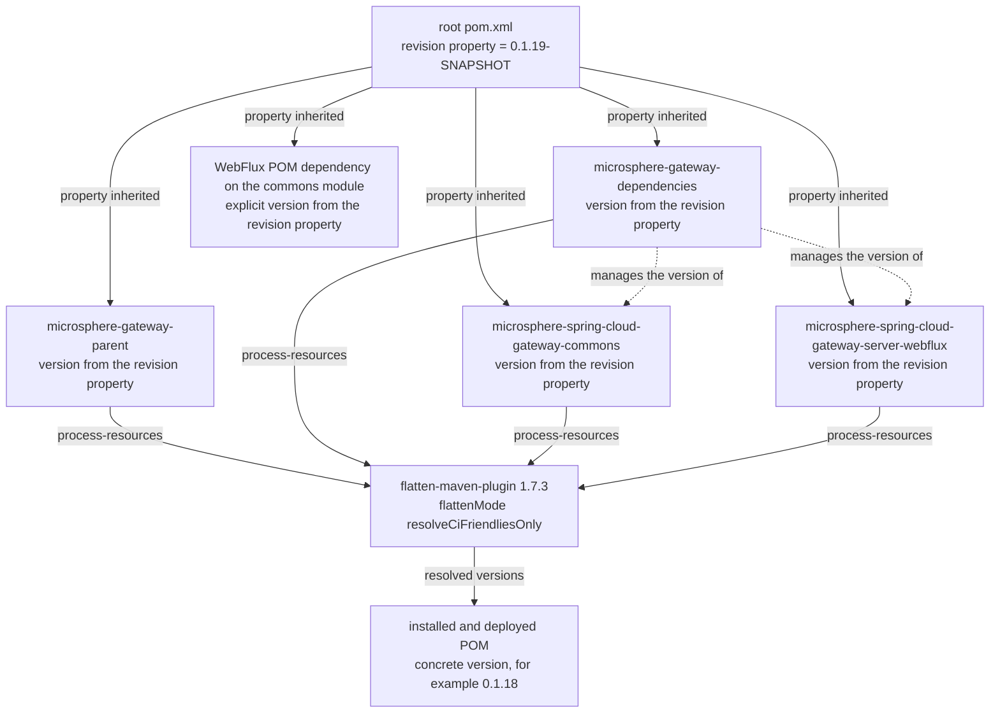

# `microsphere-gateway-parent`

`0.1.x` 版本线（`release-1.x` 分支）的 Maven 模块。打包方式 `pom`，坐标
`io.github.microsphere-projects:microsphere-gateway-parent:${revision}`。它不含任何 Java 源码，全部职责就是构建架构。POM：
`microsphere-gateway-parent/pom.xml`。

- [指南索引](../README.md)
- [microsphere-gateway-dependencies.md](../microsphere-gateway-dependencies.md)
- [microsphere-spring-cloud-gateway-commons.md](../microsphere-spring-cloud-gateway-commons.md)
- [microsphere-spring-cloud-gateway-server-webflux.md](../microsphere-spring-cloud-gateway-server-webflux.md)

## 构建架构

### 在 reactor 中的位置

`microsphere-gateway-parent` 同时扮演两个角色：

1. 它是**根 aggregator 的一个模块**——根 `pom.xml` 的 `<modules>` 把它列为第一项，因此 `./mvnw package` 会把它作为 reactor
   的一部分构建。
2. 它是**其余三个模块的父 POM**——`microsphere-gateway-dependencies`、`microsphere-spring-cloud-gateway-commons` 与
   `microsphere-spring-cloud-gateway-server-webflux` 都以
   `<relativePath>../microsphere-gateway-parent/pom.xml</relativePath>` 声明它作为 parent。

它自己的 parent 是根 `microsphere-gateway` POM，而根 POM 又继承
`io.github.microsphere-projects:microsphere-spring-cloud-parent:0.1.26`。完整继承链（由本仓库 POM 以及本地仓库中已解析的
`microsphere-spring-cloud-parent-0.1.26.pom` 验证）：

```
microsphere-gateway-parent:${revision}
    ↑ parent
microsphere-gateway:${revision}                     (this repository, root pom.xml)
    ↑ parent
microsphere-spring-cloud-parent:0.1.26              (external, microsphere-spring-cloud project)
    ↑ parent
microsphere-spring-cloud:0.1.26                     (external aggregator POM)
    ↑ parent
microsphere-build:0.3.14                            (external build-conventions POM)
```

对贡献者而言，其含义是：插件配置、编译器设置、发布规则以及绝大多数 Maven profile **并不定义在本仓库中**，而是继承而来。
本 POM 所做的构建决策只有两件事——导入 `microsphere-spring-cloud-dependencies` BOM，以及
`microsphere-spring-cloud.version` 属性。

### POM 声明了什么

```xml
<properties>
    <!-- BOM versions -->
    <microsphere-spring-cloud.version>0.1.26</microsphere-spring-cloud.version>
</properties>

<dependencyManagement>
    <dependencies>
        <dependency>
            <groupId>io.github.microsphere-projects</groupId>
            <artifactId>microsphere-spring-cloud-dependencies</artifactId>
            <version>${microsphere-spring-cloud.version}</version>
            <type>pom</type>
            <scope>import</scope>
        </dependency>
    </dependencies>
</dependencyManagement>
```

正是这一条 import，使得 `microsphere-spring-cloud-gateway-commons/pom.xml` 与
`microsphere-spring-cloud-gateway-server-webflux/pom.xml` 可以书写
`io.github.microsphere-projects:microsphere-spring-cloud-commons` 与
`io.github.microsphere-projects:microsphere-spring-boot-webflux` 而**不写 `<version>`**。
`microsphere-spring-cloud-dependencies:0.1.26` 反过来管理 `microsphere-spring-cloud-commons` 与
`microsphere-spring-cloud-openfeign`（均为 `0.1.26`）；同族的 `microsphere-spring-boot-*` 构件（`0.1.34`）由
`microsphere-spring-boot-dependencies:0.1.34` 管理，该 BOM 被 `microsphere-spring-cloud-parent:0.1.26` 导入，因此通过继承
已经在本 POM 的作用域内。

同一个 parent 还导入了 `spring-boot-dependencies`、`spring-cloud-dependencies`、`spring-cloud-alibaba-dependencies`、
`junit-bom`（`5.14.4`）与 `testcontainers-bom`（`1.21.4`），其版本取自激活的 Spring Cloud profile——这就是本仓库没有任何模块
书写 Spring 或 Spring Boot 版本号的原因。

### `${revision}` 与 POM 扁平化

本仓库的每一个 POM——根 POM、parent、BOM 以及两个 jar——都使用：

```xml
<version>${revision}</version>
```

而该属性**只**在根 `pom.xml` 中定义：

```xml
<properties>
    <revision>0.1.19-SNAPSHOT</revision>
</properties>
```

这就是 Maven 的 CI 友好版本（CI-friendly version）方案。reactor 中不再有任何位置硬编码版本，因此发布 workflow 只需在命令行
传 `-Drevision=0.1.19` 即可发布任意 patch 号，CI 也能以 `-Drevision=0.0.1-SNAPSHOT` 构建而不修改任何文件。

`${revision}` 绝不能泄漏到已发布的 POM 中，否则使用者无法解析 parent。扁平化由被继承的构建约定处理，而不是由本仓库处理：
`microsphere-build:0.3.14` 声明了 `flatten-maven-plugin` `1.7.3`，配置
`<flattenMode>resolveCiFriendliesOnly</flattenMode>`，并把 `flatten` execution 绑定到 `process-resources` 阶段；
`.gitignore` 中也包含 `# flatten ignore` / `.flattened-pom.xml` 条目。`resolveCiFriendliesOnly` 会在安装/部署的 POM 中重写
`${revision}`（以及 `${sha1}`/`${changelist}`），而保留 POM 的其余结构（包括 `<parent>` 与
`<dependencyManagement>`）不变——这正是下游用户导入 `microsphere-gateway-dependencies` 仍然有效的原因。

*推理：* flatten 配置本身位于本仓库之外，因此如果已发布的 `microsphere-gateway` POM 出现 `${revision}` 未被解析的情况，
修复点在上游 `microsphere-build` POM，而不在某个模块 POM。

### 版本在 reactor 中的传播



修改版本时须记住两点：

- `microsphere-gateway-dependencies/pom.xml` 用 `<version>${revision}</version>` 管理两个 jar 构件，因此在一次构建内 BOM、
  模块与根属性不可能互相偏离。
- `microsphere-spring-cloud-gateway-server-webflux/pom.xml` 在声明同模块依赖时同样显式写了
  `<version>${revision}</version>`，而不是依赖 BOM。这是有意为之——BOM（`microsphere-gateway-dependencies`）*并没有*被
  `microsphere-gateway-parent` 导入，因此在 reactor 内部只有该属性可用。

*推理：* 在此引入"模块内部版本属性"属于构建策略变更，与当前单一 `${revision}` 的设计不一致。

## 设计模式（构建层面）

| 模式 | 位置 | 动机 | 收益 | 代价 |
|---|---|---|---|---|
| 父 POM 与聚合分离 | `microsphere-gateway-parent/pom.xml` | 把"构建继承什么"与"reactor 包含什么"分开 | 模块 POM 保持极简，不被插件噪声污染 | 要找到真正的设置得跳两层 POM |
| 以 BOM import 锁定一个族 | `dependencyManagement` + `<scope>import</scope>` | 把整个 Microsphere Spring Cloud 族固定到一个坐标 | 一个属性（`microsphere-spring-cloud.version`）即可升级 `microsphere-spring-cloud-commons` 等 | BOM 导入顺序优先于本地条目，可能被静默覆盖 |
| CI 友好版本 `${revision}` | 根 `pom.xml`，被所有模块引用 | 不改文件即可发布任意版本 | `maven-publish.yml` 的自动 patch 发布 | 依赖 flatten 插件；IDE 只有在导入 Maven 后才能解析 `${revision}` |
| 构建约定继承 | `microsphere-build:0.3.14`（外部） | 各 Microsphere 项目的编译/测试/发布行为一致 | 不重复编写插件 XML | 上游变更会在本仓库无任何提交的情况下生效 |

## 模块依赖图

```mermaid
flowchart TD
    subgraph reactor["Microsphere Gateway 0.1.x reactor"]
        ROOT["microsphere-gateway (pom, root aggregator)"]
        PARENT["microsphere-gateway-parent (pom)"]
        BOM["microsphere-gateway-dependencies (BOM, pom)"]
        COMMONS["microsphere-spring-cloud-gateway-commons (jar)"]
        WEBFLUX["microsphere-spring-cloud-gateway-server-webflux (jar)"]
    end

    subgraph microsphere["Microsphere artifacts"]
        MSCP["microsphere-spring-cloud-parent 0.1.26"]
        MSCD["microsphere-spring-cloud-dependencies 0.1.26"]
        MSBOOT["microsphere-spring-boot-dependencies 0.1.34"]
        MSCC["microsphere-spring-cloud-commons"]
        MSBW["microsphere-spring-boot-webflux"]
        MSAP["microsphere-annotation-processor"]
        MSBT["microsphere-spring-boot-test"]
    end

    subgraph spring["Spring and Bean Validation artifacts"]
        SBA["spring-boot-starter"]
        SBACT["spring-boot-starter-actuator"]
        SBWF["spring-boot-starter-webflux"]
        SBCP["spring-boot-configuration-processor"]
        SBAP["spring-boot-autoconfigure-processor"]
        SCGW["spring-cloud-starter-gateway"]
        SCCC["spring-cloud-commons"]
        SCLB["spring-cloud-loadbalancer"]
        SPW["spring-web"]
        JVA["javax.validation validation-api"]
        JUP["junit-jupiter"]
        HVAL["hibernate-validator"]
    end

    ROOT -->|"parent"| MSCP
    MSBOOT -->|"imported by"| MSCP
    MSCD -->|"BOM import"| PARENT
    ROOT -->|"aggregates"| PARENT
    ROOT -->|"aggregates"| BOM
    ROOT -->|"aggregates"| COMMONS
    ROOT -->|"aggregates"| WEBFLUX
    PARENT -->|"parent"| BOM
    PARENT -->|"parent"| COMMONS
    PARENT -->|"parent"| WEBFLUX
    BOM -.->|"manages version of"| COMMONS
    BOM -.->|"manages version of"| WEBFLUX
    COMMONS -->|"optional"| MSAP
    COMMONS -->|"optional"| MSCC
    COMMONS -->|"optional"| SBA
    COMMONS -->|"optional"| SBACT
    COMMONS -->|"optional"| SBCP
    COMMONS -->|"optional"| SBAP
    COMMONS -->|"optional"| SCCC
    COMMONS -->|"optional"| SCLB
    COMMONS -->|"optional"| SPW
    COMMONS -->|"optional"| JVA
    COMMONS -->|"test"| MSBT
    COMMONS -->|"test"| JUP
    COMMONS -->|"test"| HVAL
    WEBFLUX -->|"compile"| COMMONS
    WEBFLUX -->|"optional"| MSAP
    WEBFLUX -->|"optional"| MSCC
    WEBFLUX -->|"optional"| MSBW
    WEBFLUX -->|"optional"| SCGW
    WEBFLUX -->|"optional"| SCCC
    WEBFLUX -->|"optional"| SCLB
    WEBFLUX -->|"optional"| SBWF
    WEBFLUX -->|"optional"| SBA
    WEBFLUX -->|"optional"| SBACT
    WEBFLUX -->|"optional"| SBCP
    WEBFLUX -->|"optional"| SBAP
    WEBFLUX -->|"test"| JUP
    WEBFLUX -->|"compile scope, test library"| MSBT
```



## 构建与测试

parent 自身不贡献任何测试（不存在 `src/` 目录），它被间接触达：

```bash
# verify the effective version and inherited dependencyManagement
./mvnw -N help:effective-pom -f microsphere-gateway-parent/pom.xml -Pspring-cloud-2021 | grep -A2 microsphere-spring-cloud-dependencies

# reactor build through the parent, exactly as CI does for one matrix leg
mvn --batch-mode --update-snapshots --file pom.xml -Drevision=0.0.1-SNAPSHOT test \
  --activate-profiles test,coverage,spring-cloud-2021
```

保持构建可信赖的规则：

- 模块 POM 中绝不硬编码版本，内部模块只能用 `${revision}`；外部版本来自 profile 或 BOM。
- 修改 `microsphere-spring-cloud.version` 就是整条版本线的依赖升级，必须在三个 Spring Cloud profile 下都验证，因为每个
  profile 还会选择一个不同的 Spring Boot 版本（`2.3.12.RELEASE`、`2.4.13`、`2.6.15`）。
- 必须 `--activate-profiles test` 才会运行 surefire/failsafe/checkstyle：在 `test` profile 之外这些插件只有配置而没有激活，
  这是构建约定所决定的。

## `0.1.x` 维护说明

在本版本线上是安全的：

- 把 `microsphere-spring-cloud.version` 升到仍然支持 Boot 2.x 与 JDK 8 的更新 `0.1.x` Microsphere Spring Cloud 版本。
- 当需要新的外部依赖族时，向 `dependencyManagement` 增加一条 `<scope>import</scope>` BOM。
- 修改构建元数据（name、description）。

不属于本版本线：

- 把 reactor 迁到 Boot 3 / Jakarta 或抬高 Java 基线——这由 `0.2.x` 版本线负责
  （[../../../current/developer-guide/README.md](../../../current/developer-guide/README.md)）。
- 采用多 `revision` 方案，或替换继承自 `microsphere-build` 的扁平化机制。
- 修改本仓库并不拥有的插件 XML；这类上游变更应作为
  `microsphere-spring-cloud` / `microsphere-build` 的 issue，而不是本仓库的提交。

仓库级上下文与产品总览：[../../../../README.md](../../../../README.md)。

## English

[../microsphere-gateway-parent.md](../microsphere-gateway-parent.md)
