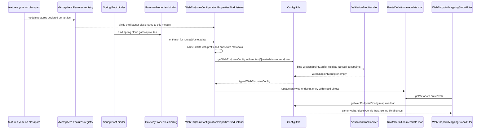
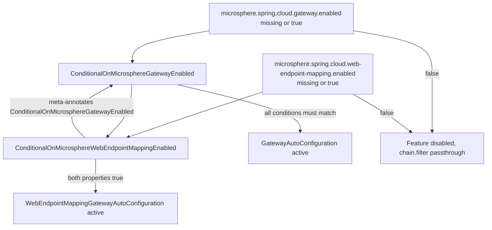

# `microsphere-spring-cloud-gateway-commons`

`0.1.x` 版本线（`release-1.x` 分支）的 jar 模块。坐标
`io.github.microsphere-projects:microsphere-spring-cloud-gateway-commons:${revision}`（reactor 中为 `0.1.19-SNAPSHOT`，
最新已发布版本 `0.1.18`）。POM：`microsphere-spring-cloud-gateway-commons/pom.xml`。

- [指南索引](../README.md)
- [microsphere-spring-cloud-gateway-server-webflux.md](../microsphere-spring-cloud-gateway-server-webflux.md)

## 架构设计

### 在体系中的角色

Commons 是各网关模块共享的词汇表与配置模型层。它不含任何请求处理逻辑；它定义的是*一个 web-endpoint 路由意味着什么*
以及*它的配置如何被物化*，并且定义了关闭该特性的开关。响应式模块
（`microsphere-spring-cloud-gateway-server-webflux`）是本仓库中它唯一的消费方，把它声明为普通的 compile 依赖。

commons 模块声明的一切都是 `optional` 或 `test` scope。这是有意为之的设计：该模块针对 Spring Boot、Spring Cloud 与
Bean Validation 编译，却拒绝把它们中的任何一个强加给消费方。在一条把所有运行时集成都放进 WebFlux 模块的版本线上，这让
commons jar 保持可复用且不带版本压力。

### 包结构

```
microsphere-spring-cloud-gateway-commons/src/main/java/io/microsphere/spring/cloud/gateway/commons/
├── annotation/
│   ├── ConditionalOnMicrosphereGatewayEnabled.java
│   └── ConditionalOnMicrosphereWebEndpointMappingEnabled.java
├── config/
│   ├── ConfigUtils.java
│   ├── WebEndpointConfig.java
│   └── WebEndpointConfigurationPropertiesBindListener.java
└── constants/
    ├── CommonConstants.java
    ├── CommonsPropertyConstants.java
    └── RouteConstants.java

microsphere-spring-cloud-gateway-commons/src/main/resources/
└── META-INF/config/default/features.yaml
```

这个模块里没有 `spring.factories`，没有
`META-INF/spring/…AutoConfiguration.imports`，没有 `@AutoConfiguration`/`@Configuration` 类，也没有任何
`@Component`/`@Bean`。对该模块 main 源码做一次 grep，`@Configuration` 类型数量为零：commons 层**不贡献任何自己的
自动配置**。它唯一的运行时钩子是一个由 *WebFlux* 模块注册的类（`WebEndpointConfigurationPropertiesBindListener`，
在那边由 `WebEndpointApplicationContextInitializer` 装配）。

### `@Conditional` 注解的预期用法

两个条件注解都以 `@ConditionalOnProperty` 作为元注解，因此求值它们的是 Spring Boot 的 condition 机制；没有注册任何自定
义内容：

| 注解 | 属性 | `matchIfMissing` | 属性缺失时的实际表现 |
|---|---|---|---|
| `ConditionalOnMicrosphereGatewayEnabled` | `microsphere.spring.cloud.gateway.enabled` | `true` | 启用 |
| `ConditionalOnMicrosphereWebEndpointMappingEnabled` | `microsphere.spring.cloud.web-endpoint-mapping.enabled` | `true` | 启用，并且同时要求网关总开关开启 |

`ConditionalOnMicrosphereWebEndpointMappingEnabled` 组合了 `ConditionalOnMicrosphereGatewayEnabled` **加上**它自己的
`@ConditionalOnProperty`。Spring 的 `ConditionEvaluator` 会收集通过元注解可达的每一个 `@Conditional`，并要求*全部*匹配，
在第一个失败处短路；收集到的这些 condition 之间的求值顺序并未规定，因此不能假定某个属性会在冲突时胜出。对维护者而言的
实际影响是：把 `microsphere.spring.cloud.gateway.enabled=false` 关掉，也会同时禁用所有被 web-endpoint-mapping 注解守卫的
东西。这一层级关系由 `ConditionalOnMicrosphereWebEndpointMappingEnabledTest` 断言（三个嵌套上下文：默认、显式 `true`、
显式 `false`）。

### 本版本线上的 bean 覆盖策略

Commons 不覆盖任何 bean。它能产出的唯一 bean 是在别处创建的，而协调方式是按 **name**（名称）而非按 type：

```java
public static final String BEAN_NAME = "webEndpointConfigurationPropertiesBindListener";
```

WebFlux 模块中的 `WebEndpointApplicationContextInitializer` 正是用这个常量作为确切名称来注册 bean definition 的。
因此这里的策略是“一个众所周知的 bean 名称，尽早注册，绝不重复注册”，而不是 `@ConditionalOnMissingBean` 那种写法——后者在
整个 `0.1.x` 代码库中都不存在（已核实：main 源码中 `ConditionalOnMissingBean` 出现次数为零），
`spring.main.allow-bean-definition-overriding` 同样不存在。如果应用自己定义了同名 bean，initializer 的注册就会冲突；这是
消费方需要关心的问题，不是本模块要防御的场景。

### Java 8 与 `javax` 时代约束

- Bean Validation 通过 `javax.validation` 绑定（`WebEndpointConfig` 导入 `javax.validation.Valid` 与
  `javax.validation.constraints.NotNull`）。仓库中没有任何 `jakarta.*` 导入，而 reactor 可达的最高 Spring Boot 版本是
  `2.6.15`（由 profile 选择），因此 Jakarta 迁移在这条版本线上无法表达。
- 源码只使用 Java 8：没有 `var`，没有 `List.of`/`Map.of`，没有 `Optional` 链式写法；`WebEndpointMappingGlobalFilter.RequestMappingContext`
  里的 `Stream.of(...)` 已是用到的最“现代”的结构。
- `WebEndpointConfig` 使用来自 `spring-web` 的 `org.springframework.web.bind.annotation.RequestMethod`（声明为 optional），
  `ConfigUtils` 使用 `org.springframework.validation.beanvalidation.LocalValidatorFactoryBean`，也就是 Spring 5 的
  javax 桥接校验器。
- `java.util.LinkedList`、`java.util.ArrayList`、用数组而非 record：这些是为了 JDK 8 加构造器绑定兼容性而选用的可变
  Java 8 写法。

*推论：* 任何需要 `jakarta.validation` 或 Java 11+ API 的修复都必须转到 `0.2.x`。

## 源码分析

### `constants.CommonConstants`

`microsphere-spring-cloud-gateway-commons/src/main/java/io/microsphere/spring/cloud/gateway/commons/constants/CommonConstants.java`

一个当作常量容器使用的 `interface`。只有一个成员：
`APPLICATION_NAME_URI_TEMPLATE_VARIABLE_NAME = "application"`。它是 `Path=/{application}/**` 这类路由断言与 WebFlux 模块中
读取已匹配 URI-template 变量的代码之间的契约。不变式：这个值必须保持为 `application`，否则现存每一个 `we://` 路由断言都
会悄无声息地不再解析出应用名（此时 filter 只会打一条 trace 日志并把 exchange 交给链路下一环）。

### `constants.CommonsPropertyConstants`

`…/commons/constants/CommonsPropertyConstants.java`

属性名词汇表，由 Microsphere 技术栈所持有的常量做字符串拼接得到：

| 常量 | 值 |
|---|---|
| `MICROSPHERE_GATEWAY_SPRING_CLOUD_PROPERTY_NAME_PREFIX` | `microsphere.spring.cloud.gateway.` |
| `MICROSPHERE_GATEWAY_ENABLED_PROPERTY_NAME` | `microsphere.spring.cloud.gateway.enabled` |
| `DEFAULT_MICROSPHERE_GATEWAY_ENABLED` | `true` |
| `MICROSPHERE_WEB_ENDPOINT_MAPPING_PROPERTY_NAME_PREFIX` | `microsphere.spring.cloud.web-endpoint-mapping.` |
| `MICROSPHERE_WEB_ENDPOINT_MAPPING_ENABLED_PROPERTY_NAME` | `microsphere.spring.cloud.web-endpoint-mapping.enabled` |

注意这里有意造成的*同名*：网关自己的 `CommonsPropertyConstants` 通过静态导入取得
`MICROSPHERE_SPRING_CLOUD_PROPERTY_NAME_PREFIX`，来源是 `io.microsphere.spring.cloud.commons.constants.CommonsPropertyConstants`
（简单名相同但不同的另一个 interface，来自 `microsphere-spring-cloud-commons`）。此处的任何编辑都必须保持那个全限定导入
不变，否则这两个接口会互相遮蔽。

两个 `enabled` 常量都带 Microsphere 的 `@ConfigurationProperty(type = boolean.class, defaultValue =
"true", source = APPLICATION_SOURCE)` 注解。该注解是给 `microsphere-annotation-processor`（optional 依赖）消费的元数据，
用于发布配置属性信息；它对绑定没有运行时影响。

### `constants.RouteConstants`

`…/commons/constants/RouteConstants.java`

`we://` 协议契约：

| 常量 | 值 | 用途 |
|---|---|---|
| `SCHEME` | `we` | 标识 web-endpoint 路由的 route URI scheme |
| `ALL_SERVICES` | `all` | 表示“每一个已发现服务”的通配 host |
| `ID_KEY` | `id` | route metadata/property 键，也用于识别 `…routes[n].id` 变化 |
| `METADATA_KEY` | `metadata` | `spring.cloud.gateway.routes[n].metadata` 的后缀 |
| `WEB_ENDPOINT_KEY` | `web-endpoint` | route metadata 内 web-endpoint 块的键 |
| `WEB_ENDPOINT_REWRITE_PATH_ATTRIBUTE_NAME` | `msgw-we-rewrite-path` | 承载重写后路径的 `ServerWebExchange` 属性名 |

这六个值都被 `RouteConstantsTest` 逐字断言；尽管它们只是 `String` 常量，实际上等同于公开 API。

### `annotation.ConditionalOnMicrosphereGatewayEnabled`

`…/commons/annotation/ConditionalOnMicrosphereGatewayEnabled.java`

```java
@Retention(RUNTIME)
@Target({TYPE, METHOD})
@Documented
@ConditionalOnProperty(name = MICROSPHERE_GATEWAY_ENABLED_PROPERTY_NAME, matchIfMissing = true)
public @interface ConditionalOnMicrosphereGatewayEnabled {
}
```

无成员。`@Target` 允许在类级与方法级使用，因此它既能守卫配置类也能守卫单个 `@Bean`
方法。WebFlux 模块中的 `GatewayAutoConfiguration` 带有它。由于 `matchIfMissing = true`，整条版本线是“默认开启、可显式关闭”
而非“默认关闭、需显式开启”。

### `annotation.ConditionalOnMicrosphereWebEndpointMappingEnabled`

`…/commons/annotation/ConditionalOnMicrosphereWebEndpointMappingEnabled.java`

形状相同，但它额外把 `@ConditionalOnMicrosphereGatewayEnabled` 作为元注解，并在 Javadoc 与 import 中引用了
`io.microsphere.spring.web.metadata.WebEndpointMapping`。这个 `WebEndpointMapping` 导入只是文档层面依赖 Microsphere 的 web
metadata 类型（该类型来自经 `microsphere-spring-cloud-commons` 传递引入的 Microsphere Spring web 栈），也正是它让这个注解
*并非*零依赖：删掉那个导入是一次编译期改动，而不是整理性改动。

已知的文档漂移（在本版本线上修复是安全的）：它的 Javadoc `@see` 指向
`CommonsPropertyConstants#MICROSPHERE_GATEWAY_ENABLED_PROPERTY_NAME`，而该注解实际守卫的是
`MICROSPHERE_WEB_ENDPOINT_MAPPING_ENABLED_PROPERTY_NAME`。

### `config.WebEndpointConfig`

`…/commons/config/WebEndpointConfig.java`

`spring.cloud.gateway.routes[n].metadata.web-endpoint` 的类型化模型，带 `@Validated`：

- `@NotNull @Valid private List<Mapping> excludes = new LinkedList<>();` —— 字段有初始化，因此一个不含
  `web-endpoint` 块的路由依然会绑定成一个“排除列表为空”的对象，而不是校验失败。
- 嵌套 `public static class Mapping` 对应 Spring request-mapping 的属性：`patterns`（`@NotNull @Valid
  String[]`）、`methods`、`params`、`headers`、`consumes`、`produces` —— 全部是 `String[]`/`RequestMethod[]`，除
  `patterns` 外全部可为 null。

两个不太直观的归一化 getter 实际定义了行为，而它们的存在都是因为 `RequestMappingInfo.Builder.headers(...)` 不能接受 `null`：

```java
@Nonnull
public RequestMethod[] getMethods() {
    if (isEmpty(methods)) {
        return values();          // RequestMethod.values()
    }
    return methods;
}

@Nonnull
public String[] getHeaders() {
    if (isEmpty(headers)) {
        return EMPTY_STRING_ARRAY;
    }
    return headers;
}
```

值得记住的不变式：

1. 一个不含 `methods` 的 `excludes` 条目会在**所有** HTTP 方法上排除该路径 —— 这个默认值是刻意宽松的（它是“屏蔽这条路径”
   的规则，而不是“只匹配 GET”的规则）。
2. `params`、`consumes`、`produces` 在未设置时保持 `null`，而 `headers` 会变成空数组。这种不对称在 `ConfigUtilsTest`
   中可见，它断言 `assertSame(EMPTY_STRING_ARRAY, exclude.getHeaders())` 以及 `assertNull(exclude.getParams())`。
3. `Mapping` 是可变的 JavaBean（有 getter 也有 setter），因为 Spring Boot 的 binder 需要 setter；它不是线程安全的，绑定
   完成后必须当一只读对象对待。

### `config.ConfigUtils`

`…/commons/config/ConfigUtils.java`

`public abstract class ConfigUtils implements Utils` 且构造器私有 —— 这是 Microsphere 的工具类写法（`io.microsphere.util.Utils`
是一个 marker interface）。两个重载，都标了 `@Nullable`：

```java
Binder binder = get(environment, springValidatorBindHandler);
return binder.bind(configPrefix, WEB_ENDPOINT_CONFIG_BINDABLE).orElse(null);
```

```java
Object webEndpoint = metadata.get(WEB_ENDPOINT_KEY);
return webEndpoint instanceof WebEndpointConfig ? (WebEndpointConfig) webEndpoint : null;
```

设计要点：

- `WEB_ENDPOINT_CONFIG_BINDABLE` 是一个 `static final` 的 `Bindable<WebEndpointConfig>`；`Bindable` 是不可变值对象，因此共享
  一个实例是安全的。
- `ValidationBindHandler` 在静态初始化块中**只创建一次**，同时创建一个手工调用 `afterPropertiesSet()` 的
  `LocalValidatorFactoryBean`。这意味着没有应用上下文也能做校验，但同时意味着：(a) 开销在首次类加载时支付；(b) 不存在由
  `ApplicationContext` 管理的 `Validator`，因此应用的 message interpolation 或 constraint 定制都不会生效；(c) 如果
  classpath 上没有 Bean Validation provider，Spring 的 `LocalValidatorFactoryBean` 会退化为 no-op validator，约束会被静默地
  不再执行（这是 Spring 框架行为；在本版本线上 provider 只是 commons 模块的 test scope 依赖 ——
  `hibernate-validator` 加上为表达式语言准备的 `tomcat-embed-el`）。
- 基于 map 的重载**从不解析**原始 map；它只返回已经被转换过的值。这正是下面那个 bind listener 建立的交接方式，也是为什么
  路由的 metadata 可以在请求期被当作类型化对象读取而不产生任何绑定开销。

### `config.WebEndpointConfigurationPropertiesBindListener`

`…/commons/config/WebEndpointConfigurationPropertiesBindListener.java`

```java
public class WebEndpointConfigurationPropertiesBindListener implements BindListener, EnvironmentAware {
```

它实现 Microsphere 的 `io.microsphere.spring.boot.context.properties.bind.BindListener`（来自
`microsphere-spring-boot-core`），这是 `ListenableBindHandlerAdapter` 使用的回调契约，从而可以把一个 bind advisor
通过 Spring Boot 的 `ConfigurationPropertiesBindHandlerAdvisor` SPI（Javadoc 中点名了该协作契约）挂到
`@ConfigurationProperties` 绑定上。只实现了 `onFinish`：

```java
String propertyName = name.toString();
if (propertyName.startsWith(gatewayRoutesPropertyNamePrefix) && propertyName.endsWith(METADATA_KEY) && result != null) {
    ConfigurationPropertyName webEndpointName = name.append(WEB_ENDPOINT_KEY);
    WebEndpointConfig webEndpointConfig = getWebEndpointConfig(environment, webEndpointName.toString());
    if (webEndpointConfig != null) {
        Map<String, Object> metadata = (Map<String, Object>) result;
        metadata.put(WEB_ENDPOINT_KEY, webEndpointConfig);
    }
}
```

精确解读：

- 构造器断言前缀非空白（`Assert.assertNotBlank`）；WebFlux 模块传入的是
  `GatewayPropertyConstants.GATEWAY_ROUTES_PROPERTY_NAME_PREFIX`，即 `spring.cloud.gateway.routes`。
- `ConfigurationPropertyName.toString()` 渲染的是*规范*（canonical）短横线形式，因此用点号字面量前缀去匹配
  `spring.cloud.gateway.routes` 是可行的，但这依赖规范命名（带索引的片段形如
  `spring.cloud.gateway.routes[0].metadata`）。
- 只有 `metadata` 节点会被拦截，而且只在 binder 产出非 `null` 结果时；随后结果被**原地修改** —— Spring Boot 绑定出来的原始
  `Map` 保持其标识不变，只有 `web-endpoint` 这一条目被替换为类型化的 `WebEndpointConfig`。
- 到 `Map<String, Object>` 的 unchecked cast 对 `RouteDefinition.metadata`（Spring Boot 把 YAML/properties 的 map
  绑定进来）是安全的，但对任何其他 route-metadata 表示形式都会抛 `ClassCastException`。加一个防御式 `instanceof` 是一个
  合理的 `0.1.x` bug 修复。
- 如果某个路由没有 `web-endpoint` 块，`getWebEndpointConfig(...)` 返回 `null`，原始 map 保持不动。

由于这个类是一个 `BindListener`/advisor，而不是应用关心的 bean，它不产生任何可见 bean；它唯一可观察的效果是
`RouteDefinition.getMetadata()` 里 `web-endpoint` 值的类型。

### `META-INF/config/default/features.yaml`

`microsphere-spring-cloud-gateway-commons/src/main/resources/META-INF/config/default/features.yaml`

```yaml
microsphere:
  spring:
    cloud:
      features:
        abstract:
          microsphere-spring-cloud-gateway-commons:
            - io.microsphere.spring.cloud.gateway.commons.config.WebEndpointConfigurationPropertiesBindListener
```

这是 Microsphere 的**特性声明注册表**，不是属性默认值文件：每个 jar 模块都随包提供一份
`META-INF/config/default/features.yaml`，按模块名作为键列出构成该模块特性的类，并区分 `abstract`（特性类型）与
`named`（名称 → 类型）。消费方位于 `microsphere-spring-cloud-commons`（`io.microsphere.spring.cloud.client.actuator.*`，
例如 `FeaturesUtils`、`FeaturesProperties`、
`ConfigurationPropertyHasFeaturesAutoConfiguration`），它自己也随包提供结构相同的
`META-INF/config/default/features.yaml` —— 已从该工件的资源清单核实。这里只注册了一个类：bind listener。常量与条件注解
没有被注册，这与“特性指的是其他代码会挂接进去的那些类”的定位一致。

*推断：* `microsphere-spring-cloud-gateway-commons` 内部没有任何代码读取这个文件；对它的修改只会通过应用 classpath 上
actuator 侧的特性上报生效。

## 设计模式

| 模式 | 位置 | 动因 | 收益 | 代价 |
|---|---|---|---|---|
| 自定义 `Condition` 元注解组合 | `annotation/ConditionalOnMicrosphereGatewayEnabled.java`、`annotation/ConditionalOnMicrosphereWebEndpointMappingEnabled.java` | 用一个有名字的注解表达一次 kill switch，而不是重复写 `@ConditionalOnProperty(name = "…")` | 守卫可读性好；子开关自动继承主开关 | 元注解之间的 AND 语义很容易被误读；如果不知道属性名，`@ConditionalOnProperty` 调试输出里看不到这些 condition |
| 常量接口作为共享词汇 | `constants/RouteConstants.java`、`constants/CommonConstants.java`、`constants/CommonsPropertyConstants.java` | `we`、`metadata`、`msgw-we-rewrite-path` 这类字符串必须在 binder 与 filter 两侧完全一致 | 只有一处需要修改；测试钉住每个值 | 公开 `interface` 常量是永久 API；没有类型安全 |
| 配置解析辅助类 | `config/ConfigUtils.java` | 绑定 `WebEndpointConfig` 需要一个带校验的 `Binder`；两个调用点（启动期绑定、请求期）必须一致 | 静态、分配极少（`Bindable` 已缓存）、带校验、返回 `null` 而不抛异常 | 静态初始化块里手工初始化 validator；没有 provider 时静默地不校验 |
| 绑定生命周期观察者（类型替换） | `config/WebEndpointConfigurationPropertiesBindListener.java` | 把 `metadata.web-endpoint` 从原始 map 变成类型化对象，而无需自定义 converter 或 post-process 钩子 | 对每个经 `GatewayProperties` 绑定的路由都生效；请求期零开销 | 原地修改已绑定的 map；unchecked cast；前缀匹配基于字符串 |
| Null-object / 宽松默认值 | `WebEndpointConfig.Mapping.getMethods()`、`getHeaders()` | 让一条排除规则表现得像一条规则，同时满足 `RequestMappingInfo` builder 的非 null 要求 | YAML 可以写得极简（只写 `patterns: /internal/**` 也合法） | `headers` 与 `params`/`consumes`/`produces` 之间的不对称令人意外 |
| 只暴露 optional 依赖面 | `microsphere-spring-cloud-gateway-commons/pom.xml` | 该模块必须在没有 Spring Cloud 的 classpath 上也可使用 | 不向应用强加版本 | 编译能通过，而运行时 `NoClassDefFoundError` 变成消费方的问题 |

## 复杂流程

### 特性声明与 route 元数据绑定



这张图的关键在于 `ConfigUtils` 的两个不同重载：基于 `Environment`
的那个在绑定期每个路由恰好调用一次，基于 `Map` 的那个在请求/刷新期被反复调用且完全不执行绑定。

### 条件守卫层级



*解读提示：* 标注 "meta-annotates" 的箭头表示组合方向；标注 "all conditions must match"
的箭头表示求值方向。两者都需要，因为一个组合出来的注解只有在每一个可达的 `@Conditional` 都匹配时才成立。

## 模块依赖图

```mermaid
flowchart TD
    subgraph reactor["Microsphere Gateway 0.1.x reactor"]
        ROOT["microsphere-gateway (pom, root aggregator)"]
        PARENT["microsphere-gateway-parent (pom)"]
        BOM["microsphere-gateway-dependencies (BOM, pom)"]
        COMMONS["microsphere-spring-cloud-gateway-commons (jar)"]
        WEBFLUX["microsphere-spring-cloud-gateway-server-webflux (jar)"]
    end

    subgraph microsphere["Microsphere artifacts"]
        MSCP["microsphere-spring-cloud-parent 0.1.26"]
        MSCD["microsphere-spring-cloud-dependencies 0.1.26"]
        MSBOOT["microsphere-spring-boot-dependencies 0.1.34"]
        MSCC["microsphere-spring-cloud-commons"]
        MSBW["microsphere-spring-boot-webflux"]
        MSAP["microsphere-annotation-processor"]
        MSBT["microsphere-spring-boot-test"]
    end

    subgraph spring["Spring and Bean Validation artifacts"]
        SBA["spring-boot-starter"]
        SBACT["spring-boot-starter-actuator"]
        SBWF["spring-boot-starter-webflux"]
        SBCP["spring-boot-configuration-processor"]
        SBAP["spring-boot-autoconfigure-processor"]
        SCGW["spring-cloud-starter-gateway"]
        SCCC["spring-cloud-commons"]
        SCLB["spring-cloud-loadbalancer"]
        SPW["spring-web"]
        JVA["javax.validation validation-api"]
        JUP["junit-jupiter"]
        HVAL["hibernate-validator"]
    end

    ROOT -->|"parent"| MSCP
    MSBOOT -->|"imported by"| MSCP
    MSCD -->|"BOM import"| PARENT
    ROOT -->|"aggregates"| PARENT
    ROOT -->|"aggregates"| BOM
    ROOT -->|"aggregates"| COMMONS
    ROOT -->|"aggregates"| WEBFLUX
    PARENT -->|"parent"| BOM
    PARENT -->|"parent"| COMMONS
    PARENT -->|"parent"| WEBFLUX
    BOM -.->|"manages version of"| COMMONS
    BOM -.->|"manages version of"| WEBFLUX
    COMMONS -->|"optional"| MSAP
    COMMONS -->|"optional"| MSCC
    COMMONS -->|"optional"| SBA
    COMMONS -->|"optional"| SBACT
    COMMONS -->|"optional"| SBCP
    COMMONS -->|"optional"| SBAP
    COMMONS -->|"optional"| SCCC
    COMMONS -->|"optional"| SCLB
    COMMONS -->|"optional"| SPW
    COMMONS -->|"optional"| JVA
    COMMONS -->|"test"| MSBT
    COMMONS -->|"test"| JUP
    COMMONS -->|"test"| HVAL
    WEBFLUX -->|"compile"| COMMONS
    WEBFLUX -->|"optional"| MSAP
    WEBFLUX -->|"optional"| MSCC
    WEBFLUX -->|"optional"| MSBW
    WEBFLUX -->|"optional"| SCGW
    WEBFLUX -->|"optional"| SCCC
    WEBFLUX -->|"optional"| SCLB
    WEBFLUX -->|"optional"| SBWF
    WEBFLUX -->|"optional"| SBA
    WEBFLUX -->|"optional"| SBACT
    WEBFLUX -->|"optional"| SBCP
    WEBFLUX -->|"optional"| SBAP
    WEBFLUX -->|"test"| JUP
    WEBFLUX -->|"compile scope, test library"| MSBT
```



## 本模块的构建与测试

```bash
./mvnw test -pl microsphere-spring-cloud-gateway-commons -Ptest,spring-cloud-2021
./mvnw test -pl microsphere-spring-cloud-gateway-commons -Ptest,spring-cloud-2020
./mvnw test -pl microsphere-spring-cloud-gateway-commons -Ptest,spring-cloud-hoxton
./mvnw -pl microsphere-spring-cloud-gateway-commons -Ptest,coverage verify
```

现有测试按类的覆盖情况：

| 测试 | 钉住了什么 |
|---|---|
| `ConditionalOnMicrosphereGatewayEnabledTest` | 主开关在类似 `@Configuration` 的类上的默认/`true`/`false` 行为 |
| `ConditionalOnMicrosphereWebEndpointMappingEnabledTest` | web-endpoint-mapping 开关的同样三种情形 |
| `CommonConstantsTest`、`CommonsPropertyConstantsTest`、`RouteConstantsTest` | 每个常量的字面值；它们是与 WebFlux 模块以及与用户 YAML 之间的契约 |
| `ConfigUtilsTest` | 基于 `Environment` 把 `metadata.web-endpoint` 绑定成三个 `Mapping` 对象、方法默认值（`RequestMethod.values()`）、headers 用 `EMPTY_STRING_ARRAY`、配置缺失时返回 `null`，以及 `Map` 重载的 `instanceof` 判定 |
| `WebEndpointConfigurationPropertiesBindListenerTest` | `onFinish` 对 `routes[0].metadata`（带 `web-endpoint` 块）触发，而对 `routes[1]`、`routes[2]` 与 `spring.cloud` 保持无效 |

测试夹具：`microsphere-spring-cloud-gateway-commons/src/test/resources/META-INF/config/default/test.yaml` —— 它有意同时声明一个顶层
`metadata.web-endpoint` 树和一个 `spring.cloud.gateway.routes` 列表；`ConfigUtilsTest` 用 `YamlPropertySourceLoader`
加载它并调用 `ConfigurationPropertySources.attach(environment)`；任何做绑定的新测试都必须以同样方式 attach，否则
`Binder.get(environment)` 看不到 canonical 名称。该文件还包含一个 `request_size_route`，其 `metadata: a: 1` —— 这正是**不能**
被转换的那个情形。

test scope 的 `hibernate-validator` 与 `org.apache.tomcat.embed:tomcat-embed-el` 依赖，才是让 `ConfigUtils`
的 `ValidationBindHandler` 在测试中真正执行校验的原因；没有它们，同样的测试会在什么都不校验的情况下通过。
`microsphere-spring-boot-test`（这里是 test scope）提供了 `WebEndpointConfigurationPropertiesBindListenerTest`
使用的、便于断言的绑定辅助（`BindUtils.bind`）。

## `0.1.x` 维护说明

可以做的：

- `WebEndpointConfigurationPropertiesBindListener` 中的空安全加固（cast 之前加 `instanceof Map`）。
- Javadoc 更正，例如 `ConditionalOnMicrosphereWebEndpointMappingEnabled` 的 `@see` 漂移。
- 新增常量，或由现有注解组合出新的条件注解，只要取值是增量式的。
- 当本模块新增一个可被挂接的类时，在 `features.yaml` 中注册更多特性类。
- 编写测试，以及把真正共享的辅助工具从 WebFlux 模块下沉到 `commons`。

已锁定（会破坏用户；属于 `0.2.x`）：

- 修改 `SCHEME`（`we`）、`ALL_SERVICES`（`all`）、`WEB_ENDPOINT_KEY`（`web-endpoint`）、
  `WEB_ENDPOINT_REWRITE_PATH_ATTRIBUTE_NAME`（`msgw-we-rewrite-path`）或两个 `enabled` 属性名。
- 改变 `Mapping.getMethods()` 的宽松默认值：今天 `/internal/**` 不写 `methods` 就意味着“所有方法”，用户依赖这一点。
- 用 `jakarta.validation` 替换 `javax.validation`，或抬高 Java 基线。
- 让 commons 模块变为非 optional（添加必需 compile 依赖）—— 这会改变 `0.1.x` 每个消费方的传递解析结果。

相关文档：[README.md](../README.md)、
[microsphere-spring-cloud-gateway-server-webflux.md](../microsphere-spring-cloud-gateway-server-webflux.md)、
[microsphere-gateway-dependencies.md](../microsphere-gateway-dependencies.md)、
[仓库根 README](../../../../README.md)、
[当前版本线开发者指南](../../../current/developer-guide/README.md)。

## English

[microsphere-spring-cloud-gateway-commons.md](../microsphere-spring-cloud-gateway-commons.md)
