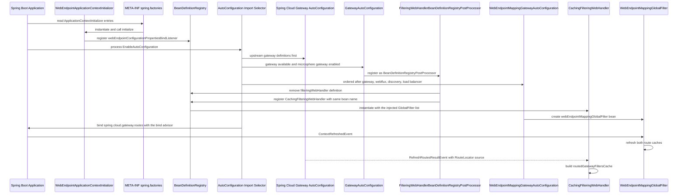
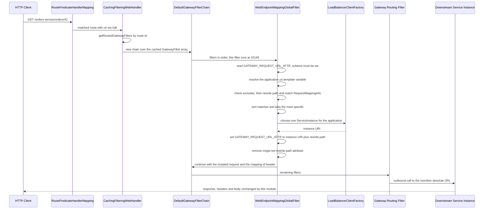
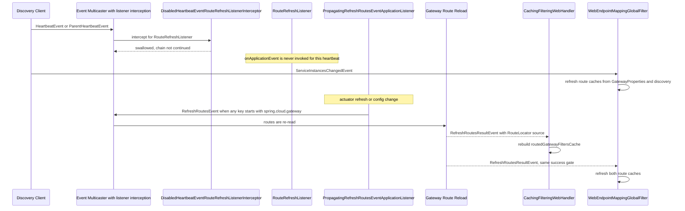
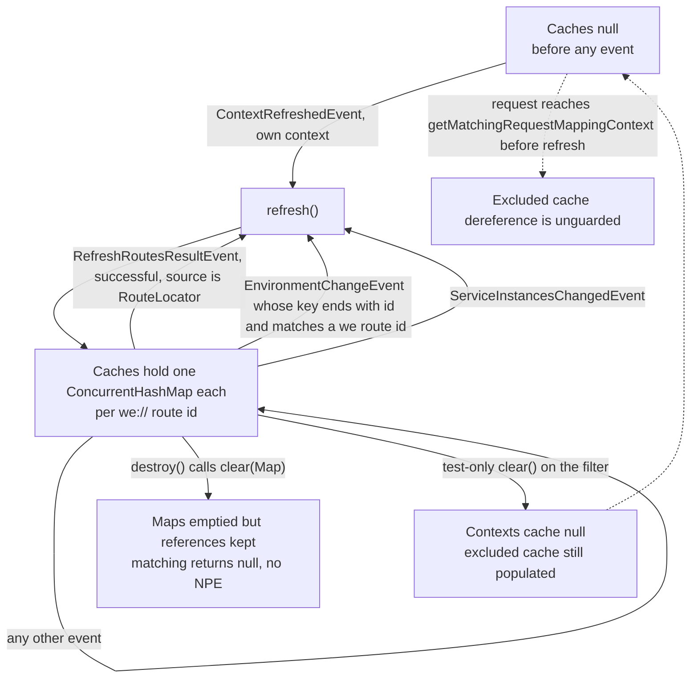
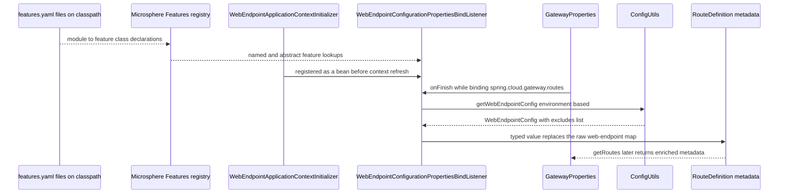

# `microsphere-spring-cloud-gateway-server-webflux`

`0.1.x` 版本线（`release-1.x` 分支）的 jar 模块。坐标
`io.github.microsphere-projects:microsphere-spring-cloud-gateway-server-webflux:${revision}`（reactor 中为
`0.1.19-SNAPSHOT`，最新已发布版本 `0.1.18`）。这是该版本线上唯一的运行时模块：每一个会触碰请求的类都在这里。POM：
`microsphere-spring-cloud-gateway-server-webflux/pom.xml`。

- [指南索引](../README.md)
- [microsphere-spring-cloud-gateway-commons.md](../microsphere-spring-cloud-gateway-commons.md)
- [microsphere-gateway-parent.md](../microsphere-gateway-parent.md)
- [microsphere-gateway-dependencies.md](../microsphere-gateway-dependencies.md)

## 架构设计

### 在体系中的角色

本模块把一个 Spring Cloud Gateway（WebFlux）实例变成面向 Microsphere web endpoint 的服务发现驱动网关。形如

```yaml
spring:
  cloud:
    gateway:
      routes:
        - id: web-endpoint-mapping
          uri: we://all
          predicates:
            - Path=/{application}/**
          metadata:
            web-endpoint:
              excludes:
                - patterns: /internal/**
```

这样的路由先由普通的 Spring Cloud Gateway 断言机制匹配，随后本模块的 `GlobalFilter` 把 `we://all` 请求 URL 替换为一个具体的
`http://<instance>` URL，它来自服务实例所发布的 `WebEndpointMapping` 元数据。

围绕这个 filter 有两项横切优化：

- `CachingFilteringWebHandler` 按 route id 预先计算好有序的 `GatewayFilter[]`，否则 Spring Cloud Gateway 会为每个请求重新
  组装一遍。
- 两个事件组件（`DisabledHeartbeatEventRouteRefreshListenerInterceptor`、
  `PropagatingRefreshRoutesEventApplicationListener`）改变的是路由数据被重新读取的*时机*，从而让服务发现心跳不再引发路由
  刷新，而配置变更仍然会。

### 包结构

```
microsphere-spring-cloud-gateway-server-webflux/src/main/java/io/microsphere/spring/cloud/gateway/server/webflux/
├── annotation/     ConditionalOnGatewayAvailable, ConditionalOnGatewayEnabled
├── autoconfigure/  GatewayAutoConfiguration, WebEndpointMappingGatewayAutoConfiguration
├── constants/      GatewayPropertyConstants
├── context/        WebEndpointApplicationContextInitializer
├── event/          DisabledHeartbeatEventRouteRefreshListenerInterceptor,
│                   PropagatingRefreshRoutesEventApplicationListener
├── filter/         DefaultGatewayFilterChain, WebEndpointMappingGlobalFilter
├── handler/        CachingFilteringWebHandler, FilteringWebHandlerBeanDefinitionRegistryPostProcessor
└── util/           GatewayUtils

microsphere-spring-cloud-gateway-server-webflux/src/main/resources/
├── META-INF/config/default/features.yaml
├── META-INF/spring.factories
└── META-INF/spring/org.springframework.boot.autoconfigure.AutoConfiguration.imports
```

### 本版本线上的自动配置钩子

`META-INF/spring.factories` 带有两个 key：

```properties
org.springframework.boot.autoconfigure.EnableAutoConfiguration=\
io.microsphere.spring.cloud.gateway.server.webflux.autoconfigure.GatewayAutoConfiguration,\
io.microsphere.spring.cloud.gateway.server.webflux.autoconfigure.WebEndpointMappingGatewayAutoConfiguration

org.springframework.context.ApplicationContextInitializer=\
io.microsphere.spring.cloud.gateway.server.webflux.context.WebEndpointApplicationContextInitializer
```

`META-INF/spring/org.springframework.boot.autoconfigure.AutoConfiguration.imports` 带有同样的两个自动配置类，
一行一个，别无其他。

在一条由 profile 选择 Spring Boot `2.3.12.RELEASE`、`2.4.13` 与 `2.6.15` 的版本线上，这种重复是有意为之——这三个版本都从
`spring.factories` 发现自动配置——而 `AutoConfiguration.imports` 是 Spring Boot 2.7+ 与 3.x 使用的位置（这是 Spring
framework 的行为，不是本仓库能够验证的事情）。同时保留这两个文件，意味着同一个 artifact 能在两种发现机制下工作。然而
`ApplicationContextInitializer` 这个 key 只通过 `spring.factories` 生效：initializer 并不存在对应的
`AutoConfiguration.imports` 机制，因此把 `spring.factories` 从本模块移除会让 `WebEndpointApplicationContextInitializer`
悄无声息地失效。这是本模块资源文件最重要的单条构建期不变式。

`microsphere-spring-cloud-gateway-commons` 注册**零**自动配置；一切声明式的内容都在这里。

`META-INF/config/default/features.yaml` 是 Microsphere 特性注册表（不是属性源）：

```yaml
microsphere:
  spring:
    cloud:
      features:
        abstract:
          microsphere-spring-cloud-gateway-server-webflux:
            - io.microsphere.spring.cloud.gateway.server.webflux.handler.CachingFilteringWebHandler
            - io.microsphere.spring.cloud.gateway.server.webflux.filter.WebEndpointMappingGlobalFilter
            - io.microsphere.spring.cloud.gateway.server.webflux.event.DisabledHeartbeatEventRouteRefreshListenerInterceptor
            - io.microsphere.spring.cloud.gateway.server.webflux.event.PropagatingRefreshRoutesEventApplicationListener
        named:
          microsphere-spring-cloud-gateway-server-webflux:
            - WebEndpointApplicationContextInitializer=io.microsphere.spring.cloud.gateway.server.webflux.context.WebEndpointApplicationContextInitializer
```

`abstract` 中的四个类是应用可以替换或扩展的类；那个由 Spring Boot 而非 Microsphere 装配的 initializer 注册在 `named` 下。

### `@Conditional` 求值顺序

本模块的每一个守卫都由 Spring Boot 条件组合而成；不存在自定义 `Condition` 类。

`GatewayAutoConfiguration` 一次性要求：

1. `@ConditionalOnGatewayEnabled` → `spring.cloud.gateway.enabled` 缺失或为 `true`（通过
   `@ConditionalOnGatewayAvailable` 继承而来）
2. `@ConditionalOnWebFluxAvailable`（来自 `microsphere-spring-boot-webflux`，继承而来）
3. `@ConditionalOnClass(name = "org.springframework.cloud.gateway.config.GatewayProperties")`（继承而来）
4. `@ConditionalOnMicrosphereGatewayEnabled` → `microsphere.spring.cloud.gateway.enabled` 缺失或为 `true`

`WebEndpointMappingGatewayAutoConfiguration` 在 1–4 之外（通过 `@ConditionalOnGatewayAvailable` 与
`@ConditionalOnMicrosphereWebEndpointMappingEnabled`）再叠加：

5. `@ConditionalOnDiscoveryEnabled` 与 `@ConditionalOnReactiveDiscoveryEnabled`（Spring Cloud Commons）
6. `@ConditionalOnClass(name = { "org.springframework.cloud.client.discovery.ReactiveDiscoveryClient",
   "org.springframework.cloud.loadbalancer.support.LoadBalancerClientFactory" })`
7. 在 `@Bean` 方法上：`@ConditionalOnEnabledGlobalFilter`（Spring Cloud Gateway 自己的“这个 global filter 是否启用”
   条件）与 `@ConditionalOnBean(value = { ReactiveDiscoveryClientAdapter.class, LoadBalancerClientFactory.class },
   search = CURRENT)`

Spring 会收集所有通过元注解可达的 `@Conditional` 并要求它们全部匹配，在第一个失败处停止；被收集到的这些条件之间的测试顺序
并未定义。编辑时需要留意的两个后果：

- 因为 `@ConditionalOnClass` 在所有地方都以 `name = {...}`（字符串形式）使用，即使 Spring Cloud Gateway、Discovery 或
  LoadBalancer 缺失，这些类也依然可以安全加载——本模块的可选依赖不会在条件求值期引发 `NoClassDefFoundError`。
- `@Bean` 方法上的 `@ConditionalOnBean` 只能看到**已经**处理过的 bean 定义，这也是该类同时声明一长串
  `@AutoConfigureAfter`（既按 value 也按 name）的原因：

```java
@AutoConfigureAfter(
        value = {
                GatewayAutoConfiguration.class,
                WebFluxAutoConfiguration.class,
                ReactiveDiscoveryClientAutoConfiguration.class
        },
        name = {
                "org.springframework.cloud.gateway.config.GatewayAutoConfiguration",
                "org.springframework.cloud.loadbalancer.config.LoadBalancerAutoConfiguration",
                "org.springframework.cloud.client.discovery.composite.reactive.ReactiveCompositeDiscoveryClientAutoConfiguration"
        }
)
```

`value` 条目是 Microsphere/自己的类；`name` 条目是上游类，以符号方式引用，从而这些 artifact 缺失时本配置依然能够加载。
这种“我们编译时依赖的用 value，只希望它存在的用 name”的划分，是本模块核心的顺序惯用法。

### Bean 覆盖策略

本模块从不使用 `@ConditionalOnMissingBean`（在整个仓库的 main 源码中出现次数为零），也从不要求
`spring.main.allow-bean-definition-overriding`。它是**结构性地**覆盖上游 bean：

- `FilteringWebHandlerBeanDefinitionRegistryPostProcessor` 移除已有的 `FilteringWebHandler` bean 定义，并以
  `CachingFilteringWebHandler` 作为 bean 类重新注册同样的 bean 名称。
- `GatewayAutoConfiguration` 用 `@Import` 引入那个后处理器（外加两个事件组件），因此这处替换随自动配置一起注册，也随上面
  任一守卫失败而一起消失。
- 本模块自己新增的一切（`webEndpointMappingGlobalFilter`）都是新的 bean 名称，而不是重定义。

`WebEndpointConfigurationPropertiesBindListener` bean 注册得更早，由 `ApplicationContextInitializer` 以固定名称
`webEndpointConfigurationPropertiesBindListener` 完成。

### Java 8 / `javax` 时代约束

- 构建基线是 JDK 8，源码也体现了这一点：没有 `var`，没有 `List.of`，没有文本块；只在一处使用 `Stream.of`。
- 模块里没有任何 `jakarta.*` 引用；它消费的校验模型来自 `microsphere-spring-cloud-gateway-commons`，经由
  `javax.validation`。
- 响应式类型是 Reactor 3（`Mono`、`Flux`）与 Spring 5 WebFlux API（`ServerWebExchange`、
  `org.springframework.web.reactive.result.method.RequestMappingInfo`）。用 `RequestMappingInfo`——一个 *WebFlux* 类——
  来做匹配，正是把本模块钉在 Spring 5 WebFlux 以及 `we://` 匹配语义上的原因。
- 本模块支持 Spring Cloud Gateway `2.2.9.RELEASE`（profile `spring-cloud-hoxton`）一直到 `3.1.9`
  （profile `spring-cloud-2021`）——即父 POM 点名的那几个 release train 所选的版本。因此任何修复都必须同时在 Boot
  2.3/2.4/2.6 与 Gateway 2.2/3.0/3.1 上编译通过且行为一致。

## 源码分析

### `constants.GatewayPropertyConstants`

`microsphere-spring-cloud-gateway-server-webflux/src/main/java/io/microsphere/spring/cloud/gateway/server/webflux/constants/GatewayPropertyConstants.java`

两个派生常量：

| 常量 | 组成 | 值 |
|---|---|---|
| `GATEWAY_ENABLED_PROPERTY_NAME` | `GatewayProperties.PREFIX + DOT + ENABLED_PROPERTY_NAME` | `spring.cloud.gateway.enabled` |
| `GATEWAY_ROUTES_PROPERTY_NAME_PREFIX` | `GatewayProperties.PREFIX + DOT + "routes"` | `spring.cloud.gateway.routes` |

`PREFIX` 取自 Spring Cloud Gateway 自身
（`org.springframework.cloud.gateway.config.GatewayProperties.PREFIX`），因此上游重命名会被自动跟随——但这同时也意味着本
模块对 Gateway 的编译期依赖并非零成本：该类是被直接 import 的，而不是通过 name 字符串。`GatewayPropertyConstantsTest`
对两个组合都做了断言。

`GATEWAY_ENABLED_PROPERTY_NAME` 上的 `@ConfigurationProperty` 注解把这个开关登记为 `boolean`、默认 `"true"`、
`APPLICATION_SOURCE`，供 Microsphere 的属性元数据工具使用。

### `annotation.ConditionalOnGatewayEnabled`

`…/webflux/annotation/ConditionalOnGatewayEnabled.java`

`@ConditionalOnProperty(name = GATEWAY_ENABLED_PROPERTY_NAME, matchIfMissing = true)`，`@Target({TYPE, METHOD})`、
`RUNTIME`、`@Documented`。它复用的是**上游**属性，所以 `spring.cloud.gateway.enabled=false` 在禁用 Spring Cloud Gateway 的
同时也以完全相同的方式禁用 Microsphere Gateway。

### `annotation.ConditionalOnGatewayAvailable`

`…/webflux/annotation/ConditionalOnGatewayAvailable.java`

三个条件的组合——`@ConditionalOnGatewayEnabled`、`@ConditionalOnWebFluxAvailable` 与
`@ConditionalOnClass(name = "org.springframework.cloud.gateway.config.GatewayProperties")`——其 Javadoc 带有配置类和
`@Bean` 方法两种用法的可复制粘贴示例。这个注解是本模块“我到底能不能碰 gateway 类型？”的闸门，两个自动配置类都使用了它。

### `autoconfigure.GatewayAutoConfiguration`

`…/webflux/autoconfigure/GatewayAutoConfiguration.java`

一个方法体为空的 `@Configuration(proxyBeanMethods = false)`，纯粹是装配声明：

```java
@Configuration(proxyBeanMethods = false)
@ConditionalOnGatewayAvailable
@ConditionalOnMicrosphereGatewayEnabled
@EnableEventExtension
@AutoConfigureAfter(name = {
        "org.springframework.cloud.gateway.config.GatewayAutoConfiguration"
})
@Import(value = {
        DisabledHeartbeatEventRouteRefreshListenerInterceptor.class,
        PropagatingRefreshRoutesEventApplicationListener.class,
        FilteringWebHandlerBeanDefinitionRegistryPostProcessor.class
})
public class GatewayAutoConfiguration {
}
```

维护者需要知道的几点：

- `proxyBeanMethods = false` 在本模块中是一致的；两个配置类都没有 bean 之间的方法调用，因此没有理由改变它。
- `@EnableEventExtension` 才是让 `ApplicationListenerInterceptor` 实现（心跳拦截器）参与事件分发的开关。没有它，拦截器
  bean 会存在但永远不会被咨询。
- 三个被导入的类是作为 bean 注册的，而不是作为 `@Bean` 方法。`FilteringWebHandlerBeanDefinitionRegistryPostProcessor`
  是一个 `BeanDefinitionRegistryPostProcessor`，它能生效是因为 Spring 会先执行所有 `postProcessBeanDefinitionRegistry`
  回调（包括由配置类注册的后处理器），然后才进入唯一的 `postProcessBeanFactory` 阶段——那时上游的
  `FilteringWebHandler` 定义已经存在。
- 这里的 `@AutoConfigureAfter` 只是 *name* 引用，因此上游类缺失时什么都不会坏。

### `autoconfigure.WebEndpointMappingGatewayAutoConfiguration`

`…/webflux/autoconfigure/WebEndpointMappingGatewayAutoConfiguration.java`

一个 bean，层层守卫：

```java
@Bean
@ConditionalOnEnabledGlobalFilter
@ConditionalOnBean(value = {ReactiveDiscoveryClientAdapter.class, LoadBalancerClientFactory.class}, search = CURRENT)
public WebEndpointMappingGlobalFilter webEndpointMappingGlobalFilter(ReactiveDiscoveryClientAdapter reactiveDiscoveryClient,
                                                                     LoadBalancerClientFactory loadBalancerClientFactory,
                                                                     GatewayProperties gatewayProperties) {
    return new WebEndpointMappingGlobalFilter(reactiveDiscoveryClient, loadBalancerClientFactory, gatewayProperties);
}
```

- `search = CURRENT` 意味着这两个必需的 bean 必须位于当前上下文，而不是父上下文——这对测试以及使用子上下文的应用
  （例如 LoadBalancer 的子上下文）都有影响。
- 参数类型是 Microsphere 的 `ReactiveDiscoveryClientAdapter`，而 filter 构造器的参数类型是 Spring Cloud 的
  `DiscoveryClient`；因此该 adapter 满足 `DiscoveryClient` 契约（编译期事实）。adapter 的存在是为了让*响应式*发现客户端
  可以服务于 filter 所执行的阻塞式查询。
- 注入 `GatewayProperties` 是因为 filter 每次刷新都会读取 `getRoutes()`。

### `context.WebEndpointApplicationContextInitializer`

`…/webflux/context/WebEndpointApplicationContextInitializer.java`

```java
public class WebEndpointApplicationContextInitializer extends ConfigurableApplicationContextInitializer {

    @Override
    protected void initialize(ConfigurableApplicationContext context, ConfigurableEnvironment environment) {
        ConfigurableListableBeanFactory beanFactory = context.getBeanFactory();
        BeanDefinitionRegistry registry = (BeanDefinitionRegistry) beanFactory;
        registerBeanDefinition(registry, BEAN_NAME,
                WebEndpointConfigurationPropertiesBindListener.class, GATEWAY_ROUTES_PROPERTY_NAME_PREFIX);
    }
}
```

职责：让路由元数据的 bind advisor 在 `GatewayProperties` 被绑定**之前**就存在。
`ConfigurationPropertiesBindHandlerAdvisor` bean 只有在第一个 `@ConfigurationProperties` 对象绑定时已经位于 bean factory
之中，才能影响绑定，这就是它不能是自动配置的原因。

值得指出的非直观行为：

- 它通过 `spring.factories` 注册，因此是**无条件的**：即使 `spring.cloud.gateway.enabled=false`、即使 Spring Cloud
  Gateway 缺失、即使 `microsphere.spring.cloud.gateway.enabled=false`，它都会运行。在这些情况下被注册的 bean 是惰性的，
  因为 `WebEndpointConfigurationPropertiesBindListener.onFinish` 按名称限定在 `spring.cloud.gateway.routes…metadata` 上。
- 基类 `ConfigurableApplicationContextInitializer`（来自 `microsphere-spring-context`）提供了
  `initialize(context, environment)` 的拆分；这个子类从不使用 `environment`。
- `context.getBeanFactory()` → `BeanDefinitionRegistry` 的强制转换对每一个 Spring Boot 的
  `ConfigurableApplicationContext` 都成立。
- 它注册该类时带一个构造器参数（`spring.cloud.gateway.routes`），与监听器唯一的 public 构造器相匹配，后者会断言非空白。

### `event.DisabledHeartbeatEventRouteRefreshListenerInterceptor`

`…/webflux/event/DisabledHeartbeatEventRouteRefreshListenerInterceptor.java`

```java
if (INTERCEPTED_CLASS.equals(listenerClass) && matchesHeartbeatEvent(eventClass)) {
    logger.trace("The ApplicationListener[{}] with event[{}] is disabled", listenerClass, eventClass);
    return;
}
chain.intercept(applicationListener, event);
```

一个 `ApplicationListenerInterceptor`，**仅当** `HeartbeatEvent` 与 `ParentHeartbeatEvent` 是投递给
`RouteRefreshListener` 时才把它们吞掉。两处刻意保持的精确性是有意为之：

- `INTERCEPTED_CLASS.equals(listenerClass)` 是精确类比较，不是 `isAssignableFrom`：`RouteRefreshListener` 的子类不会被
  拦截。
- `matchesHeartbeatEvent` 同样用 `equals` 比较，因此 `HeartbeatEvent` 的子类依然会到达 `RouteRefreshListener`。

其目的（类 Javadoc 已写明：“to disable `RouteRefreshListener`' `HeartbeatEvent`”）是阻止周期性的服务发现心跳触发全量路由
刷新。本模块不需要心跳时的路由刷新：`we://` 路由是通过 `ServiceInstancesChangedEvent` 和负载均衡器惰性解析服务实例的，
而不是通过重新加载 `RouteDefinition`。不变式：拦截器在吞掉事件时**不**调用 `chain.intercept(...)` 就直接返回，因此监听器是
被整体跳过，而不是带着一个被过滤后的事件被调用。

### `event.PropagatingRefreshRoutesEventApplicationListener`

`…/webflux/event/PropagatingRefreshRoutesEventApplicationListener.java`

```java
public void onApplicationEvent(EnvironmentChangeEvent event) {
    Set<String> keys = event.getKeys();
    if (containsGatewayPropertyName(keys)) {
        context.publishEvent(new RefreshRoutesEvent(this));
    }
}
```

一个观察者，当任何变更的 key 以 `GatewayProperties.PREFIX`（`spring.cloud.gateway`）开头时，把 Spring Cloud 的
`EnvironmentChangeEvent` 转换成网关的 `RefreshRoutesEvent`。要点：

- 判断用的是 `startsWith(key, PREFIX)`，也就是**任何**网关属性变更——不只是 `routes`——都会触发路由刷新
  （`spring.cloud.gateway.httpclient.*` 也算）。把它收窄到 routes 前缀会是一次行为变更。
- 事件源是 `this`（监听器自身），并且该类有 `ApplicationContext` 构造器参数，因此它由 `@Import` 注册为 bean 并按类型解析。
- 它*不会*被上面那个拦截器过滤，因为拦截器只匹配 `RouteRefreshListener`。
- 这个文件是仓库中唯一缺少 Apache License 头部的 main 源码——在 `0.1.x` 上做这个清理是安全的。

### `filter.DefaultGatewayFilterChain`

`…/webflux/filter/DefaultGatewayFilterChain.java`

Spring Cloud Gateway `GatewayFilterChain` 的一个基于固定数组的职责链实现：

```java
public Mono<Void> filter(ServerWebExchange exchange) {
    if (position < length) {
        GatewayFilter gatewayFilter = this.gatewayFilters[position++];
        return defer(() -> gatewayFilter.filter(exchange, this));
    }
    return empty();
}
```

- 构造器断言数组非 null 且不含 null 元素；`new DefaultGatewayFilterChain()` 传空 vararg 数组是合法的，会得到一条立刻为空
  的链（`DefaultGatewayFilterChainTest` 对这两种情况都有校验）。
- `position` 可变，实例**只能使用一次并且不是线程安全的**；每个请求都必须新建一条链，这正是
  `CachingFilteringWebHandler.handle` 所做的。在已经耗尽的链上再次调用 `filter` 会返回 `Mono.empty()`（测试里是
  `assertSame(empty(), ...)`）。
- `Mono.defer(...)` 是关键的那个响应式细节：下一个 filter 只有在返回的 `Mono` 被订阅时才被调用，因此一个用
  `then(...)` 组合 `chain.filter(exchange)` 的 filter 依然能得到正确的顺序，而且整个数组不会被提前遍历。
- 完成时返回空的 `Mono<Void>`，这是“链路结束”的信号；这里不存在“调用下一个 handler”的概念，这也是该类只能用作被匹配路由的
  *过滤器*链的原因。

### `filter.WebEndpointMappingGlobalFilter`

`…/webflux/filter/WebEndpointMappingGlobalFilter.java`

本模块的核心。一个类同时披着六重契约：`GlobalFilter`、`SmartApplicationListener`、`ApplicationContextAware`、
`EnvironmentAware`、`DisposableBean`、`Ordered`。

状态：

```java
volatile Map<String, Collection<RequestMappingContext>> routedRequestMappingContextsCache = null;
volatile Map<String, Collection<RequestMappingInfo>> routedExcludedRequestMappingInfoCache = null;
```

以 **route id** 为 key，保存从远端服务元数据推导出来的每路由请求映射知识。

**`filter(ServerWebExchange, GatewayFilterChain)`** —— 请求路径，按顺序：

1. 读取 `GATEWAY_REQUEST_URL_ATTR`；如果 URI 不是 `we` scheme（`isWebEndpointRoute`），放行。
2. 读取 URI 模板变量；要求 `application` 变量（`CommonConstants.APPLICATION_NAME_URI_TEMPLATE_VARIABLE_NAME`）；
   空白则放行。
3. `getMatchingRequestMappingContext(applicationName, exchange)`；`null` 则放行。
4. 用 `choose(applicationName)` 取一个负载均衡后的 `ServiceInstance`；`null` 则放行。
5. 成功时：移除 `msgw-we-rewrite-path` 属性，构造 `targetURI = create(instanceUri + rewritePath)`，添加携带所匹配 mapping
   id 的 `WebEndpointMapping.ID_HEADER_NAME` 头，写入新的 `GATEWAY_REQUEST_URL_ATTR`，并带着变更后的请求继续链路。

**`getMatchingRequestMappingContext(String applicationName, String routeId, ServerWebExchange exchange)`** —— 匹配核心
（package-private，以便测试可以直接调用）：

- 先做排除检查，然后是缓存为 `null` 的检查，最后才是按路由查找。
- `String rewritePath = substringAfter(path, SLASH_CHAR + applicationName);` —— 第一个 `/{application}` 段被剥掉；结果被存入
  exchange 属性，并用于构造一个*临时的*、被改写过的 exchange 来做匹配，因此模式比较的是下游路径而不是网关路径。
- 所有候选 context 都用 `RequestMappingInfo.getMatchingCondition(exchange) != null` 匹配并收集起来，然后
  `matchesRequestMappings.sort((v1, v2) -> v1.compareTo(v2, newExchange))`，由 `first(...)` 胜出——复用 Spring 自己的
  最具体映射比较器，而不是重新实现。

**缓存构建 —— `refresh()`：**

- `getWebEndpointRoutes()` 把 `gatewayProperties.getRoutes()` 过滤为 `we` scheme 的 URI。
- 对每个这样的路由：`buildRequestMappingContexts(routeUri)`（订阅列表来自 `getSubscribedServices`）以及
  `buildExcludedRequestMappingInfoSet(webEndpointRoutes, routeId)`。
- `getSubscribedServices(URI)`：host 为 `all` → `discoveryClient.getServices()`；否则
  `commaDelimitedListToSet(host)` —— 这正是 `we://orders-service,payments-service` 能够工作的原因。
- 对每个被订阅的服务，只选出**一个**样本实例，它的 `WebEndpointMapping` 集合（通过
  `ServiceInstanceUtils.getWebEndpointMappings` 从实例元数据读取）就成为整条路由的映射集合。
- 两个 map 都作为全新的 `ConcurrentHashMap` 构建，并在 `synchronized (this)` 内发布，因此读者要么看到旧的一对，要么看到新的
  一对，绝不会看到半成品。

**监听器行为 —— `supportsEventType`/`onApplicationEvent`：** `ContextRefreshedEvent`（仅自身上下文，与 `this.context`
按身份比较）、`RefreshRoutesResultEvent`（仅其中成功且 source 是 `RouteLocator` 的那些，通过
`GatewayUtils.isSuccessRouteLocatorEvent` 判断）、`EnvironmentChangeEvent`（它自己的收窄规则）以及
`ServiceInstancesChangedEvent`（总是刷新）。

`matchesEvent(EnvironmentChangeEvent)` 是微妙的那个：

```java
if (key.startsWith(GATEWAY_ROUTES_PROPERTY_NAME_PREFIX)) {
    int lastIndex = key.lastIndexOf(ID_KEY);
    if (lastIndex == (key.length() - ID_KEY.length())) {
        String propertyValue = this.environment.getProperty(key);
        for (RouteDefinition route : routes) {
            if (route.getId().equals(propertyValue)) { return true; }
        }
    }
}
```

只有当某个变更的 key 在 routes 前缀之下*以* `id` **结尾**，并且其值等于一条现存 `we://` 路由的 id 时才会刷新。
比如说编辑 `spring.cloud.gateway.routes[0].metadata.web-endpoint.excludes[0].patterns` 本身并不匹配这条规则——覆盖它的是
路由重载路径（上游 `GatewayPropertiesRefreshListener` → `RefreshRoutesEvent` → `RefreshRoutesResultEvent`）。另请注意
`isEmpty(keys) ? emptyList() : getWebEndpointRoutes()` 这个守卫，它在事件 key 为空时跳过路由枚举。

**响应式与线程相关问题：**

- `choose(String)` 是**阻塞的**：`clientFactory.getInstance(...)`，然后对负载均衡器的
  `Mono<Response<ServiceInstance>>` 调用 `getValue(mono)`。它既用在请求路径上（第 4 步），也在 `refresh()` 内对每个被订阅的
  服务调用。在 WebFlux filter 内部阻塞是本模块最大的架构妥协；该类甚至声明了 `public boolean supportsAsyncExecution()`
  返回 `false`。（*推理：*不存在 `@Override`，main 源码里也没有其他地方调用该方法，因此上游是否把它当作 override 取决于
  Spring Cloud Gateway 的版本——本模块编译时使用的是 Gateway `2.2.9.RELEASE`–`3.1.9`。）
- `refresh()` 是从事件分发线程调用的；因此由发现事件触发的刷新会在那个线程上对每个服务执行阻塞的 `choose()` 循环。
- 可变 map 从不就地清空——`refresh()` 交换整个 map。`destroy()` 调用静态的 `clear(Map)` 辅助方法，它会**清空**map 的内容但
  保留（此时为空的）实例引用，所以 `destroy()` 之后缓存是非 null 且为空的。package-private 的 `clear()`（只被测试使用）
  则改为设置 `routedRequestMappingContextsCache = null`。
- `isExcludedRequest(...)` 在解引用 `routedExcludedRequestMappingInfoCache` 时没有 null 检查，而且它在
  `routedRequestMappingContexts == null` 检查**之前**求值。因此这两个缓存是有先后要求的：`ContextRefreshedEvent` 必须在第一个
  `we://` 请求到达本 filter 之前已经触发，否则原则上可以触发 `NullPointerException`。
- `buildExcludedRequestMappingInfoSet` 会解引用 `findWebEndpointConfig(...)` 返回的配置，而当 `we://` 路由没有类型化的
  `metadata.web-endpoint` 时该配置为 `null`。因此一条不带该元数据块的 `we://all` 路由是刷新期的失败路径；本仓库中每一个 YAML
  fixture 都声明了 `metadata.web-endpoint`，所以这个场景未被测试覆盖。

**嵌套的 `RequestMappingContext`：** 包装一个 `RequestMappingInfo` 加上远端映射的 `id`；两个静态构建方法——一个来自
`WebEndpointConfig.Mapping`（排除规则，未设置时使用 `RequestMethod.values()`），另一个来自 `WebEndpointMapping`（远端
endpoint，对发布出来的方法名做 `RequestMethod.valueOf(String)`）。`compareTo(other, exchange)` 委托给
`RequestMappingInfo.compareTo`，也就是按特异性排序，而不是声明顺序。

**`static String buildPath(ServiceInstance, URI)`** 剥掉开头的 `/<serviceId>/`，并重新加上实例的
`WEB_CONTEXT_PATH_METADATA_NAME` 上下文路径。它**没有**被 `filter(...)` 或 `refresh()` 调用；仓库中唯一的调用者是
`WebEndpointMappingGlobalFilterStaticTest`。在本版本线上把它视为保留/未使用的逻辑——删除它是一个可见的 API 变更（它是
package 可见的，因此*不*是 public API），而把它接进重写路径会改变那些具有非根上下文路径的服务的目标 URI。

### `handler.CachingFilteringWebHandler`

`…/webflux/handler/CachingFilteringWebHandler.java`

继承 Spring Cloud Gateway 的 `FilteringWebHandler` 并实现 `DisposableBean`。

```java
@Override
public Mono<Void> handle(ServerWebExchange exchange) {
    Route route = exchange.getRequiredAttribute(GATEWAY_ROUTE_ATTR);
    GatewayFilter[] routedGatewayFilters = getRoutedGatewayFilters(route);
    return new DefaultGatewayFilterChain(routedGatewayFilters).filter(exchange);
}
```

- 构造器只是把 `List<GlobalFilter>` 转发给 `super`，也就是上游 handler 收到的同一份输入；这正是定义交换之所以安全的原因。
- `combineGatewayFilters(Route)` 把父类的 global filters 与 `route.getFilters()` 合并，用
  `AnnotationAwareOrderComparator.sort` 排序，并借助共享的 `EMPTY_FILTER_ARRAY` 拷贝成数组。按 route id 缓存的就是这个数组。
- `globalFilters()` 按名称反射读取父类的**私有**字段 `globalFilters`：`getFieldValue(true, this, "globalFilters")`。
  这是本模块对上游内部实现最强的一处耦合：如果更新版本的 Spring Cloud Gateway 重命名了这个私有字段，该类会在运行期 break，
  而且只是运行期 break，不是编译错误。
- 填充是事件驱动的：`@EventListener(RefreshRoutesResultEvent.class)` +
  `GatewayUtils.isSuccessRouteLocatorEvent(event)`；source 被转成 `RouteLocator`，并用
  `routeLocator.getRoutes().subscribe(route -> ...).dispose()` 遍历。这是对 `Flux` 一次刻意同步的读取，落到一个普通
  `HashMap`，随后通过 `volatile routedGatewayFiltersCache` 字段发布。（*推理：*如果某个 `RouteLocator` 是异步发射的，
  map 可能在所有路由齐备之前就被发布；本仓库没有任何测试涉及异步 locator——`CachingFilteringWebHandlerTest` 用
  `Flux.empty()` 桩掉 `getRoutes()`。）
- 当缓存为 `null` 或 route id 未知时，`getRoutedGatewayFilters(Route)` 返回 `EMPTY_FILTER_ARRAY`。
  配合 `DefaultGatewayFilterChain`，这意味着**未命中缓存的路由上的请求根本不会执行任何过滤器，并以空的 `Mono<Void>`
  完成**，直到一次成功的 route-locator 刷新把缓存填好。这是本模块最重要的行为不变式，并被
  `assertSame(EMPTY_FILTER_ARRAY, this.webHandler.getRoutedGatewayFilters(null))` 直接断言。
- `destroy()` 清空缓存 map，`CachingFilteringWebHandlerTest` 覆盖了清空之后与从未初始化两条路径，外加失败路径
  （`new RefreshRoutesResultEvent(routeLocator, throwable)` 不得重建缓存）。

### `handler.FilteringWebHandlerBeanDefinitionRegistryPostProcessor`

`…/webflux/handler/FilteringWebHandlerBeanDefinitionRegistryPostProcessor.java`

```java
@Override
public void postProcessBeanFactory(ConfigurableListableBeanFactory beanFactory) throws BeansException {
    BeanDefinitionRegistry registry = this.registry;
    String[] beanNames = beanFactory.getBeanNamesForType(FilteringWebHandler.class, false, false);
    for (String beanName : beanNames) {
        registry.removeBeanDefinition(beanName);
        registerBeanDefinition(registry, beanName, CachingFilteringWebHandler.class);
    }
}
```

- 是替换式而不是包装式的装饰器：上游 bean 被一个子类**以相同 bean 名**取代，因此所有按类型的既有注入点
  （`FilteringWebHandler`、`WebHandler`）继续工作，也不需要 overriding 开关。
- `getBeanNamesForType(FilteringWebHandler.class, false, false)` 意味着*只找 singleton bean 定义、不做急加载*——
  这是 bean-factory 后处理器内部的安全写法，因为它从定义解析类型而不是实例化 bean。
- `postProcessBeanDefinitionRegistry` 只缓存 registry；把真正的工作放在 `postProcessBeanFactory` 中，可以保证所有配置类
  （包括上游的）都已经贡献完它们的定义。
- 替换后的定义上没有声明任何构造器参数，因此 `CachingFilteringWebHandler` 构造器的 `List<GlobalFilter>` 依赖必须由容器解析。
  *推理：*这一点被 `WebEndpointMappingGlobalFilterTest` 真实地跑到了，它在一个随机端口上启动自动配置好的网关，因此在这个
  版本线所支持的 Spring 版本上，该解析确实可行。
- 对于目标定义缺失的情况没有任何守卫，所以如果 Spring Cloud Gateway 的自动配置没有运行，这个循环就什么也不做——整个特性
  退化回纯粹的上游行为。

### `util.GatewayUtils`

`…/webflux/util/GatewayUtils.java`

`public abstract class GatewayUtils implements Utils`，带私有构造器。三个方法：

- `getGatewayProperties(ConfigurableEnvironment)` —— 通过 Microsphere 的 `PropertySourcesUtils.getSubProperties`
  取 `spring.cloud.gateway` 之下的扁平化属性。`src/main` 内没有调用方；是给用户和测试用的 public API。
- `getRouteProperties(ConfigurableEnvironment, String routeId)` —— 找到**值**等于该 route id 的属性，用
  `substringBeforeLast(propertyName, DOT)` 推出它的 key 前缀，把该前缀下的所有属性作为 `unmodifiableMap` 返回，id 不存在时
  返回 `emptyMap()`。非直观的副作用：存在多条路由时，第一个匹配胜出，而某条路由的 id 如果是另一个属性值中的子串就可能错误地
  关联 key；`GatewayUtilsTest` 覆盖了找到（`web-endpoint-mapping`）、找不到（`web-endpoint-mapping-1`）以及空环境三种情况。
- `isSuccessRouteLocatorEvent(RefreshRoutesResultEvent)` —— `event != null && event.isSuccess() && source instanceof
  RouteLocator`。这是 `CachingFilteringWebHandler` 与 `WebEndpointMappingGlobalFilter` 共用的闸门，因此同一个事件在两处
  被一致地解读。

## 设计模式

| 模式 | 位置 | 动机 | 收益 | 代价 |
|---|---|---|---|---|
| 自定义 `Condition` 元注解组合 | `annotation/ConditionalOnGatewayEnabled.java`, `annotation/ConditionalOnGatewayAvailable.java` | 一个名字就能表达“gateway 类型存在且已启用” | 自动配置类读起来就是意图；基于字符串的 `@ConditionalOnClass` 让可选依赖保持安全 | AND 语义被隐藏在注解里；调试时需要了解被组合起来的各个属性 |
| `BeanDefinitionRegistryPostProcessor` bean 替换 | `handler/FilteringWebHandlerBeanDefinitionRegistryPostProcessor.java` | 在不引入 bean-override 开关的前提下替换应用从未声明的上游 bean | 名称相同、类型继承树相同，对所有注入点透明 | 依赖 Spring 的后处理器阶段；没有 `@ConditionalOnMissingBean` 兜底；上游目标 bean 改名后静默失效 |
| 围绕 `FilteringWebHandler` 的缓存装饰器 | `handler/CachingFilteringWebHandler.java` + `filter/DefaultGatewayFilterChain.java` | 上游的“路由→过滤器列表”组装是每请求工作，而其输入只在刷新时变化 | 每请求的分配降到一个链对象加一个预排序数组 | 反射读取上游私有字段；每次路由变更都必须失效缓存；冷缓存意味着“不执行任何过滤器” |
| 基于数组的职责链 | `filter/DefaultGatewayFilterChain.java` | 执行固定且已预排序的过滤器列表，不必每次构建 `List` | `Mono.defer` 让执行保持惰性且顺序精确 | 单次使用、可变、按设计非线程安全 |
| 自管理缓存的观察者/监听器 | `filter/WebEndpointMappingGlobalFilter.java`（`SmartApplicationListener`）、`handler/CachingFilteringWebHandler.java`（`@EventListener`） | 两个缓存都依赖路由/发现方面的事实，而不是请求数据 | 刷新是推送式的，之后读取很便宜 | 四种不同触发器配三条不同的匹配规则；存在顺序假设（`ContextRefreshedEvent` 在前） |
| 用链路拦截做事件抑制 | `event/DisabledHeartbeatEventRouteRefreshListenerInterceptor.java` | 在不替换监听器的前提下移除某个上游监听器对某一事件的反应 | 精准、可逆，且无需 fork 上游 | 精确类匹配会静默漏掉子类；依赖 `@EnableEventExtension` |
| 带属性名过滤的观察者 | `event/PropagatingRefreshRoutesEventApplicationListener.java` | Spring Cloud 的配置刷新本身不会为网关 key 发布 `RefreshRoutesEvent` | 运行时编辑 `spring.cloud.gateway.*` 会重载路由 | 只判断前缀会让与非路由相关的网关属性变更也刷新路由 |
| 配置解析辅助工具 | `util.GatewayUtils.java` + commons 的 `ConfigUtils` | 属性扁平化与事件分类在多个类中重复出现 | `isSuccessRouteLocatorEvent` 只有一份实现 | 两个 “Utils” 类，其中一些方法只被测试使用 |
| 对响应式 API 做阻塞式适配 | `filter.WebEndpointMappingGlobalFilter.choose(...)` | 路由/映射构建发生在监听器代码里，那里 `Mono` 很别扭 | 简单、同步的缓存构建 | 在请求路径上阻塞响应式线程；假定某一个实例的元数据能代表整个服务 |

## 复杂流程

### 启动、自动配置与路由初始化



### `we://` 路由的请求生命周期



两个失败出口都是静默放行：如果 scheme 不是 `we`，如果 `{application}` 变量为空，如果没有映射匹配，或者如果选不出实例，
filter 都会带着未被改动的 exchange 调用 `chain.filter(exchange)`。

### 刷新事件传播与心跳抑制



### 路由缓存的填充与失效



对 handler 侧的缓存而言，同样的形状成立，只是触发器不同：`null` → 每个请求返回 `EMPTY_FILTER_ARRAY`，并且只有一次 source 为
`RouteLocator` 的成功 `RefreshRoutesResultEvent` 才会给 map 赋值。

### `features.yaml` 声明与配置绑定



*阅读提示：* `features.yaml` 并不提供属性默认值；它声明的是本模块的特性类。路由元数据的默认值来自用户自己的
`spring.cloud.gateway.routes…metadata.web-endpoint` 树，唯一的内置默认值在 `WebEndpointConfig` 自身内部（一个空的
`excludes` 列表，以及不带 methods 的排除规则使用 `RequestMethod.values()`）。

## 模块依赖图

```mermaid
flowchart TD
    subgraph reactor["Microsphere Gateway 0.1.x reactor"]
        ROOT["microsphere-gateway (pom, root aggregator)"]
        PARENT["microsphere-gateway-parent (pom)"]
        BOM["microsphere-gateway-dependencies (BOM, pom)"]
        COMMONS["microsphere-spring-cloud-gateway-commons (jar)"]
        WEBFLUX["microsphere-spring-cloud-gateway-server-webflux (jar)"]
    end

    subgraph microsphere["Microsphere artifacts"]
        MSCP["microsphere-spring-cloud-parent 0.1.26"]
        MSCD["microsphere-spring-cloud-dependencies 0.1.26"]
        MSBOOT["microsphere-spring-boot-dependencies 0.1.34"]
        MSCC["microsphere-spring-cloud-commons"]
        MSBW["microsphere-spring-boot-webflux"]
        MSAP["microsphere-annotation-processor"]
        MSBT["microsphere-spring-boot-test"]
    end

    subgraph spring["Spring and Bean Validation artifacts"]
        SBA["spring-boot-starter"]
        SBACT["spring-boot-starter-actuator"]
        SBWF["spring-boot-starter-webflux"]
        SBCP["spring-boot-configuration-processor"]
        SBAP["spring-boot-autoconfigure-processor"]
        SCGW["spring-cloud-starter-gateway"]
        SCCC["spring-cloud-commons"]
        SCLB["spring-cloud-loadbalancer"]
        SPW["spring-web"]
        JVA["javax.validation validation-api"]
        JUP["junit-jupiter"]
        HVAL["hibernate-validator"]
    end

    ROOT -->|"parent"| MSCP
    MSBOOT -->|"imported by"| MSCP
    MSCD -->|"BOM import"| PARENT
    ROOT -->|"aggregates"| PARENT
    ROOT -->|"aggregates"| BOM
    ROOT -->|"aggregates"| COMMONS
    ROOT -->|"aggregates"| WEBFLUX
    PARENT -->|"parent"| BOM
    PARENT -->|"parent"| COMMONS
    PARENT -->|"parent"| WEBFLUX
    BOM -.->|"manages version of"| COMMONS
    BOM -.->|"manages version of"| WEBFLUX
    COMMONS -->|"optional"| MSAP
    COMMONS -->|"optional"| MSCC
    COMMONS -->|"optional"| SBA
    COMMONS -->|"optional"| SBACT
    COMMONS -->|"optional"| SBCP
    COMMONS -->|"optional"| SBAP
    COMMONS -->|"optional"| SCCC
    COMMONS -->|"optional"| SCLB
    COMMONS -->|"optional"| SPW
    COMMONS -->|"optional"| JVA
    COMMONS -->|"test"| MSBT
    COMMONS -->|"test"| JUP
    COMMONS -->|"test"| HVAL
    WEBFLUX -->|"compile"| COMMONS
    WEBFLUX -->|"optional"| MSAP
    WEBFLUX -->|"optional"| MSCC
    WEBFLUX -->|"optional"| MSBW
    WEBFLUX -->|"optional"| SCGW
    WEBFLUX -->|"optional"| SCCC
    WEBFLUX -->|"optional"| SCLB
    WEBFLUX -->|"optional"| SBWF
    WEBFLUX -->|"optional"| SBA
    WEBFLUX -->|"optional"| SBACT
    WEBFLUX -->|"optional"| SBCP
    WEBFLUX -->|"optional"| SBAP
    WEBFLUX -->|"test"| JUP
    WEBFLUX -->|"compile scope, test library"| MSBT
```



图背后的 POM 层事实：`microsphere-spring-cloud-gateway-commons` 是本模块唯一的非 optional compile 依赖
（`<version>${revision}</version>`），每一个 Spring/Microsphere 集成依赖都是 `<optional>true</optional>`，而
`io.github.microsphere-projects:microsphere-spring-boot-test` 声明时**没有 scope**，因此解析为 `compile`——这与 commons
模块不同，同一个 artifact 在那里是 `<scope>test</scope>`。这是一个已发布 artifact 的缺陷（测试库进入了消费方的
classpath），而这里唯一 test-scope 的条目只有 `junit-jupiter` 和 `spring-boot-starter-test`。

## 构建与测试本模块

```bash
# the module alone, default Spring Cloud profile
./mvnw test -pl microsphere-spring-cloud-gateway-server-webflux -Ptest,spring-cloud-2021

# the other matrix legs, all of which must stay green
./mvnw test -pl microsphere-spring-cloud-gateway-server-webflux -Ptest,spring-cloud-2020
./mvnw test -pl microsphere-spring-cloud-gateway-server-webflux -Ptest,spring-cloud-hoxton

# the exact CI invocation for one leg
mvn --batch-mode --update-snapshots --file pom.xml -Drevision=0.0.1-SNAPSHOT test \
  --activate-profiles test,coverage,spring-cloud-2021

# one test class
./mvnw test -pl microsphere-spring-cloud-gateway-server-webflux -Ptest -Dtest=WebEndpointMappingGlobalFilterTest
```

每个测试类证明了什么：

| 测试 | 覆盖 |
|---|---|
| `GatewayAutoConfigurationTest` | 继承 Microsphere 的 `ReactiveWebAutoConfigurationTest`；断言被导入的类（`DisabledHeartbeatEventRouteRefreshListenerInterceptor`、`PropagatingRefreshRoutesEventApplicationListener`、`FilteringWebHandlerBeanDefinitionRegistryPostProcessor`）只在守卫通过时出现，并在 `spring.cloud.gateway.enabled=false`、`microsphere.spring.cloud.gateway.enabled=false`、`microsphere.spring.boot.webflux.enabled=false` 下，或 `Flux`、`HandlerMethod`、`DispatcherHandler`、`HandlerMethodInterceptor`、`EnableWebFluxExtension`、`GatewayProperties` 缺失时消失 |
| `WebEndpointMappingGatewayAutoConfigurationTest` | 同一套测试骨架用于这个 filter bean，额外加上 `spring.cloud.discovery.reactive.enabled=false` 与 `microsphere.spring.cloud.web-endpoint-mapping.enabled=false`，以及缺失 `ReactiveDiscoveryClient` / `LoadBalancerClientFactory` / `WebClient` |
| `WebEndpointMappingGatewayAutoConfigurationIntegrationTest` | 启动一个真实的 `RANDOM_PORT` 响应式上下文，用 `MockServerWebExchange` 调用 filter，断言 `getOrder() == 10149`，并覆盖 `destroy()` 以及成功与失败两种 `RefreshRoutesResultEvent` 路径 |
| `WebEndpointMappingGlobalFilterTest` | 在 profile `simple-service-registry,gateway` 上用 `@SpringBootTest` 走端到端路径：`/test-app/test/helloworld` 被解析，`/test-1/…`、`/test-2/…` 以及 `consumes`/`produces` 场景 `/test-3/abc/def` 因排除规则而放行，`ServiceInstancesChangedEvent` 与 `EnvironmentChangeEvent` 触发刷新，未注册的应用与被清空的缓存都会降级，而 `getSubscribedServices(we://test-app)` 恰好返回一个服务 |
| `WebEndpointMappingGlobalFilterStaticTest` | 带与不带 `web-context-path` 实例元数据的 `buildPath` |
| `DefaultGatewayFilterChainTest` | 空链、拒绝 null 元素、链耗尽时返回 `Mono.empty()` |
| `CachingFilteringWebHandlerTest` | 冷缓存返回 `EMPTY_FILTER_ARRAY`；`destroy()` 在先前是否填充过的两种情况；失败的刷新事件不会重建 |
| `DisabledHeartbeatEventRouteRefreshListenerInterceptorTest` | 在 `@EnableEventExtension` 下，`HeartbeatEvent`/`ParentHeartbeatEvent` 在投递给 `RouteRefreshListener` 时被吞掉，而一个无关的 payload 事件仍会到达它的监听器 |
| `PropagatingRefreshRoutesEventApplicationListenerTest` | 包含以 `spring.cloud.gateway` 为前缀的 key 的 `EnvironmentChangeEvent` 会发布 source 为该监听器的 `RefreshRoutesEvent`；无关的 key 什么都不发布 |
| `GatewayUtilsTest` | 扁平化的网关属性、按路由的属性查找（找到与找不到）、`isSuccessRouteLocatorEvent` 在 `null`、错误 source 与失败场景下的表现 |
| `GatewayPropertyConstantsTest` | 两个派生属性名 |
| `NoOpGatewayFilter` | 不是测试：两个 filter 测试所使用的链路基件 |

Fixtures：`microsphere-spring-cloud-gateway-server-webflux/src/test/resources/META-INF/config/default/test.yaml`
声明了 `spring.application.name: test-app`，默认禁用 nacos/zookeeper/consul/kubernetes/eureka，并提供 `gateway`、
`simple-service-registry`、`nacos`、`eureka`、`zookeeper`、`consul`、`kubernetes` profile。`gateway` profile 含有带三个
排除条目的 `we://all` 路由，这就是 `WebEndpointMappingGlobalFilterTest` 能在同一个上下文里同时断言路由与排除的原因。

## `0.1.x` 维护须知

在本版本线上安全的改动：

- 空值安全与防御式读取，例如在排除缓存解引用之前加一个 `null` 检查、`metadata.web-endpoint` 缺失时给出默认的
  `WebEndpointConfig`，或在 commons 的绑定监听器里加一个 `instanceof Map` 守卫。
- 给 `PropagatingRefreshRoutesEventApplicationListener.java` 补回 Apache License 头部。
- 从本模块 POM 移除 compile-scope 的 `microsphere-spring-boot-test` 依赖（或把它设为 `test`），这是一个没有行为影响的
  打包缺陷。
- 额外的 trace 日志、额外的测试以及 Javadoc；增加守卫，使得上游 bean 缺失时本模块成为 no-op。
- 只以向后兼容的方式修复 `globalFilters` 反射（例如优先尝试新的上游访问器），从而让 Gateway
  `2.2.9.RELEASE`–`3.1.9` 全部继续可用。

属于 `0.2.x`——参见 [../../../current/developer-guide/README.md](../../../current/developer-guide/README.md)：

- 从请求路径上移除阻塞的 `choose()`，也就是让缓存构建完全响应式化。
- 改变过滤器顺序（`10149`）、`we` scheme、`{application}` 变量名、`msgw-we-rewrite-path` 属性或
  `WebEndpointMapping.ID_HEADER_NAME` 头注入——这些对用户以及对下游服务都是可见的。
- 任何 Jakarta/Boot 3 的工作，以及任何假定存在 servlet（`webmvc`）网关模块的变更，而本版本线上并不存在该模块。
- 用 fork 或装饰器替换 `CachingFilteringWebHandler` 的私有字段反射属于架构级变更；在 `0.1.x` 上请保留这个扩展并把耦合记录在
  文档里。

改动本模块时需要留意的已知耦合：

1. 上游 `FilteringWebHandler` 的私有字段 `globalFilters`。
2. `ReactiveLoadBalancerClientFilter` 的顺序常量，在这里被复制为 `LOAD_BALANCER_CLIENT_FILTER_ORDER = 10150`。
3. 跨 Gateway `2.2.9.RELEASE`、`3.0.6` 与 `3.1.9`（三个 CI profile 所选的版本）的 `GatewayProperties.PREFIX`、
   `RouteDefinition`/`Route.getFilters()`、`RefreshRoutesEvent` 与 `RefreshRoutesResultEvent` 形状。
4. Microsphere 的 `WebEndpointMapping`、`ServiceInstanceUtils.getWebEndpointMappings`、
   `ReactiveDiscoveryClientAdapter`、`BindListener`、`BeanRegistrar`、`ApplicationListenerInterceptor` 与
   `ConfigurableApplicationContextInitializer`，全部通过 optional 依赖消费。

相关文档：[README.md](../README.md)、
[microsphere-spring-cloud-gateway-commons.md](../microsphere-spring-cloud-gateway-commons.md)、
[microsphere-gateway-parent.md](../microsphere-gateway-parent.md)、
[microsphere-gateway-dependencies.md](../microsphere-gateway-dependencies.md)、
[仓库根 README](../../../../README.md)。

## English

[../microsphere-spring-cloud-gateway-server-webflux.md](../microsphere-spring-cloud-gateway-server-webflux.md)
