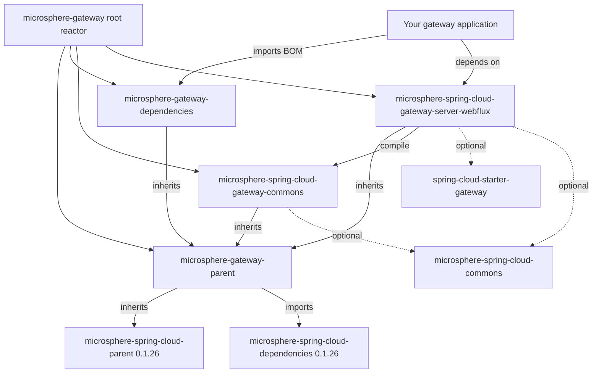

# Microsphere Gateway `0.1.x` User Guide

This guide documents the **`release-1.x`** branch of `microsphere-gateway`, i.e. the **`0.1.x`** version line. It is the
maintenance line for **pre-Jakarta stacks**: Spring Boot `2.x`, Spring Cloud `Hoxton`/`2020`/`2021`, and the `javax.*`
namespaces. Microsphere Gateway extends Spring Cloud Gateway with the custom `we://` route scheme, dynamic
web-endpoint routing against Spring Cloud discovery, and route refresh behavior.

> [!IMPORTANT]
> This line has **four modules only** and **no WebMVC (servlet) module**. There is no
> `microsphere-spring-cloud-gateway-server-webmvc` artifact on `0.1.x` — reactive WebFlux only. If you run Spring Boot
> `3.x` / JDK `17`+ with `jakarta.*`, move to the current line described in [the current user
> guide](../../current/user-guide/README.md).

## Documents in this guide

| Document | Module | What you get |
|---|---|---|
| [microsphere-gateway-parent](microsphere-gateway-parent.md) | `microsphere-gateway-parent` (POM) | Parent POM: imported BOM, version properties, inheritance |
| [microsphere-gateway-dependencies](microsphere-gateway-dependencies.md) | `microsphere-gateway-dependencies` (POM) | BOM: managed artifacts, version override |
| [microsphere-spring-cloud-gateway-commons](microsphere-spring-cloud-gateway-commons.md) | `microsphere-spring-cloud-gateway-commons` | Constants, conditional annotations, `WebEndpointConfig`, bind listener |
| [microsphere-spring-cloud-gateway-server-webflux](microsphere-spring-cloud-gateway-server-webflux.md) | `microsphere-spring-cloud-gateway-server-webflux` | Auto-configuration, `we://` routing, filter caching, refresh events |
| This README | `microsphere-gateway` (reactor root) | Guide index, version status, module map |

## Version status

| Item | Value |
|---|---|
| Branch | `release-1.x` |
| Version line | `0.1.x` |
| Maven `revision` on the branch | `0.1.19-SNAPSHOT` |
| Latest published release | `0.1.18` |
| Maven group | `io.github.microsphere-projects` |
| Root POM parent | `microsphere-spring-cloud-parent:0.1.26` |
| BOM imported by `microsphere-gateway-parent` | `microsphere-spring-cloud-dependencies:0.1.26` |
| JDK baseline | Java 8+ (the branch `README` states "JDK 8 or newer") |
| CI matrix | Java `8`/`11`/`17`/`21`/`25` x Maven profiles `spring-cloud-hoxton`, `spring-cloud-2020`, `spring-cloud-2021` |

## Modules and how they relate

`microsphere-spring-cloud-gateway-server-webflux` is the only module an application normally depends on;
`microsphere-spring-cloud-gateway-commons` arrives transitively with it (`compile` scope, non-optional). Every
third-party dependency in both modules is declared `<optional>`, so **you** bring `spring-cloud-starter-gateway`, your
discovery client and Spring Cloud LoadBalancer.

## Quick start on `0.1.x`

1. Import the BOM and add the WebFlux module (see [microsphere-gateway-dependencies](microsphere-gateway-dependencies.md)).
2. Declare one `we://` route with a `{application}` path variable and a `metadata.web-endpoint` block (see
   [microsphere-spring-cloud-gateway-server-webflux](microsphere-spring-cloud-gateway-server-webflux.md)).
3. Keep a discovery client plus `microsphere-spring-cloud-commons` on the classpath; the web-endpoint filter is
   conditional on both.

## Where to go next

- Developer guide for this line: [../developer-guide/README.md](../developer-guide/README.md)
- Current (`0.2.x`) line user guide: [../../current/user-guide/README.md](../../current/user-guide/README.md)
- Project overview: [../../../README.md](../../../README.md)

## 中文

本指南的中文版本：[zh/README.md](zh/README.md)
