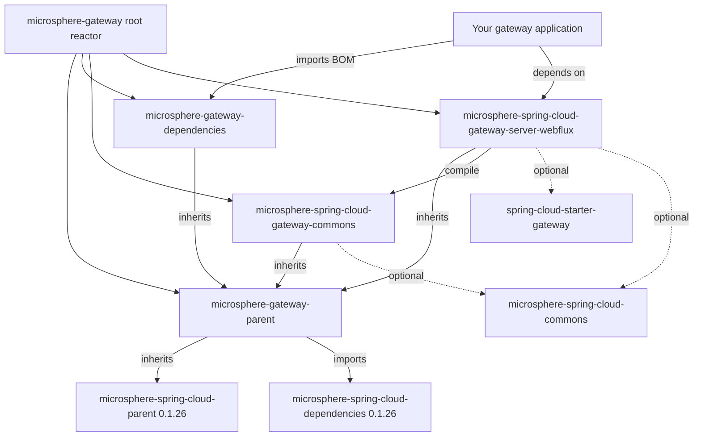

# `microsphere-gateway-dependencies`

## Purpose and audience

`microsphere-gateway-dependencies` is the published **BOM** of the `0.1.x` line: a `pom`-packaging module whose only
content is a `<dependencyManagement>` block for the two gateway artifacts. Import it in your application (or in your
own library BOM) so you can declare `microsphere-spring-cloud-gateway-*` dependencies without versions.

Who should use it:

- application teams running a Spring Cloud Gateway (WebFlux) service on Spring Boot `2.x` that adopt Microsphere
  Gateway on the `0.1.x` maintenance line;
- platform teams publishing a company-wide BOM that wants one place to pin the Microsphere gateway versions.

> [!IMPORTANT]
> The BOM manages **exactly two** artifacts, both reactive. `0.1.x` (`release-1.x`) has **no WebMVC module** — there is
> no `microsphere-spring-cloud-gateway-server-webmvc` entry to manage on this line. Servlet / Spring Boot `3.x`
> (`jakarta.*`) stacks belong to the current line: [../../current/user-guide/README.md](../../current/user-guide/README.md).

## Version information

| Item | Value |
|---|---|
| Coordinates | `io.github.microsphere-projects:microsphere-gateway-dependencies:${revision}` |
| Maven `revision` on `release-1.x` | `0.1.19-SNAPSHOT` |
| Latest published release | `0.1.18` |
| Packaging | `pom` (import with `<scope>import</scope>`) |
| Maven Central group | `io.github.microsphere-projects` |
| Version line | `0.1.x` (maintenance) |

## Compatibility range

| Axis | Supported on `0.1.x` | Notes |
|---|---|---|
| JDK | `8`, `11`, `17`, `21`, `25` | Branch `README`: "JDK 8 or newer"; `.github/workflows/maven-build.yml` matrix `['8','11','17','21','25']` |
| Spring Cloud | `Hoxton`, `2020`, `2021` | Maven profiles `spring-cloud-hoxton`, `spring-cloud-2020`, `spring-cloud-2021` |
| Spring Boot | `2.x` (pre-Jakarta) | The managed modules compile against `javax.*` (`WebEndpointConfig` imports `javax.validation`) |
| Required gateway starter | `org.springframework.cloud:spring-cloud-starter-gateway` | `<optional>` in the WebFlux module — the BOM does **not** add it for you |
| Move to `0.2.x` when | Spring Boot `3.x`, a JDK `17+` baseline, or a servlet gateway is required | [../../current/user-guide/README.md](../../current/user-guide/README.md) |

The BOM inherits `microsphere-gateway-parent`, so the Spring Boot / Spring Cloud versions behind the three profiles are
those pinned by the external parent `microsphere-spring-cloud-parent:0.1.26` (`2.3.12.RELEASE`/`Hoxton.SR12`,
`2.4.13`/`2020.0.5`, `2.6.15`/`2021.0.9`). Details: [microsphere-gateway-parent.md](microsphere-gateway-parent.md).

## Installation

```xml
<dependencyManagement>
    <dependencies>
        <dependency>
            <groupId>io.github.microsphere-projects</groupId>
            <artifactId>microsphere-gateway-dependencies</artifactId>
            <version>0.1.18</version>
            <type>pom</type>
            <scope>import</scope>
        </dependency>
    </dependencies>
</dependencyManagement>

<dependencies>
    <!-- managed by this BOM: no version needed -->
    <dependency>
        <groupId>io.github.microsphere-projects</groupId>
        <artifactId>microsphere-spring-cloud-gateway-server-webflux</artifactId>
    </dependency>
    <dependency>
        <groupId>io.github.microsphere-projects</groupId>
        <artifactId>microsphere-spring-cloud-gateway-commons</artifactId>
    </dependency>

    <!-- NOT managed by this BOM: bring your own, versions come from your Spring Boot / Spring Cloud BOMs -->
    <dependency>
        <groupId>org.springframework.cloud</groupId>
        <artifactId>spring-cloud-starter-gateway</artifactId>
    </dependency>
    <dependency>
        <groupId>org.springframework.cloud</groupId>
        <artifactId>spring-cloud-loadbalancer</artifactId>
    </dependency>
</dependencies>
```

Importing a BOM only manages versions: it adds no dependency and no transitive jar. The `commons` entry is optional in
practice because `microsphere-spring-cloud-gateway-server-webflux` already depends on it in `compile` scope; declare it
explicitly only when you use `RouteConstants`, `CommonsPropertyConstants`, `ConfigUtils` or `WebEndpointConfig` directly.

## Dependency-management surface

Verbatim from `microsphere-gateway-dependencies/pom.xml` on `release-1.x`:

| Managed artifact | Group | Version expression | Type | Notes |
|---|---|---|---|---|
| `microsphere-spring-cloud-gateway-commons` | `io.github.microsphere-projects` | `${revision}` | `jar` (default) | Constants, conditional annotations, web-endpoint config model |
| `microsphere-spring-cloud-gateway-server-webflux` | `io.github.microsphere-projects` | `${revision}` | `jar` (default) | Reactive gateway integration; the commons artifact above is its only non-optional dependency |

Nothing else is listed. There is no `<dependencyManagement>` entry for `spring-cloud-starter-gateway`, for a discovery
client, or for a WebMVC module on this line.

| Inherited element | Value | Effect |
|---|---|---|
| `<parent>` | `io.github.microsphere-projects:microsphere-gateway-parent:${revision}` (`relativePath ../microsphere-gateway-parent/pom.xml`) | Brings the import of `microsphere-spring-cloud-dependencies:0.1.26` into this BOM's effective model |
| Managed Microsphere Spring Cloud artifacts | reached through the parent, e.g. `microsphere-spring-cloud-commons`, `microsphere-spring-boot-webflux` | Lets versionless declarations resolve — this is how the module POMs on this branch are written |

### Overriding a managed version

Pin one artifact to a different build (for example a locally patched `0.1.19-SNAPSHOT`) by declaring it in your own
`<dependencyManagement>` **before** the BOM import — local entries win over imported BOMs in Maven:

```xml
<dependencyManagement>
    <dependencies>
        <dependency>
            <groupId>io.github.microsphere-projects</groupId>
            <artifactId>microsphere-spring-cloud-gateway-server-webflux</artifactId>
            <version>0.1.19-SNAPSHOT</version>
        </dependency>
        <dependency>
            <groupId>io.github.microsphere-projects</groupId>
            <artifactId>microsphere-gateway-dependencies</artifactId>
            <version>0.1.18</version>
            <type>pom</type>
            <scope>import</scope>
        </dependency>
    </dependencies>
</dependencyManagement>
```

Both managed artifacts share `${revision}` inside this BOM, so if you override one, override the other to the same
value: the WebFlux module depends on `microsphere-spring-cloud-gateway-commons:${revision}` **non-optionally**, and a
mixed-version pair is exactly what that dependency would then hide.

## Configuration reference

The BOM has no code and no `features.yaml`; it reads and contributes **no** `microsphere.*` key. For the keys the
managed modules introduce, see:

- [microsphere-spring-cloud-gateway-commons.md](microsphere-spring-cloud-gateway-commons.md)
- [microsphere-spring-cloud-gateway-server-webflux.md](microsphere-spring-cloud-gateway-server-webflux.md)

## Examples

A minimal `0.1.x` gateway using this BOM — coordinates from the BOM, route shape from
`microsphere-spring-cloud-gateway-server-webflux/src/test/resources/META-INF/config/default/test.yaml` (the `gateway`
profile document, which is what `WebEndpointMappingGlobalFilterTest` activates with
`spring.profiles.active=simple-service-registry,gateway`):

```yaml
spring:
  cloud:
    gateway:
      routes:
        - id: web-endpoint-mapping
          uri: we://all
          predicates:
            - Path=/{application}/**
          metadata:
            web-endpoint:
              excludes:
                - patterns: /test-1/**
                - patterns: /test-2/**
                  methods: GET
                - patterns: /test-3/abc/**
                  consumes: application/json
                  produces: plain/text
```

## Pitfalls and FAQ

**Q. I imported the BOM and `spring-cloud-starter-gateway` is still missing.**
By design. The BOM manages only the two Microsphere artifacts, and the WebFlux module keeps
`spring-cloud-starter-gateway` `<optional>` so it does not force a gateway version on you.

**Q. My app is on Spring Boot `3.x`.**
Do not use this BOM. Its effective model targets the `0.1.26` Microsphere Spring Cloud stack (Spring Boot `2.x`), and
`WebEndpointConfig` binds `javax.validation` constraints. Use the `0.2.x` line
([../../current/user-guide/README.md](../../current/user-guide/README.md)).

**Q. `microsphere-spring-cloud-gateway-commons` resolves to a different version than the WebFlux module expects.**
Declare both artifacts versionless from this BOM (or override both to the same version). Only the WebFlux module's own
POM carries the hard `compile` dependency on commons, and it does so with `${revision}`.

## Module dependency relationships



## See also

- Reactor overview and version status: [README.md](README.md)
- Parent POM and profile versions: [microsphere-gateway-parent.md](microsphere-gateway-parent.md)
- Developer guide for this line: [../developer-guide/README.md](../developer-guide/README.md)

## 中文

[zh/microsphere-gateway-dependencies.md](zh/microsphere-gateway-dependencies.md)
