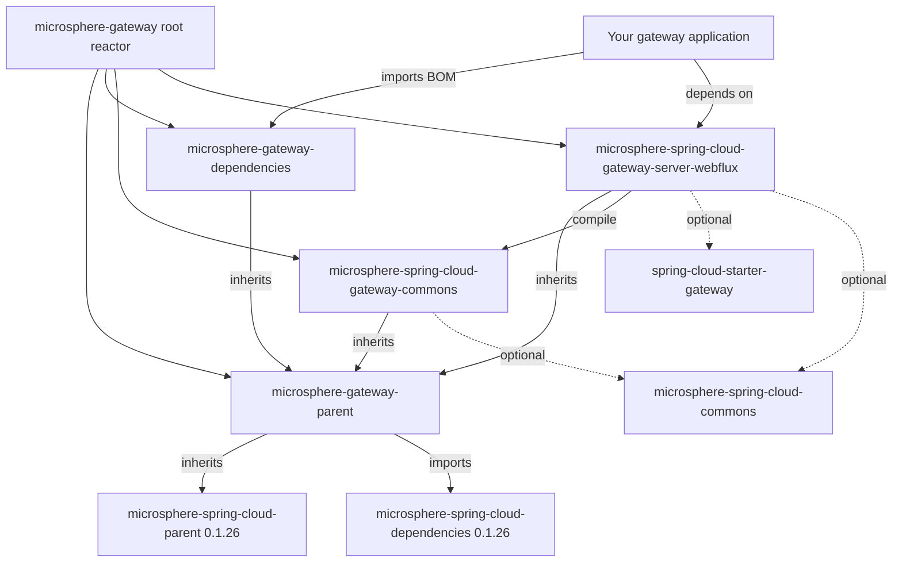

# `microsphere-gateway-parent`

## Purpose and audience

`microsphere-gateway-parent` is a `pom`-packaging module. It ships **no Java classes, no resources, and no
auto-configuration** — its `pom.xml` is the module's entire content. It exists to give every module of the `0.1.x`
reactor one place to inherit dependency management from, by importing the Microsphere Spring Cloud BOM.

Depend on it when you are:

- a maintainer adding a module to this version line, or
- an organisation publishing your own Spring Cloud Gateway extensions on top of the same Microsphere Spring Cloud BOM.

Prefer `microsphere-gateway-dependencies` (the published BOM) if you only need version management in an application —
see [microsphere-gateway-dependencies.md](microsphere-gateway-dependencies.md).

> [!IMPORTANT]
> `0.1.x` (`release-1.x`) is the maintenance line for pre-Jakarta stacks and has **no WebMVC module**: the only server
> module on this line is `microsphere-spring-cloud-gateway-server-webflux`. Spring Boot `3.x` / `jakarta.*` users
> belong on the current line: [../../current/user-guide/README.md](../../current/user-guide/README.md).

## Version information

| Item | Value |
|---|---|
| Coordinates | `io.github.microsphere-projects:microsphere-gateway-parent:${revision}` |
| Maven `revision` on `release-1.x` | `0.1.19-SNAPSHOT` |
| Latest published release | `0.1.18` |
| Packaging | `pom` |
| Maven Central group | `io.github.microsphere-projects` |
| Version line | `0.1.x` (maintenance) |

The POM declares its own version as `${revision}`, a property defined in the reactor root `microsphere-gateway` POM, so
the parent, the BOM and both jar modules always publish with one version.

## Compatibility range

| Axis | Supported on `0.1.x` | Notes |
|---|---|---|
| JDK | `8`, `11`, `17`, `21`, `25` | The branch `README` requires "JDK 8 or newer"; `.github/workflows/maven-build.yml` runs the matrix `['8','11','17','21','25']` |
| Spring Cloud | `Hoxton`, `2020`, `2021` | Selected by the Maven profiles `spring-cloud-hoxton`, `spring-cloud-2020`, `spring-cloud-2021` |
| Spring Boot | `2.x` (pre-Jakarta) | Selected by the same profiles; the managed modules compile against `javax.*` |
| Required gateway starter | `org.springframework.cloud:spring-cloud-starter-gateway` | Declared `<optional>` by the WebFlux module, so applications add it themselves |
| Move to `0.2.x` when | You run Spring Boot `3.x` (Jakarta) or need a servlet gateway | [../../current/user-guide/README.md](../../current/user-guide/README.md) |

The three profiles are **not** defined in this repository; they come from the external parent POM
`microsphere-spring-cloud-parent:0.1.26`, which the reactor root inherits and which pins, per profile:

| Profile | Spring Boot | Spring Cloud | Spring Cloud Alibaba |
|---|---|---|---|
| `spring-cloud-hoxton` | `2.3.12.RELEASE` | `Hoxton.SR12` | `2.2.10` |
| `spring-cloud-2020` | `2.4.13` | `2020.0.5` | `2021.1` |
| `spring-cloud-2021` (active by default) | `2.6.15` | `2021.0.9` | `2021.0.6.1` |

## Installation

You do not add this module as a dependency. You inherit it as a parent, using the released version:

```xml
<parent>
    <groupId>io.github.microsphere-projects</groupId>
    <artifactId>microsphere-gateway-parent</artifactId>
    <version>0.1.18</version>
    <relativePath/>
</parent>
```

Do **not** copy `${revision}` into your own POM: it is a reactor-local property and is undefined outside this build.

## Dependency-management surface

This is the module's "API". Everything below is observable in `microsphere-gateway-parent/pom.xml` on `release-1.x`.

| Element | Value | Effect |
|---|---|---|
| `<parent>` | `io.github.microsphere-projects:microsphere-gateway:${revision}` (`relativePath ../pom.xml`) | Reactor root, whose own parent is `microsphere-spring-cloud-parent:0.1.26` |
| Property `microsphere-spring-cloud.version` | `0.1.26` | Single knob for the Microsphere Spring Cloud stack |
| `<dependencyManagement>` import | `io.github.microsphere-projects:microsphere-spring-cloud-dependencies:${microsphere-spring-cloud.version}`, `<type>pom</type>`, `<scope>import</scope>` | Version management for the Microsphere Spring Cloud artifacts and, through the inherited chain, the Spring Boot / Spring Cloud / Alibaba BOMs |

Inheritance chain of `microsphere-gateway-parent`:

```text
microsphere-gateway-parent
  -> microsphere-gateway                     (reactor root, revision 0.1.19-SNAPSHOT)
     -> microsphere-spring-cloud-parent:0.1.26
        imports spring-boot-dependencies / spring-cloud-dependencies /
        spring-cloud-alibaba-dependencies / microsphere-spring-boot-dependencies
```

Concrete evidence that the management works: the module POMs on this branch declare Microsphere and Spring artifacts
**without** a `<version>`, and the build still resolves them —

```xml
<!-- microsphere-spring-cloud-gateway-server-webflux/pom.xml -->
<dependency>
    <groupId>io.github.microsphere-projects</groupId>
    <artifactId>microsphere-spring-cloud-commons</artifactId>
    <optional>true</optional>
</dependency>

<dependency>
    <groupId>io.github.microsphere-projects</groupId>
    <artifactId>microsphere-spring-boot-webflux</artifactId>
    <optional>true</optional>
</dependency>
```

```xml
<!-- microsphere-spring-cloud-gateway-commons/pom.xml -->
<dependency>
    <groupId>org.springframework.cloud</groupId>
    <artifactId>spring-cloud-commons</artifactId>
    <optional>true</optional>
</dependency>
```

The `microsphere-spring-cloud-dependencies` BOM itself is published by the `microsphere-spring-cloud` project; its full
managed-artifact list is therefore not readable from this repository and is not repeated here.

### Overriding a managed version

```xml
<properties>
    <!-- moves the whole Microsphere Spring Cloud stack, e.g. to a newer 0.1.x BOM -->
    <microsphere-spring-cloud.version>0.1.26</microsphere-spring-cloud.version>
</properties>
```

Pin an individual artifact instead by declaring it in your own `<dependencyManagement>` **before** any imported BOM —
locally declared entries win over imported ones in Maven.

## Configuration reference

`microsphere-gateway-parent` contains no code and no `features.yaml`, so it contributes **no** `microsphere.*`
configuration keys. Its only tunables are Maven properties:

| Property | Default on `release-1.x` | Type | Effect |
|---|---|---|---|
| `revision` | `0.1.19-SNAPSHOT` (declared in the reactor root, not here) | String | Version of the parent, the BOM and both jar modules |
| `microsphere-spring-cloud.version` | `0.1.26` | String | Version of the imported `microsphere-spring-cloud-dependencies` BOM |

## Examples

Run the reactor the way CI does, from the branch root (`README` on `release-1.x`, section "Build or Test Locally"):

```bash
./mvnw package
./mvnw test -Ptest,spring-cloud-2021
```

Building one module against another Spring Cloud train:

```bash
./mvnw -pl microsphere-spring-cloud-gateway-server-webflux -am -Pspring-cloud-hoxton package
```

(`-Ptest,coverage,spring-cloud-<train>` is the profile set used by `.github/workflows/maven-build.yml`.)

## Pitfalls and FAQ

**Q. Can an application inherit `microsphere-gateway-parent` instead of importing the BOM?**
Yes, and you then get the Microsphere Spring Cloud management for free. But inheritance also imports this line's build
configuration, which is aimed at library modules. Applications normally import
`microsphere-gateway-dependencies`, which inherits this same parent and adds the two gateway artifacts to management.

**Q. The `spring-cloud-*` profiles are missing from my build.**
They are declared in the external `microsphere-spring-cloud-parent:0.1.26`, not in this repository. If that parent
cannot be resolved, no profile (and no Spring Boot / Spring Cloud version) exists.

**Q. Nothing happens when I change the version here.**
`microsphere-spring-cloud-dependencies` is imported, not inherited: its `0.1.26` coordinate is written into this
module's `<dependencyManagement>`. Change the `microsphere-spring-cloud.version` property, not an imported entry.

## Module dependency relationships



## See also

- Reactor overview and version status: [README.md](README.md)
- Published BOM: [microsphere-gateway-dependencies.md](microsphere-gateway-dependencies.md)
- Developer guide for this line: [../developer-guide/README.md](../developer-guide/README.md)

## 中文

[zh/microsphere-gateway-parent.md](zh/microsphere-gateway-parent.md)
