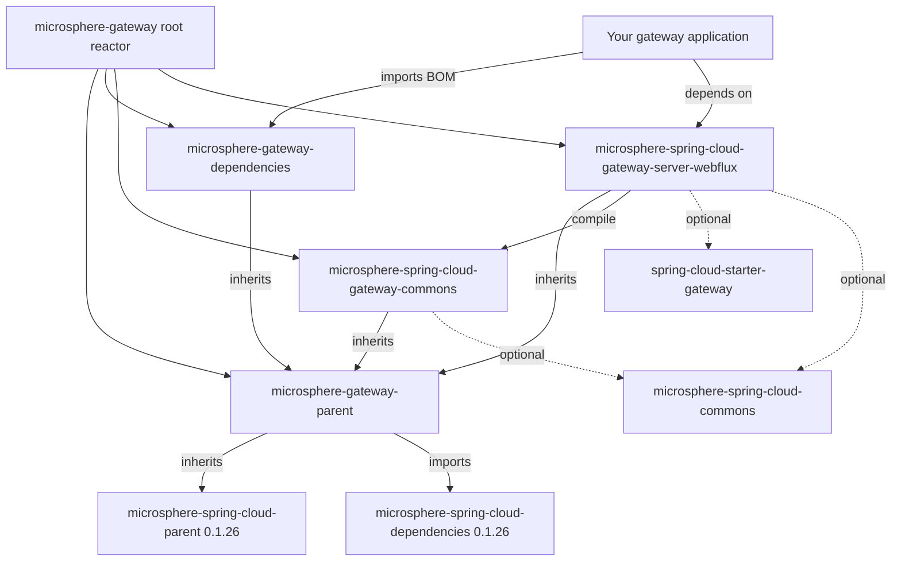

# `microsphere-spring-cloud-gateway-commons`

## Purpose and audience

The shared contract of the `0.1.x` gateway line: property-name constants, the two Microsphere conditional annotations,
the `metadata.web-endpoint` configuration model (`WebEndpointConfig`), the `ConfigUtils` binder, and the
`WebEndpointConfigurationPropertiesBindListener` that turns bound route metadata into a typed object.

Depend on it when you are:

- an application that reads/writes web-endpoint route metadata programmatically (constants, `ConfigUtils`,
  `WebEndpointConfig`) instead of hard-coding `"we"`, `"web-endpoint"`, `msgw-we-rewrite-path`, ...;
- an author of a **new** gateway server module for this line — the reactive module
  `microsphere-spring-cloud-gateway-server-webflux` already consumes it in `compile` scope, and so do any future
  transport variants;
- a consumer of `microsphere-spring-cloud-gateway-server-webflux`: this artifact arrives transitively, you do not have
  to declare it.

> [!IMPORTANT]
> `0.1.x` (`release-1.x`) is the maintenance line for pre-Jakarta stacks. It has **no WebMVC module**: this commons
> artifact is shared by the single reactive server module only, and `WebEndpointConfig` deliberately uses
> `javax.validation` and `org.springframework.web.bind.annotation.RequestMethod`. Spring Boot `3.x` / `jakarta.*`
> projects must use the current line: [../../current/user-guide/README.md](../../current/user-guide/README.md).

## Version information

| Item | Value |
|---|---|
| Coordinates | `io.github.microsphere-projects:microsphere-spring-cloud-gateway-commons:${revision}` |
| Maven `revision` on `release-1.x` | `0.1.19-SNAPSHOT` |
| Latest published release | `0.1.18` |
| Packaging | `jar` |
| Maven Central group | `io.github.microsphere-projects` |
| Javadoc | No link for this artifact; the branch `README` lists Javadoc for `microsphere-spring-cloud-gateway-server-webflux` only |

## Compatibility range

| Axis | Supported on `0.1.x` | Notes |
|---|---|---|
| JDK | `8`, `11`, `17`, `21`, `25` | Branch `README`: "JDK 8 or newer"; CI matrix in `.github/workflows/maven-build.yml` |
| Spring Cloud | `Hoxton`, `2020`, `2021` | Profiles `spring-cloud-hoxton`, `spring-cloud-2020`, `spring-cloud-2021` (Spring Boot `2.3.12.RELEASE` / `2.4.13` / `2.6.15`, pinned by the external parent `microsphere-spring-cloud-parent:0.1.26`) |
| Bean Validation | `javax.validation` API | `WebEndpointConfig.Mapping` uses `javax.validation.constraints.NotNull` / `javax.validation.Valid` |
| Spring types used | `spring-web` (`RequestMethod`), `spring-boot` `Binder` | Both declared `<optional>` in the module POM |
| Required gateway starter | `org.springframework.cloud:spring-cloud-starter-gateway` | Needed only by the WebFlux module, not by commons itself; the starter is `<optional>`, so applications add it |
| Move to `0.2.x` when | Spring Boot `3.x` / `jakarta.validation` / JDK `17+` baseline | [../../current/user-guide/README.md](../../current/user-guide/README.md) |

Every dependency of this module is `<optional>` (including `microsphere-spring-cloud-commons`, `spring-boot-starter`,
`spring-cloud-commons`, `spring-cloud-loadbalancer`, `spring-web`, `validation-api`), so it contributes **no transitive
runtime jars** — see the installation section for what you must add yourself.

## Installation

Recommended: import the BOM and depend on the reactive module, which pulls this artifact in.

```xml
<dependencyManagement>
    <dependencies>
        <dependency>
            <groupId>io.github.microsphere-projects</groupId>
            <artifactId>microsphere-gateway-dependencies</artifactId>
            <version>0.1.18</version>
            <type>pom</type>
            <scope>import</scope>
        </dependency>
    </dependencies>
</dependencyManagement>
```

Depend on commons directly only when you use its API without a gateway server module:

```xml
<dependency>
    <groupId>io.github.microsphere-projects</groupId>
    <artifactId>microsphere-spring-cloud-gateway-commons</artifactId>
</dependency>
```

Because all of commons' own dependencies are optional, a direct consumer must supply what the API touches:

```xml
<dependency>
    <groupId>org.springframework.boot</groupId>
    <artifactId>spring-boot-starter</artifactId>
</dependency>
<dependency>
    <groupId>org.springframework</groupId>
    <artifactId>spring-web</artifactId>
</dependency>
<dependency>
    <groupId>javax.validation</groupId>
    <artifactId>validation-api</artifactId>
</dependency>
<!-- a JSR-303 provider plus an EL implementation, required by ConfigUtils at runtime -->
<dependency>
    <groupId>org.hibernate.validator</groupId>
    <artifactId>hibernate-validator</artifactId>
</dependency>
<dependency>
    <groupId>org.apache.tomcat.embed</groupId>
    <artifactId>tomcat-embed-el</artifactId>
</dependency>
```

The last two mirror what the module's own tests need: `microsphere-spring-cloud-gateway-commons/pom.xml` adds
`hibernate-validator` and `tomcat-embed-el` in `test` scope so `ConfigUtilsTest` can bind and validate.

## API reference

Package `io.microsphere.spring.cloud.gateway.commons.constants`.

### `interface CommonConstants` (`@since 1.0.0`)

| Constant | Type | Value | When to use |
|---|---|---|---|
| `APPLICATION_NAME_URI_TEMPLATE_VARIABLE_NAME` | `String` | `"application"` | The URI-template variable the routing filter reads from the matched `Path` predicate. Your predicate must expose it, e.g. `Path=/{application}/**`. Asserted by `CommonConstantsTest#testConstants`. |

### `interface CommonsPropertyConstants`

Annotated members carry `@io.microsphere.annotation.ConfigurationProperty(type = boolean.class, defaultValue = "true", source = APPLICATION_SOURCE)`, which is how the properties reach the generated configuration metadata.

| Constant | Type | Value / default | When to use |
|---|---|---|---|
| `MICROSPHERE_GATEWAY_SPRING_CLOUD_PROPERTY_NAME_PREFIX` | `String` | `"microsphere.spring.cloud.gateway."` | Prefix for all gateway switches |
| `DEFAULT_MICROSPHERE_GATEWAY_ENABLED` | `String` | `"true"` | Shared default for every enabled switch on this line |
| `MICROSPHERE_GATEWAY_ENABLED_PROPERTY_NAME` | `String` | `"microsphere.spring.cloud.gateway.enabled"`, default `true` | Master Microsphere Gateway switch |
| `MICROSPHERE_WEB_ENDPOINT_MAPPING_PROPERTY_NAME_PREFIX` | `String` | `"microsphere.spring.cloud.web-endpoint-mapping."` | Prefix for the web-endpoint mapping feature |
| `MICROSPHERE_WEB_ENDPOINT_MAPPING_ENABLED_PROPERTY_NAME` | `String` | `"microsphere.spring.cloud.web-endpoint-mapping.enabled"`, default `true` | Web-endpoint routing switch |

All five values are asserted verbatim in `CommonsPropertyConstantsTest#testConstants`.

### `interface RouteConstants`

| Constant | Type | Value | Behaviour / when to use |
|---|---|---|---|
| `SCHEME` | `String` | `"we"` | The custom route scheme. A `RouteDefinition` is treated as a web-endpoint route only when `uri.getScheme()` equals this value. |
| `ALL_SERVICES` | `String` | `"all"` | Host meaning "every discovered service": `we://all`. Anything else is parsed as a comma-delimited service list (`we://orders-service,payments-service`). |
| `ID_KEY` | `String` | `"id"` | Property leaf for a route id; the reactive filter uses it to decide whether an `EnvironmentChangeEvent` touches a known route id. |
| `METADATA_KEY` | `String` | `"metadata"` | Property leaf the bind listener looks for when it rewrites route metadata. |
| `WEB_ENDPOINT_KEY` | `String` | `"web-endpoint"` | Metadata key under `metadata` holding the `WebEndpointConfig` (YAML: `metadata.web-endpoint`). |
| `WEB_ENDPOINT_REWRITE_PATH_ATTRIBUTE_NAME` | `String` | `"msgw-we-rewrite-path"` | `ServerWebExchange` attribute name carrying the path that the `{application}` prefix was stripped from. |

Verified by `RouteConstantsTest#testConstants`.

Package `io.microsphere.spring.cloud.gateway.commons.annotation`.

### `@interface ConditionalOnMicrosphereGatewayEnabled`

```java
@Retention(RUNTIME)
@Target({TYPE, METHOD})
@Documented
@ConditionalOnProperty(name = MICROSPHERE_GATEWAY_ENABLED_PROPERTY_NAME, matchIfMissing = true)
public @interface ConditionalOnMicrosphereGatewayEnabled {
}
```

Matches unless `microsphere.spring.cloud.gateway.enabled=false`; absent means enabled (`matchIfMissing = true`). Use it
on your own `@Configuration` or `@Bean` when a component belongs to Microsphere Gateway but is not covered by the
built-in auto-configurations.

### `@interface ConditionalOnMicrosphereWebEndpointMappingEnabled`

```java
@Retention(RUNTIME)
@Target({TYPE, METHOD})
@Documented
@ConditionalOnMicrosphereGatewayEnabled
@ConditionalOnProperty(name = MICROSPHERE_WEB_ENDPOINT_MAPPING_ENABLED_PROPERTY_NAME, matchIfMissing = true)
public @interface ConditionalOnMicrosphereWebEndpointMappingEnabled {
}
```

Meta-annotated with `@ConditionalOnMicrosphereGatewayEnabled`, so **both** switches must be on: it is the finer-grained
gate. `WebEndpointMappingGatewayAutoConfiguration` in the reactive module is annotated with it.

Package `io.microsphere.spring.cloud.gateway.commons.config`.

### `class WebEndpointConfig`

```java
@Validated
public class WebEndpointConfig {
    @NotNull @Valid private List<Mapping> excludes = new LinkedList<>();
    public List<Mapping> getExcludes();
    public void setExcludes(List<Mapping> excludes);

    public static class Mapping {
        @NotNull @Valid private String[] patterns;
        @Nullable private RequestMethod[] methods;
        @Nullable private String[] params;
        @Nullable private String[] headers;
        @Nullable private String[] consumes;
        @Nullable private String[] produces;
        // getters / setters, plus:
        @Nonnull public RequestMethod[] getMethods();   // RequestMethod.values() when unset
        @Nonnull public String[] getHeaders();          // ArrayUtils.EMPTY_STRING_ARRAY when unset
    }
}
```

The configuration model of one route's `metadata.web-endpoint` block. `Mapping` mirrors Spring's request-mapping
attributes, and the reactive module feeds each entry straight into
`RequestMappingInfo.paths(...).methods(...).params(...).headers(...).consumes(...).produces(...).build()`.

| Field | Type | Default when the YAML omits it | Behaviour |
|---|---|---|---|
| `excludes` | `List<Mapping>` | empty `LinkedList` | Mappings removed from web-endpoint routing for that route |
| `patterns` | `String[]` | `@NotNull` — binding fails if absent | Path patterns |
| `methods` | `RequestMethod[]` | all `RequestMethod.values()` | Restricts the exclude to HTTP verbs |
| `params` | `String[]` | `null` | Request-parameter conditions |
| `headers` | `String[]` | `EMPTY_STRING_ARRAY` (empty array, never `null`) | Header conditions |
| `consumes` | `String[]` | `null` | `Content-Type` conditions |
| `produces` | `String[]` | `null` | `Accept` conditions |

These defaults are asserted in `ConfigUtilsTest#assertWebEndpointConfig` (`assertSame(EMPTY_STRING_ARRAY, ...)`,
`assertArrayEquals(RequestMethod.values(), ...)`).

### `abstract class ConfigUtils implements Utils`

Private constructor; utility type, never instantiated.

| Signature | Returns | Behaviour |
|---|---|---|
| `@Nullable static WebEndpointConfig getWebEndpointConfig(Environment environment, String configPrefix)` | bound config or `null` | Binds `configPrefix` to `WebEndpointConfig` with a `Binder` that carries a `ValidationBindHandler` backed by a `LocalValidatorFactoryBean`, so the `@NotNull`/`@Valid` constraints above are enforced. Returns `null` when the prefix is absent. |
| `@Nullable static WebEndpointConfig getWebEndpointConfig(Map<String, Object> metadata)` | the typed config or `null` | Reads `RouteConstants.WEB_ENDPOINT_KEY` from a route-metadata map and returns it **only if the value already is a `WebEndpointConfig`**. Raw maps (plain YAML) yield `null`. |

The `ValidationBindHandler` and the `Bindable<WebEndpointConfig>` are built in a static initializer, so touching this
class requires a JSR-303 provider and an EL implementation at runtime.

### `class WebEndpointConfigurationPropertiesBindListener implements BindListener, EnvironmentAware`

```java
public static final String BEAN_NAME = "webEndpointConfigurationPropertiesBindListener";
public WebEndpointConfigurationPropertiesBindListener(String gatewayRoutesPropertyNamePrefix) // assertNotBlank
@Override public void onFinish(ConfigurationPropertyName name, Bindable<?> target, BindContext context, Object result)
@Override public void setEnvironment(Environment environment)
```

Post-processes Spring Boot property binding: whenever a bound property name starts with the configured routes prefix
and **ends with** `metadata` (i.e. `spring.cloud.gateway.routes[*].metadata`), it binds the sibling
`metadata.web-endpoint` node with `ConfigUtils` and, when present, replaces the raw map value with the typed
`WebEndpointConfig` instance. That replacement is what makes
`ConfigUtils.getWebEndpointConfig(Map)` — and therefore the routing filter — work. It is registered as a bean by
`WebEndpointApplicationContextInitializer` in the reactive module, under `BEAN_NAME`, with
`spring.cloud.gateway.routes` as the constructor argument.

## Configuration reference

Keys below are the `microsphere.*` names this module's constants and `features.yaml` introduce. All are read from your
`Environment` and none is required — every switch defaults to enabled.

| Key | Type | Default | Effect | Source in the snapshot |
|---|---|---|---|---|
| `microsphere.spring.cloud.gateway.enabled` | `boolean` | `true` (`matchIfMissing = true`) | Master switch for Microsphere Gateway: gates `@ConditionalOnMicrosphereGatewayEnabled`, hence `GatewayAutoConfiguration` and, transitively, web-endpoint routing | `CommonsPropertyConstants.MICROSPHERE_GATEWAY_ENABLED_PROPERTY_NAME`, `ConditionalOnMicrosphereGatewayEnabledTest` |
| `microsphere.spring.cloud.web-endpoint-mapping.enabled` | `boolean` | `true` (`matchIfMissing = true`) | Switch for `we://` web-endpoint routing only; does not disable the route/filter caching wired by `GatewayAutoConfiguration` | `CommonsPropertyConstants.MICROSPHERE_WEB_ENDPOINT_MAPPING_ENABLED_PROPERTY_NAME`, `ConditionalOnMicrosphereWebEndpointMappingEnabledTest` |
| `microsphere.spring.cloud.gateway.` | prefix | — | Prefix constant only; not a settable property | `MICROSPHERE_GATEWAY_SPRING_CLOUD_PROPERTY_NAME_PREFIX` |
| `microsphere.spring.cloud.web-endpoint-mapping.` | prefix | — | Prefix constant only | `MICROSPHERE_WEB_ENDPOINT_MAPPING_PROPERTY_NAME_PREFIX` |
| `microsphere.spring.cloud.features.abstract.microsphere-spring-cloud-gateway-commons` | `List<String>` (class names) | `[io.microsphere.spring.cloud.gateway.commons.config.WebEndpointConfigurationPropertiesBindListener]` | Declares the module's "abstract features" for the Microsphere/Spring Cloud `HasFeatures` reporting; shipped in `src/main/resources/META-INF/config/default/features.yaml`. The property prefixes `microsphere.spring.cloud.features.abstract.` / `...named.` are defined by `FeaturesConstants` in the external `microsphere-spring-cloud-commons` | `microsphere-spring-cloud-gateway-commons/src/main/resources/META-INF/config/default/features.yaml` |

The per-route exposure rules are **not** `microsphere.*` keys; they live under
`spring.cloud.gateway.routes[*].metadata.web-endpoint.excludes[*]` with fields `patterns`, `methods`, `params`,
`headers`, `consumes`, `produces` (model: `WebEndpointConfig.Mapping`). See
[microsphere-spring-cloud-gateway-server-webflux.md](microsphere-spring-cloud-gateway-server-webflux.md).

## Code examples

### Reading a `web-endpoint` block from an `Environment`

Adapted from `ConfigUtilsTest#testGetWebEndpointConfig`, which loads
`src/test/resources/META-INF/config/default/test.yaml` into a `MockEnvironment` and attaches configuration-property
sources:

```java
// fixture under test (META-INF/config/default/test.yaml)
// metadata:
//   web-endpoint:
//     excludes:
//       - patterns: /test-1/**
//         methods: GET
//         params: p=1
//       - patterns: /test-2/**
//         methods: POST
//         headers: h=1
//       - patterns: /test-3/abc/**
//         consumes: application/json
//         produces: plain/text

// environment set-up copied from ConfigUtilsTest#createEnvironment()
Resource resource = new DefaultResourceLoader().getResource("classpath:META-INF/config/default/test.yaml");
List<PropertySource<?>> propertySources = new YamlPropertySourceLoader().load(resource.toString(), resource);
MockEnvironment environment = new MockEnvironment();
propertySources.forEach(source -> environment.getPropertySources().addFirst(source));
ConfigurationPropertySources.attach(environment);

WebEndpointConfig config = getWebEndpointConfig(environment, "metadata.web-endpoint");
List<WebEndpointConfig.Mapping> excludes = config.getExcludes(); // 3 entries
String[] patterns = excludes.get(0).getPatterns();               // ["/test-1/**"]
RequestMethod[] methods = excludes.get(2).getMethods();          // RequestMethod.values()
```

In an application the `Environment` is already the Spring `Environment`; the call you care about is the last one.

A prefix without a `web-endpoint` node yields `null` — `ConfigUtilsTest#testGetWebEndpointConfigOnMissing` binds
`spring.cloud.gateway.routes[1]` (the `request_size_route`, whose metadata is only `a: 1`) and asserts `null`.

### From raw route metadata to the typed config

The map overload only recognises objects produced by the bind listener, exactly as
`ConfigUtilsTest#testGetWebEndpointConfig` shows:

```java
Map<String, Object> metadata = new HashMap<>();
assertNull(getWebEndpointConfig(metadata));                                  // key absent
metadata.put(WEB_ENDPOINT_KEY, metadata);                                    // wrong type
assertNull(getWebEndpointConfig(metadata));
metadata.put(WEB_ENDPOINT_KEY, getWebEndpointConfig(environment,
        "spring.cloud.gateway.routes[0].metadata.web-endpoint"));            // typed instance
assertNotNull(getWebEndpointConfig(metadata));
```

### Registering the bind listener yourself

Mirrors `WebEndpointConfigurationPropertiesBindListenerTest#setUp`, which binds real route metadata with the listener
installed:

```java
WebEndpointConfigurationPropertiesBindListener bindListener =
        new WebEndpointConfigurationPropertiesBindListener("spring.cloud.gateway.routes");
bindListener.setEnvironment(environment);

Map<String, Object> metadata = bind(environment, "spring.cloud.gateway.routes[0].metadata",
        LinkedHashMap.class, bindListener);
assertNotNull(getWebEndpointConfig(metadata));
```

In a Spring Boot application you do not do this by hand: the reactive module registers the same listener under the
bean name `webEndpointConfigurationPropertiesBindListener` through `WebEndpointApplicationContextInitializer`. Note also
that `bind(...)` above is `io.microsphere.spring.boot.context.properties.bind.util.BindUtils.bind`, the test helper the
test imports; the production path is Spring Boot's own `@ConfigurationProperties` binding.

### Gating your own configuration

From `ConditionalOnMicrosphereGatewayEnabledTest` (and its `...WebEndpointMappingEnabled` sibling):

```java
@ConditionalOnMicrosphereGatewayEnabled
static class Config {
}

@Nested
@SpringJUnitConfig(Config.class)
@TestPropertySource(properties = "microsphere.spring.cloud.gateway.enabled=false")
class DisabledTest {

    @Autowired(required = false)
    private Config config;

    @Test
    void test() {
        assertNull(this.config); // matchIfMissing = true only applies when the key is absent
    }
}
```

## Pitfalls and FAQ

**`ConfigUtils` blows up at class-initialisation time.** Its static block creates a `LocalValidatorFactoryBean`, so a
Bean Validation provider plus an EL implementation must be on the classpath. Commons keeps `validation-api` `<optional>`
and adds `hibernate-validator`/`tomcat-embed-el` only in `test` scope; nothing is inherited at runtime.

**`getWebEndpointConfig(Map)` returns `null` even though the YAML clearly has `metadata.web-endpoint`.** The overload
checks `instanceof WebEndpointConfig`. Only `WebEndpointConfigurationPropertiesBindListener` converts the raw map, and
only when binding runs through the listener registered by the reactive module — a commons-only setup, or metadata built
by hand in Java, stays untyped.

**Every exclude needs `patterns`.** It is the one `@NotNull` field of `Mapping`, and `ConfigUtils` binds with a
`ValidationBindHandler`, so an entry without it fails binding rather than being ignored.

**`methods` left out means "all methods", not "no method".** `getMethods()` returns `RequestMethod.values()` when the
array is empty (`ConfigUtilsTest#assertWebEndpointConfig` asserts this for the `/test-3/abc/**` entry), so an exclude
with only `patterns` blocks the whole path.

**Turning off `microsphere.spring.cloud.web-endpoint-mapping.enabled` does not disable everything.** It only gates
`WebEndpointMappingGatewayAutoConfiguration`; `GatewayAutoConfiguration` (heartbeat suppression, refresh propagation,
`CachingFilteringWebHandler`) is gated by `microsphere.spring.cloud.gateway.enabled` and
`spring.cloud.gateway.enabled`.

**No transitive dependencies at all.** Every dependency of this module is `<optional>`, so an application that uses
commons directly must bring Spring Boot, `spring-web`, `validation-api` and the Microsphere Spring Cloud artifacts it
touches.

## Module dependency relationships



## See also

- Reactive integration and the `we://` request path: [microsphere-spring-cloud-gateway-server-webflux.md](microsphere-spring-cloud-gateway-server-webflux.md)
- BOM and version pinning: [microsphere-gateway-dependencies.md](microsphere-gateway-dependencies.md)
- Developer guide for this line: [../developer-guide/README.md](../developer-guide/README.md)

## 中文

[zh/microsphere-spring-cloud-gateway-commons.md](zh/microsphere-spring-cloud-gateway-commons.md)
