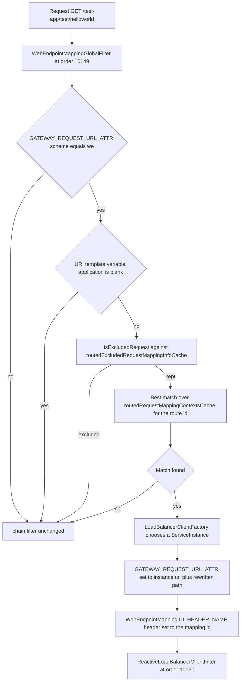
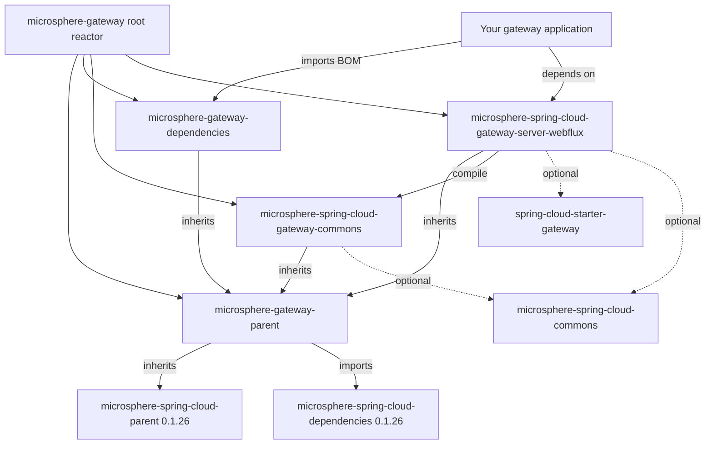

# `microsphere-spring-cloud-gateway-server-webflux`

## Purpose and audience

The reactive server module of the `0.1.x` line. It plugs Microsphere web-endpoint routing into Spring Cloud Gateway
(WebFlux): routes whose `uri` uses the custom `we://` scheme are resolved against Spring Cloud discovery plus the
published `WebEndpointMapping` metadata of the target instances, the path is rewritten, the chosen instance is
substituted into the request URL, and the gateway's own filter handling is replaced by a caching variant.

Depend on it when you are:

- an application team running a reactive Spring Cloud Gateway on Spring Boot `2.x` that wants one route to serve every
  discovered service without duplicating route definitions;
- a team that needs routes to refresh on configuration changes and service-instance changes without re-deploying.

This is the **only** server module on the line.

> [!IMPORTANT]
> `0.1.x` (`release-1.x`) is the maintenance line for pre-Jakarta stacks and has **no WebMVC (servlet) module** — there
> is no `microsphere-spring-cloud-gateway-server-webmvc` here. Servlet gateways and Spring Boot `3.x` / `jakarta.*`
> projects belong to the current line: [../../current/user-guide/README.md](../../current/user-guide/README.md).

## Version information

| Item | Value |
|---|---|
| Coordinates | `io.github.microsphere-projects:microsphere-spring-cloud-gateway-server-webflux:${revision}` |
| Maven `revision` on `release-1.x` | `0.1.19-SNAPSHOT` |
| Latest published release | `0.1.18` |
| Packaging | `jar` |
| Maven Central group | `io.github.microsphere-projects` |
| Javadoc | `https://javadoc.io/doc/io.github.microsphere-projects/microsphere-spring-cloud-gateway-server-webflux` (link from the branch `README`) |
| Non-optional dependency | `io.github.microsphere-projects:microsphere-spring-cloud-gateway-commons:${revision}` |

## Compatibility range

| Axis | Supported on `0.1.x` | Notes |
|---|---|---|
| JDK | `8`, `11`, `17`, `21`, `25` | Branch `README`: "JDK 8 or newer"; `.github/workflows/maven-build.yml` matrix `['8','11','17','21','25']` |
| Spring Cloud | `Hoxton`, `2020`, `2021` | Profiles `spring-cloud-hoxton`, `spring-cloud-2020`, `spring-cloud-2021` |
| Spring Boot | `2.3.12.RELEASE` (`spring-cloud-hoxton`), `2.4.13` (`spring-cloud-2020`), `2.6.15` (`spring-cloud-2021`, active by default) | Versions come from the external parent `microsphere-spring-cloud-parent:0.1.26`, not from this repository |
| Required: gateway starter | `org.springframework.cloud:spring-cloud-starter-gateway` | Declared `<optional>` in this module's POM — you must add it |
| Required: discovery | a `ReactiveDiscoveryClient` setup (Nacos, Eureka, Zookeeper, Consul, Kubernetes, or the simple registry used by the tests) | `WebEndpointMappingGatewayAutoConfiguration` is `@ConditionalOnDiscoveryEnabled` + `@ConditionalOnReactiveDiscoveryEnabled` |
| Required: load balancer | `LoadBalancerClientFactory` (Spring Cloud LoadBalancer) | Constructor dependency of `WebEndpointMappingGlobalFilter` and a `@ConditionalOnBean` guard |
| Required: Microsphere Spring Cloud | `microsphere-spring-cloud-commons` (provides `ReactiveDiscoveryClientAdapter`, `ServiceInstancesChangedEvent`, `WebEndpointMapping`), `microsphere-spring-boot-webflux` (provides `@ConditionalOnWebFluxAvailable`) | Both `<optional>` in the POM; without them the conditions below do not match and no beans appear |
| Move to `0.2.x` when | Spring Boot `3.x` / JDK `17+` baseline | [../../current/user-guide/README.md](../../current/user-guide/README.md) |

`microsphere-spring-cloud-gateway-commons` is the single non-optional dependency of this module, and every third-party
dependency is `<optional>`: the module compiles against them but never forces a version on an application.

## Installation

```xml
<dependencyManagement>
    <dependencies>
        <dependency>
            <groupId>io.github.microsphere-projects</groupId>
            <artifactId>microsphere-gateway-dependencies</artifactId>
            <version>0.1.18</version>
            <type>pom</type>
            <scope>import</scope>
        </dependency>
    </dependencies>
</dependencyManagement>

<dependencies>
    <dependency>
        <groupId>io.github.microsphere-projects</groupId>
        <artifactId>microsphere-spring-cloud-gateway-server-webflux</artifactId>
    </dependency>

    <!-- the starter is optional in the module above, so declare it here -->
    <dependency>
        <groupId>org.springframework.cloud</groupId>
        <artifactId>spring-cloud-starter-gateway</artifactId>
    </dependency>

    <!-- needed for the web-endpoint filter to be created at all -->
    <dependency>
        <groupId>io.github.microsphere-projects</groupId>
        <artifactId>microsphere-spring-cloud-commons</artifactId>
    </dependency>
    <dependency>
        <groupId>org.springframework.cloud</groupId>
        <artifactId>spring-cloud-loadbalancer</artifactId>
    </dependency>
</dependencies>
```

Add one discovery-client starter of your choice (`eureka`, `consul`, `zookeeper`, `nacos`, `kubernetes`) and, if you
call `ConfigUtils` yourself, a Bean Validation provider — see
[microsphere-spring-cloud-gateway-commons.md](microsphere-spring-cloud-gateway-commons.md).

## API reference

### Auto-configuration entry points

Registered twice, in sync, by the module's resources:

| Resource | Key | Classes |
|---|---|---|
| `META-INF/spring.factories` | `org.springframework.boot.autoconfigure.EnableAutoConfiguration` | `GatewayAutoConfiguration`, `WebEndpointMappingGatewayAutoConfiguration` |
| `META-INF/spring.factories` | `org.springframework.context.ApplicationContextInitializer` | `WebEndpointApplicationContextInitializer` |
| `META-INF/spring/org.springframework.boot.autoconfigure.AutoConfiguration.imports` | (one class per line) | `GatewayAutoConfiguration`, `WebEndpointMappingGatewayAutoConfiguration` |
| `META-INF/config/default/features.yaml` | `microsphere.spring.cloud.features.*` | see the configuration reference |

### `class GatewayAutoConfiguration`

Package `io.microsphere.spring.cloud.gateway.server.webflux.autoconfigure`.

```java
@Configuration(proxyBeanMethods = false)
@ConditionalOnGatewayAvailable
@ConditionalOnMicrosphereGatewayEnabled
@EnableEventExtension
@AutoConfigureAfter(name = {
        "org.springframework.cloud.gateway.config.GatewayAutoConfiguration"
})
@Import(value = {
        DisabledHeartbeatEventRouteRefreshListenerInterceptor.class,
        PropagatingRefreshRoutesEventApplicationListener.class,
        FilteringWebHandlerBeanDefinitionRegistryPostProcessor.class
})
public class GatewayAutoConfiguration {
}
```

Empty body, pure wiring. It enables the Microsphere event extension, installs the heartbeat suppressor, installs the
`EnvironmentChangeEvent` -> `RefreshRoutesEvent` propagator, and replaces Spring Cloud Gateway's `FilteringWebHandler`
bean definition with `CachingFilteringWebHandler`. Active when Spring Cloud Gateway is on the classpath, the app is a
WebFlux app, `spring.cloud.gateway.enabled` is not `false`, and `microsphere.spring.cloud.gateway.enabled` is not
`false`.

### `class WebEndpointMappingGatewayAutoConfiguration`

Conditions, verbatim from the source:

| Condition | Effect |
|---|---|
| `@ConditionalOnGatewayAvailable` | Gateway classes present, WebFlux available, gateway enabled |
| `@ConditionalOnDiscoveryEnabled` | Spring Cloud discovery enabled |
| `@ConditionalOnReactiveDiscoveryEnabled` | Reactive discovery enabled |
| `@ConditionalOnMicrosphereWebEndpointMappingEnabled` | `microsphere.spring.cloud.web-endpoint-mapping.enabled` (and the master switch) not `false` |
| `@ConditionalOnClass(name = {"org.springframework.cloud.client.discovery.ReactiveDiscoveryClient", "org.springframework.cloud.loadbalancer.support.LoadBalancerClientFactory"})` | Reactive discovery + LoadBalancer on the classpath |
| `@AutoConfigureAfter(value = {GatewayAutoConfiguration.class, WebFluxAutoConfiguration.class, ReactiveDiscoveryClientAutoConfiguration.class}, name = {"org.springframework.cloud.gateway.config.GatewayAutoConfiguration", "org.springframework.cloud.loadbalancer.config.LoadBalancerAutoConfiguration", "org.springframework.cloud.client.discovery.composite.reactive.ReactiveCompositeDiscoveryClientAutoConfiguration"})` | Ordering against the upstream auto-configurations |

Exposes one bean:

```java
@Bean
@ConditionalOnEnabledGlobalFilter
@ConditionalOnBean(value = {ReactiveDiscoveryClientAdapter.class, LoadBalancerClientFactory.class}, search = CURRENT)
public WebEndpointMappingGlobalFilter webEndpointMappingGlobalFilter(ReactiveDiscoveryClientAdapter reactiveDiscoveryClient,
                                                                    LoadBalancerClientFactory loadBalancerClientFactory,
                                                                    GatewayProperties gatewayProperties)
```

`@ConditionalOnBean(..., search = CURRENT)` is the reason a discovery client alone is not enough: a
`ReactiveDiscoveryClientAdapter` bean (contributed by `microsphere-spring-cloud-commons`) must exist in the *current*
context, and `@ConditionalOnEnabledGlobalFilter` additionally lets Spring Cloud Gateway's own filter-enabling property
switch the bean off.

### `interface GatewayPropertyConstants`

| Constant | Value | Behaviour |
|---|---|---|
| `GATEWAY_ENABLED_PROPERTY_NAME` | `spring.cloud.gateway.enabled` (built as `GatewayProperties.PREFIX + DOT + ENABLED_PROPERTY_NAME`), default `true` | Spring Cloud Gateway's own enable switch, reused by `@ConditionalOnGatewayEnabled` |
| `GATEWAY_ROUTES_PROPERTY_NAME_PREFIX` | `spring.cloud.gateway.routes` | Prefix handed to `WebEndpointConfigurationPropertiesBindListener` and matched in `WebEndpointMappingGlobalFilter#matchesEvent(EnvironmentChangeEvent)` |

Asserted by `GatewayPropertyConstantsTest#testConstants`.

### `@interface ConditionalOnGatewayEnabled`

`@Target({TYPE, METHOD})`, `@Retention(RUNTIME)`, `@Documented`, meta-annotated
`@ConditionalOnProperty(name = GATEWAY_ENABLED_PROPERTY_NAME, matchIfMissing = true)`. Use it to gate your own beans on
Spring Cloud Gateway being enabled.

### `@interface ConditionalOnGatewayAvailable`

Composition used by both auto-configuration classes:

```java
@Retention(RUNTIME)
@Target({TYPE, METHOD})
@Documented
@ConditionalOnGatewayEnabled
@ConditionalOnWebFluxAvailable
@ConditionalOnClass(name = {
        "org.springframework.cloud.gateway.config.GatewayProperties"    // Spring Cloud Gateway API
})
public @interface ConditionalOnGatewayAvailable {
}
```

"Gateway enabled + WebFlux available + gateway classes present". `@ConditionalOnWebFluxAvailable` comes from
`microsphere-spring-boot-webflux`, which this module declares `<optional>`.

### `class WebEndpointMappingGlobalFilter implements GlobalFilter, SmartApplicationListener, ApplicationContextAware, EnvironmentAware, DisposableBean, Ordered`

The heart of the module. Constructor:

```java
public WebEndpointMappingGlobalFilter(DiscoveryClient discoveryClient,
                                      LoadBalancerClientFactory clientFactory,
                                      GatewayProperties gatewayProperties)
```

| Member | Behaviour |
|---|---|
| `Mono<Void> filter(ServerWebExchange, GatewayFilterChain)` | Skips (pass-through) unless `GATEWAY_REQUEST_URL_ATTR` has scheme `we`; requires the `{application}` URI-template variable; resolves the excluded/matched mapping; then sets `GATEWAY_REQUEST_URL_ATTR` to the instance URI + rewritten path and adds the `WebEndpointMapping.ID_HEADER_NAME` header carrying the matched mapping id |
| `int getOrder()` | `10149` (`LOAD_BALANCER_CLIENT_FILTER_ORDER - 1`, with the constant `10150` mirroring Spring Cloud Gateway's reactive load-balancer filter), so it rewrites the URL immediately before the load balancer filter runs |
| `boolean supportsAsyncExecution()` | `false` — the filter declares that Spring Cloud Gateway must not run it on the event loop, which matches the synchronous `MonoUtils.getValue(...)` inside instance selection |
| `boolean supportsEventType(Class<? extends ApplicationEvent>)` | `ContextRefreshedEvent`, `RefreshRoutesResultEvent`, `EnvironmentChangeEvent`, `ServiceInstancesChangedEvent` |
| `void onApplicationEvent(ApplicationEvent)` | Dispatches to cache refresh for each of the four event types above |
| `void setApplicationContext(ApplicationContext)` / `void setEnvironment(Environment)` | Standard awareness callbacks |
| `void destroy()` | Clears both caches (`routedRequestMappingContextsCache`, `routedExcludedRequestMappingInfoCache`) |
| `volatile Map<String, Collection<RequestMappingContext>> routedRequestMappingContextsCache` | Package-visible per-route mapping cache, swapped under `synchronized (this)` by `refresh()` |
| `volatile Map<String, Collection<RequestMappingInfo>> routedExcludedRequestMappingInfoCache` | Package-visible per-route exclusion cache |
| `Collection<String> getSubscribedServices(URI routeUri)` (package-private) | Host `all` -> `discoveryClient.getServices()`; otherwise the comma-delimited host split into a `Set` |
| `RequestMappingContext getMatchingRequestMappingContext(String applicationName, String routeId, ServerWebExchange exchange)` (package-visible, for tests) | Exclusion check, then best-match selection over the cached mappings, storing the rewritten path under the `msgw-we-rewrite-path` exchange attribute |
| `void clear()` (package-visible, "Clear for testing") | Nulls the mapping cache |

Nested, package-private `static class RequestMappingContext` holds the `RequestMappingInfo` built from a
`WebEndpointMapping` plus its `id`, and offers `compareTo(RequestMappingContext, ServerWebExchange)` (Spring's own
mapping precedence) and two `buildRequestMappingInfo` factories — one from `WebEndpointConfig.Mapping` (the excludes) and
one from `WebEndpointMapping` (the discovered endpoint). Two further package-private statics exist, `buildPath(ServiceInstance, URI)`
(strip the leading `/{serviceId}/` and re-apply the instance's `web.context-path` metadata) and `clear(Map<?, ?>)`; in
this snapshot `buildPath` is exercised only by `WebEndpointMappingGlobalFilterStaticTest` and is not invoked from
`filter(...)`.

### `class CachingFilteringWebHandler extends FilteringWebHandler implements DisposableBean`

| Member | Behaviour |
|---|---|
| `CachingFilteringWebHandler(List<GlobalFilter> globalFilters)` | Passes the global filters to the super constructor |
| `Mono<Void> handle(ServerWebExchange)` | Looks up the route's pre-sorted filter array from the cache and runs it through `DefaultGatewayFilterChain`; it does **not** call `super.handle` |
| `@EventListener(RefreshRoutesResultEvent.class) void onRefreshRoutesResultEvent(RefreshRoutesResultEvent)` | Rebuilds the whole cache from `RouteLocator#getRoutes()` when `GatewayUtils.isSuccessRouteLocatorEvent(event)` |
| `GatewayFilter[] getRoutedGatewayFilters(Route)` (package-visible) | `EMPTY_FILTER_ARRAY` when the cache is still `null` or the route id is unknown |
| `void destroy()` | Clears the cache, tolerating a `null` cache |
| `static final GatewayFilter[] EMPTY_FILTER_ARRAY` | Package-visible empty sentinel |
| private `List<GatewayFilter> globalFilters()` | Reads the inherited private `globalFilters` field reflectively (`FieldUtils.getFieldValue(true, this, "globalFilters")`) |

### `class FilteringWebHandlerBeanDefinitionRegistryPostProcessor implements BeanDefinitionRegistryPostProcessor`

`postProcessBeanDefinitionRegistry` stores the registry; `postProcessBeanFactory` finds every bean name of type
`FilteringWebHandler`, removes the definition and re-registers the same bean name with
`CachingFilteringWebHandler.class`. This is the whole "route filter caching" opt-out story: it happens automatically
while `GatewayAutoConfiguration` is active.

### `class DefaultGatewayFilterChain implements GatewayFilterChain`

```java
public DefaultGatewayFilterChain(GatewayFilter... gatewayFilters)   // rejects null array and null elements
@Override public Mono<Void> filter(ServerWebExchange exchange)
```

Advances an internal `position` and defers each filter (`Mono.defer`); once the array is exhausted it returns
`Mono.empty()`. Import `IllegalArgumentException` on bad input, as `DefaultGatewayFilterChainTest` asserts.

### `class WebEndpointApplicationContextInitializer extends ConfigurableApplicationContextInitializer`

`protected void initialize(ConfigurableApplicationContext context, ConfigurableEnvironment environment)` registers the
`WebEndpointConfigurationPropertiesBindListener` bean definition (name
`WebEndpointConfigurationPropertiesBindListener.BEAN_NAME`) with the constructor argument
`GatewayPropertyConstants.GATEWAY_ROUTES_PROPERTY_NAME_PREFIX`. Registered through
`spring.factories`' `ApplicationContextInitializer` key, i.e. before any `@ConfigurationProperties` binding of
`spring.cloud.gateway.routes[*]` happens.

### `class DisabledHeartbeatEventRouteRefreshListenerInterceptor implements ApplicationListenerInterceptor`

`void intercept(ApplicationListener<?>, ApplicationEvent, ApplicationListenerInterceptorChain)` drops the event (a
`logger.trace` and `return`, without continuing the chain) when the listener class **equals**
`RouteRefreshListener.class` and the event class equals `HeartbeatEvent` or `ParentHeartbeatEvent`; everything else is
passed down the chain. Exact-class matching means a subclass of `RouteRefreshListener` is not intercepted. Requires the
Microsphere event extension, which `GatewayAutoConfiguration` turns on with `@EnableEventExtension`.

### `class PropagatingRefreshRoutesEventApplicationListener implements ApplicationListener<EnvironmentChangeEvent>`

```java
public PropagatingRefreshRoutesEventApplicationListener(ApplicationContext context)
@Override public void onApplicationEvent(EnvironmentChangeEvent event)
```

If any changed key starts with `spring.cloud.gateway`, publishes `new RefreshRoutesEvent(this)`. The event's source is
this listener, not a `RouteLocator`, so it is not itself a cache-refresh trigger for this module: Spring Cloud Gateway's
own route machinery performs the refresh and publishes the `RefreshRoutesResultEvent` that the caches then react to.

### `abstract class GatewayUtils implements Utils`

| Signature | Behaviour |
|---|---|
| `@Nonnull static Map<String, Object> getGatewayProperties(ConfigurableEnvironment environment)` | Flattened properties under `spring.cloud.gateway` (keys relative to the prefix), via `PropertySourcesUtils.getSubProperties` |
| `@Nonnull static Map<String, Object> getRouteProperties(ConfigurableEnvironment environment, String routeId)` | Finds the property prefix of the route whose `id` equals `routeId`, then returns every gateway property under that prefix; `emptyMap()` when the id is not found; the result is unmodifiable |
| `static boolean isSuccessRouteLocatorEvent(RefreshRoutesResultEvent event)` | `event != null && event.isSuccess() && event.getSource() instanceof RouteLocator` |

`GatewayUtilsTest` covers all three, including the `null` event, the `this`-source event, the mocked `RouteLocator`
success and the failure variant built with a `Throwable`.

## Configuration reference

| Key | Type | Default | Effect | Source in the snapshot |
|---|---|---|---|---|
| `microsphere.spring.cloud.gateway.enabled` | `boolean` | `true` | Microsphere master switch for `GatewayAutoConfiguration` (and, transitively, web-endpoint routing) | `CommonsPropertyConstants` in the commons module |
| `microsphere.spring.cloud.web-endpoint-mapping.enabled` | `boolean` | `true` | Switch for `WebEndpointMappingGatewayAutoConfiguration` only | `CommonsPropertyConstants` in the commons module |
| `microsphere.spring.cloud.features.abstract.microsphere-spring-cloud-gateway-server-webflux` | `List<String>` | `[CachingFilteringWebHandler, WebEndpointMappingGlobalFilter, DisabledHeartbeatEventRouteRefreshListenerInterceptor, PropagatingRefreshRoutesEventApplicationListener]` (fully-qualified names) | Registers the module's "abstract features" for Microsphere/Spring Cloud `HasFeatures` reporting | `src/main/resources/META-INF/config/default/features.yaml` |
| `microsphere.spring.cloud.features.named.microsphere-spring-cloud-gateway-server-webflux` | `Map<String, String>` | `WebEndpointApplicationContextInitializer=io.microsphere.spring.cloud.gateway.server.webflux.context.WebEndpointApplicationContextInitializer` | Registers a "named feature" (`name=class`) for the same reporting | `src/main/resources/META-INF/config/default/features.yaml` |
| `microsphere.spring.boot.webflux.enabled` | `boolean` | `true` (in `microsphere-spring-boot-webflux`) | Not a key of this module: `@ConditionalOnGatewayAvailable` meta-annotates `@ConditionalOnWebFluxAvailable`, and the tests list `microsphere.spring.boot.webflux.enabled=false` as a global disable value | `GatewayAutoConfigurationTest`, `WebEndpointMappingGatewayAutoConfigurationTest` |
| `spring.cloud.gateway.enabled` | `boolean` | `true` | Spring Cloud Gateway's switch, reused by `@ConditionalOnGatewayEnabled` | `GatewayPropertyConstants.GATEWAY_ENABLED_PROPERTY_NAME` |
| `spring.cloud.gateway.routes` | prefix | — | Prefix the bind listener and the `EnvironmentChangeEvent` matching use | `GatewayPropertyConstants.GATEWAY_ROUTES_PROPERTY_NAME_PREFIX` |
| `spring.cloud.gateway.routes[n].uri` | `String` | — | Must be `we://all`, `we://<service>`, or `we://<service>,<service>` to be routed by this module | `RouteConstants.SCHEME`, `ALL_SERVICES`; `WebEndpointMappingGlobalFilter#getSubscribedServices` |
| `spring.cloud.gateway.routes[n].predicates` | list | — | Must expose the `application` URI-template variable, e.g. `Path=/{application}/**` | `CommonConstants.APPLICATION_NAME_URI_TEMPLATE_VARIABLE_NAME`; `WebEndpointMappingGlobalFilter#filter` |
| `spring.cloud.gateway.routes[n].metadata.web-endpoint` | `WebEndpointConfig` object | absent => not injected | Turned into a typed `WebEndpointConfig` by the bind listener | `RouteConstants.WEB_ENDPOINT_KEY`; `WebEndpointConfigurationPropertiesBindListener` |
| `spring.cloud.gateway.routes[n].metadata.web-endpoint.excludes[k].patterns` | `String[]` | required (`@NotNull`) | Excluded path patterns | `WebEndpointConfig.Mapping` |
| `...excludes[k].methods` | `RequestMethod[]` | all `RequestMethod.values()` when omitted | Excluded verbs | `WebEndpointConfig.Mapping#getMethods` |
| `...excludes[k].params` | `String[]` | `null` | Excluded request-parameter conditions | `WebEndpointConfig.Mapping` |
| `...excludes[k].headers` | `String[]` | empty array when omitted | Excluded header conditions | `WebEndpointConfig.Mapping#getHeaders` |
| `...excludes[k].consumes` | `String[]` | `null` | Excluded `Content-Type` conditions | `WebEndpointConfig.Mapping` |
| `...excludes[k].produces` | `String[]` | `null` | Excluded `Accept` conditions | `WebEndpointConfig.Mapping` |
| `spring.cloud.discovery.reactive.enabled` | `boolean` | `true` (Spring Cloud) | Not a key of this module; `@ConditionalOnReactiveDiscoveryEnabled` gates the filter bean, and the tests disable it with `spring.cloud.discovery.reactive.enabled=false` | `WebEndpointMappingGatewayAutoConfigurationTest` |

## Request path



Caches are rebuilt on `ContextRefreshedEvent` (own context only), a successful `RefreshRoutesResultEvent` whose source
is a `RouteLocator`, an `EnvironmentChangeEvent` whose changed keys name a known route `id`, and any
`ServiceInstancesChangedEvent`.

## Code examples

### A web-endpoint route

From `microsphere-spring-cloud-gateway-server-webflux/src/test/resources/META-INF/config/default/test.yaml`, the
document activated by `spring.profiles.active=simple-service-registry,gateway` in
`WebEndpointMappingGlobalFilterTest`:

```yaml
spring:
  cloud:
    gateway:
      routes:
        - id: request_size_route
          uri: http://localhost:8080/upload
          predicates:
            - Path=/upload
          filters:
            - name: RequestSize
              args:
                maxSize: 5000000
          metadata:
            a: 1
        - id: retry_test
          uri: http://localhost:8080/flakey
          predicates:
            - Host=*.retry.com
          filters:
            - name: Retry
              args:
                retries: 3
                statuses: BAD_GATEWAY
                methods: GET,POST
        - id: web-endpoint-mapping
          uri: we://all
          predicates:
            - Path=/{application}/**
          metadata:
            web-endpoint:
              excludes:
                - patterns: /test-1/**
                - patterns: /test-2/**
                  methods: GET
                - patterns: /test-3/abc/**
                  consumes: application/json
                  produces: plain/text
```

Only the third route is a web-endpoint route: `getWebEndpointRoutes()` keeps routes whose `uri` scheme is exactly `we`.
The excerpt is abridged — the `retry_test` route in the fixture additionally configures `backoff`, `jitter` and
`timeout` arguments for its `Retry` filter.

### Targeting specific services

The branch `README` shows `we://all`, `we://orders-service` and `we://orders-service,payments-service`; the comma form
is parsed by `getSubscribedServices(...)` with `commaDelimitedListToSet(host)`:

```yaml
spring:
  cloud:
    gateway:
      routes:
        - id: two-services
          uri: we://orders-service,payments-service
          predicates:
            - Path=/{application}/**
          metadata:
            web-endpoint:
              excludes: []
```

`WebEndpointMappingGlobalFilterTest#testFilter` proves the single-service form: `getSubscribedServices(URI.create("we://test-app"))`
returns one element, `"test-app"`, while `we://all` expands to `discoveryClient.getServices()`.

### Switching features off

From the branch `README` ("Configure a Web Endpoint Mapping Route"):

```yaml
microsphere:
  spring:
    cloud:
      gateway:
        enabled: false
      web-endpoint-mapping:
        enabled: false
```

### Calling the filter the way the tests do

Adapted from `WebEndpointMappingGatewayAutoConfigurationIntegrationTest`:

```java
MockServerWebExchange exchange = MockServerWebExchange.from(MockServerHttpRequest.get("/test").build());
exchange.getAttributes().put(ServerWebExchangeUtils.GATEWAY_REQUEST_URL_ATTR, exchange.getRequest().getURI());
GatewayFilterChain chain = new DefaultGatewayFilterChain(new NoOpGatewayFilter());

assertNotNull(webEndpointMappingGlobalFilter.filter(exchange, chain));
assertEquals(10149, webEndpointMappingGlobalFilter.getOrder());
webEndpointMappingGlobalFilter.destroy();                       // clears both caches
webEndpointMappingGlobalFilter.onApplicationEvent(new RefreshRoutesResultEvent(this));
webEndpointMappingGlobalFilter.onApplicationEvent(new RefreshRoutesResultEvent(this, new Exception("For testing")));
```

`NoOpGatewayFilter` is the test's `GatewayFilter` that returns `Mono.empty()`
(`src/test/java/.../filter/NoOpGatewayFilter.java`).

### Observing the routing end to end

`WebEndpointMappingGlobalFilterTest` registers the test application itself in the *simple* registry with the local
random port, then asserts the rewritten call reaches the mapping published by the app:

```java
@SpringBootTest(
        classes = {TestController.class, WebEndpointMappingGlobalFilterTest.class,
                WebEndpointMappingGlobalFilterTest.TestConfig.class},
        properties = {"spring.profiles.active=simple-service-registry,gateway"},
        webEnvironment = RANDOM_PORT)
@EnableAutoConfiguration
class WebEndpointMappingGlobalFilterTest {

    @Test
    @Order(1)
    void testFilter() {
        testHelloWorldEndpoint();               // /test-app/test/helloworld -> 200, body == TestController#helloWorld
        // excluded paths are not rewritten to a discovered instance
        webTestClient.get().uri("/test-1/test/helloworld").exchange().expectStatus().isOk();
        webTestClient.get().uri("/test-2/test/helloworld").exchange().expectStatus().isOk();
        webTestClient.get().uri("/test-3/abc/def").header(CONTENT_TYPE, "application/json")
                .header(ACCEPT, "plain/text").exchange().expectStatus().isOk();
        // instance changes force a cache refresh
        context.publishEvent(new ServiceInstancesChangedEvent(registration.getServiceId(), ofList(registration)));
        testHelloWorldEndpoint();
    }
}
```

`testFilterOnUnregisteredApplication` (`/test-0/test/helloworld`) and `testFilterOnNoRoutedRequestMappingContext`
(after `filter.clear()` + `filter.destroy()`) show the pass-through behaviour when no mapping can be matched.

### Route refresh propagation

Adapted from `PropagatingRefreshRoutesEventApplicationListenerTest`:

```java
ValueHolder<RefreshRoutesEvent> holder = new ValueHolder<>();
context.addApplicationListener((ApplicationListener<RefreshRoutesEvent>) event -> holder.setValue(event));

context.publishEvent(new EnvironmentChangeEvent(ofSet("spring.cloud.gateway.enabled"))); // PREFIX + ".enabled"
assertSame(listener, holder.getValue().getSource());          // RefreshRoutesEvent was propagated

holder.setValue(null);
context.publishEvent(new EnvironmentChangeEvent(ofSet("enabled"))); // no gateway prefix
assertNull(holder.getValue());                                // nothing propagated
```

### Suppressing heartbeat-driven refreshes

Adapted from `DisabledHeartbeatEventRouteRefreshListenerInterceptorTest`:

```java
@ExtendWith(SpringExtension.class)
@ContextConfiguration(classes = {RouteRefreshListener.class,
        DisabledHeartbeatEventRouteRefreshListenerInterceptor.class,
        DisabledHeartbeatEventRouteRefreshListenerInterceptorTest.class})
@EnableEventExtension
class DisabledHeartbeatEventRouteRefreshListenerInterceptorTest {

    @Test
    void testIntercept() {
        context.publishEvent(new HeartbeatEvent(this, this));        // swallowed for RouteRefreshListener
        context.publishEvent(new ParentHeartbeatEvent(this, this));  // swallowed as well
        // unrelated listeners still receive their events
        context.publishEvent("Hello,World");
        assertSame("Hello,World", holder.getValue());
    }
}
```

### Inspecting route properties from the `Environment`

Adapted from `GatewayUtilsTest`:

```java
MockEnvironment environment = new MockEnvironment();
assertTrue(getGatewayProperties(environment).isEmpty());

environment.setProperty("spring.cloud.gateway.enabled", "true");
assertEquals("true", getGatewayProperties(environment).get("enabled")); // prefix stripped

Map<String, Object> routeProperties = getRouteProperties(environment, "web-endpoint-mapping");
assertTrue(routeProperties.isEmpty());                                  // unknown route id
```

### Caching handler without a refresh yet

Adapted from `CachingFilteringWebHandlerTest`:

```java
CachingFilteringWebHandler handler = new CachingFilteringWebHandler(emptyList());
assertSame(EMPTY_FILTER_ARRAY, handler.getRoutedGatewayFilters(null)); // cache still null

RouteLocator routeLocator = mock(RouteLocator.class);
when(routeLocator.getRoutes()).thenReturn(Flux.empty());
handler.onRefreshRoutesResultEvent(new RefreshRoutesResultEvent(routeLocator));        // rebuilds
handler.onRefreshRoutesResultEvent(new RefreshRoutesResultEvent(routeLocator, new Exception("For testing"))); // ignored
handler.destroy();
```

## Pitfalls and FAQ

**Every `we://` route needs a `metadata.web-endpoint` node.** `refresh()` calls
`buildExcludedRequestMappingInfoSet(...)`, which dereferences the `WebEndpointConfig` returned by
`ConfigUtils.getWebEndpointConfig(metadata)` without a null check. A `we://` route whose metadata has no `web-endpoint`
entry therefore fails the cache build. Declare `metadata: web-endpoint: excludes: []` when you need no exclusions.

**Requests are not rewritten if the predicate does not expose `{application}`.** `filter(...)` reads the
`application` URI-template variable and returns `chain.filter(exchange)` when it is blank, so
`Path=/{application}/**` (or an equivalent) is mandatory.

**The caching handler serves an empty chain before the first successful refresh.** `handle(...)` builds a
`DefaultGatewayFilterChain` from `getRoutedGatewayFilters(route)`, and that method returns `EMPTY_FILTER_ARRAY` while
`routedGatewayFiltersCache` is still `null`; the chain then completes with `Mono.empty()` instead of running your
filters. The cache is populated only on a successful `RefreshRoutesResultEvent` whose source is a `RouteLocator`.

**Discovery heartbeats no longer refresh routes — on purpose.**
`DisabledHeartbeatEventRouteRefreshListenerInterceptor` drops `HeartbeatEvent`/`ParentHeartbeatEvent` for
`RouteRefreshListener`. Expect refreshes from `EnvironmentChangeEvent` on `spring.cloud.gateway.*` keys,
`ServiceInstancesChangedEvent`, and `RefreshRoutesResultEvent` instead. The interceptor matches the exact class, so a
custom subclass of `RouteRefreshListener` keeps its heartbeat handling.

**The filter bean is missing.** Check the four guards in order: gateway classes and WebFlux available,
`spring.cloud.gateway.enabled` / `microsphere.spring.cloud.gateway.enabled` /
`microsphere.spring.cloud.web-endpoint-mapping.enabled` not `false`, a `ReactiveDiscoveryClientAdapter` bean in the
current context (that is `microsphere-spring-cloud-commons`, `<optional>` in the POM), and a
`LoadBalancerClientFactory` bean.

**Instance selection is synchronous inside the filter.** `choose(...)` calls `MonoUtils.getValue(mono)` to block on the
load balancer's `Mono`, and the filter declares `supportsAsyncExecution() == false`, the Spring Cloud Gateway marker for
filters that must not run on the event loop. A slow `ReactorLoadBalancer` therefore stalls request handling rather than
merely the subscription.

**Internal-field coupling.** `CachingFilteringWebHandler#globalFilters()` reads the private `globalFilters` field of
Spring Cloud Gateway's `FilteringWebHandler` by reflection. Renaming that field upstream breaks route filter caching
with an `IllegalArgumentException`/`NullPointerException` rather than a compile error; the branch history records such a
fix (`0.1.17`: "Fix global filter lookup in caching handler").

**`DefaultGatewayFilterChain` is single-use.** It advances an internal position and returns `Mono.empty()` once
exhausted (`DefaultGatewayFilterChainTest` asserts exactly that), so never cache or reuse an instance across exchanges.

**Two auto-configuration registration files exist.** `META-INF/spring.factories` and
`META-INF/spring/org.springframework.boot.autoconfigure.AutoConfiguration.imports` list the same two classes; keeping
them in sync matters because the Spring Boot versions pinned by the `0.1.x` profiles are not all new enough to read the
`.imports` file.

**`we://` is not a load-balancer scheme.** Do not combine it with `lb://` expectations: only routes with scheme `we`
enter this filter, and after the rewrite the URL handed to Spring Cloud Gateway is a concrete `http`/`https` instance
URI.

## Module dependency relationships



## See also

- Constants, `WebEndpointConfig` and `ConfigUtils`: [microsphere-spring-cloud-gateway-commons.md](microsphere-spring-cloud-gateway-commons.md)
- BOM and version pinning: [microsphere-gateway-dependencies.md](microsphere-gateway-dependencies.md)
- Developer guide for this line: [../developer-guide/README.md](../developer-guide/README.md)

## 中文

[zh/microsphere-spring-cloud-gateway-server-webflux.md](zh/microsphere-spring-cloud-gateway-server-webflux.md)
