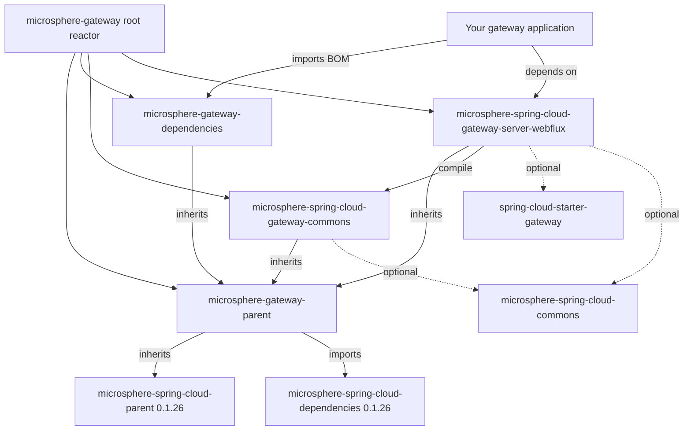

# Microsphere Gateway `0.1.x` 用户指南

本指南文档覆盖 `microsphere-gateway` 的 **`release-1.x`** 分支，即 **`0.1.x`** 版本线。它是面向 **Jakarta 之前（pre-Jakarta）
技术栈**的维护版本线：Spring Boot `2.x`、Spring Cloud `Hoxton`/`2020`/`2021`，以及 `javax.*` 命名空间。Microsphere Gateway
在 Spring Cloud Gateway 之上扩展了自定义 `we://` 路由协议、基于 Spring Cloud 服务发现的动态 web endpoint 路由，以及路由刷新行为。

> [!IMPORTANT]
> 本版本线**只有四个模块**，并且**没有 WebMVC（servlet）模块**。`0.1.x` 上不存在
> `microsphere-spring-cloud-gateway-server-webmvc` 制品——只有响应式 WebFlux。如果你运行在 Spring Boot `3.x` / JDK `17`+
> 与 `jakarta.*` 之上，请迁移到当前版本线，参见[当前版本线用户指南](../../../current/user-guide/README.md)。

## 本指南的文档

| 文档 | 模块 | 内容 |
|---|---|---|
| [microsphere-gateway-parent](microsphere-gateway-parent.md) | `microsphere-gateway-parent`（POM） | 父 POM：导入的 BOM、版本属性、如何继承 |
| [microsphere-gateway-dependencies](microsphere-gateway-dependencies.md) | `microsphere-gateway-dependencies`（POM） | BOM：被管理的制品、版本覆盖 |
| [microsphere-spring-cloud-gateway-commons](microsphere-spring-cloud-gateway-commons.md) | `microsphere-spring-cloud-gateway-commons` | 常量、条件注解、`WebEndpointConfig`、绑定监听器 |
| [microsphere-spring-cloud-gateway-server-webflux](microsphere-spring-cloud-gateway-server-webflux.md) | `microsphere-spring-cloud-gateway-server-webflux` | 自动配置、`we://` 路由、过滤器缓存、刷新事件 |
| 本 README | `microsphere-gateway`（reactor 根） | 指南索引、版本状态、模块地图 |

## 版本状态

| 项目 | 值 |
|---|---|
| 分支 | `release-1.x` |
| 版本线 | `0.1.x` |
| 分支上的 Maven `revision` | `0.1.19-SNAPSHOT` |
| 最新发布版本 | `0.1.18` |
| Maven group | `io.github.microsphere-projects` |
| 根 POM 的 parent | `microsphere-spring-cloud-parent:0.1.26` |
| `microsphere-gateway-parent` 导入的 BOM | `microsphere-spring-cloud-dependencies:0.1.26` |
| JDK 基线 | Java 8+（分支 `README` 写明 "JDK 8 or newer"） |
| CI 矩阵 | Java `8`/`11`/`17`/`21`/`25` x Maven profiles `spring-cloud-hoxton`、`spring-cloud-2020`、`spring-cloud-2021` |

## 模块与依赖关系

`microsphere-spring-cloud-gateway-server-webflux` 是应用通常唯一需要依赖的模块；
`microsphere-spring-cloud-gateway-commons` 会随它传递引入（`compile` 作用域、非 optional）。两个模块中的第三方依赖全部声明为
`<optional>`，因此**由你自己**引入 `spring-cloud-starter-gateway`、你的服务发现客户端以及 Spring Cloud LoadBalancer。

## 在 `0.1.x` 上的快速开始

1. 导入 BOM 并添加 WebFlux 模块（见 [microsphere-gateway-dependencies](microsphere-gateway-dependencies.md)）。
2. 声明一条带 `{application}` 路径变量的 `we://` 路由，并带上 `metadata.web-endpoint` 配置块（见
   [microsphere-spring-cloud-gateway-server-webflux](microsphere-spring-cloud-gateway-server-webflux.md)）。
3. 让服务发现客户端与 `microsphere-spring-cloud-commons` 同时存在于 classpath：web endpoint 过滤器对两者都有条件约束。

## 下一步

- 本版本线开发者指南：[../../developer-guide/README.md](../../developer-guide/README.md)
- 当前（`0.2.x`）版本线用户指南：[../../../current/user-guide/README.md](../../../current/user-guide/README.md)
- 项目总览：[../../../../README.md](../../../../README.md)

## English

[../README.md](../README.md)
