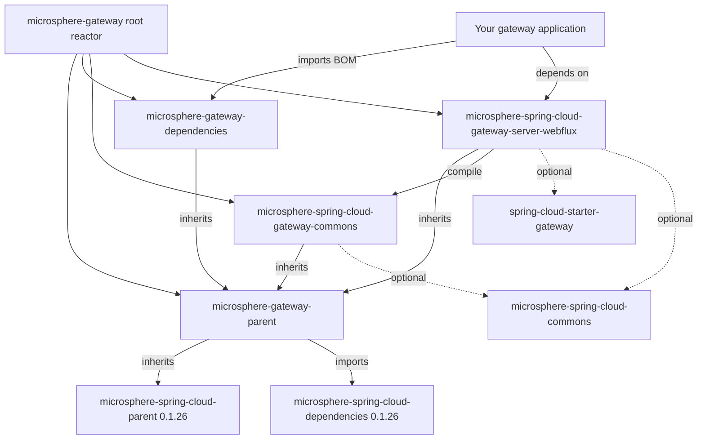

# `microsphere-gateway-dependencies`

## 定位与适用人群

`microsphere-gateway-dependencies` 是 `0.1.x` 版本线对外发布的 **BOM**：一个 `pom` 打包类型的模块，其唯一内容就是为两个
gateway 制品声明 `<dependencyManagement>`。在你的应用（或你自己的库 BOM）中导入它，就可以不带版本号地声明
`microsphere-spring-cloud-gateway-*` 依赖。

谁应当使用它：

- 在 Spring Boot `2.x` 上运行 Spring Cloud Gateway（WebFlux）服务、并在 `0.1.x` 维护版本线上采用 Microsphere Gateway 的应用团队；
- 希望在同一处锁定 Microsphere gateway 版本、并发布公司级 BOM 的平台团队。

> [!IMPORTANT]
> 该 BOM 精确管理**两个**制品，且都是响应式的。`0.1.x`（`release-1.x`）**没有 WebMVC 模块**——本版本线上不存在
> `microsphere-spring-cloud-gateway-server-webmvc` 的管理条目。servlet / Spring Boot `3.x`（`jakarta.*`）技术栈属于当前版本线：
> [../../../current/user-guide/README.md](../../../current/user-guide/README.md)。

## 版本信息

| 项目 | 值 |
|---|---|
| 坐标 | `io.github.microsphere-projects:microsphere-gateway-dependencies:${revision}` |
| `release-1.x` 分支上的 Maven `revision` | `0.1.19-SNAPSHOT` |
| 最新发布版本 | `0.1.18` |
| 打包类型 | `pom`（以 `<scope>import</scope>` 导入） |
| Maven Central group | `io.github.microsphere-projects` |
| 版本线 | `0.1.x`（维护版本线） |

## 兼容范围

| 维度 | `0.1.x` 上的支持情况 | 说明 |
|---|---|---|
| JDK | `8`、`11`、`17`、`21`、`25` | 分支 `README`："JDK 8 or newer"；`.github/workflows/maven-build.yml` 矩阵 `['8','11','17','21','25']` |
| Spring Cloud | `Hoxton`、`2020`、`2021` | Maven profiles `spring-cloud-hoxton`、`spring-cloud-2020`、`spring-cloud-2021` |
| Spring Boot | `2.x`（Jakarta 之前） | 被管理的模块基于 `javax.*` 编译（`WebEndpointConfig` 使用 `javax.validation`） |
| 必需的 gateway starter | `org.springframework.cloud:spring-cloud-starter-gateway` | 在 WebFlux 模块中是 `<optional>`——BOM **不会**替你添加它 |
| 何时迁移到 `0.2.x` | 需要 Spring Boot `3.x`、JDK `17+` 基线，或 servlet 网关 | [../../../current/user-guide/README.md](../../../current/user-guide/README.md) |

该 BOM 继承 `microsphere-gateway-parent`，因此三个 profile 背后的 Spring Boot / Spring Cloud 版本就是外部父 POM
`microsphere-spring-cloud-parent:0.1.26` 所锁定的（`2.3.12.RELEASE`/`Hoxton.SR12`、`2.4.13`/`2020.0.5`、
`2.6.15`/`2021.0.9`）。细节见 [microsphere-gateway-parent.md](microsphere-gateway-parent.md)。

## 安装

```xml
<dependencyManagement>
    <dependencies>
        <dependency>
            <groupId>io.github.microsphere-projects</groupId>
            <artifactId>microsphere-gateway-dependencies</artifactId>
            <version>0.1.18</version>
            <type>pom</type>
            <scope>import</scope>
        </dependency>
    </dependencies>
</dependencyManagement>

<dependencies>
    <!-- managed by this BOM: no version needed -->
    <dependency>
        <groupId>io.github.microsphere-projects</groupId>
        <artifactId>microsphere-spring-cloud-gateway-server-webflux</artifactId>
    </dependency>
    <dependency>
        <groupId>io.github.microsphere-projects</groupId>
        <artifactId>microsphere-spring-cloud-gateway-commons</artifactId>
    </dependency>

    <!-- NOT managed by this BOM: bring your own, versions come from your Spring Boot / Spring Cloud BOMs -->
    <dependency>
        <groupId>org.springframework.cloud</groupId>
        <artifactId>spring-cloud-starter-gateway</artifactId>
    </dependency>
    <dependency>
        <groupId>org.springframework.cloud</groupId>
        <artifactId>spring-cloud-loadbalancer</artifactId>
    </dependency>
</dependencies>
```

导入 BOM 只管理版本：它既不添加依赖，也不引入任何传递 jar。实际上 `commons` 条目是可省略的，因为
`microsphere-spring-cloud-gateway-server-webflux` 已经以 `compile` 作用域依赖了它；只有当你直接使用 `RouteConstants`、
`CommonsPropertyConstants`、`ConfigUtils` 或 `WebEndpointConfig` 时才需要显式声明。

## 依赖管理面

以下内容逐字取自 `release-1.x` 分支的 `microsphere-gateway-dependencies/pom.xml`：

| 被管理制品 | Group | 版本表达式 | 类型 | 说明 |
|---|---|---|---|---|
| `microsphere-spring-cloud-gateway-commons` | `io.github.microsphere-projects` | `${revision}` | `jar`（默认） | 常量、条件注解、web endpoint 配置模型 |
| `microsphere-spring-cloud-gateway-server-webflux` | `io.github.microsphere-projects` | `${revision}` | `jar`（默认） | 响应式网关集成；上述 commons 制品是它唯一的非 optional 依赖 |

清单到此为止。本版本线的 `<dependencyManagement>` 中没有 `spring-cloud-starter-gateway`、没有服务发现客户端、也没有 WebMVC
模块的条目。

| 继承来的元素 | 值 | 作用 |
|---|---|---|
| `<parent>` | `io.github.microsphere-projects:microsphere-gateway-parent:${revision}`（`relativePath ../microsphere-gateway-parent/pom.xml`） | 使 `microsphere-spring-cloud-dependencies:0.1.26` 的导入进入本 BOM 的有效模型 |
| 由父级带来的 Microsphere Spring Cloud 制品 | 例如 `microsphere-spring-cloud-commons`、`microsphere-spring-boot-webflux` | 让不带版本的声明得以解析——本分支的模块 POM 正是这样写的 |

### 覆盖被管理的版本

若要把某个制品指向另一构建产物（例如本地打过补丁的 `0.1.19-SNAPSHOT`），把它声明在你自己的
`<dependencyManagement>` 中，并放在 BOM 导入**之前**——Maven 中本地条目优先于导入的 BOM：

```xml
<dependencyManagement>
    <dependencies>
        <dependency>
            <groupId>io.github.microsphere-projects</groupId>
            <artifactId>microsphere-spring-cloud-gateway-server-webflux</artifactId>
            <version>0.1.19-SNAPSHOT</version>
        </dependency>
        <dependency>
            <groupId>io.github.microsphere-projects</groupId>
            <artifactId>microsphere-gateway-dependencies</artifactId>
            <version>0.1.18</version>
            <type>pom</type>
            <scope>import</scope>
        </dependency>
    </dependencies>
</dependencyManagement>
```

本 BOM 中两个被管理制品共用同一个 `${revision}`，所以一旦覆盖其中一个，就必须把另一个覆盖成相同版本：WebFlux 模块对
`microsphere-spring-cloud-gateway-commons:${revision}` 的依赖是**非 optional** 的，版本不一致会被这条依赖掩盖。

## 配置参考

该 BOM 没有代码也没有 `features.yaml`，既不读取也不贡献任何 `microsphere.*` 键。被管理模块引入的键见：

- [microsphere-spring-cloud-gateway-commons.md](microsphere-spring-cloud-gateway-commons.md)
- [microsphere-spring-cloud-gateway-server-webflux.md](microsphere-spring-cloud-gateway-server-webflux.md)

## 示例

使用本 BOM 的最小 `0.1.x` 网关——坐标来自 BOM，路由形态来自
`microsphere-spring-cloud-gateway-server-webflux/src/test/resources/META-INF/config/default/test.yaml`（`gateway` profile
文档，也就是 `WebEndpointMappingGlobalFilterTest` 通过
`spring.profiles.active=simple-service-registry,gateway` 激活的那一份）：

```yaml
spring:
  cloud:
    gateway:
      routes:
        - id: web-endpoint-mapping
          uri: we://all
          predicates:
            - Path=/{application}/**
          metadata:
            web-endpoint:
              excludes:
                - patterns: /test-1/**
                - patterns: /test-2/**
                  methods: GET
                - patterns: /test-3/abc/**
                  consumes: application/json
                  produces: plain/text
```

## 坑与常见问题

**问：我导入了 BOM，但仍然缺 `spring-cloud-starter-gateway`。**
这是设计如此。BOM 只管理两个 Microsphere 制品，而 WebFlux 模块把 `spring-cloud-starter-gateway` 保持为 `<optional>`，以免把
某个网关版本强加给你。

**问：我的应用基于 Spring Boot `3.x`。**
不要用这个 BOM。它的有效模型指向 `0.1.26` 这套 Microsphere Spring Cloud 栈（Spring Boot `2.x`），并且 `WebEndpointConfig`
绑定的是 `javax.validation` 约束。请使用 `0.2.x` 版本线
（[../../../current/user-guide/README.md](../../../current/user-guide/README.md)）。

**问：`microsphere-spring-cloud-gateway-commons` 解析出的版本与 WebFlux 模块预期的不一致。**
两个制品都通过本 BOM 以无版本方式声明（或者把两者覆盖成同一个版本）。只有 WebFlux 模块自身的 POM 携带对 commons 的硬
`compile` 依赖，并且它用的就是 `${revision}`。

## 模块依赖关系



## 另见

- reactor 总览与版本状态：[README.md](README.md)
- 父 POM 与 profile 版本：[microsphere-gateway-parent.md](microsphere-gateway-parent.md)
- 本版本线开发者指南：[../../developer-guide/README.md](../../developer-guide/README.md)

## English

[../microsphere-gateway-dependencies.md](../microsphere-gateway-dependencies.md)
