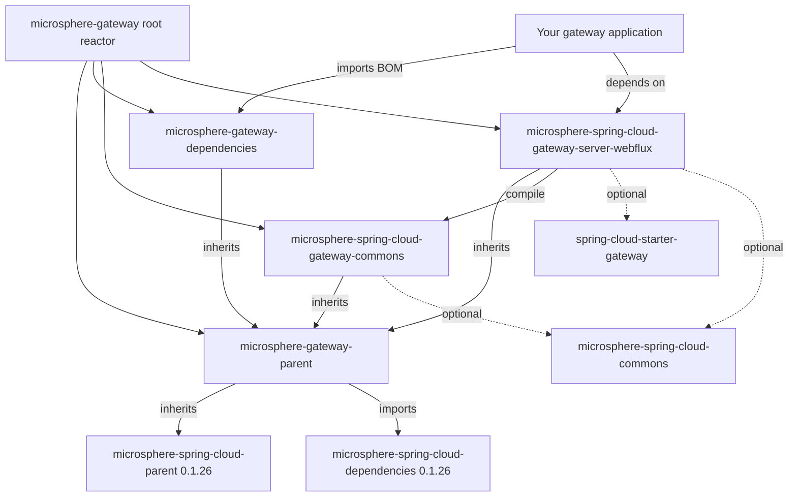

# `microsphere-gateway-parent`

## 定位与适用人群

`microsphere-gateway-parent` 是一个 `pom` 打包类型的模块。它**不包含任何 Java 类、资源文件与自动配置**——它的
`pom.xml` 就是该模块的全部内容。它存在的意义是为 `0.1.x` reactor 中的每个模块提供一个继承依赖管理的统一入口，即导入
Microsphere Spring Cloud BOM。

在以下场景依赖它：

- 你是本版本线的维护者，需要新增一个模块；
- 你的组织希望基于同一份 Microsphere Spring Cloud BOM 发布自己的 Spring Cloud Gateway 扩展。

如果你的应用只需要版本管理，请优先使用 `microsphere-gateway-dependencies`（已发布的 BOM）——见
[microsphere-gateway-dependencies.md](microsphere-gateway-dependencies.md)。

> [!IMPORTANT]
> `0.1.x`（`release-1.x`）是面向 Jakarta 之前技术栈的维护版本线，**没有 WebMVC 模块**：本版本线唯一的服务端模块是
> `microsphere-spring-cloud-gateway-server-webflux`。Spring Boot `3.x` / `jakarta.*` 用户应使用当前版本线：
> [../../../current/user-guide/README.md](../../../current/user-guide/README.md)。

## 版本信息

| 项目 | 值 |
|---|---|
| 坐标 | `io.github.microsphere-projects:microsphere-gateway-parent:${revision}` |
| `release-1.x` 分支上的 Maven `revision` | `0.1.19-SNAPSHOT` |
| 最新发布版本 | `0.1.18` |
| 打包类型 | `pom` |
| Maven Central group | `io.github.microsphere-projects` |
| 版本线 | `0.1.x`（维护版本线） |

该 POM 把自身版本声明为 `${revision}`，而这个属性定义在 reactor 根 POM `microsphere-gateway` 中，因此父 POM、BOM 与两个
jar 模块永远以同一个版本发布。

## 兼容范围

| 维度 | `0.1.x` 上的支持情况 | 说明 |
|---|---|---|
| JDK | `8`、`11`、`17`、`21`、`25` | 分支 `README` 要求 "JDK 8 or newer"；`.github/workflows/maven-build.yml` 的矩阵是 `['8','11','17','21','25']` |
| Spring Cloud | `Hoxton`、`2020`、`2021` | 由 Maven profiles `spring-cloud-hoxton`、`spring-cloud-2020`、`spring-cloud-2021` 选择 |
| Spring Boot | `2.x`（Jakarta 之前） | 同样由这三个 profile 选择；被管理的模块基于 `javax.*` 编译 |
| 必需的 gateway starter | `org.springframework.cloud:spring-cloud-starter-gateway` | 在 WebFlux 模块中声明为 `<optional>`，需应用自行添加 |
| 何时迁移到 `0.2.x` | 运行 Spring Boot `3.x`（Jakarta），或需要 servlet 网关 | [../../../current/user-guide/README.md](../../../current/user-guide/README.md) |

这三个 profile **不定义在本仓库中**，而来自外部父 POM `microsphere-spring-cloud-parent:0.1.26`（reactor 根继承自它），它按
profile 锁定如下版本：

| Profile | Spring Boot | Spring Cloud | Spring Cloud Alibaba |
|---|---|---|---|
| `spring-cloud-hoxton` | `2.3.12.RELEASE` | `Hoxton.SR12` | `2.2.10` |
| `spring-cloud-2020` | `2.4.13` | `2020.0.5` | `2021.1` |
| `spring-cloud-2021`（默认激活） | `2.6.15` | `2021.0.9` | `2021.0.6.1` |

## 安装

你并不是把它作为依赖添加，而是把它作为 parent 继承，并使用已发布版本：

```xml
<parent>
    <groupId>io.github.microsphere-projects</groupId>
    <artifactId>microsphere-gateway-parent</artifactId>
    <version>0.1.18</version>
    <relativePath/>
</parent>
```

**不要**把 `${revision}` 抄进你自己的 POM：它是 reactor 内部的属性，在本次构建之外没有定义。

## 依赖管理面

这就是本模块的“API”。以下每一条都能在 `release-1.x` 分支的 `microsphere-gateway-parent/pom.xml` 中观察到。

| 元素 | 值 | 作用 |
|---|---|---|
| `<parent>` | `io.github.microsphere-projects:microsphere-gateway:${revision}`（`relativePath ../pom.xml`） | reactor 根 POM，其自身的 parent 是 `microsphere-spring-cloud-parent:0.1.26` |
| 属性 `microsphere-spring-cloud.version` | `0.1.26` | 整套 Microsphere Spring Cloud 的唯一调节旋钮 |
| `<dependencyManagement>` 导入 | `io.github.microsphere-projects:microsphere-spring-cloud-dependencies:${microsphere-spring-cloud.version}`、`<type>pom</type>`、`<scope>import</scope>` | 为 Microsphere Spring Cloud 制品提供版本管理，并通过继承链带来 Spring Boot / Spring Cloud / Alibaba 的 BOM |

`microsphere-gateway-parent` 的继承链：

```text
microsphere-gateway-parent
  -> microsphere-gateway                     (reactor root, revision 0.1.19-SNAPSHOT)
     -> microsphere-spring-cloud-parent:0.1.26
        imports spring-boot-dependencies / spring-cloud-dependencies /
        spring-cloud-alibaba-dependencies / microsphere-spring-boot-dependencies
```

依赖管理确实生效的直接证据：本分支的模块 POM 声明 Microsphere 与 Spring 制品时**不写** `<version>`，构建依然能解析——

```xml
<!-- microsphere-spring-cloud-gateway-server-webflux/pom.xml -->
<dependency>
    <groupId>io.github.microsphere-projects</groupId>
    <artifactId>microsphere-spring-cloud-commons</artifactId>
    <optional>true</optional>
</dependency>

<dependency>
    <groupId>io.github.microsphere-projects</groupId>
    <artifactId>microsphere-spring-boot-webflux</artifactId>
    <optional>true</optional>
</dependency>
```

```xml
<!-- microsphere-spring-cloud-gateway-commons/pom.xml -->
<dependency>
    <groupId>org.springframework.cloud</groupId>
    <artifactId>spring-cloud-commons</artifactId>
    <optional>true</optional>
</dependency>
```

`microsphere-spring-cloud-dependencies` BOM 本身由 `microsphere-spring-cloud` 项目发布，因此它管理的完整制品清单无法从本仓库
读出，这里不予复述。

### 覆盖被管理的版本

```xml
<properties>
    <!-- moves the whole Microsphere Spring Cloud stack, e.g. to a newer 0.1.x BOM -->
    <microsphere-spring-cloud.version>0.1.26</microsphere-spring-cloud.version>
</properties>
```

若只想锁定单个制品，请把它声明在你自己的 `<dependencyManagement>` 中，并且放在任何被导入的 BOM **之前**——在 Maven 中本地
声明的条目优先于导入的条目。

## 配置参考

`microsphere-gateway-parent` 不含代码，也没有 `features.yaml`，因此它**不**贡献任何 `microsphere.*` 配置键。它可调的只有
Maven 属性：

| 属性 | `release-1.x` 上的默认值 | 类型 | 作用 |
|---|---|---|---|
| `revision` | `0.1.19-SNAPSHOT`（声明在 reactor 根，而非本模块） | String | 父 POM、BOM 与两个 jar 模块的版本 |
| `microsphere-spring-cloud.version` | `0.1.26` | String | 被导入的 `microsphere-spring-cloud-dependencies` BOM 的版本 |

## 示例

按 CI 的方式在分支根目录构建（`release-1.x` 分支 `README` 的 "Build or Test Locally" 一节）：

```bash
./mvnw package
./mvnw test -Ptest,spring-cloud-2021
```

用另一个 Spring Cloud 版本训练构建单个模块：

```bash
./mvnw -pl microsphere-spring-cloud-gateway-server-webflux -am -Pspring-cloud-hoxton package
```

（`.github/workflows/maven-build.yml` 使用的 profile 集合是 `-Ptest,coverage,spring-cloud-<train>`。）

## 坑与常见问题

**问：应用能否直接继承 `microsphere-gateway-parent`，而不导入 BOM？**
可以，这样你同时也免费获得了 Microsphere Spring Cloud 的依赖管理。但继承同时会引入本版本线的构建配置，而它是面向库模块的。
应用通常导入 `microsphere-gateway-dependencies`，该 BOM 继承的正是这个 parent，并把两个 gateway 制品加入管理。

**问：我的构建里找不到 `spring-cloud-*` 这些 profile。**
它们声明在外部的 `microsphere-spring-cloud-parent:0.1.26`，不在本仓库。如果该 parent 无法解析，那么既没有 profile，也没有
Spring Boot / Spring Cloud 版本。

**问：在这里改了版本却没效果。**
`microsphere-spring-cloud-dependencies` 是被导入而非被继承的：它的 `0.1.26` 坐标写在模块自身的 `<dependencyManagement>` 里。
请修改 `microsphere-spring-cloud.version` 属性，而不是去改导入条目。

## 模块依赖关系



## 另见

- reactor 总览与版本状态：[README.md](README.md)
- 已发布的 BOM：[microsphere-gateway-dependencies.md](microsphere-gateway-dependencies.md)
- 本版本线开发者指南：[../../developer-guide/README.md](../../developer-guide/README.md)

## English

[../microsphere-gateway-parent.md](../microsphere-gateway-parent.md)
