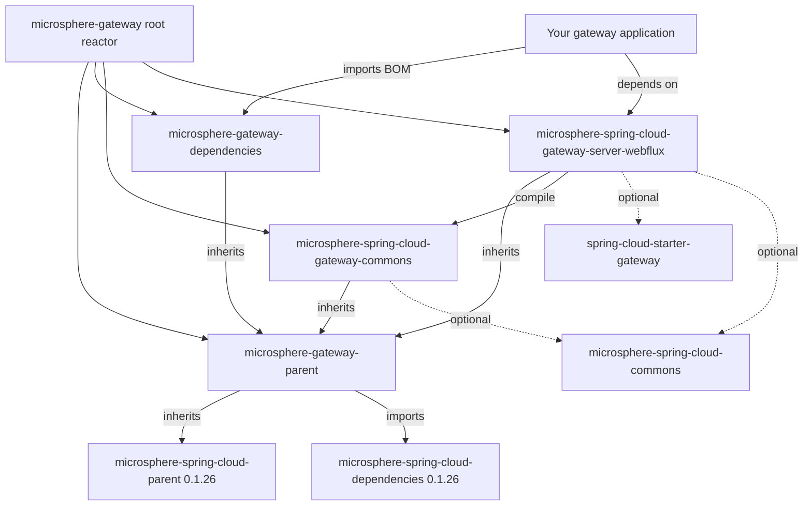

# `microsphere-spring-cloud-gateway-commons`

## 定位与适用人群

`0.1.x` 网关版本线的共享契约：配置属性名常量、两个 Microsphere 条件注解、`metadata.web-endpoint` 配置模型
（`WebEndpointConfig`）、`ConfigUtils` 绑定工具，以及把已绑定的路由 metadata 转换为类型化对象的
`WebEndpointConfigurationPropertiesBindListener`。

在以下场景依赖它：

- 你的应用以编程方式读写 web endpoint 路由 metadata（常量、`ConfigUtils`、`WebEndpointConfig`），而不是硬编码
  `"we"`、`"web-endpoint"`、`msgw-we-rewrite-path` 等字符串；
- 你要为本版本线编写一个**新的**网关服务端模块——响应式模块
  `microsphere-spring-cloud-gateway-server-webflux` 已经以 `compile` 作用域消费它，未来的其它传输形态同理；
- 你是 `microsphere-spring-cloud-gateway-server-webflux` 的使用方：该制品会传递引入，你无需显式声明。

> [!IMPORTANT]
> `0.1.x`（`release-1.x`）是面向 Jakarta 之前技术栈的维护版本线，**没有 WebMVC 模块**：这个 commons 制品只被唯一的响应式
> 服务端模块共享，并且 `WebEndpointConfig` 有意使用了 `javax.validation` 与
> `org.springframework.web.bind.annotation.RequestMethod`。Spring Boot `3.x` / `jakarta.*` 项目必须使用当前版本线：
> [../../../current/user-guide/README.md](../../../current/user-guide/README.md)。

## 版本信息

| 项目 | 值 |
|---|---|
| 坐标 | `io.github.microsphere-projects:microsphere-spring-cloud-gateway-commons:${revision}` |
| `release-1.x` 分支上的 Maven `revision` | `0.1.19-SNAPSHOT` |
| 最新发布版本 | `0.1.18` |
| 打包类型 | `jar` |
| Maven Central group | `io.github.microsphere-projects` |
| Javadoc | 分支 `README` 未为本制品给出链接，只为 `microsphere-spring-cloud-gateway-server-webflux` 提供了 Javadoc |

## 兼容范围

| 维度 | `0.1.x` 上的支持情况 | 说明 |
|---|---|---|
| JDK | `8`、`11`、`17`、`21`、`25` | 分支 `README`："JDK 8 or newer"；CI 矩阵见 `.github/workflows/maven-build.yml` |
| Spring Cloud | `Hoxton`、`2020`、`2021` | profiles `spring-cloud-hoxton`、`spring-cloud-2020`、`spring-cloud-2021`（Spring Boot `2.3.12.RELEASE` / `2.4.13` / `2.6.15`，由外部父 POM `microsphere-spring-cloud-parent:0.1.26` 锁定） |
| Bean Validation | `javax.validation` API | `WebEndpointConfig.Mapping` 使用 `javax.validation.constraints.NotNull` / `javax.validation.Valid` |
| 用到的 Spring 类型 | `spring-web`（`RequestMethod`）、`spring-boot` 的 `Binder` | 二者在模块 POM 中均声明为 `<optional>` |
| 必需的 gateway starter | `org.springframework.cloud:spring-cloud-starter-gateway` | 只有 WebFlux 模块需要它，commons 本身不需要；该 starter 是 `<optional>`，由应用自行添加 |
| 何时迁移到 `0.2.x` | Spring Boot `3.x` / `jakarta.validation` / JDK `17+` 基线 | [../../../current/user-guide/README.md](../../../current/user-guide/README.md) |

本模块的所有依赖都是 `<optional>`（包括 `microsphere-spring-cloud-commons`、`spring-boot-starter`、
`spring-cloud-commons`、`spring-cloud-loadbalancer`、`spring-web`、`validation-api`），因此它**不贡献任何传递的运行时
jar**——你需要自己补充什么，见安装小节。

## 安装

推荐做法：导入 BOM 并依赖响应式模块，由它把本制品带进来。

```xml
<dependencyManagement>
    <dependencies>
        <dependency>
            <groupId>io.github.microsphere-projects</groupId>
            <artifactId>microsphere-gateway-dependencies</artifactId>
            <version>0.1.18</version>
            <type>pom</type>
            <scope>import</scope>
        </dependency>
    </dependencies>
</dependencyManagement>
```

只有当你使用 commons 的 API 却不引入任何网关服务端模块时，才直接依赖 commons：

```xml
<dependency>
    <groupId>io.github.microsphere-projects</groupId>
    <artifactId>microsphere-spring-cloud-gateway-commons</artifactId>
</dependency>
```

由于 commons 自身的全部依赖都是 optional，直接使用它的消费方必须补齐 API 触及的东西：

```xml
<dependency>
    <groupId>org.springframework.boot</groupId>
    <artifactId>spring-boot-starter</artifactId>
</dependency>
<dependency>
    <groupId>org.springframework</groupId>
    <artifactId>spring-web</artifactId>
</dependency>
<dependency>
    <groupId>javax.validation</groupId>
    <artifactId>validation-api</artifactId>
</dependency>
<!-- a JSR-303 provider plus an EL implementation, required by ConfigUtils at runtime -->
<dependency>
    <groupId>org.hibernate.validator</groupId>
    <artifactId>hibernate-validator</artifactId>
</dependency>
<dependency>
    <groupId>org.apache.tomcat.embed</groupId>
    <artifactId>tomcat-embed-el</artifactId>
</dependency>
```

后两项与本模块测试的需要一致：`microsphere-spring-cloud-gateway-commons/pom.xml` 以 `test` 作用域加入了
`hibernate-validator` 与 `tomcat-embed-el`，`ConfigUtilsTest` 才能完成绑定与校验。

## API 参考

包 `io.microsphere.spring.cloud.gateway.commons.constants`。

### `interface CommonConstants`（`@since 1.0.0`）

| 常量 | 类型 | 值 | 何时使用 |
|---|---|---|---|
| `APPLICATION_NAME_URI_TEMPLATE_VARIABLE_NAME` | `String` | `"application"` | 路由过滤器从匹配到的 `Path` 断言中读取的 URI 模板变量。你的断言必须暴露它，例如 `Path=/{application}/**`。由 `CommonConstantsTest#testConstants` 断言。 |

### `interface CommonsPropertyConstants`

带注解的成员使用 `@io.microsphere.annotation.ConfigurationProperty(type = boolean.class, defaultValue = "true", source = APPLICATION_SOURCE)`，配置元数据正是由此生成。

| 常量 | 类型 | 值 / 默认值 | 何时使用 |
|---|---|---|---|
| `MICROSPHERE_GATEWAY_SPRING_CLOUD_PROPERTY_NAME_PREFIX` | `String` | `"microsphere.spring.cloud.gateway."` | 所有网关开关的前缀 |
| `DEFAULT_MICROSPHERE_GATEWAY_ENABLED` | `String` | `"true"` | 本版本线所有 enabled 开关的共享默认值 |
| `MICROSPHERE_GATEWAY_ENABLED_PROPERTY_NAME` | `String` | `"microsphere.spring.cloud.gateway.enabled"`，默认 `true` | Microsphere Gateway 总开关 |
| `MICROSPHERE_WEB_ENDPOINT_MAPPING_PROPERTY_NAME_PREFIX` | `String` | `"microsphere.spring.cloud.web-endpoint-mapping."` | web endpoint 映射特性前缀 |
| `MICROSPHERE_WEB_ENDPOINT_MAPPING_ENABLED_PROPERTY_NAME` | `String` | `"microsphere.spring.cloud.web-endpoint-mapping.enabled"`，默认 `true` | web endpoint 路由开关 |

以上五个值都在 `CommonsPropertyConstantsTest#testConstants` 中被逐字断言。

### `interface RouteConstants`

| 常量 | 类型 | 值 | 行为 / 何时使用 |
|---|---|---|---|
| `SCHEME` | `String` | `"we"` | 自定义路由协议。只有当 `RouteDefinition` 的 `uri.getScheme()` 等于该值时，它才被视作 web endpoint 路由。 |
| `ALL_SERVICES` | `String` | `"all"` | 表示“所有已发现服务”的 host：`we://all`。其它 host 会按逗号分隔的服务列表解析（`we://orders-service,payments-service`）。 |
| `ID_KEY` | `String` | `"id"` | 路由 id 的属性叶子名；响应式过滤器用它判断某个 `EnvironmentChangeEvent` 是否命中已知路由 id。 |
| `METADATA_KEY` | `String` | `"metadata"` | 绑定监听器改写路由 metadata 时所寻找的属性叶子名。 |
| `WEB_ENDPOINT_KEY` | `String` | `"web-endpoint"` | `metadata` 之下承载 `WebEndpointConfig` 的键（YAML：`metadata.web-endpoint`）。 |
| `WEB_ENDPOINT_REWRITE_PATH_ATTRIBUTE_NAME` | `String` | `"msgw-we-rewrite-path"` | `ServerWebExchange` 属性名，承载剥掉 `{application}` 前缀之后的路径。 |

由 `RouteConstantsTest#testConstants` 验证。

包 `io.microsphere.spring.cloud.gateway.commons.annotation`。

### `@interface ConditionalOnMicrosphereGatewayEnabled`

```java
@Retention(RUNTIME)
@Target({TYPE, METHOD})
@Documented
@ConditionalOnProperty(name = MICROSPHERE_GATEWAY_ENABLED_PROPERTY_NAME, matchIfMissing = true)
public @interface ConditionalOnMicrosphereGatewayEnabled {
}
```

除非 `microsphere.spring.cloud.gateway.enabled=false`，否则匹配；键缺失即视为开启（`matchIfMissing = true`）。当某个组件
属于 Microsphere Gateway、却又不在内置自动配置覆盖范围内时，把它用在你的 `@Configuration` 或 `@Bean` 上。

### `@interface ConditionalOnMicrosphereWebEndpointMappingEnabled`

```java
@Retention(RUNTIME)
@Target({TYPE, METHOD})
@Documented
@ConditionalOnMicrosphereGatewayEnabled
@ConditionalOnProperty(name = MICROSPHERE_WEB_ENDPOINT_MAPPING_ENABLED_PROPERTY_NAME, matchIfMissing = true)
public @interface ConditionalOnMicrosphereWebEndpointMappingEnabled {
}
```

它被 `@ConditionalOnMicrosphereGatewayEnabled` 元注解，因此**两个**开关都必须为开：这是更细粒度的闸门。响应式模块中的
`WebEndpointMappingGatewayAutoConfiguration` 使用了它。

包 `io.microsphere.spring.cloud.gateway.commons.config`。

### `class WebEndpointConfig`

```java
@Validated
public class WebEndpointConfig {
    @NotNull @Valid private List<Mapping> excludes = new LinkedList<>();
    public List<Mapping> getExcludes();
    public void setExcludes(List<Mapping> excludes);

    public static class Mapping {
        @NotNull @Valid private String[] patterns;
        @Nullable private RequestMethod[] methods;
        @Nullable private String[] params;
        @Nullable private String[] headers;
        @Nullable private String[] consumes;
        @Nullable private String[] produces;
        // getters / setters, plus:
        @Nonnull public RequestMethod[] getMethods();   // RequestMethod.values() when unset
        @Nonnull public String[] getHeaders();          // ArrayUtils.EMPTY_STRING_ARRAY when unset
    }
}
```

它是一条路由 `metadata.web-endpoint` 配置块的模型。`Mapping` 与 Spring 的 request-mapping 属性一一对应，响应式模块把每个
条目原样喂给 `RequestMappingInfo.paths(...).methods(...).params(...).headers(...).consumes(...).produces(...).build()`。

| 字段 | 类型 | YAML 缺省时的默认值 | 行为 |
|---|---|---|---|
| `excludes` | `List<Mapping>` | 空 `LinkedList` | 从该路由的 web endpoint 路由中剔除的映射 |
| `patterns` | `String[]` | `@NotNull`——缺失则绑定失败 | 路径模式 |
| `methods` | `RequestMethod[]` | 全部 `RequestMethod.values()` | 把排除项限定到指定 HTTP 方法 |
| `params` | `String[]` | `null` | 请求参数条件 |
| `headers` | `String[]` | `EMPTY_STRING_ARRAY`（空数组，永不为 `null`） | 请求头条件 |
| `consumes` | `String[]` | `null` | `Content-Type` 条件 |
| `produces` | `String[]` | `null` | `Accept` 条件 |

这些默认值在 `ConfigUtilsTest#assertWebEndpointConfig` 中被断言（`assertSame(EMPTY_STRING_ARRAY, ...)`、
`assertArrayEquals(RequestMethod.values(), ...)`）。

### `abstract class ConfigUtils implements Utils`

私有构造器；工具类，永不实例化。

| 签名 | 返回值 | 行为 |
|---|---|---|
| `@Nullable static WebEndpointConfig getWebEndpointConfig(Environment environment, String configPrefix)` | 绑定后的配置或 `null` | 使用携带 `ValidationBindHandler`（背后是 `LocalValidatorFactoryBean`）的 `Binder` 把 `configPrefix` 绑定成 `WebEndpointConfig`，因此上述 `@NotNull`/`@Valid` 约束会被强制执行。前缀不存在时返回 `null`。 |
| `@Nullable static WebEndpointConfig getWebEndpointConfig(Map<String, Object> metadata)` | 类型化配置或 `null` | 从路由 metadata 中读取 `RouteConstants.WEB_ENDPOINT_KEY`，**并且仅当该值本身已是 `WebEndpointConfig`** 时返回。原始 Map（纯 YAML）得到 `null`。 |

`ValidationBindHandler` 与 `Bindable<WebEndpointConfig>` 都在静态初始化块中构建，因此触碰这个类在运行时需要 JSR-303 提供者与
EL 实现。

### `class WebEndpointConfigurationPropertiesBindListener implements BindListener, EnvironmentAware`

```java
public static final String BEAN_NAME = "webEndpointConfigurationPropertiesBindListener";
public WebEndpointConfigurationPropertiesBindListener(String gatewayRoutesPropertyNamePrefix) // assertNotBlank
@Override public void onFinish(ConfigurationPropertyName name, Bindable<?> target, BindContext context, Object result)
@Override public void setEnvironment(Environment environment)
```

对 Spring Boot 的属性绑定做后置处理：每当被绑定的属性名以配置好的 routes 前缀开头并且**以 `metadata` 结尾**（即
`spring.cloud.gateway.routes[*].metadata`），它就用 `ConfigUtils` 绑定同级的 `metadata.web-endpoint` 节点，并在存在时把原始
Map 值替换成类型化的 `WebEndpointConfig` 实例。正是这次替换让 `ConfigUtils.getWebEndpointConfig(Map)`——进而让路由过滤器——能够
工作。它由响应式模块中的 `WebEndpointApplicationContextInitializer` 以 `BEAN_NAME` 注册为 bean，构造参数是
`spring.cloud.gateway.routes`。

## 配置参考

下表是本模块常量与 `features.yaml` 引入的 `microsphere.*` 键。它们全部从你的 `Environment` 读取，且都不是必填——所有开关默认
开启。

| 键 | 类型 | 默认值 | 作用 | 快照中的出处 |
|---|---|---|---|---|
| `microsphere.spring.cloud.gateway.enabled` | `boolean` | `true`（`matchIfMissing = true`） | Microsphere Gateway 总开关：约束 `@ConditionalOnMicrosphereGatewayEnabled`，因而约束 `GatewayAutoConfiguration`，并传递性地约束 web endpoint 路由 | `CommonsPropertyConstants.MICROSPHERE_GATEWAY_ENABLED_PROPERTY_NAME`、`ConditionalOnMicrosphereGatewayEnabledTest` |
| `microsphere.spring.cloud.web-endpoint-mapping.enabled` | `boolean` | `true`（`matchIfMissing = true`） | 只管 `we://` web endpoint 路由；不会关闭 `GatewayAutoConfiguration` 装配的路由/过滤器缓存 | `CommonsPropertyConstants.MICROSPHERE_WEB_ENDPOINT_MAPPING_ENABLED_PROPERTY_NAME`、`ConditionalOnMicrosphereWebEndpointMappingEnabledTest` |
| `microsphere.spring.cloud.gateway.` | 前缀 | — | 仅是前缀常量，不是可设置属性 | `MICROSPHERE_GATEWAY_SPRING_CLOUD_PROPERTY_NAME_PREFIX` |
| `microsphere.spring.cloud.web-endpoint-mapping.` | 前缀 | — | 仅是前缀常量 | `MICROSPHERE_WEB_ENDPOINT_MAPPING_PROPERTY_NAME_PREFIX` |
| `microsphere.spring.cloud.features.abstract.microsphere-spring-cloud-gateway-commons` | `List<String>`（类名） | `[io.microsphere.spring.cloud.gateway.commons.config.WebEndpointConfigurationPropertiesBindListener]` | 为 Microsphere/Spring Cloud 的 `HasFeatures` 上报声明本模块的“抽象特性”；文件位于 `src/main/resources/META-INF/config/default/features.yaml`。前缀 `microsphere.spring.cloud.features.abstract.` / `...named.` 由外部 `microsphere-spring-cloud-commons` 中的 `FeaturesConstants` 定义 | `microsphere-spring-cloud-gateway-commons/src/main/resources/META-INF/config/default/features.yaml` |

按路由的暴露规则**不是** `microsphere.*` 键，它们位于 `spring.cloud.gateway.routes[*].metadata.web-endpoint.excludes[*]`，字段为
`patterns`、`methods`、`params`、`headers`、`consumes`、`produces`（模型：`WebEndpointConfig.Mapping`）。参见
[microsphere-spring-cloud-gateway-server-webflux.md](microsphere-spring-cloud-gateway-server-webflux.md)。

## 代码示例

### 从 `Environment` 读取 `web-endpoint` 配置块

改写自 `ConfigUtilsTest#testGetWebEndpointConfig`，该测试把
`src/test/resources/META-INF/config/default/test.yaml` 装入 `MockEnvironment` 并附加 configuration-property 属性源：

```java
// fixture under test (META-INF/config/default/test.yaml)
// metadata:
//   web-endpoint:
//     excludes:
//       - patterns: /test-1/**
//         methods: GET
//         params: p=1
//       - patterns: /test-2/**
//         methods: POST
//         headers: h=1
//       - patterns: /test-3/abc/**
//         consumes: application/json
//         produces: plain/text

// environment set-up copied from ConfigUtilsTest#createEnvironment()
Resource resource = new DefaultResourceLoader().getResource("classpath:META-INF/config/default/test.yaml");
List<PropertySource<?>> propertySources = new YamlPropertySourceLoader().load(resource.toString(), resource);
MockEnvironment environment = new MockEnvironment();
propertySources.forEach(source -> environment.getPropertySources().addFirst(source));
ConfigurationPropertySources.attach(environment);

WebEndpointConfig config = getWebEndpointConfig(environment, "metadata.web-endpoint");
List<WebEndpointConfig.Mapping> excludes = config.getExcludes(); // 3 entries
String[] patterns = excludes.get(0).getPatterns();               // ["/test-1/**"]
RequestMethod[] methods = excludes.get(2).getMethods();          // RequestMethod.values()
```

在真实应用里 `Environment` 本来就是 Spring 的 `Environment`，你真正关心的是最后一行调用。

前缀下没有 `web-endpoint` 节点时得到 `null`——`ConfigUtilsTest#testGetWebEndpointConfigOnMissing` 绑定的是
`spring.cloud.gateway.routes[1]`（即 `request_size_route`，它的 metadata 只有 `a: 1`），并断言结果为 `null`。

### 从原始路由 metadata 到类型化配置

Map 重载只认绑定监听器产出的对象，`ConfigUtilsTest#testGetWebEndpointConfig` 演示得十分精确：

```java
Map<String, Object> metadata = new HashMap<>();
assertNull(getWebEndpointConfig(metadata));                                  // key absent
metadata.put(WEB_ENDPOINT_KEY, metadata);                                    // wrong type
assertNull(getWebEndpointConfig(metadata));
metadata.put(WEB_ENDPOINT_KEY, getWebEndpointConfig(environment,
        "spring.cloud.gateway.routes[0].metadata.web-endpoint"));            // typed instance
assertNotNull(getWebEndpointConfig(metadata));
```

### 自行注册绑定监听器

对应 `WebEndpointConfigurationPropertiesBindListenerTest#setUp`，它在装上监听器后绑定真实的路由 metadata：

```java
WebEndpointConfigurationPropertiesBindListener bindListener =
        new WebEndpointConfigurationPropertiesBindListener("spring.cloud.gateway.routes");
bindListener.setEnvironment(environment);

Map<String, Object> metadata = bind(environment, "spring.cloud.gateway.routes[0].metadata",
        LinkedHashMap.class, bindListener);
assertNotNull(getWebEndpointConfig(metadata));
```

在 Spring Boot 应用中无需手工这样做：响应式模块通过 `WebEndpointApplicationContextInitializer` 以 bean 名
`webEndpointConfigurationPropertiesBindListener` 注册了同一个监听器。另外请注意，上面的 `bind(...)` 是测试导入的测试工具
`io.microsphere.spring.boot.context.properties.bind.util.BindUtils.bind`；生产路径是 Spring Boot 自身的
`@ConfigurationProperties` 绑定。

### 为你自己的配置加闸门

来自 `ConditionalOnMicrosphereGatewayEnabledTest`（以及它的 `...WebEndpointMappingEnabled` 姊妹测试）：

```java
@ConditionalOnMicrosphereGatewayEnabled
static class Config {
}

@Nested
@SpringJUnitConfig(Config.class)
@TestPropertySource(properties = "microsphere.spring.cloud.gateway.enabled=false")
class DisabledTest {

    @Autowired(required = false)
    private Config config;

    @Test
    void test() {
        assertNull(this.config); // matchIfMissing = true only applies when the key is absent
    }
}
```

## 坑与常见问题

**`ConfigUtils` 在类初始化阶段就炸。** 它的静态块会创建 `LocalValidatorFactoryBean`，因此 classpath 上必须同时有 Bean
Validation 提供者与 EL 实现。commons 把 `validation-api` 保持为 `<optional>`，只在 `test` 作用域加入
`hibernate-validator`/`tomcat-embed-el`；运行时什么都不会继承到。

**YAML 明明写了 `metadata.web-endpoint`，`getWebEndpointConfig(Map)` 却返回 `null`。** 该重载做的是
`instanceof WebEndpointConfig` 判断。只有 `WebEndpointConfigurationPropertiesBindListener` 会把原始 Map 换成类型化对象，而且只有
当绑定经过响应式模块注册的这个监听器时才发生——只用 commons、或在 Java 里手工拼装的 metadata，仍是未类型化的。

**每个 exclude 都必须有 `patterns`。** 它是 `Mapping` 中唯一的 `@NotNull` 字段，而 `ConfigUtils` 是用
`ValidationBindHandler` 绑定的，所以缺少它的条目会让绑定失败，而不是被忽略。

**不写 `methods` 的含义是“所有方法”，而不是“没有方法”。** 数组为空时 `getMethods()` 返回
`RequestMethod.values()`（`ConfigUtilsTest#assertWebEndpointConfig` 对 `/test-3/abc/**` 条目断言了这一点），因此只写
`patterns` 的排除项会屏蔽整条路径。

**关掉 `microsphere.spring.cloud.web-endpoint-mapping.enabled` 并不等于关掉全部。** 它只约束
`WebEndpointMappingGatewayAutoConfiguration`；`GatewayAutoConfiguration`（心跳抑制、刷新传播、`CachingFilteringWebHandler`）
受 `microsphere.spring.cloud.gateway.enabled` 与 `spring.cloud.gateway.enabled` 约束。

**完全没有传递依赖。** 本模块所有依赖都是 `<optional>`，所以直接使用 commons 的应用必须自行带上 Spring Boot、
`spring-web`、`validation-api` 以及它触碰到的那些 Microsphere Spring Cloud 制品。

## 模块依赖关系



## 另见

- 响应式集成与 `we://` 请求链路：[microsphere-spring-cloud-gateway-server-webflux.md](microsphere-spring-cloud-gateway-server-webflux.md)
- BOM 与版本锁定：[microsphere-gateway-dependencies.md](microsphere-gateway-dependencies.md)
- 本版本线开发者指南：[../../developer-guide/README.md](../../developer-guide/README.md)

## English

[../microsphere-spring-cloud-gateway-commons.md](../microsphere-spring-cloud-gateway-commons.md)
