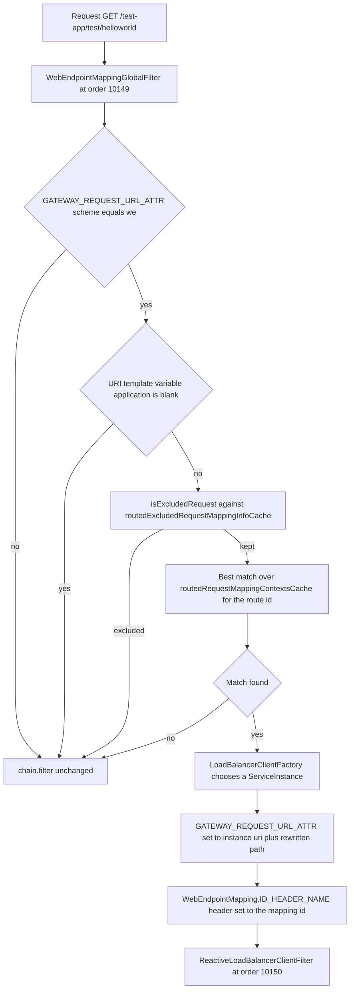
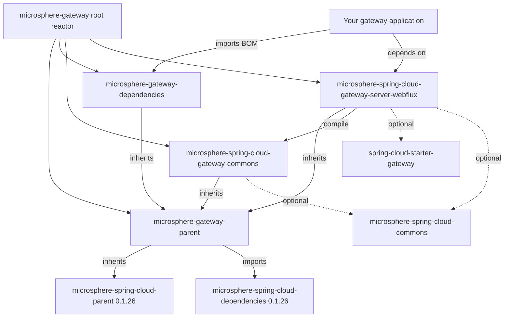

# `microsphere-spring-cloud-gateway-server-webflux`

## 定位与适用人群

`0.1.x` 版本线的响应式服务端模块。它把 Microsphere 的 web endpoint 路由能力插入 Spring Cloud Gateway（WebFlux）：
`uri` 使用自定义 `we://` scheme 的路由，会结合 Spring Cloud 服务发现与目标实例发布的 `WebEndpointMapping` metadata
进行解析，随后重写路径、把选中的实例替换进请求 URL，并且网关自身的 filter 执行逻辑会被替换为一个带缓存的实现。

在以下场景依赖它：

- 你的团队在 Spring Boot `2.x` 上运行响应式 Spring Cloud Gateway，希望用一条路由服务所有被发现的服务，而不必重复
  声明路由定义；
- 你的团队需要在配置变更、服务实例变更时刷新路由，而无需重新部署。

这是本版本线**唯一**的服务端模块。

> [!IMPORTANT]
> `0.1.x`（`release-1.x`）是面向 Jakarta 之前技术栈的维护版本线，**没有 WebMVC（servlet）模块**——这里不存在
> `microsphere-spring-cloud-gateway-server-webmvc`。Servlet 网关以及 Spring Boot `3.x` / `jakarta.*` 项目属于当前版本线：
> [../../../current/user-guide/README.md](../../../current/user-guide/README.md)。

## 版本信息

| 项目 | 值 |
|---|---|
| 坐标 | `io.github.microsphere-projects:microsphere-spring-cloud-gateway-server-webflux:${revision}` |
| `release-1.x` 分支上的 Maven `revision` | `0.1.19-SNAPSHOT` |
| 最新发布版本 | `0.1.18` |
| 打包类型 | `jar` |
| Maven Central group | `io.github.microsphere-projects` |
| Javadoc | `https://javadoc.io/doc/io.github.microsphere-projects/microsphere-spring-cloud-gateway-server-webflux`（来自分支 `README` 的链接） |
| 非 optional 依赖 | `io.github.microsphere-projects:microsphere-spring-cloud-gateway-commons:${revision}` |

## 兼容范围

| 维度 | `0.1.x` 上的支持情况 | 说明 |
|---|---|---|
| JDK | `8`、`11`、`17`、`21`、`25` | 分支 `README`："JDK 8 or newer"；`.github/workflows/maven-build.yml` 矩阵 `['8','11','17','21','25']` |
| Spring Cloud | `Hoxton`、`2020`、`2021` | profiles `spring-cloud-hoxton`、`spring-cloud-2020`、`spring-cloud-2021` |
| Spring Boot | `2.3.12.RELEASE`（`spring-cloud-hoxton`）、`2.4.13`（`spring-cloud-2020`）、`2.6.15`（`spring-cloud-2021`，默认激活） | 版本由外部父 POM `microsphere-spring-cloud-parent:0.1.26` 锁定，不来自本仓库 |
| 必需：gateway starter | `org.springframework.cloud:spring-cloud-starter-gateway` | 在本模块 POM 中声明为 `<optional>`——必须由你添加 |
| 必需：服务发现 | 一套 `ReactiveDiscoveryClient` 环境（Nacos、Eureka、Zookeeper、Consul、Kubernetes，或测试使用的 simple registry） | `WebEndpointMappingGatewayAutoConfiguration` 带有 `@ConditionalOnDiscoveryEnabled` + `@ConditionalOnReactiveDiscoveryEnabled` |
| 必需：负载均衡 | `LoadBalancerClientFactory`（Spring Cloud LoadBalancer） | 它是 `WebEndpointMappingGlobalFilter` 的构造器依赖，同时也是 `@ConditionalOnBean` 的守卫条件 |
| 必需：Microsphere Spring Cloud | `microsphere-spring-cloud-commons`（提供 `ReactiveDiscoveryClientAdapter`、`ServiceInstancesChangedEvent`、`WebEndpointMapping`）、`microsphere-spring-boot-webflux`（提供 `@ConditionalOnWebFluxAvailable`） | 二者在 POM 中均为 `<optional>`；缺少它们时下述条件不匹配，不会出现任何 bean |
| 何时迁移到 `0.2.x` | Spring Boot `3.x` / JDK `17+` 基线 | [../../../current/user-guide/README.md](../../../current/user-guide/README.md) |

`microsphere-spring-cloud-gateway-commons` 是本模块唯一的非 optional 依赖，而所有第三方依赖都是 `<optional>`：模块针对它们
编译，但从不把某个版本强加给应用。

## 安装

```xml
<dependencyManagement>
    <dependencies>
        <dependency>
            <groupId>io.github.microsphere-projects</groupId>
            <artifactId>microsphere-gateway-dependencies</artifactId>
            <version>0.1.18</version>
            <type>pom</type>
            <scope>import</scope>
        </dependency>
    </dependencies>
</dependencyManagement>

<dependencies>
    <dependency>
        <groupId>io.github.microsphere-projects</groupId>
        <artifactId>microsphere-spring-cloud-gateway-server-webflux</artifactId>
    </dependency>

    <!-- the starter is optional in the module above, so declare it here -->
    <dependency>
        <groupId>org.springframework.cloud</groupId>
        <artifactId>spring-cloud-starter-gateway</artifactId>
    </dependency>

    <!-- needed for the web-endpoint filter to be created at all -->
    <dependency>
        <groupId>io.github.microsphere-projects</groupId>
        <artifactId>microsphere-spring-cloud-commons</artifactId>
    </dependency>
    <dependency>
        <groupId>org.springframework.cloud</groupId>
        <artifactId>spring-cloud-loadbalancer</artifactId>
    </dependency>
</dependencies>
```

再自行添加一个你选择的 discovery-client starter（`eureka`、`consul`、`zookeeper`、`nacos`、`kubernetes`），如果你自己要调用
`ConfigUtils`，还需要一个 Bean Validation 实现——见
[microsphere-spring-cloud-gateway-commons.md](microsphere-spring-cloud-gateway-commons.md)。

## API 参考

### 自动配置入口

由本模块的资源文件同步注册两次：

| 资源 | 键 | 类 |
|---|---|---|
| `META-INF/spring.factories` | `org.springframework.boot.autoconfigure.EnableAutoConfiguration` | `GatewayAutoConfiguration`、`WebEndpointMappingGatewayAutoConfiguration` |
| `META-INF/spring.factories` | `org.springframework.context.ApplicationContextInitializer` | `WebEndpointApplicationContextInitializer` |
| `META-INF/spring/org.springframework.boot.autoconfigure.AutoConfiguration.imports` | （每行一个类） | `GatewayAutoConfiguration`、`WebEndpointMappingGatewayAutoConfiguration` |
| `META-INF/config/default/features.yaml` | `microsphere.spring.cloud.features.*` | 见配置参考 |

### `class GatewayAutoConfiguration`

包 `io.microsphere.spring.cloud.gateway.server.webflux.autoconfigure`。

```java
@Configuration(proxyBeanMethods = false)
@ConditionalOnGatewayAvailable
@ConditionalOnMicrosphereGatewayEnabled
@EnableEventExtension
@AutoConfigureAfter(name = {
        "org.springframework.cloud.gateway.config.GatewayAutoConfiguration"
})
@Import(value = {
        DisabledHeartbeatEventRouteRefreshListenerInterceptor.class,
        PropagatingRefreshRoutesEventApplicationListener.class,
        FilteringWebHandlerBeanDefinitionRegistryPostProcessor.class
})
public class GatewayAutoConfiguration {
}
```

类体为空，纯装配代码。它启用 Microsphere 事件扩展、安装心跳事件抑制器、安装
`EnvironmentChangeEvent` -> `RefreshRoutesEvent` 传播器，并把 Spring Cloud Gateway 的 `FilteringWebHandler` bean 定义替换为
`CachingFilteringWebHandler`。当 Spring Cloud Gateway 在 classpath 上、应用是 WebFlux 应用、`spring.cloud.gateway.enabled`
不为 `false`、且 `microsphere.spring.cloud.gateway.enabled` 不为 `false` 时生效。

### `class WebEndpointMappingGatewayAutoConfiguration`

条件，逐字取自源码：

| 条件 | 效果 |
|---|---|
| `@ConditionalOnGatewayAvailable` | Gateway 类存在、WebFlux 可用、gateway 已启用 |
| `@ConditionalOnDiscoveryEnabled` | Spring Cloud 服务发现已启用 |
| `@ConditionalOnReactiveDiscoveryEnabled` | 响应式服务发现已启用 |
| `@ConditionalOnMicrosphereWebEndpointMappingEnabled` | `microsphere.spring.cloud.web-endpoint-mapping.enabled`（以及总开关）不为 `false` |
| `@ConditionalOnClass(name = {"org.springframework.cloud.client.discovery.ReactiveDiscoveryClient", "org.springframework.cloud.loadbalancer.support.LoadBalancerClientFactory"})` | classpath 上有响应式发现 + LoadBalancer |
| `@AutoConfigureAfter(value = {GatewayAutoConfiguration.class, WebFluxAutoConfiguration.class, ReactiveDiscoveryClientAutoConfiguration.class}, name = {"org.springframework.cloud.gateway.config.GatewayAutoConfiguration", "org.springframework.cloud.loadbalancer.config.LoadBalancerAutoConfiguration", "org.springframework.cloud.client.discovery.composite.reactive.ReactiveCompositeDiscoveryClientAutoConfiguration"})` | 与上游自动配置的执行顺序 |

只暴露一个 bean：

```java
@Bean
@ConditionalOnEnabledGlobalFilter
@ConditionalOnBean(value = {ReactiveDiscoveryClientAdapter.class, LoadBalancerClientFactory.class}, search = CURRENT)
public WebEndpointMappingGlobalFilter webEndpointMappingGlobalFilter(ReactiveDiscoveryClientAdapter reactiveDiscoveryClient,
                                                                    LoadBalancerClientFactory loadBalancerClientFactory,
                                                                    GatewayProperties gatewayProperties)
```

`@ConditionalOnBean(..., search = CURRENT)` 正是"只有 discovery client 还不够"的原因：当前*（current）*上下文中必须存在一个
`ReactiveDiscoveryClientAdapter` bean（由 `microsphere-spring-cloud-commons` 贡献）；而 `@ConditionalOnEnabledGlobalFilter`
还额外允许用 Spring Cloud Gateway 自己的 filter 启用属性把这个 bean 关掉。

### `interface GatewayPropertyConstants`

| 常量 | 值 | 行为 |
|---|---|---|
| `GATEWAY_ENABLED_PROPERTY_NAME` | `spring.cloud.gateway.enabled`（由 `GatewayProperties.PREFIX + DOT + ENABLED_PROPERTY_NAME` 拼出），默认 `true` | Spring Cloud Gateway 自身的启用开关，被 `@ConditionalOnGatewayEnabled` 复用 |
| `GATEWAY_ROUTES_PROPERTY_NAME_PREFIX` | `spring.cloud.gateway.routes` | 交给 `WebEndpointConfigurationPropertiesBindListener` 的前缀，同时也是 `WebEndpointMappingGlobalFilter#matchesEvent(EnvironmentChangeEvent)` 中匹配用的前缀 |

由 `GatewayPropertyConstantsTest#testConstants` 断言。

### `@interface ConditionalOnGatewayEnabled`

`@Target({TYPE, METHOD})`、`@Retention(RUNTIME)`、`@Documented`，元注解为
`@ConditionalOnProperty(name = GATEWAY_ENABLED_PROPERTY_NAME, matchIfMissing = true)`。用它把你自己的 bean 闸门在
"Spring Cloud Gateway 已启用"上。

### `@interface ConditionalOnGatewayAvailable`

两个自动配置类共同使用的组合注解：

```java
@Retention(RUNTIME)
@Target({TYPE, METHOD})
@Documented
@ConditionalOnGatewayEnabled
@ConditionalOnWebFluxAvailable
@ConditionalOnClass(name = {
        "org.springframework.cloud.gateway.config.GatewayProperties"    // Spring Cloud Gateway API
})
public @interface ConditionalOnGatewayAvailable {
}
```

含义是"gateway 已启用 + WebFlux 可用 + gateway 类存在"。`@ConditionalOnWebFluxAvailable` 来自
`microsphere-spring-boot-webflux`，本模块对其声明为 `<optional>`。

### `class WebEndpointMappingGlobalFilter implements GlobalFilter, SmartApplicationListener, ApplicationContextAware, EnvironmentAware, DisposableBean, Ordered`

本模块的核心。构造器：

```java
public WebEndpointMappingGlobalFilter(DiscoveryClient discoveryClient,
                                      LoadBalancerClientFactory clientFactory,
                                      GatewayProperties gatewayProperties)
```

| 成员 | 行为 |
|---|---|
| `Mono<Void> filter(ServerWebExchange, GatewayFilterChain)` | 除非 `GATEWAY_REQUEST_URL_ATTR` 的 scheme 为 `we`，否则原样透传；要求存在 `{application}` URI 模板变量；解析被排除项/匹配项；然后把 `GATEWAY_REQUEST_URL_ATTR` 设为实例 URI + 重写后的路径，并添加携带匹配到的 mapping id 的 `WebEndpointMapping.ID_HEADER_NAME` 请求头 |
| `int getOrder()` | `10149`（`LOAD_BALANCER_CLIENT_FILTER_ORDER - 1`，其中常量 `10150` 对应 Spring Cloud Gateway 的响应式负载均衡 filter），因此它在负载均衡 filter 执行前一刻重写 URL |
| `boolean supportsAsyncExecution()` | `false`——该 filter 声明 Spring Cloud Gateway 不得在事件循环上运行它，这与实例选择内部的同步 `MonoUtils.getValue(...)` 相一致 |
| `boolean supportsEventType(Class<? extends ApplicationEvent>)` | `ContextRefreshedEvent`、`RefreshRoutesResultEvent`、`EnvironmentChangeEvent`、`ServiceInstancesChangedEvent` |
| `void onApplicationEvent(ApplicationEvent)` | 针对上述四类事件分别派发缓存刷新 |
| `void setApplicationContext(ApplicationContext)` / `void setEnvironment(Environment)` | 标准的 aware 回调 |
| `void destroy()` | 清空两个缓存（`routedRequestMappingContextsCache`、`routedExcludedRequestMappingInfoCache`） |
| `volatile Map<String, Collection<RequestMappingContext>> routedRequestMappingContextsCache` | 包可见的按路由 mapping 缓存，由 `refresh()` 在 `synchronized (this)` 保护下整体替换 |
| `volatile Map<String, Collection<RequestMappingInfo>> routedExcludedRequestMappingInfoCache` | 包可见的按路由排除项缓存 |
| `Collection<String> getSubscribedServices(URI routeUri)`（包私有） | host 为 `all` 时 -> `discoveryClient.getServices()`；否则把 host 按逗号切分成 `Set` |
| `RequestMappingContext getMatchingRequestMappingContext(String applicationName, String routeId, ServerWebExchange exchange)`（包可见，供测试使用） | 先做排除检查，再在缓存的 mapping 上做最优匹配，并把重写后的路径以 `msgw-we-rewrite-path` 交换属性存下 |
| `void clear()`（包可见，注释为 "Clear for testing"） | 把 mapping 缓存置空 |

嵌套的包私有 `static class RequestMappingContext` 持有由 `WebEndpointMapping` 构建出的 `RequestMappingInfo` 及其 `id`，并提供
`compareTo(RequestMappingContext, ServerWebExchange)`（使用 Spring 自身的 mapping 优先级规则）和两个 `buildRequestMappingInfo`
工厂方法——一个来自 `WebEndpointConfig.Mapping`（排除项），一个来自 `WebEndpointMapping`（被发现的 endpoint）。另有两个包私有静态方法
`buildPath(ServiceInstance, URI)`（去掉开头的 `/{serviceId}/`，再套用实例的 `web.context-path` metadata）和 `clear(Map<?, ?>)`；在本快照中
`buildPath` 只被 `WebEndpointMappingGlobalFilterStaticTest` 覆盖，并未被 `filter(...)` 调用。

### `class CachingFilteringWebHandler extends FilteringWebHandler implements DisposableBean`

| 成员 | 行为 |
|---|---|
| `CachingFilteringWebHandler(List<GlobalFilter> globalFilters)` | 把 global filters 传给父类构造器 |
| `Mono<Void> handle(ServerWebExchange)` | 从缓存中取出该路由已排序的 filter 数组，交给 `DefaultGatewayFilterChain` 执行；**不**调用 `super.handle` |
| `@EventListener(RefreshRoutesResultEvent.class) void onRefreshRoutesResultEvent(RefreshRoutesResultEvent)` | 当 `GatewayUtils.isSuccessRouteLocatorEvent(event)` 为真时，用 `RouteLocator#getRoutes()` 重建整个缓存 |
| `GatewayFilter[] getRoutedGatewayFilters(Route)`（包可见） | 缓存仍为 `null` 或路由 id 未知时返回 `EMPTY_FILTER_ARRAY` |
| `void destroy()` | 清空缓存，可容忍缓存为 `null` |
| `static final GatewayFilter[] EMPTY_FILTER_ARRAY` | 包可见的空数组哨兵值 |
| private `List<GatewayFilter> globalFilters()` | 通过反射读取父类的私有字段 `globalFilters`（`FieldUtils.getFieldValue(true, this, "globalFilters")`) |

### `class FilteringWebHandlerBeanDefinitionRegistryPostProcessor implements BeanDefinitionRegistryPostProcessor`

`postProcessBeanDefinitionRegistry` 保存 registry；`postProcessBeanFactory` 找出所有类型为 `FilteringWebHandler` 的 bean 名称，
移除其定义，再以相同 bean 名称重新注册 `CachingFilteringWebHandler.class`。这就是"路由 filter 缓存"能力接入的全部过程：只要
`GatewayAutoConfiguration` 生效，它就自动发生。

### `class DefaultGatewayFilterChain implements GatewayFilterChain`

```java
public DefaultGatewayFilterChain(GatewayFilter... gatewayFilters)   // rejects null array and null elements
@Override public Mono<Void> filter(ServerWebExchange exchange)
```

推进内部 `position`，并延迟执行每个 filter（`Mono.defer`）；数组耗尽后返回 `Mono.empty()`。输入非法时抛出
`IllegalArgumentException`，`DefaultGatewayFilterChainTest` 正是如此断言的。

### `class WebEndpointApplicationContextInitializer extends ConfigurableApplicationContextInitializer`

`protected void initialize(ConfigurableApplicationContext context, ConfigurableEnvironment environment)` 向容器注册
`WebEndpointConfigurationPropertiesBindListener` 的 bean 定义（名称为
`WebEndpointConfigurationPropertiesBindListener.BEAN_NAME`），构造参数为
`GatewayPropertyConstants.GATEWAY_ROUTES_PROPERTY_NAME_PREFIX`。它通过 `spring.factories` 的 `ApplicationContextInitializer`
键注册，也就是说在任何 `spring.cloud.gateway.routes[*]` 的 `@ConfigurationProperties` 绑定发生之前就已就位。

### `class DisabledHeartbeatEventRouteRefreshListenerInterceptor implements ApplicationListenerInterceptor`

`void intercept(ApplicationListener<?>, ApplicationEvent, ApplicationListenerInterceptorChain)` 在监听器类**等于**
`RouteRefreshListener.class`（exact-class 比较）且事件类等于 `HeartbeatEvent` 或 `ParentHeartbeatEvent` 时丢弃该事件（一次
`logger.trace` 加 `return`，不再继续链条）；其余事件照常向下传递。精确类匹配意味着 `RouteRefreshListener` 的子类不会被拦截。
该能力依赖 Microsphere 事件扩展，由 `GatewayAutoConfiguration` 上的 `@EnableEventExtension` 开启。

### `class PropagatingRefreshRoutesEventApplicationListener implements ApplicationListener<EnvironmentChangeEvent>`

```java
public PropagatingRefreshRoutesEventApplicationListener(ApplicationContext context)
@Override public void onApplicationEvent(EnvironmentChangeEvent event)
```

只要任意变更的 key 以 `spring.cloud.gateway` 开头，就发布 `new RefreshRoutesEvent(this)`。该事件的 source 是这个 listener
本身而不是 `RouteLocator`，因此它本身并不构成本模块的缓存刷新触发器：真正执行路由刷新并发布 `RefreshRoutesResultEvent`（缓存随后
对该事件作出反应）的是 Spring Cloud Gateway 自身的路由机制。

### `abstract class GatewayUtils implements Utils`

| 签名 | 行为 |
|---|---|
| `@Nonnull static Map<String, Object> getGatewayProperties(ConfigurableEnvironment environment)` | 通过 `PropertySourcesUtils.getSubProperties` 取出 `spring.cloud.gateway` 下的扁平化属性（key 相对于该前缀） |
| `@Nonnull static Map<String, Object> getRouteProperties(ConfigurableEnvironment environment, String routeId)` | 找到 `id` 等于 `routeId` 的路由的属性前缀，然后返回该前缀下的全部 gateway 属性；找不到该 id 时返回 `emptyMap()`；返回值不可修改 |
| `static boolean isSuccessRouteLocatorEvent(RefreshRoutesResultEvent event)` | `event != null && event.isSuccess() && event.getSource() instanceof RouteLocator` |

`GatewayUtilsTest` 覆盖了全部三个方法，包括 `null` 事件、以 `this` 为 source 的事件、用 mock 的 `RouteLocator` 构造的成功事件，
以及用 `Throwable` 构造的失败事件。

## 配置参考

| 键 | 类型 | 默认值 | 效果 | 快照中的出处 |
|---|---|---|---|---|
| `microsphere.spring.cloud.gateway.enabled` | `boolean` | `true` | Microsphere 针对 `GatewayAutoConfiguration`（并间接针对 web-endpoint 路由）的总开关 | commons 模块中的 `CommonsPropertyConstants` |
| `microsphere.spring.cloud.web-endpoint-mapping.enabled` | `boolean` | `true` | 仅作用于 `WebEndpointMappingGatewayAutoConfiguration` 的开关 | commons 模块中的 `CommonsPropertyConstants` |
| `microsphere.spring.cloud.features.abstract.microsphere-spring-cloud-gateway-server-webflux` | `List<String>` | `[CachingFilteringWebHandler, WebEndpointMappingGlobalFilter, DisabledHeartbeatEventRouteRefreshListenerInterceptor, PropagatingRefreshRoutesEventApplicationListener]`（全限定名） | 把本模块的 "abstract features" 注册给 Microsphere/Spring Cloud 的 `HasFeatures` 上报 | `src/main/resources/META-INF/config/default/features.yaml` |
| `microsphere.spring.cloud.features.named.microsphere-spring-cloud-gateway-server-webflux` | `Map<String, String>` | `WebEndpointApplicationContextInitializer=io.microsphere.spring.cloud.gateway.server.webflux.context.WebEndpointApplicationContextInitializer` | 为同一套上报注册一个 "named feature"（`name=class`） | `src/main/resources/META-INF/config/default/features.yaml` |
| `microsphere.spring.boot.webflux.enabled` | `boolean` | `true`（定义在 `microsphere-spring-boot-webflux`） | 不是本模块的键：`@ConditionalOnGatewayAvailable` 元注解了 `@ConditionalOnWebFluxAvailable`，而测试把 `microsphere.spring.boot.webflux.enabled=false` 列为全局禁用值 | `GatewayAutoConfigurationTest`、`WebEndpointMappingGatewayAutoConfigurationTest` |
| `spring.cloud.gateway.enabled` | `boolean` | `true` | Spring Cloud Gateway 的开关，被 `@ConditionalOnGatewayEnabled` 复用 | `GatewayPropertyConstants.GATEWAY_ENABLED_PROPERTY_NAME` |
| `spring.cloud.gateway.routes` | 前缀 | — | 绑定监听器与 `EnvironmentChangeEvent` 匹配所使用的前缀 | `GatewayPropertyConstants.GATEWAY_ROUTES_PROPERTY_NAME_PREFIX` |
| `spring.cloud.gateway.routes[n].uri` | `String` | — | 必须由本模块路由时写成 `we://all`、`we://<service>` 或 `we://<service>,<service>` | `RouteConstants.SCHEME`、`ALL_SERVICES`；`WebEndpointMappingGlobalFilter#getSubscribedServices` |
| `spring.cloud.gateway.routes[n].predicates` | list | — | 必须暴露 `application` URI 模板变量，例如 `Path=/{application}/**` | `CommonConstants.APPLICATION_NAME_URI_TEMPLATE_VARIABLE_NAME`；`WebEndpointMappingGlobalFilter#filter` |
| `spring.cloud.gateway.routes[n].metadata.web-endpoint` | `WebEndpointConfig` 对象 | 缺失 => 不注入 | 由绑定监听器转换为类型化的 `WebEndpointConfig` | `RouteConstants.WEB_ENDPOINT_KEY`；`WebEndpointConfigurationPropertiesBindListener` |
| `spring.cloud.gateway.routes[n].metadata.web-endpoint.excludes[k].patterns` | `String[]` | 必填（`@NotNull`） | 被排除的路径模式 | `WebEndpointConfig.Mapping` |
| `...excludes[k].methods` | `RequestMethod[]` | 省略时为全部 `RequestMethod.values()` | 被排除的方法 | `WebEndpointConfig.Mapping#getMethods` |
| `...excludes[k].params` | `String[]` | `null` | 被排除的请求参数条件 | `WebEndpointConfig.Mapping` |
| `...excludes[k].headers` | `String[]` | 省略时为空数组 | 被排除的请求头条件 | `WebEndpointConfig.Mapping#getHeaders` |
| `...excludes[k].consumes` | `String[]` | `null` | 被排除的 `Content-Type` 条件 | `WebEndpointConfig.Mapping` |
| `...excludes[k].produces` | `String[]` | `null` | 被排除的 `Accept` 条件 | `WebEndpointConfig.Mapping` |
| `spring.cloud.discovery.reactive.enabled` | `boolean` | `true`（Spring Cloud） | 不是本模块的键；`@ConditionalOnReactiveDiscoveryEnabled` 闸门住 filter bean，测试用 `spring.cloud.discovery.reactive.enabled=false` 将其关闭 | `WebEndpointMappingGatewayAutoConfigurationTest` |

## 请求路径



缓存会在以下时机重建：`ContextRefreshedEvent`（仅限自身容器）、source 为 `RouteLocator` 的成功
`RefreshRoutesResultEvent`、变更 key 命中已知路由 `id` 的 `EnvironmentChangeEvent`，以及任意
`ServiceInstancesChangedEvent`。

## 代码示例

### 一条 web-endpoint 路由

来自 `microsphere-spring-cloud-gateway-server-webflux/src/test/resources/META-INF/config/default/test.yaml`，即
`WebEndpointMappingGlobalFilterTest` 中通过 `spring.profiles.active=simple-service-registry,gateway` 激活的那份配置：

```yaml
spring:
  cloud:
    gateway:
      routes:
        - id: request_size_route
          uri: http://localhost:8080/upload
          predicates:
            - Path=/upload
          filters:
            - name: RequestSize
              args:
                maxSize: 5000000
          metadata:
            a: 1
        - id: retry_test
          uri: http://localhost:8080/flakey
          predicates:
            - Host=*.retry.com
          filters:
            - name: Retry
              args:
                retries: 3
                statuses: BAD_GATEWAY
                methods: GET,POST
        - id: web-endpoint-mapping
          uri: we://all
          predicates:
            - Path=/{application}/**
          metadata:
            web-endpoint:
              excludes:
                - patterns: /test-1/**
                - patterns: /test-2/**
                  methods: GET
                - patterns: /test-3/abc/**
                  consumes: application/json
                  produces: plain/text
```

只有第三条是 web-endpoint 路由：`getWebEndpointRoutes()` 保留 `uri` 的 scheme 恰好为 `we` 的路由。
上面的片段做了删节——夹具中的 `retry_test` 路由为其 `Retry` filter 额外配置了 `backoff`、`jitter` 与
`timeout` 参数。

### 指定具体服务

分支 `README` 给出了 `we://all`、`we://orders-service` 与 `we://orders-service,payments-service` 三种写法；逗号形式由
`getSubscribedServices(...)` 中的 `commaDelimitedListToSet(host)` 解析：

```yaml
spring:
  cloud:
    gateway:
      routes:
        - id: two-services
          uri: we://orders-service,payments-service
          predicates:
            - Path=/{application}/**
          metadata:
            web-endpoint:
              excludes: []
```

`WebEndpointMappingGlobalFilterTest#testFilter` 证实了单服务写法：`getSubscribedServices(URI.create("we://test-app"))`
返回一个元素 `"test-app"`，而 `we://all` 会展开为 `discoveryClient.getServices()`。

### 关闭特性

来自分支 `README`（"Configure a Web Endpoint Mapping Route"）：

```yaml
microsphere:
  spring:
    cloud:
      gateway:
        enabled: false
      web-endpoint-mapping:
        enabled: false
```

### 按测试的方式调用 filter

改写自 `WebEndpointMappingGatewayAutoConfigurationIntegrationTest`：

```java
MockServerWebExchange exchange = MockServerWebExchange.from(MockServerHttpRequest.get("/test").build());
exchange.getAttributes().put(ServerWebExchangeUtils.GATEWAY_REQUEST_URL_ATTR, exchange.getRequest().getURI());
GatewayFilterChain chain = new DefaultGatewayFilterChain(new NoOpGatewayFilter());

assertNotNull(webEndpointMappingGlobalFilter.filter(exchange, chain));
assertEquals(10149, webEndpointMappingGlobalFilter.getOrder());
webEndpointMappingGlobalFilter.destroy();                       // clears both caches
webEndpointMappingGlobalFilter.onApplicationEvent(new RefreshRoutesResultEvent(this));
webEndpointMappingGlobalFilter.onApplicationEvent(new RefreshRoutesResultEvent(this, new Exception("For testing")));
```

`NoOpGatewayFilter` 是测试里那个返回 `Mono.empty()` 的 `GatewayFilter`
（`src/test/java/.../filter/NoOpGatewayFilter.java`）。

### 端到端观察路由行为

`WebEndpointMappingGlobalFilterTest` 把测试应用自身以本地随机端口注册进*简单*（simple）注册中心，然后断言重写后的调用命中
应用发布的 mapping：

```java
@SpringBootTest(
        classes = {TestController.class, WebEndpointMappingGlobalFilterTest.class,
                WebEndpointMappingGlobalFilterTest.TestConfig.class},
        properties = {"spring.profiles.active=simple-service-registry,gateway"},
        webEnvironment = RANDOM_PORT)
@EnableAutoConfiguration
class WebEndpointMappingGlobalFilterTest {

    @Test
    @Order(1)
    void testFilter() {
        testHelloWorldEndpoint();               // /test-app/test/helloworld -> 200, body == TestController#helloWorld
        // excluded paths are not rewritten to a discovered instance
        webTestClient.get().uri("/test-1/test/helloworld").exchange().expectStatus().isOk();
        webTestClient.get().uri("/test-2/test/helloworld").exchange().expectStatus().isOk();
        webTestClient.get().uri("/test-3/abc/def").header(CONTENT_TYPE, "application/json")
                .header(ACCEPT, "plain/text").exchange().expectStatus().isOk();
        // instance changes force a cache refresh
        context.publishEvent(new ServiceInstancesChangedEvent(registration.getServiceId(), ofList(registration)));
        testHelloWorldEndpoint();
    }
}
```

`testFilterOnUnregisteredApplication`（`/test-0/test/helloworld`）与 `testFilterOnNoRoutedRequestMappingContext`
（在 `filter.clear()` + `filter.destroy()` 之后）展示了无法匹配任何 mapping 时的透传行为。

### 路由刷新的传播

改写自 `PropagatingRefreshRoutesEventApplicationListenerTest`：

```java
ValueHolder<RefreshRoutesEvent> holder = new ValueHolder<>();
context.addApplicationListener((ApplicationListener<RefreshRoutesEvent>) event -> holder.setValue(event));

context.publishEvent(new EnvironmentChangeEvent(ofSet("spring.cloud.gateway.enabled"))); // PREFIX + ".enabled"
assertSame(listener, holder.getValue().getSource());          // RefreshRoutesEvent was propagated

holder.setValue(null);
context.publishEvent(new EnvironmentChangeEvent(ofSet("enabled"))); // no gateway prefix
assertNull(holder.getValue());                                // nothing propagated
```

### 抑制由心跳驱动的路由刷新

改写自 `DisabledHeartbeatEventRouteRefreshListenerInterceptorTest`：

```java
@ExtendWith(SpringExtension.class)
@ContextConfiguration(classes = {RouteRefreshListener.class,
        DisabledHeartbeatEventRouteRefreshListenerInterceptor.class,
        DisabledHeartbeatEventRouteRefreshListenerInterceptorTest.class})
@EnableEventExtension
class DisabledHeartbeatEventRouteRefreshListenerInterceptorTest {

    @Test
    void testIntercept() {
        context.publishEvent(new HeartbeatEvent(this, this));        // swallowed for RouteRefreshListener
        context.publishEvent(new ParentHeartbeatEvent(this, this));  // swallowed as well
        // unrelated listeners still receive their events
        context.publishEvent("Hello,World");
        assertSame("Hello,World", holder.getValue());
    }
}
```

### 从 `Environment` 查看路由属性

改写自 `GatewayUtilsTest`：

```java
MockEnvironment environment = new MockEnvironment();
assertTrue(getGatewayProperties(environment).isEmpty());

environment.setProperty("spring.cloud.gateway.enabled", "true");
assertEquals("true", getGatewayProperties(environment).get("enabled")); // prefix stripped

Map<String, Object> routeProperties = getRouteProperties(environment, "web-endpoint-mapping");
assertTrue(routeProperties.isEmpty());                                  // unknown route id
```

### 尚未刷新时的缓存 handler

改写自 `CachingFilteringWebHandlerTest`：

```java
CachingFilteringWebHandler handler = new CachingFilteringWebHandler(emptyList());
assertSame(EMPTY_FILTER_ARRAY, handler.getRoutedGatewayFilters(null)); // cache still null

RouteLocator routeLocator = mock(RouteLocator.class);
when(routeLocator.getRoutes()).thenReturn(Flux.empty());
handler.onRefreshRoutesResultEvent(new RefreshRoutesResultEvent(routeLocator));        // rebuilds
handler.onRefreshRoutesResultEvent(new RefreshRoutesResultEvent(routeLocator, new Exception("For testing"))); // ignored
handler.destroy();
```

## 坑与常见问题

**每条 `we://` 路由都必须有 `metadata.web-endpoint` 节点。** `refresh()` 会调用
`buildExcludedRequestMappingInfoSet(...)`，该方法对 `ConfigUtils.getWebEndpointConfig(metadata)` 的返回值做解引用且没有
null 检查。因此 metadata 中缺少 `web-endpoint` 条目的 `we://` 路由会导致缓存构建失败。若不需要任何排除项，请声明
`metadata: web-endpoint: excludes: []`。

**如果断言未暴露 `{application}`，请求不会被重写。** `filter(...)` 会读取 `application` URI 模板变量，为空时直接返回
`chain.filter(exchange)`，所以 `Path=/{application}/**`（或等价写法）是必需的。

**在首次成功刷新之前，缓存 handler 提供的是空 filter 链。** `handle(...)` 用 `getRoutedGatewayFilters(route)` 构造
`DefaultGatewayFilterChain`，而当 `routedGatewayFiltersCache` 仍为 `null` 时该方法返回 `EMPTY_FILTER_ARRAY`；于是链条以
`Mono.empty()` 结束，你的 filter 不会执行。该缓存只在 source 为 `RouteLocator` 的成功 `RefreshRoutesResultEvent` 上被填充。

**发现组件的心跳不再刷新路由——这是有意的。**
`DisabledHeartbeatEventRouteRefreshListenerInterceptor` 会为 `RouteRefreshListener` 丢弃
`HeartbeatEvent`/`ParentHeartbeatEvent`。请改为期待来自 `spring.cloud.gateway.*` 键的 `EnvironmentChangeEvent`、
`ServiceInstancesChangedEvent` 以及 `RefreshRoutesResultEvent` 的刷新。该拦截器使用精确类匹配，因此
`RouteRefreshListener` 的自定义子类会保留自己的心跳处理逻辑。

**filter bean 不见了。** 按顺序检查四道守卫：gateway 类与 WebFlux 可用；`spring.cloud.gateway.enabled` /
`microsphere.spring.cloud.gateway.enabled` / `microsphere.spring.cloud.web-endpoint-mapping.enabled` 均不为 `false`；
当前上下文中存在 `ReactiveDiscoveryClientAdapter` bean（即 `microsphere-spring-cloud-commons`，在 POM 中是
`<optional>`）；以及存在 `LoadBalancerClientFactory` bean。

**实例选择在 filter 内部是同步的。** `choose(...)` 调用 `MonoUtils.getValue(mono)` 阻塞等待负载均衡的 `Mono`，而该 filter
声明 `supportsAsyncExecution() == false`，这正是 Spring Cloud Gateway 用于标记"不得在事件循环上运行"的 filter 的约定。因此一个
缓慢的 `ReactorLoadBalancer` 阻塞的是请求处理本身，而不仅仅是订阅过程。

**内部字段耦合。** `CachingFilteringWebHandler#globalFilters()` 通过反射读取 Spring Cloud Gateway
`FilteringWebHandler` 的私有字段 `globalFilters`。一旦上游重命名该字段，路由 filter 缓存会以
`IllegalArgumentException`/`NullPointerException` 的形式失效而不是编译错误；分支历史记录了此类修复（`0.1.17`：
"Fix global filter lookup in caching handler"）。

**`DefaultGatewayFilterChain` 是一次性使用的。** 它会推进内部位置，数组耗尽后返回 `Mono.empty()`
（`DefaultGatewayFilterChainTest` 正是如此断言），因此绝不要在多个 exchange 之间缓存或复用同一个实例。

**存在两份自动配置注册文件。** `META-INF/spring.factories` 与
`META-INF/spring/org.springframework.boot.autoconfigure.AutoConfiguration.imports` 列出了相同的两个类；保持二者同步很
重要，因为 `0.1.x` 各 profile 锁定的部分 Spring Boot 版本尚新到不能读取 `.imports` 文件。

**`we://` 不是负载均衡 scheme。** 不要把它和 `lb://` 的预期混用：只有 scheme 为 `we` 的路由会进入本 filter，而重写之后交给
Spring Cloud Gateway 的 URL 是具体的 `http`/`https` 实例 URI。

## 模块依赖关系



## 另见

- 常量、`WebEndpointConfig` 与 `ConfigUtils`：[microsphere-spring-cloud-gateway-commons.md](microsphere-spring-cloud-gateway-commons.md)
- BOM 与版本锁定：[microsphere-gateway-dependencies.md](microsphere-gateway-dependencies.md)
- 本版本线的开发者指南：[../../developer-guide/README.md](../../developer-guide/README.md)

## English

[../microsphere-spring-cloud-gateway-server-webflux.md](../microsphere-spring-cloud-gateway-server-webflux.md)
