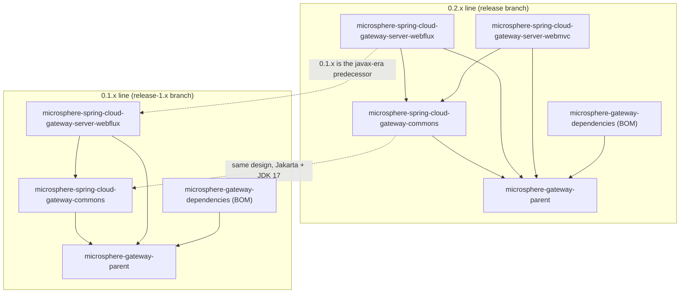

# Microsphere Gateway Documentation

Documentation for [`microsphere-gateway`](../README.md), the Spring Cloud Gateway extension that adds the `we://`
web-endpoint route scheme, discovery-driven routing, and route refresh behavior.

These guides describe **only the two released lines** of the project, analysed from the `release` and `release-1.x`
branches. They never document `main` or `dev`.

## Choose your version line

| Line | Branch | Status | Latest release | JDK | Spring Cloud trains | Modules | WebMVC module |
|---|---|---|---|---|---|---|---|
| `0.2.x` | `release` | Current | `0.2.18` (`0.2.19-SNAPSHOT` in the reactor) | 17 / 21 / 25 | `2022`, `2023`, `2024`, `2025` | 5 | Yes |
| `0.1.x` | `release-1.x` | Maintenance (pre-Jakarta) | `0.1.18` (`0.1.19-SNAPSHOT` in the reactor) | 8 / 11 / 17 / 21 / 25 | `Hoxton`, `2020`, `2021` | 4 | No |

## Guides

### Current line — `release` (`0.2.x`)

- [User Guide](current/user-guide/README.md) — installation, API reference, configuration keys, code examples,
  compatibility range, per module.
- [Developer Guide](current/developer-guide/README.md) — architecture, source analysis, design patterns, and Mermaid
  diagrams of the request, refresh, caching, and configuration-binding flows.

### Maintenance line — `release-1.x` (`0.1.x`)

- [User Guide](1.x/user-guide/README.md)
- [Developer Guide](1.x/developer-guide/README.md)

## Documents per version line

Each guide carries one document per Maven module, plus this index pattern:

| Document | Module kind | Covered in |
|---|---|---|
| `microsphere-gateway-parent.md` | Parent POM | Build architecture, `${revision}`, BOM import chain, profiles |
| `microsphere-gateway-dependencies.md` | BOM | Managed artifacts, version override, consumer usage |
| `microsphere-spring-cloud-gateway-commons.md` | Library | Constants, conditional annotations, `WebEndpointConfig`, configuration binding |
| `microsphere-spring-cloud-gateway-server-webflux.md` | Runtime | Auto-configuration, `we://` routing, filter chain, route caching, refresh events |
| `microsphere-spring-cloud-gateway-server-webmvc.md` | Runtime | Servlet-based gateway integration (`0.2.x` only) |

## Source diffs between tags

File-level comparisons of the newest release tags of both lines (`0.2.18` vs `0.1.18`), per Maven module, split by
`src/main` and `src/test`, with Java 8/17 syntax and Java EE/Jakarta EE differences excluded and each remaining
difference attributed to a cause (API compatibility, feature coverage, …):

| Document | Scope | 中文 |
|---|---|---|
| [main-diff-0.2.18-vs-0.1.18.md](diff/source/main-diff-0.2.18-vs-0.1.18.md) | `src/main` of matched modules | [中文版](diff/source/main-diff-0.2.18-vs-0.1.18.zh.md) |
| [test-diff-0.2.18-vs-0.1.18.md](diff/source/test-diff-0.2.18-vs-0.1.18.md) | `src/test` of matched modules | [中文版](diff/source/test-diff-0.2.18-vs-0.1.18.zh.md) |

## How the modules fit together

Solid arrows are compile-scope dependencies inside a line; dotted arrows compare the two lines, they are not
dependencies.

## Reading order

1. Start with the [repository README](../README.md) for the product overview and the shortest getting-started path.
2. Pick your line in the table above, then read that line's **User Guide** index.
3. Read the module document for the artifact you depend on, most often
   `microsphere-spring-cloud-gateway-server-webflux` (or `...-server-webmvc` on `0.2.x`).
4. Contributing or debugging? Read the matching **Developer Guide** document for the same module.

## Languages

English is the default language and lives at the paths above. Chinese mirrors keep identical file names inside a `zh/`
subdirectory next to each English document:

| Language | Root index |
|---|---|
| English | this file |
| 中文 | [zh/README.md](zh/README.md) |

Every individual document links to its counterpart at the end.

## 中文

中文文档入口：[zh/README.md](zh/README.md)
