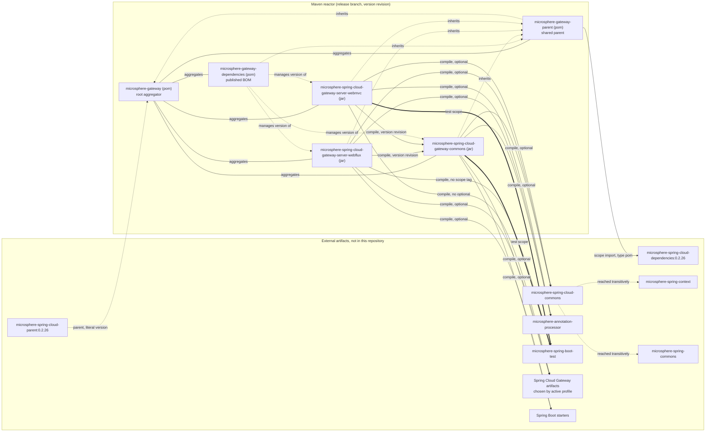
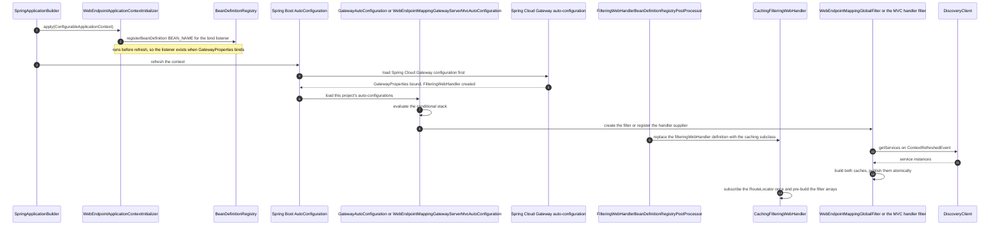

# Microsphere Gateway developer guide

Architecture and source-level documentation for the `microsphere-gateway` reactor, written against the
**`release` branch** (version line `0.2.x`, Maven `revision` = `0.2.19-SNAPSHOT`, latest published release
`0.2.18`).

Group `io.github.microsphere-projects`, JDK 17 baseline (`pom.xml:55`), Spring Cloud profiles `2022`, `2023`,
`2024`, `2025` with `2025` active by default. This guide describes extension code: it does not replace the
[end-user guide](../user-guide/README.md), which documents the properties and route YAML.

## Documents in this guide

| Document | Module | Packaging | What it covers |
| --- | --- | --- | --- |
| [microsphere-gateway-parent.md](microsphere-gateway-parent.md) | `microsphere-gateway-parent` | `pom` | Inherited build configuration, the `microsphere-spring-cloud-dependencies:0.2.26` import, `${revision}` and flattening |
| [microsphere-gateway-dependencies.md](microsphere-gateway-dependencies.md) | `microsphere-gateway-dependencies` | `pom` | The published BOM, the import chain consumers see, version propagation |
| [microsphere-spring-cloud-gateway-commons.md](microsphere-spring-cloud-gateway-commons.md) | `microsphere-spring-cloud-gateway-commons` | `jar` | The `we://` vocabulary, `WebEndpointConfig`, the bind-listener hook, shared conditional annotations |
| [microsphere-spring-cloud-gateway-server-webflux.md](microsphere-spring-cloud-gateway-server-webflux.md) | `microsphere-spring-cloud-gateway-server-webflux` | `jar` | Reactive gateway extension: `GlobalFilter`, `FilteringWebHandler` replacement, event interceptors, route refresh |
| [microsphere-spring-cloud-gateway-server-webmvc.md](microsphere-spring-cloud-gateway-server-webmvc.md) | `microsphere-spring-cloud-gateway-server-webmvc` | `jar` | Servlet gateway extension: the `HandlerSupplier` SPI, `HandlerFilterFunction`, route refresh |
| Chinese version of this index | all | — | [zh/README.md](zh/README.md) |

Every module document is mirrored in Chinese under [zh/](zh/README.md) with the same file names, the same
section order and byte-identical code and diagram sources.

Older release line: the `1.x` developer guide lives at
[../../1.x/developer-guide/README.md](../../1.x/developer-guide/README.md).
Project overview and quick start: [../../../README.md](../../../README.md).

## System topology

Five Maven modules (`pom.xml:58-64`). Solid arrows are declared classpath edges; dotted arrows are
inheritance, BOM-import or "version managed by" relationships that never appear on a classpath. `optional`
dependencies do not propagate to consumers, which is why both server modules re-declare what they need.



Read the same graph, annotated for one module, inside each document: the "Module dependency graph" section is
repeated in all five module files.

## Application startup across the whole system

The shape is identical in both flavours until the last two steps, where WebFlux swaps a bean definition and
WebMVC registers an SPI-supplied handler function. The per-module variants, with all condition stacks, are in
[the WebFlux document](microsphere-spring-cloud-gateway-server-webflux.md) and
[the WebMVC document](microsphere-spring-cloud-gateway-server-webmvc.md); the configuration-binding path that
fills `RouteDefinition.metadata` is in
[the commons document](microsphere-spring-cloud-gateway-commons.md#configuration-flow).



Two properties of this sequence are load-bearing and easy to break:

* The `ApplicationContextInitializer` registration is what guarantees the bind listener exists before
  `GatewayProperties` binds. The initializers are declared in `META-INF/spring.factories`
  (`microsphere-spring-cloud-gateway-server-webflux/src/main/resources/META-INF/spring.factories:1-2`,
  `microsphere-spring-cloud-gateway-server-webmvc/src/main/resources/META-INF/spring.factories:5-6`).
  Everything else in this project is declared through
  `META-INF/spring/org.springframework.boot.autoconfigure.AutoConfiguration.imports`, the Spring Boot 3
  mechanism. The WebMVC `spring.factories` carries a second key, the
  `org.springframework.cloud.gateway.server.mvc.handler.HandlerSupplier` SPI entry
  (`microsphere-spring-cloud-gateway-server-webmvc/src/main/resources/META-INF/spring.factories:1-2`).
* Auto-configuration order is expressed with `@AutoConfigureAfter(name = ...)` using **class-name strings**,
  not `Class` references, so this project compiles against whichever Spring Cloud Gateway artifact the active
  Maven profile selects.

## Contributor quick start

```bash
# JDK 17 is the baseline (pom.xml:55); CI also runs 21 and 25
./mvnw --batch-mode -Drevision=0.0.1-SNAPSHOT test
# one module, default profile is spring-cloud-2025
./mvnw -pl microsphere-spring-cloud-gateway-server-webflux -am test
# reproduce the full CI matrix
for p in spring-cloud-2022 spring-cloud-2023 spring-cloud-2024 spring-cloud-2025; do
  ./mvnw --batch-mode -Drevision=0.0.1-SNAPSHOT test --activate-profiles test,coverage,$p
done
```

The CI definitions are `.github/workflows/maven-build.yml` (JDK `17`/`21`/`25` × the four profiles,
`maven-build.yml:24-46`) and `.github/workflows/maven-publish.yml` (`deploy` with an explicit `-Drevision`,
`maven-publish.yml:47-55`, then a `sed` bump of `<revision>` in the root POM only, `maven-publish.yml:181-190`).
Build artefacts named `.flattened-pom.xml` are generated by the flattening plugin and are git-ignored
(`.gitignore:53-54`).

## Where to look for what

| Question | Document |
| --- | --- |
| Why does a `we://` URI resolve to one specific service instance? | WebFlux: "Request lifecycle for a `we://` route"; WebMVC: same section title |
| How are route exclusions (`metadata.web-endpoint.excludes`) parsed and validated? | Commons: "Configuration flow" |
| What happens when a service registers or deregisters? | WebFlux: "Route refresh and cache invalidation"; WebMVC: "Route refresh" |
| Why is `FilteringWebHandler` replaced, and what does the cache cost? | WebFlux: "Caching behaviour of `CachingFilteringWebHandler`" |
| Which version do my transitive Microsphere dependencies resolve to? | Parent and Dependencies documents |
| How do I add a filter, a conditional annotation or a new scheme? | the "Extension recipes" section of each module document |

## Reading order

1. [microsphere-spring-cloud-gateway-commons.md](microsphere-spring-cloud-gateway-commons.md) — the contracts
   everything else depends on.
2. [microsphere-spring-cloud-gateway-server-webflux.md](microsphere-spring-cloud-gateway-server-webflux.md) —
   the larger implementation; most design discussion lives here.
3. [microsphere-spring-cloud-gateway-server-webmvc.md](microsphere-spring-cloud-gateway-server-webmvc.md) —
   read it as a diff against WebFlux; the two documents share a comparison table.
4. [microsphere-gateway-parent.md](microsphere-gateway-parent.md) and
   [microsphere-gateway-dependencies.md](microsphere-gateway-dependencies.md) — build and release mechanics.

## 中文

The Chinese version of this guide is available at [zh/README.md](zh/README.md).

Project root README: [../../../README.md](../../../README.md).
