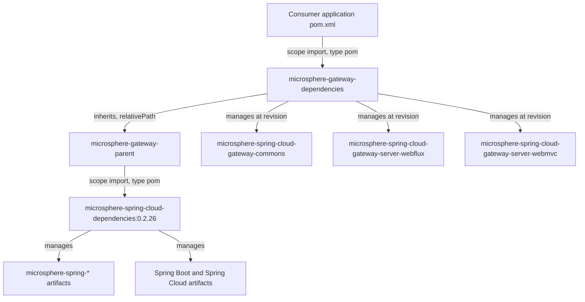
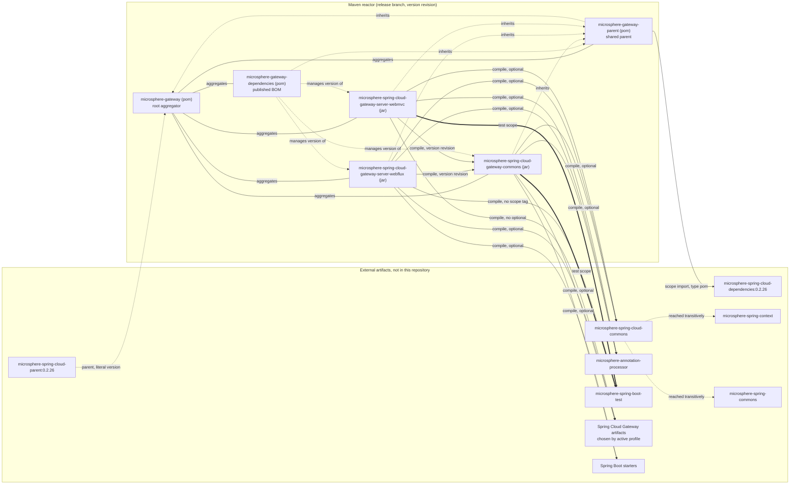

# microsphere-gateway-dependencies

Build-only module: the **published Bill of Materials** for Microsphere Gateway. `packaging = pom`, no Java
sources, three managed dependencies — all of them artifacts built by this same reactor.

| Attribute | Value | Evidence |
| --- | --- | --- |
| `groupId` | `io.github.microsphere-projects` | `microsphere-gateway-dependencies/pom.xml:6`, `:13` |
| `artifactId` | `microsphere-gateway-dependencies` | `microsphere-gateway-dependencies/pom.xml:7`, `:14` |
| `version` | `${revision}` | `microsphere-gateway-dependencies/pom.xml:8` (parent), `:15` (self) |
| `packaging` | `pom` | `microsphere-gateway-dependencies/pom.xml:9`, `:16` |
| Managed artifacts | `...-gateway-commons`, `...-server-webflux`, `...-server-webmvc` | `microsphere-gateway-dependencies/pom.xml:24-41` |
| Managed version | `${revision}` for all three | `microsphere-gateway-dependencies/pom.xml:27`, `:33`, `:39` |
| Maven `revision` in force on `release` | `0.2.19-SNAPSHOT` | `pom.xml:54` |
| Latest published release | `0.2.18` | `release-notes.md` (final section) |

Line numbers are relative to the `release` snapshot directory
`C:\Users\mercy\AppData\Local\Temp\mgw-src\release`.

---

## Architecture design

### Role in the build versus role in consumption

This module is the mirror image of `microsphere-gateway-parent`:

| | `microsphere-gateway-parent` | `microsphere-gateway-dependencies` |
| --- | --- | --- |
| Audience | the reactor itself | downstream applications |
| Connected by | Maven inheritance (`<parent>`) | Maven `scope import` (`<dependencyManagement>`) |
| Contains | one external BOM import | the three internal coordinates |
| Inheritance from parent | direct child of the root aggregator | child of `microsphere-gateway-parent` |
| Typical edit frequency | when the platform version changes | when a module is added or removed |

Evidence: `microsphere-gateway-parent/pom.xml:26-39` imports `microsphere-spring-cloud-dependencies`
(external); `microsphere-gateway-dependencies/pom.xml:21-43` lists only internal artifacts and imports
nothing.

Because `microsphere-gateway-dependencies` inherits from `microsphere-gateway-parent`
(`microsphere-gateway-dependencies/pom.xml:5-10`), a consumer that imports the gateway BOM **also transitively
gets every version managed by `microsphere-spring-cloud-dependencies:0.2.26`**. That is the single most
important design consequence of this POM: one import in an application gives a consistent Microsphere +
Spring Boot + Spring Cloud version set.



### The BOM import chain

```
consumer <dependencyManagement>
   -> microsphere-gateway-dependencies (this module, version 0.2.18 when released)
      -> inherited from microsphere-gateway-parent
         -> microsphere-spring-cloud-dependencies:0.2.26 (scope import, type pom)
            -> microsphere-spring-cloud-parent:0.2.26 (external, literal version at pom.xml:9)
```

* The import is declared at `microsphere-gateway-parent/pom.xml:30-36` and pinned by the property at `:23`.
* The gateway BOM entry `<type>`/`<scope>` is *not* `pom`/`import` inside the BOM itself: consumers must add
  `<type>pom</type><scope>import</scope>` in their own POM. Inside `microsphere-gateway-parent` those two
  elements are present for the external BOM (`:34-35`), which is why that POM behaves as an importer while
  `microsphere-gateway-dependencies` behaves as a plain managed list.

### Version propagation rules

1. `revision` is declared once, in the root POM (`pom.xml:54`). This module only references it, at `:8`,
   `:15`, `:27`, `:33`, `:39`.
2. All three managed versions therefore equal the reactor version. There is no way to pin one gateway
   module to a different release line from inside this BOM.
3. At publish time CI overrides the property from the command line (`-Drevision=${{ inputs.revision }}`,
   `.github/workflows/maven-publish.yml:52`), and afterwards rewrites only `<revision>` in the root `pom.xml`
   (`:189`). So the BOM entry versions and the BOM's own version always move together.
4. Because of `flatten-maven-plugin` (evidenced by `.gitignore:53-54` in the same style as the parent
   document), the *deployed* BOM contains literal versions rather than `${revision}`. Consumers that do not
   define `revision` themselves would otherwise fail to resolve.

### What adding a module looks like

Adding a fourth artifact to the reactor requires a matching block here; the pattern is the same as
`microsphere-gateway-dependencies/pom.xml:36-40`:

```xml
<dependency>
    <groupId>io.github.microsphere-projects</groupId>
    <artifactId>microsphere-spring-cloud-gateway-server-webmvc</artifactId>
    <version>${revision}</version>
</dependency>
```

Note the absence of `<type>`/`<scope>`: these are ordinary jar artifacts, and their versions are managed but
their scopes are left to the consumer.

---

## Design patterns

**Bill of Materials (BOM).**
Where: `microsphere-gateway-dependencies/pom.xml:21-43`, `packaging pom` at `:16`.
Why: three artifacts that are compiled, versioned and released together must be consumed together.
Buys: consumers declare `<artifactId>` only; one import line aligns the whole gateway stack; the same import
also pulls in `microsphere-spring-cloud-dependencies:0.2.26` through inheritance, so Spring Boot / Spring
Cloud versions cannot drift.
Cost: the BOM is versioned as a whole, so a security fix in one module forces a new release of all three;
and a consumer that wants an *older* commons with a *newer* webflux must override `<dependencyManagement>`
explicitly.

**Facade.**
Where: this POM is the only coordinates list external users need; the reactor internals (`<relativePath>`
chains, profile-selected Spring Cloud Gateway artifacts) stay hidden.
Buys: the webflux/webmvc `<optional>` choices and the four Spring Cloud profiles never leak into consumer
POMs.
Cost: because the BOM deliberately does not declare scopes, consumers still have to add the Spring Cloud
Gateway starter themselves — the facade hides versions, not wiring.

**Template Method (again, at build level).**
Where: `microsphere-gateway-dependencies/pom.xml:5-10` inherits everything and adds exactly one section,
`<dependencyManagement>`.
Buys: zero plugin duplication; the deploy/signing configuration comes from the parent chain.
Cost: the effective BOM content is not visible in this file; inspect it with `mvn help:effective-pom`.

**Not present:** no profiles (`microsphere-gateway-dependencies/pom.xml` contains no `<profiles>` element),
so the four Spring Cloud profiles documented for the code modules do **not** affect this artifact. The BOM
is profile-independent, which is what makes it safe to publish once per release.

---

## Module dependency graph

Repeated here so that a reader of this single page still sees the whole topology. `optional` and `test`
scopes are distinguished from compile-scope edges.



The three dotted `manages version of` edges at the bottom are the entire runtime significance of this module.

---

## Build & test guidance

No tests exist in this module (there is no `src/test` directory). Verification is Maven-level:

| Goal | Command | Expected |
| --- | --- | --- |
| BOM resolves | `./mvnw -N install -pl microsphere-gateway-parent,microsphere-gateway-dependencies` | Both POMs installed to the local repo |
| Inspect what consumers get | `./mvnw help:effective-pom -pl microsphere-gateway-dependencies` | Three managed entries with a literal version, plus the imported external BOM entries |
| Prove import chain | `./mvnw dependency:tree -pl microsphere-spring-cloud-gateway-server-webflux` | `microsphere-spring-cloud-gateway-commons` resolves without an explicit version when driven by the BOM |
| Consume it | import `microsphere-gateway-dependencies:0.2.18` with `<type>pom</type><scope>import</scope>` in a scratch project and declare the three artifacts without versions | Compiles; no version in the consumer POM |
| CI parity | `./mvnw --batch-mode --update-snapshots -Drevision=0.0.1-SNAPSHOT test --activate-profiles test,coverage,spring-cloud-2025` | `.github/workflows/maven-build.yml:39-46` |

If the BOM is edited, run `./mvnw validate` from the root: a bad entry breaks the reactor's inter-module
dependencies (`microsphere-spring-cloud-gateway-server-webflux/pom.xml:29-33`,
`microsphere-spring-cloud-gateway-server-webmvc/pom.xml:29-33`).

---

## Extension recipes

### Add a managed dependency

1. Insert a `<dependency>` block in `<dependencyManagement>` following
   `microsphere-gateway-dependencies/pom.xml:36-40`; keep `<version>${revision}</version>` so the reactor's
   single-property rule holds.
2. If the new artifact is a reactor module, also add it to `<modules>` at `pom.xml:58-64` and give it the
   standard `<parent>` block.
3. If it is an *external* library, prefer pinning it in `microsphere-gateway-parent`
   (`microsphere-gateway-parent/pom.xml:26-39`) or bumping `microsphere-spring-cloud.version` at `:23`, so
   this BOM keeps listing only Microsphere Gateway coordinates.

### Consume the BOM in an application

```xml
<dependencyManagement>
    <dependencies>
        <dependency>
            <groupId>io.github.microsphere-projects</groupId>
            <artifactId>microsphere-gateway-dependencies</artifactId>
            <version>0.2.18</version>
            <type>pom</type>
            <scope>import</scope>
        </dependency>
    </dependencies>
</dependencyManagement>
```

Then declare `microsphere-spring-cloud-gateway-server-webflux` or
`microsphere-spring-cloud-gateway-server-webmvc` with no `<version>`. Remember that the modules mark Spring
Cloud Gateway and the Microsphere support libraries `<optional>`
(`microsphere-spring-cloud-gateway-server-webflux/pom.xml:43-47`,
`microsphere-spring-cloud-gateway-server-webmvc/pom.xml:63-72`), so the application still has to add the
gateway starter itself.

### Remove or rename a module

Delete its `<dependency>` block from `microsphere-gateway-dependencies/pom.xml` *and* its `<module>` entry
from `pom.xml:58-64`; releasing the BOM without the module while still aggregating it produces a POM whose
managed coordinates point at an artifact nobody depends on.

---

## Inference and ambiguity

* "Consumers transitively receive `microsphere-spring-cloud-dependencies:0.2.26`" is derived from Maven's
  inheritance rule for `<dependencyManagement>` combined with
  `microsphere-gateway-dependencies/pom.xml:5-10` (parent is `microsphere-gateway-parent`) and
  `microsphere-gateway-parent/pom.xml:30-36` (the import). The external BOM's exact contents are not part of
  this snapshot, so no individual managed third-party version is claimed here.
* `0.2.18` as the latest published release is read from the final section of `release-notes.md`; the working
  POM still says `0.2.19-SNAPSHOT` (`pom.xml:54`).
* The flattening plugin is inferred from `${revision}` usage plus the `# flatten ignore` /
  `.flattened-pom.xml` lines in `.gitignore:53-54`; its configuration lives in the external parent.
* `microsphere-gateway-dependencies` has no `<properties>` element of its own
  (`microsphere-gateway-dependencies/pom.xml:21` is the first element after the description), so everything
  except the managed list is inherited.

---

## 中文

Developers guide for this module is also available in Chinese:
[zh/microsphere-gateway-dependencies.md](zh/microsphere-gateway-dependencies.md).

Back to the guide index: [README.md](README.md).
Project root README: [../../../README.md](../../../README.md).
