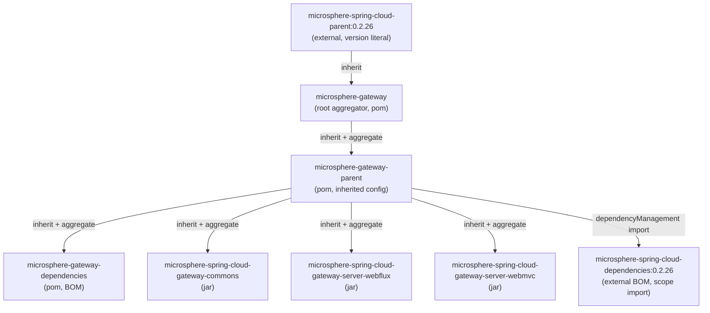
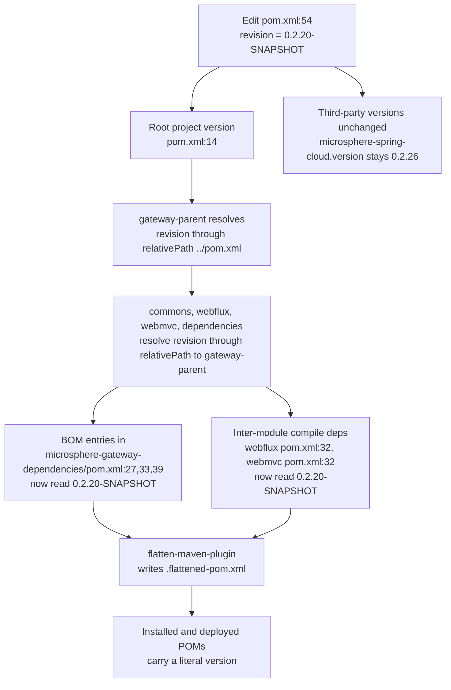
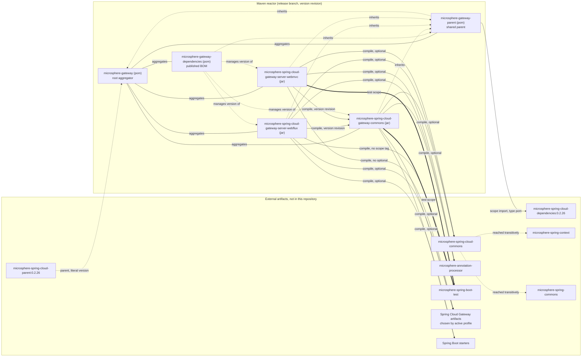

# microsphere-gateway-parent

Build-only module. It has `packaging = pom`, one declared property and one imported BOM, and it is the
Maven `<parent>` of every other module in the reactor except the root aggregator itself.

| Attribute | Value | Evidence |
| --- | --- | --- |
| `groupId` | `io.github.microsphere-projects` | `microsphere-gateway-parent/pom.xml:6` |
| `artifactId` | `microsphere-gateway-parent` | `microsphere-gateway-parent/pom.xml:7` |
| `version` | `${revision}` | `microsphere-gateway-parent/pom.xml:8` (parent), `:15` (self) |
| `packaging` | `pom` | `microsphere-gateway-parent/pom.xml:9` |
| Maven `revision` in force on `release` | `0.2.19-SNAPSHOT` | `pom.xml:54` |
| Latest published release | `0.2.18` | `release-notes.md` (final section) |
| Imported BOM | `microsphere-spring-cloud-dependencies:0.2.26` | `microsphere-gateway-parent/pom.xml:23`, `:30-36` |
| JDK baseline | `17` | `pom.xml:55` |

All line numbers below are relative to the `release` snapshot directory, i.e. `microsphere-gateway-parent/pom.xml`
means `C:\Users\mercy\AppData\Local\Temp\mgw-src\release\microsphere-gateway-parent\pom.xml`.

---

## Architecture design

### Role in the build

The reactor has five modules (`pom.xml:58-64`). Two of them carry no Java sources at all:

* `microsphere-gateway-parent` — *inherited configuration holder*. It answers the question "what version
  of every third-party and Microsphere dependency do the gateway modules compile against?".
* `microsphere-gateway-dependencies` — *outgoing BOM*. It answers the question "what version do downstream
  consumers get when they depend on the three gateway artifacts?".

The parent chain is deliberately **not** the same as the aggregation chain:

* Aggregation (`<modules>`) is declared once, in the root `pom.xml:58-64`.
* Inheritance is declared per module with `<parent>`:
  * `microsphere-gateway-parent` inherits from the root aggregator `microsphere-gateway`
    (`microsphere-gateway-parent/pom.xml:5-10`, `<relativePath>../pom.xml</relativePath>` at `:9`).
  * `microsphere-gateway-dependencies`, `...-gateway-commons`, `...-server-webflux` and
    `...-server-webmvc` all inherit from `microsphere-gateway-parent`, not from the root
    (`microsphere-gateway-dependencies/pom.xml:5-10`, `microsphere-spring-cloud-gateway-commons/pom.xml:5-10`,
    `microsphere-spring-cloud-gateway-server-webflux/pom.xml:5-10`,
    `microsphere-spring-cloud-gateway-server-webmvc/pom.xml:5-10`, each with
    `<relativePath>../microsphere-gateway-parent/pom.xml</relativePath>`).

Consequence: the root POM is only an aggregator plus the *external* parent holder. Everything a code module
actually needs (the `microsphere-spring-cloud-dependencies` import) arrives through
`microsphere-gateway-parent`, which is why the four child modules can omit `<groupId>`/`<version>` from
their own dependency declarations for managed artifacts.



Source references: external parent at `pom.xml:6-10`; `microsphere-gateway-parent/pom.xml:26-39` for the
import; aggregation at `pom.xml:58-64`.

### POM anatomy

The whole module is 40 lines:

| Lines | Element | Purpose |
| --- | --- | --- |
| `1-4` | XML header + `<project>` namespace | Maven 4.0.0 model |
| `5-10` | `<parent>` = `microsphere-gateway`, `${revision}`, `../pom.xml` | Reaches the root POM, and through it `microsphere-spring-cloud-parent:0.2.26` |
| `11` | `<modelVersion>` | `4.0.0` |
| `13-16` | own coordinates, `packaging pom` | Installs a POM artifact |
| `18-19` | `<name>` / `<description>` | `Microsphere :: Gateway :: Parent` |
| `21-24` | `<properties>` | Exactly one property: `microsphere-spring-cloud.version = 0.2.26` |
| `26-39` | `<dependencyManagement>` | Exactly one entry: the BOM import |

Notably absent: `<build>`, `<plugins>`, `<modules>`, `<repositories>`, `<distributionManagement>`. All of
that is inherited from `microsphere-spring-cloud-parent` (external artifact, not present in this snapshot —
see "Inference and ambiguity" at the end of this document).

### The `${revision}` mechanism

`revision` is a Maven "CI-friendly" version property. In this repository it is declared **once**, in the
root POM:

```xml
<properties>
    <revision>0.2.19-SNAPSHOT</revision>
    <java.version>17</java.version>
</properties>
```

(`pom.xml:53-56`.)

Every other occurrence of `${revision}` is a *reference*, never a redefinition. The complete inventory in
the snapshot is:

| POM | Lines containing `revision` | Kind |
| --- | --- | --- |
| `pom.xml` | `:14` `<version>`, `:54` `<revision>` property | declaration + first use |
| `microsphere-gateway-parent/pom.xml` | `:8` `<parent><version>`, `:15` `<version>` | reference |
| `microsphere-gateway-dependencies/pom.xml` | `:8` parent, `:15` self, `:27`, `:33`, `:39` managed versions | reference |
| `...-gateway-commons/pom.xml` | `:8` parent, `:14` self | reference |
| `...-server-webflux/pom.xml` | `:8` parent, `:14` self, `:32` commons dependency version | reference |
| `...-server-webmvc/pom.xml` | `:8` parent, `:14` self, `:32` commons dependency version | reference |

Two consequences that matter when you edit a POM:

1. **Interpolation happens before the parent is resolved.** A `<parent><version>${revision}</version>` is
   legal here only because Maven reads `<relativePath>` first (`microsphere-gateway-parent/pom.xml:9`,
   `.../pom.xml:9` in each child), so `${revision}` is taken from the *file system* parent chain rather
   than from a repository download. If you break the `<relativePath>` values, the reactor stops resolving.
2. **The property is not inherited as a literal value into published metadata.** That is the job of
   flattening, below.

### Flattening and `.flattened-pom.xml`

The repository ignores the flattening plugin's output:

```
# flatten ignore
.flattened-pom.xml
```

(`.gitignore:53-54`.)

`${revision}` in an installed/deployed POM would otherwise be published verbatim and would be unreadable by
consumers that do not execute the same property. The `flatten-maven-plugin` therefore rewrites each POM at
`process-resources`-time into `.flattened-pom.xml`, with the effective version interpolated (`0.2.18` for a
release run), and that flattened file is what gets installed and deployed. The plugin itself is configured
in the external parent, which is why no `<build>` section appears in any POM of this repository.

The `.flattened-pom.xml` files are build outputs, not sources: they are git-ignored, regenerated by every
`mvn` invocation that touches the module, and must never be committed.

### How versions propagate across the reactor



Because the whole reactor shares one property, a single edit at `pom.xml:54` moves five artifacts at once —
there is no per-module version to keep in sync, and `mvn release:prepare`-style per-module versioning is
structurally impossible here.

### The publish override path

`.github/workflows/maven-publish.yml` shows the other half of the design:

* The workflow is triggered by `push` to `release` or manually with a `revision` input
  (`maven-publish.yml:11-19`), and the input is validated against `^[0-9]+\.[0-9]+\.[0-9]+$`
  (`:28-33`).
* Publishing passes the version on the command line, overriding the file: `-Drevision=${{ inputs.revision }}`
  with `deploy --activate-profiles publish,ci` (`:47-55`).
* Afterwards the "Increment patch version" step rewrites the property with `sed`, in place, **only in the
  root `pom.xml`**:

```bash
sed -i "s|^\( *\)<revision>[^<]*</revision>|\1<revision>${NEXT_VERSION}</revision>|" pom.xml
```

(`maven-publish.yml:189`, with `NEXT_VERSION` computed as `MAJOR.MINOR.(PATCH+1)-SNAPSHOT` at `:184-188`.)
Only `pom.xml` and `release-notes.md` are committed back (`:196`), and `release` is then merged into `main`
(`:200-212`).

This is safe *only* because the property is declared in exactly one file. If a second `<revision>` property
declaration were added to a child POM, that child would keep publishing the old version after a release.

---

## Design patterns

These are patterns the POM text actually exhibits, with what each one buys and costs.

**Single source of truth (a.k.a. CI-friendly versions).**
Where: the `revision` property at `pom.xml:54`, referenced by all six POMs (inventory above).
Why: one reactor, five artifacts that must always be released together.
Buys: a one-line version bump; `-Drevision=` override at publish time without touching files; the `sed`
step in `maven-publish.yml:189` can target a single file.
Cost: requires flattening (otherwise published POMs contain an unresolved `${revision}`), requires intact
`<relativePath>` links, and breaks any tooling that reads `<version>` literally.

**Template Method at the build level (parent POM as the template).**
Where: `microsphere-gateway-parent` overrides only the "hook" it needs — the `microsphere-spring-cloud.version`
property (`:23`) and one BOM import (`:30-36`) — and inherits plugins, distributions and licenses from
`microsphere-spring-cloud-parent` (`pom.xml:6-10`) and the root (`pom.xml:13-51`).
Buys: release policy, compiler settings and plugin configuration are non-repeating.
Cost: effective configuration is spread across three files, two of them external; `mvn help:effective-pom`
is the only reliable way to inspect it.

**Dependency inversion between "internal versions" and "external versions".**
Where: external versions are pinned as literals (`0.2.26` at `pom.xml:9` and `microsphere-gateway-parent/pom.xml:33`),
internal versions are parameterised (`${revision}`).
Buys: the reactor can be rebuilt against a released Microsphere platform while still being a snapshot itself.
Cost: two different versioning disciplines in one file, easy to confuse when reviewing a diff.

**Facade (for `microsphere-gateway-dependencies`, covered in its own document)** — the sibling POM
`microsphere-gateway-dependencies/pom.xml:21-43` is the read-only surface of the reactor's own coordinates.

No pattern is claimed for plugins, profiles or resource filtering in this module, because the module
declares none (`microsphere-gateway-parent/pom.xml` contains no `<build>` or `<profiles>` element).

---

## Module dependency graph

Repeated here so that a reader of this single page still sees the whole topology. `optional` and `provided`
scopes are drawn separately from compile-scope edges; POM-only modules are marked `(pom)`.



Legend: solid arrows are declared `<dependency>` edges, thick solid arrows are `test` scope, dotted arrows
are inheritance/import/management relationships (never classpath edges), and `optional` means the artifact is
absent from a consumer's classpath unless the consumer declares it itself.

---

## Build & test guidance

`microsphere-gateway-parent` has no sources, so it has no tests of its own. What you can verify:

| Goal | Command | What proves the parent is correct |
| --- | --- | --- |
| Reactor sanity | `./mvnw -N validate` | Root POM resolves; `revision` interpolates |
| Full validation | `./mvnw validate` | Every child `<parent>` block resolves through its `<relativePath>` |
| Effective versions | `./mvnw help:effective-pom -pl microsphere-spring-cloud-gateway-commons` | The managed `microsphere-spring-cloud-*` versions come from `microsphere-spring-cloud-dependencies:0.2.26` |
| Profile matrix | `./mvnw -Ptest,coverage,spring-cloud-2022 test` (then `2023`, `2024`, `2025`) | This is exactly the CI matrix; see `.github/workflows/maven-build.yml:26-27`, `:39-46` |
| JDK matrix | same command with `JAVA_HOME` on 17, 21, 25 | `.github/workflows/maven-build.yml:25` |
| Override version | `./mvnw -Drevision=0.0.1-SNAPSHOT test` | The CI build always does this (`maven-build.yml:44`), so `0.2.19-SNAPSHOT` never leaks into CI artefacts |
| Flattened output | `ls */.flattened-pom.xml` after any build | Confirms the plugin ran; the file is git-ignored (`.gitignore:53-54`) |

Because the parent holds the BOM import, a mistake there fails the *whole* reactor with unresolved-version
errors in the code modules; run `./mvnw validate` from the root after editing it.

---

## Extension recipes

### Raise the Microsphere platform version

1. Change `<microsphere-spring-cloud.version>` at `microsphere-gateway-parent/pom.xml:23`.
2. Do **not** duplicate the BOM entry; the single import at `:30-36` already cascades to all four children.
3. Run the full matrix locally — `microsphere-spring-cloud-commons` provides `WebEndpointMapping` and the
   `BindListener` SPI used by the commons module, so an upgrade can break the `we://` matching semantics.

### Add an inherited plugin or property to every code module

Put it in this POM rather than repeating it in `...-commons`, `...-server-webflux`, `...-server-webmvc`.
If the change is only about *versions of third-party libraries*, prefer overriding the property defined by
`microsphere-spring-cloud-dependencies` (the same style as `microsphere-spring-cloud.version` at `:23`), so
the override stays visible.

### Add a managed version of an external library for the reactor

If consumers should also get it, add it to `microsphere-gateway-dependencies` (see that document) — that POM
is the published BOM. If it is build-internal only, add `<dependencyManagement>` next to the import at
`microsphere-gateway-parent/pom.xml:26-39`, remembering that entries declared here take precedence over the
imported BOM only for artifacts listed directly in this file.

### Add a new module to the reactor

1. Create the directory with a `<parent>` block copied from `microsphere-spring-cloud-gateway-commons/pom.xml:5-11`,
   using `<version>${revision}</version>` and `<relativePath>../microsphere-gateway-parent/pom.xml</relativePath>`.
2. Add the directory name to `<modules>` at `pom.xml:58-64`.
3. Add the artifact to `microsphere-gateway-dependencies/pom.xml` so downstream builds can manage it.
4. Do not add a `<revision>` property to the new POM; the publish workflow's `sed` step only edits `pom.xml`
   (`maven-publish.yml:189`).

---

## Inference and ambiguity

* The `flatten-maven-plugin` is inferred, not observed. The only in-snapshot evidence is the git-ignore
  comment `# flatten ignore` / `.flattened-pom.xml` (`.gitignore:53-54`) combined with the fact that every
  POM uses `${revision}` (`pom.xml:54` is the single declaration). The plugin's execution ids, phases and
  `flattenMode` are configured in the external parent `microsphere-spring-cloud-parent:0.2.26`, which is not
  part of this snapshot, so no claim is made about them here.
* Likewise, `<build>` plugins, `distributionManagement`, GPG/signing and the `publish`/`ci`/`test`/`coverage`
  profiles activated by CI (`maven-build.yml:46`, `maven-publish.yml:55`) are inherited from the external
  parent chain and cannot be verified from these files.
* "Only `pom.xml` declares `<revision>`" is verified by a repository-wide search of POM files for the string
  `revision`; the resulting inventory is the table above.

---

## 中文

Developers guide for this module is also available in Chinese:
[zh/microsphere-gateway-parent.md](zh/microsphere-gateway-parent.md).

Back to the guide index: [README.md](README.md).
Project root README: [../../../README.md](../../../README.md).
