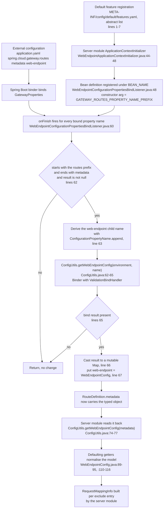
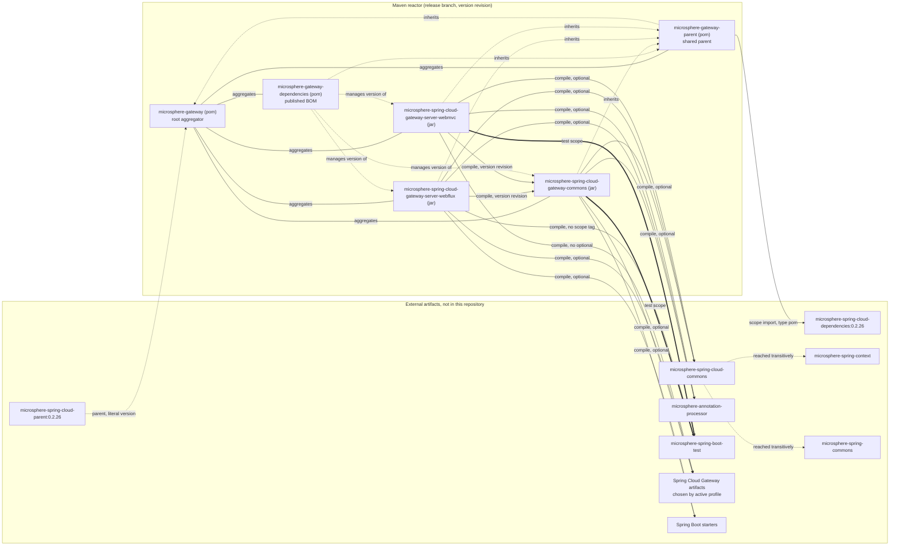

# microsphere-spring-cloud-gateway-commons

The shared, runtime-neutral kernel of Microsphere Gateway. It contains no gateway code: it defines the
`we://` vocabulary (constants), the `WebEndpointConfig` model, the binding hook that turns route metadata
into that model, and the two conditional annotations both server modules reuse.

| Attribute | Value | Evidence |
| --- | --- | --- |
| `artifactId` | `microsphere-spring-cloud-gateway-commons` | `microsphere-spring-cloud-gateway-commons/pom.xml:13` |
| `version` | `${revision}`, declared in the root as `0.2.19-SNAPSHOT` | `microsphere-spring-cloud-gateway-commons/pom.xml:14`, `pom.xml:54` |
| Parent | `microsphere-gateway-parent` | `microsphere-spring-cloud-gateway-commons/pom.xml:5-10` |
| Main classes | 8 | `src/main/java/io/microsphere/spring/cloud/gateway/commons/**` |
| Test classes | 7 | `src/test/java/io/microsphere/spring/cloud/gateway/commons/**` |
| Auto-configuration | none (no `spring.factories`, no `AutoConfiguration.imports`) | only `src/main/resources/META-INF/config/default/features.yaml` exists |

Line numbers are relative to the `release` snapshot directory
`C:\Users\mercy\AppData\Local\Temp\mgw-src\release`.

---

## Architecture design

### Role in the system

The two server modules (`...-server-webflux`, `...-server-webmvc`) both depend on this artifact at compile
scope with the reactor version (`microsphere-spring-cloud-gateway-server-webflux/pom.xml:29-33`,
`microsphere-spring-cloud-gateway-server-webmvc/pom.xml:29-33`). Everything they must agree on lives here:

* the route scheme and metadata keys, so a route written as `we://all` is interpreted identically by a
  reactive and a servlet gateway;
* the `WebEndpointConfig` object that ends up inside `RouteDefinition.metadata`, so the matching rules are
  bound once by Spring Boot's binder instead of twice by two modules;
* the kill-switch property names, so one documented prefix disables the feature in both flavours.

### Package layout

```
io/microsphere/spring/cloud/gateway/commons/
  annotation/    ConditionalOnMicrosphereGatewayEnabled
                 ConditionalOnMicrosphereWebEndpointMappingEnabled
  config/        ConfigUtils
                 WebEndpointConfig
                 WebEndpointConfigurationPropertiesBindListener
  constants/     CommonConstants
                 CommonsPropertyConstants
                 RouteConstants
```

| Package | Extension point | Consumed by |
| --- | --- | --- |
| `annotation` | Composable conditional meta-annotations for user `@Configuration` classes | Both server modules' auto-configurations, and any application configuration |
| `config` | `BindListener` hook (`WebEndpointConfigurationPropertiesBindListener`) and the `WebEndpointConfig` model | Registered by the server modules' `ApplicationContextInitializer` |
| `constants` | Stable string contracts: scheme `we`, metadata keys, URI template variable `application` | Both server modules and their tests |

### Auto-configuration participation

This module deliberately ships **no** auto-configuration. `src/main/resources/META-INF/` contains only
`config/default/features.yaml`; there is no `META-INF/spring.factories` and no
`META-INF/spring/org.springframework.boot.autoconfigure.AutoConfiguration.imports` in this artifact. The
reason is visible in the two server modules: `WebEndpointMapping` support requires
`ReactiveDiscoveryClient` in WebFlux and `DiscoveryClient` in WebMVC, so the conditional stack must be built
per flavour and cannot be shared as one auto-configuration class.

What this module does contribute is the *registration recipe* the server modules execute, and one line in
`features.yaml`:

```yaml
microsphere:
  spring:
    cloud:
      features:
        abstract:
          microsphere-spring-cloud-gateway-commons:
            - io.microsphere.spring.cloud.gateway.commons.config.WebEndpointConfigurationPropertiesBindListener
```

(`microsphere-spring-cloud-gateway-commons/src/main/resources/META-INF/config/default/features.yaml:1-7`.)

The `abstract` key lists a class that must never be instantiated as a bean by itself — it needs a
constructor argument (`WebEndpointConfigurationPropertiesBindListener.java:54-57`) — which is exactly how the
server modules register it manually:

```java
registry.registerBeanDefinition(BEAN_NAME,
        beanDefinition(WebEndpointConfigurationPropertiesBindListener.class,
                listener, GATEWAY_ROUTES_PROPERTY_NAME_PREFIX));
```

(`microsphere-spring-cloud-gateway-server-webflux/.../context/WebEndpointApplicationContextInitializer.java:44-48`
and the identical `microsphere-spring-cloud-gateway-server-webmvc/.../context/WebEndpointApplicationContextInitializer.java:44-48`.)

Both initializers register under the *same* bean name — `WebEndpointConfigurationPropertiesBindListener.BEAN_NAME`,
`"webEndpointConfigurationPropertiesBindListener"` (`WebEndpointConfigurationPropertiesBindListener.java:48`).
Because an application selects one server module, the two never collide; if both were on the classpath the
second registration would target the same name.

### Bean override strategy

There is no `@Bean` method in this module, hence nothing to override. The only override-adjacent decision is
that the listener is registered as a plain bean definition with a constructor-arg, so a user can redefine
`webEndpointConfigurationPropertiesBindListener` in their own configuration and the server-module initializer
would still have written its definition first (initializers run before `refresh()`).

---

## Source analysis

### `constants/RouteConstants.java`

`interface` holding the `we://` contract (`RouteConstants.java:28`):

| Constant | Value | Line |
| --- | --- | --- |
| `SCHEME` | `we` | `:33` |
| `ALL_SERVICES` | `all` | `:38` |
| `ID_KEY` | `id` | `:43` |
| `METADATA_KEY` | `metadata` | `:48` |
| `WEB_ENDPOINT_KEY` | `web-endpoint` | `:53` |
| `WEB_ENDPOINT_REWRITE_PATH_ATTRIBUTE_NAME` | `msgw-we-rewrite-path` | `:58` |

`WEB_ENDPOINT_REWRITE_PATH_ATTRIBUTE_NAME` is not a config property: it is a **request attribute key used as
a side channel inside each server module's implementation**, carrying the application-stripped path from the
matching step to the forwarding step. WebFlux writes it while matching
(`WebEndpointMappingGlobalFilter.java:334`) and removes it while forwarding (`:157`); WebMVC removes it
(`WebEndpointMappingHandlerFilterFunction.java:122`) and writes it again after rewriting (`:129`). Its value
`msgw-we-rewrite-path` is pinned by `RouteConstantsTest.java:46`.

An interface (not a final class with a private constructor) is used here, so the constants are implicitly
`public static final` and the type is instantiable-by-implementation; the module mixes both styles
(`RouteConstants.java:28` vs `ConfigUtils.java:42`, `:79-80`).

### `constants/CommonsPropertyConstants.java`

Two prefixes and two `.enabled` keys (`CommonsPropertyConstants.java:31`):

| Constant | Value | Line |
| --- | --- | --- |
| `MICROSPHERE_GATEWAY_SPRING_CLOUD_PROPERTY_NAME_PREFIX` | `microsphere.spring.cloud.gateway.` | `:36` |
| `DEFAULT_MICROSPHERE_GATEWAY_ENABLED` | `"true"` | `:41` |
| `MICROSPHERE_GATEWAY_ENABLED_PROPERTY_NAME` | `microsphere.spring.cloud.gateway.enabled` | `:51` |
| `MICROSPHERE_WEB_ENDPOINT_MAPPING_PROPERTY_NAME_PREFIX` | `microsphere.spring.cloud.web-endpoint-mapping.` | `:56` |
| `MICROSPHERE_WEB_ENDPOINT_MAPPING_ENABLED_PROPERTY_NAME` | `microsphere.spring.cloud.web-endpoint-mapping.enabled` | `:66` |

Both prefixes are built from `MICROSPHERE_SPRING_CLOUD_PROPERTY_NAME_PREFIX` imported from the external
`io.microsphere.spring.cloud.commons.constants.CommonsPropertyConstants` (`:23`), so the gateway prefixes
follow the platform prefix rather than being re-typed.

`MICROSPHERE_GATEWAY_ENABLED_PROPERTY_NAME` (`:46-51`) and
`MICROSPHERE_WEB_ENDPOINT_MAPPING_ENABLED_PROPERTY_NAME` (`:61-66`) are annotated with
`@ConfigurationProperty(type = boolean.class, defaultValue = DEFAULT_MICROSPHERE_GATEWAY_ENABLED,
source = APPLICATION_SOURCE)`. The `defaultValue` for the *web-endpoint-mapping* key reuses the gateway
constant (`:63`) — same `"true"` value, so it is a cosmetic reuse rather than a bug. These annotations are
consumed by `microsphere-annotation-processor` (declared optional at `pom.xml:22-26`) to generate
configuration metadata; that processing happens outside this repository.

Literal names are asserted in `CommonsPropertyConstantsTest.java:40-44`.

### `constants/CommonConstants.java`

One constant: `APPLICATION_NAME_URI_TEMPLATE_VARIABLE_NAME = "application"`
(`CommonConstants.java:28`, `:33`).

It is the contract between a route predicate and the endpoint-matching code: a `we://` route must expose the
service name through the URI template variable literally named `application`, as in the test fixtures
`Path=/{application}/**` (`microsphere-spring-cloud-gateway-commons/src/test/resources/META-INF/config/default/test.yaml:22`,
mirrored in the webflux and webmvc test resources). The WebFlux filter reads the variable from the matched
route's URI template variables and passes the request through untouched when the value is blank
(`WebEndpointMappingGlobalFilter.java:142-147`, WebMVC analogue
`WebEndpointMappingHandlerFilterFunction.java:109-112`).

### `annotation/ConditionalOnMicrosphereGatewayEnabled.java`

```java
@Retention(RUNTIME)
@Target({TYPE, METHOD})
@Documented
@ConditionalOnProperty(name = MICROSPHERE_GATEWAY_ENABLED_PROPERTY_NAME, matchIfMissing = true)
public @interface ConditionalOnMicrosphereGatewayEnabled {
}
```

(`ConditionalOnMicrosphereGatewayEnabled.java:43-47`.)

* Meta-annotation composition: the annotation carries no `@Conditional` of its own; Spring Boot's condition
  evaluator reads `@ConditionalOnProperty` from the meta-annotation level.
* `matchIfMissing = true` (`:46`) makes the feature **on by default**; the only way to switch it off is to
  set `microsphere.spring.cloud.gateway.enabled=false`. The webmvc integration test proves the alternative
  kill switch: `microsphere.autoconfigure.exclude` plus
  `microsphere.spring.cloud.webmvc.enabled=false`
  (`WebEndpointMappingGatewayServerMvcAutoConfigurationIntegrationDisabledTest.java`).
* `@Target({TYPE, METHOD})` (`:44`) — this is why the annotation is reusable on `@Bean` methods, which the
  webflux module does not currently exploit but user configurations can.
* Tested by `ConditionalOnMicrosphereGatewayEnabledTest.java:36-93` with three nested contexts: default
  (`:38-52`), explicit `true` (`:54-71`), explicit `false` asserting the bean is absent (`:73-89`).

### `annotation/ConditionalOnMicrosphereWebEndpointMappingEnabled.java`

```java
@Retention(RUNTIME)
@Target({TYPE, METHOD})
@Documented
@ConditionalOnMicrosphereGatewayEnabled
@ConditionalOnProperty(name = MICROSPHERE_WEB_ENDPOINT_MAPPING_ENABLED_PROPERTY_NAME, matchIfMissing = true)
public @interface ConditionalOnMicrosphereWebEndpointMappingEnabled {
}
```

(`ConditionalOnMicrosphereWebEndpointMappingEnabled.java:44-49`.)

Two conditions are stacked, so the effective rule is a logical AND:
`microsphere.spring.cloud.gateway.enabled` must not be `false` **and**
`microsphere.spring.cloud.web-endpoint-mapping.enabled` must not be `false`
(`:47-48`). Turning the gateway switch off therefore turns endpoint mapping off transitively, while the
converse is not true.

Javadoc drift: `@see CommonsPropertyConstants#MICROSPHERE_GATEWAY_ENABLED_PROPERTY_NAME` (`:41`) points at
the gateway key although the annotation guards the web-endpoint-mapping key (`:48`). Behaviour is correct;
the `@see` tag is stale.

Tested by `ConditionalOnMicrosphereWebEndpointMappingEnabledTest.java:36-93`, same three-case shape.

### `config/WebEndpointConfig.java`

The configuration model injected into a route's metadata.

```java
@Validated
public class WebEndpointConfig {

    @NotNull
    @Valid
    private List<Mapping> excludes = new LinkedList<>();
    ...
```

(`WebEndpointConfig.java:42-47`.)

Invariants that the rest of the system relies on:

* `excludes` is initialised to a mutable `LinkedList` (`:45-47`) and is `@NotNull` (`:45`), validated by the
  `ValidationBindHandler` installed by `ConfigUtils` (`ConfigUtils.java:48-52`). So a bound config always
  has a non-null list — but `ConfigUtils` can still hand back `null` when the prefix has no bindable subtree
  (`ConfigUtils.java:62-65`, and the `@Nullable` on the return), which is why the WebMVC module null-checks
  and the WebFlux module does not (see the two server documents).
* `Mapping.patterns` is `@NotNull @Valid` (`WebEndpointConfig.java:62-64`): a mapping without patterns fails
  binding.
* Normalising getters are the interesting part. `getMethods()` returns **all** request methods when the
  configured array is empty (`:89-95`), and `getHeaders()` returns
  `ArrayUtils.EMPTY_STRING_ARRAY` when empty (`:110-116`). Both are annotated `@Nonnull` while their fields
  are `@Nullable` (`:66-73`). This is a deliberate default-open semantic: an exclude entry with no `methods`
  excludes that path pattern for every HTTP verb. `params`, `consumes` and `produces` stay `@Nullable`
  (`:75-79`, `:101-134`), i.e. "unset" and "empty" are not distinguished for them.
* `Mapping` is a `public static class` (`:60`) rather than a bean with a builder, so it is bindable by
  property names and constructible by the binder's default no-arg instantiation.

`ConfigUtilsTest.assertWebEndpointConfig` (`ConfigUtilsTest.java:103-131`) is the executable specification:
three excludes; the third one, which configures only `patterns` + `consumes` + `produces`, is asserted to
return `RequestMethod.values()` for methods (`:126`) and the *same instance* `EMPTY_STRING_ARRAY` for headers
(`:128`) — `assertSame`, not `assertEquals`, so the identity of the shared empty array is part of the
contract.

### `config/WebEndpointConfigurationPropertiesBindListener.java`

The bridge between "raw route metadata map" and "typed `WebEndpointConfig`".

```java
public class WebEndpointConfigurationPropertiesBindListener implements BindListener, EnvironmentAware {

    public static final String BEAN_NAME = "webEndpointConfigurationPropertiesBindListener";

    private final String gatewayRoutesPropertyNamePrefix;

    private Environment environment;

    public WebEndpointConfigurationPropertiesBindListener(String gatewayRoutesPropertyNamePrefix) {
        assertNotBlank(gatewayRoutesPropertyNamePrefix, () -> "The 'gatewayRoutesPropertyNamePrefix' must not be blank");
        this.gatewayRoutesPropertyNamePrefix = gatewayRoutesPropertyNamePrefix;
    }
```

(`WebEndpointConfigurationPropertiesBindListener.java:46-57`.)

`BindListener` and `ListenableBindHandlerAdapter` come from `microsphere-spring-boot-*` (imports at `:20-21`),
not from Spring Boot itself; the module declares those dependencies `optional` (`pom.xml:29-33` for
`microsphere-spring-cloud-commons`).

`onFinish` (`:59-70`) runs at the end of every bind operation in the application, which is why the guard is a
cheap string test on the property name:

```java
String propertyName = name.toString();
if (propertyName.startsWith(gatewayRoutesPropertyNamePrefix) && propertyName.endsWith(METADATA_KEY) && result != null) {
    ConfigurationPropertyName webEndpointName = name.append(WEB_ENDPOINT_KEY);
    WebEndpointConfig webEndpointConfig = getWebEndpointConfig(environment, webEndpointName.toString());
    if (webEndpointConfig != null) {
        Map<String, Object> metadata = (Map<String, Object>) result;
        metadata.put(WEB_ENDPOINT_KEY, webEndpointConfig);
    }
}
```

Non-obvious behaviour worth tracking:

1. **Three-way guard.** Prefix match + `metadata` suffix + non-null result (`:62`). The prefix is
   constructor-injected, so the listener is prefix-agnostic and can serve both
   `spring.cloud.gateway.routes` (WebFlux) and `spring.cloud.gateway.server.webflux.routes` /
   `spring.cloud.gateway.server.webmvc.routes` depending on which artifact the active Maven profile pulls
   in. The values passed are `GatewayPropertyConstants.GATEWAY_ROUTES_PROPERTY_NAME_PREFIX` from each server
   module.
2. **`ConfigurationPropertyName.append`** (`:63`) rather than string concatenation, so the derived name is a
   valid, canonical property name (`...routes[0].metadata.web-endpoint`).
3. **Recursive bind.** `getWebEndpointConfig(environment, ...)` (`:64`) binds a *nested* subtree while the
   outer bind of the parent subtree is finishing. The inner bind runs with the shared validation handler
   (`ConfigUtils.java:44`, `:63`), and the listener itself is not attached to the inner bind, so no
   recursion loop occurs.
4. **Unchecked cast.** `(Map<String, Object>) result` (`:66`) assumes Spring Boot binds route metadata to a
   `Map` and that its implementation is mutable. `WebEndpointConfigurationPropertiesBindListenerTest.java:56`
   binds to `LinkedHashMap.class`, which is consistent, but the production binder's map type is not asserted
   by this module's tests.
5. **Write-back into the bound object.** `metadata.put(WEB_ENDPOINT_KEY, webEndpointConfig)` (`:67`) mutates
   the map that the outer binder produced, so the resulting `RouteDefinition.metadata` contains a live
   `WebEndpointConfig` instance under the same key that also exists as raw properties. That is precisely the
   dual representation `ConfigUtils` reads back.
6. **Mutable `environment` field, no synchronisation** (`:52`, `:72-75`). `setEnvironment` is called once by
   the container before the bean is used; `onFinish` reads it. Safe under the normal lifecycle, but the
   listener is shared across all bind operations.

The `assertNotBlank` in the constructor (`:55`, from `io.microsphere.util.Assert`, import `:34`) turns a
mis-registered initializer into a startup failure instead of a silently dead feature.

### `config/ConfigUtils.java`

```java
public abstract class ConfigUtils implements Utils {

    private static final BindHandler springValidatorBindHandler;

    private static final Bindable<WebEndpointConfig> WEB_ENDPOINT_CONFIG_BINDABLE = of(WebEndpointConfig.class);

    static {
        LocalValidatorFactoryBean validator = new LocalValidatorFactoryBean();
        validator.afterPropertiesSet();
        springValidatorBindHandler = new ValidationBindHandler(validator);
    }
```

(`ConfigUtils.java:42-52`.)

* `implements Utils` (`:42`) is the microsphere marker for utility classes; `abstract` plus a private
  constructor (`:79-80`) prevents instantiation. `io.microsphere.util.Utils` comes from `microsphere-commons`,
  reached transitively.
* **Eager static initialisation of a validator** (`:48-52`). `LocalValidatorFactoryBean` is created and
  `afterPropertiesSet()` called manually, bypassing the Spring context. The consequence is a hard
  requirement for a Jakarta Validation provider plus an EL implementation at runtime: the commons test scope
  adds `hibernate-validator` (`pom.xml:109-114`) and `tomcat-embed-el` (`pom.xml:116-120`) exactly for that
  reason, and both are `test`-scoped — so a consumer of this module supplies its own provider (gateway
  applications get one from `spring-boot-starter-validation`/actuator in practice, and
  `spring-boot-starter-actuator` is declared optional at `pom.xml:42-46`). If no provider is on the
  consumer's classpath, the failure surfaces when `ConfigUtils` is first touched.
* The class is loaded lazily, so the cost is paid only when the `we://` feature is exercised.
* `WEB_ENDPOINT_CONFIG_BINDABLE` is a static constant (`:46`) reused by every bind, avoiding per-request
  `Bindable.of` allocations.
* `getWebEndpointConfig(Environment, String)` (`:61-65`) binds with the validating handler and returns
  `orElse(null)`, so a missing subtree yields `null` rather than an empty config.
  `ConfigUtilsTest.java:98-101` pins that: binding `spring.cloud.gateway.routes[1]` (a route with metadata
  but no `web-endpoint` key, see `test.yaml:32-35`) returns `null`.
* `getWebEndpointConfig(Map<String, Object>)` (`:73-77`) reads `web-endpoint` and uses `instanceof` before
  casting, so a raw map that was never processed by the listener returns `null` instead of throwing.
  `ConfigUtilsTest.java:84-95` exercises all three states: absent key → `null` (`:86`), wrong type under the
  key (`metadata.put(WEB_ENDPOINT_KEY, metadata)`) → `null` (`:88-90`), correct type → non-`null` (`:92-94`).
* The two overloads together express the module's central invariant: **the typed config lives inside the
  metadata map only if the bind listener ran.** Any code path that reads metadata without the listener
  installed silently gets `null` and therefore no exclusion rules.

---

## Configuration flow

`features.yaml` is not Spring Boot configuration; it is a Microsphere-platform construct read by
`microsphere-spring-cloud-commons` (external artifact). Its two shapes in this repository are:

* `abstract:` — a list of classes that participate in a feature but must not be auto-instantiated
  (this module, `features.yaml:5-7`);
* `named:` — a `BeanName=ClassName` list (both server modules).

The runtime binding path, from properties to a matched exclusion, is:



Defaults versus overrides: nothing in `features.yaml` supplies property values. The only in-artifact defaults
are in code — `WebEndpointConfig.excludes` defaults to an empty list (`WebEndpointConfig.java:47`),
`getMethods()` defaults to all verbs (`:91-93`), `getHeaders()` defaults to the shared empty array
(`:112-114`), and both `@ConfigurationProperty(defaultValue = "true")` annotations
(`CommonsPropertyConstants.java:48`, `:63`) document that the kill switches default to enabled, matching
`matchIfMissing = true` (`ConditionalOnMicrosphereGatewayEnabled.java:46`,
`ConditionalOnMicrosphereWebEndpointMappingEnabled.java:48`).

`META-INF/config/default/test.yaml` under `src/test/resources` (`:1-35`) is the fixture that both
`ConfigUtilsTest.createEnvironment()` (`ConfigUtilsTest.java:64-77`) and the server-module tests reuse; note
`attach(environment)` at `:75`, which is required for relaxed-binding of the `metadata.web-endpoint` tree.

---

## Design patterns

**Meta-annotation / composition of conditions.**
Where: `ConditionalOnMicrosphereGatewayEnabled.java:43-47` composes `@ConditionalOnProperty`;
`ConditionalOnMicrosphereWebEndpointMappingEnabled.java:44-49` composes that annotation *and* another
`@ConditionalOnProperty`.
Why: express a project-wide kill switch once and reuse it as a domain-specific annotation.
Buys: readable auto-configurations in the server modules (`@ConditionalOnMicrosphereWebEndpointMappingEnabled`
in `WebEndpointMappingGatewayAutoConfiguration.java`), default-on behaviour (`matchIfMissing = true`), and
`@Target({TYPE, METHOD})` reuse by applications.
Cost: conditions are evaluated at class-loading/registration time, so a typo in the composed property name
is silent; `@ConditionalOnProperty` without `havingValue` accepts only the literal `false` as a switch-off.

**Constant interface.**
Where: `RouteConstants.java:28`, `CommonsPropertyConstants.java:31`, `CommonConstants.java:28`.
Why: the values are compile-time constants, so `@ConditionalOnProperty(name = ...)` and
`name.append(...)` call sites can use them directly in annotations.
Buys: annotation-friendly references (`ConditionalOnMicrosphereGatewayEnabled.java:46`), and single-point
renames.
Cost: implementers inherit the constants into their namespace; the values must be re-pinned by tests, which is
what `RouteConstantsTest.java:41-46` and `CommonsPropertyConstantsTest.java:40-44` exist for.

**Null Object via defaulting getters.**
Where: `WebEndpointConfig.Mapping.getMethods()` (`:89-95`) and `getHeaders()` (`:110-116`).
Why: downstream matching code must never special-case "no methods configured".
Buys: the server modules build `RequestMappingInfo` unconditionally from these getters
(`WebEndpointMappingGlobalFilter.java:438-457`, `WebEndpointMappingHandlerFilterFunction.java:284-303`).
Cost: `null` and empty become indistinguishable, and `params`/`consumes`/`produces` deliberately do *not*
follow the pattern, so the model is asymmetric — a fact the caller must remember.

**Hook / observer on the binding pipeline.**
Where: `WebEndpointConfigurationPropertiesBindListener.onFinish` (`:59-70`), implementing `BindListener`
(`:20`).
Why: Spring Boot's binder has no extension point that can enrich an already-bound `Map` mid-flight other
than a bind handler chain.
Buys: post-processing keyed on property name without copying `GatewayProperties`; no gateway-flavour-specific
code.
Cost: fires for **every** bind in the JVM (`:62` string tests guard it), performs an unchecked cast (`:66`)
and mutates the binder's result.

**Utility class with eager collaborator.**
Where: `ConfigUtils.java:42`, `:48-52`, `:79-80`.
Why: a validated binder is needed from both server modules and from tests, without requiring an
`ApplicationContext`.
Buys: one-line call sites, shared `Bindable` (`:46`), consistent validation semantics.
Cost: static state and a class-load-time validator; requires a Jakarta Validation provider on the consumer
classpath (test-scoped here: `pom.xml:109-120`).

**Data Mapper / binder-driven DTO.**
Where: `WebEndpointConfig.java:42` + `ConfigUtils.java:62-65`.
Why: YAML metadata must become a validated object graph.
Buys: `@Validated`/`@NotNull`/`@Valid` constraints (`:42`, `:45-46`, `:62-63`) enforce the shape at startup.
Cost: validation happens during binding, so an invalid exclude entry fails deep inside the bind listener,
with the property path as the only diagnostic.

---

## Module dependency graph

Repeated here so that a reader of this single page still sees the whole topology.



For **this** artifact the important detail is that every compile dependency is `<optional>`
(`microsphere-spring-cloud-gateway-commons/pom.xml:22-86`) and therefore contributes **no transitive
compile dependencies** to `...-server-webflux` / `...-server-webmvc`. Both server modules re-declare what
they need. The full optional list: `microsphere-annotation-processor` (`:22-26`),
`microsphere-spring-cloud-commons` (`:29-33`), `spring-boot-starter` (`:36-40`),
`spring-boot-starter-actuator` (`:42-46`), `spring-boot-configuration-processor` (`:48-52`),
`spring-boot-autoconfigure-processor` (`:54-58`), `spring-cloud-commons` (`:60-65`),
`spring-cloud-loadbalancer` (`:67-72`), `spring-web` (`:74-79`), `jakarta.validation-api` (`:81-86`); test
scope: `junit-jupiter` (`:89-93`), `spring-boot-starter-test` (`:95-100`), `microsphere-spring-boot-test`
(`:102-107`), `hibernate-validator` (`:109-114`), `tomcat-embed-el` (`:116-120`).

---

## Build & test guidance

| Test class | What it pins |
| --- | --- |
| `constants/RouteConstantsTest.java` | every literal value of the `we://` contract, `:41-46` |
| `constants/CommonsPropertyConstantsTest.java` | both prefixes and both `.enabled` names, `:40-44` |
| `constants/CommonConstantsTest.java` | the `application` URI template variable, `:36` |
| `annotation/ConditionalOnMicrosphereGatewayEnabledTest.java` | default-on, explicit `true`, and `false` disables (`:38-89`) |
| `annotation/ConditionalOnMicrosphereWebEndpointMappingEnabledTest.java` | same three cases for the web-endpoint-mapping switch (`:38-89`) |
| `config/ConfigUtilsTest.java` | binding of the fixture YAML (`:79-95`), `null` for a subtree with no `web-endpoint` (`:97-101`), and the defaulting getters (`:103-131`) |
| `config/WebEndpointConfigurationPropertiesBindListenerTest.java` | end-to-end: binding `spring.cloud.gateway.routes[0].metadata` with the listener attached produces a typed `WebEndpointConfig` (`:54-63`) |

Run just this module:

```bash
./mvnw -pl microsphere-spring-cloud-gateway-commons --activate-profiles test,coverage test
```

Full matrix, mirroring `.github/workflows/maven-build.yml:24-46`:

```bash
./mvnw --batch-mode --update-snapshots -Drevision=0.0.1-SNAPSHOT test --activate-profiles test,coverage,spring-cloud-2025
```

Notes for running these tests:

* `ConfigUtilsTest` and `WebEndpointConfigurationPropertiesBindListenerTest` share one fixture environment
  through the `static createEnvironment()` helper (`ConfigUtilsTest.java:64-77`, reused at
  `WebEndpointConfigurationPropertiesBindListenerTest.java:30`, `:48`). Editing
  `src/test/resources/META-INF/config/default/test.yaml` therefore affects several assertions at once,
  including the server modules' tests.
* `hibernate-validator` and `tomcat-embed-el` are test-scoped (`pom.xml:109-120`) and are what make the
  `ValidationBindHandler` in `ConfigUtils` (`:48-52`) work in unit tests. Removing them produces failures in
  `ConfigUtilsTest` rather than a compile error.
* `microsphere-spring-boot-test` (`pom.xml:102-107`) supplies the `BindUtils.bind(...)` used by
  `WebEndpointConfigurationPropertiesBindListenerTest.java:56`.
* The annotation tests are plain `@SpringJUnitConfig` tests (`ConditionalOnMicrosphereGatewayEnabledTest.java:39`),
  not auto-configuration tests, so they will not detect a broken `AutoConfiguration.imports` file — that is
  covered in the server modules.

---

## Extension recipes

### Add a new gateway filter that reads web-endpoint config

A commons-side helper is enough; the actual `GlobalFilter` belongs in the WebFlux module:

```java
public abstract class WebEndpointConfigSupport {

    @Nullable
    protected WebEndpointConfig findWebEndpointConfig(RouteDefinition routeDefinition) {
        return ConfigUtils.getWebEndpointConfig(routeDefinition.getMetadata());
    }
}
```

Use `ConfigUtils.getWebEndpointConfig(Map)` (`ConfigUtils.java:74-77`) and never `metadata.get(WEB_ENDPOINT_KEY)`
directly: the map value is only a `WebEndpointConfig` when the bind listener ran, and the `instanceof` guard
in the util method is what keeps a mis-configured route from throwing a `ClassCastException`. Remember that
`null` is a legal answer meaning "no exclusions", so callers must treat `null` as "route has no web-endpoint
policy" rather than skipping the route.

### Add a new conditional annotation

1. Put it in `commons/annotation/` and compose the existing one first so the global switch still wins:

```java
@Retention(RUNTIME)
@Target({TYPE, METHOD})
@Documented
@ConditionalOnMicrosphereGatewayEnabled
@ConditionalOnProperty(name = MICROSPHERE_SPRING_CLOUD_GATEWAY_NEW_FEATURE_ENABLED_PROPERTY_NAME,
        matchIfMissing = true)
public @interface ConditionalOnMicrosphereNewFeatureEnabled {
}
```

2. Declare the key in `CommonsPropertyConstants` as a `+ ENABLED_PROPERTY_NAME` composition
   (pattern at `CommonsPropertyConstants.java:51`, `:66`) with the `@ConfigurationProperty(source =
   APPLICATION_SOURCE)` annotation so `microsphere-annotation-processor` documents the default.
3. Add the literal to `CommonsPropertyConstantsTest` (`:40-44`), otherwise the refactor that renamed the
   prefix would go unnoticed.
4. Add a three-case `@Nested` test in the shape of `ConditionalOnMicrosphereGatewayEnabledTest.java:36-93`
   (default / explicit true / explicit false).
5. Keep `@Target({TYPE, METHOD})` (`:44`) so applications can guard `@Bean` methods, and keep
   `matchIfMissing = true` unless the feature is experimental — the module's convention is default-on.

### Add a new route-scheme handler

Schemes are matched by string comparison against `RouteConstants.SCHEME` (`:33`) inside each server module
(`WebEndpointMappingGlobalFilter.java:413`, `WebEndpointMappingGatewayServerMvcAutoConfiguration.java:184`). To
add a scheme:

1. Add the constant here (`RouteConstants.java:33` style) and pin it in `RouteConstantsTest.java:41`.
2. If the scheme carries metadata, choose a metadata key the same way `WEB_ENDPOINT_KEY` was chosen
   (`RouteConstants.java:53`) and extend `WebEndpointConfigurationPropertiesBindListener.onFinish`
   (`:59-70`) — it is currently hard-wired to the `web-endpoint` child, so a second scheme needs either a
   parameterised key or a sibling listener.
3. Keep the model bound through `ConfigUtils` so validation stays uniform (`ConfigUtils.java:62-65`).
4. Do not add new dependencies to this POM without marking them `<optional>`; every existing compile
   dependency is optional (`pom.xml:22-86`) and both server modules rely on that when they choose their own
   reactive/servlet variants.

---

## Inference and ambiguity

* The meaning of the `abstract:` key in `META-INF/config/default/features.yaml` is inferred from usage: the
  listed class has a mandatory constructor argument (`WebEndpointConfigurationPropertiesBindListener.java:54-57`)
  and is registered manually by both server modules' initializers
  (`WebEndpointApplicationContextInitializer.java:44-48`). The code that reads `features.yaml` lives in the
  external `microsphere-spring-cloud-commons` artifact and is not part of this snapshot, so the exact
  semantics of `abstract` versus `named` cannot be verified here.
* Whether `microsphere-annotation-processor` generates visible output for the `@ConfigurationProperty`
  annotations (`CommonsPropertyConstants.java:46-50`, `:61-65`) is not observable in this snapshot; the
  dependency is declared `optional` at `pom.xml:22-26`.
* The mutable-map assumption behind the unchecked cast at
  `WebEndpointConfigurationPropertiesBindListener.java:66` is supported by the test binding to
  `LinkedHashMap` (`WebEndpointConfigurationPropertiesBindListener.java` usage in
  `WebEndpointConfigurationPropertiesBindListenerTest.java:56`) but is not proven for the production
  `GatewayProperties` bind.
* `MICROSPHERE_WEB_ENDPOINT_MAPPING_ENABLED_PROPERTY_NAME` reusing `DEFAULT_MICROSPHERE_GATEWAY_ENABLED` as
  its documented default (`CommonsPropertyConstants.java:63`) is read as intentional value reuse, not a copy
  paste defect; the Javadoc at `:59` states the default is `"true"` either way.
* The stale `@see` target at `ConditionalOnMicrosphereWebEndpointMappingEnabled.java:41` is a fact (visible
  in the source); the claim that the behaviour is unaffected is inference from the annotation values at
  `:47-48`.

---

## 中文

The developer guide for this module is also available in Chinese:
[zh/microsphere-spring-cloud-gateway-commons.md](zh/microsphere-spring-cloud-gateway-commons.md).

Back to the guide index: [README.md](README.md).
Project root README: [../../../README.md](../../../README.md).
