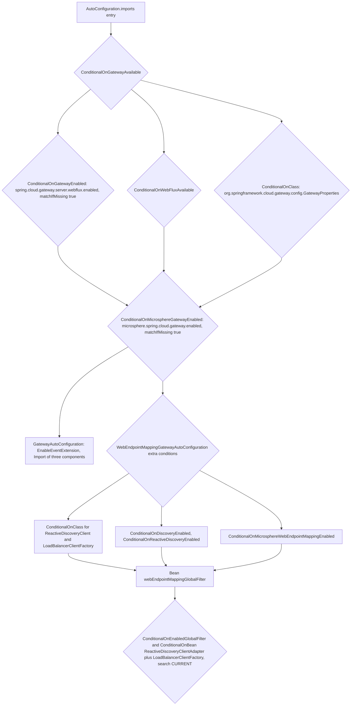
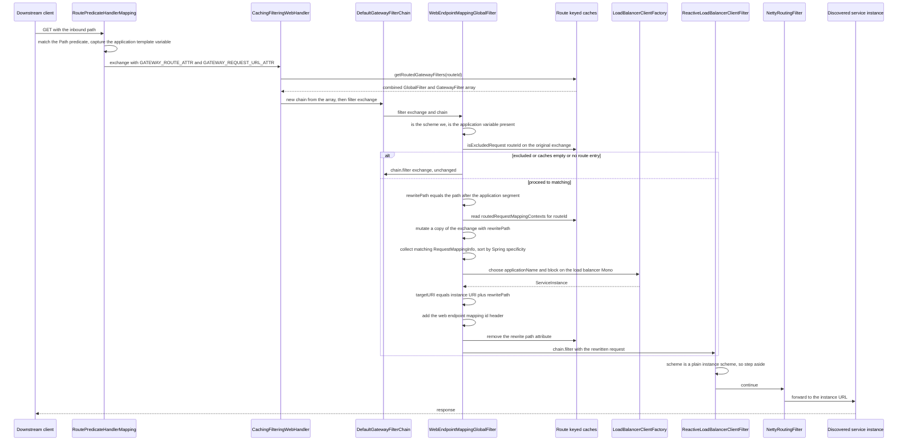
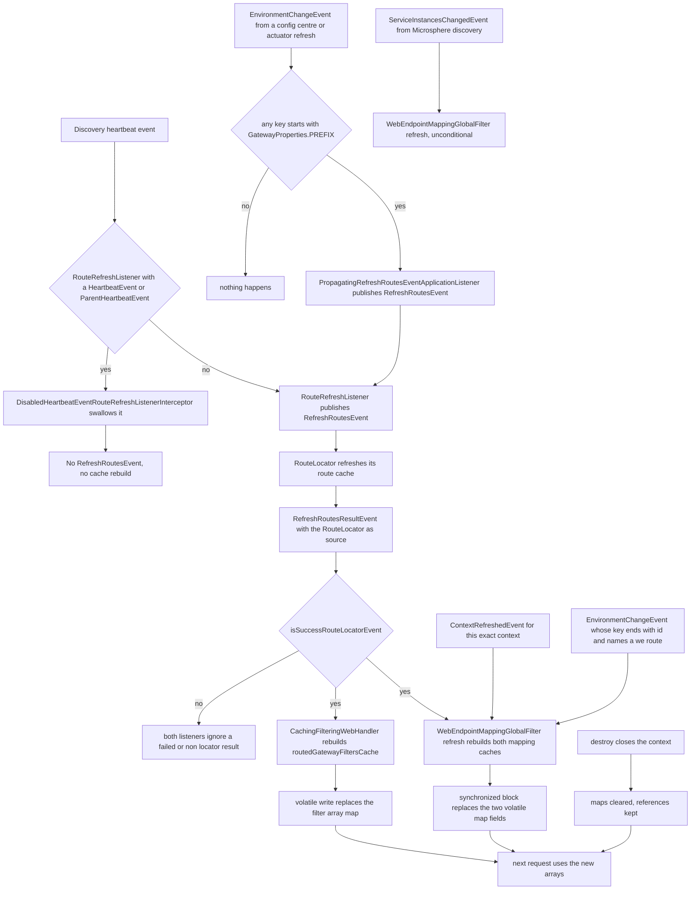
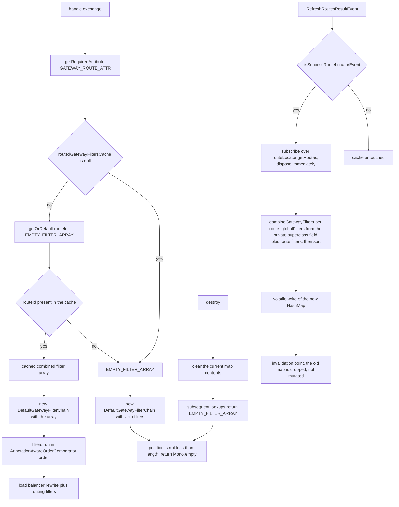

# microsphere-spring-cloud-gateway-server-webflux

Developer documentation for the reactive gateway module of the `0.2.x` line — the integration layer between
Spring Cloud Gateway Server WebFlux and Microsphere web-endpoint discovery.

| | |
|---|---|
| Coordinates | `io.github.microsphere-projects:microsphere-spring-cloud-gateway-server-webflux:${revision}` |
| Packaging | `jar` |
| Parent | `microsphere-gateway-parent` (`microsphere-spring-cloud-gateway-server-webflux/pom.xml:5-10`) |
| Java package root | `io.microsphere.spring.cloud.gateway.server.webflux` |
| Spring Boot registrations | `META-INF/spring.factories` (one `ApplicationContextInitializer`) + `META-INF/spring/org.springframework.boot.autoconfigure.AutoConfiguration.imports` (two auto-configurations) |

`module-path:line` pointers are relative to the repository root.

## Architecture design

### Role in the system

The module turns `we://<services>` route URIs into live traffic on a reactive gateway. Three cooperating
mechanisms do the work:

1. **A `GlobalFilter`** (`WebEndpointMappingGlobalFilter`) that, just before Spring Cloud Gateway's
   load-balancer filter, decides *which* published web endpoint can serve the request, rewrites the path, picks a
   service instance and replaces the `we://` URL with a concrete instance URL.
2. **A cached `WebHandler`** (`CachingFilteringWebHandler`, swapped in by a
   `BeanDefinitionRegistryPostProcessor`) that pre-computes, per route id, the combined
   `GlobalFilter` + `GatewayFilter` array so the per-request chain assembly becomes an array copy.
3. **Two event adaptations** (`DisabledHeartbeatEventRouteRefreshListenerInterceptor`,
   `PropagatingRefreshRoutesEventApplicationListener`) that change *when* route refreshes happen: heartbeat-driven
   polling is suppressed for `RouteRefreshListener`, and configuration changes are promoted into
   `RefreshRoutesEvent`.

### Package layout

```
io/microsphere/spring/cloud/gateway/server/webflux/
├── annotation/      ConditionalOnGatewayAvailable, ConditionalOnGatewayEnabled
├── autoconfigure/   GatewayAutoConfiguration, WebEndpointMappingGatewayAutoConfiguration
├── constants/       GatewayPropertyConstants
├── context/         WebEndpointApplicationContextInitializer
├── event/           DisabledHeartbeatEventRouteRefreshListenerInterceptor,
│                    PropagatingRefreshRoutesEventApplicationListener
├── filter/          DefaultGatewayFilterChain, WebEndpointMappingGlobalFilter
├── handler/         CachingFilteringWebHandler, FilteringWebHandlerBeanDefinitionRegistryPostProcessor
└── util/            GatewayUtils
```

Resources:
`src/main/resources/META-INF/spring.factories`,
`src/main/resources/META-INF/spring/org.springframework.boot.autoconfigure.AutoConfiguration.imports`,
`src/main/resources/META-INF/config/default/features.yaml`.

### Auto-configuration wiring

`src/main/resources/META-INF/spring.factories` registers only the initializer:

```properties
org.springframework.context.ApplicationContextInitializer=\
io.microsphere.spring.cloud.gateway.server.webflux.context.WebEndpointApplicationContextInitializer
```

`src/main/resources/META-INF/spring/org.springframework.boot.autoconfigure.AutoConfiguration.imports` registers
both configuration classes, listed in the order `GatewayAutoConfiguration`, then
`WebEndpointMappingGatewayAutoConfiguration`. The file order is *not* what sequences them; the explicit
`@AutoConfigureAfter` declarations do
(`.../autoconfigure/WebEndpointMappingGatewayAutoConfiguration.java:54-65`).

The condition stack, evaluated outermost-first:



Two ordering decisions matter to contributors:

* `@AutoConfigureAfter(name = "org.springframework.cloud.gateway.config.GatewayAutoConfiguration")`
  (`.../autoconfigure/GatewayAutoConfiguration.java:42-44`) is written with `name`, not `value`, so the module
  compiles and runs even when that class is absent — the attribute is evaluated reflectively by
  `AutoConfigurationSorter`. The same technique appears in
  `WebEndpointMappingGatewayAutoConfiguration.java:60-64`.
* The `@Import` of `FilteringWebHandlerBeanDefinitionRegistryPostProcessor`
  (`.../autoconfigure/GatewayAutoConfiguration.java:45-49`) means the `FilteringWebHandler` swap happens only when
  the gateway-wide conditions pass; if `spring.cloud.gateway.server.webflux.enabled=false`, the stock Spring Cloud
  Gateway handler stays in place.

**Bean override strategy.** The module never uses `spring.main.allow-bean-override=true` nor a second bean
definition with the same name. It rewrites the existing definition in place:
`registry.removeBeanDefinition(beanName)` followed by `registerBeanDefinition(registry, beanName, CachingFilteringWebHandler.class)`
(`.../handler/FilteringWebHandlerBeanDefinitionRegistryPostProcessor.java:49-56`), so the original bean name and
every by-name injection survive.

## Source analysis

### `annotation/ConditionalOnGatewayEnabled.java`

`@ConditionalOnProperty(name = GATEWAY_ENABLED_PROPERTY_NAME, matchIfMissing = true)` (`:46`) — the switch is the
one Spring Cloud Gateway itself owns (`spring.cloud.gateway.server.webflux.enabled` per
`.../constants/GatewayPropertyConstants.java:37`), not a Microsphere one. Disabling the stock gateway therefore
disables the Microsphere extensions automatically.

### `annotation/ConditionalOnGatewayAvailable.java`

Composition of three conditions (`:62-66`): `@ConditionalOnGatewayEnabled`, `@ConditionalOnWebFluxAvailable` (from
the optional `microsphere-spring-boot-webflux` dependency) and `@ConditionalOnClass(name = "...GatewayProperties")`.
The `@ConditionalOnClass` is expressed with `name` so the annotation is safe to place in code that is itself
compiled without Spring Cloud Gateway on the classpath; its own class-level `@see` javadoc
(`:56`) references `org.springframework.cloud.gateway.config.GatewayProperties` for documentation only.
The javadoc also documents both usage shapes — on a configuration class and on a `@Bean` method (`:34-51`).

### `constants/GatewayPropertyConstants.java`

* `GATEWAY_ENABLED_PROPERTY_NAME = PREFIX + DOT + ENABLED_PROPERTY_NAME` (`:46`)
* `GATEWAY_ROUTES_PROPERTY_NAME_PREFIX = PREFIX + DOT + "routes"` (`:53`)

Both derive from `org.springframework.cloud.gateway.config.GatewayProperties.PREFIX` (statically imported at
`:26`). Because `PREFIX` is a `static final String` used in a constant expression, the resulting names are
**inlined at compile time against the Spring Cloud Gateway artifact selected by the active `spring-cloud-*`
profile**. The consequences, all visible in the snapshot:

* the javadoc states the `2025` outcome, `spring.cloud.gateway.server.webflux.enabled` (`:37`);
* the test fixture declares the same routes twice, once under `spring.cloud.gateway.routes`
  (`microsphere-spring-cloud-gateway-server-webflux/src/test/resources/META-INF/config/default/test.yaml:117-158`)
  and once under `spring.cloud.gateway.server.webflux.routes` (`:160-205`), because different release trains use
  different prefixes;
* `mvn` runs the build with `-Ptest,coverage,spring-cloud-{2022,2023,2024,2025}`
  (`.github/workflows/maven-build.yml:26-27,46`), so each train compiles the constants for itself.

The conclusion that the prefix differs per release train is reasoning from these artefacts, not a value printed in
the snapshot.

`GATEWAY_ROUTES_PROPERTY_NAME_PREFIX` is used by the bind-listener registration
(`.../context/WebEndpointApplicationContextInitializer.java:46-47`) and by `EnvironmentChangeEvent` matching
(`.../filter/WebEndpointMappingGlobalFilter.java:377`).

### `context/WebEndpointApplicationContextInitializer.java`

Extends `io.microsphere.spring.context.ConfigurableApplicationContextInitializer` (from `microsphere-spring-context`)
so it only has to implement the interesting half:

```java
protected void initialize(ConfigurableApplicationContext context, ConfigurableEnvironment environment) {
    ConfigurableListableBeanFactory beanFactory = context.getBeanFactory();
    BeanDefinitionRegistry registry = (BeanDefinitionRegistry) beanFactory;
    registerBeanDefinition(registry, BEAN_NAME,
            WebEndpointConfigurationPropertiesBindListener.class, GATEWAY_ROUTES_PROPERTY_NAME_PREFIX);
}
```
(`:42-48`)

Why an initializer rather than an auto-configuration: `@ConfigurationProperties` binding for
`GatewayProperties` happens early in `refresh()`, so the `BindListener` must already be a bean definition before
auto-configuration is even parsed. Registering it in an initializer guarantees that. The constructor argument
`GATEWAY_ROUTES_PROPERTY_NAME_PREFIX` is what makes the shared commons listener webflux-specific.

### `autoconfigure/GatewayAutoConfiguration.java`

```java
@Configuration(proxyBeanMethods = false)
@ConditionalOnGatewayAvailable
@ConditionalOnMicrosphereGatewayEnabled
@EnableEventExtension
@AutoConfigureAfter(name = { "org.springframework.cloud.gateway.config.GatewayAutoConfiguration" })
@Import(value = { DisabledHeartbeatEventRouteRefreshListenerInterceptor.class,
                  PropagatingRefreshRoutesEventApplicationListener.class,
                  FilteringWebHandlerBeanDefinitionRegistryPostProcessor.class })
public class GatewayAutoConfiguration { }
```
(`:38-51`)

It declares no beans. Its body is a *registration bundle*: `@EnableEventExtension` (from
`io.microsphere.spring.context.event`) activates the `ApplicationListenerInterceptor` infrastructure that makes the
heartbeat interceptor effective — without it, the imported interceptor would be a bean nobody consults. The
companion test asserts exactly this triple (`.../test/java/.../autoconfigure/GatewayAutoConfigurationTest.java:50-54`).

`proxyBeanMethods = false` is the module-wide convention: no inter-`@Bean` calls exist to preserve.

### `autoconfigure/WebEndpointMappingGatewayAutoConfiguration.java`

Carries five condition annotations plus a `@ConditionalOnClass(name = ...)` pair for
`ReactiveDiscoveryClient` and `LoadBalancerClientFactory` (`:46-53`), and an `@AutoConfigureAfter` that mixes typed
and by-name ordering (`:54-65`) — the typed entries are Microsphere's own configurations
(`GatewayAutoConfiguration`, `WebFluxAutoConfiguration`, `ReactiveDiscoveryClientAutoConfiguration`), the by-name
entries are Spring Cloud's.

The single bean method (`:68-75`):

```java
@Bean
@ConditionalOnEnabledGlobalFilter
@ConditionalOnBean(value = {ReactiveDiscoveryClientAdapter.class, LoadBalancerClientFactory.class}, search = CURRENT)
public WebEndpointMappingGlobalFilter webEndpointMappingGlobalFilter(ReactiveDiscoveryClientAdapter reactiveDiscoveryClient,
                                                                    LoadBalancerClientFactory loadBalancerClientFactory,
                                                                    GatewayProperties gatewayProperties)
```

Three subtleties worth keeping:

* `@ConditionalOnEnabledGlobalFilter` is Spring Cloud Gateway's own
  `spring.cloud.gateway.filter.global-filter.<name>.enabled` opt-out hook, so the filter is switchable with stock
  gateway properties.
* `search = CURRENT` (`:70`, static import at `:36`) deliberately avoids the parent context, so a gateway child
  context (e.g. a load-balancer child) cannot resurrect the filter.
* The parameter type is `ReactiveDiscoveryClientAdapter`, but the filter's constructor declares
  `org.springframework.cloud.client.discovery.DiscoveryClient` (`.../filter/WebEndpointMappingGlobalFilter.java:112,126`).
  The code compiles, so `ReactiveDiscoveryClientAdapter` — Microsphere's adapter from
  `microsphere-spring-cloud-commons` — is a `DiscoveryClient` that sources its data from a
  `ReactiveDiscoveryClient`. That is why the module requires *reactive* discovery
  (`@ConditionalOnReactiveDiscoveryEnabled`, `:48`) while the filter's only discovery call,
  `discoveryClient.getServices()` (`:407`), is a blocking-shaped call.

### `filter/WebEndpointMappingGlobalFilter.java`

The core: 487 lines, one class playing six roles (`:107-108`) — `GlobalFilter`, `SmartApplicationListener`,
`ApplicationContextAware`, `EnvironmentAware`, `DisposableBean`, `Ordered`.

**Immutable state** (`:112-116`): `discoveryClient`, `clientFactory`, `gatewayProperties`, injected by constructor.
**Mutable state** (`:118-124`): `context`, `environment`, and the two `volatile` caches
`routedRequestMappingContextsCache` and `routedExcludedRequestMappingInfoCache`, both `Map<routeId, ...>`.

#### `filter(ServerWebExchange, GatewayFilterChain)` — `:134-168`

```
url = exchange.getAttribute(GATEWAY_REQUEST_URL_ATTR)         // :135
if scheme != "we"            -> chain.filter(exchange)         // :136-140
applicationName = uriTemplateVariables["application"]          // :142-143
if blank                     -> chain.filter(exchange)         // :144-147
ctx = getMatchingRequestMappingContext(applicationName, exchange)  // :149
if ctx != null:
    instance = choose(applicationName)                          // :153
    if instance != null:
        targetURI = instanceUri + rewritePath                   // :155-158
        request = mutate().header(ID_HEADER_NAME, ctx.id)       // :160-162
        attributes[GATEWAY_REQUEST_URL_ATTR] = targetURI        // :163
        return chain.filter(exchange.mutate().request(request)) // :164
return chain.filter(exchange)                                   // :167
```

Every non-applicable branch is a clean pass-through: the filter never short-circuits a request, it only rewrites or
steps aside. That is the central invariant — an application that has this filter installed but no `we://` route
behaves exactly as plain Spring Cloud Gateway.

Order: `LOAD_BALANCER_CLIENT_FILTER_ORDER - 1` (`:213-215`), asserted as `10149` in
`.../autoconfigure/WebEndpointMappingGatewayAutoConfigurationIntegrationTest.java:75`. Being one before the
load-balancer filter is what makes the rewrite visible to it: the rewritten URL is a concrete instance URL, so
`ReactiveLoadBalancerClientFilter` sees a non-`lb` scheme and steps aside, leaving `NettyRoutingFilter` to forward.

Note the path handling at `:158`: `create(uri + rewritePath)` is plain string concatenation of the instance base
URI (from `ServiceInstanceUtils.getUriString`, external) and the rewritten path. The context-path-aware helper
`buildPath(...)` (`:466-480`) exists to do this properly — it strips `/<serviceId>/` and re-applies the instance's
`WEB_CONTEXT_PATH_METADATA_NAME` — but **no production code path calls it**; only
`.../filter/WebEndpointMappingGlobalFilterStaticTest.java:42-52` exercises it. If you fix a context-path bug, that
helper is the intended home for the logic.

#### Matching: `getMatchingRequestMappingContext` — `:300-348`

The public-shaped entry (`:300-304) resolves the route id from `GATEWAY_ROUTE_ATTR`; the package-private overload
(`:306-348`) is the testable core and takes `(applicationName, routeId, exchange)`:

1. `isExcludedRequest(routeId, exchange)` (`:307`, `:359-367`) — matches the **original** exchange against the
   route's `metadata.web-endpoint.excludes` patterns. Because it runs against the untouched request, exclusion
   patterns are written in inbound-path terms.
2. Null-cache guard (`:313-319`), then empty-per-route guard (`:321-327`).
3. Compute `rewritePath = substringAfter(path, "/" + applicationName)` (`:333`) and store it in the exchange
   attribute `msgw-we-rewrite-path` (`:334`) — the hand-off consumed at `:157`.
4. Build a *mutated copy* of the exchange with the rewritten path (`:335-336`) — matching never mutates the caller's
   exchange.
5. Collect every context whose `RequestMappingInfo.getMatchingCondition(newExchange)` is non-null (`:339-344`),
   sort with `RequestMappingInfo.compareTo(other, exchange)` (`:345`, `:434-436`), return `first(...)` (`:347`).

Step 5 is where Spring's own specificity ordering is reused rather than re-implemented: the sort comparator delegates
to `RequestMappingInfo.compareTo`, so patterns, params, headers and media types rank exactly as they do in an MVC
application.

#### Cache construction: `refresh()` — `:239-259`

```java
Map<...> routedRequestMappingContextsMap = new ConcurrentHashMap<>();      // :240
Map<...> routedExcludedRequestMappingInfoMap = new ConcurrentHashMap<>();  // :241
for (RouteDefinition webEndpointRoute : getWebEndpointRoutes()) { ... }    // :244-252
synchronized (this) {                                                      // :255-258
    this.routedRequestMappingContextsCache = routedRequestMappingContextsMap;
    this.routedExcludedRequestMappingInfoCache = routedExcludedRequestMappingInfoMap;
}
```

* It reads `gatewayProperties.getRoutes()` — the *definition* list, not the resolved `Route` list — so the cache is
  built from configuration, not from the route locators' output (`:392-402`).
* `buildRequestMappingContexts(routeUri)` (`:272-285`) resolves the subscribed services from the URI host and, for
  each, calls `choose(service)` to get **one sample instance**, then reads its `WebEndpointMapping` collection
  (`ServiceInstanceUtils.getWebEndpointMappings`, external). The design assumption is that all instances of a
  service publish identical mappings; a canary running an older build would therefore not be reflected — the `TODO
  support ZonePreferenceFilter` at `:275` marks the same "one instance only" simplification.
* `buildExcludedRequestMappingInfoSet` (`:261-270`) dereferences the result of `findWebEndpointConfig(...)` without
  a null check, whereas the servlet sibling explicitly returns `emptySet()` when the config is absent
  (`.../webmvc/filter/WebEndpointMappingHandlerFilterFunction.java:179-182`). Since
  `ConfigUtils.getWebEndpointConfig(Map)` returns `null` unless the map really holds a `WebEndpointConfig`, a
  `we://` route whose `metadata.web-endpoint` subtree binds to nothing would raise a `NullPointerException` inside
  `refresh()` on this line. No snapshot test covers a `we://` route without a `web-endpoint` block, so treat this as
  a code-reading conclusion — and as the reason every fixture route in the repository does declare `excludes`.
* The two maps are built as `ConcurrentHashMap` even though publication is by volatile reference swap. Readers only
  ever `get`/`getOrDefault`, so the concurrency guarantee that matters is the volatile write; the
  `synchronized (this)` block makes the two assignments atomic with respect to a concurrent `refresh()`, but a
  request thread reading the two fields independently can still observe a new contexts cache with a stale excludes
  cache. Both are keyed by route id and only used to accept or reject, so a one-generation skew is benign.

#### Event handling — `:175-237`

`supportsEventType` (`:175-180`) uses `equals`, not `isAssignableFrom`: only the exact four event types
`ContextRefreshedEvent`, `RefreshRoutesResultEvent`, `EnvironmentChangeEvent` and
`io.microsphere.spring.cloud.client.event.ServiceInstancesChangedEvent` reach `onApplicationEvent`
(`:183-194`), which then dispatches with pattern-matching `instanceof`. `supportsAsyncExecution()` returns `false`
(`:170-172`) and carries no `@Override`; it corresponds to the `ApplicationListener` asynchronous-execution flag in
current Spring Framework versions, keeping this listener on the publishing thread — consistent with the fact that
the same object is also a request-path filter.

* `onContextRefreshedEvent` (`:217-221`) refreshes only when `this.context == event.getApplicationContext()` — an
  identity check that prevents child contexts (load-balancer contexts are children) from triggering a rebuild.
* `onRefreshRoutesResultEvent` (`:223-227`) refreshes only on a *successful* `RouteLocator` result
  (`GatewayUtils.isSuccessRouteLocatorEvent`, `.../util/GatewayUtils.java:103-105`).
* `onEnvironmentChangeEvent` (`:229-233`, `:373-390`) is selective: it needs a non-empty key set, a key starting with
  the routes prefix, that key *ending* with `id` (`lastIndex == key.length() - ID_KEY.length()`, `:378-379`), and the
  property's value matching one of the current `we` route ids. Note that the `endsWith("id")` test is a substring
  position check, not a segment comparison, so a key such as `...routes[0].some-id` would also qualify; and when the
  key set is empty `getWebEndpointRoutes()` is never called (`:375`), which is the branch
  `WebEndpointMappingGlobalFilterTest` exercises with `new EnvironmentChangeEvent(emptySet())`
  (`.../filter/WebEndpointMappingGlobalFilterTest.java:163`).
* `onServiceInstancesChangedEvent` (`:235-237`) refreshes unconditionally — the Microsphere instance-changed event is
  the replacement for heartbeat polling.

`destroy()` (`:207-210`) clears the *contents* of both maps via the static `clear(Map)` helper (`:482-486`) but
leaves the references set, so post-shutdown requests take the "no contexts for this route" branch rather than the
null-cache branch. The test-only `clear()` (`:416-421`) nulls only the contexts cache and is used by
`WebEndpointMappingGlobalFilterTest#testFilterOnNoRoutedRequestMappingContext`
(`.../filter/WebEndpointMappingGlobalFilterTest.java:186-194`).

The **ordering hazard** in `:306-319` deserves a comment from maintainers: `isExcludedRequest` (`:359-367`)
dereferences `routedExcludedRequestMappingInfoCache` before the null guard on the *other* cache is reached. The
class relies on `ContextRefreshedEvent` populating both caches before traffic arrives, not on a guard.

#### `RequestMappingContext` — `:423-464`

A package-private value object pairing a Spring `RequestMappingInfo` with the `WebEndpointMapping` id. Two static
`buildRequestMappingInfo` overloads share the same builder pipeline — one from the configuration model `Mapping`
(`:438-446`), one from discovered metadata (`:448-457`) — and `buildRequestMethods` (`:459-463`) converts
`WebEndpointMapping.getMethods()` strings with `RequestMethod.valueOf`. Adding a condition attribute therefore means
editing both overloads.

`compareTo(RequestMappingContext, ServerWebExchange)` (`:434-436`) is the bridge to Spring's own ranking.

### `filter/DefaultGatewayFilterChain.java`

A minimal, explicit re-implementation of `GatewayFilterChain` over an array (`:36-59`):

```java
if (position < length) {
    GatewayFilter gatewayFilter = this.gatewayFilters[position++];
    return defer(() -> gatewayFilter.filter(exchange, this));
}
return empty();
```

* Constructor validates non-null and no-null-elements (`:44-50`), throwing `IllegalArgumentException`, which
  `DefaultGatewayFilterChainTest#testConstructorWithNullGatewayFilter` asserts
  (`.../filter/DefaultGatewayFilterChainTest.java:47-49`).
* `position` is mutable and **not** thread-safe and not re-subscribable: the same instance represents one traversal.
  `.../filter/DefaultGatewayFilterChainTest.java:56-58` proves the exhausted behaviour — a second `filter(...)` on a
  one-filter chain returns the same `Mono.empty()` the terminators return.
* `Mono.defer` makes each step lazy per subscription instead of eager at assembly time.
* It is created fresh per request by `CachingFilteringWebHandler.handle` (`:69`) and used directly in tests and in
  the integration test's filter invocation (`.../autoconfigure/WebEndpointMappingGatewayAutoConfigurationIntegrationTest.java:69`).

### `handler/CachingFilteringWebHandler.java`

```java
public class CachingFilteringWebHandler extends FilteringWebHandler implements DisposableBean {   // :55
    static final GatewayFilter[] EMPTY_FILTER_ARRAY = new GatewayFilter[0];                       // :57
    private volatile Map<String, GatewayFilter[]> routedGatewayFiltersCache = null;               // :59
```

`handle` replaces the superclass implementation completely (`:65-70`): it reads the matched `Route` from
`GATEWAY_ROUTE_ATTR` with `getRequiredAttribute`, fetches the pre-computed array and runs a new
`DefaultGatewayFilterChain`. `super.handle(...)` is never called.

`combineGatewayFilters(route)` (`:107-115`) concatenates `globalFilters()` and `route.getFilters()`, sorts with
`AnnotationAwareOrderComparator.sort` (`:39`) and copies into `EMPTY_FILTER_ARRAY`. `globalFilters()` (`:121-123`)
reads the superclass's private field reflectively — `getFieldValue(true, this, "globalFilters")` — which is the
price of extending a class whose state is private; a Spring Cloud Gateway rename of that field breaks this method at
runtime, not at compile time.

Cache construction (`:87-95`) drains the reactive route stream imperatively:

```java
routeLocator.getRoutes().subscribe(route -> { ... put(routeId, filters) ... }).dispose();
```

`subscribe(...).dispose()` collects into a plain `HashMap` **synchronously** and drops the subscription
immediately. That is only correct because the `RouteLocator` in a running gateway is Spring Cloud Gateway's
caching locator whose `Flux` is already materialised. If the source ever needs real I/O, routes would silently be
missing from the cache. The `HashMap` is then published through the volatile field (`:83`) and never mutated again,
which is a safe-publication pattern.

`getRoutedGatewayFilters(route)` (`:97-105`) is the whole failure mode of the class: a `null` cache yields
`EMPTY_FILTER_ARRAY`, and an unknown route id yields `EMPTY_FILTER_ARRAY` via `getOrDefault`. With an empty array,
`DefaultGatewayFilterChain.filter` immediately returns `Mono.empty()`
(`.../filter/DefaultGatewayFilterChain.java:52-58`) — that is, **the request is answered with an empty, filter-free
completion rather than being routed**. This class is therefore only safe because `RefreshRoutesResultEvent` arrives
during start-up (`RouteLocator` refresh) before traffic. `CachingFilteringWebHandlerTest#testGetRoutedGatewayFilters`
asserts the null-cache branch (`.../handler/CachingFilteringWebHandlerTest.java:67-70`).

Invalidation is exclusively event-driven — `@EventListener(RefreshRoutesResultEvent.class)` (`:79-85`) — filtered by
`isSuccessRouteLocatorEvent` (`:117-119`). `destroy()` (`:72-77`) clears the map contents. There is no TTL and no
per-route eviction.

### `handler/FilteringWebHandlerBeanDefinitionRegistryPostProcessor.java`

```java
public void postProcessBeanDefinitionRegistry(BeanDefinitionRegistry registry) { this.registry = registry; }   // :43-46
public void postProcessBeanFactory(ConfigurableListableBeanFactory beanFactory) {
    String[] beanNames = beanFactory.getBeanNamesForType(FilteringWebHandler.class, false, false);              // :51
    for (String beanName : beanNames) {
        registry.removeBeanDefinition(beanName);                                                              // :53
        registerBeanDefinition(registry, beanName, CachingFilteringWebHandler.class);                         // :54
    }
}
```

* `getBeanNamesForType(FilteringWebHandler.class, false, false)` requests non-singleton-inclusive = `false` and
  `allowEagerInit = false`, i.e. type matching from the bean definition's declared/factory return type only, with no
  instance creation. That is both what makes the swap safe this early and what limits it to definitions whose type is
  statically known — Spring Cloud Gateway's `@Bean` method qualifies.
* The loop is plural by design: if an application registers several `FilteringWebHandler` beans, all are replaced.
* The replacement is registered with a class only, no explicit constructor arguments, unlike the bind-listener
  registration which does pass an argument
  (`.../context/WebEndpointApplicationContextInitializer.java:46-47`). `CachingFilteringWebHandler`'s only
  constructor takes `List<GlobalFilter>` (`:61-63`), so resolution falls to Spring's single-constructor autowiring,
  injecting every `GlobalFilter` bean. That this still receives the same filter list Spring Cloud Gateway would have
  passed is an inference about Spring's instantiation behaviour, not something the snapshot asserts.
* Being a `BeanDefinitionRegistryPostProcessor` with no `Ordered`/`PriorityOrdered` marker, it runs in the
  "regular" group of post-processors — after `ConfigurationClassPostProcessor`, so Spring Cloud Gateway's own bean
  definitions already exist when the swap happens. `GatewayAutoConfigurationTest` lists it among the auto-configured
  classes of the parent configuration (`.../autoconfigure/GatewayAutoConfigurationTest.java:53`).

### `event/DisabledHeartbeatEventRouteRefreshListenerInterceptor.java`

An `io.microsphere.spring.context.event.ApplicationListenerInterceptor` (`:41`, `:47-58`):

```java
if (INTERCEPTED_CLASS.equals(listenerClass) && matchesHeartbeatEvent(eventClass)) {
    logger.trace(...); return;                       // swallow
}
chain.intercept(applicationListener, event);         // otherwise continue the chain
```

`INTERCEPTED_CLASS` is `RouteRefreshListener` compared with `equals` (`:45`, `:52`) and the event test is exact
class equality against `HeartbeatEvent` and `ParentHeartbeatEvent` (`:60-62`). Subclasses of either are therefore
*not* intercepted — deliberate narrowness that keeps the suppression from swallowing unrelated listeners. The
pattern is a chain of responsibility: the interceptor decides and otherwise delegates to
`ApplicationListenerInterceptorChain`, and it only runs because `GatewayAutoConfiguration` carries
`@EnableEventExtension`.

Why it exists: Spring Cloud Gateway's `RouteRefreshListener` reacts to discovery heartbeat events, so a heartbeat
every `instance-info-cache` interval would rebuild both `CachingFilteringWebHandler`'s filter arrays and
`WebEndpointMappingGlobalFilter`'s mapping caches even though nothing changed. The module replaces polling-driven
refresh with `ServiceInstancesChangedEvent` (`:235-237` of the filter) and leaves `RefreshRoutesEvent` to genuine
configuration changes.

### `event/PropagatingRefreshRoutesEventApplicationListener.java`

`ApplicationListener<EnvironmentChangeEvent>` (`:20`) that publishes `new RefreshRoutesEvent(this)` as soon as any
changed key starts with `GatewayProperties.PREFIX` (`:29-46`). Its `ApplicationContext` is constructor-injected, so
it is a bean created through the `@Import` in `GatewayAutoConfiguration` (`:47`).

This closes a gap: Spring Cloud Gateway refreshes routes on `RefreshRoutesEvent`, but a
`spring.cloud.gateway...` property change — from `/actuator/refresh` or a config centre — arrives as an
`EnvironmentChangeEvent`. The listener converts one into the other, and because the published event's source is the
listener itself, `isSuccessRouteLocatorEvent` still requires the *downstream* `RefreshRoutesResultEvent` (whose source
is the `RouteLocator`) before either cache acts.
`PropagatingRefreshRoutesEventApplicationListenerTest` asserts both directions
(`.../event/PropagatingRefreshRoutesEventApplicationListenerTest.java:60-81`).

### `util/GatewayUtils.java`

A non-instantiable helper (`:45`, private ctor `:107-108`) with three methods:

* `getGatewayProperties(ConfigurableEnvironment)` (`:53-56`) — flattened `spring.cloud.gateway...` properties via
  `PropertySourcesUtils.getSubProperties`.
* `getRouteProperties(ConfigurableEnvironment, String routeId)` (`:66-95`) — scans the flattened map for the entry
  whose *value* equals the route id, takes `substringBeforeLast(propertyName, ".")` as that route's prefix, then
  collects every property under it and returns an `unmodifiableMap` (`:94`), or `emptyMap()` when the id is not
  found (`:80-82`). Two properties with the same value can mis-associate a prefix — the search is value-based, not
  structure-based. It is a public API for consumers and tooling, not used by this module's own request path
  (verified by grep: only `GatewayUtilsTest` calls it).
* `isSuccessRouteLocatorEvent(RefreshRoutesResultEvent)` (`:103-105`) — null-safe, `event.isSuccess()` and
  `event.getSource() instanceof RouteLocator`. It is the shared gate for both cache-refresh paths
  (`.../filter/WebEndpointMappingGlobalFilter.java:369-371` and
  `.../handler/CachingFilteringWebHandler.java:117-119`), and `GatewayUtilsTest#testIsSuccessRouteLocatorEvent`
  pins all four combinations (`.../util/GatewayUtilsTest.java:93-101`).

## Request lifecycle for a `we://` route



One line above deserves emphasis for reviewers: the load-balancer call at
`.../filter/WebEndpointMappingGlobalFilter.java:293-298` performs a **blocking read of the load balancer's
`Mono`** (`MonoUtils.getValue`, from `microsphere-spring-web`) inside `filter(...)`, which on a running gateway
executes on a Netty event-loop thread. `choose(...)` is also called from `refresh()` (`:277`), where it runs on the
publishing thread of `ContextRefreshedEvent` / `RefreshRoutesResultEvent` / `ServiceInstancesChangedEvent`. Any
change to this class should keep that in mind: reactor forbids `block()` on `NonBlocking` threads, so an
implementation change here must either stay off the event loop or resolve the instance without blocking.

## Route refresh and cache invalidation



## Caching behaviour of `CachingFilteringWebHandler`



`buildRoutedGatewayFiltersCache` assigns a *fresh* map and publishes it through the volatile field, so in-flight
requests keep reading the old array set — invalidation is by replacement, never by mutation, except in `destroy()`,
which mutates the map in place.

## Design patterns

Only patterns the code in this module actually exhibits are listed. Each entry gives the location, the
problem it solves, what it buys and what it costs.

**Chain of Responsibility (hand-written, cursor-based).**
Where: `DefaultGatewayFilterChain.java:36-59` implementing Spring Cloud Gateway's `GatewayFilterChain`; the
`GatewayFilter[]` + `position` cursor at `:38-42`, advance-and-dispatch at `:55`, termination at `:58`.
Why: the module needs to run its own filter list (the cached one) instead of the one `FilteringWebHandler`
builds per request.
Buys: no allocation beyond the chain object, O(1) per hop, and the whole handler path is expressible in one
line: `new DefaultGatewayFilterChain(routedGatewayFilters).filter(exchange)`
(`CachingFilteringWebHandler.java:69`).
Cost: the chain is stateful (`position` is mutated at `:55`) and therefore single-use and not thread-safe; it
must be constructed per request, which is what `handle` does. Exhaustion returns `Mono.empty()` (`:58`) rather
than signalling "no filter handled it", so a route with an empty filter list silently produces an empty
response.

**Lazy evaluation of the chain head.**
Where: `defer(() -> gatewayFilter.filter(exchange, this))` (`DefaultGatewayFilterChain.java:56`).
Why: `GatewayFilter.filter` may throw while composing rather than while subscribing.
Buys: exceptions raised during filter invocation surface as an error signal inside the reactive pipeline
instead of escaping `handle`.
Cost: one `Mono` wrapper per hop.

**Decorator by inheritance, installed by a registry swap.**
Where: `CachingFilteringWebHandler.java:55` (`extends FilteringWebHandler implements DisposableBean`),
`handle` overridden at `:65-70` and **never** calling `super.handle`; the swap is performed by
`FilteringWebHandlerBeanDefinitionRegistryPostProcessor.java:49-56`
(`getBeanNamesForType(FilteringWebHandler.class, false, false)` at `:51`, then remove + re-register).
Why: Spring Cloud Gateway exposes the handler as a concrete bean, with no interface to implement and no
customiser hook.
Buys: full behavioural replacement without forking the gateway, and without a `@Primary` bean that would leave
the original instantiated.
Cost: the decorator depends on private superclass state — `globalFilters()` reads the field reflectively
(`CachingFilteringWebHandler.java:121-123`) — so a rename in Spring Cloud Gateway breaks it silently for
`@SuppressWarnings`-style reflection. Overriding `handle` without `super` means any future superclass
behaviour (metrics, predicates re-check) is lost.

**Null Object.**
Where: `EMPTY_FILTER_ARRAY` (`CachingFilteringWebHandler.java:57`), returned both for a `null` cache and an
unknown route id (`:99-104`); the `empty()` terminal in `DefaultGatewayFilterChain.java:58`; `Mono.empty()`
return paths in `WebEndpointMappingGlobalFilter` when nothing matches.
Buys: no `null` checks in the dispatch loop; `CachingFilteringWebHandlerTest.java:67-70` pins the
null-cache case.
Cost: "no filters" and "cache not built yet" are indistinguishable at runtime, which is exactly the failure
mode that makes a missing `RefreshRoutesResultEvent` produce filter-free routing.

**Copy-on-write snapshot publication.**
Where: `CachingFilteringWebHandler.java:59` (`volatile Map<String, GatewayFilter[]>`) with assignment of a
freshly built map at `:83`; the same discipline in `WebEndpointMappingGlobalFilter.java` — two `volatile`
collections (`:112-124`) built inside `synchronized (this)` and swapped together (`:239-259`).
Why: request threads read the cache on every exchange while refresh events rebuild it.
Buys: lock-free reads; a reader either sees the complete old snapshot or the complete new one.
Cost: builds are serialised by the `synchronized` block in the filter, and the handler's build is *not* — it
relies on the event being single-threaded. Neither structure has a TTL or eviction.

**Observer with self-filtering.**
Where: `WebEndpointMappingGlobalFilter` implements `SmartApplicationListener` and narrows the event set in
`supportsEventType` by exact `equals` on four event types (`:175-180`), then dispatches in
`onApplicationEvent` (`:183-194`); `PropagatingRefreshRoutesEventApplicationListener.java:29-46` is a plain
`ApplicationListener<EnvironmentChangeEvent>` that re-publishes `RefreshRoutesEvent`.
Buys: registration cost stays with Spring's default multicaster; unwanted events are rejected before any
work.
Cost: exact-type matching means a subclass of a subscribed event is ignored — in this module the subscribed
set is `ContextRefreshedEvent`, `RefreshRoutesResultEvent`, `EnvironmentChangeEvent` and
`ServiceInstancesChangedEvent` (`:176-179`), so for example a heartbeat event never reaches this listener at
all; the rule is silent rather than documented by an exception.

**Interceptor chain (a.k.a. Pipeline) around an observer.**
Where: `DisabledHeartbeatEventRouteRefreshListenerInterceptor.java:45-62`, wired through the
`ApplicationListenerInterceptor`/`ApplicationListenerInterceptorChain` SPI that
`@EnableEventExtension` on `GatewayAutoConfiguration.java:41` turns on.
Why: Spring Cloud Gateway's `RouteRefreshListener` reacts to heartbeat events, which in a service mesh with
frequent heartbeats causes useless route refreshes.
Buys: the framework class is never subclassed or replaced; the suppression is declarative and reversible
(`chain.intercept(...)` at `:57` restores the default path for every other event).
Cost: exact-equality on the listener class (`:45`, `:52`) means a user-provided `RouteRefreshListener`
subclass is *not* intercepted, and the mechanism comes from the external `microsphere-spring-*` stack.

**Facade over framework lookups.**
Where: `GatewayUtils.java:45-109` — `getGatewayProperties` (`:53-56`), `getRouteProperties` (`:66-95`),
`isSuccessRouteLocatorEvent` (`:103-105`), private constructor (`:107-108`).
Buys: one place encodes "the route properties are read by prefix scanning the `Environment`, and the result is
unmodifiable or empty" (`:81`, `:94`), and "a route-locator event counts only when it succeeded".
Cost: `getGatewayProperties` and `getRouteProperties` currently have **no main-source callers** in this
repository (only `GatewayUtilsTest`), so the facade is partly speculative generality.

**Blackboard via exchange attributes.**
Where: `WEB_ENDPOINT_REWRITE_PATH_ATTRIBUTE_NAME` written at `WebEndpointMappingGlobalFilter.java:334` during
matching and removed at `:157` during forwarding, plus `GATEWAY_REQUEST_URL_ATTR` written at `:163`.
Why: the rewritten path is discovered deep inside matching but needed at the forwarding step, and the two
steps do not share a return type.
Buys: no signature change to the package-private matching method.
Cost: the value survives a *non*-matching outcome (written at `:334` before any match is known), so readers
cannot assume the attribute implies a successful match, and the cast at `:157` is unchecked.

**Strategy selected by conditional annotations.**
Where: the `@Import` list on `GatewayAutoConfiguration.java:45-49` and the bean method in
`WebEndpointMappingGatewayAutoConfiguration.java:68-75` guarded by `@ConditionalOnEnabledGlobalFilter` and
`@ConditionalOnBean(..., search = SearchStrategy.CURRENT)`.
Buys: the "caching handler" strategy and the "web endpoint mapping" strategy are independently switchable.
Cost: three overlapping condition sources (`@ConditionalOnGatewayAvailable`,
`@ConditionalOnMicrosphereGatewayEnabled`, `@ConditionalOnBean`) can produce an auto-configuration that is
skipped for a reason no log line spells out at default level.

Explicitly **not** present in this module: no Builder, no Abstract Factory, no composite `Route` tree of the
module's own design, no `Mono`/`Flux` custom scheduler (nothing calls
`publishOn`/`subscribeOn`; the blocking `MonoUtils.getValue` call at `WebEndpointMappingGlobalFilter.java:293-298`
is the opposite of one), and no bean-level Strategy interface — the only polymorphism is the
`FilteringWebHandler` subclass.

---

## Module dependency graph

The same reactor graph appears in every module document of this guide; node `F` is this module.

```mermaid
graph TD
    subgraph reactor["Maven reactor microsphere-gateway"]
        ROOT["microsphere-gateway (aggregator pom)"]
        P["microsphere-gateway-parent (pom)"]
        D["microsphere-gateway-dependencies (pom, BOM)"]
        C["microsphere-spring-cloud-gateway-commons (jar)"]
        F["microsphere-spring-cloud-gateway-server-webflux (jar)"]
        M["microsphere-spring-cloud-gateway-server-webmvc (jar)"]
    end
    ROOT --> P
    ROOT --> D
    ROOT --> C
    ROOT --> F
    ROOT --> M
    P -->|parent of| D
    P -->|parent of| C
    P -->|parent of| F
    P -->|parent of| M
    F -->|"compile, revision"| C
    M -->|compile| C

    subgraph optMF["External Microsphere, optional scope"]
        SCP["microsphere-annotation-processor"]
        SCC["microsphere-spring-cloud-commons"]
        SBW["microsphere-spring-boot-webflux"]
    end
    subgraph transitiveMF["Reached transitively, not declared in this pom"]
        SBCONTEXT["microsphere-spring-context, provides EnableEventExtension"]
    end
    subgraph testMF["External Microsphere, compile scope here"]
        SBT["microsphere-spring-boot-test, no scope tag in this pom"]
    end
    subgraph scgProfiles["Spring Cloud Gateway, per Maven profile, optional"]
        GW2025["spring-cloud-gateway-server-webflux, spring-cloud-2025 default"]
        GW2022["spring-cloud-starter-gateway, spring-cloud-2022 2023 2024"]
    end
    subgraph optSF["External Spring, optional scope"]
        SCOM["spring-cloud-commons"]
        SLB["spring-cloud-loadbalancer"]
        SBWF["spring-boot-starter-webflux"]
        SBOOT["spring-boot-starter, starter-actuator"]
        SPROC["spring-boot-configuration-processor, spring-boot-autoconfigure-processor"]
    end
    subgraph testSF["External Spring, test scope"]
        JUP["junit-jupiter"]
        SBTEST["spring-boot-starter-test"]
    end

    SCP --> F
    SCC --> F
    SBW --> F
    SBCONTEXT --> F
    SBT --> F
    GW2025 --> F
    GW2022 --> F
    SCOM --> F
    SLB --> F
    SBWF --> F
    SBOOT --> F
    SPROC --> F
    JUP --> F
    SBTEST --> F
    SCBOM["microsphere-spring-cloud-dependencies 0.2.26, imported BOM"] --> P
```



Scope facts from `microsphere-spring-cloud-gateway-server-webflux/pom.xml`: every dependency except the commons
module is `optional` or `test` (`:21-113`); `microsphere-spring-boot-test` is declared *without* a scope tag
(`:108-112`), unlike the other two modules which mark it `test` — a real, if cosmetic, inconsistency in the reactor.
The Spring Cloud Gateway dependency itself moves between profiles (`:116-168`), with `spring-cloud-2025`
`activeByDefault` (`:153-157`).

## Build & test guidance

```bash
./mvnw -pl microsphere-spring-cloud-gateway-server-webflux -am test
./mvnw -pl microsphere-spring-cloud-gateway-server-webflux test -Ptest,spring-cloud-2023
./mvnw -pl microsphere-spring-cloud-gateway-server-webflux test -Ptest,spring-cloud-2025
```

Profiles that matter here: `spring-cloud-2022`, `spring-cloud-2023`, `spring-cloud-2024` add
`spring-cloud-starter-gateway`, `spring-cloud-2025` (default) adds `spring-cloud-gateway-server-webflux`
(`microsphere-spring-cloud-gateway-server-webflux/pom.xml:116-168`). CI runs the full matrix of JDK 17/21/25 against
all four profiles with `-Ptest,coverage,<profile>` (`.github/workflows/maven-build.yml:23-46`), so a change to a
`@ConditionalOnClass` name must hold for the oldest train as well.

Spring profiles used by the fixtures (`src/test/resources/META-INF/config/default/test.yaml`): `nacos`, `eureka`,
`zookeeper`, `consul`, `kubernetes`, `simple-service-registry`, `gateway`. The default document disables every
discovery client (`:5-27`), and `gateway` (`:110-205`) supplies the two route trees.

| Test class | Coverage |
|---|---|
| `autoconfigure/GatewayAutoConfigurationTest` | the positive/negative condition matrix of `GatewayAutoConfiguration`, including the three `@Import`ed components and the "classes missing" cases (`Flux`, `DispatcherHandler`, `GatewayProperties`, …) — `.../autoconfigure/GatewayAutoConfigurationTest.java:49-71` |
| `autoconfigure/WebEndpointMappingGatewayAutoConfigurationTest` | the same matrix for the web-endpoint configuration, adding `spring.cloud.discovery.reactive.enabled` and `microsphere.spring.cloud.web-endpoint-mapping.enabled` as kill switches |
| `autoconfigure/WebEndpointMappingGatewayAutoConfigurationIntegrationTest` | boots with `@EnableAutoConfiguration` on a random port, runs the real filter over `MockServerWebExchange`, asserts order `10149`, calls `destroy()`, and feeds both a successful and a failed `RefreshRoutesResultEvent` (`:57-86`) |
| `filter/WebEndpointMappingGlobalFilterTest` | the end-to-end `we://` round trip against a self-registered service (`test-app`) through `WebTestClient.bindToApplicationContext`, the three `excludes` cases (`/test-1/**`, `/test-2/**`, `/test-3/abc/**`), `ServiceInstancesChangedEvent`, `EnvironmentChangeEvent` with and without keys, the unregistered-application path, and the cleared-cache path (`:134-204`) |
| `filter/WebEndpointMappingGlobalFilterStaticTest` | `buildPath` only — the helper that is not wired into `filter(...)` |
| `filter/DefaultGatewayFilterChainTest` | constructor validation, exhausted-chain `Mono.empty()`, multi-filter traversal |
| `filter/NoOpGatewayFilter` | test fixture, not a test |
| `handler/CachingFilteringWebHandlerTest` | `destroy` with and without initialisation, event handling with a null and a non-null throwable, and the null-cache branch of `getRoutedGatewayFilters` |
| `event/DisabledHeartbeatEventRouteRefreshListenerInterceptorTest` | publishes `HeartbeatEvent`, `ParentHeartbeatEvent` and an unrelated payload event, asserting unrelated listeners still fire (`:57-70`) |
| `event/PropagatingRefreshRoutesEventApplicationListenerTest` | `EnvironmentChangeEvent` with and without a gateway-prefixed key |
| `constants/GatewayPropertyConstantsTest` | the two derived property names |
| `util/GatewayUtilsTest` | flattened gateway properties, route lookup by id with a synthetic `routes[1].id`, the not-found branch, and all four `isSuccessRouteLocatorEvent` cases |

The auto-configuration tests extend `ReactiveWebAutoConfigurationTest` from `microsphere-spring-boot-test`, whose
contract is: for each configured kill switch, and for each listed missing class, the auto-configuration must *not*
register. When you add a condition to a configuration class, add the matching
`configureGlobalDisabledPropertyValues` / `configureGlobalMissingClasses` entry, otherwise the test suite will not
prove the condition works.

## Extension recipes

### Add a new gateway filter

1. Put it in `...server.webflux.filter` and implement `GlobalFilter` + `Ordered`. If it must see the URL produced by
   a `we://` rewrite, choose an order greater than `LOAD_BALANCER_CLIENT_FILTER_ORDER`; if it must decide before the
   endpoint mapping runs, stay below `10149`
   (`.../filter/WebEndpointMappingGlobalFilter.java:213-215`).
2. Register it as a `@Bean` inside a `@ConditionalOnGatewayAvailable`-guarded configuration, or add a bean method to
   `WebEndpointMappingGatewayAutoConfiguration` with `@ConditionalOnEnabledGlobalFilter` so the stock
   `spring.cloud.gateway.filter.global-filter.<name>.enabled` switch works.
3. Remember `CachingFilteringWebHandler`: your filter is picked up only through the superclass's private
   `globalFilters` list (`.../handler/CachingFilteringWebHandler.java:121-123`) and only for routes present in the
   cache. If your filter mutates per-route state, make sure it appears in every `RefreshRoutesResultEvent` rebuild.
4. For a route-scoped (non-global) filter, no module change is needed — Spring Cloud Gateway's own
   `GatewayFilterFactory` mechanism applies, and `combineGatewayFilters` already merges `route.getFilters()`.
5. Add a test in the style of `filter/WebEndpointMappingGlobalFilterTest` using
   `WebTestClient.bindToApplicationContext`, and drive a chain with `DefaultGatewayFilterChain` plus a stub filter as
   `filter/NoOpGatewayFilter` does.

### Add a new conditional annotation

Follow `annotation/ConditionalOnGatewayAvailable.java`: meta-annotate existing conditions rather than implementing
`Condition`, use `@ConditionalOnClass(name = ...)` for anything that may be absent, and target `{TYPE, METHOD}` so
the annotation is usable on configuration classes and bean methods. Keep Microsphere-level switches in
[microsphere-spring-cloud-gateway-commons](microsphere-spring-cloud-gateway-commons.md) and stock-Gateway switches
here (`annotation/ConditionalOnGatewayEnabled.java`), so a user can turn off "Spring Cloud Gateway" and "Microsphere
extensions" independently.

### Add a new route-scheme handler

1. Declare the scheme in `RouteConstants` (commons) — `SCHEME = "we"` is the current sole entry.
2. Extend the route filter used to seed caches: `getWebEndpointRoutes()`
   (`.../filter/WebEndpointMappingGlobalFilter.java:392-402`) tests `SCHEME.equals(routeUri.getScheme())`, and
   `isWebEndpointRoute` (`:412-414`) is the guard used on the request path at `:136`.
3. Resolve the new scheme's host part the way `getSubscribedServices(URI)` does (`:404-410`) — `all` means
   `discoveryClient.getServices()`, anything else is a comma-delimited service list.
4. Rewrite and forward in the same place `filter(...)` does (`:149-165`): keep the "no match means pass through"
   invariant, and always remove the hand-off attribute (`:157`) so a later filter cannot re-read a stale rewrite
   path.
5. Publish the new scheme through `META-INF/config/default/features.yaml` (the `named`/`abstract` sections list the
   classes that make the feature work).
6. Mirror the work in the servlet module, or the scheme will only exist for one runtime; see
   [microsphere-spring-cloud-gateway-server-webmvc](microsphere-spring-cloud-gateway-server-webmvc.md).

---

## 中文

The developer guide for this module is also available in Chinese:
[zh/microsphere-spring-cloud-gateway-server-webflux.md](zh/microsphere-spring-cloud-gateway-server-webflux.md).

Back to the guide index: [README.md](README.md).
Project root README: [../../../README.md](../../../README.md).
