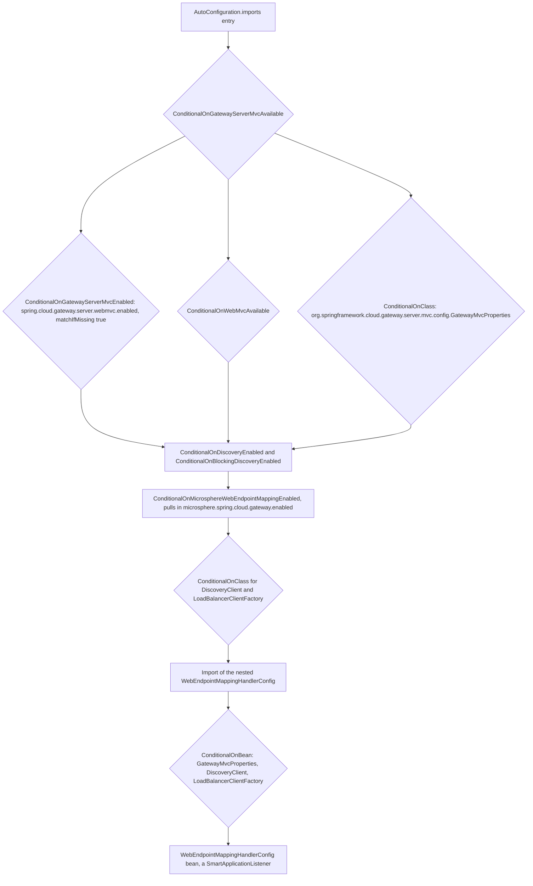
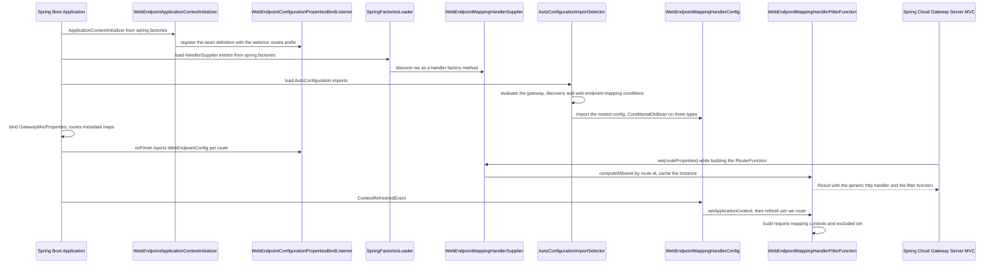
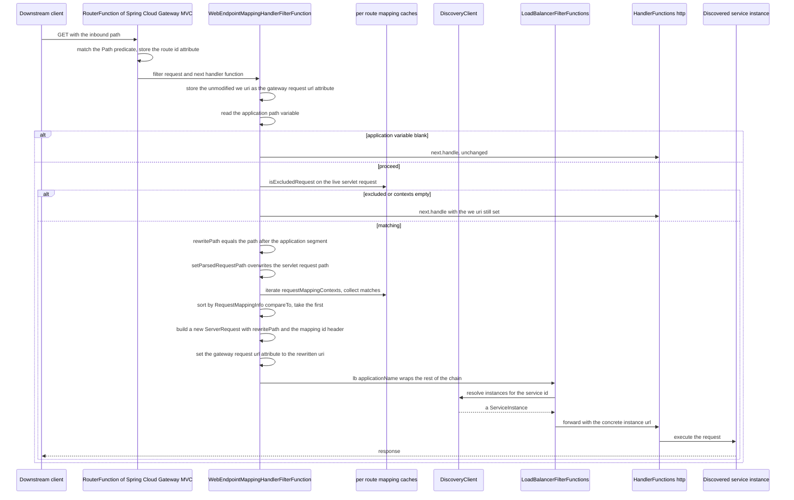
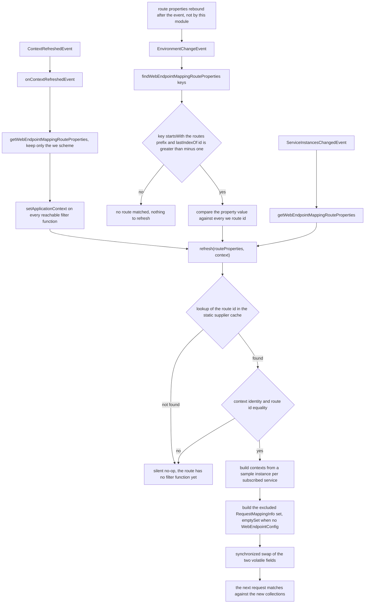

# microsphere-spring-cloud-gateway-server-webmvc

Developer documentation for the servlet-based gateway module of the `0.2.x` line — the integration layer between
Spring Cloud Gateway Server MVC and Microsphere web-endpoint discovery.

| | |
|---|---|
| Coordinates | `io.github.microsphere-projects:microsphere-spring-cloud-gateway-server-webmvc:${revision}` |
| Packaging | `jar` |
| Parent | `microsphere-gateway-parent` (`microsphere-spring-cloud-gateway-server-webmvc/pom.xml:5-10`) |
| Java package root | `io.microsphere.spring.cloud.gateway.server.webmvc` |
| Spring Boot registrations | `META-INF/spring.factories` (a `HandlerSupplier` SPI entry **and** an `ApplicationContextInitializer`) + `META-INF/spring/org.springframework.boot.autoconfigure.AutoConfiguration.imports` (one auto-configuration) |

`module-path:line` pointers are relative to the repository root.

## Architecture design

### Role in the system

This module delivers the same `we://<services>` semantics as
[microsphere-spring-cloud-gateway-server-webflux](microsphere-spring-cloud-gateway-server-webflux.md) on the
blocking `RouterFunction`/`HandlerFunction` model of Spring Cloud Gateway Server MVC. Because that model has no
`GlobalFilter` chain and no `FilteringWebHandler` seam, the implementation is structurally different:

* The extension point is **`HandlerSupplier`**, Spring Cloud Gateway MVC's own SPI, registered through
  `META-INF/spring.factories`. `WebEndpointMappingHandlerSupplier.we(RouteProperties)` is the factory Spring
  invokes for a route whose URI selects the `we` handler; it returns a `Result` that pairs Spring's generic
  `HandlerFunctions.http()` forwarding handler with a per-route
  `WebEndpointMappingHandlerFilterFunction`.
* The per-request work happens in a **`HandlerFilterFunction`**, i.e. a before-filter wrapped around one route's
  handler, not in a global chain.
* Load balancing is **delegated**, not reimplemented: the filter function composes
  `LoadBalancerFilterFunctions.lb(applicationName)` around the rewritten request and lets it pick the target
  instance. Discovery is only consulted to read published web-endpoint metadata.
* Cache refresh is coordinated by a nested imported configuration,
  `WebEndpointMappingGatewayServerMvcAutoConfiguration.WebEndpointMappingHandlerConfig`, which is itself a
  `SmartApplicationListener`.

### Package layout

```
io/microsphere/spring/cloud/gateway/server/webmvc/
├── annotation/      ConditionalOnGatewayServerMvcAvailable, ConditionalOnGatewayServerMvcEnabled
├── autoconfigure/   WebEndpointMappingGatewayServerMvcAutoConfiguration (with nested WebEndpointMappingHandlerConfig)
├── constants/       GatewayPropertyConstants
├── context/         WebEndpointApplicationContextInitializer
└── filter/          WebEndpointMappingHandlerFilterFunction, WebEndpointMappingHandlerSupplier
```

Resources: `src/main/resources/META-INF/spring.factories`,
`src/main/resources/META-INF/spring/org.springframework.boot.autoconfigure.AutoConfiguration.imports`,
`src/main/resources/META-INF/config/default/features.yaml`.
Test resources additionally ship a runnable `TestApplication` (`src/test/java/.../webmvc/test/TestApplication.java`).

### Auto-configuration and SPI wiring

`src/main/resources/META-INF/spring.factories`:

```properties
org.springframework.cloud.gateway.server.mvc.handler.HandlerSupplier=\
io.microsphere.spring.cloud.gateway.server.webmvc.filter.WebEndpointMappingHandlerSupplier

org.springframework.context.ApplicationContextInitializer=\
io.microsphere.spring.cloud.gateway.server.webmvc.context.WebEndpointApplicationContextInitializer
```

Two different consumers read this one file: the first key is Spring Cloud Gateway MVC's own factory-lookup key
(loaded by the gateway when it builds its handler-function registry), the second is Spring Boot's. The
`AutoConfiguration.imports` file has a single entry, `WebEndpointMappingGatewayServerMvcAutoConfiguration`.

The condition stack:



**Bean override strategy:** none. This module adds beans; it never removes or replaces a Spring Cloud Gateway bean
definition — the counterpart module needs a `BeanDefinitionRegistryPostProcessor`, this one does not, because
`RouterFunction` composition happens through the `HandlerSupplier` SPI rather than by replacing a handler.

### Differences from the reactive module

| Concern | WebFlux module | WebMVC module |
|---|---|---|
| Extension seam | `GlobalFilter` bean at order `10149` | `HandlerSupplier` SPI + `HandlerFilterFunction` per route |
| Registration files | `spring.factories` (initializer) + `AutoConfiguration.imports` (two classes) | `spring.factories` (gateway SPI + initializer) + `AutoConfiguration.imports` (one class) |
| Handler caching | `CachingFilteringWebHandler` replaces `FilteringWebHandler` | not needed; `RouterFunction` already binds filters to routes |
| Filter-chain implementation | `DefaultGatewayFilterChain` | none, supplied by Spring |
| Target instance selection | `LoadBalancerClientFactory` in `choose(...)`, on the request path | `LoadBalancerFilterFunctions.lb(...)`, composed around the rewritten request |
| Sample instance for metadata | `clientFactory.getInstance(...)` with no null guard (`...webflux/.../WebEndpointMappingGlobalFilter.java:293-298`) | `discoveryClient.getInstances(...).findAny()` with an explicit null guard (`.../filter/WebEndpointMappingHandlerFilterFunction.java:192-196`, `:167`) |
| Missing-config behaviour | `buildExcludedRequestMappingInfoSet` dereferences the config unconditionally | returns `emptySet()` (`:179-182`) |
| Event-type matching | exact `equals` on four event types | `isAssignableFrom` on three event types (`.../autoconfigure/WebEndpointMappingGatewayServerMvcAutoConfiguration.java:107-111`) |
| Heartbeat suppression | `DisabledHeartbeatEventRouteRefreshListenerInterceptor` + `@EnableEventExtension` | absent |
| `EnvironmentChangeEvent` to routes | `PropagatingRefreshRoutesEventApplicationListener` | handled directly by `WebEndpointMappingHandlerConfig` |
| Filter function lifecycle | a Spring bean | **not** a Spring bean; created and cached statically by `WebEndpointMappingHandlerSupplier` |
| Discovery flavour | `ReactiveDiscoveryClientAdapter` (a `DiscoveryClient`) | blocking `DiscoveryClient` |

## Source analysis

### `annotation/ConditionalOnGatewayServerMvcEnabled.java`

`@ConditionalOnProperty(name = GATEWAY_ENABLED_PROPERTY_NAME, matchIfMissing = true)` (`:43-47`) — the switch is
Spring Cloud Gateway MVC's own `spring.cloud.gateway.server.webmvc.enabled` (`:37-44` of the constants class).

### `annotation/ConditionalOnGatewayServerMvcAvailable.java`

Composition of `@ConditionalOnGatewayServerMvcEnabled`, `@ConditionalOnWebMvcAvailable` (from the optional
`microsphere-spring-boot-webmvc` dependency) and `@ConditionalOnClass(name = "…GatewayMvcProperties")`
(`:45-49`). Same "use `name` so the annotation survives without the optional dependency" technique as the reactive
module.

### `constants/GatewayPropertyConstants.java`

`GATEWAY_ENABLED_PROPERTY_NAME` (`:44`) and `GATEWAY_ROUTES_PROPERTY_NAME_PREFIX` (`:51`) both derive from
`GatewayMvcProperties.PREFIX` (static import `:26`). As in the reactive module, the concatenation is a compile-time
constant resolved against the Spring Cloud Gateway artifact chosen by the active Maven profile, which is why the
test fixture declares routes twice — under `spring.cloud.gateway.mvc.routes` and under
`spring.cloud.gateway.server.webmvc.routes`
(`microsphere-spring-cloud-gateway-server-webmvc/src/test/resources/application.yaml:33-59` and `:61-86`).

### `context/WebEndpointApplicationContextInitializer.java`

Byte-for-byte the shape of the reactive counterpart, differing only in the prefix it hands to the shared commons
listener: `GATEWAY_ROUTES_PROPERTY_NAME_PREFIX` from this module's constants (`:46-47`). It registers the bean
definition named `webEndpointConfigurationPropertiesBindListener`
(`WebEndpointConfigurationPropertiesBindListener.java:48` in the commons module) so `metadata.web-endpoint` blocks
under `spring.cloud.gateway...routes[*]` are converted into `WebEndpointConfig` objects during binding. See
[microsphere-spring-cloud-gateway-commons](microsphere-spring-cloud-gateway-commons.md) for the binding mechanics.

### `filter/WebEndpointMappingHandlerSupplier.java`

```java
public class WebEndpointMappingHandlerSupplier implements HandlerSupplier {                       // :42
    private static final Map<String, WebEndpointMappingHandlerFilterFunction>
            handlerFilterFunctionsCache = new HashMap<>();                                        // :44
    @Override public Collection<Method> get() { return ofList(getClass().getMethods()); }         // :46-49
    public static Result we(RouteProperties routeProperties) { ... }                              // :51-58
    public static WebEndpointMappingHandlerFilterFunction getWebEndpointMappingHandlerFilterFunction(String routeId) // :60-62
}
```

* `get()` hands Spring Cloud Gateway MVC **all** public methods of the class (`getClass().getMethods()` also returns
  inherited `Object` methods), of which `we(RouteProperties)` is the only one with the factory shape — `static`,
  takes `RouteProperties`, returns `Result`. The method name `we` matches `RouteConstants.SCHEME`, so routes with
  `uri: we://...` resolve to it. The precise lookup rule lives in Spring Cloud Gateway MVC, not in this snapshot;
  the naming correspondence and the `HandlerSupplier` registration are what this repository guarantees.
* `we(...)` does `handlerFilterFunctionsCache.computeIfAbsent(routeId, WebEndpointMappingHandlerFilterFunction::new)`
  (`:53-54`) and returns `new Result(http(), ofList(function), emptyList())` (`:55-57`): the generic HTTP forwarding
  handler function, plus this route's `WebEndpointMappingHandlerFilterFunction`, plus an empty trailing collection.
  `computeIfAbsent` is what makes the instance **per route id and stable across refreshes** — the refresh
  coordinator looks the same instance up by id (`:60-62`) instead of replacing it.
* Two consequences of `:44` you should know before touching it: the map is a plain `HashMap` reached from a static
  field, so concurrent `computeIfAbsent` calls are unsynchronised; and entries are never removed, so a route
  deleted from configuration leaves its filter function behind. In practice the factory method runs while the
  `RouterFunction` is built (single-threaded, at start-up), which is why the unsynchronised map has not bitten
  anyone yet.
* The filter functions are **not** Spring beans. No `@Bean`, no `ApplicationContext` injection at construction; the
  module's `WebEndpointMappingHandlerConfig` pushes the context in manually (`:153-157` of the autoconfiguration).

### `filter/WebEndpointMappingHandlerFilterFunction.java`

`implements HandlerFilterFunction<ServerResponse, ServerResponse>` (`:83`). State:
`routeId` final (`:87`), `discoveryClient` and `context` fields marked `@Nonnull` but assigned later by
`setApplicationContext` (`:89-93`, `:134-137`), and two `volatile` collections — `requestMappingContexts` and
`excludedRequestMappingInfoSet` (`:95-97`). Note this cache is **per route**, whereas the reactive filter keys two
maps by route id; both hold the same information, differently shaped.

#### `filter(ServerRequest, HandlerFunction)` — `:104-132`

```java
Map<String, String> uriTemplateVariables = request.pathVariables();                       // :105
String applicationName = uriTemplateVariables.get(APPLICATION_NAME_URI_TEMPLATE_VARIABLE_NAME);
request.attributes().put(GATEWAY_REQUEST_URL_ATTR, request.uri());                        // :107
if (isBlank(applicationName)) return next.handle(request);                                 // :109-112
RequestMappingContext ctx = getMatchingRequestMappingContext(applicationName, request);     // :114
if (ctx == null) return next.handle(request);                                              // :116-118
HandlerFilterFunction<ServerResponse, ServerResponse> lb = lb(applicationName);             // :120
String rewritePath = (String) attributes.remove(WEB_ENDPOINT_REWRITE_PATH_ATTRIBUTE_NAME);  // :122
ServerRequest newRequest = from(request).uri(create(rewritePath))
        .header(ID_HEADER_NAME, valueOf(ctx.id)).build();                                   // :124-127
attributes.put(GATEWAY_REQUEST_URL_ATTR, newRequest.uri());                                 // :129
return lbHandlerFunctionDefinition.filter(newRequest, next);                                // :131
```

Reading order matters:

1. `:107` seeds `GATEWAY_REQUEST_URL_ATTR` with the *unmodified* `we://` URI before anything can match — the
   behaviour Spring Cloud Gateway MVC's own filters expect, and the reason the `we` URI is still visible to
   `next.handle(request)` when nothing matches.
2. `{application}` again comes from the URI template, so the predicate contract from `CommonConstants` applies
   (`...commons/constants/CommonConstants.java:33`).
3. The instance is not chosen here. `lb(applicationName)` (`:120`, static import `:67`) wraps `next` with Spring
   Cloud Gateway MVC's load-balancing filter function, which resolves the concrete instance from the service name.
   The rewritten request carries only the *path*; `create(rewritePath)` produces a relative URI.
4. `ID_HEADER_NAME` carries the matched `WebEndpointMapping` id to the downstream service in both modules, so a
   service can verify that the gateway's routing decision matches its own mapping.

#### Matching — `:198-245`

```java
String routeId = getAttribute(request, GATEWAY_ROUTE_ID_ATTR);        // :199
HttpServletRequest servletRequest = request.servletRequest();        // :212
if (isExcludedRequest(servletRequest)) return null;                   // :213-217, :252-262
if (isEmpty(this.requestMappingContexts)) return null;                 // :219-225
String rewritePath = substringAfter(path, SLASH_CHAR + applicationName);// :229
request.attributes().put(WEB_ENDPOINT_REWRITE_PATH_ATTRIBUTE_NAME, rewritePath); // :230
RequestPath rewriteRequestPath = parse(rewritePath, null);              // :232
setParsedRequestPath(rewriteRequestPath, servletRequest);               // :233
... matchesRequestMapping(...) ... sort(v1 -> v1.compareTo(v2, servletRequest)) ... first(...) // :235-244
```

The distinctive move is `:232-233`: instead of mutating a copy of the exchange (the reactive approach,
`...webflux/.../WebEndpointMappingGlobalFilter.java:335-336`), this code **overwrites the parsed request path on the
live `HttpServletRequest`** so that Spring MVC's `RequestMappingInfo.getMatchingCondition(HttpServletRequest)` sees
the rewritten path. That is adapter logic — `RequestPath.parse(rewritePath, null)` plus
`ServletRequestPathUtils.setParsedRequestPath(...)` is the servlet equivalent of `exchange.mutate().request(...)`.

The cost is a side effect that outlives the match: if no mapping matches, the filter returns
`next.handle(request)` at `:117` while the servlet request still carries the rewritten path and the attributes still
carry the original `we://` URL. The behaviour users see is a failure, and the snapshot asserts it as such —
`WebEndpointMappingHandlerFilterFunctionTest#testOnNotFound` expects an exception for `/we/test-app2/test/helloworld`
(an unregistered service) (`microsphere-spring-cloud-gateway-server-webmvc/src/test/java/.../filter/WebEndpointMappingHandlerFilterFunctionTest.java:205-209`).

`isExcludedRequest` (`:252-262`) is null-guarded here (`if (excludedRequestMappingInfoSet != null)`), unlike the
reactive implementation; the test forces the null case explicitly
(`.../WebEndpointMappingHandlerFilterFunctionTest.java:197-203`).

#### `refresh(RouteProperties, ApplicationContext)` — `:139-158`

```java
if (context != this.context) return;                              // :140-142
if (!Objects.equals(this.routeId, routeProperties.getId())) return; // :144-146
Collection<RequestMappingContext> contexts = buildRequestMappingContexts(routeProperties);    // :148
Set<RequestMappingInfo> excludes = buildExcludedRequestMappingInfoSet(routeProperties);       // :150
synchronized (this) { this.requestMappingContexts = contexts; this.excludedRequestMappingInfoSet = excludes; } // :152-155
```

* The identity check on `context` is what keeps a filter function created by an earlier (or child) application
  context from being repopulated by a later one; it is the price of the functions not being beans.
* `buildRequestMappingContexts` (`:160-176`) walks `getSubscribedServices(routeUri)` (`:203-209`, same `all` versus
  comma-delimited rule as the reactive module), takes one sample instance per service via `choose(...)` (`:192-196`)
  and reads its `WebEndpointMapping` collection. `if (sampleServiceInstance != null)` at `:167` makes an unknown or
  scale-to-zero service contribute nothing instead of throwing — asserted by
  `.../WebEndpointMappingHandlerFilterFunctionTest.java:189-192`. The `TODO support ZonePreferenceFilter` at `:164`
  mirrors the reactive one.
* `buildExcludedRequestMappingInfoSet` (`:178-190`) reads `ConfigUtils.getWebEndpointConfig(routeProperties.getMetadata())`
  and returns `emptySet()` for a `null` config — so a `we://` route without a `metadata.web-endpoint` block simply
  has no exclusions here.
* `RequestMappingContext` (`:268-282`) again pairs a `RequestMappingInfo` with the mapping id, and the two
  `buildRequestMappingInfo` overloads (`:284-303`) duplicate the reactive module's builder pipeline against
  `org.springframework.web.servlet.mvc.method.RequestMappingInfo` instead of the reactive one. Any change to the
  exclude model must be applied in **both** modules.

### `autoconfigure/WebEndpointMappingGatewayServerMvcAutoConfiguration.java`

The outer class declares only conditions and `@Import(...WebEndpointMappingHandlerConfig.class)` (`:67-89`).
`@AutoConfigureAfter` (`:76-87`) orders it after Microsphere's `WebMvcAutoConfiguration` and
`DiscoveryClientAutoConfiguration` and, by name, after LoadBalancer's auto-configuration,
`GatewayServerMvcAutoConfiguration`, `ConfigurationPropertiesRebinderAutoConfiguration` and
`CompositeDiscoveryClientAutoConfiguration`. Listing the rebinder here records the intent that
`GatewayMvcProperties` be re-bound before this feature reacts to an `EnvironmentChangeEvent`; whether the re-bind
actually precedes this listener *within the same event publication* is decided by listener ordering, which this
module does not pin. Treat the ordering as intended, not guaranteed.

The nested `WebEndpointMappingHandlerConfig` (`:91-187`) is the refresh coordinator:

* `@ConditionalOnBean(value = {GatewayMvcProperties.class, DiscoveryClient.class, LoadBalancerClientFactory.class})`
  (`:91`) — default search scope, i.e. the whole hierarchy.
* It holds `gatewayMvcProperties`, `context` and `environment` (`:94-104`), the environment taken from the
  application context rather than injected separately.
* `supportsEventType` (`:107-111`) uses `isAssignableFrom`, so `EnvironmentChangeEvent` subclasses are accepted —
  different from the reactive filter's exact-equality list.
* `onApplicationEvent` (`:113-122`) dispatches with pattern-matching `instanceof` and routes an unrecognised event to
  `onServiceInstancesChangedEvent()`, exactly as the reactive filter does.
* `onContextRefreshedEvent` (`:124-130`) is the only path that supplies the extra initializer —
  `handlerFilterFunction -> handlerFilterFunction.setApplicationContext(context)` — because that is when the
  function first learns the context and the `DiscoveryClient`.
* `refresh(List, ApplicationContext, Consumer)` (`:150-160`) resolves the function by route id through
  `WebEndpointMappingHandlerSupplier.getWebEndpointMappingHandlerFilterFunction(routeID)` and **silently does
  nothing when the lookup returns `null`**. So refresh only ever updates functions the gateway has already
  instantiated while building its `RouterFunction`.
* `findWebEndpointMappingRouteProperties(Set<String> keys)` (`:162-179`) accepts any key starting with the routes
  prefix whose `lastIndexOf("id") > -1` — looser than the reactive module's "the key must *end with* `id`" rule —
  and can add the same `RouteProperties` more than once when several changed keys match it. Both behaviours are
  asserted by `WebEndpointMappingGatewayServerMvcAutoConfigurationIntegrationTest`
  (`microsphere-spring-cloud-gateway-server-webmvc/src/test/java/.../autoconfigure/WebEndpointMappingGatewayServerMvcAutoConfigurationIntegrationTest.java:63-81`).
* `getWebEndpointMappingRouteProperties()` (`:181-186`) filters `gatewayMvcProperties.getRoutes()` to the `we`
  scheme and returns an unmodifiable list.

## Application startup



## Request lifecycle for a `we://` route



`Fn` never contacts `Discovery` for the *target* instance; `choose(...)` is only reachable from `refresh(...)`. The
service id handed to `lb(applicationName)` is the `{application}` path variable, so the URI template variable is
both the metadata selector and the load-balancer key.

## Route refresh



There is no TTL, no size limit and no eviction: the per-route collections live exactly as long as the filter
function, which lives exactly as long as the static `HashMap` in `WebEndpointMappingHandlerSupplier` and therefore
the classloader.

## Design patterns

Only patterns the code in this module actually exhibits are listed. Where a pattern is also used by the
reactive module, the difference in the servlet implementation is called out because that difference is the
reason this module exists as a separate artifact.

**Service Provider Interface (SPI) discovered through reflection.**
Where: `WebEndpointMappingHandlerSupplier.java:42` implements Spring Cloud Gateway MVC's `HandlerSupplier`;
`get()` returns `ofList(getClass().getMethods())` (`:46-49`); the registration is the `spring.factories` key
`org.springframework.cloud.gateway.server.mvc.handler.HandlerSupplier`
(`src/main/resources/META-INF/spring.factories:1-2`).
Why: Gateway MVC has no `GlobalFilter` concept; route handlers are contributed by discovering public static
methods on supplier classes.
Buys: adding a route-scheme "filter function" is one `public static Result x(RouteProperties)` method with no
wiring code.
Cost: the supplier exposes **all** public methods of the class as candidate handlers — including
`getWebEndpointMappingHandlerFilterFunction(String)` (`:60-62`) — because the discovery is
`getMethods()`-based; the framework's own filter on method shape is what keeps that harmless. There is no
`@Order` or conditional gate inside the supplier, so it participates even when the auto-configuration's
conditions all fail.

**Static factory returning a composed routing definition (a "route function").**
Where: `we(RouteProperties)` (`:51-58`) building `new Result(http(), ofList(function), emptyList())`.
Why: the functional gateway DSL expresses a route as handler + filter functions + predicates.
Buys: `we://` routes read like the built-in `lb:` / `http()` functions, and the name `we` comes from
`RouteConstants.SCHEME` so it mirrors the YAML URI scheme.
Cost: the `Result` is created eagerly at route-registration time and the handler function is *not* a Spring
bean, so nothing in the container manages its lifecycle — see the observer pattern below for how it gets
populated.

**Decorator by functional composition.**
Where: the `HandlerFilterFunction<ServerResponse, ServerResponse>` implementation
(`WebEndpointMappingHandlerFilterFunction.java:83`) wrapping the delegate `HandlerFunction` passed to
`filter` (`:104`), delegating untouched on the two pass-through paths (`:111`, `:117`) and delegating to
`lb(applicationName)` on the matched path (`:120`, `:131`). The Javadoc calls it a "Before-Filter" (`:76`).
Buys: one object both short-circuits into load-balanced forwarding and preserves the original route behaviour
when it does not apply; no subclassing of a framework handler, in contrast to WebFlux's
`CachingFilteringWebHandler` decorator, which *replaces* `FilteringWebHandler`'s behaviour by bean-definition
swap.
Cost: `filter` declares `throws Exception` (`:104`) — a servlet-side signature the reactive module does not
have — so failures travel as checked exceptions rather than `Mono` error signals.

**Memoisation keyed by route id (a registry with an unbounded, non-thread-safe map).**
Where: `private static final Map<String, WebEndpointMappingHandlerFilterFunction> handlerFilterFunctionsCache
= new HashMap<>()` (`WebEndpointMappingHandlerSupplier.java:44`), filled by `computeIfAbsent` (`:53-54`) and
read by `getWebEndpointMappingHandlerFilterFunction` (`:60-62`).
Why: the auto-configuration must find the already-installed filter function for a route, and functions are
created inside the DSL, outside the container.
Buys: the only handle between the two halves of the module; no bean registry gymnastics.
Cost: it is a **static, plain `HashMap`**, so concurrent route registration during startup is unsynchronised;
the supplier only ever calls `computeIfAbsent` (`:53-54`) and `get` (`:61`) on it, so entries are never
removed even when a route disappears from the configuration, and the map is scoped to the classloader rather
than the `ApplicationContext` — two contexts in one JVM share it.

**Observer with subtype-tolerant event selection.**
Where: `WebEndpointMappingHandlerConfig implements SmartApplicationListener`
(`WebEndpointMappingGatewayServerMvcAutoConfiguration.java:92`), `supportsEventType` using
`isAssignableFrom` over `EnvironmentChangeEvent`, `ContextRefreshedEvent` and
`ServiceInstancesChangedEvent` (`:107-111`), dispatch in `onApplicationEvent` (`:113-122`).
Why: the caches inside each filter function need rebuilding on startup, config change and instance change.
Buys: unlike the WebFlux filter's exact `equals` test (`WebEndpointMappingGlobalFilter.java:176-179`), any
subclass of those three events is still handled. Why the two modules differ is not stated in the code; the
most plausible reading is that `EnvironmentChangeEvent` arrives through Spring Cloud's rebinder path, which can
publish subtypes.
Cost: the listener class is package-visible nested (`:91-92`) and guarded by
`@ConditionalOnBean({GatewayMvcProperties, DiscoveryClient, LoadBalancerClientFactory})`, so when the
condition fails the supplier is still registered but its functions never receive `setApplicationContext` —
`discoveryClient` and `context` stay unassigned while annotated `@Nonnull` (`:89-93`).

**Parameterised initialiser instead of Template Method (lambda Strategy).**
Where: three overloads of `refresh` — `refresh(Supplier<List<RouteProperties>>)` (`:140-143`),
`refresh(List, ApplicationContext)` delegating with an empty consumer (`:145-148`), and the full
`refresh(List, ApplicationContext, Consumer<WebEndpointMappingHandlerFilterFunction>)` (`:150-160`); only the
`ContextRefreshedEvent` path passes a real consumer (`:127-129`).
Why: the first refresh must inject the `ApplicationContext`, later refreshes must not re-inject it.
Buys: one traversal loop; the difference is a parameter.
Cost: the two no-op callers (`:133`, `:137`) silently skip initialisation, and `refresh` returns nothing, so a
route whose function is absent from the static cache is skipped with no signal (`:155`).

**Copy-on-write snapshot publication.**
Where: `volatile Collection<RequestMappingContext> requestMappingContexts` and
`volatile Collection<RequestMappingInfo> excludedRequestMappingInfoSet`
(`WebEndpointMappingHandlerFilterFunction.java:95-97`), both rebuilt first and assigned together inside
`synchronized (this)` (`:148-155`).
Buys: request threads never observe a half-built cache; identical intent to the WebFlux filter's swap
(`WebEndpointMappingGlobalFilter.java:255-258`).
Cost: the guards preceding the swap are identity and equality tests on the context and route id (`:140-146`),
so a refresh can be a silent no-op; and unlike the WebFlux filter, this module's
`buildExcludedRequestMappingInfoSet` returns `emptySet()` when there is no `WebEndpointConfig` (`:178-190`),
meaning the two modules treat "no config" differently even though the publication shape is the same.

**Mutating shared request state as a side channel.**
Where: `request.attributes().put(GATEWAY_REQUEST_URL_ATTR, request.uri())` before matching (`:107`), the
rewrite-path attribute written during matching (`:230`) and removed at `:122`, the separate
`setParsedRequestPath(parse(rewritePath, null), servletRequest)` mutation of the live servlet request
(`:232-233`), and finally `attributes.put(GATEWAY_REQUEST_URL_ATTR, newRequest.uri())` at `:129`.
Why: `HandlerFilterFunction` has no place to return an intermediate rewrite, and Spring MVC matching operates
on the live `HttpServletRequest`.
Buys: the downstream `lb()` function sees a normal request URI, so no custom routing code is needed after the
filter.
Cost: the mutation is visible to the rest of the request pipeline even when the filter later returns
`next.handle(request)` (`:117`); this is the servlet analogue of the WebFlux exchange-attribute blackboard and
carries the same "attribute present does not imply matched" caveat.

**Value-object context holder.**
Where: the nested `RequestMappingContext` (`:268-282`) pairing a `RequestMappingInfo` with the endpoint `id`,
plus `compareTo` delegating to `RequestMappingInfo.compareTo` (`:279-281`).
Buys: sorting and id propagation stay in one immutable-ish object, matching the WebFlux design
(`WebEndpointMappingGlobalFilter.java:423-464`).
Cost: `id` is a non-final `int` assigned once in the constructor (`:272`, `:276`), so the field is technically
mutable and not `final` — safe only because nothing writes it again.

Explicitly **not** present in this module: no bean-definition swapping or `BeanFactoryPostProcessor` (the SPI
key replaces that need), no `CachingFilteringWebHandler` analogue (the MVC handler is stateless per request),
no event-interceptor/`@EnableEventExtension` usage (the heartbeat suppression of the reactive module has no
servlet counterpart here), no reactive types at all, and no `@Bean` method returning a filter function — the
only auto-configuration class
(`WebEndpointMappingGatewayServerMvcAutoConfiguration.java:89`) declares no `@Bean` methods, it contributes a
listener via `@Import` (`:88`).

---

## Module dependency graph

The same reactor graph appears in every module document of this guide; node `M` is this module.

```mermaid
graph TD
    subgraph reactor["Maven reactor microsphere-gateway"]
        ROOT["microsphere-gateway (aggregator pom)"]
        P["microsphere-gateway-parent (pom)"]
        D["microsphere-gateway-dependencies (pom, BOM)"]
        C["microsphere-spring-cloud-gateway-commons (jar)"]
        F["microsphere-spring-cloud-gateway-server-webflux (jar)"]
        M["microsphere-spring-cloud-gateway-server-webmvc (jar)"]
    end
    ROOT --> P
    ROOT --> D
    ROOT --> C
    ROOT --> F
    ROOT --> M
    P -->|parent of| D
    P -->|parent of| C
    P -->|parent of| F
    P -->|parent of| M
    M -->|"compile, revision"| C
    F -->|compile| C

    subgraph mandatory["Declared without optional, so they reach consumers"]
        GMVC["spring-cloud-starter-gateway-mvc"]
        GPEX["spring-cloud-gateway-proxyexchange-webmvc"]
    end
    subgraph optM["External Microsphere, optional scope"]
        SCP["microsphere-annotation-processor"]
        SCC["microsphere-spring-cloud-commons"]
        SBM["microsphere-spring-boot-webmvc"]
    end
    subgraph transitiveM["Reached transitively, not declared in this pom"]
        SBCONTEXT["microsphere-spring-context, provides ConfigurableApplicationContextInitializer"]
    end
    subgraph optS["External Spring, optional scope"]
        SCOM["spring-cloud-commons"]
        SLB["spring-cloud-loadbalancer"]
        SBOOT["spring-boot-starter, starter-actuator"]
        SPROC["spring-boot-configuration-processor, spring-boot-autoconfigure-processor"]
    end
    subgraph testS["Test scope"]
        JUP["junit-jupiter"]
        SBTEST["spring-boot-starter-test"]
        MSBT["microsphere-spring-boot-test"]
    end
    subgraph profileDeps["Per Maven profile, optional"]
        MVC2025["spring-cloud-gateway-server-webmvc, spring-cloud-2025 default"]
        MVC2022["spring-cloud-starter-gateway-mvc, spring-cloud-2022 2023 2024"]
    end

    GMVC --> M
    GPEX --> M
    SCP --> M
    SCC --> M
    SBM --> M
    SBCONTEXT --> M
    SCOM --> M
    SLB --> M
    SBOOT --> M
    SPROC --> M
    JUP --> M
    SBTEST --> M
    MSBT --> M
    MVC2025 --> M
    MVC2022 --> M
    SCBOM["microsphere-spring-cloud-dependencies 0.2.26, imported BOM"] --> P
```



The scope asymmetry is deliberate and visible in `microsphere-spring-cloud-gateway-server-webmvc/pom.xml`:
`spring-cloud-starter-gateway-mvc` (`:63-67`) and `spring-cloud-gateway-proxyexchange-webmvc` (`:69-72`) are
**non-optional** compile dependencies, unlike everything else in this module. So adding this artifact does pull
Spring Cloud Gateway MVC transitively — the opposite of the reactive module, where the gateway stays behind a
profile and `optional`.

## Build & test guidance

```bash
./mvnw -pl microsphere-spring-cloud-gateway-server-webmvc -am test
./mvnw -pl microsphere-spring-cloud-gateway-server-webmvc test -Ptest,spring-cloud-2024
./mvnw -pl microsphere-spring-cloud-gateway-server-webmvc test -Ptest,spring-cloud-2025
```

Profiles, from `microsphere-spring-cloud-gateway-server-webmvc/pom.xml:122-181`:

| Profile | Effect |
|---|---|
| `spring-cloud-2022` | adds `spring-cloud-starter-gateway-mvc` as optional **and** pins `spring-boot.version` `3.3.13`, `spring-cloud.version` `2023.0.6`, `spring-cloud-alibaba.version` `2023.0.3.2`; the file itself carries the comment `actual : spring-cloud-2023` (`:125`) |
| `spring-cloud-2023`, `spring-cloud-2024` | add `spring-cloud-starter-gateway-mvc` as optional, no version overrides |
| `spring-cloud-2025` | `activeByDefault` (`:167-169`), adds `spring-cloud-gateway-server-webmvc` as optional |

The `spring-cloud-2022` profile is the one place in the reactor where a profile id and its content disagree: the
profile named `2022` actually selects the `2023.0.6` release train, because Spring Cloud Gateway Server MVC did
not exist in `2022`. CI still runs `-Ptest,coverage,spring-cloud-2022`
(`.github/workflows/maven-build.yml:26-27,46`), so keep that in mind when a build breaks "on 2022".

Spring profile fixtures (`microsphere-spring-cloud-gateway-server-webmvc/src/test/resources/application.yaml`):
`simple-service-registry` (`:12-24`) enables Microsphere's simple service registry, and `gateway` (`:27-86`) supplies
three routes under both `spring.cloud.gateway.mvc.routes` and `spring.cloud.gateway.server.webmvc.routes` — two
`https://example.org` routes and one `we://all` route with `metadata.web-endpoint.excludes`.

| Test class | Coverage |
|---|---|
| `autoconfigure/WebEndpointMappingGatewayServerMvcAutoConfigurationTest` | the condition matrix via `WebAutoConfigurationTest`: each kill switch (`spring.cloud.gateway.server.webmvc.enabled`, `microsphere.spring.boot.webmvc.enabled`, `spring.cloud.discovery.enabled`, `microsphere.spring.cloud.gateway.enabled`, `microsphere.spring.cloud.web-endpoint-mapping.enabled`) and each missing class (`DispatcherServlet`, `DiscoveryClient`, `LoadBalancerClientFactory`, …) must prevent registration (`.../autoconfigure/WebEndpointMappingGatewayServerMvcAutoConfigurationTest.java:46-67`) |
| `autoconfigure/WebEndpointMappingGatewayServerMvcAutoConfigurationIntegrationTest` | boots with `@EnableAutoConfiguration` under the `gateway` profile, asserts the `WebEndpointMappingHandlerConfig` bean exists, refreshes an unknown route id, and checks `findWebEndpointMappingRouteProperties` for both the no-match and many-match key sets (`:63-81`) |
| `autoconfigure/WebEndpointMappingGatewayServerMvcAutoConfigurationIntegrationDisabledTest` | asserts the config is absent when LoadBalancer and discovery auto-configurations are excluded through `microsphere.autoconfigure.exclude` and `microsphere.spring.boot.webmvc.enabled=false` (`:36-57`) — note the Microsphere-specific exclusion property |
| `filter/WebEndpointMappingHandlerFilterFunctionTest` | the real round trip: self-registration against `local.server.port`, `GET /we/test-app/test/helloworld` through `MockMvc` returning the controller body, the excluded case (`/we/test-app/**` with `consumes`/`produces`) throwing, an `EnvironmentChangeEvent` for `routes[0].id` followed by a successful call, deregistration plus `ServiceInstancesChangedEvent` making the call fail again, and package-private probes of `buildExcludedRequestMappingInfoSet`, `getSubscribedServices`, `buildRequestMappingContexts`, `refresh`, `isExcludedRequest` and `getMatchingRequestMappingContext` with `null` caches (`:151-209`) |
| `constants/GatewayPropertyConstantsTest` | the two derived property names |
| `test/TestApplication` | not a test; a runnable `@EnableAutoConfiguration` main that starts the same fixture profiles (`.../test/TestApplication.java:30-38`) |

`WebEndpointMappingHandlerFilterFunctionTest` and the integration tests carry `@DirtiesContext`, so each rebuilds the
Spring context; the static filter-function cache is *not* reset between them, which is why the tests assert against
route ids rather than object identity across contexts.

## Extension recipes

### Add a new gateway filter (servlet flavour)

There is no `GlobalFilter` here. Two supported shapes:

1. **A before/after filter for one route family** — implement `HandlerFilterFunction<ServerResponse, ServerResponse>`
   and return it from a new `HandlerSupplier` factory method registered in `META-INF/spring.factories` under
   `org.springframework.cloud.gateway.server.mvc.handler.HandlerSupplier`, modelled on
   `filter/WebEndpointMappingHandlerSupplier.java:51-58`. Pair your filter with a handler function in the `Result`.
2. **A cross-cutting servlet filter** — register a standard `jakarta.servlet.Filter` or Spring
   `FilterRegistrationBean`; it runs before Spring Cloud Gateway MVC's `RouterFunction`, so it cannot see the
   `{application}` rewrite. Use this only for concerns independent of endpoint mapping.

If the filter needs the matched web-endpoint id, read `WebEndpointMapping.ID_HEADER_NAME` — the filter function sets
it at `.../filter/WebEndpointMappingHandlerFilterFunction.java:124-127`.

### Add a new conditional annotation

Follow `annotation/ConditionalOnGatewayServerMvcAvailable.java`: one `@ConditionalOnProperty` for the runtime switch,
`@ConditionalOnWebMvcAvailable` for the web-application type, and `@ConditionalOnClass(name = ...)` for the Spring
Cloud Gateway MVC marker. Keep user-facing Microsphere switches in
[microsphere-spring-cloud-gateway-commons](microsphere-spring-cloud-gateway-commons.md) so both runtimes share them.
Then add the switch to the `configureGlobalDisabledPropertyValues` override in
`autoconfigure/WebEndpointMappingGatewayServerMvcAutoConfigurationTest`.

### Add a new route-scheme handler

1. Add the scheme constant to `RouteConstants` in the commons module.
2. Add a static factory method whose name equals the scheme to `filter/WebEndpointMappingHandlerSupplier.java`
   (`we` at `:51`), caching a per-route-id filter function the way `:53-54` does, and returning a
   `Result` that pairs `HandlerFunctions.http()` with the new filter function.
3. Select routes by scheme in the refresh coordinator: `getWebEndpointMappingRouteProperties()` filters on
   `SCHEME.equals(routeProperties.getUri().getScheme())`
   (`.../autoconfigure/WebEndpointMappingGatewayServerMvcAutoConfiguration.java:181-186`).
4. Implement the per-request rewrite in a `HandlerFilterFunction`, keeping the two pass-through branches
   (`.../filter/WebEndpointMappingHandlerFilterFunction.java:109-118`).
5. Mirror the scheme in the reactive module —
   `...webflux/filter/WebEndpointMappingGlobalFilter.java:412-414` — or the scheme works in only one runtime.
6. Declare the new classes in `src/main/resources/META-INF/config/default/features.yaml`.

## Inference and ambiguity

* The rule by which Spring Cloud Gateway MVC maps a route URI scheme onto a `HandlerSupplier` factory-method name
  lives in the gateway artifact, not in this snapshot. That `we(RouteProperties)` is selected because `we` equals
  `RouteConstants.SCHEME` (`microsphere-spring-cloud-gateway-commons/src/main/java/.../constants/RouteConstants.java:33`)
  is my inference from the naming correspondence plus the `spring.factories:1-2` registration; the snapshot proves
  the registration and the naming, not the lookup algorithm.
* The "single-threaded at start-up" explanation for the unsynchronised static `HashMap`
  (`filter/WebEndpointMappingHandlerSupplier.java:44`) is my reading of why the race has not surfaced; nothing in
  the snapshot states or enforces it.
* `@AutoConfigureAfter` naming `ConfigurationPropertiesRebinderAutoConfiguration`
  (`autoconfigure/WebEndpointMappingGatewayServerMvcAutoConfiguration.java:76-87`) documents an ordering intent.
  Whether the re-bind really precedes `WebEndpointMappingHandlerConfig` inside one `EnvironmentChangeEvent`
  publication depends on listener ordering that this module does not pin; I could not verify it from the snapshot.
* The comment `actual : spring-cloud-2023` (`microsphere-spring-cloud-gateway-server-webmvc/pom.xml:125`) is direct
  evidence that the `spring-cloud-2022` profile id and its content disagree. My causal explanation — that Spring
  Cloud Gateway Server MVC did not exist in the `2022` release train — is inference; the POM records no reason.
* `GATEWAY_ENABLED_PROPERTY_NAME` and `GATEWAY_ROUTES_PROPERTY_NAME_PREFIX`
  (`constants/GatewayPropertyConstants.java:44`, `:51`) are compile-time constants because `PREFIX` is a `static`
  `String` constant (`:26`); that much is Java semantics. Concluding that this is *why* the test fixture declares
  the routes twice under `spring.cloud.gateway.mvc.routes` and `spring.cloud.gateway.server.webmvc.routes`
  (`src/test/resources/application.yaml:33-59`, `:61-86`) is reasoning from the two trees, not a documented statement.

---

## 中文

The developer guide for this module is also available in Chinese:
[zh/microsphere-spring-cloud-gateway-server-webmvc.md](zh/microsphere-spring-cloud-gateway-server-webmvc.md).

Back to the guide index: [README.md](README.md).
Project root README: [../../../README.md](../../../README.md).
