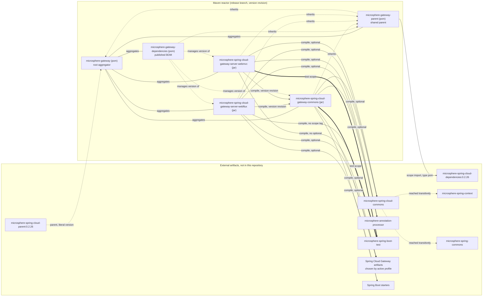
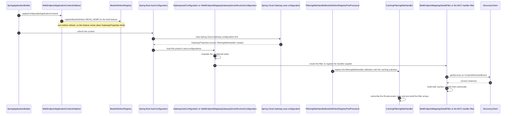

# Microsphere Gateway 开发者指南

本文档基于 **`release` 分支**编写，描述 `microsphere-gateway` 反应堆（reactor）的架构与源码级实现
（版本线 `0.2.x`，Maven `revision` = `0.2.19-SNAPSHOT`，最近一次已发布版本 `0.2.18`）。

Group 为 `io.github.microsphere-projects`，JDK 基线为 17（`pom.xml:55`），Spring Cloud profile 包括
`2022`、`2023`、`2024`、`2025`，默认激活 `2025`。本指南描述的是扩展代码，不能替代
[使用者指南](../../user-guide/zh/README.md)——后者记录配置属性与路由 YAML。

## 本指南包含的文档

| 文档 | 模块 | 打包类型 | 覆盖内容 |
| --- | --- | --- | --- |
| [microsphere-gateway-parent.md](../microsphere-gateway-parent.md) | `microsphere-gateway-parent` | `pom` | 被继承的构建配置、`microsphere-spring-cloud-dependencies:0.2.26` 导入、`${revision}` 与扁平化（flattening） |
| [microsphere-gateway-dependencies.md](../microsphere-gateway-dependencies.md) | `microsphere-gateway-dependencies` | `pom` | 对外发布的 BOM、使用者看到的导入链、版本传播 |
| [microsphere-spring-cloud-gateway-commons.md](../microsphere-spring-cloud-gateway-commons.md) | `microsphere-spring-cloud-gateway-commons` | `jar` | `we://` 词汇表、`WebEndpointConfig`、绑定监听器钩子、共享条件注解 |
| [microsphere-spring-cloud-gateway-server-webflux.md](../microsphere-spring-cloud-gateway-server-webflux.md) | `microsphere-spring-cloud-gateway-server-webflux` | `jar` | 响应式网关扩展：`GlobalFilter`、`FilteringWebHandler` 替换、事件拦截器、路由刷新 |
| [microsphere-spring-cloud-gateway-server-webmvc.md](../microsphere-spring-cloud-gateway-server-webmvc.md) | `microsphere-spring-cloud-gateway-server-webmvc` | `jar` | Servlet 网关扩展：`HandlerSupplier` SPI、`HandlerFilterFunction`、路由刷新 |
| 本索引的英文版本 | 全部 | — | [../README.md](../README.md) |

本目录下的六个中文文档与英文文档一一对应，文件名相同、章节顺序相同，代码块与图示源码保持逐字节一致；
标识符（类名、属性名、常量值）保持原文不译。

旧版本线：`1.x` 开发者指南位于
[../../../1.x/developer-guide/zh/README.md](../../../1.x/developer-guide/zh/README.md)。
项目概览与快速开始：[../../../../README.md](../../../../README.md)。

## 系统拓扑

五个 Maven 模块（`pom.xml:58-64`）。实线箭头表示声明的 classpath 依赖边；虚线箭头表示继承、BOM 导入或
“版本由……管理”关系，它们永远不会出现在 classpath 上。`optional` 依赖不会传递给使用者，这正是两个 server
模块都要重新声明自身所需依赖的原因。



同一张图在各模块文档中针对单个模块做了标注，请参见每个模块文档的“模块依赖图”小节，共五个模块文件都有。

## 整体系统的应用启动流程

在最初若干步骤中，两种技术栈的形态完全一致；最后两步开始分岔：WebFlux 替换 Bean 定义，而 WebMVC 注册由
SPI 提供的处理函数。带完整条件栈的逐模块版本见
[WebFlux 文档](../microsphere-spring-cloud-gateway-server-webflux.md)与
[WebMVC 文档](../microsphere-spring-cloud-gateway-server-webmvc.md)；填充 `RouteDefinition.metadata` 的配置绑定
路径见[公共模块文档](../microsphere-spring-cloud-gateway-commons.md)中的“配置绑定流程”一节。



这条时序中有两条性质是承重的、也最容易被破坏：

* `ApplicationContextInitializer` 的注册保证了绑定监听器在 `GatewayProperties` 绑定之前就已经存在。这些
  initializer 声明在 `META-INF/spring.factories` 中
  （`microsphere-spring-cloud-gateway-server-webflux/src/main/resources/META-INF/spring.factories:1-2`、
  `microsphere-spring-cloud-gateway-server-webmvc/src/main/resources/META-INF/spring.factories:5-6`）。
  本项目其余内容都通过
  `META-INF/spring/org.springframework.boot.autoconfigure.AutoConfiguration.imports` 声明，即 Spring Boot 3 的
  机制。WebMVC 的 `spring.factories` 还带有第二个 key，即
  `org.springframework.cloud.gateway.server.mvc.handler.HandlerSupplier` SPI 条目
  （`microsphere-spring-cloud-gateway-server-webmvc/src/main/resources/META-INF/spring.factories:1-2`）。
* 自动配置顺序通过 `@AutoConfigureAfter(name = ...)` 表达，使用的是**类名字符串**而不是 `Class` 引用，因此
  本项目可以针对当前 Maven profile 所选的任意 Spring Cloud Gateway 制品进行编译。

## 贡献者快速上手

```bash
# JDK 17 is the baseline (pom.xml:55); CI also runs 21 and 25
./mvnw --batch-mode -Drevision=0.0.1-SNAPSHOT test
# one module, default profile is spring-cloud-2025
./mvnw -pl microsphere-spring-cloud-gateway-server-webflux -am test
# reproduce the full CI matrix
for p in spring-cloud-2022 spring-cloud-2023 spring-cloud-2024 spring-cloud-2025; do
  ./mvnw --batch-mode -Drevision=0.0.1-SNAPSHOT test --activate-profiles test,coverage,$p
done
```

CI 定义位于 `.github/workflows/maven-build.yml`（JDK `17`/`21`/`25` × 四个 profile，
`maven-build.yml:24-46`）与 `.github/workflows/maven-publish.yml`（`deploy` 显式传入 `-Drevision`，
`maven-publish.yml:47-55`，随后用 `sed` 仅修改根 POM 中的 `<revision>`，`maven-publish.yml:181-190`）。
名为 `.flattened-pom.xml` 的构建产物由扁平化插件生成，已被 git 忽略（`.gitignore:53-54`）。

## 按问题查找文档

| 问题 | 文档 |
| --- | --- |
| 为什么某个 `we://` URI 会解析到一个具体的服务实例？ | WebFlux：“`we://` 路由的请求生命周期”；WebMVC：同名小节 |
| 路由排除规则（`metadata.web-endpoint.excludes`）如何被解析与校验？ | 公共模块：“配置绑定流程” |
| 服务注册或注销时会发生什么？ | WebFlux：“路由刷新与缓存失效”；WebMVC：“路由刷新” |
| `FilteringWebHandler` 为什么被替换，缓存带来了什么代价？ | WebFlux：“`CachingFilteringWebHandler` 的缓存行为” |
| 我的传递性 Microsphere 依赖会解析到哪个版本？ | parent 与 dependencies 两篇文档 |
| 如何新增一个过滤器、一个条件注解或一个新的 scheme？ | 各模块文档的“扩展配方”小节 |

## 推荐阅读顺序

1. [microsphere-spring-cloud-gateway-commons.md](../microsphere-spring-cloud-gateway-commons.md)——其他一切所依赖的契约。
2. [microsphere-spring-cloud-gateway-server-webflux.md](../microsphere-spring-cloud-gateway-server-webflux.md)——实现更庞大的一方，多数设计讨论在此。
3. [microsphere-spring-cloud-gateway-server-webmvc.md](../microsphere-spring-cloud-gateway-server-webmvc.md)——按 WebFlux 的差异来读；两篇文档共享一张对比表。
4. [microsphere-gateway-parent.md](../microsphere-gateway-parent.md) 与
   [microsphere-gateway-dependencies.md](../microsphere-gateway-dependencies.md)——构建与发布机制。

## English

本指南的英文版：[../README.md](../README.md)。

项目根 README：[../../../../README.md](../../../../README.md)。
