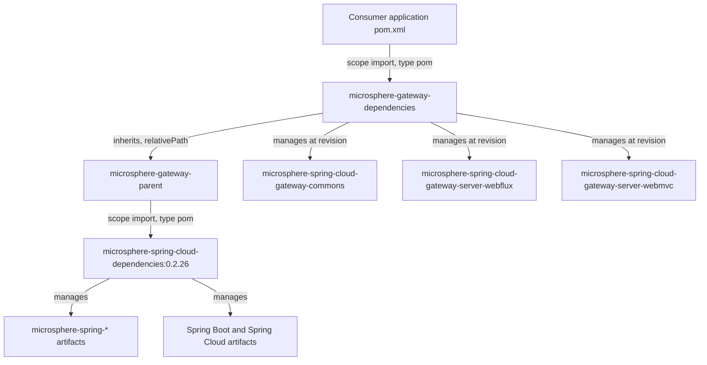
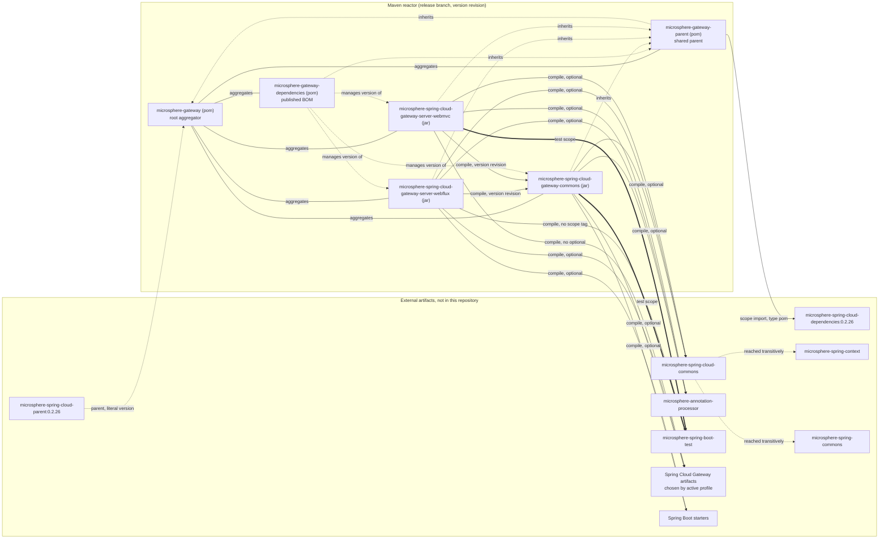

# microsphere-gateway-dependencies

纯构建模块：Microsphere Gateway 对外发布的 **Bill of Materials（BOM）**。`packaging = pom`，没有 Java 源码，
三个受管依赖——而且全部由本反应堆自己构建。

| 属性 | 取值 | 证据 |
| --- | --- | --- |
| `groupId` | `io.github.microsphere-projects` | `microsphere-gateway-dependencies/pom.xml:6`、`:13` |
| `artifactId` | `microsphere-gateway-dependencies` | `microsphere-gateway-dependencies/pom.xml:7`、`:14` |
| `version` | `${revision}` | `microsphere-gateway-dependencies/pom.xml:8`（parent）、`:15`（自身） |
| `packaging` | `pom` | `microsphere-gateway-dependencies/pom.xml:9`、`:16` |
| 受管制品 | `...-gateway-commons`、`...-server-webflux`、`...-server-webmvc` | `microsphere-gateway-dependencies/pom.xml:24-41` |
| 受管版本 | 三者均为 `${revision}` | `microsphere-gateway-dependencies/pom.xml:27`、`:33`、`:39` |
| `release` 分支上生效的 Maven `revision` | `0.2.19-SNAPSHOT` | `pom.xml:54` |
| 最近一次已发布版本 | `0.2.18` | `release-notes.md`（最后一节） |

行号均相对于 `release` 快照目录 `C:\Users\mercy\AppData\Local\Temp\mgw-src\release`。

---

## 架构设计

### 在构建中的角色与在使用中的角色

本模块是 `microsphere-gateway-parent` 的镜像对应物：

| | `microsphere-gateway-parent` | `microsphere-gateway-dependencies` |
| --- | --- | --- |
| 受众 | 反应堆自身 | 下游应用 |
| 连接方式 | Maven 继承（`<parent>`） | Maven `scope import`（`<dependencyManagement>`） |
| 内容 | 一个外部 BOM 导入 | 三个内部坐标 |
| 与父模块的关系 | 根聚合器的直接子模块 | `microsphere-gateway-parent` 的子模块 |
| 典型修改时机 | 平台版本变化时 | 增加或移除模块时 |

证据：`microsphere-gateway-parent/pom.xml:26-39` 导入 `microsphere-spring-cloud-dependencies`（外部）；
`microsphere-gateway-dependencies/pom.xml:21-43` 只列内部制品，且不做任何导入。

由于 `microsphere-gateway-dependencies` 继承自 `microsphere-gateway-parent`
（`microsphere-gateway-dependencies/pom.xml:5-10`），导入 gateway BOM 的使用者**同时传递性地获得
`microsphere-spring-cloud-dependencies:0.2.26` 所管理的全部版本**。这是本 POM 最重要的设计后果：应用里
只需一行导入，就能得到一致的 Microsphere + Spring Boot + Spring Cloud 版本集合。



### BOM 导入链

```
consumer <dependencyManagement>
   -> microsphere-gateway-dependencies (this module, version 0.2.18 when released)
      -> inherited from microsphere-gateway-parent
         -> microsphere-spring-cloud-dependencies:0.2.26 (scope import, type pom)
            -> microsphere-spring-cloud-parent:0.2.26 (external, literal version at pom.xml:9)
```

* 该导入声明在 `microsphere-gateway-parent/pom.xml:30-36`，由 `:23` 的属性固定版本。
* 在 BOM 自身内部，gateway 条目的 `<type>`/`<scope>` 并**不**是 `pom`/`import`：使用者必须在自己 POM 里加上
  `<type>pom</type><scope>import</scope>`。而在 `microsphere-gateway-parent` 中，针对外部 BOM 这两个元素是
  齐备的（`:34-35`），这正是前者行为像“纯受管列表”、后者行为像“导入器”的原因。

### 版本传播规则

1. `revision` 只声明于根 POM（`pom.xml:54`）。本模块只是引用它，位置是 `:8`、`:15`、`:27`、`:33`、`:39`。
2. 因此三个受管版本恒等于反应堆版本。无法在 BOM 内部把某个 gateway 模块钉到另一条发布线上。
3. 发布时 CI 会在命令行覆盖该属性（`-Drevision=${{ inputs.revision }}`，
   `.github/workflows/maven-publish.yml:52`），之后仅改写根 `pom.xml` 的 `<revision>`（`:189`）。所以 BOM
   条目版本与 BOM 自身版本总是同步移动。
4. 由于 `flatten-maven-plugin`（证据方式与 parent 文档相同，见 `.gitignore:53-54`），*已部署*的 BOM 中是字面
   版本而非 `${revision}`。否则自定义了 `revision` 的使用者将解析失败。

### 新增模块的样子

向反应堆添加第四个制品时，需要在此补一个结构相同的块，模板即
`microsphere-gateway-dependencies/pom.xml:36-40`：

```xml
<dependency>
    <groupId>io.github.microsphere-projects</groupId>
    <artifactId>microsphere-spring-cloud-gateway-server-webmvc</artifactId>
    <version>${revision}</version>
</dependency>
```

注意其中没有 `<type>`/`<scope>`：这些是普通 jar 制品，本 BOM 管理它们的版本，但把作用域留给使用者决定。

---

## 设计模式

**Bill of Materials（BOM）。**
位置：`microsphere-gateway-dependencies/pom.xml:21-43`，`:16` 处的 `packaging pom`。
动机：三个制品被一起编译、一起定版、一起发布，因此必须一起被消费。
收益：使用者只写 `<artifactId>`；一行导入即可对齐整个 gateway 技术栈；由于继承关系，同一行导入还会带入
`microsphere-spring-cloud-dependencies:0.2.26`，因此 Spring Boot / Spring Cloud 版本不可能漂移。
代价：BOM 整体定版，任一模块的安全修复都会迫使三个制品一起发新版；想要“旧 commons + 新 webflux”的使用者
必须显式覆写自己的 `<dependencyManagement>`。

**外观（Facade）。**
位置：本 POM 是外部使用者唯一需要的坐标清单；反应堆内部细节（`<relativePath>` 链、由 profile 选择的 Spring
Cloud Gateway 制品）保持隐藏。
收益：webflux/webmvc 的 `<optional>` 选择与四个 Spring Cloud profile 不会泄漏进使用者 POM。
代价：由于本 BOM 有意不声明作用域，使用者仍然要自己添加 Spring Cloud Gateway starter——外观隐藏的是版本，
不是装配。

**模板方法（同样在构建层）。**
位置：`microsphere-gateway-dependencies/pom.xml:5-10` 继承一切，只增加一个段落
`<dependencyManagement>`。
收益：插件零重复，部署/签名配置来自父链。
代价：有效 BOM 内容在本文件中不可见，需用 `mvn help:effective-pom` 查看。

**不存在的模式：**本 POM 没有 profile（`microsphere-gateway-dependencies/pom.xml` 中没有 `<profiles>` 元素），
因此代码模块文档中描述的四个 Spring Cloud profile **不会**影响本制品。BOM 与 profile 无关，这正是它可以
每次发布只产出一次的依据。

---

## 模块依赖图

在此重复，以便只读本页的读者也能看到整体拓扑。`optional` 与 `test` 作用域与 compile 作用域的边分开展示。



底部三条虚线 `manages version of` 边，就是本模块在运行时的全部意义。

---

## 构建与测试指引

本模块没有测试（不存在 `src/test` 目录）。验证手段是 Maven 层面的：

| 目标 | 命令 | 预期 |
| --- | --- | --- |
| BOM 可解析 | `./mvnw -N install -pl microsphere-gateway-parent,microsphere-gateway-dependencies` | 两个 POM 安装进本地仓库 |
| 查看使用者得到什么 | `./mvnw help:effective-pom -pl microsphere-gateway-dependencies` | 三条字面版本的受管条目，外加导入的外部 BOM 条目 |
| 验证导入链 | `./mvnw dependency:tree -pl microsphere-spring-cloud-gateway-server-webflux` | 在 BOM 驱动下 `microsphere-spring-cloud-gateway-commons` 无需显式版本即可解析 |
| 实际消费 | 在草稿工程中用 `<type>pom</type><scope>import</scope>` 导入 `microsphere-gateway-dependencies:0.2.18`，然后不带版本地声明这三个制品 | 编译通过；使用者 POM 中没有版本 |
| 与 CI 对齐 | `./mvnw --batch-mode --update-snapshots -Drevision=0.0.1-SNAPSHOT test --activate-profiles test,coverage,spring-cloud-2025` | 对应 `.github/workflows/maven-build.yml:39-46` |

若修改了 BOM，请从根目录执行 `./mvnw validate`：一个坏条目会破坏反应堆内的模块间依赖
（`microsphere-spring-cloud-gateway-server-webflux/pom.xml:29-33`、
`microsphere-spring-cloud-gateway-server-webmvc/pom.xml:29-33`）。

---

## 扩展配方

### 添加一个受管依赖

1. 在 `<dependencyManagement>` 中按 `microsphere-gateway-dependencies/pom.xml:36-40` 的结构插入
   `<dependency>` 块，并保持 `<version>${revision}</version>`，以维持反应堆的单属性规则。
2. 如果新制品是反应堆模块，同时把它加入 `pom.xml:58-64` 的 `<modules>`，并给它标准的 `<parent>` 块。
3. 如果它是*外部*库，更推荐钉在 `microsphere-gateway-parent`
   （`microsphere-gateway-parent/pom.xml:26-39`）或提升 `:23` 的
   `microsphere-spring-cloud.version`，从而让本 BOM 只列 Microsphere Gateway 自身的坐标。

### 在应用中消费该 BOM

```xml
<dependencyManagement>
    <dependencies>
        <dependency>
            <groupId>io.github.microsphere-projects</groupId>
            <artifactId>microsphere-gateway-dependencies</artifactId>
            <version>0.2.18</version>
            <type>pom</type>
            <scope>import</scope>
        </dependency>
    </dependencies>
</dependencyManagement>
```

随后声明 `microsphere-spring-cloud-gateway-server-webflux` 或
`microsphere-spring-cloud-gateway-server-webmvc` 且不带 `<version>`。请注意这两个模块把 Spring Cloud Gateway
以及 Microsphere 支持库标记为 `<optional>`
（`microsphere-spring-cloud-gateway-server-webflux/pom.xml:43-47`、
`microsphere-spring-cloud-gateway-server-webmvc/pom.xml:63-72`），因此应用仍需自行添加 gateway starter。

### 移除或重命名模块

既要删除 `microsphere-gateway-dependencies/pom.xml` 中的 `<dependency>` 块，*也要*删除
`pom.xml:58-64` 中的 `<module>` 条目。若 BOM 发布时去掉了某模块但反应堆仍聚合它，产出的 POM 中受管坐标将
指向一个无人依赖的制品。

---

## 推断与不确定之处

* “使用者传递性地获得 `microsphere-spring-cloud-dependencies:0.2.26`”是由 Maven 对 `<dependencyManagement>`
  的继承规则，结合 `microsphere-gateway-dependencies/pom.xml:5-10`（父模块是
  `microsphere-gateway-parent`）与 `microsphere-gateway-parent/pom.xml:30-36`（导入语句）推导得出。外部 BOM
  的具体内容不在本快照内，因此此处不声称任何具体的第三方受管版本。
* “最近一次已发布版本是 `0.2.18`”读自 `release-notes.md` 的最后一节；工作区 POM 仍是
  `0.2.19-SNAPSHOT`（`pom.xml:54`）。
* 扁平化插件由 `${revision}` 的使用方式加上 `.gitignore:53-54` 的
  `# flatten ignore` / `.flattened-pom.xml` 两行推断而来；其配置位于外部父 POM。
* `microsphere-gateway-dependencies` 没有自己的 `<properties>` 元素
  （`microsphere-gateway-dependencies/pom.xml:21` 是 description 之后的第一个元素），因此除受管列表外全部
  继承而来。

---

## English

本文档的英文版：[../microsphere-gateway-dependencies.md](../microsphere-gateway-dependencies.md)。

返回指南目录：[README.md](../README.md)。
项目根 README：[../../../../README.md](../../../../README.md)。
