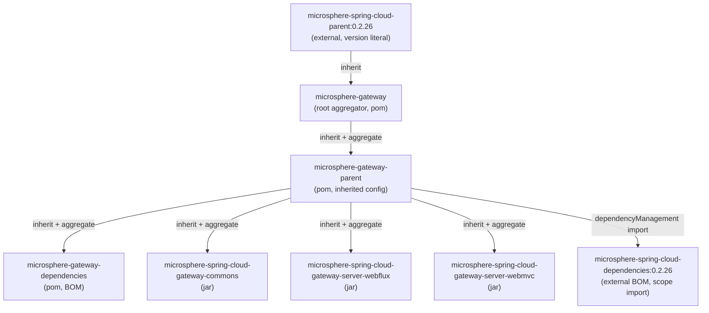
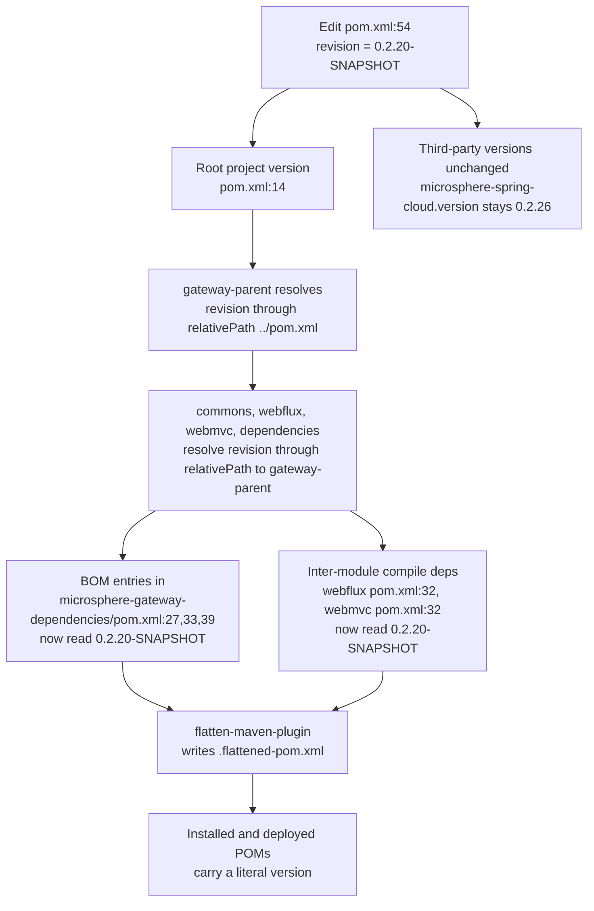
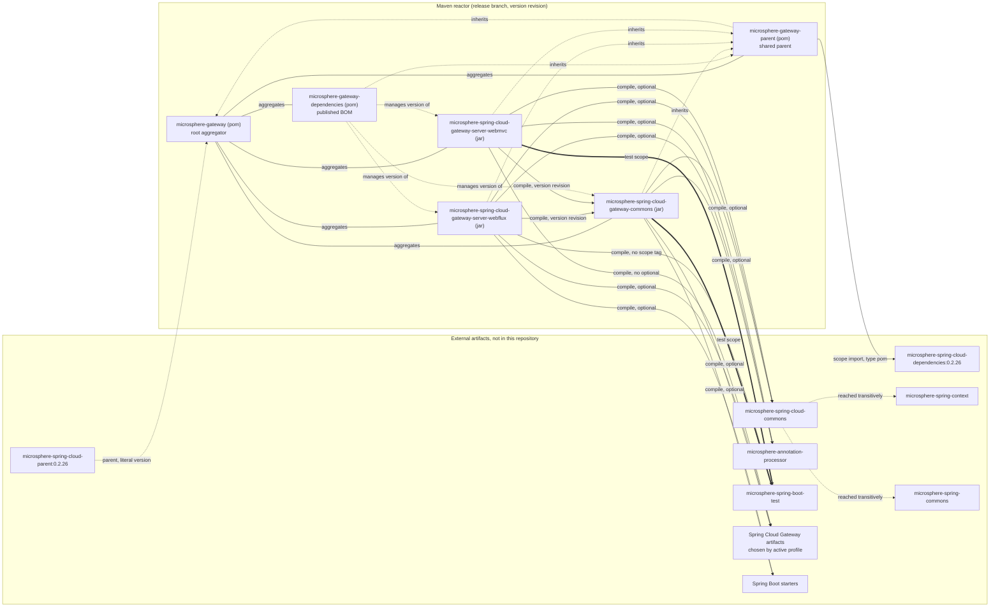

# microsphere-gateway-parent

纯构建模块。它只有 `packaging = pom`、一个声明的属性和一个导入的 BOM，但除了根聚合 POM 之外，反应堆中
每一个模块都以它为 Maven `<parent>`。

| 属性 | 取值 | 证据 |
| --- | --- | --- |
| `groupId` | `io.github.microsphere-projects` | `microsphere-gateway-parent/pom.xml:6` |
| `artifactId` | `microsphere-gateway-parent` | `microsphere-gateway-parent/pom.xml:7` |
| `version` | `${revision}` | `microsphere-gateway-parent/pom.xml:8`（parent）、`:15`（自身） |
| `packaging` | `pom` | `microsphere-gateway-parent/pom.xml:9` |
| `release` 分支上生效的 Maven `revision` | `0.2.19-SNAPSHOT` | `pom.xml:54` |
| 最近一次已发布版本 | `0.2.18` | `release-notes.md`（最后一节） |
| 导入的 BOM | `microsphere-spring-cloud-dependencies:0.2.26` | `microsphere-gateway-parent/pom.xml:23`、`:30-36` |
| JDK 基线 | `17` | `pom.xml:55` |

下文所有行号均相对于 `release` 快照目录，也就是说 `microsphere-gateway-parent/pom.xml` 指
`C:\Users\mercy\AppData\Local\Temp\mgw-src\release\microsphere-gateway-parent\pom.xml`。

---

## 架构设计

### 在构建中的角色

反应堆共有五个模块（`pom.xml:58-64`），其中两个完全不含 Java 源码：

* `microsphere-gateway-parent`——*被继承配置的承载者*。它回答“gateway 各模块编译时所依赖的全部第三方与
  Microsphere 依赖分别是什么版本？”。
* `microsphere-gateway-dependencies`——*对外发布的 BOM*。它回答“下游使用者依赖这三个 gateway 制品时会得到
  什么版本？”。

继承链与聚合链在设计上是**不同**的两条链：

* 聚合（`<modules>`）只在根 `pom.xml:58-64` 声明一次。
* 继承由每个模块各自的 `<parent>` 声明：
  * `microsphere-gateway-parent` 继承自根聚合器 `microsphere-gateway`
    （`microsphere-gateway-parent/pom.xml:5-10`，`:9` 处为 `<relativePath>../pom.xml</relativePath>`）。
  * `microsphere-gateway-dependencies`、`...-gateway-commons`、`...-server-webflux` 与
    `...-server-webmvc` 全部继承自 `microsphere-gateway-parent`，而不是根 POM
    （`microsphere-gateway-dependencies/pom.xml:5-10`、
    `microsphere-spring-cloud-gateway-commons/pom.xml:5-10`、
    `microsphere-spring-cloud-gateway-server-webflux/pom.xml:5-10`、
    `microsphere-spring-cloud-gateway-server-webmvc/pom.xml:5-10`，各自的
    `<relativePath>../microsphere-gateway-parent/pom.xml</relativePath>`）。

结果是：根 POM 只承担聚合器与*外部*父 POM 的持有者角色。四个代码模块真正需要的内容（即
`microsphere-spring-cloud-dependencies` 的导入）全部经由 `microsphere-gateway-parent` 到达，这也解释了为什么
这些模块可以省略自身依赖声明中的 `<groupId>`/`<version>`。



源码引用：外部父 POM 见 `pom.xml:6-10`；导入语句见 `microsphere-gateway-parent/pom.xml:26-39`；聚合见
`pom.xml:58-64`。

### POM 结构

整个模块只有 40 行：

| 行 | 元素 | 作用 |
| --- | --- | --- |
| `1-4` | XML 头 + `<project>` 命名空间 | Maven 4.0.0 模型 |
| `5-10` | `<parent>` = `microsphere-gateway`、`${revision}`、`../pom.xml` | 触达根 POM，并经由它触达 `microsphere-spring-cloud-parent:0.2.26` |
| `11` | `<modelVersion>` | `4.0.0` |
| `13-16` | 自身坐标、`packaging pom` | 安装一个 POM 制品 |
| `18-19` | `<name>` / `<description>` | `Microsphere :: Gateway :: Parent` |
| `21-24` | `<properties>` | 恰好一个属性：`microsphere-spring-cloud.version = 0.2.26` |
| `26-39` | `<dependencyManagement>` | 恰好一个条目：BOM 导入 |

值得注意的是**缺少**的内容：`<build>`、`<plugins>`、`<modules>`、`<repositories>`、
`<distributionManagement>`。这些全部继承自 `microsphere-spring-cloud-parent`（外部制品，不在本快照中——
见文末的“推断与不确定之处”）。

### `${revision}` 机制

`revision` 是 Maven 的“CI 友好”版本属性。在本仓库中它只被**声明一次**，位于根 POM：

```xml
<properties>
    <revision>0.2.19-SNAPSHOT</revision>
    <java.version>17</java.version>
</properties>
```

（`pom.xml:53-56`。）

其他所有 `${revision}` 出现的位置都是*引用*，绝不是重新定义。快照中的完整清单如下：

| POM | 包含 `revision` 的行 | 种类 |
| --- | --- | --- |
| `pom.xml` | `:14` `<version>`、`:54` `<revision>` 属性 | 声明 + 首次使用 |
| `microsphere-gateway-parent/pom.xml` | `:8` `<parent><version>`、`:15` `<version>` | 引用 |
| `microsphere-gateway-dependencies/pom.xml` | `:8` parent、`:15` 自身、`:27`、`:33`、`:39` 受管版本 | 引用 |
| `...-gateway-commons/pom.xml` | `:8` parent、`:14` 自身 | 引用 |
| `...-server-webflux/pom.xml` | `:8` parent、`:14` 自身、`:32` commons 依赖版本 | 引用 |
| `...-server-webmvc/pom.xml` | `:8` parent、`:14` 自身、`:32` commons 依赖版本 | 引用 |

编辑 POM 时必须注意的两条推论：

1. **插值发生在父 POM 解析之前。** `<parent><version>${revision}</version>` 在这里合法，只是因为 Maven 会先读取
   `<relativePath>`（`microsphere-gateway-parent/pom.xml:9`，以及各子模块 `.../pom.xml:9`），因此 `${revision}`
   取自*文件系统*上的父链，而不是从仓库下载。一旦破坏 `<relativePath>` 的值，反应堆就无法解析。
2. **该属性不会以字面值形式被继承进已发布的元数据。** 这是扁平化的职责，见下文。

### 扁平化与 `.flattened-pom.xml`

仓库忽略了扁平化插件的输出：

```
# flatten ignore
.flattened-pom.xml
```

（`.gitignore:53-54`。）

若不做处理，已安装/已发布的 POM 中的 `${revision}` 会原样发布，而不自定义该属性的使用者将无法解析。因此
`flatten-maven-plugin` 会在 `process-resources` 阶段把每个 POM 重写为 `.flattened-pom.xml`，其中有效版本已被
插值（发布时为 `0.2.18`），最终被安装与部署的是这个扁平化文件。插件本身配置在外部父 POM 中，这就是本仓库
任何 POM 都不出现 `<build>` 段的原因。

`.flattened-pom.xml` 是构建产物而非源码：它被 git 忽略，每次触及该模块的 `mvn` 调用都会重新生成，绝不可提交。

### 版本如何在反应堆中传播



由于整个反应堆共享同一个属性，`pom.xml:54` 的一处改动会同时移动五个制品——这里不存在需要逐个同步的模块级
版本，结构上也不可能使用 `mvn release:prepare` 式的按模块版本管理。

### 发布覆盖路径

`.github/workflows/maven-publish.yml` 展示了该设计的另一半：

* 该 workflow 由 `release` 分支的 `push` 或带 `revision` 输入的手动触发（`maven-publish.yml:11-19`），输入值
  必须匹配 `^[0-9]+\.[0-9]+\.[0-9]+$`（`:28-33`）。
* 发布时在命令行覆盖版本：`-Drevision=${{ inputs.revision }}`，配合
  `deploy --activate-profiles publish,ci`（`:47-55`）。
* 随后“Increment patch version”步骤用 `sed` 就地改写该属性，**且仅改写根 `pom.xml`**：

```bash
sed -i "s|^\( *\)<revision>[^<]*</revision>|\1<revision>${NEXT_VERSION}</revision>|" pom.xml
```

（`maven-publish.yml:189`，其中 `NEXT_VERSION` 在 `:184-188` 计算为
`MAJOR.MINOR.(PATCH+1)-SNAPSHOT`。）回提交的文件只有 `pom.xml` 与 `release-notes.md`（`:196`），之后把
`release` 合并进 `main`（`:200-212`）。

这只在“属性只声明于一个文件”的前提下才安全。如果第二个 `<revision>` 声明被加到某个子 POM，那么该子模块在
发布之后仍会持续发布旧版本。

---

## 设计模式

以下是 POM 文本实际体现出的模式，并说明各自的收益与代价。

**单一事实来源（Single source of truth，亦即 CI 友好版本）。**
位置：`revision` 属性位于 `pom.xml:54`，被全部六个 POM 引用（见上表）。
动机：一个反应堆、五个必须始终一起发布的制品。
收益：版本升级只改一行；发布时可用 `-Drevision=` 覆盖而无需改文件；`maven-publish.yml:189` 的 `sed` 步骤可以
只针对一个文件。
代价：必须依赖扁平化（否则已发布 POM 中含有未解析的 `${revision}`）；必须保持 `<relativePath>` 链路完整；
任何按字面读取 `<version>` 的工具都会失效。

**构建层面的模板方法（Template Method，父 POM 即模板）。**
位置：`microsphere-gateway-parent` 只覆写它需要的“钩子”——`microsphere-spring-cloud.version` 属性（`:23`）与
一处 BOM 导入（`:30-36`），其余插件、分发与许可证信息全部继承自
`microsphere-spring-cloud-parent`（`pom.xml:6-10`）与根 POM（`pom.xml:13-51`）。
收益：发布策略、编译器设置与插件配置不重复。
代价：有效配置分散在三个文件中，其中两个在仓库之外；唯一可靠的查看方式是 `mvn help:effective-pom`。

**“内部版本”与“外部版本”之间的依赖倒置。**
位置：外部版本以字面量固定（`pom.xml:9` 与 `microsphere-gateway-parent/pom.xml:33` 的 `0.2.26`），内部版本
被参数化（`${revision}`）。
收益：反应堆可以在自身仍是快照的情况下，针对已发布的 Microsphere 平台构建。
代价：同一文件中存在两套版本纪律，review diff 时容易混淆。

**外观（Facade，针对 `microsphere-gateway-dependencies`，在其对应文档中详述）**——同级 POM
`microsphere-gateway-dependencies/pom.xml:21-43` 是反应堆自身坐标的只读表面。

本模块不声明任何插件、profile 或资源过滤（`microsphere-gateway-parent/pom.xml` 中没有 `<build>` 也没有
`<profiles>` 元素），因此不为这些内容声称任何模式。

---

## 模块依赖图

在此重复，以便只读本页的读者也能看到整体拓扑。`optional` 与 `provided` 作用域与 compile 作用域的边分开展示；
纯 POM 模块标注 `(pom)`。



图例：实线箭头是声明的 `<dependency>` 边，粗实线箭头是 `test` 作用域，虚线箭头表示继承/导入/版本管理关系
（绝不是 classpath 边），`optional` 表示除非使用者自行声明，否则该制品不会出现在其 classpath 上。

---

## 构建与测试指引

`microsphere-gateway-parent` 没有源码，因此没有自己的测试。可验证的内容如下：

| 目标 | 命令 | 什么能证明父 POM 正确 |
| --- | --- | --- |
| 反应堆健全性 | `./mvnw -N validate` | 根 POM 可解析；`revision` 可插值 |
| 完整校验 | `./mvnw validate` | 每个子模块的 `<parent>` 块都能通过其 `<relativePath>` 解析 |
| 有效版本 | `./mvnw help:effective-pom -pl microsphere-spring-cloud-gateway-commons` | 受管的 `microsphere-spring-cloud-*` 版本来自 `microsphere-spring-cloud-dependencies:0.2.26` |
| profile 矩阵 | `./mvnw -Ptest,coverage,spring-cloud-2022 test`（再依次 `2023`、`2024`、`2025`） | 这正是 CI 矩阵，见 `.github/workflows/maven-build.yml:26-27`、`:39-46` |
| JDK 矩阵 | 同一命令，`JAVA_HOME` 分别指向 17、21、25 | `.github/workflows/maven-build.yml:25` |
| 版本覆盖 | `./mvnw -Drevision=0.0.1-SNAPSHOT test` | CI 构建始终这样做（`maven-build.yml:44`），因此 `0.2.19-SNAPSHOT` 不会泄漏进 CI 产物 |
| 扁平化输出 | 任意构建后执行 `ls */.flattened-pom.xml` | 证明插件确实执行了；该文件被 git 忽略（`.gitignore:53-54`） |

由于父 POM 持有 BOM 导入，这里的错误会以“未解析版本”的形式在代码模块中拖垮**整个**反应堆；修改后请在根目录
执行 `./mvnw validate`。

---

## 扩展配方

### 提升 Microsphere 平台版本

1. 修改 `microsphere-gateway-parent/pom.xml:23` 的 `<microsphere-spring-cloud.version>`。
2. **不要**复制 BOM 条目；`:30-36` 的单条导入已级联到四个子模块。
3. 本地跑完整矩阵——`microsphere-spring-cloud-commons` 提供 `WebEndpointMapping` 与 `BindListener` SPI，被公共
   模块使用，因此升级可能改变 `we://` 的匹配语义。

### 为全部代码模块添加被继承的插件或属性

写进本 POM，而不是在 `...-commons`、`...-server-webflux`、`...-server-webmvc` 中重复。若改动只涉及*第三方库
版本*，更推荐覆盖 `microsphere-spring-cloud-dependencies` 定义的属性（与 `:23` 处的
`microsphere-spring-cloud.version` 同风格），以便覆盖点保持可见。

### 为反应堆添加某个外部库的受管版本

如果使用者也应当获得它，就加到 `microsphere-gateway-dependencies`（见该文档）——那个 POM 才是发布的 BOM。
若仅构建内部使用，则加到 `microsphere-gateway-parent/pom.xml:26-39` 的 `<dependencyManagement>` 中，并注意
本文件中直接列出的条目才优先于导入的 BOM。

### 向反应堆添加新模块

1. 创建目录并复制 `microsphere-spring-cloud-gateway-commons/pom.xml:5-11` 的 `<parent>` 块，使用
   `<version>${revision}</version>` 与
   `<relativePath>../microsphere-gateway-parent/pom.xml</relativePath>`。
2. 把目录名加入 `pom.xml:58-64` 的 `<modules>`。
3. 把该制品加入 `microsphere-gateway-dependencies/pom.xml`，以便下游构建可以管理它。
4. 不要在新 POM 中添加 `<revision>` 属性；发布 workflow 的 `sed` 步骤只改 `pom.xml`
   （`maven-publish.yml:189`）。

---

## 推断与不确定之处

* `flatten-maven-plugin` 属于推断，而非直接观测。快照内唯一证据是 git 忽略注释
  `# flatten ignore` / `.flattened-pom.xml`（`.gitignore:53-54`），加上每个 POM 都使用 `${revision}`
  （唯一声明在 `pom.xml:54`）。插件的执行 id、阶段与 `flattenMode` 配置在外部父 POM
  `microsphere-spring-cloud-parent:0.2.26` 中，不在本快照内，因此此处不做任何具体声称。
* 同理，`<build>` 插件、`distributionManagement`、GPG/签名，以及 CI 激活的
  `publish`/`ci`/`test`/`coverage` profile（`maven-build.yml:46`、`maven-publish.yml:55`）都继承自外部父链，
  无法由这些文件验证。
* “只有 `pom.xml` 声明 `<revision>`”这一结论由对仓库内 POM 文件全文搜索 `revision` 得出，结果即上表。

---

## English

本文档的英文版：[../microsphere-gateway-parent.md](../microsphere-gateway-parent.md)。

返回指南目录：[README.md](../README.md)。
项目根 README：[../../../../README.md](../../../../README.md)。
