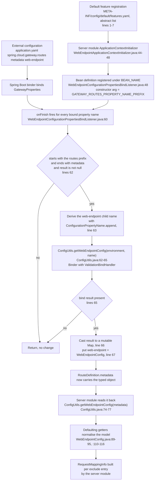
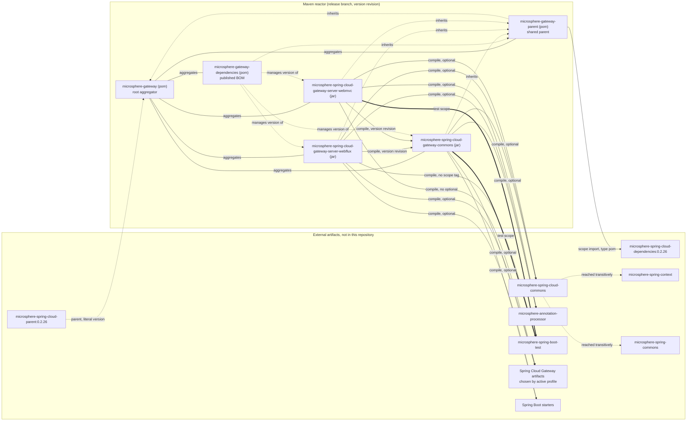

# microsphere-spring-cloud-gateway-commons

Microsphere Gateway 共享的、与技术栈无关的内核。它本身不含任何网关代码：它定义了 `we://` 词汇表（常量）、
`WebEndpointConfig` 模型、把路由元数据转换为该模型的绑定钩子，以及两个 server 模块共同复用的条件注解。

| 属性 | 取值 | 证据 |
| --- | --- | --- |
| `artifactId` | `microsphere-spring-cloud-gateway-commons` | `microsphere-spring-cloud-gateway-commons/pom.xml:13` |
| `version` | `${revision}`，在根 POM 中声明为 `0.2.19-SNAPSHOT` | `microsphere-spring-cloud-gateway-commons/pom.xml:14`、`pom.xml:54` |
| 父模块 | `microsphere-gateway-parent` | `microsphere-spring-cloud-gateway-commons/pom.xml:5-10` |
| 主源码类 | 8 个 | `src/main/java/io/microsphere/spring/cloud/gateway/commons/**` |
| 测试类 | 7 个 | `src/test/java/io/microsphere/spring/cloud/gateway/commons/**` |
| 自动配置 | 无（既无 `spring.factories`，也无 `AutoConfiguration.imports`） | 只有 `src/main/resources/META-INF/config/default/features.yaml` |

行号均相对于 `release` 快照目录
`C:\Users\mercy\AppData\Local\Temp\mgw-src\release`。

---

## 架构设计

### 在系统中的角色

两个 server 模块（`...-server-webflux`、`...-server-webmvc`）都以 compile 作用域、使用反应堆版本依赖本制品
（`microsphere-spring-cloud-gateway-server-webflux/pom.xml:29-33`、
`microsphere-spring-cloud-gateway-server-webmvc/pom.xml:29-33`）。它们必须保持一致的内容都存放在这里：

* 路由 scheme 与元数据 key，从而 `we://all` 这样的路由在响应式网关与 Servlet 网关中被同样解释；
* 最终落入 `RouteDefinition.metadata` 的 `WebEndpointConfig` 对象，从而匹配规则由 Spring Boot 的 binder 绑定
  一次，而不是被两个模块各绑定一次；
* 总开关属性名，从而一个有文档记载的前缀就能在两种技术栈中关闭该特性。

### 包结构

```
io/microsphere/spring/cloud/gateway/commons/
  annotation/    ConditionalOnMicrosphereGatewayEnabled
                 ConditionalOnMicrosphereWebEndpointMappingEnabled
  config/        ConfigUtils
                 WebEndpointConfig
                 WebEndpointConfigurationPropertiesBindListener
  constants/     CommonConstants
                 CommonsPropertyConstants
                 RouteConstants
```

| 包 | 扩展点 | 被谁消费 |
| --- | --- | --- |
| `annotation` | 可组合的条件元注解，用于使用者 `@Configuration` 类 | 两个 server 模块的自动配置，以及任意应用配置 |
| `config` | `BindListener` 钩子（`WebEndpointConfigurationPropertiesBindListener`）与 `WebEndpointConfig` 模型 | 由 server 模块的 `ApplicationContextInitializer` 注册 |
| `constants` | 稳定的字符串契约：scheme `we`、元数据 key、URI 模板变量 `application` | 两个 server 模块及其测试 |

### 自动配置的参与方式

本模块刻意**不**提供自动配置。`src/main/resources/META-INF/` 下只有
`config/default/features.yaml`；该制品中不存在 `META-INF/spring.factories`，也不存在
`META-INF/spring/org.springframework.boot.autoconfigure.AutoConfiguration.imports`。原因在两个 server 模块里
一目了然：`WebEndpointMapping` 支持在 WebFlux 中需要 `ReactiveDiscoveryClient`，在 WebMVC 中需要
`DiscoveryClient`，因此条件栈必须按技术栈分别构建，无法共享成一个自动配置类。

本模块真正贡献的，是 server 模块所执行的*注册配方*，以及 `features.yaml` 中的一段：

```yaml
microsphere:
  spring:
    cloud:
      features:
        abstract:
          microsphere-spring-cloud-gateway-commons:
            - io.microsphere.spring.cloud.gateway.commons.config.WebEndpointConfigurationPropertiesBindListener
```

（`microsphere-spring-cloud-gateway-commons/src/main/resources/META-INF/config/default/features.yaml:1-7`。）

`abstract` key 列出的类绝不能被自动实例化为 Bean——它需要构造参数
（`WebEndpointConfigurationPropertiesBindListener.java:54-57`）——而这正是 server 模块手工注册它的方式：

```java
registry.registerBeanDefinition(BEAN_NAME,
        beanDefinition(WebEndpointConfigurationPropertiesBindListener.class,
                listener, GATEWAY_ROUTES_PROPERTY_NAME_PREFIX));
```

（`microsphere-spring-cloud-gateway-server-webflux/.../context/WebEndpointApplicationContextInitializer.java:44-48`
以及内容完全相同的 `microsphere-spring-cloud-gateway-server-webmvc/.../context/WebEndpointApplicationContextInitializer.java:44-48`。）

两个 initializer 使用*同一个* Bean 名称注册——`WebEndpointConfigurationPropertiesBindListener.BEAN_NAME`，
即 `"webEndpointConfigurationPropertiesBindListener"`（`WebEndpointConfigurationPropertiesBindListener.java:48`）。
由于一个应用只会选择一个 server 模块，二者不会冲突；若两者同时存在于 classpath，第二次注册会指向同一个名字。

### Bean 覆盖策略

本模块没有 `@Bean` 方法，因此也不存在覆盖问题。唯一与覆盖相关的决策是：该监听器是以带构造参数的普通 Bean
定义注册的，因此使用者可以在自己的配置里重新定义
`webEndpointConfigurationPropertiesBindListener`，而 server 模块的 initializer 仍然先写入了它的定义
（initializer 在 `refresh()` 之前执行）。

---

## 源码分析

### `constants/RouteConstants.java`

承载 `we://` 契约的 `interface`（`RouteConstants.java:28`）：

| 常量 | 取值 | 行 |
| --- | --- | --- |
| `SCHEME` | `we` | `:33` |
| `ALL_SERVICES` | `all` | `:38` |
| `ID_KEY` | `id` | `:43` |
| `METADATA_KEY` | `metadata` | `:48` |
| `WEB_ENDPOINT_KEY` | `web-endpoint` | `:53` |
| `WEB_ENDPOINT_REWRITE_PATH_ATTRIBUTE_NAME` | `msgw-we-rewrite-path` | `:58` |

`WEB_ENDPOINT_REWRITE_PATH_ATTRIBUTE_NAME` 不是配置属性：它是**每个 server 模块实现内部作为旁路信道使用的
请求 attribute key**，把去掉应用名之后的路径从匹配步骤传递到转发步骤。WebFlux 在匹配时写入
（`WebEndpointMappingGlobalFilter.java:334`），在转发时移除（`:157`）；WebMVC 先移除
（`WebEndpointMappingHandlerFilterFunction.java:122`），改写之后再次写入（`:129`）。其值
`msgw-we-rewrite-path` 由 `RouteConstantsTest.java:46` 钉住。

这里使用的是接口（而不是带私有构造器的 final 类），因此常量隐式为 `public static final`，并且该类型可被
实现；本模块同时混用两种风格（`RouteConstants.java:28` 对比 `ConfigUtils.java:42`、`:79-80`）。

### `constants/CommonsPropertyConstants.java`

两个前缀与两个 `.enabled` key（`CommonsPropertyConstants.java:31`）：

| 常量 | 取值 | 行 |
| --- | --- | --- |
| `MICROSPHERE_GATEWAY_SPRING_CLOUD_PROPERTY_NAME_PREFIX` | `microsphere.spring.cloud.gateway.` | `:36` |
| `DEFAULT_MICROSPHERE_GATEWAY_ENABLED` | `"true"` | `:41` |
| `MICROSPHERE_GATEWAY_ENABLED_PROPERTY_NAME` | `microsphere.spring.cloud.gateway.enabled` | `:51` |
| `MICROSPHERE_WEB_ENDPOINT_MAPPING_PROPERTY_NAME_PREFIX` | `microsphere.spring.cloud.web-endpoint-mapping.` | `:56` |
| `MICROSPHERE_WEB_ENDPOINT_MAPPING_ENABLED_PROPERTY_NAME` | `microsphere.spring.cloud.web-endpoint-mapping.enabled` | `:66` |

两个前缀都由 `MICROSPHERE_SPRING_CLOUD_PROPERTY_NAME_PREFIX` 拼出，后者从外部
`io.microsphere.spring.cloud.commons.constants.CommonsPropertyConstants` 导入（`:23`），因此 gateway 前缀跟随
平台前缀，而不是重新手打。

`MICROSPHERE_GATEWAY_ENABLED_PROPERTY_NAME`（`:46-51`）与
`MICROSPHERE_WEB_ENDPOINT_MAPPING_ENABLED_PROPERTY_NAME`（`:61-66`）带有
`@ConfigurationProperty(type = boolean.class, defaultValue = DEFAULT_MICROSPHERE_GATEWAY_ENABLED,
source = APPLICATION_SOURCE)` 注解。*web-endpoint-mapping* key 的 `defaultValue` 复用了 gateway 常量（`:63`）——
值同样是 `"true"`，因此这属于表面上的复用而非缺陷。这些注解由 `microsphere-annotation-processor`
（在 `pom.xml:22-26` 声明为 optional）消费以生成配置元数据；该处理发生在本仓库之外。

字面名称由 `CommonsPropertyConstantsTest.java:40-44` 断言。

### `constants/CommonConstants.java`

仅一个常量：`APPLICATION_NAME_URI_TEMPLATE_VARIABLE_NAME = "application"`
（`CommonConstants.java:28`、`:33`）。

它是路由断言与端点匹配代码之间的契约：一条 `we://` 路由必须以字面名为 `application` 的 URI 模板变量暴露服务
名，测试夹具中的写法即 `Path=/{application}/**`
（`microsphere-spring-cloud-gateway-commons/src/test/resources/META-INF/config/default/test.yaml:22`，
webflux 与 webmvc 的测试资源中亦有同样内容）。WebFlux 过滤器从匹配到的路由的 URI 模板变量中读取该变量，若值
为空则原样放行请求（`WebEndpointMappingGlobalFilter.java:142-147`，WebMVC 的对应实现见
`WebEndpointMappingHandlerFilterFunction.java:109-112`）。

### `annotation/ConditionalOnMicrosphereGatewayEnabled.java`

```java
@Retention(RUNTIME)
@Target({TYPE, METHOD})
@Documented
@ConditionalOnProperty(name = MICROSPHERE_GATEWAY_ENABLED_PROPERTY_NAME, matchIfMissing = true)
public @interface ConditionalOnMicrosphereGatewayEnabled {
}
```

（`ConditionalOnMicrosphereGatewayEnabled.java:43-47`。）

* 元注解组合：该注解自身不带 `@Conditional`；Spring Boot 的条件求值器从元注解层读取
  `@ConditionalOnProperty`。
* `matchIfMissing = true`（`:46`）使该特性**默认开启**；唯一的关闭方式是设置
  `microsphere.spring.cloud.gateway.enabled=false`。webmvc 的集成测试证明了另一条关闭路径：
  `microsphere.autoconfigure.exclude` 加上 `microsphere.spring.cloud.webmvc.enabled=false`
  （`WebEndpointMappingGatewayServerMvcAutoConfigurationIntegrationDisabledTest.java`）。
* `@Target({TYPE, METHOD})`（`:44`）——这就是该注解可复用在 `@Bean` 方法上的原因；webflux 模块目前未利用
  这一点，但用户配置可以。
* 由 `ConditionalOnMicrosphereGatewayEnabledTest.java:36-93` 覆盖，包含三个嵌套上下文：默认（`:38-52`）、
  显式 `true`（`:54-71`）、显式 `false` 并断言 Bean 不存在（`:73-89`）。

### `annotation/ConditionalOnMicrosphereWebEndpointMappingEnabled.java`

```java
@Retention(RUNTIME)
@Target({TYPE, METHOD})
@Documented
@ConditionalOnMicrosphereGatewayEnabled
@ConditionalOnProperty(name = MICROSPHERE_WEB_ENDPOINT_MAPPING_ENABLED_PROPERTY_NAME, matchIfMissing = true)
public @interface ConditionalOnMicrosphereWebEndpointMappingEnabled {
}
```

（`ConditionalOnMicrosphereWebEndpointMappingEnabled.java:44-49`。）

两个条件是叠加的，因此生效规则是逻辑与：`microsphere.spring.cloud.gateway.enabled` 不能为 `false`，**并且**
`microsphere.spring.cloud.web-endpoint-mapping.enabled` 不能为 `false`（`:47-48`）。所以关闭 gateway 开关会
传递性地关闭端点映射，反之则不成立。

Javadoc 漂移：`@see CommonsPropertyConstants#MICROSPHERE_GATEWAY_ENABLED_PROPERTY_NAME`（`:41`）指向的是
gateway key，而该注解守护的是 web-endpoint-mapping key（`:48`）。行为正确，只是 `@see` 标签过时了。

由 `ConditionalOnMicrosphereWebEndpointMappingEnabledTest.java:36-93` 覆盖，同样是三 case 的形状。

### `config/WebEndpointConfig.java`

注入到路由元数据中的配置模型。

```java
@Validated
public class WebEndpointConfig {

    @NotNull
    @Valid
    private List<Mapping> excludes = new LinkedList<>();
    ...
```

（`WebEndpointConfig.java:42-47`。）

系统其余部分依赖的不变式：

* `excludes` 初始化为可变的 `LinkedList`（`:45-47`）且带 `@NotNull`（`:45`），由 `ConfigUtils` 安装的
  `ValidationBindHandler` 校验（`ConfigUtils.java:48-52`）。因此绑定成功的配置一定持有非 null 列表——但当前缀下
  不存在可绑定的子树时，`ConfigUtils` 仍会返回 `null`（`ConfigUtils.java:62-65`，返回值上的 `@Nullable`），这正
  是 WebMVC 模块做判空而 WebFlux 模块不做的原因（见两篇 server 文档）。
* `Mapping.patterns` 是 `@NotNull @Valid`（`WebEndpointConfig.java:62-64`）：没有 patterns 的 mapping 会绑定
  失败。
* 真正值得注意的是做归一化的 getter。当配置的数组为空时，`getMethods()` 返回**全部**请求方法（`:89-95`），
  `getHeaders()` 返回 `ArrayUtils.EMPTY_STRING_ARRAY`（`:110-116`）。两者的注解是 `@Nonnull`，而字段是
  `@Nullable`（`:66-73`）。这是刻意设计的“默认开放”语义：一条不写 `methods` 的 exclude 条目会针对所有 HTTP
  方法排除该路径模式。`params`、`consumes`、`produces` 保持 `@Nullable`（`:75-79`、`:101-134`），即对它们不区分
  “未设置”和“为空”。
* `Mapping` 是 `public static class`（`:60`），而不是带 builder 的 Bean，因此它可按属性名绑定，也能由 binder
  默认的无参实例化创建。

`ConfigUtilsTest.assertWebEndpointConfig`（`ConfigUtilsTest.java:103-131`）就是可执行的规格说明：三条
excludes；第三条只配置了 `patterns` + `consumes` + `produces`，断言其 methods 返回
`RequestMethod.values()`（`:126`），headers 返回*同一个实例* `EMPTY_STRING_ARRAY`（`:128`）——用的是
`assertSame` 而不是 `assertEquals`，因此共享空数组的引用同一性也是契约的一部分。

### `config/WebEndpointConfigurationPropertiesBindListener.java`

“原始路由元数据 Map”与“类型化 `WebEndpointConfig`”之间的桥梁。

```java
public class WebEndpointConfigurationPropertiesBindListener implements BindListener, EnvironmentAware {

    public static final String BEAN_NAME = "webEndpointConfigurationPropertiesBindListener";

    private final String gatewayRoutesPropertyNamePrefix;

    private Environment environment;

    public WebEndpointConfigurationPropertiesBindListener(String gatewayRoutesPropertyNamePrefix) {
        assertNotBlank(gatewayRoutesPropertyNamePrefix, () -> "The 'gatewayRoutesPropertyNamePrefix' must not be blank");
        this.gatewayRoutesPropertyNamePrefix = gatewayRoutesPropertyNamePrefix;
    }
```

（`WebEndpointConfigurationPropertiesBindListener.java:46-57`。）

`BindListener` 与 `ListenableBindHandlerAdapter` 来自 `microsphere-spring-boot-*`（导入见 `:20-21`），而不是
Spring Boot 本身；模块把相关依赖声明为 `optional`（`microsphere-spring-cloud-commons` 见 `pom.xml:29-33`）。

`onFinish`（`:59-70`）在应用中**每次**绑定操作结束时都会执行，因此守卫条件是一次廉价的属性名字符串测试：

```java
String propertyName = name.toString();
if (propertyName.startsWith(gatewayRoutesPropertyNamePrefix) && propertyName.endsWith(METADATA_KEY) && result != null) {
    ConfigurationPropertyName webEndpointName = name.append(WEB_ENDPOINT_KEY);
    WebEndpointConfig webEndpointConfig = getWebEndpointConfig(environment, webEndpointName.toString());
    if (webEndpointConfig != null) {
        Map<String, Object> metadata = (Map<String, Object>) result;
        metadata.put(WEB_ENDPOINT_KEY, webEndpointConfig);
    }
}
```

值得留意的非直观行为：

1. **三重守卫。** 前缀匹配 + `metadata` 后缀 + 结果非 null（`:62`）。前缀由构造器注入，因此该监听器与前缀无
   耦合，既可以服务 `spring.cloud.gateway.routes`（WebFlux），也可以服务
   `spring.cloud.gateway.server.webflux.routes` / `spring.cloud.gateway.server.webmvc.routes`，取决于当前
   Maven profile 拉入的是哪个制品。传入的值来自各 server 模块的
   `GatewayPropertyConstants.GATEWAY_ROUTES_PROPERTY_NAME_PREFIX`。
2. 使用 **`ConfigurationPropertyName.append`**（`:63`）而非字符串拼接，因此派生出的名字是合法、规范化的属性名
   （`...routes[0].metadata.web-endpoint`）。
3. **递归绑定。** `getWebEndpointConfig(environment, ...)`（`:64`）在父子树的外层绑定即将结束时绑定一个*嵌套*
   子树。内层绑定使用共享的校验 handler（`ConfigUtils.java:44`、`:63`），并且没有把监听器自身挂到内层绑定上，
   因此不会形成递归环。
4. **未检查的强制转换。** `(Map<String, Object>) result`（`:66`）假定了 Spring Boot 会把路由元数据绑定成
   `Map`，并且其实现是可变的。
   `WebEndpointConfigurationPropertiesBindListenerTest.java:56` 绑定到 `LinkedHashMap.class`，与此一致，但生产
   binder 所使用的 Map 类型并未由本模块的测试断言。
5. **回写进已绑定的对象。** `metadata.put(WEB_ENDPOINT_KEY, webEndpointConfig)`（`:67`）修改了外层 binder 产出的
   Map，因此最终 `RouteDefinition.metadata` 中同时存在一个活的 `WebEndpointConfig` 实例，以及同一 key 下的原始
   属性表示。这恰好就是 `ConfigUtils` 回读时所依赖的双重表示。
6. **可变的 `environment` 字段且无同步**（`:52`、`:72-75`）。`setEnvironment` 由容器在 Bean 被使用之前调用一次，
   `onFinish` 读取它。在正常生命周期下是安全的，但该监听器被所有绑定操作共享。

构造器中的 `assertNotBlank`（`:55`，来自 `io.microsphere.util.Assert`，导入见 `:34`）把“initializer 注册错误”
变成启动失败，而不是特性静默失效。

### `config/ConfigUtils.java`

```java
public abstract class ConfigUtils implements Utils {

    private static final BindHandler springValidatorBindHandler;

    private static final Bindable<WebEndpointConfig> WEB_ENDPOINT_CONFIG_BINDABLE = of(WebEndpointConfig.class);

    static {
        LocalValidatorFactoryBean validator = new LocalValidatorFactoryBean();
        validator.afterPropertiesSet();
        springValidatorBindHandler = new ValidationBindHandler(validator);
    }
```

（`ConfigUtils.java:42-52`。）

* `implements Utils`（`:42`）是 microsphere 对工具类的标记；`abstract` 加私有构造器（`:79-80`）阻止实例化。
  `io.microsphere.util.Utils` 来自 `microsphere-commons`，是传递依赖。
* **校验器的急切静态初始化**（`:48-52`）。`LocalValidatorFactoryBean` 被手动创建并手动调用
  `afterPropertiesSet()`，绕开了 Spring 容器。其后果是运行时硬性要求存在 Jakarta Validation 实现以及 EL
  实现：commons 的 test 作用域正是因为这个才加入 `hibernate-validator`（`pom.xml:109-114`）和
  `tomcat-embed-el`（`pom.xml:116-120`），而且两者都是 `test` 作用域——也就是说本模块的使用者需要提供自己的
  实现（网关应用实践中由 `spring-boot-starter-validation`/actuator 提供，而
  `spring-boot-starter-actuator` 在 `pom.xml:42-46` 声明为 optional）。若使用者 classpath 上没有实现，失败会
  在 `ConfigUtils` 第一次被触碰时暴露。
* 该类是懒加载的，所以只有在 `we://` 特性真正被使用时才付出该成本。
* `WEB_ENDPOINT_CONFIG_BINDABLE` 是静态常量（`:46`），每次绑定复用，避免逐请求的 `Bindable.of` 分配。
* `getWebEndpointConfig(Environment, String)`（`:61-65`）使用带校验的 handler 绑定，并返回 `orElse(null)`，
  因此缺失的子树返回 `null` 而不是空配置。`ConfigUtilsTest.java:98-101` 钉住了这一点：绑定
  `spring.cloud.gateway.routes[1]`（一条有 metadata 但没有 `web-endpoint` key 的路由，见
  `test.yaml:32-35`）返回 `null`。
* `getWebEndpointConfig(Map<String, Object>)`（`:73-77`）读取 `web-endpoint`，并在强转之前使用 `instanceof`，
  因此从未被监听器处理过的原始 Map 返回 `null` 而不是抛异常。
  `ConfigUtilsTest.java:84-95` 覆盖了全部三种状态：key 不存在 → `null`（`:86`）、key 下类型不对
  （`metadata.put(WEB_ENDPOINT_KEY, metadata)`）→ `null`（`:88-90`）、类型正确 → 非 `null`（`:92-94`）。
* 两个重载共同表达了本模块的核心不变式：**只有绑定监听器执行过，类型化配置才会存在于元数据 Map 中。**
  任何在未安装监听器的情况下读取元数据的代码路径都会静默得到 `null`，因此也就没有任何排除规则。

---

## 配置绑定流程

`features.yaml` 不是 Spring Boot 配置；它是 Microsphere 平台的概念，由
`microsphere-spring-cloud-commons`（外部制品）读取。在本仓库中它有两种形态：

* `abstract:` ——参与某个特性但不得被自动实例化的类列表（本模块，`features.yaml:5-7`）；
* `named:` ——`BeanName=ClassName` 形式的列表（两个 server 模块）。

从属性到命中排除规则的运行时绑定路径如下：



默认值与覆盖：`features.yaml` 中没有任何内容提供属性值。制品内唯一的默认值在代码中——
`WebEndpointConfig.excludes` 默认为空列表（`WebEndpointConfig.java:47`），`getMethods()` 默认为全部方法
（`:91-93`），`getHeaders()` 默认为共享空数组（`:112-114`），而两个
`@ConfigurationProperty(defaultValue = "true")` 注解（`CommonsPropertyConstants.java:48`、`:63`）记录了总开关
默认开启，与 `matchIfMissing = true`
（`ConditionalOnMicrosphereGatewayEnabled.java:46`、
`ConditionalOnMicrosphereWebEndpointMappingEnabled.java:48`）一致。

`src/test/resources` 下的 `META-INF/config/default/test.yaml`（`:1-35`）是被
`ConfigUtilsTest.createEnvironment()`（`ConfigUtilsTest.java:64-77`）以及 server 模块测试共同复用的夹具；请注意
`:75` 处的 `attach(environment)`，它是 `metadata.web-endpoint` 子树能够 relaxed-binding 的必要条件。

---

## 设计模式

**元注解 / 条件组合。**
位置：`ConditionalOnMicrosphereGatewayEnabled.java:43-47` 组合 `@ConditionalOnProperty`；
`ConditionalOnMicrosphereWebEndpointMappingEnabled.java:44-49` 组合该注解*以及*另一个
`@ConditionalOnProperty`。
动机：把项目级总开关表达一次，并以领域专用注解的形式复用。
收益：server 模块的自动配置更易读（`WebEndpointMappingGatewayAutoConfiguration.java` 中的
`@ConditionalOnMicrosphereWebEndpointMappingEnabled`）、默认开启的行为（`matchIfMissing = true`），以及
`@Target({TYPE, METHOD})` 带来的应用级复用。
代价：条件在类加载/注册期求值，因此组合的属性名写错不会有任何提示；不带 `havingValue` 的
`@ConditionalOnProperty` 只接受字面 `false` 作为关闭值。

**常量接口（Constant interface）。**
位置：`RouteConstants.java:28`、`CommonsPropertyConstants.java:31`、`CommonConstants.java:28`。
动机：这些值是编译期常量，因此 `@ConditionalOnProperty(name = ...)` 与 `name.append(...)` 等调用点可以直接在
注解中使用它们。
收益：便于写入注解的引用（`ConditionalOnMicrosphereGatewayEnabled.java:46`），以及单点重命名。
代价：实现类会把这些常量继承进自己的命名空间；常量值必须由测试重新钉住，这正是
`RouteConstantsTest.java:41-46` 与 `CommonsPropertyConstantsTest.java:40-44` 存在的意义。

**通过默认化 getter 实现 Null Object。**
位置：`WebEndpointConfig.Mapping.getMethods()`（`:89-95`）与 `getHeaders()`（`:110-116`）。
动机：下游匹配代码绝不应该为“没有配置 methods”写特判。
收益：server 模块可以无条件地用这些 getter 构造 `RequestMappingInfo`
（`WebEndpointMappingGlobalFilter.java:438-457`、`WebEndpointMappingHandlerFilterFunction.java:284-303`）。
代价：`null` 与“空”变得不可区分，而 `params`/`consumes`/`produces` 有意*不*遵循该模式，因此模型是不对称的——
这是调用方必须记住的事实。

**绑定管道上的钩子 / 观察者。**
位置：`WebEndpointConfigurationPropertiesBindListener.onFinish`（`:59-70`），实现 `BindListener`（`:20`）。
动机：除了 bind handler 链，Spring Boot 的 binder 没有其它扩展点可以在绑定过程中丰富一个已经绑好的 `Map`。
收益：按属性名做后处理，而无需复制 `GatewayProperties`；不含任何网关技术栈相关代码。
代价：对 JVM 中**每一次**绑定都会触发（`:62` 的字符串测试只是守卫），执行了未检查强转（`:66`），并且修改了
binder 的结果对象。

**持有急切协作者的工具类。**
位置：`ConfigUtils.java:42`、`:48-52`、`:79-80`。
动机：两个 server 模块和测试都需要一个带校验的 binder，但不希望依赖 `ApplicationContext`。
收益：调用点一行搞定、共享 `Bindable`（`:46`）、校验语义一致。
代价：静态状态、类加载期创建校验器；要求使用者 classpath 上存在 Jakarta Validation 实现（此处为 test
作用域：`pom.xml:109-120`）。

**Data Mapper / binder 驱动的 DTO。**
位置：`WebEndpointConfig.java:42` + `ConfigUtils.java:62-65`。
动机：YAML 元数据必须变成经过校验的对象图。
收益：`@Validated`/`@NotNull`/`@Valid` 约束（`:42`、`:45-46`、`:62-63`）在启动期就保证了对象形状。
代价：校验发生在绑定过程中，因此一条非法的 exclude 条目会深入绑定监听器内部才失败，唯一可用的诊断信息是
属性路径。

---

## 模块依赖图

在此重复，以便只读本页的读者也能看到整体拓扑。



对**本**制品而言，关键细节是所有 compile 依赖都是 `<optional>`
（`microsphere-spring-cloud-gateway-commons/pom.xml:22-86`），因此它**不向** `...-server-webflux` /
`...-server-webmvc` 贡献任何传递性 compile 依赖。两个 server 模块都重新声明了自身所需。完整的 optional 清单：
`microsphere-annotation-processor`（`:22-26`）、`microsphere-spring-cloud-commons`（`:29-33`）、
`spring-boot-starter`（`:36-40`）、`spring-boot-starter-actuator`（`:42-46`）、
`spring-boot-configuration-processor`（`:48-52`）、`spring-boot-autoconfigure-processor`（`:54-58`）、
`spring-cloud-commons`（`:60-65`）、`spring-cloud-loadbalancer`（`:67-72`）、`spring-web`（`:74-79`）、
`jakarta.validation-api`（`:81-86`）；test 作用域：`junit-jupiter`（`:89-93`）、
`spring-boot-starter-test`（`:95-100`）、`microsphere-spring-boot-test`（`:102-107`）、
`hibernate-validator`（`:109-114`）、`tomcat-embed-el`（`:116-120`）。

---

## 构建与测试指引

| 测试类 | 钉住了什么 |
| --- | --- |
| `constants/RouteConstantsTest.java` | `we://` 契约的每个字面值，`:41-46` |
| `constants/CommonsPropertyConstantsTest.java` | 两个前缀与两个 `.enabled` 名称，`:40-44` |
| `constants/CommonConstantsTest.java` | `application` URI 模板变量，`:36` |
| `annotation/ConditionalOnMicrosphereGatewayEnabledTest.java` | 默认开启、显式 `true`、以及 `false` 使其关闭（`:38-89`） |
| `annotation/ConditionalOnMicrosphereWebEndpointMappingEnabledTest.java` | web-endpoint-mapping 开关的同样三种情形（`:38-89`） |
| `config/ConfigUtilsTest.java` | 夹具 YAML 的绑定（`:79-95`）、无 `web-endpoint` 子树时返回 `null`（`:97-101`）、以及默认化 getter（`:103-131`） |
| `config/WebEndpointConfigurationPropertiesBindListenerTest.java` | 端到端：挂上监听器后绑定 `spring.cloud.gateway.routes[0].metadata` 会产出类型化的 `WebEndpointConfig`（`:54-63`） |

只跑本模块：

```bash
./mvnw -pl microsphere-spring-cloud-gateway-commons --activate-profiles test,coverage test
```

完整矩阵，对应 `.github/workflows/maven-build.yml:24-46`：

```bash
./mvnw --batch-mode --update-snapshots -Drevision=0.0.1-SNAPSHOT test --activate-profiles test,coverage,spring-cloud-2025
```

运行这些测试时的注意事项：

* `ConfigUtilsTest` 与 `WebEndpointConfigurationPropertiesBindListenerTest` 通过
  `static createEnvironment()` 辅助方法共享同一份夹具环境（`ConfigUtilsTest.java:64-77`，在
  `WebEndpointConfigurationPropertiesBindListenerTest.java:30`、`:48` 复用）。因此修改
  `src/test/resources/META-INF/config/default/test.yaml` 会同时影响多处断言，包括 server 模块的测试。
* `hibernate-validator` 与 `tomcat-embed-el` 是 test 作用域（`pom.xml:109-120`），正是它们让
  `ConfigUtils` 中的 `ValidationBindHandler`（`:48-52`）能在单元测试里工作。移除它们会导致
  `ConfigUtilsTest` 失败，而不是编译错误。
* `microsphere-spring-boot-test`（`pom.xml:102-107`）提供了
  `WebEndpointConfigurationPropertiesBindListenerTest.java:56` 使用的 `BindUtils.bind(...)`。
* 注解测试是普通的 `@SpringJUnitConfig` 测试
  （`ConditionalOnMicrosphereGatewayEnabledTest.java:39`），不是自动配置测试，因此它们无法发现
  `AutoConfiguration.imports` 文件损坏——那部分由 server 模块覆盖。

---

## 扩展配方

### 新增一个读取 web-endpoint 配置的网关过滤器

在 commons 侧提供一个辅助类即可；真正的 `GlobalFilter` 应属于 WebFlux 模块：

```java
public abstract class WebEndpointConfigSupport {

    @Nullable
    protected WebEndpointConfig findWebEndpointConfig(RouteDefinition routeDefinition) {
        return ConfigUtils.getWebEndpointConfig(routeDefinition.getMetadata());
    }
}
```

请使用 `ConfigUtils.getWebEndpointConfig(Map)`（`ConfigUtils.java:74-77`），而不要直接
`metadata.get(WEB_ENDPOINT_KEY)`：只有绑定监听器执行过时 Map 中的值才是 `WebEndpointConfig`，工具方法里的
`instanceof` 守卫正是避免配置有误的路由抛出 `ClassCastException` 的关键。同时请记住 `null` 是合法返回值，含义是
“没有排除规则”，因此调用方必须把 `null` 理解为“该路由没有 web-endpoint 策略”，而不是跳过该路由。

### 新增一个条件注解

1. 放到 `commons/annotation/`，并且先组合已有注解，以保证全局开关始终优先：

```java
@Retention(RUNTIME)
@Target({TYPE, METHOD})
@Documented
@ConditionalOnMicrosphereGatewayEnabled
@ConditionalOnProperty(name = MICROSPHERE_SPRING_CLOUD_GATEWAY_NEW_FEATURE_ENABLED_PROPERTY_NAME,
        matchIfMissing = true)
public @interface ConditionalOnMicrosphereNewFeatureEnabled {
}
```

2. 在 `CommonsPropertyConstants` 中以 `+ ENABLED_PROPERTY_NAME` 的拼接方式声明 key（写法见
   `CommonsPropertyConstants.java:51`、`:66`），并加上
   `@ConfigurationProperty(source = APPLICATION_SOURCE)` 注解，以便
   `microsphere-annotation-processor` 生成默认值文档。
3. 把字面值加入 `CommonsPropertyConstantsTest`（`:40-44`），否则一次重命名前缀的重构将无人察觉。
4. 参照 `ConditionalOnMicrosphereGatewayEnabledTest.java:36-93` 的形状补一个三 case 的 `@Nested` 测试
   （默认 / 显式 true / 显式 false）。
5. 保留 `@Target({TYPE, METHOD})`（`:44`）以便应用可以守护 `@Bean` 方法；除非该特性处于实验阶段，否则保留
   `matchIfMissing = true`——本模块的约定是默认开启。

### 新增一个路由 scheme 处理器

scheme 是在各 server 模块内部通过与 `RouteConstants.SCHEME`（`:33`）做字符串比较来识别的
（`WebEndpointMappingGlobalFilter.java:413`、
`WebEndpointMappingGatewayServerMvcAutoConfiguration.java:184`）。新增 scheme 时：

1. 在此添加常量（仿照 `RouteConstants.java:33`）并在 `RouteConstantsTest.java:41` 钉住它。
2. 如果该 scheme 需要携带元数据，请仿照 `WEB_ENDPOINT_KEY` 的方式选定元数据 key
   （`RouteConstants.java:53`），并扩展
   `WebEndpointConfigurationPropertiesBindListener.onFinish`（`:59-70`）——它目前硬编码为 `web-endpoint`
   子节点，因此第二个 scheme 要么需要参数化的 key，要么需要一个同级监听器。
3. 保持通过 `ConfigUtils` 绑定模型，以便校验方式统一（`ConfigUtils.java:62-65`）。
4. 不要在本 POM 中新增不带 `<optional>` 的依赖；当前所有 compile 依赖都是 optional
   （`pom.xml:22-86`），两个 server 模块在选择各自的响应式/Servlet 变体时正依赖这一点。

---

## 推断与不确定之处

* `META-INF/config/default/features.yaml` 中 `abstract:` key 的含义由使用方式推断：被列出的类有一个必需构造
  参数（`WebEndpointConfigurationPropertiesBindListener.java:54-57`），并由两个 server 模块的 initializer 手工
  注册（`WebEndpointApplicationContextInitializer.java:44-48`）。读取 `features.yaml` 的代码位于外部
  `microsphere-spring-cloud-commons` 制品中，不在本快照内，因此 `abstract` 与 `named` 的精确语义无法在此验证。
* `microsphere-annotation-processor` 是否针对 `@ConfigurationProperty`
  （`CommonsPropertyConstants.java:46-50`、`:61-65`）生成了可见产物，在本快照中不可观测；该依赖在
  `pom.xml:22-26` 声明为 `optional`。
* `WebEndpointConfigurationPropertiesBindListener.java:66` 处未检查强转背后的“Map 可变”假设，有测试绑定到
  `LinkedHashMap` 作为支持证据
  （`WebEndpointConfigurationPropertiesBindListenerTest.java:56`），但并未在生产环境的
  `GatewayProperties` 绑定上得到证明。
* `MICROSPHERE_WEB_ENDPOINT_MAPPING_ENABLED_PROPERTY_NAME` 复用
  `DEFAULT_MICROSPHERE_GATEWAY_ENABLED` 作为其文档化默认值（`CommonsPropertyConstants.java:63`），此处解读为有意
  的值复用而非复制粘贴缺陷；`:59` 的 Javadoc 说明默认值同样就是 `"true"`。
* `ConditionalOnMicrosphereWebEndpointMappingEnabled.java:41` 处过时的 `@see` 指向是事实（源码可见）；而“行为
  不受影响”的结论是由 `:47-48` 的注解值得出的推断。

---

## English

本文档的英文版：[../microsphere-spring-cloud-gateway-commons.md](../microsphere-spring-cloud-gateway-commons.md)。

返回指南目录：[README.md](../README.md)。
项目根 README：[../../../../README.md](../../../../README.md)。
