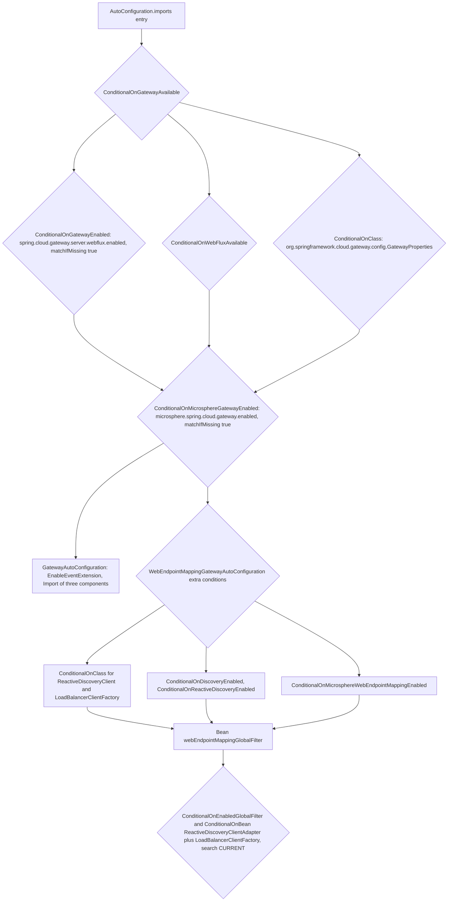
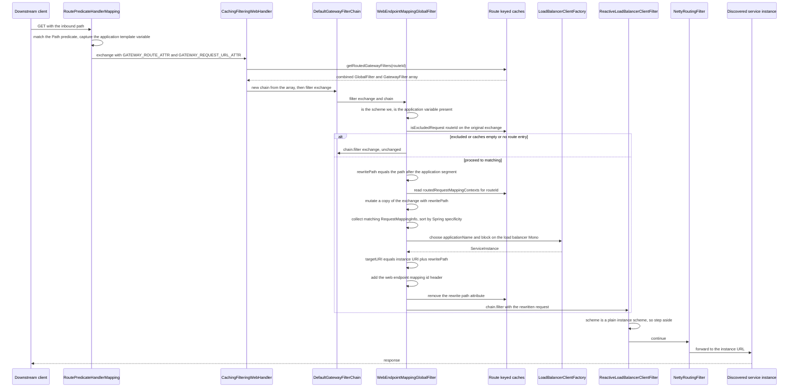
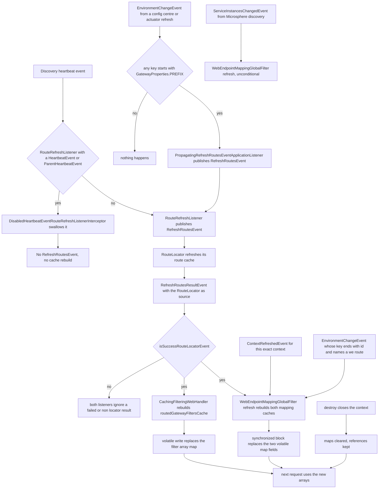
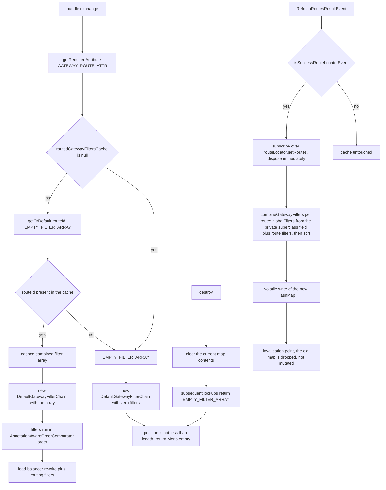

# microsphere-spring-cloud-gateway-server-webflux

`0.2.x` 版本线中响应式网关模块的开发者文档——它是 Spring Cloud Gateway Server WebFlux 与 Microsphere
web-endpoint 服务发现之间的集成层。

| | |
|---|---|
| 坐标 | `io.github.microsphere-projects:microsphere-spring-cloud-gateway-server-webflux:${revision}` |
| 打包类型 | `jar` |
| 父模块 | `microsphere-gateway-parent`（`microsphere-spring-cloud-gateway-server-webflux/pom.xml:5-10`） |
| Java 包根 | `io.microsphere.spring.cloud.gateway.server.webflux` |
| Spring Boot 注册 | `META-INF/spring.factories`（一个 `ApplicationContextInitializer`）+ `META-INF/spring/org.springframework.boot.autoconfigure.AutoConfiguration.imports`（两个自动配置） |

`module-path:line` 形式的指针相对于仓库根目录。

## 架构设计

### 在系统中的角色

本模块把 `we://<services>` 形式的路由 URI 变成响应式网关上的真实流量。三项协作机制完成这项工作：

1. **一个 `GlobalFilter`**（`WebEndpointMappingGlobalFilter`）：它在 Spring Cloud Gateway 负载均衡过滤器之前
   决定*哪个*已发布的 web endpoint 可以服务该请求，改写路径，挑选一个服务实例，并把 `we://` URL 替换为具体的
   实例 URL。
2. **一个带缓存的 `WebHandler`**（`CachingFilteringWebHandler`，由
   `BeanDefinitionRegistryPostProcessor` 换入）：它按路由 id 预先计算 `GlobalFilter` + `GatewayFilter` 的合并
   数组，从而把逐请求的过滤器链装配变成一次数组拷贝。
3. **两处事件适配**（`DisabledHeartbeatEventRouteRefreshListenerInterceptor`、
   `PropagatingRefreshRoutesEventApplicationListener`）：它们改变路由刷新发生的*时机*——针对
   `RouteRefreshListener` 抑制心跳驱动的轮询，并把配置变更提升为 `RefreshRoutesEvent`。

### 包结构

```
io/microsphere/spring/cloud/gateway/server/webflux/
├── annotation/      ConditionalOnGatewayAvailable, ConditionalOnGatewayEnabled
├── autoconfigure/   GatewayAutoConfiguration, WebEndpointMappingGatewayAutoConfiguration
├── constants/       GatewayPropertyConstants
├── context/         WebEndpointApplicationContextInitializer
├── event/           DisabledHeartbeatEventRouteRefreshListenerInterceptor,
│                    PropagatingRefreshRoutesEventApplicationListener
├── filter/          DefaultGatewayFilterChain, WebEndpointMappingGlobalFilter
├── handler/         CachingFilteringWebHandler, FilteringWebHandlerBeanDefinitionRegistryPostProcessor
└── util/            GatewayUtils
```

资源文件：
`src/main/resources/META-INF/spring.factories`、
`src/main/resources/META-INF/spring/org.springframework.boot.autoconfigure.AutoConfiguration.imports`、
`src/main/resources/META-INF/config/default/features.yaml`。

### 自动配置装配

`src/main/resources/META-INF/spring.factories` 只注册了 initializer：

```properties
org.springframework.context.ApplicationContextInitializer=\
io.microsphere.spring.cloud.gateway.server.webflux.context.WebEndpointApplicationContextInitializer
```

`src/main/resources/META-INF/spring/org.springframework.boot.autoconfigure.AutoConfiguration.imports` 注册了两个
配置类，顺序是先 `GatewayAutoConfiguration`、后 `WebEndpointMappingGatewayAutoConfiguration`。真正决定二者顺序的
*不是*文件行序，而是显式的 `@AutoConfigureAfter` 声明
（`.../autoconfigure/WebEndpointMappingGatewayAutoConfiguration.java:54-65`）。

条件栈，按由外到内求值：



有两处顺序决策对贡献者很重要：

* `@AutoConfigureAfter(name = "org.springframework.cloud.gateway.config.GatewayAutoConfiguration")`
  （`.../autoconfigure/GatewayAutoConfiguration.java:42-44`）使用的是 `name` 而不是 `value`，因此即使该类不存在，
  模块也能编译与运行——该属性由 `AutoConfigurationSorter` 反射求值。同样的技巧出现在
  `WebEndpointMappingGatewayAutoConfiguration.java:60-64`。
* 对 `FilteringWebHandlerBeanDefinitionRegistryPostProcessor` 的 `@Import`
  （`.../autoconfigure/GatewayAutoConfiguration.java:45-49`）意味着只有当网关级条件全部通过时才发生
  `FilteringWebHandler` 替换；若 `spring.cloud.gateway.server.webflux.enabled=false`，Spring Cloud Gateway 原生
  handler 会保留原位。

**Bean 覆盖策略。** 本模块从不使用 `spring.main.allow-bean-override=true`，也不会用同名第二份 Bean 定义。它原地
重写既有定义：`registry.removeBeanDefinition(beanName)` 然后
`registerBeanDefinition(registry, beanName, CachingFilteringWebHandler.class)`
（`.../handler/FilteringWebHandlerBeanDefinitionRegistryPostProcessor.java:49-56`），因此原 Bean 名称以及所有按名
注入都不受影响。

## 源码分析

### `annotation/ConditionalOnGatewayEnabled.java`

`@ConditionalOnProperty(name = GATEWAY_ENABLED_PROPERTY_NAME, matchIfMissing = true)`（`:46`）——这里的开关归
Spring Cloud Gateway 自己所有（按 `.../constants/GatewayPropertyConstants.java:37` 即
`spring.cloud.gateway.server.webflux.enabled`），不是 Microsphere 的开关。因此关闭原生网关也就自动关闭了
Microsphere 扩展。

### `annotation/ConditionalOnGatewayAvailable.java`

三个条件的组合（`:62-66`）：`@ConditionalOnGatewayEnabled`、`@ConditionalOnWebFluxAvailable`（来自可选依赖
`microsphere-spring-boot-webflux`）以及 `@ConditionalOnClass(name = "...GatewayProperties")`。
`@ConditionalOnClass` 用 `name` 表达，因此把该注解放在本身不含 Spring Cloud Gateway 的代码里也是安全的；它自己
类级的 `@see` javadoc（`:56`）引用 `org.springframework.cloud.gateway.config.GatewayProperties` 只作文档用途。
javadoc 同时记录了两种使用形态——配置类上以及 `@Bean` 方法上（`:34-51`）。

### `constants/GatewayPropertyConstants.java`

* `GATEWAY_ENABLED_PROPERTY_NAME = PREFIX + DOT + ENABLED_PROPERTY_NAME`（`:46`）
* `GATEWAY_ROUTES_PROPERTY_NAME_PREFIX = PREFIX + DOT + "routes"`（`:53`）

两者都派生自 `org.springframework.cloud.gateway.config.GatewayProperties.PREFIX`（静态导入见 `:26`）。由于
`PREFIX` 是用于常量表达式的 `static final String`，最终得到的名字是**在编译期针对当前 `spring-cloud-*` profile
所选的 Spring Cloud Gateway 制品被内联**的。其后果在快照中都可看到：

* javadoc 记录了 `2025` 的结果：`spring.cloud.gateway.server.webflux.enabled`（`:37`）；
* 测试夹具把同样的路由声明了两遍，一份在 `spring.cloud.gateway.routes` 下
  （`microsphere-spring-cloud-gateway-server-webflux/src/test/resources/META-INF/config/default/test.yaml:117-158`），
  一份在 `spring.cloud.gateway.server.webflux.routes` 下（`:160-205`），因为不同的发布列车使用不同前缀；
* `mvn` 以 `-Ptest,coverage,spring-cloud-{2022,2023,2024,2025}` 执行构建
  （`.github/workflows/maven-build.yml:26-27,46`），因此每一列发布列车都会为自己编译出相应常量。

“前缀随发布列车而不同”这一结论是基于上述制品的推理，而不是快照中打印出来的值。

`GATEWAY_ROUTES_PROPERTY_NAME_PREFIX` 被绑定监听器的注册使用
（`.../context/WebEndpointApplicationContextInitializer.java:46-47`），也被 `EnvironmentChangeEvent` 匹配使用
（`.../filter/WebEndpointMappingGlobalFilter.java:377`）。

### `context/WebEndpointApplicationContextInitializer.java`

继承 `io.microsphere.spring.context.ConfigurableApplicationContextInitializer`（来自
`microsphere-spring-context`），因此它只需实现真正有趣的那一半：

```java
protected void initialize(ConfigurableApplicationContext context, ConfigurableEnvironment environment) {
    ConfigurableListableBeanFactory beanFactory = context.getBeanFactory();
    BeanDefinitionRegistry registry = (BeanDefinitionRegistry) beanFactory;
    registerBeanDefinition(registry, BEAN_NAME,
            WebEndpointConfigurationPropertiesBindListener.class, GATEWAY_ROUTES_PROPERTY_NAME_PREFIX);
}
```
（`:42-48`）

为什么用 initializer 而不是自动配置：`GatewayProperties` 的 `@ConfigurationProperties` 绑定发生在 `refresh()`
早期，因此 `BindListener` 必须在自动配置被解析*之前*就已经是一个 Bean 定义。放在 initializer 中注册可以保证这一
点。构造参数 `GATEWAY_ROUTES_PROPERTY_NAME_PREFIX` 正是让 commons 中共享的监听器变成 webflux 专属的原因。

### `autoconfigure/GatewayAutoConfiguration.java`

```java
@Configuration(proxyBeanMethods = false)
@ConditionalOnGatewayAvailable
@ConditionalOnMicrosphereGatewayEnabled
@EnableEventExtension
@AutoConfigureAfter(name = { "org.springframework.cloud.gateway.config.GatewayAutoConfiguration" })
@Import(value = { DisabledHeartbeatEventRouteRefreshListenerInterceptor.class,
                  PropagatingRefreshRoutesEventApplicationListener.class,
                  FilteringWebHandlerBeanDefinitionRegistryPostProcessor.class })
public class GatewayAutoConfiguration { }
```
（`:38-51`）

它不声明任何 Bean。它的方法体是一个*注册包*：`@EnableEventExtension`（来自
`io.microsphere.spring.context.event`）激活 `ApplicationListenerInterceptor` 基础设施，心跳拦截器由此才真正生效——
否则被 import 的拦截器只是一个没人询问的 Bean。配套测试恰好断言了这三件套
（`.../test/java/.../autoconfigure/GatewayAutoConfigurationTest.java:50-54`）。

`proxyBeanMethods = false` 是全模块约定：不存在需要保留的 `@Bean` 之间调用。

### `autoconfigure/WebEndpointMappingGatewayAutoConfiguration.java`

除五个条件注解外，还带有针对 `ReactiveDiscoveryClient` 与 `LoadBalancerClientFactory` 的
`@ConditionalOnClass(name = ...)`（`:46-53`），以及一个混用类型与名字的 `@AutoConfigureAfter`（`:54-65`）——
类型形式的那些是 Microsphere 自身的配置（`GatewayAutoConfiguration`、`WebFluxAutoConfiguration`、
`ReactiveDiscoveryClientAutoConfiguration`），名字形式的那些属于 Spring Cloud。

唯一的 Bean 方法（`:68-75`）：

```java
@Bean
@ConditionalOnEnabledGlobalFilter
@ConditionalOnBean(value = {ReactiveDiscoveryClientAdapter.class, LoadBalancerClientFactory.class}, search = CURRENT)
public WebEndpointMappingGlobalFilter webEndpointMappingGlobalFilter(ReactiveDiscoveryClientAdapter reactiveDiscoveryClient,
                                                                    LoadBalancerClientFactory loadBalancerClientFactory,
                                                                    GatewayProperties gatewayProperties)
```

三处值得记住的细节：

* `@ConditionalOnEnabledGlobalFilter` 是 Spring Cloud Gateway 自带的
  `spring.cloud.gateway.filter.global-filter.<name>.enabled` 关闭钩子，因此该过滤器可以用原生网关属性来开关。
* `search = CURRENT`（`:70`，静态导入见 `:36`）刻意避开父上下文，因此网关的子上下文（例如负载均衡子上下文）无法
  把这个过滤器重新拉起来。
* 参数类型是 `ReactiveDiscoveryClientAdapter`，而过滤器的构造器声明的是
  `org.springframework.cloud.client.discovery.DiscoveryClient`
  （`.../filter/WebEndpointMappingGlobalFilter.java:112,126`）。代码能够编译，说明
  `ReactiveDiscoveryClientAdapter`——来自 `microsphere-spring-cloud-commons` 的 Microsphere 适配器——是一个数据
  源自 `ReactiveDiscoveryClient` 的 `DiscoveryClient`。这也解释了为什么模块要求*响应式*发现
  （`@ConditionalOnReactiveDiscoveryEnabled`，`:48`），而过滤器中唯一的发现调用
  `discoveryClient.getServices()`（`:407`）却是阻塞形态的。

### `filter/WebEndpointMappingGlobalFilter.java`

核心：487 行，一个类扮演六种角色（`:107-108`）——`GlobalFilter`、`SmartApplicationListener`、
`ApplicationContextAware`、`EnvironmentAware`、`DisposableBean`、`Ordered`。

**不可变状态**（`:112-116`）：`discoveryClient`、`clientFactory`、`gatewayProperties`，由构造器注入。
**可变状态**（`:118-124`）：`context`、`environment`，以及两个 `volatile` 缓存
`routedRequestMappingContextsCache` 与 `routedExcludedRequestMappingInfoCache`，二者都是 `Map<routeId, ...>`。

#### `filter(ServerWebExchange, GatewayFilterChain)` — `:134-168`

```
url = exchange.getAttribute(GATEWAY_REQUEST_URL_ATTR)         // :135
if scheme != "we"            -> chain.filter(exchange)         // :136-140
applicationName = uriTemplateVariables["application"]          // :142-143
if blank                     -> chain.filter(exchange)         // :144-147
ctx = getMatchingRequestMappingContext(applicationName, exchange)  // :149
if ctx != null:
    instance = choose(applicationName)                          // :153
    if instance != null:
        targetURI = instanceUri + rewritePath                   // :155-158
        request = mutate().header(ID_HEADER_NAME, ctx.id)       // :160-162
        attributes[GATEWAY_REQUEST_URL_ATTR] = targetURI        // :163
        return chain.filter(exchange.mutate().request(request)) // :164
return chain.filter(exchange)                                   // :167
```

所有不适用的分支都是干净的放行：该过滤器从不截断请求，它只改写或退让。这就是核心不变式——安装了这个过滤器但没有
`we://` 路由的应用，其行为与原生 Spring Cloud Gateway 完全一致。

顺序：`LOAD_BALANCER_CLIENT_FILTER_ORDER - 1`（`:213-215`），在
`.../autoconfigure/WebEndpointMappingGatewayAutoConfigurationIntegrationTest.java:75` 中断言为 `10149`。排在负载
均衡过滤器之前一位，正是让改写对它可见的原因：改写后的 URL 是具体实例 URL，于是
`ReactiveLoadBalancerClientFilter` 看到非 `lb` scheme 就退让，交由 `NettyRoutingFilter` 转发。

请注意 `:158` 处的路径处理：`create(uri + rewritePath)` 只是把实例基础 URI（来自外部
`ServiceInstanceUtils.getUriString`）与改写后的路径做朴素字符串拼接。真正感知 context-path 的辅助方法
`buildPath(...)`（`:466-480`）存在，用来正确完成这件事——它会剥掉 `/<serviceId>/` 并重新套用实例的
`WEB_CONTEXT_PATH_METADATA_NAME`——但**没有任何生产代码路径调用它**；只有
`.../filter/WebEndpointMappingGlobalFilterStaticTest.java:42-52` 覆盖了它。如果你要修一个 context-path 缺陷，这段
逻辑的应归之处就是那个辅助方法。

#### 匹配：`getMatchingRequestMappingContext` — `:300-348`

公开形态的入口（`:300-304) 从 `GATEWAY_ROUTE_ATTR` 解析路由 id；包私有的重载（`:306-348`）才是可测试的核心，签名
是 `(applicationName, routeId, exchange)`：

1. `isExcludedRequest(routeId, exchange)`（`:307`、`:359-367`）——用**原始** exchange 去匹配路由的
   `metadata.web-endpoint.excludes` 模式。由于它作用于未经改动的请求，排除模式要以入站路径的视角来书写。
2. 空缓存守卫（`:313-319`），随后是按路由为空的守卫（`:321-327`）。
3. 计算 `rewritePath = substringAfter(path, "/" + applicationName)`（`:333`），并写入 exchange attribute
   `msgw-we-rewrite-path`（`:334`）——即 `:157` 处消费的交接值。
4. 构造一个带改写路径的 exchange *可变副本*（`:335-336`）——匹配过程从不修改调用方的 exchange。
5. 收集所有 `RequestMappingInfo.getMatchingCondition(newExchange)` 非 null 的上下文（`:339-344`），用
   `RequestMappingInfo.compareTo(other, exchange)` 排序（`:345`、`:434-436`），返回 `first(...)`（`:347`）。

第 5 步是复用而非重新实现 Spring 自身特异性排序之处：比较器委托给 `RequestMappingInfo.compareTo`，因此模式、
params、headers 与媒体类型的_ranking_与 MVC 应用完全一致。

#### 缓存构建：`refresh()` — `:239-259`

```java
Map<...> routedRequestMappingContextsMap = new ConcurrentHashMap<>();      // :240
Map<...> routedExcludedRequestMappingInfoMap = new ConcurrentHashMap<>();  // :241
for (RouteDefinition webEndpointRoute : getWebEndpointRoutes()) { ... }    // :244-252
synchronized (this) {                                                      // :255-258
    this.routedRequestMappingContextsCache = routedRequestMappingContextsMap;
    this.routedExcludedRequestMappingInfoCache = routedExcludedRequestMappingInfoMap;
}
```

* 它读取 `gatewayProperties.getRoutes()`——即*定义*列表，而不是解析后的 `Route` 列表——因此缓存来自配置，而不是
  来自 route locator 的输出（`:392-402`）。
* `buildRequestMappingContexts(routeUri)`（`:272-285`）从 URI host 解析出订阅的服务集合，对每个服务调用
  `choose(service)` 取**一个样本实例**，然后读取其 `WebEndpointMapping` 集合
  （`ServiceInstanceUtils.getWebEndpointMappings`，外部）。设计假设是同一服务的所有实例发布完全相同的映射；因此运行
  旧构建的灰度实例不会被反映——`:275` 处的 `TODO support ZonePreferenceFilter` 标注的正是同一处“只用一个实例”的简化。
* `buildExcludedRequestMappingInfoSet`（`:261-270`）在没有判空的情况下解引用了 `findWebEndpointConfig(...)` 的结果，
  而 Servlet 侧的同名方法在配置缺失时显式返回 `emptySet()`
  （`.../webmvc/filter/WebEndpointMappingHandlerFilterFunction.java:179-182`）。由于
  `ConfigUtils.getWebEndpointConfig(Map)` 只有在 Map 中确实存在 `WebEndpointConfig` 时才非 null，一条
  `metadata.web-endpoint` 子树绑定不出任何东西的 `we://` 路由会在这一行的 `refresh()` 内抛出
  `NullPointerException`。快照中没有覆盖“无 `web-endpoint` 块的 `we://` 路由”的测试，因此请把它当作代码阅读得出的
  结论——同时也把它当作仓库中每条夹具路由都声明了 `excludes` 的原因。
* 两个 Map 即便通过 volatile 引用换出来发布，仍然建成 `ConcurrentHashMap`。读取方只做 `get`/`getOrDefault`，因此
  真正重要的并发保证是那次 volatile 写；`synchronized (this)` 块让两次赋值相对于并发的 `refresh()` 是原子的，但一个
  请求线程独立读取这两个字段时，仍可能看到新的 contexts 缓存配上过期的 excludes 缓存。两者都以路由 id 为键且只用于
  接受或拒绝，所以一代的偏差是无害的。

#### 事件处理 — `:175-237`

`supportsEventType`（`:175-180`）使用 `equals` 而非 `isAssignableFrom`：只有
`ContextRefreshedEvent`、`RefreshRoutesResultEvent`、`EnvironmentChangeEvent` 与
`io.microsphere.spring.cloud.client.event.ServiceInstancesChangedEvent` 这四种精确类型能进入
`onApplicationEvent`（`:183-194`），后者再用模式匹配的 `instanceof` 分派。`supportsAsyncExecution()` 返回 `false`
（`:170-172`）且不带 `@Override`；它对应的是当前 Spring Framework 版本中 `ApplicationListener` 的异步执行标志，作用是
让这个监听器留在发布线程上执行——与“同一对象同时也在请求路径上充当过滤器”这一事实相一致。

* `onContextRefreshedEvent`（`:217-221`）只在 `this.context == event.getApplicationContext()` 时刷新——这个同一性
  检查阻止子上下文（负载均衡上下文就是子上下文）触发重建。
* `onRefreshRoutesResultEvent`（`:223-227`）只在*成功*的 `RouteLocator` 结果时刷新
  （`GatewayUtils.isSuccessRouteLocatorEvent`，`.../util/GatewayUtils.java:103-105`）。
* `onEnvironmentChangeEvent`（`:229-233`、`:373-390`）是有选择的：需要非空 key 集合、需要某个 key 以路由前缀开头、该
  key *结尾*必须是 `id`（`lastIndex == key.length() - ID_KEY.length()`，`:378-379`），并且该属性的值必须匹配当前某个
  `we` 路由 id。请注意 `endsWith("id")` 判断是按位置做的子串检查，而不是按段比较，所以
  `...routes[0].some-id` 这类 key 也会满足条件；而当 key 集合为空时 `getWebEndpointRoutes()` 根本不会被调用
  （`:375`），这正是 `WebEndpointMappingGlobalFilterTest` 用 `new EnvironmentChangeEvent(emptySet())` 走到的分支
  （`.../filter/WebEndpointMappingGlobalFilterTest.java:163`）。
* `onServiceInstancesChangedEvent`（`:235-237`）无条件刷新——Microsphere 的实例变更事件就是心跳轮询的替代品。

`destroy()`（`:207-210`）通过静态 `clear(Map)` 辅助方法（`:482-486`）清空两个 Map 的*内容*，但保留引用本身，因此关闭
之后的请求走的是“该路由没有上下文”分支，而不是“缓存为 null”分支。仅供测试使用的 `clear()`（`:416-421`）只把 contexts
缓存置空，被 `WebEndpointMappingGlobalFilterTest#testFilterOnNoRoutedRequestMappingContext` 使用
（`.../filter/WebEndpointMappingGlobalFilterTest.java:186-194`）。

`:306-319` 中的**顺序隐患**值得维护者写一条注释：`isExcludedRequest`（`:359-367`）在到达*另一个*缓存的 null 守卫
之前就解引用了 `routedExcludedRequestMappingInfoCache`。这个类依赖“`ContextRefreshedEvent` 在流量到来前已经把两个缓存
都填好”，而不是依赖某个守卫。

#### `RequestMappingContext` — `:423-464`

一个包私有值对象，把 Spring 的 `RequestMappingInfo` 与 `WebEndpointMapping` 的 id 配对。两个静态
`buildRequestMappingInfo` 重载共用同一套 builder 管道——一个来自配置模型 `Mapping`（`:438-446`），一个来自发现到的
元数据（`:448-457`）——而 `buildRequestMethods`（`:459-463`）用 `RequestMethod.valueOf` 转换
`WebEndpointMapping.getMethods()` 的字符串。因此新增一种条件属性意味着同时修改两个重载。

`compareTo(RequestMappingContext, ServerWebExchange)`（`:434-436`）是通往 Spring 自身排序的桥。

### `filter/DefaultGatewayFilterChain.java`

对 `GatewayFilterChain` 基于数组的最小化显式重写（`:36-59`）：

```java
if (position < length) {
    GatewayFilter gatewayFilter = this.gatewayFilters[position++];
    return defer(() -> gatewayFilter.filter(exchange, this));
}
return empty();
```

* 构造器校验非 null 且元素非 null（`:44-50`），抛出 `IllegalArgumentException`，
  `DefaultGatewayFilterChainTest#testConstructorWithNullGatewayFilter` 对此做了断言
  （`.../filter/DefaultGatewayFilterChainTest.java:47-49`）。
* `position` 可变，**不是**线程安全的，也不可重复订阅：同一实例只代表一次遍历。
  `.../filter/DefaultGatewayFilterChainTest.java:56-58` 证明了耗尽后的行为——在一个只有单个过滤器的链上第二次调用
  `filter(...)` 返回的是与终止分支相同的 `Mono.empty()`。
* `Mono.defer` 让每一步相对订阅惰性求值，而不是在装配期急求值。
* 它由 `CachingFilteringWebHandler.handle`（`:69`）逐请求新建，并在测试以及集成测试的过滤器调用中被直接使用
  （`.../autoconfigure/WebEndpointMappingGatewayAutoConfigurationIntegrationTest.java:69`）。

### `handler/CachingFilteringWebHandler.java`

```java
public class CachingFilteringWebHandler extends FilteringWebHandler implements DisposableBean {   // :55
    static final GatewayFilter[] EMPTY_FILTER_ARRAY = new GatewayFilter[0];                       // :57
    private volatile Map<String, GatewayFilter[]> routedGatewayFiltersCache = null;               // :59
```

`handle` 完全替换了父类实现（`:65-70`）：用 `getRequiredAttribute` 从 `GATEWAY_ROUTE_ATTR` 取匹配到的 `Route`，
取出预计算好的数组，然后运行一个新的 `DefaultGatewayFilterChain`。`super.handle(...)` 从未被调用。

`combineGatewayFilters(route)`（`:107-115`）把 `globalFilters()` 与 `route.getFilters()` 拼接，用
`AnnotationAwareOrderComparator.sort`（`:39`）排序，并拷贝进 `EMPTY_FILTER_ARRAY`。`globalFilters()`
（`:121-123`）通过反射读取父类的私有字段——`getFieldValue(true, this, "globalFilters")`——这就是继承一个状态私有的
类所要付的代价：Spring Cloud Gateway 一旦重命名该字段，这个方法会在运行期而不是编译期被破坏。

缓存构建（`:87-95`）以命令式方式抽干响应式路由流：

```java
routeLocator.getRoutes().subscribe(route -> { ... put(routeId, filters) ... }).dispose();
```

`subscribe(...).dispose()` **同步地**收集到一个普通 `HashMap`，并立刻丢弃订阅。之所以只有在这个前提下正确，是因为
运行中网关里的 `RouteLocator` 是 Spring Cloud Gateway 的缓存型 locator，其 `Flux` 已经实体化。若数据源将来需要真正
的 I/O，路由就会静默地缺失于缓存中。该 `HashMap` 随后通过 volatile 字段发布（`:83`），此后不再被修改，属于安全发布
模式。

`getRoutedGatewayFilters(route)`（`:97-105`）就是这个类全部的失败模式：缓存为 `null` 返回
`EMPTY_FILTER_ARRAY`，未知路由 id 通过 `getOrDefault` 返回 `EMPTY_FILTER_ARRAY`。数组为空时，
`DefaultGatewayFilterChain.filter` 立刻返回 `Mono.empty()`
（`.../filter/DefaultGatewayFilterChain.java:52-58`）——也就是说，**请求被以一次空的、不经过任何过滤器的完成来响应，
而不是被路由出去**。因此这个类之所以安全，只是因为 `RefreshRoutesResultEvent` 在启动期（`RouteLocator` 刷新）先于
流量到达。`CachingFilteringWebHandlerTest#testGetRoutedGatewayFilters` 断言了空缓存分支
（`.../handler/CachingFilteringWebHandlerTest.java:67-70`）。

失效完全由事件驱动——`@EventListener(RefreshRoutesResultEvent.class)`（`:79-85`）——并经
`isSuccessRouteLocatorEvent` 过滤（`:117-119`）。`destroy()`（`:72-77`）清空 Map 内容。没有 TTL，也没有按路由的
逐出。

### `handler/FilteringWebHandlerBeanDefinitionRegistryPostProcessor.java`

```java
public void postProcessBeanDefinitionRegistry(BeanDefinitionRegistry registry) { this.registry = registry; }   // :43-46
public void postProcessBeanFactory(ConfigurableListableBeanFactory beanFactory) {
    String[] beanNames = beanFactory.getBeanNamesForType(FilteringWebHandler.class, false, false);              // :51
    for (String beanName : beanNames) {
        registry.removeBeanDefinition(beanName);                                                              // :53
        registerBeanDefinition(registry, beanName, CachingFilteringWebHandler.class);                         // :54
    }
}
```

* `getBeanNamesForType(FilteringWebHandler.class, false, false)` 传入
  includeNonSingletons = `false`、`allowEagerInit = false`，即只依据 Bean 定义声明的类型/工厂返回类型做类型匹配，
  不创建任何实例。这既是此刻换入之所以安全的原因，也把它限定在类型静态可知的定义上——Spring Cloud Gateway 的
  `@Bean` 方法满足条件。
* 循环是复数形式，这是设计决定：如果应用注册了多个 `FilteringWebHandler` Bean，全部会被替换。
* 替换时只给了类，没有显式构造参数，这与绑定监听器的注册不同，后者确实传了参数
  （`.../context/WebEndpointApplicationContextInitializer.java:46-47`）。
  `CachingFilteringWebHandler` 唯一的构造器接收 `List<GlobalFilter>`（`:61-63`），因此解析落到 Spring 的单构造器
  自动装配，注入所有 `GlobalFilter` Bean。它仍然会收到 Spring Cloud Gateway 原本会传入的同一份过滤器列表——这是关于
  Spring 实例化行为的推断，快照并未断言这一点。
* 作为一个不带 `Ordered`/`PriorityOrdered` 标记的 `BeanDefinitionRegistryPostProcessor`，它在后处理器的“常规”组中
  执行——即在 `ConfigurationClassPostProcessor` 之后，所以换入时 Spring Cloud Gateway 自身的 Bean 定义已经存在。
  `GatewayAutoConfigurationTest` 把它列在该自动配置类的导入清单中
  （`.../autoconfigure/GatewayAutoConfigurationTest.java:53`）。

### `event/DisabledHeartbeatEventRouteRefreshListenerInterceptor.java`

一个 `io.microsphere.spring.context.event.ApplicationListenerInterceptor`（`:41`、`:47-58`）：

```java
if (INTERCEPTED_CLASS.equals(listenerClass) && matchesHeartbeatEvent(eventClass)) {
    logger.trace(...); return;                       // swallow
}
chain.intercept(applicationListener, event);         // otherwise continue the chain
```

`INTERCEPTED_CLASS` 是 `RouteRefreshListener`，用 `equals` 比较（`:45`、`:52`），事件判断则是与
`HeartbeatEvent` 和 `ParentHeartbeatEvent` 的精确类相等（`:60-62`）。因此二者的子类*不会*被拦截——这是一种刻意的
收窄，以免抑制逻辑吞掉无关的监听器。其形态是职责链：拦截器自行决策，否则委托给
`ApplicationListenerInterceptorChain`；而它之所以会执行，只是因为 `GatewayAutoConfiguration` 带有
`@EnableEventExtension`。

它为何存在：Spring Cloud Gateway 的 `RouteRefreshListener` 会对发现心跳事件做出反应，于是按
`instance-info-cache` 间隔产生的每次心跳都会重建 `CachingFilteringWebHandler` 的过滤器数组和
`WebEndpointMappingGlobalFilter` 的映射缓存，即便什么都没变。本模块用 `ServiceInstancesChangedEvent` 取代轮询驱动的
刷新（过滤器的 `:235-237`），并把 `RefreshRoutesEvent` 留给真正的配置变更。

### `event/PropagatingRefreshRoutesEventApplicationListener.java`

一个 `ApplicationListener<EnvironmentChangeEvent>`（`:20`），只要有任意变更 key 以
`GatewayProperties.PREFIX` 开头就发布 `new RefreshRoutesEvent(this)`（`:29-46`）。它的
`ApplicationContext` 由构造器注入，因此它是通过 `GatewayAutoConfiguration` 的 `@Import` 创建的 Bean（`:47`）。

它补上了一个缺口：Spring Cloud Gateway 在收到 `RefreshRoutesEvent` 时刷新路由，但一次
`spring.cloud.gateway...` 属性变更——来自 `/actuator/refresh` 或配置中心——是以
`EnvironmentChangeEvent` 形式到达的。该监听器把前者转换成后者；并且由于发布事件的 source 是监听器自身，
`isSuccessRouteLocatorEvent` 仍然要求*下游*的 `RefreshRoutesResultEvent`（其 source 是 `RouteLocator`），两个缓存才
会动作。`PropagatingRefreshRoutesEventApplicationListenerTest` 对两个方向都做了断言
（`.../event/PropagatingRefreshRoutesEventApplicationListenerTest.java:60-81`）。

### `util/GatewayUtils.java`

一个不可实例化的辅助类（`:45`，私有构造器 `:107-108`），三个方法：

* `getGatewayProperties(ConfigurableEnvironment)`（`:53-56`）——经由
  `PropertySourcesUtils.getSubProperties` 拿到扁平化的 `spring.cloud.gateway...` 属性。
* `getRouteProperties(ConfigurableEnvironment, String routeId)`（`:66-95`）——在扁平化的 Map 中扫描*值*等于路由 id
  的条目，取 `substringBeforeLast(propertyName, ".")` 作为该路由的前缀，然后收集该前缀下的全部属性并返回
  `unmodifiableMap`（`:94`），找不到 id 时返回 `emptyMap()`（`:80-82`）。两个属性值相同时可能错配前缀——查找是按值、
  而非按结构进行的。它是给使用者与工具使用的公开 API，本模块自身的请求路径并不使用它（grep 验证：只有
  `GatewayUtilsTest` 调用）。
* `isSuccessRouteLocatorEvent(RefreshRoutesResultEvent)`（`:103-105`）——判空安全，要求 `event.isSuccess()` 且
  `event.getSource() instanceof RouteLocator`。它是两条缓存刷新路径共用的闸门
  （`.../filter/WebEndpointMappingGlobalFilter.java:369-371` 与
  `.../handler/CachingFilteringWebHandler.java:117-119`），而
  `GatewayUtilsTest#testIsSuccessRouteLocatorEvent` 钉住了全部四种组合
  （`.../util/GatewayUtilsTest.java:93-101`）。

## `we://` 路由的请求生命周期



上面有一行值得评审者特别注意：`.../filter/WebEndpointMappingGlobalFilter.java:293-298` 处的负载均衡调用在
`filter(...)` 内部执行了**对负载均衡器 `Mono` 的阻塞读取**（`MonoUtils.getValue`，来自
`microsphere-spring-web`），而在运行中的网关上这就发生在 Netty 事件循环线程上。`choose(...)` 也会被 `refresh()`
调用（`:277`），此时它运行在 `ContextRefreshedEvent` / `RefreshRoutesResultEvent` /
`ServiceInstancesChangedEvent` 的发布线程上。任何对该类的改动都必须记住这一点：reactor 禁止在 `NonBlocking` 线程上
`block()`，因此这里的实现改动要么必须离开事件循环，要么必须在不阻塞的前提下解析实例。

## 路由刷新与缓存失效



## `CachingFilteringWebHandler` 的缓存行为



`buildRoutedGatewayFiltersCache` 赋的是一个*全新*的 Map，并通过 volatile 字段发布，因此在途请求会继续读取旧的数组
集合——失效靠替换而非修改完成，只有 `destroy()` 是原地修改 Map 内容。

## 设计模式

这里只列本模块代码真实体现出的模式。每条给出位置、它解决的问题、收益与代价。

**职责链（Chain of Responsibility，手写、基于游标）。**
位置：`DefaultGatewayFilterChain.java:36-59` 实现 Spring Cloud Gateway 的 `GatewayFilterChain`；
`GatewayFilter[]` + `position` 游标见 `:38-42`，推进并分派见 `:55`，终止见 `:58`。
动机：模块需要运行自己的过滤器列表（缓存的那一份），而不是 `FilteringWebHandler` 每次请求临时构建的那一份。
收益：除链对象本身外没有额外分配，每跳 O(1)，整条 handler 路径可以一句话说清：
`new DefaultGatewayFilterChain(routedGatewayFilters).filter(exchange)`（`CachingFilteringWebHandler.java:69`）。
代价：该链是有状态的（`position` 在 `:55` 被修改），因此只能用一次、不是线程安全的；必须逐请求构建，而 `handle`
正是这么做的。链耗尽时返回 `Mono.empty()`（`:58`），而不是给出“没有过滤器处理它”的信号，因此一条过滤器列表为空的路
由会静默产生空响应。

**链头的惰性求值。**
位置：`defer(() -> gatewayFilter.filter(exchange, this))`（`DefaultGatewayFilterChain.java:56`）。
动机：`GatewayFilter.filter` 可能在装配阶段而非订阅阶段抛异常。
收益：过滤器调用期间抛出的异常表现为响应式管道内的错误信号，而不会逸出 `handle`。
代价：每跳多包一层 `Mono`。

**通过继承实现的装饰器，由 Bean 定义替换装入。**
位置：`CachingFilteringWebHandler.java:55`（`extends FilteringWebHandler implements DisposableBean`），
`:65-70` 覆写 `handle` 且**从不**调用 `super.handle`；替换由
`FilteringWebHandlerBeanDefinitionRegistryPostProcessor.java:49-56` 完成
（`:51` 处 `getBeanNamesForType(FilteringWebHandler.class, false, false)`，随后移除并重新注册）。
动机：Spring Cloud Gateway 把 handler 暴露为一个具体 Bean，既没有可实现也没有可插入的接口与定制钩子。
收益：不 fork 网关、也不用引入一个会让原对象照样实例化的 `@Primary` Bean，就完成行为级完全替换。
代价：装饰器依赖父类私有状态——`globalFilters()` 通过反射读字段
（`CachingFilteringWebHandler.java:121-123`）——因此 Spring Cloud Gateway 的重命名会在运行期静默破坏它。覆写
`handle` 而不调用 `super` 意味着父类将来的任何行为（指标、断言重检查）都会丢失。

**Null Object。**
位置：`EMPTY_FILTER_ARRAY`（`CachingFilteringWebHandler.java:57`），缓存为 `null` 与路由 id 未知两种情况都返回它
（`:99-104`）；`DefaultGatewayFilterChain.java:58` 的 `empty()` 终止分支；
`WebEndpointMappingGlobalFilter` 在未匹配时的 `Mono.empty()` 返回路径。
收益：分派循环里没有 `null` 判断；`CachingFilteringWebHandlerTest.java:67-70` 钉住了空缓存分支。
代价：“没有过滤器”与“缓存尚未构建”在运行期不可区分，而这正是缺失
`RefreshRoutesResultEvent` 会导致“无过滤器路由”的失败模式所在。

**写时复制的快照发布。**
位置：`CachingFilteringWebHandler.java:59`（`volatile Map<String, GatewayFilter[]>`），并在 `:83` 赋一个刚构建好的
Map；`WebEndpointMappingGlobalFilter.java` 中同一套纪律——两个 `volatile` 集合（`:112-124`）在
`synchronized (this)` 内构建并一起换出（`:239-259`）。
动机：请求线程每个 exchange 都读缓存，而刷新事件会重建缓存。
收益：无锁读取；读取者要么看到完整的旧快照，要么看到完整的新快照。
代价：过滤器中的构建被 `synchronized` 串行化，而 handler 的构建*没有*——它依赖事件是单线程的。两种结构都没有 TTL
也没有逐出。

**自带过滤能力的观察者。**
位置：`WebEndpointMappingGlobalFilter` 实现 `SmartApplicationListener`，并在 `supportsEventType` 中对四种事件类型
做精确 `equals` 收窄（`:175-180`），随后在 `onApplicationEvent` 分派（`:183-194`）；
`PropagatingRefreshRoutesEventApplicationListener.java:29-46` 是一个普通的
`ApplicationListener<EnvironmentChangeEvent>`，负责重新发布 `RefreshRoutesEvent`。
收益：注册成本仍由 Spring 默认多播器承担；不需要的事件在任何工作之前就被拒绝。
代价：精确类型匹配意味着被订阅事件的子类会被忽略——本模块订阅的集合是 `ContextRefreshedEvent`、
`RefreshRoutesResultEvent`、`EnvironmentChangeEvent` 与 `ServiceInstancesChangedEvent`（`:176-179`），所以例如心跳
事件根本到不了这个监听器；这条规则是静默的，并没有以抛异常的方式表达。

**围绕观察者的拦截器链（亦即管道）。**
位置：`DisabledHeartbeatEventRouteRefreshListenerInterceptor.java:45-62`，经由
`ApplicationListenerInterceptor`/`ApplicationListenerInterceptorChain` SPI 装配，该 SPI 由
`GatewayAutoConfiguration.java:41` 上的 `@EnableEventExtension` 打开。
动机：Spring Cloud Gateway 的 `RouteRefreshListener` 会对心跳事件做出反应，而在心跳频繁的服务网格中这会造成毫无意义
的路由刷新。
收益：从不继承或替换框架类；抑制是声明式且可回退的（`:57` 处的 `chain.intercept(...)`
为其它所有事件保留了默认路径）。
代价：对监听器类做精确相等比较（`:45`、`:52`）意味着用户提供的 `RouteRefreshListener` 子类*不会*被拦截，并且该机制
来自外部 `microsphere-spring-*` 技术栈。

**面向框架查找的外观（Facade）。**
位置：`GatewayUtils.java:45-109`——`getGatewayProperties`（`:53-56`）、`getRouteProperties`（`:66-95`）、
`isSuccessRouteLocatorEvent`（`:103-105`）、私有构造器（`:107-108`）。
收益：把“路由属性通过扫描 `Environment` 的前缀读取，结果要么不可变要么为空”（`:81`、`:94`）以及“route-locator
事件仅在成功时算数”集中表达在一处。
代价：`getGatewayProperties` 与 `getRouteProperties` 目前在本仓库中**没有任何主源码调用者**（只有
`GatewayUtilsTest`），因此这个外观有一部分属于投机性的通用化。

**以 exchange attribute 实现的黑板（Blackboard）。**
位置：`WEB_ENDPOINT_REWRITE_PATH_ATTRIBUTE_NAME` 在匹配期写入
（`WebEndpointMappingGlobalFilter.java:334`），在转发期移除（`:157`），另有 `:163` 写入的
`GATEWAY_REQUEST_URL_ATTR`。
动机：改写后的路径在匹配深处得出，却在转发步骤才需要，而这两步并不共享返回类型。
收益：无需修改包私有匹配方法的签名。
代价：该值在*未*匹配的结果下依然残留（`:334` 在任何匹配结论已知之前就已写入），因此读取者不能假定“属性存在即代表
匹配成功”，并且 `:157` 处的强转未经检查。

**由条件注解选择的策略。**
位置：`GatewayAutoConfiguration.java:45-49` 的 `@Import` 列表，以及
`WebEndpointMappingGatewayAutoConfiguration.java:68-75` 中被 `@ConditionalOnEnabledGlobalFilter` 与
`@ConditionalOnBean(..., search = SearchStrategy.CURRENT)` 守护的 Bean 方法。
收益：“缓存 handler”策略与“web endpoint mapping”策略可以各自独立开关。
代价：三层重叠的条件来源（`@ConditionalOnGatewayAvailable`、`@ConditionalOnMicrosphereGatewayEnabled`、
`@ConditionalOnBean`）可能造成某个自动配置被跳过，而默认日志级别下没有任何一行日志说明原因。

本模块**明确不存在**的模式：没有 Builder，没有 Abstract Factory，没有自设计的 `Route` 组合树，没有
`Mono`/`Flux` 自定义调度器（没有任何地方调用 `publishOn`/`subscribeOn`；
`WebEndpointMappingGlobalFilter.java:293-298` 处的阻塞 `MonoUtils.getValue` 恰恰相反），也没有 Bean 级的
Strategy 接口——唯一的多态就是 `FilteringWebHandler` 的子类。

---

## 模块依赖图

本指南的每个模块文档都包含同一张 reactor 图；节点 `F` 即本模块。

```mermaid
graph TD
    subgraph reactor["Maven reactor microsphere-gateway"]
        ROOT["microsphere-gateway (aggregator pom)"]
        P["microsphere-gateway-parent (pom)"]
        D["microsphere-gateway-dependencies (pom, BOM)"]
        C["microsphere-spring-cloud-gateway-commons (jar)"]
        F["microsphere-spring-cloud-gateway-server-webflux (jar)"]
        M["microsphere-spring-cloud-gateway-server-webmvc (jar)"]
    end
    ROOT --> P
    ROOT --> D
    ROOT --> C
    ROOT --> F
    ROOT --> M
    P -->|parent of| D
    P -->|parent of| C
    P -->|parent of| F
    P -->|parent of| M
    F -->|"compile, revision"| C
    M -->|compile| C

    subgraph optMF["External Microsphere, optional scope"]
        SCP["microsphere-annotation-processor"]
        SCC["microsphere-spring-cloud-commons"]
        SBW["microsphere-spring-boot-webflux"]
    end
    subgraph transitiveMF["Reached transitively, not declared in this pom"]
        SBCONTEXT["microsphere-spring-context, provides EnableEventExtension"]
    end
    subgraph testMF["External Microsphere, compile scope here"]
        SBT["microsphere-spring-boot-test, no scope tag in this pom"]
    end
    subgraph scgProfiles["Spring Cloud Gateway, per Maven profile, optional"]
        GW2025["spring-cloud-gateway-server-webflux, spring-cloud-2025 default"]
        GW2022["spring-cloud-starter-gateway, spring-cloud-2022 2023 2024"]
    end
    subgraph optSF["External Spring, optional scope"]
        SCOM["spring-cloud-commons"]
        SLB["spring-cloud-loadbalancer"]
        SBWF["spring-boot-starter-webflux"]
        SBOOT["spring-boot-starter, starter-actuator"]
        SPROC["spring-boot-configuration-processor, spring-boot-autoconfigure-processor"]
    end
    subgraph testSF["External Spring, test scope"]
        JUP["junit-jupiter"]
        SBTEST["spring-boot-starter-test"]
    end

    SCP --> F
    SCC --> F
    SBW --> F
    SBCONTEXT --> F
    SBT --> F
    GW2025 --> F
    GW2022 --> F
    SCOM --> F
    SLB --> F
    SBWF --> F
    SBOOT --> F
    SPROC --> F
    JUP --> F
    SBTEST --> F
    SCBOM["microsphere-spring-cloud-dependencies 0.2.26, imported BOM"] --> P
```



来自 `microsphere-spring-cloud-gateway-server-webflux/pom.xml` 的作用域事实：除 commons 模块之外，所有依赖都是
`optional` 或 `test`（`:21-113`）；`microsphere-spring-boot-test` 声明时*没有*作用域标签（`:108-112`），而另外两个
模块把它标为 `test`——这是反应堆中一处真实、虽然只是表面不一致的地方。Spring Cloud Gateway 依赖本身随 profile 变动
（`:116-168`），其中 `spring-cloud-2025` 为 `activeByDefault`（`:153-157`）。

## 构建与测试指引

```bash
./mvnw -pl microsphere-spring-cloud-gateway-server-webflux -am test
./mvnw -pl microsphere-spring-cloud-gateway-server-webflux test -Ptest,spring-cloud-2023
./mvnw -pl microsphere-spring-cloud-gateway-server-webflux test -Ptest,spring-cloud-2025
```

此处需要关注的 profile：`spring-cloud-2022`、`spring-cloud-2023`、`spring-cloud-2024` 添加
`spring-cloud-starter-gateway`，`spring-cloud-2025`（默认）添加
`spring-cloud-gateway-server-webflux`（`microsphere-spring-cloud-gateway-server-webflux/pom.xml:116-168`）。
CI 会用 `-Ptest,coverage,<profile>` 跑 JDK 17/21/25 × 四个 profile 的完整矩阵
（`.github/workflows/maven-build.yml:23-46`），因此对 `@ConditionalOnClass` 名字的改动必须同时在最旧的一列发布列车
上成立。

夹具使用的 Spring profile（`src/test/resources/META-INF/config/default/test.yaml`）：`nacos`、`eureka`、
`zookeeper`、`consul`、`kubernetes`、`simple-service-registry`、`gateway`。默认文档禁用了所有 discovery client
（`:5-27`），`gateway`（`:110-205`）提供两棵路由树。

| 测试类 | 覆盖内容 |
|---|---|
| `autoconfigure/GatewayAutoConfigurationTest` | `GatewayAutoConfiguration` 的正/负条件矩阵，包括三个被 `@Import` 的组件与“类缺失”各例（`Flux`、`DispatcherHandler`、`GatewayProperties` 等）——`.../autoconfigure/GatewayAutoConfigurationTest.java:49-71` |
| `autoconfigure/WebEndpointMappingGatewayAutoConfigurationTest` | 针对 web-endpoint 配置的同样矩阵，额外把 `spring.cloud.discovery.reactive.enabled` 与 `microsphere.spring.cloud.web-endpoint-mapping.enabled` 作为开关 |
| `autoconfigure/WebEndpointMappingGatewayAutoConfigurationIntegrationTest` | 以 `@EnableAutoConfiguration` 在随机端口启动，用真实过滤器跑 `MockServerWebExchange`，断言 order 为 `10149`，调用 `destroy()`，并分别喂入成功与失败的 `RefreshRoutesResultEvent`（`:57-86`） |
| `filter/WebEndpointMappingGlobalFilterTest` | 借助 `WebTestClient.bindToApplicationContext` 针对自注册服务（`test-app`）的端到端 `we://` 往返、三个 `excludes` 用例（`/test-1/**`、`/test-2/**`、`/test-3/abc/**`）、`ServiceInstancesChangedEvent`、带与不带 key 的 `EnvironmentChangeEvent`、未注册应用的路径，以及清空缓存的路径（`:134-204`） |
| `filter/WebEndpointMappingGlobalFilterStaticTest` | 仅覆盖 `buildPath`——那个没有接入 `filter(...)` 的辅助方法 |
| `filter/DefaultGatewayFilterChainTest` | 构造器校验、耗尽后的 `Mono.empty()`、多过滤器遍历 |
| `filter/NoOpGatewayFilter` | 测试夹具，不是测试 |
| `handler/CachingFilteringWebHandlerTest` | 初始化前与初始化后的 `destroy`、throwable 为 null 与非 null 的事件处理，以及 `getRoutedGatewayFilters` 的空缓存分支 |
| `event/DisabledHeartbeatEventRouteRefreshListenerInterceptorTest` | 发布 `HeartbeatEvent`、`ParentHeartbeatEvent` 以及一个无关 payload 事件，断言无关监听器仍然触发（`:57-70`） |
| `event/PropagatingRefreshRoutesEventApplicationListenerTest` | 带与不带 gateway 前缀 key 的 `EnvironmentChangeEvent` |
| `constants/GatewayPropertyConstantsTest` | 两个派生属性名 |
| `util/GatewayUtilsTest` | 扁平化的 gateway 属性、用合成的 `routes[1].id` 按 id 查找路由、未找到的分支，以及 `isSuccessRouteLocatorEvent` 的全部四种组合 |

自动配置测试继承 `microsphere-spring-boot-test` 中的 `ReactiveWebAutoConfigurationTest`，其约定是：对每一个配置的
开关属性、以及每一个列出的缺失类，自动配置都必须*不*注册。当你给配置类新增条件时，请同时补上相应的
`configureGlobalDisabledPropertyValues` / `configureGlobalMissingClasses` 条目，否则测试套件不会证明该条件确实生效。

## 扩展配方

### 新增一个网关过滤器

1. 放到 `...server.webflux.filter`，实现 `GlobalFilter` + `Ordered`。如果它必须看到 `we://` 改写之后产出的 URL，
   order 要大于 `LOAD_BALANCER_CLIENT_FILTER_ORDER`；如果它必须在端点映射之前决策，则保持在 `10149` 之下
   （`.../filter/WebEndpointMappingGlobalFilter.java:213-215`）。
2. 把它注册为受 `@ConditionalOnGatewayAvailable` 守护的配置类里的一个 `@Bean`；或者给
   `WebEndpointMappingGatewayAutoConfiguration` 增加一个带 `@ConditionalOnEnabledGlobalFilter` 的 Bean 方法，这样
   原生的 `spring.cloud.gateway.filter.global-filter.<name>.enabled` 开关就能用。
3. 请记住 `CachingFilteringWebHandler`：你的过滤器只会通过父类私有的 `globalFilters` 列表被拾取
   （`.../handler/CachingFilteringWebHandler.java:121-123`），并且只对缓存中存在的路由生效。如果你的过滤器会修改按
   路由的状态，务必让它出现在每一次 `RefreshRoutesResultEvent` 重建中。
4. 若是路由级（非全局）过滤器，本模块无需改动——Spring Cloud Gateway 自身的 `GatewayFilterFactory` 机制即适用，
   而且 `combineGatewayFilters` 已经在合并 `route.getFilters()`。
5. 参照 `filter/WebEndpointMappingGlobalFilterTest` 的风格补测试，使用
   `WebTestClient.bindToApplicationContext`，并用 `DefaultGatewayFilterChain` 加一个桩过滤器来驱动链路，如同
   `filter/NoOpGatewayFilter` 的做法。

### 新增一个条件注解

照着 `annotation/ConditionalOnGatewayAvailable.java` 做：对既有条件做元注解组合，而不是去实现 `Condition`；对任何
可能缺席的类使用 `@ConditionalOnClass(name = ...)`；`@Target` 设为 `{TYPE, METHOD}`，使注解在配置类与 Bean 方法上都
可用。Microsphere 级别的开关留在
[microsphere-spring-cloud-gateway-commons](../microsphere-spring-cloud-gateway-commons.md)，原生 Gateway 的开关留在本
模块（`annotation/ConditionalOnGatewayEnabled.java`），这样用户可以分别关闭“Spring Cloud Gateway”与“Microsphere
扩展”。

### 新增一个路由 scheme 处理器

1. 在 `RouteConstants`（commons）中声明该 scheme——`SCHEME = "we"` 目前是唯一的条目。
2. 扩展用于给缓存喂数据的路由筛选：`getWebEndpointRoutes()`
   （`.../filter/WebEndpointMappingGlobalFilter.java:392-402`）用 `SCHEME.equals(routeUri.getScheme())` 判断，而
   `isWebEndpointRoute`（`:412-414`）是请求路径上 `:136` 处使用的守卫。
3. 按 `getSubscribedServices(URI)`（`:404-410`）的方式解析新 scheme 的 host 部分——`all` 表示
   `discoveryClient.getServices()`，其它值是逗号分隔的服务列表。
4. 在 `filter(...)` 所在的位置完成改写与转发（`:149-165`）：保持“不匹配即放行”的不变式，并且始终移除交接属性
   （`:157`），以免后续过滤器重新读到一个过期的改写路径。
5. 通过 `META-INF/config/default/features.yaml` 发布新 scheme（`named`/`abstract` 段列出使该特性生效的类）。
6. 在 Servlet 模块中做同样的事，否则该 scheme 只在一种运行时存在，见
   [microsphere-spring-cloud-gateway-server-webmvc](../microsphere-spring-cloud-gateway-server-webmvc.md)。

---

## English

本文档的英文版：[../microsphere-spring-cloud-gateway-server-webflux.md](../microsphere-spring-cloud-gateway-server-webflux.md)。

返回指南目录：[README.md](../README.md)。
项目根 README：[../../../../README.md](../../../../README.md)。
