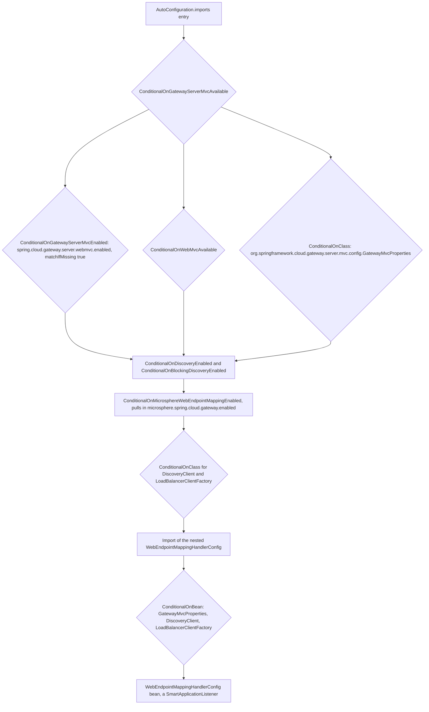
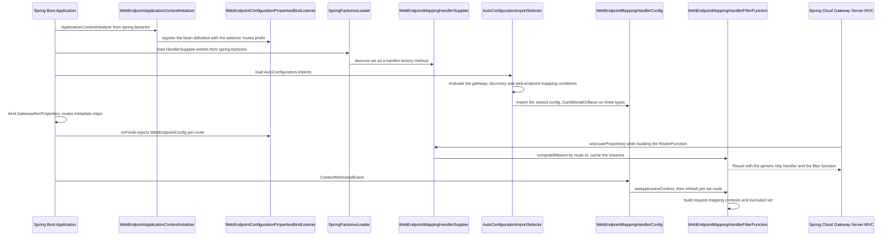
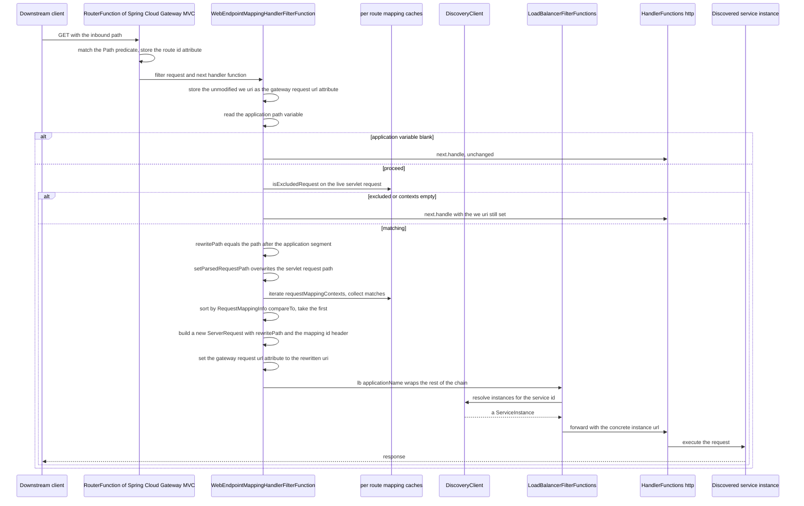
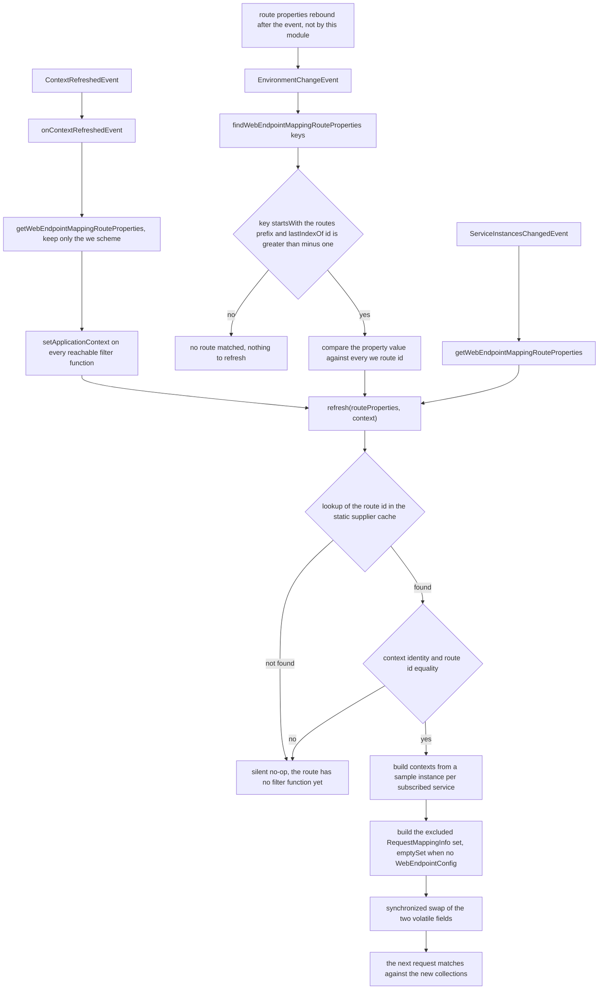

# microsphere-spring-cloud-gateway-server-webmvc

`0.2.x` 系列中基于 Servlet 网关模块的开发者文档——Spring Cloud Gateway Server MVC 与 Microsphere
Web 端点发现之间的集成层。

| | |
|---|---|
| 坐标 | `io.github.microsphere-projects:microsphere-spring-cloud-gateway-server-webmvc:${revision}` |
| 打包 | `jar` |
| 父 POM | `microsphere-gateway-parent`（`microsphere-spring-cloud-gateway-server-webmvc/pom.xml:5-10`） |
| Java 包根 | `io.microsphere.spring.cloud.gateway.server.webmvc` |
| Spring Boot 注册 | `META-INF/spring.factories`（一个 `HandlerSupplier` SPI 条目**加上**一个 `ApplicationContextInitializer`）+ `META-INF/spring/org.springframework.boot.autoconfigure.AutoConfiguration.imports`（一个自动配置类） |

`module-path:line` 指针相对于仓库根目录。

## 架构设计

### 在系统中的角色

本模块在 Spring Cloud Gateway Server MVC 的阻塞式 `RouterFunction`/`HandlerFunction` 模型之上，提供与
[microsphere-spring-cloud-gateway-server-webflux](../microsphere-spring-cloud-gateway-server-webflux.md)
完全相同的 `we://<services>` 语义。由于该模型既没有 `GlobalFilter` 链，也没有 `FilteringWebHandler` 这个切面，
实现在结构上完全不同：

* 扩展点是 **`HandlerSupplier`**，即 Spring Cloud Gateway MVC 自己的 SPI，通过 `META-INF/spring.factories`
  注册。对于 URI 选中 `we` 处理器的路由，Spring 会调用
  `WebEndpointMappingHandlerSupplier.we(RouteProperties)` 作为工厂方法；它返回一个 `Result`，把 Spring 通用的
  `HandlerFunctions.http()` 转发处理器与该路由专属的
  `WebEndpointMappingHandlerFilterFunction` 配对在一起。
* 每请求的工作发生在 **`HandlerFilterFunction`** 中，也就是包裹单个路由处理器的前置过滤器，而不是一条全局链。
* 负载均衡是被**委派**出去的，并非重新实现：过滤器函数把
  `LoadBalancerFilterFunctions.lb(applicationName)` 组合到改写后的请求之外，由它来选择目标实例。
  服务发现只用于读取已发布的 Web 端点元数据。
* 缓存刷新由一个被 `@Import` 的嵌套配置类协调，即
  `WebEndpointMappingGatewayServerMvcAutoConfiguration.WebEndpointMappingHandlerConfig`，它本身是一个
  `SmartApplicationListener`。

### 包结构

```
io/microsphere/spring/cloud/gateway/server/webmvc/
├── annotation/      ConditionalOnGatewayServerMvcAvailable, ConditionalOnGatewayServerMvcEnabled
├── autoconfigure/   WebEndpointMappingGatewayServerMvcAutoConfiguration (with nested WebEndpointMappingHandlerConfig)
├── constants/       GatewayPropertyConstants
├── context/         WebEndpointApplicationContextInitializer
└── filter/          WebEndpointMappingHandlerFilterFunction, WebEndpointMappingHandlerSupplier
```

资源文件：`src/main/resources/META-INF/spring.factories`、
`src/main/resources/META-INF/spring/org.springframework.boot.autoconfigure.AutoConfiguration.imports`、
`src/main/resources/META-INF/config/default/features.yaml`。
测试资源还额外提供一个可运行的 `TestApplication`（`src/test/java/.../webmvc/test/TestApplication.java`）。

### 自动配置与 SPI 装配

`src/main/resources/META-INF/spring.factories`：

```properties
org.springframework.cloud.gateway.server.mvc.handler.HandlerSupplier=\
io.microsphere.spring.cloud.gateway.server.webmvc.filter.WebEndpointMappingHandlerSupplier

org.springframework.context.ApplicationContextInitializer=\
io.microsphere.spring.cloud.gateway.server.webmvc.context.WebEndpointApplicationContextInitializer
```

同一个文件被两个不同的消费者读取：第一个键是 Spring Cloud Gateway MVC 自己的工厂查找键（由网关在构建其
处理器函数注册表时加载），第二个键是 Spring Boot 的。`AutoConfiguration.imports` 文件只有一个条目，
即 `WebEndpointMappingGatewayServerMvcAutoConfiguration`。

条件栈：



**Bean 覆盖策略：**没有。本模块只新增 bean，从不删除或替换任何 Spring Cloud Gateway 的 bean 定义——对应的
响应式模块需要一个 `BeanDefinitionRegistryPostProcessor`，而本模块不需要，因为 `RouterFunction` 的组合是通过
`HandlerSupplier` SPI 完成的，而不是通过替换某个处理器。

### 与响应式模块的差异

| 关注点 | WebFlux 模块 | WebMVC 模块 |
|---|---|---|
| 扩展切面 | 顺序为 `10149` 的 `GlobalFilter` bean | `HandlerSupplier` SPI + 每路由一个 `HandlerFilterFunction` |
| 注册文件 | `spring.factories`（initializer）+ `AutoConfiguration.imports`（两个类） | `spring.factories`（网关 SPI + initializer）+ `AutoConfiguration.imports`（一个类） |
| 处理器缓存 | `CachingFilteringWebHandler` 替换 `FilteringWebHandler` | 不需要；`RouterFunction` 已经把过滤器绑定到路由上 |
| 过滤器链实现 | `DefaultGatewayFilterChain` | 无，由 Spring 提供 |
| 目标实例选择 | 在请求路径上的 `choose(...)` 中调用 `LoadBalancerClientFactory` | `LoadBalancerFilterFunctions.lb(...)`，组合在改写后的请求之外 |
| 用于读取元数据的样本实例 | `clientFactory.getInstance(...)`，没有 null 保护（`...webflux/.../WebEndpointMappingGlobalFilter.java:293-298`） | `discoveryClient.getInstances(...).findAny()`，带显式 null 保护（`.../filter/WebEndpointMappingHandlerFilterFunction.java:192-196`、`:167`） |
| 缺失配置时的行为 | `buildExcludedRequestMappingInfoSet` 无条件解引用配置 | 返回 `emptySet()`（`:179-182`） |
| 事件类型匹配 | 对四种事件类型做精确 `equals` | 对三种事件类型做 `isAssignableFrom`（`.../autoconfigure/WebEndpointMappingGatewayServerMvcAutoConfiguration.java:107-111`） |
| 心跳抑制 | `DisabledHeartbeatEventRouteRefreshListenerInterceptor` + `@EnableEventExtension` | 不存在 |
| `EnvironmentChangeEvent` 到路由 | `PropagatingRefreshRoutesEventApplicationListener` | 由 `WebEndpointMappingHandlerConfig` 直接处理 |
| 过滤器函数生命周期 | 一个 Spring bean | **不是** Spring bean；由 `WebEndpointMappingHandlerSupplier` 静态创建并缓存 |
| 发现方式 | `ReactiveDiscoveryClientAdapter`（一个 `DiscoveryClient`） | 阻塞式 `DiscoveryClient` |

## 源码分析

### `annotation/ConditionalOnGatewayServerMvcEnabled.java`

`@ConditionalOnProperty(name = GATEWAY_ENABLED_PROPERTY_NAME, matchIfMissing = true)`（`:43-47`）——开关是
Spring Cloud Gateway MVC 自己的 `spring.cloud.gateway.server.webmvc.enabled`（常量类的 `:37-44`）。

### `annotation/ConditionalOnGatewayServerMvcAvailable.java`

由 `@ConditionalOnGatewayServerMvcEnabled`、`@ConditionalOnWebMvcAvailable`（来自可选依赖
`microsphere-spring-boot-webmvc`）以及 `@ConditionalOnClass(name = "…GatewayMvcProperties")` 组合而成
（`:45-49`）。与响应式模块使用同样的技巧：用 `name`，使得该注解在缺少可选依赖时依然能存活。

### `constants/GatewayPropertyConstants.java`

`GATEWAY_ENABLED_PROPERTY_NAME`（`:44`）与 `GATEWAY_ROUTES_PROPERTY_NAME_PREFIX`（`:51`）都派生自
`GatewayMvcProperties.PREFIX`（静态导入 `:26`）。与响应式模块一样，这次字符串拼接是一个编译期常量，
其值取决于当前激活的 Maven profile 所选定的 Spring Cloud Gateway 制品，这正是测试夹具在
`spring.cloud.gateway.mvc.routes` 和 `spring.cloud.gateway.server.webmvc.routes` 下重复声明路由的原因
（`microsphere-spring-cloud-gateway-server-webmvc/src/test/resources/application.yaml:33-59` 与 `:61-86`）。

### `context/WebEndpointApplicationContextInitializer.java`

与响应式对应物的形状逐字节一致，唯一的区别是它交给共享 commons 监听器的前缀：来自本模块常量类的
`GATEWAY_ROUTES_PROPERTY_NAME_PREFIX`（`:46-47`）。它注册名为
`webEndpointConfigurationPropertiesBindListener` 的 bean 定义
（commons 模块的 `WebEndpointConfigurationPropertiesBindListener.java:48`），从而在绑定过程中把
`spring.cloud.gateway...routes[*]` 下的 `metadata.web-endpoint` 块转换为 `WebEndpointConfig` 对象。
绑定机制见 [microsphere-spring-cloud-gateway-commons](../microsphere-spring-cloud-gateway-commons.md)。

### `filter/WebEndpointMappingHandlerSupplier.java`

```java
public class WebEndpointMappingHandlerSupplier implements HandlerSupplier {                       // :42
    private static final Map<String, WebEndpointMappingHandlerFilterFunction>
            handlerFilterFunctionsCache = new HashMap<>();                                        // :44
    @Override public Collection<Method> get() { return ofList(getClass().getMethods()); }         // :46-49
    public static Result we(RouteProperties routeProperties) { ... }                              // :51-58
    public static WebEndpointMappingHandlerFilterFunction getWebEndpointMappingHandlerFilterFunction(String routeId) // :60-62
}
```

* `get()` 把这个类的**全部** public 方法交给 Spring Cloud Gateway MVC（`getClass().getMethods()` 也会返回从
  `Object` 继承来的方法），其中只有 `we(RouteProperties)` 具备工厂方法的形状——`static`、接收
  `RouteProperties`、返回 `Result`。方法名 `we` 与 `RouteConstants.SCHEME` 一致，因此 `uri: we://...`
  的路由会解析到它。精确的查找规则属于 Spring Cloud Gateway MVC，不在本快照内；本仓库能保证的是
  这种命名对应关系以及 `HandlerSupplier` 注册本身。
* `we(...)` 执行 `handlerFilterFunctionsCache.computeIfAbsent(routeId, WebEndpointMappingHandlerFilterFunction::new)`
  （`:53-54`），并返回 `new Result(http(), ofList(function), emptyList())`（`:55-57`）：通用的 HTTP 转发
  处理器函数，加上该路由的 `WebEndpointMappingHandlerFilterFunction`，再加上一个空的尾部集合。
  正是 `computeIfAbsent` 让这个实例**按路由 id 唯一、并且在刷新之间保持稳定**——刷新协调器按 id 查找
  同一个实例（`:60-62`），而不是替换它。
* 修改 `:44` 之前你应该知道 `:44` 的两个后果：这个 map 是一个从静态字段访问的普通 `HashMap`，因此并发调用
  `computeIfAbsent` 是非同步的；并且条目从不被移除，所以从配置中删除一条路由会留下它的过滤器函数。
  实践中工厂方法在构建 `RouterFunction` 期间执行（单线程、启动期），这就是这个非同步 map 尚未造成伤害的原因。
* 过滤器函数**不是** Spring bean。没有 `@Bean`，构造时也没有 `ApplicationContext` 注入；模块的
  `WebEndpointMappingHandlerConfig` 手工把上下文推进去（自动配置类的 `:153-157`）。

### `filter/WebEndpointMappingHandlerFilterFunction.java`

`implements HandlerFilterFunction<ServerResponse, ServerResponse>`（`:83`）。状态：`routeId` 为 final
（`:87`），`discoveryClient` 和 `context` 字段标注了 `@Nonnull` 但由 `setApplicationContext` 稍后赋值
（`:89-93`、`:134-137`），以及两个 `volatile` 集合——`requestMappingContexts` 和
`excludedRequestMappingInfoSet`（`:95-97`）。注意这份缓存是**每路由**的，而响应式过滤器用两个以路由 id
为键的 map；两者承载相同的信息，只是形状不同。

#### `filter(ServerRequest, HandlerFunction)`——`:104-132`

```java
Map<String, String> uriTemplateVariables = request.pathVariables();                       // :105
String applicationName = uriTemplateVariables.get(APPLICATION_NAME_URI_TEMPLATE_VARIABLE_NAME);
request.attributes().put(GATEWAY_REQUEST_URL_ATTR, request.uri());                        // :107
if (isBlank(applicationName)) return next.handle(request);                                 // :109-112
RequestMappingContext ctx = getMatchingRequestMappingContext(applicationName, request);     // :114
if (ctx == null) return next.handle(request);                                              // :116-118
HandlerFilterFunction<ServerResponse, ServerResponse> lb = lb(applicationName);             // :120
String rewritePath = (String) attributes.remove(WEB_ENDPOINT_REWRITE_PATH_ATTRIBUTE_NAME);  // :122
ServerRequest newRequest = from(request).uri(create(rewritePath))
        .header(ID_HEADER_NAME, valueOf(ctx.id)).build();                                   // :124-127
attributes.put(GATEWAY_REQUEST_URL_ATTR, newRequest.uri());                                 // :129
return lbHandlerFunctionDefinition.filter(newRequest, next);                                // :131
```

阅读顺序很重要：

1. `:107` 在任何匹配发生之前，把**未修改**的 `we://` URI 先写入 `GATEWAY_REQUEST_URL_ATTR`——这是
   Spring Cloud Gateway MVC 自己的过滤器所期待的行为，也是当没有任何匹配时 `next.handle(request)` 仍能看到
   `we` URI 的原因。
2. `{application}` 同样来自 URI 模板，因此 `CommonConstants` 的谓词契约适用
   （`...commons/constants/CommonConstants.java:33`）。
3. 这里并不选择实例。`lb(applicationName)`（`:120`，静态导入 `:67`）用 Spring Cloud Gateway MVC 的负载均衡
   过滤器函数包装 `next`，由它从服务名解析出具体实例。改写后的请求只携带*路径*；
   `create(rewritePath)` 产生的是一个相对 URI。
4. `ID_HEADER_NAME` 在两个模块中都把匹配到的 `WebEndpointMapping` id 传递给下游服务，因此服务可以校验
   网关的路由决策与它自己的映射是否一致。

#### 匹配——`:198-245`

```java
String routeId = getAttribute(request, GATEWAY_ROUTE_ID_ATTR);        // :199
HttpServletRequest servletRequest = request.servletRequest();        // :212
if (isExcludedRequest(servletRequest)) return null;                   // :213-217, :252-262
if (isEmpty(this.requestMappingContexts)) return null;                 // :219-225
String rewritePath = substringAfter(path, SLASH_CHAR + applicationName);// :229
request.attributes().put(WEB_ENDPOINT_REWRITE_PATH_ATTRIBUTE_NAME, rewritePath); // :230
RequestPath rewriteRequestPath = parse(rewritePath, null);              // :232
setParsedRequestPath(rewriteRequestPath, servletRequest);               // :233
... matchesRequestMapping(...) ... sort(v1 -> v1.compareTo(v2, servletRequest)) ... first(...) // :235-244
```

独特的动作在 `:232-233`：这段代码不是去变更 exchange 的副本（响应式的做法，
`...webflux/.../WebEndpointMappingGlobalFilter.java:335-336`），而是**在活动的 `HttpServletRequest` 上覆盖
已解析的请求路径**，从而让 Spring MVC 的 `RequestMappingInfo.getMatchingCondition(HttpServletRequest)` 看到
改写后的路径。这是适配器逻辑——`RequestPath.parse(rewritePath, null)` 加上
`ServletRequestPathUtils.setParsedRequestPath(...)` 是 `exchange.mutate().request(...)` 的 Servlet 等价物。

代价是一个比匹配本身活得更久的副作用：如果没有映射匹配，过滤器在 `:117` 返回
`next.handle(request)`，而 servlet 请求上仍然带着改写后的路径，attributes 里仍然是原始的 `we://` URL。
用户看到的行为是失败，快照也把它断言为失败——`WebEndpointMappingHandlerFilterFunctionTest#testOnNotFound`
针对 `/we/test-app2/test/helloworld`（一个未注册的服务）期待异常
（`microsphere-spring-cloud-gateway-server-webmvc/src/test/java/.../filter/WebEndpointMappingHandlerFilterFunctionTest.java:205-209`）。

`isExcludedRequest`（`:252-262`）在这里有 null 保护（`if (excludedRequestMappingInfoSet != null)`），
与响应式实现不同；测试显式地迫使 null 分支执行
（`.../WebEndpointMappingHandlerFilterFunctionTest.java:197-203`）。

#### `refresh(RouteProperties, ApplicationContext)`——`:139-158`

```java
if (context != this.context) return;                              // :140-142
if (!Objects.equals(this.routeId, routeProperties.getId())) return; // :144-146
Collection<RequestMappingContext> contexts = buildRequestMappingContexts(routeProperties);    // :148
Set<RequestMappingInfo> excludes = buildExcludedRequestMappingInfoSet(routeProperties);       // :150
synchronized (this) { this.requestMappingContexts = contexts; this.excludedRequestMappingInfoSet = excludes; } // :152-155
```

* 对 `context` 的身份检查，正是防止由更早的（或子的）应用上下文创建的过滤器函数被后来的上下文重新填充的手段；
  这是函数不是 bean 所应付出的代价。
* `buildRequestMappingContexts`（`:160-176`）遍历 `getSubscribedServices(routeUri)`（`:203-209`，与响应式模块
  相同的 `all` 对逗号分隔规则），通过 `choose(...)` 为每个服务取一个样本实例（`:192-196`），并读取它的
  `WebEndpointMapping` 集合。`:167` 的 `if (sampleServiceInstance != null)` 使得未知或已缩零的服务什么都不贡献
  而不是抛异常——由 `.../WebEndpointMappingHandlerFilterFunctionTest.java:189-192` 断言。`:164` 的
  `TODO support ZonePreferenceFilter` 与响应式模块的那一条相互对应。
* `buildExcludedRequestMappingInfoSet`（`:178-190`）读取 `ConfigUtils.getWebEndpointConfig(routeProperties.getMetadata())`，
  对 `null` 配置返回 `emptySet()`——因此一个没有 `metadata.web-endpoint` 块的 `we://` 路由在这里就是没有任何排除项。
* `RequestMappingContext`（`:268-282`）同样把 `RequestMappingInfo` 与映射 id 配成一对，两个
  `buildRequestMappingInfo` 重载（`:284-303`）针对
  `org.springframework.web.servlet.mvc.method.RequestMappingInfo`（而非响应式的那个）复刻了响应式模块的构建管线。
  对排除模型的任何修改都必须**同时**应用到两个模块。

### `autoconfigure/WebEndpointMappingGatewayServerMvcAutoConfiguration.java`

外层类只声明条件以及 `@Import(...WebEndpointMappingHandlerConfig.class)`（`:67-89`）。
`@AutoConfigureAfter`（`:76-87`）把它排在 Microsphere 的 `WebMvcAutoConfiguration` 和
`DiscoveryClientAutoConfiguration` 之后，并按名字排在 LoadBalancer 的自动配置、
`GatewayServerMvcAutoConfiguration`、`ConfigurationPropertiesRebinderAutoConfiguration` 和
`CompositeDiscoveryClientAutoConfiguration` 之后。在这里列出 rebinder 记录了这样一个意图：
`GatewayMvcProperties` 应当在本特性响应 `EnvironmentChangeEvent` 之前完成重新绑定；而重新绑定是否真的在该
监听器之前发生（*在同一次事件发布之内*）取决于监听器排序，本模块并没有钉住它。请把这个顺序视为意图，而非保证。

嵌套的 `WebEndpointMappingHandlerConfig`（`:91-187`）就是刷新协调器：

* `@ConditionalOnBean(value = {GatewayMvcProperties.class, DiscoveryClient.class, LoadBalancerClientFactory.class})`
  （`:91`）——默认搜索作用域，即整个层级。
* 它持有 `gatewayMvcProperties`、`context` 和 `environment`（`:94-104`），其中 environment 是从应用上下文取得，
  而非单独注入。
* `supportsEventType`（`:107-111`）使用 `isAssignableFrom`，因此 `EnvironmentChangeEvent` 的子类也会被接受——
  这与响应式过滤器的精确相等列表不同。
* `onApplicationEvent`（`:113-122`）用模式匹配的 `instanceof` 分派，并把无法识别的事件路由到
  `onServiceInstancesChangedEvent()`，与响应式过滤器完全一致。
* `onContextRefreshedEvent`（`:124-130`）是唯一提供额外初始化器的路径——
  `handlerFilterFunction -> handlerFilterFunction.setApplicationContext(context)`——因为正是在此刻，函数第一次
  得知上下文和 `DiscoveryClient`。
* `refresh(List, ApplicationContext, Consumer)`（`:150-160`）通过
  `WebEndpointMappingHandlerSupplier.getWebEndpointMappingHandlerFilterFunction(routeID)` 按路由 id 解析函数，
  并且**当查找返回 `null` 时静默地什么都不做**。所以刷新只会更新网关在构建 `RouterFunction` 时已经实例化过的函数。
* `findWebEndpointMappingRouteProperties(Set<String> keys)`（`:162-179`）接受任何以 routes 前缀开头且
  `lastIndexOf("id") > -1` 的键——比响应式模块"键必须以 `id` *结尾*"的规则更宽松——并且当多个变更键都匹配它时，
  同一个 `RouteProperties` 可能被加入多次。这两种行为都由
  `WebEndpointMappingGatewayServerMvcAutoConfigurationIntegrationTest` 断言
  （`microsphere-spring-cloud-gateway-server-webmvc/src/test/java/.../autoconfigure/WebEndpointMappingGatewayServerMvcAutoConfigurationIntegrationTest.java:63-81`）。
* `getWebEndpointMappingRouteProperties()`（`:181-186`）把 `gatewayMvcProperties.getRoutes()` 过滤到 `we` 协议，
  并返回一个不可修改的列表。

## 应用启动



## `we://` 路由的请求生命周期



`Fn` 从来不会为了*目标*实例去访问 `Discovery`；`choose(...)` 只能从 `refresh(...)` 抵达。交给
`lb(applicationName)` 的服务 id 就是 `{application}` 路径变量，因此这个 URI 模板变量既是元数据选择器，
也是负载均衡器的键。

## 路由刷新



没有 TTL、没有容量上限、也没有淘汰：每路由的集合活得和过滤器函数一样久，而过滤器函数活得和
`WebEndpointMappingHandlerSupplier` 里的静态 `HashMap` 一样久，因此也就和类加载器一样久。

## 设计模式

这里只列出本模块代码实际展现的模式。当某个模式同时被响应式模块使用时，会指出 Servlet 实现上的差异，
因为这个差异正是本模块作为独立制品存在的原因。

**通过反射发现的 SPI（Service Provider Interface）。**
位置：`WebEndpointMappingHandlerSupplier.java:42` 实现了 Spring Cloud Gateway MVC 的 `HandlerSupplier`；
`get()` 返回 `ofList(getClass().getMethods())`（`:46-49`）；注册就是 `spring.factories` 的键
`org.springframework.cloud.gateway.server.mvc.handler.HandlerSupplier`
（`src/main/resources/META-INF/spring.factories:1-2`）。
原因：Gateway MVC 没有 `GlobalFilter` 概念；路由处理器是靠发现供应商类上的 public static 方法来贡献的。
收益：新增一个"路由协议过滤器函数"只需要一个 `public static Result x(RouteProperties)` 方法，无需任何装配代码。
代价：这个供应商会把该类的**所有** public 方法作为候选处理器暴露出去——包括
`getWebEndpointMappingHandlerFilterFunction(String)`（`:60-62`）——因为发现机制基于 `getMethods()`；
让它无害的是框架自身对方法形状的过滤。供应商内部没有 `@Order` 也没有条件门，因此即便自动配置的所有条件都不成立，
它依然参与。

**返回组合式路由定义的静态工厂（一个"路由函数"）。**
位置：`we(RouteProperties)`（`:51-58`）构建 `new Result(http(), ofList(function), emptyList())`。
原因：函数式网关 DSL 把一条路由表达为 handler + filter functions + predicates。
收益：`we://` 路由读起来就像内置的 `lb:` / `http()` 函数，并且 `we` 这个名字来自 `RouteConstants.SCHEME`，
因此它与 YAML 中的 URI 协议相呼应。
代价：`Result` 在路由注册时就被急切创建，而处理器函数*不是* Spring bean，所以容器里没有任何东西管理它的
生命周期——它如何被填充见下文的观察者模式。

**通过函数组合实现的装饰器。**
位置：`HandlerFilterFunction<ServerResponse, ServerResponse>` 实现
（`WebEndpointMappingHandlerFilterFunction.java:83`）包裹传给 `filter` 的委托 `HandlerFunction`（`:104`），
在两条直通路径上原样委托（`:111`、`:117`），在匹配路径上委托给 `lb(applicationName)`（`:120`、`:131`）。
Javadoc 称其为 "Before-Filter"（`:76`）。
收益：一个对象既能短路进入负载均衡转发，又能在不适用时保留原始路由行为；不需要继承框架的 handler，
这与 WebFlux 的 `CachingFilteringWebHandler` 装饰器形成对比——后者通过 bean 定义替换*取代*了
`FilteringWebHandler` 的行为。
代价：`filter` 声明了 `throws Exception`（`:104`）——这是响应式模块没有的 Servlet 侧签名——因此失败以受检
异常传播，而不是 `Mono` 错误信号。

**以路由 id 为键的备忘缓存（一个无界、非线程安全的注册表 map）。**
位置：`private static final Map<String, WebEndpointMappingHandlerFilterFunction> handlerFilterFunctionsCache
= new HashMap<>()`（`WebEndpointMappingHandlerSupplier.java:44`），由 `computeIfAbsent` 填充（`:53-54`），
由 `getWebEndpointMappingHandlerFilterFunction` 读取（`:60-62`）。
原因：自动配置必须找到某条路由上已经安装的过滤器函数，而这些函数是在 DSL 内部、容器之外创建的。
收益：这是模块两半之间唯一的把手；不需要 bean 注册表的技巧。
代价：它是一个**静态的普通 `HashMap`**，因此启动期并发注册路由是非同步的；供应商只调用它的
`computeIfAbsent`（`:53-54`）和 `get`（`:61`），所以即使某条路由从配置中消失，条目也从不被移除，
并且这个 map 的作用域是类加载器而不是 `ApplicationContext`——同一个 JVM 中的两个上下文会共享它。

**带子类型容忍事件筛选的观察者。**
位置：`WebEndpointMappingHandlerConfig implements SmartApplicationListener`
（`WebEndpointMappingGatewayServerMvcAutoConfiguration.java:92`），`supportsEventType` 对
`EnvironmentChangeEvent`、`ContextRefreshedEvent` 和 `ServiceInstancesChangedEvent` 使用
`isAssignableFrom`（`:107-111`），`onApplicationEvent` 负责分派（`:113-122`）。
原因：每个过滤器函数内部的缓存需要在启动、配置变更和实例变更时重建。
收益：与 WebFlux 过滤器的精确 `equals` 判断（`WebEndpointMappingGlobalFilter.java:176-179`）不同，
这三个事件的任何子类仍会被处理。两个模块为何不同，代码中并未说明；最合理的解读是
`EnvironmentChangeEvent` 经由 Spring Cloud 的 rebinder 路径到达，而该路径可能发布子类类型。
代价：监听器类是包可见的嵌套类（`:91-92`），并且被
`@ConditionalOnBean({GatewayMvcProperties, DiscoveryClient, LoadBalancerClientFactory})` 守护，因此当条件
不成立时，供应商仍然被注册，但它的函数永远不会收到 `setApplicationContext`——
`discoveryClient` 和 `context` 虽然标注了 `@Nonnull` 却保持未赋值（`:89-93`）。

**用参数化初始化器代替模板方法（lambda 形式的 Strategy）。**
位置：`refresh(List<RouteProperties>, ApplicationContext, Consumer<HandlerFilterFunction>)`（`:145-148`、
`:150-160`），调用点在 `:124-130`（`onContextRefreshedEvent` 传入 `setApplicationContext` 消费者）和
`:132-138`（另外两个事件传入空操作消费者）。
原因：只有一条路径需要额外的一次初始化，而响应式模块为此用的是模板方法。
收益：没有抽象层次，每个调用点都自包含。
代价：`null` 保护（`:155`）与消费者是否为空操作相互作用，使得跳过逻辑很难一眼看穿；把某个步骤放到一个
共享的模板方法里会更容易发现"三个事件做同一件事"这种事实。

**写时复制发布（copy-on-write），带两个守卫。**
位置：`buildRequestMappingContexts` / `buildExcludedRequestMappingInfoSet` 构建全新集合（`:148`、`:150`），
`synchronized (this)` 块赋值两个 `volatile` 字段（`:152-155`）。
收益：读者（`getMatchingRequestMappingContext`，`:219`、`:238`）可能看到刷新前后的集合，但绝不会看到半新半旧；
同步范围只覆盖两次赋值。
代价：在旧值仍被使用（`:213-217`）时写入 `new`（`:148`、`:150`），所以一次刷新可能浪费构建结果。
这是有意接受的，而不是被忽略的。

**共享请求上的副作用（不是模式，是一个值得命名的特性）。**
位置：`getMatchingRequestMappingContext` 在 `:230` 写入 `WEB_ENDPOINT_REWRITE_PATH_ATTRIBUTE_NAME`（由 `:122`
读取并移除）、在 `:233` 覆盖 servlet 请求的已解析路径，`:107` 和 `:129` 用不同值写入同一个属性键
`GATEWAY_REQUEST_URL_ATTR`。
收益：无需变更请求对象（在 MVC DSL 中代价很高）即可让 Spring MVC 自身的 `RequestMappingInfo` 匹配逻辑工作。
代价：没有"撤销"路径。上面的匹配流程已经描述了残留影响，`WebEndpointMappingHandlerFilterFunctionTest#testOnNotFound`
（`src/test/java/.../filter/WebEndpointMappingHandlerFilterFunctionTest.java:205-209`）断言了这个外部可见结果。

**值对象作为上下文持有者（`RequestMappingContext`）。**
位置：`:268-282`，配 `buildRequestMappingInfo` 重载（`:284-303`）。
收益：把排序/比较所需的 `RequestMappingInfo` 和转发所需的 id 绑在一起，因此排序（`:241-243`）和头写入（`:126`）
用同一个对象。
代价：与响应式模块的对应物不是同一个类型，因此行为上的改动必须手工镜像到两处（见本文[设计模式](#设计模式)）。

本模块中**没有**的模式（值得说明，以免读者去找）：没有装饰器 bean 替换，因此没有
`BeanDefinitionRegistryPostProcessor`；没有过滤器链构造，因此没有责任链；没有事件扩展拦截器，因此没有
`@EnableEventExtension`；没有 Null Object（`:167` 的保护直接返回）；没有属性绑定模式，因为绑定发生在
commons 模块。

---

## 模块依赖图

本指南的每个模块文档都包含同一张 reactor 图；节点 `M` 即本模块。

```mermaid
graph TD
    subgraph reactor["Maven reactor microsphere-gateway"]
        ROOT["microsphere-gateway (aggregator pom)"]
        P["microsphere-gateway-parent (pom)"]
        D["microsphere-gateway-dependencies (pom, BOM)"]
        C["microsphere-spring-cloud-gateway-commons (jar)"]
        F["microsphere-spring-cloud-gateway-server-webflux (jar)"]
        M["microsphere-spring-cloud-gateway-server-webmvc (jar)"]
    end
    ROOT --> P
    ROOT --> D
    ROOT --> C
    ROOT --> F
    ROOT --> M
    P -->|parent of| D
    P -->|parent of| C
    P -->|parent of| F
    P -->|parent of| M
    M -->|"compile, revision"| C
    F -->|compile| C

    subgraph mandatory["Declared without optional, so they reach consumers"]
        GMVC["spring-cloud-starter-gateway-mvc"]
        GPEX["spring-cloud-gateway-proxyexchange-webmvc"]
    end
    subgraph optM["External Microsphere, optional scope"]
        SCP["microsphere-annotation-processor"]
        SCC["microsphere-spring-cloud-commons"]
        SBM["microsphere-spring-boot-webmvc"]
    end
    subgraph transitiveM["Reached transitively, not declared in this pom"]
        SBCONTEXT["microsphere-spring-context, provides ConfigurableApplicationContextInitializer"]
    end
    subgraph optS["External Spring, optional scope"]
        SCOM["spring-cloud-commons"]
        SLB["spring-cloud-loadbalancer"]
        SBOOT["spring-boot-starter, starter-actuator"]
        SPROC["spring-boot-configuration-processor, spring-boot-autoconfigure-processor"]
    end
    subgraph testS["Test scope"]
        JUP["junit-jupiter"]
        SBTEST["spring-boot-starter-test"]
        MSBT["microsphere-spring-boot-test"]
    end
    subgraph profileDeps["Per Maven profile, optional"]
        MVC2025["spring-cloud-gateway-server-webmvc, spring-cloud-2025 default"]
        MVC2022["spring-cloud-starter-gateway-mvc, spring-cloud-2022 2023 2024"]
    end

    GMVC --> M
    GPEX --> M
    SCP --> M
    SCC --> M
    SBM --> M
    SBCONTEXT --> M
    SCOM --> M
    SLB --> M
    SBOOT --> M
    SPROC --> M
    JUP --> M
    SBTEST --> M
    MSBT --> M
    MVC2025 --> M
    MVC2022 --> M
    SCBOM["microsphere-spring-cloud-dependencies 0.2.26, imported BOM"] --> P
```



作用域上的不对称是有意为之，在 `microsphere-spring-cloud-gateway-server-webmvc/pom.xml` 中可见：
`spring-cloud-starter-gateway-mvc`（`:63-67`）和 `spring-cloud-gateway-proxyexchange-webmvc`（`:69-72`）是
**非可选**的 compile 依赖，与本模块其他所有依赖都不同。所以添加这个制品确实会传递引入 Spring Cloud Gateway MVC
——与响应式模块相反，后者的网关藏在 profile 加 `optional` 之后。

## 构建与测试指引

```bash
./mvnw -pl microsphere-spring-cloud-gateway-server-webmvc -am test
./mvnw -pl microsphere-spring-cloud-gateway-server-webmvc test -Ptest,spring-cloud-2024
./mvnw -pl microsphere-spring-cloud-gateway-server-webmvc test -Ptest,spring-cloud-2025
```

Profiles，来自 `microsphere-spring-cloud-gateway-server-webmvc/pom.xml:122-181`：

| Profile | 效果 |
|---|---|
| `spring-cloud-2022` | 把 `spring-cloud-starter-gateway-mvc` 作为可选依赖加入，**并且**钉住 `spring-boot.version` `3.3.13`、`spring-cloud.version` `2023.0.6`、`spring-cloud-alibaba.version` `2023.0.3.2`；文件本身带有注释 `actual : spring-cloud-2023`（`:125`） |
| `spring-cloud-2023`、`spring-cloud-2024` | 把 `spring-cloud-starter-gateway-mvc` 作为可选依赖加入，不覆盖版本 |
| `spring-cloud-2025` | `activeByDefault`（`:167-169`），把 `spring-cloud-gateway-server-webmvc` 作为可选依赖加入 |

`spring-cloud-2022` 这个 profile 是整个 reactor 中唯一 profile id 与其内容不一致的地方：名为 `2022` 的 profile
实际选择的是 `2023.0.6` 发布列车，因为 Spring Cloud Gateway Server MVC 在 `2022` 中并不存在。CI 仍然会执行
`-Ptest,coverage,spring-cloud-2022`（`.github/workflows/maven-build.yml:26-27,46`），所以在"2022"上构建失败时
请记住这一点。

Spring profile 夹具（`microsphere-spring-cloud-gateway-server-webmvc/src/test/resources/application.yaml`）：
`simple-service-registry`（`:12-24`）启用 Microsphere 的简单服务注册表，`gateway`（`:27-86`）在
`spring.cloud.gateway.mvc.routes` 和 `spring.cloud.gateway.server.webmvc.routes` 下各提供三条路由——两条
`https://example.org` 路由，以及一条带 `metadata.web-endpoint.excludes` 的 `we://all` 路由。

| 测试类 | 覆盖内容 |
|---|---|
| `autoconfigure/WebEndpointMappingGatewayServerMvcAutoConfigurationTest` | 通过 `WebAutoConfigurationTest` 覆盖条件矩阵：每个总开关（`spring.cloud.gateway.server.webmvc.enabled`、`microsphere.spring.boot.webmvc.enabled`、`spring.cloud.discovery.enabled`、`microsphere.spring.cloud.gateway.enabled`、`microsphere.spring.cloud.web-endpoint-mapping.enabled`）以及每个缺失的类（`DispatcherServlet`、`DiscoveryClient`、`LoadBalancerClientFactory`……）都必须阻止注册（`.../autoconfigure/WebEndpointMappingGatewayServerMvcAutoConfigurationTest.java:46-67`） |
| `autoconfigure/WebEndpointMappingGatewayServerMvcAutoConfigurationIntegrationTest` | 在 `gateway` profile 下用 `@EnableAutoConfiguration` 启动，断言 `WebEndpointMappingHandlerConfig` bean 存在，刷新一个未知路由 id，并在无匹配与多匹配两组键上校验 `findWebEndpointMappingRouteProperties`（`:63-81`） |
| `autoconfigure/WebEndpointMappingGatewayServerMvcAutoConfigurationIntegrationDisabledTest` | 断言当 LoadBalancer 与 discovery 自动配置通过 `microsphere.autoconfigure.exclude` 和 `microsphere.spring.boot.webmvc.enabled=false` 被排除时该配置不存在（`:36-57`）——注意这是 Microsphere 专有的排除属性 |
| `filter/WebEndpointMappingHandlerFilterFunctionTest` | 真实的往返：针对 `local.server.port` 自注册，通过 `MockMvc` 请求 `GET /we/test-app/test/helloworld` 并返回 controller 响应体，排除场景（带 `consumes`/`produces` 的 `/we/test-app/**`）抛异常，为 `routes[0].id` 发布 `EnvironmentChangeEvent` 后调用成功，注销服务并触发 `ServiceInstancesChangedEvent` 后调用再次失败，以及以 `null` 缓存探测 `buildExcludedRequestMappingInfoSet`、`getSubscribedServices`、`buildRequestMappingContexts`、`refresh`、`isExcludedRequest` 和 `getMatchingRequestMappingContext`（`:151-209`） |
| `constants/GatewayPropertyConstantsTest` | 两个派生属性名 |
| `test/TestApplication` | 不是测试；一个可运行的 `@EnableAutoConfiguration` main，启动同样的夹具 profile（`.../test/TestApplication.java:30-38`） |

`WebEndpointMappingHandlerFilterFunctionTest` 与各集成测试都带有 `@DirtiesContext`，因此每个测试都会重建 Spring
上下文；而静态的过滤器函数缓存并*不会*在它们之间重置，这就是测试断言基于路由 id 而不是跨上下文对象身份的原因。

## 扩展配方

### 新增网关过滤器（Servlet 风味）

这里没有 `GlobalFilter`。两种受支持的形态：

1. **为一路路由家族做前置/后置过滤器**——实现 `HandlerFilterFunction<ServerResponse, ServerResponse>`，
   并通过新的 `HandlerSupplier` 工厂方法返回它，在 `META-INF/spring.factories` 的
   `org.springframework.cloud.gateway.server.mvc.handler.HandlerSupplier` 键下注册，参照
   `filter/WebEndpointMappingHandlerSupplier.java:51-58` 建模。在 `Result` 中把你的过滤器与一个处理器函数配对。
2. **横切的 Servlet 过滤器**——注册标准的 `jakarta.servlet.Filter` 或 Spring 的 `FilterRegistrationBean`；
   它在 Spring Cloud Gateway MVC 的 `RouterFunction` 之前执行，因此看不到 `{application}` 改写。
   仅在与端点映射无关的关注点中使用。

如果过滤器需要匹配到的 Web 端点 id，请读取 `WebEndpointMapping.ID_HEADER_NAME`——过滤器函数在
`.../filter/WebEndpointMappingHandlerFilterFunction.java:124-127` 设置它。

### 新增条件注解

参照 `annotation/ConditionalOnGatewayServerMvcAvailable.java`：一个 `@ConditionalOnProperty` 作为运行时开关，
`@ConditionalOnWebMvcAvailable` 表示 Web 应用类型，`@ConditionalOnClass(name = ...)` 指向 Spring Cloud Gateway MVC
的标记类。把面向用户的 Microsphere 开关保留在
[microsphere-spring-cloud-gateway-commons](../microsphere-spring-cloud-gateway-commons.md)，让两个运行时共享。
然后把该开关加入
`autoconfigure/WebEndpointMappingGatewayServerMvcAutoConfigurationTest` 的
`configureGlobalDisabledPropertyValues` 覆写中。

### 新增路由协议处理器

1. 把协议常量加到 commons 模块的 `RouteConstants`。
2. 在 `filter/WebEndpointMappingHandlerSupplier.java` 中加一个名字等于该协议名的静态工厂方法（`we` 在 `:51`），
   按 `:53-54` 的方式缓存每路由 id 的过滤器函数，并返回一个把 `HandlerFunctions.http()` 与新过滤器函数配成一对的
   `Result`。
3. 在刷新协调器中按协议筛选路由：`getWebEndpointMappingRouteProperties()` 用
   `SCHEME.equals(routeProperties.getUri().getScheme())` 过滤
   （`.../autoconfigure/WebEndpointMappingGatewayServerMvcAutoConfiguration.java:181-186`）。
4. 在 `HandlerFilterFunction` 中实现每请求改写，并保留直通分支
   （`.../filter/WebEndpointMappingHandlerFilterFunction.java:109-118`）。
5. 在响应式模块中镜像该协议——`...webflux/filter/WebEndpointMappingGlobalFilter.java:412-414`——
   否则该协议只在一个运行时中可用。
6. 在 `src/main/resources/META-INF/config/default/features.yaml` 中声明新类。

## 推断与不确定之处

* Spring Cloud Gateway MVC 如何把路由 URI 协议映射到 `HandlerSupplier` 的工厂方法名，这条规则位于网关制品中，
  不在本快照里。"`we(RouteProperties)` 之所以被选中是因为 `we` 等于 `RouteConstants.SCHEME`"
  （`microsphere-spring-cloud-gateway-commons/src/main/java/.../constants/RouteConstants.java:33`）
  是我根据命名对应关系加上 `spring.factories:1-2` 注册作出的推断；快照能证明的是注册与命名，而不是查找算法。
* 关于非同步静态 `HashMap`（`filter/WebEndpointMappingHandlerSupplier.java:44`）"启动期单线程"的解释，是我对
  这个竞态为何尚未暴露的解读；快照中没有任何内容陈述或强制这一点。
* `@AutoConfigureAfter` 列出 `ConfigurationPropertiesRebinderAutoConfiguration`
  （`autoconfigure/WebEndpointMappingGatewayServerMvcAutoConfiguration.java:76-87`）记录的是一个排序意图。
  重新绑定是否真的在同一次 `EnvironmentChangeEvent` 发布中先于 `WebEndpointMappingHandlerConfig`，取决于本模块
  并未钉住的监听器排序；我无法从快照验证它。
* 注释 `actual : spring-cloud-2023`（`microsphere-spring-cloud-gateway-server-webmvc/pom.xml:125`）是
  `spring-cloud-2022` 这个 profile 的 id 与其内容不一致的直接证据。我给出的因果解释——Spring Cloud Gateway
  Server MVC 在 `2022` 发布列车中并不存在——是推断；POM 没有记录原因。
* `GATEWAY_ENABLED_PROPERTY_NAME` 与 `GATEWAY_ROUTES_PROPERTY_NAME_PREFIX`
  （`constants/GatewayPropertyConstants.java:44`、`:51`）之所以是编译期常量，是因为 `PREFIX` 是一个 `static`
  `String` 常量（`:26`）；这一部分属于 Java 语义。由此断定这正是测试夹具在
  `spring.cloud.gateway.mvc.routes` 和 `spring.cloud.gateway.server.webmvc.routes` 下重复声明路由的原因
  （`src/test/resources/application.yaml:33-59`、`:61-86`），是基于这两棵配置树的推理，而非有文档的陈述。

---

## English

本文档的英文版：[../microsphere-spring-cloud-gateway-server-webmvc.md](../microsphere-spring-cloud-gateway-server-webmvc.md)。

返回指南目录：[README.md](../README.md)。
项目根 README：[../../../../README.md](../../../../README.md)。