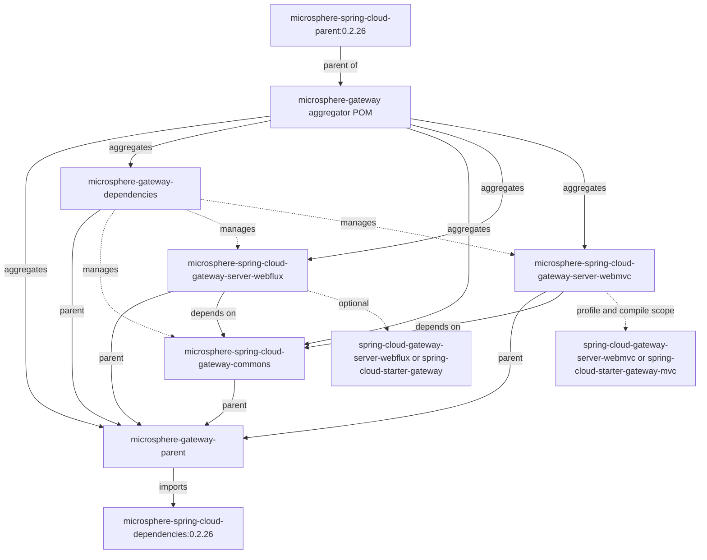

# Microsphere Gateway User Guide (current, `0.2.x`)

This guide documents the **`release` branch** of Microsphere Gateway, the `0.2.x` version line. The branch's Maven
`revision` is `0.2.19-SNAPSHOT`; the newest entry in the branch `release-notes.md` — and therefore the latest published
release on Maven Central — is **`0.2.18`** under the group `io.github.microsphere-projects`. Everything below was read
from that branch's POMs, sources, tests, `META-INF` resources and release notes, so class names, property keys and
defaults match what you get when you depend on a `0.2.x` artifact.

Microsphere Gateway extends Spring Cloud Gateway with the custom `we://` (web-endpoint) route URI scheme, route and
mapping-cache refreshing on discovery/configuration events, and per-route `metadata.web-endpoint.excludes` filtering.

## Modules

| Document | Artifact | Kind | What it is for |
|---|---|---|---|
| [microsphere-gateway-parent](microsphere-gateway-parent.md) | `io.github.microsphere-projects:microsphere-gateway-parent` | `pom` | Build parent: imports the Microsphere Spring Cloud BOM, carries `java.version` / `revision`. |
| [microsphere-gateway-dependencies](microsphere-gateway-dependencies.md) | `io.github.microsphere-projects:microsphere-gateway-dependencies` | `pom` (BOM) | Version management for the three deployable modules. |
| [microsphere-spring-cloud-gateway-commons](microsphere-spring-cloud-gateway-commons.md) | `io.github.microsphere-projects:microsphere-spring-cloud-gateway-commons` | `jar` | Shared constants, conditional annotations, `WebEndpointConfig` model and route-metadata binding. |
| [microsphere-spring-cloud-gateway-server-webflux](microsphere-spring-cloud-gateway-server-webflux.md) | `io.github.microsphere-projects:microsphere-spring-cloud-gateway-server-webflux` | `jar` | Reactive gateway integration: `WebEndpointMappingGlobalFilter`, caching `FilteringWebHandler`, refresh event wiring. |
| [microsphere-spring-cloud-gateway-server-webmvc](microsphere-spring-cloud-gateway-server-webmvc.md) | `io.github.microsphere-projects:microsphere-spring-cloud-gateway-server-webmvc` | `jar` | Servlet gateway integration: `HandlerSupplier` for `we://`, `WebEndpointMappingHandlerFilterFunction`, refresh wiring. |

Every module document follows the same structure: purpose, version information, compatibility range, installation,
API (or dependency-management) reference, configuration reference, code examples taken from the module's own tests, and
pitfalls.

## Module relationships



Solid `depends on` edges are real compile-scope Maven dependencies; `optional` edges are artifacts the module declares as
`<optional>` and that **you** must add. The WebMVC module additionally declares `spring-cloud-starter-gateway-mvc` and
`spring-cloud-gateway-proxyexchange-webmvc` at compile scope, so read its
[installation section](microsphere-spring-cloud-gateway-server-webmvc.md#4-installation) before you add a gateway
dependency of your own.

## Prerequisites

| Requirement | Value | Source |
|---|---|---|
| JDK | 17 baseline; CI also verifies 21 and 25 | `java.version=17` in the aggregator POM; `maven-build.yml` matrix |
| Build tool | Maven 3.9.16 (the bundled wrapper, `only-script` distribution, wrapperVersion 3.3.4) | `.mvn/wrapper/maven-wrapper.properties` |
| Spring Cloud release trains | `spring-cloud-2022`, `spring-cloud-2023`, `spring-cloud-2024`, `spring-cloud-2025` (`2025` is `activeByDefault`) | module POM profiles; CI matrix |
| Gateway starter | Your own Spring Cloud Gateway artifact (see the diagram above) — nearly all third-party dependencies of these modules are `<optional>` | module POMs |
| Service discovery | A Spring Cloud `DiscoveryClient` / `ReactiveDiscoveryClient` plus Spring Cloud LoadBalancer | auto-configuration conditions |
| Target services | Must publish Microsphere `WebEndpointMapping` metadata | `WebEndpointMapping` usage in both filters |

## Quick start

```xml
<dependencyManagement>
    <dependencies>
        <dependency>
            <groupId>org.springframework.cloud</groupId>
            <artifactId>spring-cloud-dependencies</artifactId>
            <version>2025.0.0</version>
            <type>pom</type>
            <scope>import</scope>
        </dependency>
        <dependency>
            <groupId>io.github.microsphere-projects</groupId>
            <artifactId>microsphere-gateway-dependencies</artifactId>
            <version>0.2.18</version>
            <type>pom</type>
            <scope>import</scope>
        </dependency>
    </dependencies>
</dependencyManagement>

<dependencies>
    <dependency>
        <groupId>io.github.microsphere-projects</groupId>
        <artifactId>microsphere-spring-cloud-gateway-server-webflux</artifactId>
    </dependency>
    <dependency>
        <groupId>org.springframework.cloud</groupId>
        <artifactId>spring-cloud-starter-gateway</artifactId>
    </dependency>
    <dependency>
        <groupId>io.github.microsphere-projects</groupId>
        <artifactId>microsphere-spring-cloud-commons</artifactId>
    </dependency>
</dependencies>
```

Then declare one `we://` route. `we://all` subscribes to every discovered service; `we://orders-service` or
`we://orders-service,payments-service` narrow the subscription. The predicate must expose the `{application}` variable:

```yaml
spring:
  cloud:
    gateway:
      routes:
        - id: web-endpoint-mapping
          uri: we://all
          predicates:
            - Path=/{application}/**
          metadata:
            web-endpoint:
              excludes:
                - patterns: /internal/**
                  methods: GET
```

Everything is on by default. To switch features off:

```yaml
microsphere:
  spring:
    cloud:
      gateway:
        enabled: false
      web-endpoint-mapping:
        enabled: false
```

## Property key index

| Key | Owner module | Default | Effect |
|---|---|---|---|
| `microsphere.spring.cloud.gateway.enabled` | commons | `true` | Master switch for every Microsphere gateway extension. |
| `microsphere.spring.cloud.web-endpoint-mapping.enabled` | commons | `true` | Switch for the `we://` web-endpoint mapping feature. |
| `spring.cloud.gateway.server.webflux.enabled` | webflux (`GatewayProperties.PREFIX` + `.enabled`) | `true` | Upstream reactive gateway switch honoured by `@ConditionalOnGatewayAvailable`. |
| `spring.cloud.gateway.server.webmvc.enabled` | webmvc (`GatewayMvcProperties.PREFIX` + `.enabled`) | `true` | Upstream MVC gateway switch honoured by `@ConditionalOnGatewayServerMvcAvailable`. |

The last two keys are spelled as documented in each module's Javadoc; both modules derive them from the upstream
`PREFIX` constant rather than hard-coding them, so confirm the prefix for your Spring Cloud Gateway version
(`spring.cloud.gateway` historically, `spring.cloud.gateway.server.webflux` / `spring.cloud.gateway.server.webmvc` in the
newer line).

## Choosing a module

| Situation | Use |
|---|---|
| Reactive gateway (`spring-boot-starter-webflux`, `ReactiveDiscoveryClient`) | `microsphere-spring-cloud-gateway-server-webflux` |
| Servlet gateway (Spring MVC, blocking `DiscoveryClient`) | `microsphere-spring-cloud-gateway-server-webmvc` |
| Only need `we://` constants, `WebEndpointConfig` or feature toggles | `microsphere-spring-cloud-gateway-commons` |
| Version management for the three modules in one place | `microsphere-gateway-dependencies` |
| Want the same managed stack and build configuration as this project | `microsphere-gateway-parent` |

## Build this branch yourself

```bash
./mvnw --batch-mode -Drevision=0.0.1-SNAPSHOT -Ptest,spring-cloud-2025 package
./mvnw test -Ptest,spring-cloud-2025
```

## More documentation

- [Developer guide](../developer-guide/README.md) — internal design, extension points and testing strategy for the same
  `0.2.x` line.
- [1.x user guide](../../1.x/user-guide/README.md) — the older `1.x` version line.
- [Repository README](../../../README.md) — project overview, badges, getting-help links and license.

## License

Apache License 2.0, as declared in the aggregator POM and the repository `LICENSE` file.

## 中文

- [Chinese user guide (this index)](zh/README.md)
