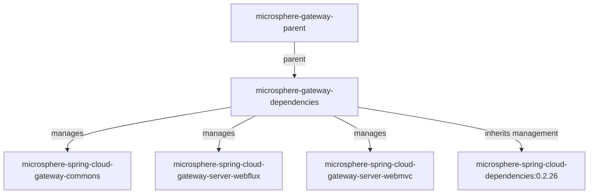

# `microsphere-gateway-dependencies`

## 1. Purpose

`microsphere-gateway-dependencies` is the Bill Of Materials of Microsphere Gateway: a `pom` artifact whose only content is
a `<dependencyManagement>` section pinning the three deployable modules of this project (`commons`, `server-webflux`,
`server-webmvc`) to the version the BOM itself was released with. Applications that consume Microsphere Gateway should
import it in their own `<dependencyManagement>` so that the gateway modules are declared without versions and can never
drift apart; teams publishing several internal gateway-related libraries should import it in those libraries so
consumers get one consistent set.

## 2. Version information

| Item | Value |
|---|---|
| Group id | `io.github.microsphere-projects` |
| Artifact id | `microsphere-gateway-dependencies` |
| Version line | `0.2.x` |
| Branch version (`release`) | `0.2.19-SNAPSHOT` (Maven `revision`) |
| Latest published release | `0.2.18` (newest entry in the branch `release-notes.md`) |
| Packaging | `pom` |
| Published to | Maven Central, group `io.github.microsphere-projects` (deployed by `.github/workflows/maven-publish.yml`) |
| Parent | `io.github.microsphere-projects:microsphere-gateway-parent:${revision}` (`<relativePath>../microsphere-gateway-parent/pom.xml</relativePath>`) |

Because the managed versions are expressed as `${revision}`, the three entries in this BOM are always published at exactly
the same version as the BOM: importing `0.2.18` manages `0.2.18` of each module.

## 3. Compatibility range

| Dimension | Supported | Evidence in the snapshot | What breaks outside the range |
|---|---|---|---|
| JDK of the managed artifacts | 17 baseline; CI verified on 17 / 21 / 25 | `<java.version>17</java.version>` in the aggregator POM; `maven-build.yml` matrix | The BOM itself compiles nothing, but the jars it pins do not run on JDK 8/11 |
| Maven | 3.9.16 (wrapper) | `.mvn/wrapper/maven-wrapper.properties` | `import` scope with `pom` type is standard, but older Maven releases are not tested here |
| Spring Cloud release trains | `spring-cloud-2022`, `spring-cloud-2023`, `spring-cloud-2024`, `spring-cloud-2025` | profile matrix in `maven-build.yml`; profiles declared in the server modules | The BOM does **not** switch gateway artifacts per profile — the starter is still yours to choose; see the [WebFlux](microsphere-spring-cloud-gateway-server-webflux.md#3-compatibility-range) and [WebMVC](microsphere-spring-cloud-gateway-server-webmvc.md#3-compatibility-range) pages |
| Upstream managed stack | Inherited through the parent: `microsphere-spring-cloud-dependencies:0.2.26` | `microsphere-gateway-parent/pom.xml` | If your build also imports Spring Boot's or Spring Cloud's own BOMs, ordering decides who wins |
| Spring Cloud Gateway starter | Not managed here | BOM `<dependencyManagement>` lists only the three Microsphere artifacts | You must still add `spring-cloud-starter-gateway`, `spring-cloud-gateway-server-webflux`, `spring-cloud-starter-gateway-mvc` or `spring-cloud-gateway-server-webmvc` yourself, normally via the Spring Cloud BOM |

Position in the reactor:



## 4. Installation

```xml
<dependencyManagement>
    <dependencies>
        <dependency>
            <groupId>io.github.microsphere-projects</groupId>
            <artifactId>microsphere-gateway-dependencies</artifactId>
            <version>0.2.18</version>
            <type>pom</type>
            <scope>import</scope>
        </dependency>
    </dependencies>
</dependencyManagement>

<dependencies>
    <dependency>
        <groupId>io.github.microsphere-projects</groupId>
        <artifactId>microsphere-spring-cloud-gateway-server-webflux</artifactId>
    </dependency>
</dependencies>
```

Importing the BOM adds no jar to your classpath — it only manages versions.

## 5. Dependency-management surface (API reference for a POM-only module)

### 5.1 Artifacts managed directly by this BOM

All three are `io.github.microsphere-projects`, `jar`, version `${revision}`:

| Artifact id | Scope of management | What you get transitively that you must still provide |
|---|---|---|
| `microsphere-spring-cloud-gateway-commons` | version only (no `<type>`/`<scope>` overrides) | Everything it declares is `<optional>`: `microsphere-spring-cloud-commons`, `spring-boot-starter`, `spring-boot-starter-actuator`, `spring-cloud-commons`, `spring-cloud-loadbalancer`, `spring-web`, `jakarta.validation-api` |
| `microsphere-spring-cloud-gateway-server-webflux` | version only | `commons` comes transitively (compile scope); `microsphere-spring-cloud-commons`, `microsphere-spring-boot-webflux`, `spring-cloud-commons`, `spring-cloud-loadbalancer`, `spring-boot-starter-webflux` are `<optional>`, and the gateway server artifact is profile-scoped and `<optional>` |
| `microsphere-spring-cloud-gateway-server-webmvc` | version only | `commons` comes transitively; the module itself declares `spring-cloud-starter-gateway-mvc` and `spring-cloud-gateway-proxyexchange-webmvc` at compile scope, while `microsphere-spring-cloud-commons`, `microsphere-spring-boot-webmvc`, `spring-cloud-commons`, `spring-cloud-loadbalancer` and `spring-boot-starter` are `<optional>` |

### 5.2 Management inherited from the parent

`microsphere-gateway-dependencies` has `microsphere-gateway-parent` as its parent, and that parent imports
`io.github.microsphere-projects:microsphere-spring-cloud-dependencies:0.2.26`. Consequently the *effective* management you
receive from importing this BOM also covers the Microsphere Spring Cloud family managed by that BOM (for instance
`microsphere-spring-cloud-commons`, which the gateway modules need at runtime but declare as `<optional>`). Treat the
exact member list as belonging to `microsphere-spring-cloud-dependencies`, not to this artifact, and confirm it in your
build:

```bash
mvn -DincludeGroupIds=io.github.microsphere-projects dependency:tree
mvn help:effective-pom | grep -A2 microsphere-
```

### 5.3 Overriding a managed version

Two supported patterns.

Declare your entry **before** the import (Maven keeps the first declaration):

```xml
<dependencyManagement>
    <dependencies>
        <!-- pin one module to a specific release -->
        <dependency>
            <groupId>io.github.microsphere-projects</groupId>
            <artifactId>microsphere-spring-cloud-gateway-server-webflux</artifactId>
            <version>0.2.17</version>
        </dependency>

        <dependency>
            <groupId>io.github.microsphere-projects</groupId>
            <artifactId>microsphere-gateway-dependencies</artifactId>
            <version>0.2.18</version>
            <type>pom</type>
            <scope>import</scope>
        </dependency>
    </dependencies>
</dependencyManagement>
```

Or inherit the parent and override the property (this changes the imported Microsphere Spring Cloud BOM, not the gateway
entries, which always follow `${revision}`) — see
[`microsphere-gateway-parent`](microsphere-gateway-parent.md#52-properties-you-can-override).

### 5.4 What is deliberately *not* in this BOM

- Spring Cloud Gateway server artifacts (`spring-cloud-starter-gateway`, `spring-cloud-gateway-server-webflux`,
  `spring-cloud-starter-gateway-mvc`, `spring-cloud-gateway-server-webmvc`) — these are profile-selected in the module
  POMs and are not managed here.
- Spring Boot and Spring Cloud BOMs — managed by the Microsphere Spring Cloud BOM chain.
- Test infrastructure (`microsphere-spring-boot-test`) — except that the WebFlux module declares it without `<scope>test</scope>`; see the [WebFlux pitfalls](microsphere-spring-cloud-gateway-server-webflux.md#8-common-pitfalls--faq).

## 6. Configuration reference

No `microsphere.*` application property is defined by this artifact (it packages no resources). The property keys managed
by the artifacts listed here are documented in the
[commons reference](microsphere-spring-cloud-gateway-commons.md#6-configuration-reference), the
[WebFlux reference](microsphere-spring-cloud-gateway-server-webflux.md#6-configuration-reference) and the
[WebMVC reference](microsphere-spring-cloud-gateway-server-webmvc.md#6-configuration-reference).

## 7. Code examples

### 7.1 A gateway application built the way this project's own tests are built

The WebFlux and WebMVC tests both run with `spring.profiles.active=simple-service-registry,gateway` and rely on
Microsphere's simple service registry, so the dependency set below is the minimum that reproduces that behaviour.
Derived from `WebEndpointMappingHandlerFilterFunctionTest` (WebMVC) and `WebEndpointMappingGlobalFilterTest` (WebFlux):

```xml
<dependencyManagement>
    <dependencies>
        <dependency>
            <groupId>org.springframework.cloud</groupId>
            <artifactId>spring-cloud-dependencies</artifactId>
            <version>2025.0.0</version>
            <type>pom</type>
            <scope>import</scope>
        </dependency>
        <dependency>
            <groupId>io.github.microsphere-projects</groupId>
            <artifactId>microsphere-gateway-dependencies</artifactId>
            <version>0.2.18</version>
            <type>pom</type>
            <scope>import</scope>
        </dependency>
    </dependencies>
</dependencyManagement>

<dependencies>
    <dependency>
        <groupId>io.github.microsphere-projects</groupId>
        <artifactId>microsphere-spring-cloud-gateway-server-webmvc</artifactId>
    </dependency>

    <!-- <optional> in the modules: must be declared by you -->
    <dependency>
        <groupId>io.github.microsphere-projects</groupId>
        <artifactId>microsphere-spring-cloud-commons</artifactId>
    </dependency>
    <dependency>
        <groupId>org.springframework.cloud</groupId>
        <artifactId>spring-cloud-starter-loadbalancer</artifactId>
    </dependency>
    <dependency>
        <groupId>org.springframework.boot</groupId>
        <artifactId>spring-boot-starter-web</artifactId>
    </dependency>
</dependencies>
```

The `spring-cloud-dependencies` version is an example value matching the `spring-cloud-2025` train name used by CI; align
it with the release train you actually target.

### 7.2 The verbatim `<dependencyManagement>` of this BOM

```xml
<dependencyManagement>
    <dependencies>

        <dependency>
            <groupId>io.github.microsphere-projects</groupId>
            <artifactId>microsphere-spring-cloud-gateway-commons</artifactId>
            <version>${revision}</version>
        </dependency>

        <dependency>
            <groupId>io.github.microsphere-projects</groupId>
            <artifactId>microsphere-spring-cloud-gateway-server-webflux</artifactId>
            <version>${revision}</version>
        </dependency>

        <dependency>
            <groupId>io.github.microsphere-projects</groupId>
            <artifactId>microsphere-spring-cloud-gateway-server-webmvc</artifactId>
            <version>${revision}</version>
        </dependency>

    </dependencies>
</dependencyManagement>
```

## 8. Common pitfalls / FAQ

**"I imported the BOM and Maven cannot resolve `microsphere-spring-cloud-gateway-server-webflux`."**
Check you are using `0.2.18` (or another published release) rather than the branch version `0.2.19-SNAPSHOT`, which is not
on Maven Central.

**"My gateway module now drags in `spring-cloud-starter-gateway-mvc` that I did not ask for."**
That is real, and only for the WebMVC module: `spring-cloud-starter-gateway-mvc` and
`spring-cloud-gateway-proxyexchange-webmvc` are compile (non-optional) dependencies in that POM, while the WebFlux module's
gateway dependency is `<optional>`. If you need to suppress it, exclude it and add the gateway artifact that matches your
Spring Cloud train.

**"The BOM does not pin a Spring Cloud Gateway version, so my gateway version came from nowhere / clashed."**
Correct by design: pair this BOM with `spring-cloud-dependencies` (or the Boot parent) so the gateway server artifact
version is managed there. This BOM's parent chain only manages the Microsphere Spring Cloud family.

**"Mixing `0.2.18` modules with a different `microsphere-spring-cloud-commons` version broke `we://` routing."**
The server modules compile against `io.microsphere.spring.web.metadata.WebEndpointMapping` and
`io.microsphere.spring.cloud.client.*`, which arrive through the *optional* `microsphere-spring-cloud-commons` dependency.
Keep that version aligned with the `microsphere-spring-cloud-dependencies` version your gateway release was built against
(`0.2.26` for the current `0.2.x` line) and re-check with `dependency:tree`.

**"Can I import this BOM together with `microsphere-gateway-parent` as my parent?"**
Yes — the parent already imports the Microsphere Spring Cloud BOM, and this BOM adds the gateway module versions. Duplicate
management of the same artifact is harmless; the first declaration wins.

## Related documents

- [User guide index](README.md)
- [microsphere-gateway-parent](microsphere-gateway-parent.md)
- [microsphere-spring-cloud-gateway-commons](microsphere-spring-cloud-gateway-commons.md)
- [Repository README](../../../README.md)

## 中文

- [Chinese user guide index](zh/README.md)
- [`microsphere-gateway-dependencies` in Chinese](zh/microsphere-gateway-dependencies.md)
