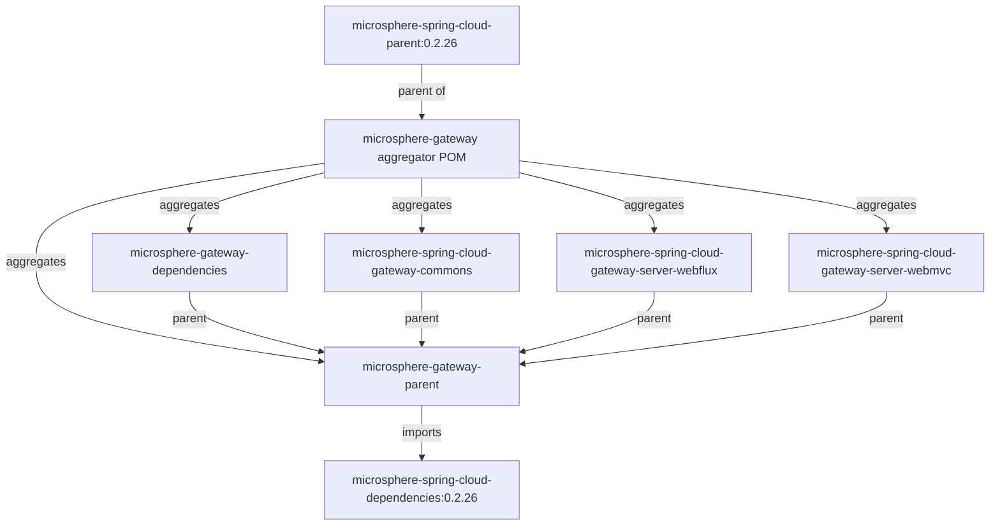

# `microsphere-gateway-parent`

## 1. Purpose

`microsphere-gateway-parent` is the build parent POM of Microsphere Gateway. It contributes no classes and no resources —
its whole job is to give every module in the reactor (and any consumer POM that adopts it as `<parent>`) a single,
coherent dependency-management surface by importing the Microsphere Spring Cloud BOM. Use it as the `<parent>` of your
own internal service or library modules when you want the same managed versions of Microsphere Spring Cloud, Spring
Boot, Spring Cloud and Spring Cloud Alibaba that this project is built and tested with; use
[`microsphere-gateway-dependencies`](microsphere-gateway-dependencies.md) instead when you only want to *import* version
management without inheriting build configuration.

## 2. Version information

| Item | Value |
|---|---|
| Group id | `io.github.microsphere-projects` |
| Artifact id | `microsphere-gateway-parent` |
| Version line | `0.2.x` |
| Branch version (`release`) | `0.2.19-SNAPSHOT` (Maven `revision`) |
| Latest published release | `0.2.18` (newest entry in the branch `release-notes.md`) |
| Packaging | `pom` |
| Published to | Maven Central, group `io.github.microsphere-projects` (deployed by `.github/workflows/maven-publish.yml`) |
| Inherited parent | `io.github.microsphere-projects:microsphere-gateway:${revision}` (the aggregator POM), whose own parent is `io.github.microsphere-projects:microsphere-spring-cloud-parent:0.2.26` |

The POM declares `<version>${revision}</version>` and `<packaging>pom</packaging>`, with
`<relativePath>../pom.xml</relativePath>` pointing at the aggregator. `revision` (`0.2.19-SNAPSHOT`) and `java.version`
(`17`) are defined in that aggregator POM, so anything you inherit from this parent also inherits the `revision`
property.

## 3. Compatibility range

| Dimension | Supported | Evidence in the snapshot | What breaks outside the range |
|---|---|---|---|
| JDK | 17 baseline, CI verified on 17 / 21 / 25 | `<java.version>17</java.version>` in the aggregator POM; `maven-build.yml` matrix | A child module compiling with `maven.compiler.source/target` below 17 is not supported by the parent chain's configuration |
| Build tool | Maven 3.9.16 (wrapper, `only-script` distribution type, wrapperVersion 3.3.4) | `.mvn/wrapper/maven-wrapper.properties`, `./mvnw` | Older Maven versions are not exercised by CI |
| Spring Cloud release trains | `spring-cloud-2022`, `spring-cloud-2023`, `spring-cloud-2024`, `spring-cloud-2025` | profile names in the CI matrix and in the server module POMs | The train selection is done by the imported BOM and the parent chain; an unsupported train is not managed |
| Microsphere Spring Cloud | BOM `io.github.microsphere-projects:microsphere-spring-cloud-dependencies:0.2.26` | `<microsphere-spring-cloud.version>0.2.26</microsphere-spring-cloud.version>` and the `import` entry in this POM | Using a different value without overriding the property leads to mixed managed versions |
| Spring Cloud Gateway starter | Not managed or declared by this POM — each server module selects it through its own profile | `microsphere-gateway-parent/pom.xml` contains a single `dependencyManagement` entry | Expecting this parent to bring a gateway dependency fails: you must add the starter yourself |

Position in the reactor:



## 4. Installation

As a parent (inherits build configuration plus dependency management):

```xml
<parent>
    <groupId>io.github.microsphere-projects</groupId>
    <artifactId>microsphere-gateway-parent</artifactId>
    <version>0.2.18</version>
    <relativePath/> <!-- lookup parent from the repository -->
</parent>
```

Or, more commonly inside this project's own reactor, as a sibling of the aggregator:

```xml
<parent>
    <groupId>io.github.microsphere-projects</groupId>
    <artifactId>microsphere-gateway-parent</artifactId>
    <version>${revision}</version>
    <relativePath>../microsphere-gateway-parent/pom.xml</relativePath>
</parent>
```

If you only need version management, import the BOM instead — see
[`microsphere-gateway-dependencies`](microsphere-gateway-dependencies.md).

## 5. Dependency-management surface (API reference for a POM-only module)

This artifact exposes no Java API. Its "API" is the set of things your POM can reach through it.

### 5.1 Imported BOMs

| Import | Scope / type | Version property | Notes |
|---|---|---|---|
| `io.github.microsphere-projects:microsphere-spring-cloud-dependencies` | `pom` / `import` | `microsphere-spring-cloud.version` = `0.2.26` | The only `<dependencyManagement>` entry declared directly in this POM. Through it you receive the managed Microsphere Spring Cloud artifacts (`microsphere-spring-cloud-commons`, `microsphere-spring-boot-*`, …) plus the Spring Boot / Spring Cloud / Spring Cloud Alibaba versions that the Microsphere BOM itself manages. |

### 5.2 Properties you can override

| Property | Declared value | Declared in | Effect when overridden in your child POM |
|---|---|---|---|
| `microsphere-spring-cloud.version` | `0.2.26` | `microsphere-gateway-parent/pom.xml` | Re-points the imported BOM, e.g. `<microsphere-spring-cloud.version>0.2.25</microsphere-spring-cloud.version>`. This is the supported way to move the whole managed stack one Microsphere release up or down while inheriting this parent. |
| `revision` | `0.2.19-SNAPSHOT` | aggregator `pom.xml` | Your own version when you inherit the parent chain; CI builds use `-Drevision=0.0.1-SNAPSHOT` and the publish workflow uses a `-Drevision=<major>.<minor>.<patch>` release version. |
| `java.version` | `17` | aggregator `pom.xml` | The JDK baseline carried by the parent chain's compiler configuration. |
| `spring-boot.version`, `spring-cloud.version`, `spring-cloud-alibaba.version` | not set in this POM | set per-profile only inside `microsphere-spring-cloud-gateway-server-webmvc` | Overriding them in a child that inherits this parent changes the versions resolved by the imported BOM; see the [WebMVC compatibility notes](microsphere-spring-cloud-gateway-server-webmvc.md#3-compatibility-range). |

### 5.3 Inherited coordinates

`groupId` `io.github.microsphere-projects` and `<version>${revision}</version>` are set here, so child modules may omit
both — exactly as `microsphere-spring-cloud-gateway-commons`, `-server-webflux` and `-server-webmvc` do (they still repeat
`<version>${revision}</version>` explicitly).

### 5.4 Build and release commands driven by the parent chain

```bash
# full reactor, the profile CI uses by default
./mvnw --batch-mode -Drevision=0.0.1-SNAPSHOT -Ptest,spring-cloud-2025 package

# one module and its dependencies
./mvnw --batch-mode -Drevision=0.0.1-SNAPSHOT \
  -pl microsphere-spring-cloud-gateway-commons -am \
  -Ptest,spring-cloud-2025 test
```

Reactor build order is defined by the aggregator `<modules>` list: `microsphere-gateway-parent`,
`microsphere-gateway-dependencies`, `microsphere-spring-cloud-gateway-commons`,
`microsphere-spring-cloud-gateway-server-webflux`, `microsphere-spring-cloud-gateway-server-webmvc`.

## 6. Configuration reference

There are no `microsphere.*` application properties in this module: it is a `pom` artifact with no resources. Its
configuration surface is the Maven property table in [5.2](#52-properties-you-can-override). For the runtime toggles that
the managed artifacts read, see the
[commons configuration reference](microsphere-spring-cloud-gateway-commons.md#6-configuration-reference).

## 7. Code examples

### 7.1 A consumer POM that inherits the managed stack

```xml
<project>
    <modelVersion>4.0.0</modelVersion>

    <parent>
        <groupId>io.github.microsphere-projects</groupId>
        <artifactId>microsphere-gateway-parent</artifactId>
        <version>0.2.18</version>
        <relativePath/>
    </parent>

    <groupId>com.example</groupId>
    <artifactId>my-gateway</artifactId>
    <version>1.0.0</version>

    <properties>
        <!-- move the whole Microsphere Spring Cloud stack -->
        <microsphere-spring-cloud.version>0.2.26</microsphere-spring-cloud.version>
    </properties>

    <dependencies>
        <!-- versions come from the imported BOM plus the gateway BOM -->
        <dependency>
            <groupId>io.github.microsphere-projects</groupId>
            <artifactId>microsphere-spring-cloud-gateway-server-webflux</artifactId>
        </dependency>
        <dependency>
            <groupId>org.springframework.cloud</groupId>
            <artifactId>spring-cloud-starter-gateway</artifactId>
        </dependency>
    </dependencies>
</project>
```

Note that `microsphere-spring-cloud-gateway-server-webflux` is **not** managed by this parent — it is managed by
`microsphere-gateway-dependencies`. Import that BOM (or pin the version) in addition to inheriting this parent.

### 7.2 The exact `dependencyManagement` block this POM contributes

```xml
<dependencyManagement>
    <dependencies>

        <!-- Microsphere Spring Cloud Dependencies -->
        <dependency>
            <groupId>io.github.microsphere-projects</groupId>
            <artifactId>microsphere-spring-cloud-dependencies</artifactId>
            <version>${microsphere-spring-cloud.version}</version>
            <type>pom</type>
            <scope>import</scope>
        </dependency>

    </dependencies>
</dependencyManagement>
```

## 8. Common pitfalls / FAQ

**"I inherited `microsphere-gateway-parent` and now my gateway artifacts have no version."**
By design. This parent only imports `microsphere-spring-cloud-dependencies`; the three gateway artifacts are managed by
`microsphere-gateway-dependencies`. Import both.

**"Can I override `microsphere-spring-cloud.version` when I only *import* the BOM?"**
No. Properties travel with inheritance, not with `import` scope. Importing
`io.github.microsphere-projects:microsphere-gateway-dependencies` in your `<dependencyManagement>` gives you the resolved
versions, not the properties. To override by property, use this artifact as `<parent>`; to override by version, declare
your own `<dependency>` management entry **before** the import (first declaration wins).

**"`<relativePath/>` is required when I use a published parent."**
Yes. The POM on Maven Central has no `../pom.xml`; leaving the default relative path makes Maven look on your filesystem
first and report a missing parent. Use an empty `<relativePath/>`.

**"The parent chain pulls build plugins I do not want."**
Everything above this POM comes from `microsphere-spring-cloud-parent:0.2.26` (compiler, publishing and profile
configuration). If you want version management without that build configuration, import
[`microsphere-gateway-dependencies`](microsphere-gateway-dependencies.md) instead of inheriting.

## Related documents

- [User guide index](README.md)
- [microsphere-gateway-dependencies (BOM)](microsphere-gateway-dependencies.md)
- [microsphere-spring-cloud-gateway-commons](microsphere-spring-cloud-gateway-commons.md)
- [Repository README](../../../README.md)

## 中文

- [Chinese user guide index](zh/README.md)
- [`microsphere-gateway-parent` in Chinese](zh/microsphere-gateway-parent.md)
