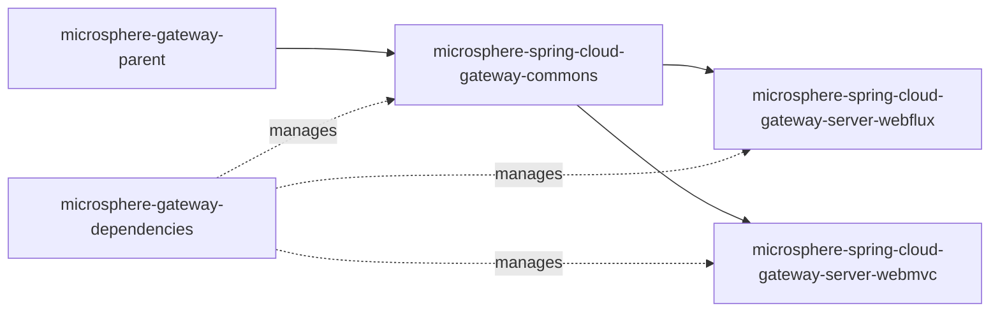

# `microsphere-spring-cloud-gateway-commons`

## 1. Purpose

`microsphere-spring-cloud-gateway-commons` is the shared, gateway-stack-agnostic library of Microsphere Gateway. It owns
the vocabulary that the whole project revolves around: the `we://` (web-endpoint) route URI scheme, the route metadata
keys under `metadata.web-endpoint`, the `microsphere.spring.cloud.*` feature toggles, the `WebEndpointConfig` model that
describes per-route `excludes`, and the property-binding listener that turns raw route metadata into that model. Any
application that needs to react to Microsphere gateway route metadata without depending on a reactive or servlet gateway
implementation should depend on this module — in practice you almost always get it transitively from
`microsphere-spring-cloud-gateway-server-webflux` or `microsphere-spring-cloud-gateway-server-webmvc`, and you declare it
explicitly only when you want the constants and the binding logic on the classpath of a non-gateway service (for example,
to build route metadata programmatically or to validate `excludes` structures in a control plane).

## 2. Version information

| Item | Value |
|---|---|
| Group id | `io.github.microsphere-projects` |
| Artifact id | `microsphere-spring-cloud-gateway-commons` |
| Version line | `0.2.x` |
| Branch version (`release`) | `0.2.19-SNAPSHOT` (Maven `revision` in the root POM) |
| Latest published release | `0.2.18` (newest entry in the branch `release-notes.md`) |
| Packaging | `jar` |
| Published to | Maven Central, group `io.github.microsphere-projects` (deployed by `.github/workflows/maven-publish.yml`) |
| Source module | `microsphere-spring-cloud-gateway-commons` |

The version is not hard-coded in the module POM: the module declares `<version>${revision}</version>`, and `revision` is
defined once in the aggregator POM (`0.2.19-SNAPSHOT` on the `release` branch). The publish pipeline
(`.github/workflows/maven-publish.yml`) deploys from the `release` branch with a `-Drevision=<major>.<minor>.<patch>`
value, which is why released artifacts carry plain versions such as `0.2.18` while the branch itself is a `-SNAPSHOT`.

## 3. Compatibility range

| Dimension | Supported | Evidence in the snapshot | What breaks outside the range |
|---|---|---|---|
| JDK | 17 baseline; CI verifies 17, 21, 25 | `<java.version>17</java.version>` in the aggregator POM; `maven-build.yml` matrix `java: ['17','21','25']` | Compiling or running on JDK 8/11 fails; the artifact is not built for them and CI never exercises them |
| Spring Boot | Whatever the imported `microsphere-spring-cloud-dependencies:0.2.26` BOM manages for the chosen Spring Cloud train | Root POM parent `microsphere-spring-cloud-parent:0.2.26`; `microsphere-gateway-parent` imports the BOM | `spring-boot-starter`, `spring-boot-starter-actuator` and both annotation processors are `<optional>` here, so a mismatched Boot version is your build's problem, not resolved by this module |
| Spring Cloud release train | `spring-cloud-2022`, `spring-cloud-2023`, `spring-cloud-2024`, `spring-cloud-2025` (Maven profiles, `2025` active by default) | `maven-build.yml` matrix `maven-profile-spring-cloud` | The profiles are declared in the server modules, not here; this module has no gateway dependency at all, so its own compatibility is driven by `spring-cloud-commons` |
| Spring Cloud | `spring-cloud-commons`, `spring-cloud-loadbalancer` (`<optional>`) | Module POM dependency block | If `spring-cloud-commons` is missing, `io.microsphere.spring.cloud.gateway.commons.config.WebEndpointConfig` still loads, but classes referencing `WebEndpointMapping` (from `microsphere-spring-cloud-commons`) will not |
| Microsphere Spring Cloud | `io.github.microsphere-projects:microsphere-spring-cloud-commons` (`<optional>`) | Module POM; imported BOM version `0.2.26` | `CommonsPropertyConstants` and `WebEndpointConfig` compile against it; without it on your classpath the module fails with `NoClassDefFoundError` on `io.microsphere.spring.web.metadata.WebEndpointMapping` |
| Bean Validation | `jakarta.validation:jakarta.validation-api` (`<optional>`); Hibernate Validator is test-scoped only | Module POM | `WebEndpointConfig` is annotated with `@Validated`, `@NotNull`, `@Valid`; without a validation provider the exclude constraints are silently not enforced |
| Spring Web | `org.springframework:spring-web` (`<optional>`) | Module POM (`RequestMethod` is used by `WebEndpointConfig.Mapping`) | `Mapping.getMethods()` returns `RequestMethod[]`; without `spring-web` the class will not initialize |

Module dependency shape:



## 4. Installation

Import the BOM first, then declare the module without a version:

```xml
<dependencyManagement>
    <dependencies>
        <dependency>
            <groupId>io.github.microsphere-projects</groupId>
            <artifactId>microsphere-gateway-dependencies</artifactId>
            <version>0.2.18</version>
            <type>pom</type>
            <scope>import</scope>
        </dependency>
    </dependencies>
</dependencyManagement>

<dependencies>
    <dependency>
        <groupId>io.github.microsphere-projects</groupId>
        <artifactId>microsphere-spring-cloud-gateway-commons</artifactId>
    </dependency>
</dependencies>
```

Because every compile dependency of this module is `<optional>`, you must add the ones you actually use. A realistic
standalone set:

```xml
<dependencies>
    <dependency>
        <groupId>io.github.microsphere-projects</groupId>
        <artifactId>microsphere-spring-cloud-gateway-commons</artifactId>
    </dependency>

    <!-- Not optional in this module: Microsphere Spring Cloud commons -->
    <dependency>
        <groupId>io.github.microsphere-projects</groupId>
        <artifactId>microsphere-spring-cloud-commons</artifactId>
    </dependency>

    <dependency>
        <groupId>org.springframework.boot</groupId>
        <artifactId>spring-boot-starter</artifactId>
    </dependency>

    <dependency>
        <groupId>org.springframework</groupId>
        <artifactId>spring-web</artifactId>
    </dependency>

    <dependency>
        <groupId>org.springframework.cloud</groupId>
        <artifactId>spring-cloud-commons</artifactId>
    </dependency>

    <!-- Validation provider: required for the @NotNull / @Valid constraints -->
    <dependency>
        <groupId>org.hibernate.validator</groupId>
        <artifactId>hibernate-validator</artifactId>
    </dependency>
    <dependency>
        <groupId>org.apache.tomcat.embed</groupId>
        <artifactId>tomcat-embed-el</artifactId>
    </dependency>
</dependencies>
```

If `microsphere-spring-cloud-commons` ends up unmanaged in your build, pin it explicitly (the version family matches the
imported Microsphere Spring Cloud BOM, `0.2.26`) or import
`io.github.microsphere-projects:microsphere-spring-cloud-dependencies:0.2.26` alongside this BOM. Verify with
`mvn dependency:tree`.

## 5. API reference

### 5.1 `io.microsphere.spring.cloud.gateway.commons.constants.RouteConstants`

`public interface RouteConstants` — the vocabulary of the `we://` scheme. All members are `String` constants
(`since 1.0.0`).

| Member | Value | Behaviour / when to use |
|---|---|---|
| `SCHEME` | `"we"` | The URI scheme that marks a route as a web-endpoint route. Both server modules only build mapping caches for routes whose `uri` scheme equals this value. Use it when you filter `RouteDefinition`/`RouteProperties` yourself. |
| `ALL_SERVICES` | `"all"` | The host value meaning "subscribe to every discovered service", i.e. `we://all`. Anything else is parsed as a comma-delimited list of service ids (`we://orders-service,payments-service`). |
| `ID_KEY` | `"id"` | The per-route property segment used to detect route-id changes in an `EnvironmentChangeEvent`. |
| `METADATA_KEY` | `"metadata"` | The route property segment the bind listener watches. |
| `WEB_ENDPOINT_KEY` | `"web-endpoint"` | The metadata sub-key holding `WebEndpointConfig`; also the key the resolved config is written back to in the metadata map. |
| `WEB_ENDPOINT_REWRITE_PATH_ATTRIBUTE_NAME` | `"msgw-we-rewrite-path"` | The exchange/request attribute name under which the path with the leading `/{application}` segment removed is stashed before forwarding. Read it in your own filters if you need the downstream path. |

Verified by `RouteConstantsTest.testConstants`.

### 5.2 `io.microsphere.spring.cloud.gateway.commons.constants.CommonConstants`

`public interface CommonConstants`

| Member | Value | Behaviour / when to use |
|---|---|---|
| `APPLICATION_NAME_URI_TEMPLATE_VARIABLE_NAME` | `"application"` | The URI template variable name the gateway reads the target service id from. Your route predicate must declare `{application}` (for example `Path=/{application}/**`) — otherwise the web-endpoint filter passes the request through untouched. |

Verified by `CommonConstantsTest.testConstants`.

### 5.3 `io.microsphere.spring.cloud.gateway.commons.constants.CommonsPropertyConstants`

`public interface CommonsPropertyConstants` — only the two `enabled` keys carry
`@ConfigurationProperty(type = boolean.class, defaultValue = DEFAULT_MICROSPHERE_GATEWAY_ENABLED, source = APPLICATION_SOURCE)`;
the two prefixes and the `"true"` default constant are plain `String` fields.

| Member | Value | Behaviour / when to use |
|---|---|---|
| `MICROSPHERE_GATEWAY_SPRING_CLOUD_PROPERTY_NAME_PREFIX` | `"microsphere.spring.cloud.gateway."` | Prefix for this module's toggles. |
| `DEFAULT_MICROSPHERE_GATEWAY_ENABLED` | `"true"` | Shared default; the server modules reuse it for their own `enabled` keys. |
| `MICROSPHERE_GATEWAY_ENABLED_PROPERTY_NAME` | `"microsphere.spring.cloud.gateway.enabled"` | Master switch for all Microsphere gateway behaviour (`matchIfMissing = true`). |
| `MICROSPHERE_WEB_ENDPOINT_MAPPING_PROPERTY_NAME_PREFIX` | `"microsphere.spring.cloud.web-endpoint-mapping."` | Prefix for the web-endpoint mapping feature. |
| `MICROSPHERE_WEB_ENDPOINT_MAPPING_ENABLED_PROPERTY_NAME` | `"microsphere.spring.cloud.web-endpoint-mapping.enabled"` | Switch for the `WebEndpointMapping` route translation only; the rest of the gateway extension stays on. |

Verified by `CommonsPropertyConstantsTest.testConstants`.

### 5.4 Annotations

| Type | Declaration | Behaviour |
|---|---|---|
| `io.microsphere.spring.cloud.gateway.commons.annotation.ConditionalOnMicrosphereGatewayEnabled` | `@Target({TYPE, METHOD})`, `@Retention(RUNTIME)`, `@Documented`, meta-annotated `@ConditionalOnProperty(name = "microsphere.spring.cloud.gateway.enabled", matchIfMissing = true)` | Marks a configuration class or `@Bean` method as active only while Microsphere Gateway is enabled. Absence of the property means enabled. |
| `io.microsphere.spring.cloud.gateway.commons.annotation.ConditionalOnMicrosphereWebEndpointMappingEnabled` | Same targets/retention; meta-annotated `@ConditionalOnMicrosphereGatewayEnabled` **and** `@ConditionalOnProperty(name = "microsphere.spring.cloud.web-endpoint-mapping.enabled", matchIfMissing = true)` | Requires both toggles. Use it when your own bean is an extension of the web-endpoint routing behaviour, so `microsphere.spring.cloud.gateway.enabled=false` also switches it off. |

### 5.5 `config.WebEndpointConfig`

`@Validated public class WebEndpointConfig` — the typed model of `metadata.web-endpoint`.

| Member | Signature | Behaviour |
|---|---|---|
| `getExcludes` / `setExcludes` | `List<Mapping> getExcludes()` | Never `null` in a freshly created instance (initialised to an empty `LinkedList`); `@NotNull @Valid`, so an explicit `null` fails binding. |

Nested `public static class Mapping` (`@see WebEndpointMapping`):

| Property | Signature | Default when the key is absent | Notes |
|---|---|---|---|
| `patterns` | `String[] getPatterns()` / `setPatterns(String[])` | `null` | `@NotNull @Valid` — an exclude entry without `patterns` fails binding. |
| `methods` | `RequestMethod[] getMethods()` (`@Nonnull`) | `RequestMethod.values()` (all methods) | Nullable setter; an empty or missing array is normalised to *every* HTTP method, so an exclude without `methods` blocks the path for all verbs. |
| `params` | `String[] getParams()` (`@Nullable`) | `null` | Passed straight to `RequestMappingInfo.paths(...).params(...)`. |
| `headers` | `String[] getHeaders()` (`@Nonnull`) | `EMPTY_STRING_ARRAY` | Empty-or-missing is normalised to an empty array, never `null`. |
| `consumes` | `String[] getConsumes()` (`@Nullable`) | `null` | Media type restriction. |
| `produces` | `String[] getProduces()` (`@Nullable`) | `null` | Media type restriction. |

### 5.6 `config.ConfigUtils`

`public abstract class ConfigUtils implements Utils` — final constructor, static entry points only.

| Method | Signature | Behaviour |
|---|---|---|
| `getWebEndpointConfig(Environment, String)` | `@Nullable static WebEndpointConfig getWebEndpointConfig(Environment environment, String configPrefix)` | Binds `configPrefix` to `WebEndpointConfig` using a `Binder` that is wrapped in a `ValidationBindHandler` backed by a `LocalValidatorFactoryBean` created in a static initialiser. Returns `null` when nothing is bound. |
| `getWebEndpointConfig(Map<String, Object>)` | `@Nullable static WebEndpointConfig getWebEndpointConfig(Map<String, Object> metadata)` | Reads the `web-endpoint` key and returns it **only if the value is already a `WebEndpointConfig` instance**; a raw `Map` at that key yields `null`. This is why the bind listener below exists. |

### 5.7 `config.WebEndpointConfigurationPropertiesBindListener`

`public class WebEndpointConfigurationPropertiesBindListener implements BindListener, EnvironmentAware`

| Member | Signature | Behaviour |
|---|---|---|
| `BEAN_NAME` | `public static final String BEAN_NAME = "webEndpointConfigurationPropertiesBindListener"` | The bean name both server initialisers register. |
| constructor | `WebEndpointConfigurationPropertiesBindListener(String gatewayRoutesPropertyNamePrefix)` | Fails fast (`assertNotBlank`) on a blank prefix. The WebFlux module passes `GatewayProperties.PREFIX + ".routes"`, the WebMVC module passes `GatewayMvcProperties.PREFIX + ".routes"`. |
| `onFinish` | `void onFinish(ConfigurationPropertyName name, Bindable<?> target, BindContext context, Object result)` | When the bound property name starts with the routes prefix **and** ends with `metadata` and the result is non-`null`, it binds `<...>metadata.web-endpoint` into a `WebEndpointConfig` and, on success, puts it into the metadata `Map` under `web-endpoint`. Non-route metadata and metadata without `web-endpoint` are left untouched. |
| `setEnvironment` | `void setEnvironment(Environment environment)` | Standard `EnvironmentAware` injection used by `onFinish`. |

### 5.8 `META-INF/config/default/features.yaml`

The module ships exactly one feature declaration:

```yaml
microsphere:
  spring:
    cloud:
      features:
        abstract:
          microsphere-spring-cloud-gateway-commons:
            - io.microsphere.spring.cloud.gateway.commons.config.WebEndpointConfigurationPropertiesBindListener
```

`WebEndpointConfigurationPropertiesBindListener` is listed as an *abstract* feature (a class that participates in the
Microsphere Spring Cloud feature mechanism but is instantiated by the server modules, not registered as-is). The module
ships **no** `spring.factories` and **no** `AutoConfiguration.imports`: it contributes no auto-configuration of its own.

## 6. Configuration reference

Property keys owned by this module (verbatim from `CommonsPropertyConstants`):

| Key | Type | Default | Effect |
|---|---|---|---|
| `microsphere.spring.cloud.gateway.enabled` | `boolean` | `true` | Master switch (`matchIfMissing = true`). Turning it off backs off every `@ConditionalOnMicrosphereGatewayEnabled` and `@ConditionalOnMicrosphereWebEndpointMappingEnabled` element, including the gateway auto-configurations in both server modules. |
| `microsphere.spring.cloud.web-endpoint-mapping.enabled` | `boolean` | `true` | Switches only the `we://` web-endpoint mapping feature; the umbrella switch still controls everything. |
| `microsphere.spring.cloud.gateway.` | prefix | — | Namespaces the toggles above; no further keys are read by this module. |
| `microsphere.spring.cloud.web-endpoint-mapping.` | prefix | — | Namespace of the mapping toggle above. |

Route-metadata keys (the shape actually bound into `WebEndpointConfig`; taken verbatim from `src/test/resources` YAML):

| Key (relative to a route entry) | Type | Default | Effect |
|---|---|---|---|
| `uri` | URI with scheme `we` | — | `we://all` subscribes to every discovered service; `we://a,b` subscribes to the listed service ids. |
| `predicates` | list | — | Must expose the `{application}` URI template variable for the rewrite to happen. |
| `metadata.web-endpoint` | object | absent | Presence triggers `WebEndpointConfig` binding. |
| `metadata.web-endpoint.excludes` | list of mappings | empty list | Requests matching any entry are not translated; they keep the normal gateway behaviour. |
| `metadata.web-endpoint.excludes[].patterns` | `String[]` | required | Ant-style path patterns. |
| `metadata.web-endpoint.excludes[].methods` | `String[]` (`RequestMethod`) | all methods | Omit to match every verb. |
| `metadata.web-endpoint.excludes[].params` | `String[]` | `null` | Request-param expressions such as `p=1`. |
| `metadata.web-endpoint.excludes[].headers` | `String[]` | empty | Header expressions such as `h=1`. |
| `metadata.web-endpoint.excludes[].consumes` | `String[]` | `null` | Content-type restriction. |
| `metadata.web-endpoint.excludes[].produces` | `String[]` | `null` | Accept restriction. |

There is no `@ConfigurationProperties` class in this module; everything above is bound through `Binder` calls rather than
a properties bean, so none of these keys appear in `spring-configuration-metadata.json` from this artifact.

## 7. Code examples

### 7.1 Route metadata with excludes (derived from `ConfigUtilsTest` and `commons/src/test/resources/META-INF/config/default/test.yaml`)

```yaml
spring:
  cloud:
    gateway:
      routes:
        - id: web-endpoint-mapping
          uri: we://all
          predicates:
            - Path=/{application}/**
          metadata:
            web-endpoint:
              excludes:
                - patterns: /test-1/**
                  methods: GET
                  params: p=1
                - patterns: /test-2/**
                  methods: POST
                  headers: h=1
```

The test asserts the resulting model: entry 0 has `patterns=["/test-1/**"]`, `methods=[GET]`, `params=["p=1"]` and
`headers` equal to the empty array; entry 1 has `patterns=["/test-2/**"]`, `methods=[POST]`, `headers=["h=1"]` and `null`
`params`. Source: `io.microsphere.spring.cloud.gateway.commons.config.ConfigUtilsTest#testGetWebEndpointConfig`.

### 7.2 Defaults for a partially populated exclude (same test, third entry of the shared YAML)

```yaml
metadata:
  web-endpoint:
    excludes:
      - patterns: /test-3/abc/**
        consumes: application/json
        produces: plain/text
```

`ConfigUtilsTest.assertWebEndpointConfig` asserts `methods` is `RequestMethod.values()` (every verb), `params` is `null`,
`headers` is the empty array, and `consumes`/`produces` carry the two media types.

### 7.3 Binding route metadata at runtime (derived from `WebEndpointConfigurationPropertiesBindListenerTest`)

```java
Environment environment = createEnvironment(); // a MockEnvironment with the YAML above attached

WebEndpointConfigurationPropertiesBindListener bindListener =
        new WebEndpointConfigurationPropertiesBindListener("spring.cloud.gateway.routes");
bindListener.setEnvironment(environment);

Map<String, Object> metadata = bind(environment, "spring.cloud.gateway.routes[0].metadata",
        LinkedHashMap.class, bindListener);

WebEndpointConfig config = ConfigUtils.getWebEndpointConfig(metadata);
assertNotNull(config);
```

The same test also binds `routes[1].metadata` (a route without `web-endpoint`) and `spring.cloud` (outside the routes
prefix) — both are no-ops. Source:
`io.microsphere.spring.cloud.gateway.commons.config.WebEndpointConfigurationPropertiesBindListenerTest#testApply`.

### 7.4 Gating your own configuration (derived from `ConditionalOnMicrosphereGatewayEnabledTest` / `ConditionalOnMicrosphereWebEndpointMappingEnabledTest`)

```java
@ConditionalOnMicrosphereWebEndpointMappingEnabled
static class Config {
}
```

With no properties set the bean is present; with
`microsphere.spring.cloud.web-endpoint-mapping.enabled=false` (or `microsphere.spring.cloud.gateway.enabled=false`) the
same test asserts the injected bean is `null`. Source:
`io.microsphere.spring.cloud.gateway.commons.annotation.ConditionalOnMicrosphereWebEndpointMappingEnabledTest`.

## 8. Common pitfalls / FAQ

**`getWebEndpointConfig(Map)` returns `null` even though `metadata.web-endpoint` is in the YAML.**
The `Map` overload performs an `instanceof WebEndpointConfig` check — it never binds. A metadata map holding a plain
`LinkedHashMap` under `web-endpoint` returns `null` (asserted in `ConfigUtilsTest`). Use the `Environment` overload with
the full property prefix, or make sure the route was bound while `WebEndpointConfigurationPropertiesBindListener` was
registered (which both server modules do through their `WebEndpointApplicationContextInitializer`).

**An exclude entry with no `patterns` fails the whole route binding.**
`Mapping.patterns` is `@NotNull` and `ConfigUtils` binds through a `ValidationBindHandler`. Symptom: the route (or the
application) fails to start with a binding validation error rather than a routing miss.

**An exclude without `methods` excludes more than you think.**
`getMethods()` substitutes `RequestMethod.values()` when the array is empty, so `/internal/**` alone blocks GET, POST,
PUT, DELETE and everything else on that path.

**`ClassNotFoundException` / `NoClassDefFoundError` on `WebEndpointMapping` or `RequestMethod`.**
`microsphere-spring-cloud-commons`, `spring-web`, `spring-cloud-commons` and `jakarta.validation-api` are all
`<optional>` in this module's POM; nothing is pulled transitively at compile scope. Add the ones you need.

**Validation constraints are silently ignored.**
No validation provider is declared at compile scope (Hibernate Validator and `tomcat-embed-el` are `test` scope here).
Without a provider on your classpath, `@NotNull`/`@Valid` on `WebEndpointConfig` cannot be enforced.

**Excludes look "not applied" for a path that clearly matches.**
Exclude patterns are matched against the request path as it arrives at the route — before the `/{application}` segment is
stripped. In the WebFlux test configuration the route predicate is `Path=/{application}/**` and the patterns are
`/test-1/**`; in the WebMVC configuration the predicate is `Path=/we/{application}/**` and the pattern is
`/we/test-app/**`. Keep the leading route prefix in your patterns.

**Where do `microsphere.spring.cloud.*` keys come from?**
`MICROSPHERE_GATEWAY_SPRING_CLOUD_PROPERTY_NAME_PREFIX` is built from the Microsphere Spring Cloud commons prefix
(`microsphere.spring.cloud.`) plus `gateway.`; the exact strings are pinned by `CommonsPropertyConstantsTest`, so copy
them from this page rather than assembling them yourself.

## Related documents

- [User guide index](README.md)
- [WebFlux server module](microsphere-spring-cloud-gateway-server-webflux.md)
- [WebMVC server module](microsphere-spring-cloud-gateway-server-webmvc.md)
- [Repository README](../../../README.md)

## 中文

- [Chinese user guide index](zh/README.md)
- [`microsphere-spring-cloud-gateway-commons` in Chinese](zh/microsphere-spring-cloud-gateway-commons.md)
