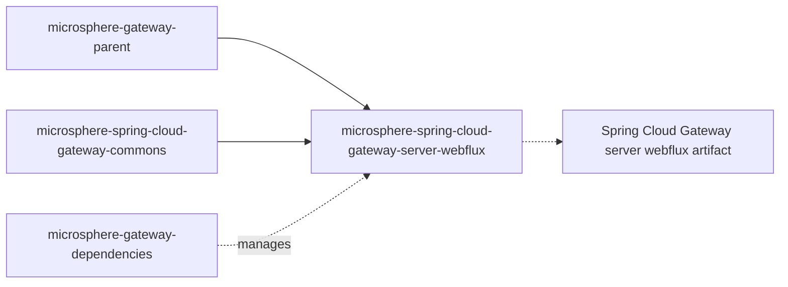

# `microsphere-spring-cloud-gateway-server-webflux`

## 1. Purpose

`microsphere-spring-cloud-gateway-server-webflux` turns a reactive Spring Cloud Gateway (the WebFlux server) into a
Microsphere web-endpoint gateway. It auto-configures the `we://` route scheme so that a single route can forward traffic
to *discovered* services based on the web endpoint metadata each service publishes, instead of you writing one route per
service. It also replaces Spring Cloud Gateway's `FilteringWebHandler` with a caching variant, stops discovery heartbeats
from thrashing the route cache, and refreshes route-derived mapping caches when configuration or service instances change.
Depend on this module from a reactive gateway application (Spring Boot + `spring-cloud-starter-gateway` or
`spring-cloud-gateway-server-webflux`) that uses a Spring Cloud `ReactiveDiscoveryClient` and Spring Cloud LoadBalancer;
servlet applications should use
[`microsphere-spring-cloud-gateway-server-webmvc`](microsphere-spring-cloud-gateway-server-webmvc.md) instead — the two
are mutually exclusive variants of the same behaviour.

## 2. Version information

| Item | Value |
|---|---|
| Group id | `io.github.microsphere-projects` |
| Artifact id | `microsphere-spring-cloud-gateway-server-webflux` |
| Version line | `0.2.x` |
| Branch version (`release`) | `0.2.19-SNAPSHOT` (Maven `revision`) |
| Latest published release | `0.2.18` (newest entry in the branch `release-notes.md`) |
| Packaging | `jar` |
| Published to | Maven Central, group `io.github.microsphere-projects` (deployed by `.github/workflows/maven-publish.yml`) |
| Javadocs | `https://javadoc.io/doc/io.github.microsphere-projects/microsphere-spring-cloud-gateway-server-webflux` |
| Parent | `io.github.microsphere-projects:microsphere-gateway-parent:${revision}` |

## 3. Compatibility range

| Dimension | Supported | Evidence in the snapshot | What breaks outside the range |
|---|---|---|---|
| JDK | 17 baseline; CI verifies 17, 21, 25 | `<java.version>17</java.version>`; `maven-build.yml` `java: ['17','21','25']` | Not compiled or tested below 17 |
| Spring Cloud `2022` / `2023` / `2024` (Maven profiles `spring-cloud-2022`, `spring-cloud-2023`, `spring-cloud-2024`) | Build/test matrix; the profile adds `org.springframework.cloud:spring-cloud-starter-gateway` as `<optional>` | profile blocks in this module's POM | You must add the starter yourself; `GatewayProperties` from a version whose package/field layout differs can make `ConditionalOnGatewayAvailable` back off or `CachingFilteringWebHandler`'s reflective `globalFilters` lookup fail |
| Spring Cloud `2025` (profile `spring-cloud-2025`, **`activeByDefault` true**) | The profile adds `org.springframework.cloud:spring-cloud-gateway-server-webflux` as `<optional>` — note the different artifact id | profile block in this module's POM | Building `2025` while depending on `spring-cloud-starter-gateway` (or the reverse) leaves you with the wrong gateway server artifact for the compiled code paths |
| Reactive gateway server | `spring-cloud-gateway-server-webflux` / `spring-cloud-starter-gateway`, providing `org.springframework.cloud.gateway.config.GatewayProperties` | `@ConditionalOnClass(name = "org.springframework.cloud.gateway.config.GatewayProperties")` | Without that class **every** auto-configuration in this module backs off silently — no `we://` routing, no error |
| Reactive web stack | `spring-boot-starter-webflux` and `io.github.microsphere-projects:microsphere-spring-boot-webflux` (both `<optional>`); the latter provides `io.microsphere.spring.boot.webflux.autoconfigure.condition.ConditionalOnWebFluxAvailable` | `<optional>` entries in this module's POM + the annotation's meta-conditions | A servlet application gets no beans from this module |
| Discovery | `spring-cloud-commons` providing `ReactiveDiscoveryClient` (`<optional>`) plus a `ReactiveDiscoveryClientAdapter` bean from `microsphere-spring-cloud-commons` | `@ConditionalOnClass`, `@ConditionalOnBean(..., search = CURRENT)` in `WebEndpointMappingGatewayAutoConfiguration` | No `WebEndpointMappingGlobalFilter` bean: routes with `we://` are matched but never translated |
| Load balancing | `spring-cloud-loadbalancer` providing `LoadBalancerClientFactory` (`<optional>`) | same conditions; `ReactiveLoadBalancerClientFilter` ordering | Instance selection (`choose`) cannot happen; the filter backs off |
| Microsphere Spring Cloud | `microsphere-spring-cloud-commons` (`<optional>`) — `WebEndpointMapping`, `ServiceInstanceUtils`, `ServiceInstancesChangedEvent`, `ReactiveDiscoveryClientAdapter` | imports throughout the sources | `NoClassDefFoundError` at refresh time |

Position in the reactor:



## 4. Installation

```xml
<dependencyManagement>
    <dependencies>
        <dependency>
            <groupId>org.springframework.cloud</groupId>
            <artifactId>spring-cloud-dependencies</artifactId>
            <version>2025.0.0</version>
            <type>pom</type>
            <scope>import</scope>
        </dependency>
        <dependency>
            <groupId>io.github.microsphere-projects</groupId>
            <artifactId>microsphere-gateway-dependencies</artifactId>
            <version>0.2.18</version>
            <type>pom</type>
            <scope>import</scope>
        </dependency>
    </dependencies>
</dependencyManagement>

<dependencies>
    <dependency>
        <groupId>org.springframework.cloud</groupId>
        <artifactId>spring-cloud-starter-gateway</artifactId>
    </dependency>

    <dependency>
        <groupId>io.github.microsphere-projects</groupId>
        <artifactId>microsphere-spring-cloud-gateway-server-webflux</artifactId>
    </dependency>

    <!-- everything below is <optional> in the module and must be provided -->
    <dependency>
        <groupId>io.github.microsphere-projects</groupId>
        <artifactId>microsphere-spring-cloud-commons</artifactId>
    </dependency>
    <dependency>
        <groupId>org.springframework.cloud</groupId>
        <artifactId>spring-cloud-starter-loadbalancer</artifactId>
    </dependency>
    <dependency>
        <groupId>org.springframework.boot</groupId>
        <artifactId>spring-boot-starter-webflux</artifactId>
    </dependency>
</dependencies>
```

`microsphere-spring-cloud-gateway-commons` is a compile dependency of this module and arrives transitively.

## 5. API reference

Registered extension points (`src/main/resources`):

| File | Content |
|---|---|
| `META-INF/spring/org.springframework.boot.autoconfigure.AutoConfiguration.imports` | `io.microsphere.spring.cloud.gateway.server.webflux.autoconfigure.GatewayAutoConfiguration`, `io.microsphere.spring.cloud.gateway.server.webflux.autoconfigure.WebEndpointMappingGatewayAutoConfiguration` |
| `META-INF/spring.factories` | `org.springframework.context.ApplicationContextInitializer=io.microsphere.spring.cloud.gateway.server.webflux.context.WebEndpointApplicationContextInitializer` |
| `META-INF/config/default/features.yaml` | abstract features: `CachingFilteringWebHandler`, `WebEndpointMappingGlobalFilter`, `DisabledHeartbeatEventRouteRefreshListenerInterceptor`, `PropagatingRefreshRoutesEventApplicationListener`; named feature: `WebEndpointApplicationContextInitializer=...context.WebEndpointApplicationContextInitializer` |

### 5.1 `autoconfigure.GatewayAutoConfiguration`

`@Configuration(proxyBeanMethods = false)`, conditional on `@ConditionalOnGatewayAvailable` +
`@ConditionalOnMicrosphereGatewayEnabled`, `@EnableEventExtension`, `@AutoConfigureAfter(name = "org.springframework.cloud.gateway.config.GatewayAutoConfiguration")`, and `@Import`s `DisabledHeartbeatEventRouteRefreshListenerInterceptor`,
`PropagatingRefreshRoutesEventApplicationListener`, `FilteringWebHandlerBeanDefinitionRegistryPostProcessor`. Declares no
beans itself: it is the switch that turns the three imported extensions on. Use `microsphere.spring.cloud.gateway.enabled=false`
to disable all of them.

### 5.2 `autoconfigure.WebEndpointMappingGatewayAutoConfiguration`

`@Configuration(proxyBeanMethods = false)`. Conditions (all must hold): `@ConditionalOnGatewayAvailable`,
`@ConditionalOnDiscoveryEnabled`, `@ConditionalOnReactiveDiscoveryEnabled`,
`@ConditionalOnMicrosphereWebEndpointMappingEnabled`, `@ConditionalOnClass({"...ReactiveDiscoveryClient",
"...LoadBalancerClientFactory"})`, and it orders itself after `GatewayAutoConfiguration` (Microsphere and upstream),
`WebFluxAutoConfiguration`, `ReactiveDiscoveryClientAutoConfiguration`, `LoadBalancerAutoConfiguration` and
`ReactiveCompositeDiscoveryClientAutoConfiguration`.

| Bean | Signature | Conditions | Notes |
|---|---|---|---|
| `webEndpointMappingGlobalFilter` | `WebEndpointMappingGlobalFilter webEndpointMappingGlobalFilter(ReactiveDiscoveryClientAdapter reactiveDiscoveryClient, LoadBalancerClientFactory loadBalancerClientFactory, GatewayProperties gatewayProperties)` | `@ConditionalOnEnabledGlobalFilter` and `@ConditionalOnBean(value = {ReactiveDiscoveryClientAdapter.class, LoadBalancerClientFactory.class}, search = CURRENT)` | The `ReactiveDiscoveryClientAdapter` type (from `microsphere-spring-cloud-commons`) is required specifically — a plain `ReactiveDiscoveryClient` bean is not enough. |

### 5.3 `annotation.ConditionalOnGatewayAvailable` / `annotation.ConditionalOnGatewayEnabled`

| Type | Composition | Use when |
|---|---|---|
| `@ConditionalOnGatewayEnabled` | `@ConditionalOnProperty(name = GatewayPropertyConstants.GATEWAY_ENABLED_PROPERTY_NAME, matchIfMissing = true)` | You want your own bean to follow the upstream gateway switch only. |
| `@ConditionalOnGatewayAvailable` | `@ConditionalOnGatewayEnabled` + `@ConditionalOnWebFluxAvailable` + `@ConditionalOnClass(name = "org.springframework.cloud.gateway.config.GatewayProperties")` | Your bean needs the reactive gateway classes to actually be present. Documented on types and methods; both `@Retention(RUNTIME)` and `@Documented`. |

### 5.4 `constants.GatewayPropertyConstants`

`public interface GatewayPropertyConstants` (both members `@ConfigurationProperty(type = boolean.class, defaultValue = "true", source = APPLICATION_SOURCE)` where applicable):

| Member | Value | Behaviour |
|---|---|---|
| `GATEWAY_ENABLED_PROPERTY_NAME` | `GatewayProperties.PREFIX + "." + "enabled"` — the class Javadoc names it `spring.cloud.gateway.server.webflux.enabled`, which is also the key the module's own tests disable | The upstream reactive gateway switch, also honoured by `@ConditionalOnGatewayEnabled`. The prefix is whatever your Spring Cloud Gateway version uses, so check `GatewayProperties.PREFIX` in that version. |
| `GATEWAY_ROUTES_PROPERTY_NAME_PREFIX` | `GatewayProperties.PREFIX + "." + "routes"` | The prefix passed to the route-metadata bind listener and the prefix matched against `EnvironmentChangeEvent` keys. |

`GatewayPropertyConstantsTest.testConstants` asserts both against the upstream `PREFIX`, i.e. these are derived values,
not literals owned by Microsphere.

### 5.5 `filter.WebEndpointMappingGlobalFilter`

`public class WebEndpointMappingGlobalFilter implements GlobalFilter, SmartApplicationListener, ApplicationContextAware,
EnvironmentAware, DisposableBean, Ordered`.

| Member | Signature | Behaviour |
|---|---|---|
| constructor | `WebEndpointMappingGlobalFilter(DiscoveryClient discoveryClient, LoadBalancerClientFactory clientFactory, GatewayProperties gatewayProperties)` | Note the parameter type is the blocking `DiscoveryClient`, while the auto-configuration passes a `ReactiveDiscoveryClientAdapter` (an adapter that implements both). |
| `filter` | `Mono<Void> filter(ServerWebExchange exchange, GatewayFilterChain chain)` | Reads `GATEWAY_REQUEST_URL_ATTR`; if the scheme is not `we`, delegates unchanged. Reads the `application` URI template variable; if blank, delegates unchanged. Otherwise resolves a matching `RequestMappingContext`, chooses a `ServiceInstance` through the load balancer, replaces `GATEWAY_REQUEST_URL_ATTR` with `instanceUri + rewritePath`, adds the `WebEndpointMapping.ID_HEADER_NAME` header carrying the matched mapping id, and continues the chain. |
| `getOrder` | `int getOrder()` | `ReactiveLoadBalancerClientFilter.LOAD_BALANCER_CLIENT_FILTER_ORDER - 1` — runs immediately **before** the load-balancer filter. `WebEndpointMappingGatewayAutoConfigurationIntegrationTest` asserts the concrete value `10149` on the tested Spring Cloud Gateway version. |
| `supportsAsyncExecution` | `boolean supportsAsyncExecution()` | `false`. |
| `supportsEventType` | `boolean supportsEventType(Class<? extends ApplicationEvent>)` | Exactly `ContextRefreshedEvent`, `RefreshRoutesResultEvent`, `EnvironmentChangeEvent`, `ServiceInstancesChangedEvent`. |
| `onApplicationEvent` | `void onApplicationEvent(ApplicationEvent)` | Dispatches to the four handlers above; `ServiceInstancesChangedEvent` (and any other accepted type) triggers an unconditional `refresh()`. |
| `getSubscribedServices` | `Collection<String> getSubscribedServices(URI routeUri)` (package-private) | `we://all` → `discoveryClient.getServices()`; anything else → the host split on commas. Asserted by `WebEndpointMappingGlobalFilterTest` (`we://test-app` → `["test-app"]`). |
| `destroy` | `void destroy()` | Clears both caches. |
| caches | `volatile Map<String, Collection<RequestMappingContext>> routedRequestMappingContextsCache`, `volatile Map<String, Collection<RequestMappingInfo>> routedExcludedRequestMappingInfoCache` | Rebuilt as whole maps and swapped inside a `synchronized` block; per-route keyed by route id. |
| static helpers | `static String buildPath(ServiceInstance, URI)`, `static void clear(Map<?,?>)` | `buildPath` strips the leading `/{serviceId}/` from a path and re-prefixes the instance's `WEB_CONTEXT_PATH_METADATA_NAME` context path when present. Asserted by `WebEndpointMappingGlobalFilterStaticTest`: `we://all/test-app/test-path` against a `test-app` instance yields `/test-path`. |

Matching rules that matter to configuration:

- `metadata.web-endpoint.excludes` patterns are evaluated against the **incoming** path, before the `/{application}`
  segment is removed.
- The service's published `WebEndpointMapping` patterns are evaluated against the **rewritten** path (the
  `/{application}` prefix stripped), stored under the exchange attribute `msgw-we-rewrite-path`.
- Among all matching mappings, the best one wins via `RequestMappingInfo.compareTo`, and its id is sent downstream in the
  `WebEndpointMapping.ID_HEADER_NAME` header.
- `refresh()` reads `gatewayProperties.getRoutes()` and keeps only routes whose URI scheme is `we`.

### 5.6 `handler.CachingFilteringWebHandler`

`public class CachingFilteringWebHandler extends FilteringWebHandler implements DisposableBean`.

| Member | Signature | Behaviour |
|---|---|---|
| constructor | `CachingFilteringWebHandler(List<GlobalFilter> globalFilters)` | Delegates to super. |
| `handle` | `Mono<Void> handle(ServerWebExchange exchange)` | Resolves the matched `Route` from `GATEWAY_ROUTE_ATTR` and runs its pre-computed filter array through a `DefaultGatewayFilterChain` instead of rebuilding the list per request. |
| `onRefreshRoutesResultEvent` | `@EventListener(RefreshRoutesResultEvent.class) public void onRefreshRoutesResultEvent(RefreshRoutesResultEvent event)` | Rebuilds the whole cache when `GatewayUtils.isSuccessRouteLocatorEvent(event)` is true. |
| `getRoutedGatewayFilters` | `GatewayFilter[] getRoutedGatewayFilters(Route route)` (package-private) | Returns `EMPTY_FILTER_ARRAY` before the first successful refresh or for unknown route ids. |
| `EMPTY_FILTER_ARRAY` | `static final GatewayFilter[]` | Shared empty array, used by `CachingFilteringWebHandlerTest`. |
| `destroy` | `void destroy()` | Clears the cache. |

Internally it reads the private `globalFilters` field of the upstream `FilteringWebHandler` reflectively
(`getFieldValue(true, this, "globalFilters")`), sorts global + route filters with `AnnotationAwareOrderComparator`, and
caches one array per route id.

### 5.7 `handler.FilteringWebHandlerBeanDefinitionRegistryPostProcessor`

`implements BeanDefinitionRegistryPostProcessor`. In `postProcessBeanFactory` it looks up every bean name of type
`FilteringWebHandler`, removes the definition and re-registers the same bean name as `CachingFilteringWebHandler`. It is
imported by `GatewayAutoConfiguration`, so the substitution is automatic while Microsphere Gateway is enabled.

### 5.8 `filter.DefaultGatewayFilterChain`

`public class DefaultGatewayFilterChain implements GatewayFilterChain`.

| Member | Signature | Behaviour |
|---|---|---|
| constructor | `DefaultGatewayFilterChain(GatewayFilter... gatewayFilters)` | Rejects `null` array and `null` elements with `IllegalArgumentException` (`assertNotNull` / `assertNoNullElements`), as asserted by `DefaultGatewayFilterChainTest`. |
| `filter` | `Mono<Void> filter(ServerWebExchange exchange)` | Advances one filter per call via `Mono.defer`, passing `this` as the chain; returns `Mono.empty()` once the array is exhausted. |

Reusable in tests to drive a filter without a full gateway context (that is exactly what
`WebEndpointMappingGatewayAutoConfigurationIntegrationTest` does with `NoOpGatewayFilter`).

### 5.9 `event.DisabledHeartbeatEventRouteRefreshListenerInterceptor`

`implements ApplicationListenerInterceptor`. When the listener is **exactly** `org.springframework.cloud.gateway.route.RouteRefreshListener`
and the event is exactly `HeartbeatEvent` or `ParentHeartbeatEvent`, the interception stops there (the event is not
delivered) and a `trace` log is emitted; everything else continues down the chain. Effect: periodic discovery heartbeats
no longer trigger route refreshes. Requires the `@EnableEventExtension` mechanism (enabled by `GatewayAutoConfiguration`).

### 5.10 `event.PropagatingRefreshRoutesEventApplicationListener`

`implements ApplicationListener<EnvironmentChangeEvent>`, constructor `PropagatingRefreshRoutesEventApplicationListener(ApplicationContext context)`.
If any changed key starts with `GatewayProperties.PREFIX`, it publishes `new RefreshRoutesEvent(this)` — i.e. a config-server
refresh that touches *any* gateway property reloads the routes. `PropagatingRefreshRoutesEventApplicationListenerTest`
asserts the source of the published event is the listener itself, and that a change to a non-gateway key publishes
nothing.

### 5.11 `context.WebEndpointApplicationContextInitializer`

`extends ConfigurableApplicationContextInitializer`, registered through `spring.factories`. Before the context is
refreshed it registers the bean `webEndpointConfigurationPropertiesBindListener`
(`WebEndpointConfigurationPropertiesBindListener` from the commons module) constructed with
`GATEWAY_ROUTES_PROPERTY_NAME_PREFIX`. That is what makes `metadata.web-endpoint` become a real `WebEndpointConfig` inside
route metadata.

### 5.12 `util.GatewayUtils`

`public abstract class GatewayUtils implements Utils` (private constructor, static methods):

| Method | Signature | Behaviour |
|---|---|---|
| `getGatewayProperties` | `@Nonnull static Map<String,Object> getGatewayProperties(ConfigurableEnvironment environment)` | All properties under `GatewayProperties.PREFIX`, flattened and with the prefix removed. Returns an empty map when nothing is set. |
| `getRouteProperties` | `@Nonnull static Map<String,Object> getRouteProperties(ConfigurableEnvironment environment, String routeId)` | Scans the flattened gateway properties for the entry whose **value** equals `routeId`, takes the key's parent prefix, and returns every property under it (unmodifiable). Unknown route id → empty map. Asserted by `GatewayUtilsTest`. |
| `isSuccessRouteLocatorEvent` | `static boolean isSuccessRouteLocatorEvent(RefreshRoutesResultEvent event)` | `event != null && event.isSuccess() && event.getSource() instanceof RouteLocator`. Used by both `CachingFilteringWebHandler` and `WebEndpointMappingGlobalFilter` to decide whether to rebuild caches. |

## 6. Configuration reference

Microsphere-owned keys (verbatim from `CommonsPropertyConstants`, re-exported here for the gateway application):

| Key | Type | Default | Effect |
|---|---|---|---|
| `microsphere.spring.cloud.gateway.enabled` | `boolean` | `true` | Disables `GatewayAutoConfiguration`, `WebEndpointMappingGatewayAutoConfiguration` and every interceptor/cache substitution listed above. |
| `microsphere.spring.cloud.web-endpoint-mapping.enabled` | `boolean` | `true` | Disables only `WebEndpointMappingGatewayAutoConfiguration`, i.e. the `we://` translation, leaving the filter-chain caching, heartbeat suppression and environment-change propagation in place. |

Upstream-derived keys read by this module (see `GatewayPropertyConstants`):

| Key | Type | Default | Effect |
|---|---|---|---|
| `<GatewayProperties.PREFIX>.enabled` (documented as `spring.cloud.gateway.server.webflux.enabled`) | `boolean` | `true` (`matchIfMissing = true`) | The upstream gateway switch, honoured by `@ConditionalOnGatewayEnabled`/`@ConditionalOnGatewayAvailable`. |
| `<GatewayProperties.PREFIX>.routes` (i.e. `GATEWAY_ROUTES_PROPERTY_NAME_PREFIX`) | list of route definitions | — | Where `we://` routes and their `metadata.web-endpoint` live; also the prefix matched against `EnvironmentChangeEvent` keys. |
| `<GatewayProperties.PREFIX>.routes[n].uri` | URI | — | `we://all`, `we://orders-service` or `we://orders-service,payments-service`. |
| `<GatewayProperties.PREFIX>.routes[n].predicates` | list | — | Must expose `{application}`. |
| `<GatewayProperties.PREFIX>.routes[n].metadata.web-endpoint.excludes[]` | list | empty | `patterns` (required), `methods`, `params`, `headers`, `consumes`, `produces`. |
| `<GatewayProperties.PREFIX>.routes[n].metadata.web-endpoint.excludes[].patterns` | `String[]` | required | Matched against the incoming path. |
| `<...>.excludes[].methods` | `String[]` | all verbs | `RequestMethod` names. |
| `<...>.excludes[].params` | `String[]` | `null` | e.g. `p=1`. |
| `<...>.excludes[].headers` | `String[]` | empty | e.g. `h=1`. |
| `<...>.excludes[].consumes` | `String[]` | `null` | Media type. |
| `<...>.excludes[].produces` | `String[]` | `null` | Media type. |

Test-support key seen in the module's test YAML (not owned by this module; provided by `microsphere-spring-cloud-commons`):

| Key | Type | Default | Effect |
|---|---|---|---|
| `microsphere.spring.cloud.service-registry.auto-registration.simple.enabled` | `boolean` | `false` | Used with `spring.profiles.active=simple-service-registry` in the module's tests to register `test-app` locally so `we://` routing has a target. |

## 7. Code examples

### 7.1 A `we://` route with per-route excludes (derived from `WebEndpointMappingGlobalFilterTest` and `src/test/resources/META-INF/config/default/test.yaml`)

```yaml
spring:
  application:
    name: test-app
  cloud:
    gateway:
      routes:
        - id: web-endpoint-mapping
          uri: we://all
          predicates:
            - Path=/{application}/**
          metadata:
            web-endpoint:
              excludes:
                - patterns: /test-1/**
                - patterns: /test-2/**
                  methods: GET
                - patterns: /test-3/abc/**
                  consumes: application/json
                  produces: plain/text
        - id: request_size_route
          uri: http://localhost:8080/upload
          predicates:
            - Path=/upload
          filters:
            - name: RequestSize
              args:
                maxSize: 5000000
          metadata:
            a: 1
```

The test then drives the gateway with a `WebTestClient` bound to the application context:

```java
this.webTestClient = bindToApplicationContext(context).build();

// routed through we:// to the locally registered "test-app" instance
this.webTestClient.get().uri("/test-app/test/helloworld")
        .exchange()
        .expectStatus().isOk()
        .expectBody(String.class)
        .isEqualTo(testController.helloWorld());

// excluded by metadata.web-endpoint.excludes -> ordinary gateway behaviour
this.webTestClient.get().uri("/test-1/test/helloworld").exchange().expectStatus().isOk();
```

Source: `io.microsphere.spring.cloud.gateway.server.webflux.filter.WebEndpointMappingGlobalFilterTest` (run with
`spring.profiles.active=simple-service-registry,gateway`, `webEnvironment = RANDOM_PORT`).

### 7.2 Reacting to instance and configuration changes (same test)

```java
// a service-instance change refreshes the mapping cache
context.publishEvent(new ServiceInstancesChangedEvent(registration.getServiceId(), ofList(registration)));

// an environment change whose key ends with ".id" and matches a we:// route id refreshes it
Map<String, Object> subProperties = getSubProperties(environment, PREFIX);
Set<String> keys = subProperties.keySet().stream()
        .map(key -> PREFIX + DOT + key)
        .collect(toSet());
context.publishEvent(new EnvironmentChangeEvent(keys));

// an unrelated environment change is ignored
context.publishEvent(new EnvironmentChangeEvent(emptySet()));
```

### 7.3 Driving the filter without a server (derived from `WebEndpointMappingGatewayAutoConfigurationIntegrationTest`)

```java
MockServerWebExchange exchange = from(get("/we/test-app/test").build());
exchange.getAttributes().put(GATEWAY_REQUEST_URL_ATTR, exchange.getRequest().getURI());

DefaultGatewayFilterChain chain = new DefaultGatewayFilterChain(new NoOpGatewayFilter());
assertNotNull(webEndpointMappingGlobalFilter.filter(exchange, chain));
assertEquals(10149, webEndpointMappingGlobalFilter.getOrder());
```

`NoOpGatewayFilter` is the test's own `GatewayFilter` that returns `Mono.empty()`.

### 7.4 Unit-testing your own filter chain (derived from `DefaultGatewayFilterChainTest`)

```java
MockServerWebExchange exchange = from(get("/test").build());
DefaultGatewayFilterChain chain = new DefaultGatewayFilterChain(new NoOpGatewayFilter(), new NoOpGatewayFilter());
assertNotNull(chain.filter(exchange));
assertSame(empty(), chain.filter(exchange)); // chain exhausted
```

### 7.5 Inspecting what the module would auto-configure (derived from `GatewayAutoConfigurationTest`)

```java
@SpringBootTest(classes = GatewayAutoConfigurationTest.class)
class MyGatewayAutoConfigurationTest extends ReactiveWebAutoConfigurationTest<GatewayAutoConfiguration> {

    @Override
    protected void configureAutoConfiguredClasses(Set<Class<?>> autoConfiguredClasses) {
        autoConfiguredClasses.add(DisabledHeartbeatEventRouteRefreshListenerInterceptor.class);
        autoConfiguredClasses.add(PropagatingRefreshRoutesEventApplicationListener.class);
        autoConfiguredClasses.add(FilteringWebHandlerBeanDefinitionRegistryPostProcessor.class);
    }

    @Override
    protected void configureGlobalDisabledPropertyValues(Set<String> globalDisabledPropertyValues) {
        globalDisabledPropertyValues.add("spring.cloud.gateway.server.webflux.enabled=false");
        globalDisabledPropertyValues.add("microsphere.spring.cloud.gateway.enabled=false");
        globalDisabledPropertyValues.add("microsphere.spring.boot.webflux.enabled=false");
    }
}
```

Uses `ReactiveWebAutoConfigurationTest` from `microsphere-spring-boot-test`.

## 8. Common pitfalls / FAQ

**No `we://` routing and no error message.**
Every entry point here is conditional. Check, in order: `GatewayProperties` on the classpath
(`@ConditionalOnGatewayAvailable`), a reactive web application, `spring.cloud.gateway.enabled` not set to `false`,
`microsphere.spring.cloud.gateway.enabled` / `microsphere.spring.cloud.web-endpoint-mapping.enabled` not `false`, discovery
and reactive discovery enabled, `ReactiveDiscoveryClient` and `LoadBalancerClientFactory` classes present, and a
`ReactiveDiscoveryClientAdapter` bean in the **current** context (`search = CURRENT`, so a parent-context bean does not
count). `-Ddebug` (conditions report) is the quickest way in.

**The WebFlux artifact pulls `microsphere-spring-boot-test` into your production classpath.**
Yes — in this module's POM `io.github.microsphere-projects:microsphere-spring-boot-test` is declared **without**
`<scope>test</scope>`, unlike the same dependency in the commons and WebMVC modules. Exclude it if that matters:

```xml
<dependency>
    <groupId>io.github.microsphere-projects</groupId>
    <artifactId>microsphere-spring-cloud-gateway-server-webflux</artifactId>
    <exclusions>
        <exclusion>
            <groupId>io.github.microsphere-projects</groupId>
            <artifactId>microsphere-spring-boot-test</artifactId>
        </exclusion>
    </exclusions>
</dependency>
```

**You must add the gateway server artifact yourself.**
It is `<optional>` and profile-scoped: `spring-cloud-starter-gateway` for the `spring-cloud-2022`/`2023`/`2024` profiles,
`spring-cloud-gateway-server-webflux` for the default `spring-cloud-2025` profile. Building without any profile gives you
the `2025` variant.

**Routes are not reloaded as often as you expected after switching to this module.**
`DisabledHeartbeatEventRouteRefreshListenerInterceptor` deliberately drops `HeartbeatEvent`/`ParentHeartbeatEvent` for
`RouteRefreshListener`. Route refresh now comes from `RefreshRoutesEvent` (which
`PropagatingRefreshRoutesEventApplicationListener` publishes on any gateway-property change), explicit refresh endpoint
use, and `ServiceInstancesChangedEvent`. If you relied on heartbeat-driven refresh, that is the change.

**`spring.cloud.gateway.routes` vs `spring.cloud.gateway.server.webflux.routes`.**
The module's own test YAML configures both blocks, because the route prefix is `GatewayProperties.PREFIX + ".routes"` and
that prefix moved between Spring Cloud Gateway generations (`spring.cloud.gateway` historically,
`spring.cloud.gateway.server.webflux` in the newer line). Confirm `GatewayProperties.PREFIX` for your version —
`GatewayPropertyConstantsTest` compares against it rather than a literal — and put your `we://` routes under the prefix
your runtime actually binds, otherwise the filter never sees them.

**`CachingFilteringWebHandler` misbehaves after a Spring Cloud Gateway upgrade.**
It reads the private `globalFilters` field of `FilteringWebHandler` reflectively. An upstream rename produces a
`null`/wrong filter list rather than a compile error (the project's own 0.2.17 release notes list
"Fix global filter lookup in webflux handler"). Pin the gateway version, and cover route-filter ordering with a test when
you upgrade.

**The rewrite produced the wrong downstream path.**
The leading `/{application}` is removed with `substringAfter(path, "/" + applicationName)` — the first occurrence. If your
route predicate puts the application name later in the path (for example `/we/{application}/**`), the patterns in
`metadata.web-endpoint.excludes` must include the `/we` prefix while the service's own mappings must match the stripped
path. See `WebEndpointMappingGlobalFilterTest` (`Path=/{application}/**`, excludes `/test-1/**`) versus the WebMVC test
(`Path=/we/{application}/**`, excludes `/we/test-app/**`).

**Requests to an unknown application still return a response.**
Blank `application` variable, no matching mapping, excluded request, or an uninitialised cache all mean "pass through the
chain" — the filter never produces a 404 itself. Expect the ordinary gateway result for those paths.

**Blocking behaviour inside the filter.**
`choose()` blocks on `loadBalancer.choose()` (`MonoUtils.getValue`) while the request is being filtered, and
`supportsAsyncExecution()` returns `false`. Also note the WebMVC module guards a `null` service instance during cache
building while this module's `buildRequestMappingContexts` passes the chosen instance straight to
`getWebEndpointMappings(...)`, so a discovered service without a live instance is handled less defensively here.

## Related documents

- [User guide index](README.md)
- [microsphere-spring-cloud-gateway-commons](microsphere-spring-cloud-gateway-commons.md)
- [microsphere-spring-cloud-gateway-server-webmvc](microsphere-spring-cloud-gateway-server-webmvc.md)
- [microsphere-gateway-dependencies](microsphere-gateway-dependencies.md)
- [Repository README](../../../README.md)

## 中文

- [Chinese user guide index](zh/README.md)
- [`microsphere-spring-cloud-gateway-server-webflux` in Chinese](zh/microsphere-spring-cloud-gateway-server-webflux.md)
