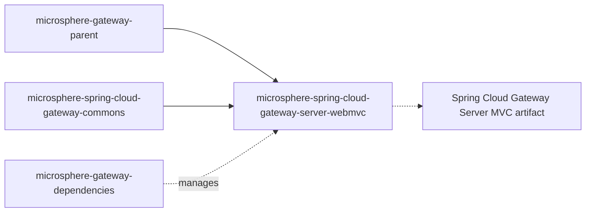

# `microsphere-spring-cloud-gateway-server-webmvc`

## 1. Purpose

`microsphere-spring-cloud-gateway-server-webmvc` brings the `we://` (web-endpoint) route scheme to the servlet /
Spring MVC flavour of Spring Cloud Gateway. Instead of the reactive `GlobalFilter` used by the WebFlux module, it plugs
into Gateway Server MVC's `HandlerSupplier` SPI: a route whose URI scheme is `we` is served by a
`HandlerFunctions.http()` handler wrapped in `WebEndpointMappingHandlerFilterFunction`, which reads the published
`WebEndpointMapping` metadata of discovered services, honours the per-route `metadata.web-endpoint.excludes`, strips the
leading `/{application}` segment and hands the request to the load-balancer filter function. Depend on this module from a
servlet gateway application (Spring Boot web stack + Spring Cloud Gateway Server MVC) that uses a blocking
`DiscoveryClient` and Spring Cloud LoadBalancer. Do not combine it with
[`microsphere-spring-cloud-gateway-server-webflux`](microsphere-spring-cloud-gateway-server-webflux.md) in the same
application: they are alternative implementations of one feature set for two gateway runtimes.

## 2. Version information

| Item | Value |
|---|---|
| Group id | `io.github.microsphere-projects` |
| Artifact id | `microsphere-spring-cloud-gateway-server-webmvc` |
| Version line | `0.2.x` |
| Branch version (`release`) | `0.2.19-SNAPSHOT` (Maven `revision`) |
| Latest published release | `0.2.18` (newest entry in the branch `release-notes.md`) |
| Packaging | `jar` |
| Published to | Maven Central, group `io.github.microsphere-projects` (deployed by `.github/workflows/maven-publish.yml`) |
| Javadocs | `https://javadoc.io/doc/io.github.microsphere-projects/microsphere-spring-cloud-gateway-server-webmvc` |
| Parent | `io.github.microsphere-projects:microsphere-gateway-parent:${revision}` |

## 3. Compatibility range

| Dimension | Supported | Evidence in the snapshot | What breaks outside the range |
|---|---|---|---|
| JDK | 17 baseline; CI verifies 17, 21, 25 | `<java.version>17</java.version>`; `maven-build.yml` `java: ['17','21','25']` | Not compiled or tested below 17 |
| Maven profile `spring-cloud-2022` | **Not what the name says.** The profile is annotated `<!-- actual : spring-cloud-2023 -->` and pins `spring-boot.version=3.3.13`, `spring-cloud.version=2023.0.6`, `spring-cloud-alibaba.version=2023.0.3.2` while adding `spring-cloud-starter-gateway-mvc` as `<optional>` | profile block in this module's POM | Selecting `-Pspring-cloud-2022` on this module builds against Spring Boot 3.3 / Spring Cloud 2023, not the 2022 train. Do not rely on the profile id to mean the 2022 train here |
| Maven profile `spring-cloud-2023`, `spring-cloud-2024` | Add `org.springframework.cloud:spring-cloud-starter-gateway-mvc` as `<optional>`; versions come from the parent chain | profile blocks in this module's POM | Without the starter on your classpath the MVC gateway classes are missing and every condition below backs off |
| Maven profile `spring-cloud-2025` (**`activeByDefault` true**) | Adds `org.springframework.cloud:spring-cloud-gateway-server-webmvc` as `<optional>` — different artifact id from the other profiles | profile block in this module's POM | Mixing the starter (2023/2024) with `spring-cloud-gateway-server-webmvc` (2025) can give you two gateway-server artifacts or none that matches the compiled code |
| Gateway Server MVC classes | Needs `org.springframework.cloud.gateway.server.mvc.config.GatewayMvcProperties` | `@ConditionalOnClass(name = "...GatewayMvcProperties")` in `ConditionalOnGatewayServerMvcAvailable` | If your MVC gateway artifact exposes a different package (`gateway.mvc` instead of `gateway.server.mvc`), the auto-configuration silently does nothing |
| Servlet web stack | `spring-boot-starter` and `io.github.microsphere-projects:microsphere-spring-boot-webmvc` (both `<optional>`); the latter provides `io.microsphere.spring.boot.webmvc.autoconfigure.condition.ConditionalOnWebMvcAvailable` | `<optional>` entries in this module's POM + the annotation's meta-conditions | A reactive application gets no beans from this module |
| Discovery | `spring-cloud-commons` (`<optional>`) providing `DiscoveryClient`; `@ConditionalOnDiscoveryEnabled` + `@ConditionalOnBlockingDiscoveryEnabled` | `WebEndpointMappingGatewayServerMvcAutoConfiguration` | No `WebEndpointMappingHandlerConfig` bean, therefore no refresh of the mapping caches |
| Load balancing | `spring-cloud-loadbalancer` (`<optional>`) providing `LoadBalancerClientFactory`; uses `LoadBalancerFilterFunctions.lb(...)` | same class | Instance selection through the filter function cannot happen |
| Microsphere Spring Cloud | `microsphere-spring-cloud-commons` (`<optional>`) — `WebEndpointMapping`, `ServiceInstanceUtils`, `ServiceInstancesChangedEvent`, `DiscoveryClientAutoConfiguration` | imports throughout the sources | `NoClassDefFoundError` when the route is handled |

Position in the reactor:



Unlike the WebFlux module, this POM declares two gateway artifacts at **compile** (non-optional) scope in its main
`<dependencies>` block: `org.springframework.cloud:spring-cloud-starter-gateway-mvc` and
`org.springframework.cloud:spring-cloud-gateway-proxyexchange-webmvc`. They reach your classpath transitively, and the
profile blocks then re-declare a gateway dependency as `<optional>`. Verify the effective graph with
`mvn dependency:tree` after you change profiles.

## 4. Installation

```xml
<dependencyManagement>
    <dependencies>
        <dependency>
            <groupId>org.springframework.cloud</groupId>
            <artifactId>spring-cloud-dependencies</artifactId>
            <version>2025.0.0</version>
            <type>pom</type>
            <scope>import</scope>
        </dependency>
        <dependency>
            <groupId>io.github.microsphere-projects</groupId>
            <artifactId>microsphere-gateway-dependencies</artifactId>
            <version>0.2.18</version>
            <type>pom</type>
            <scope>import</scope>
        </dependency>
    </dependencies>
</dependencyManagement>

<dependencies>
    <dependency>
        <groupId>io.github.microsphere-projects</groupId>
        <artifactId>microsphere-spring-cloud-gateway-server-webmvc</artifactId>
    </dependency>

    <!-- <optional> in the module: must be provided by you -->
    <dependency>
        <groupId>io.github.microsphere-projects</groupId>
        <artifactId>microsphere-spring-cloud-commons</artifactId>
    </dependency>
    <dependency>
        <groupId>org.springframework.cloud</groupId>
        <artifactId>spring-cloud-starter-loadbalancer</artifactId>
    </dependency>
    <dependency>
        <groupId>org.springframework.boot</groupId>
        <artifactId>spring-boot-starter-web</artifactId>
    </dependency>
</dependencies>
```

If you want to control the gateway artifact yourself, exclude the transitive ones:

```xml
<dependency>
    <groupId>io.github.microsphere-projects</groupId>
    <artifactId>microsphere-spring-cloud-gateway-server-webmvc</artifactId>
    <exclusions>
        <exclusion>
            <groupId>org.springframework.cloud</groupId>
            <artifactId>spring-cloud-starter-gateway-mvc</artifactId>
        </exclusion>
        <exclusion>
            <groupId>org.springframework.cloud</groupId>
            <artifactId>spring-cloud-gateway-proxyexchange-webmvc</artifactId>
        </exclusion>
    </exclusions>
</dependency>
```

## 5. API reference

Registered extension points (`src/main/resources`):

| File | Content |
|---|---|
| `META-INF/spring/org.springframework.boot.autoconfigure.AutoConfiguration.imports` | `io.microsphere.spring.cloud.gateway.server.webmvc.autoconfigure.WebEndpointMappingGatewayServerMvcAutoConfiguration` |
| `META-INF/spring.factories` | `org.springframework.cloud.gateway.server.mvc.handler.HandlerSupplier=io.microsphere.spring.cloud.gateway.server.webmvc.filter.WebEndpointMappingHandlerSupplier` and `org.springframework.context.ApplicationContextInitializer=io.microsphere.spring.cloud.gateway.server.webmvc.context.WebEndpointApplicationContextInitializer` |
| `META-INF/config/default/features.yaml` | named feature: `WebEndpointApplicationContextInitializer=io.microsphere.spring.cloud.gateway.server.webmvc.context.WebEndpointApplicationContextInitializer` |

### 5.1 `autoconfigure.WebEndpointMappingGatewayServerMvcAutoConfiguration`

`@Configuration(proxyBeanMethods = false)` conditional on `@ConditionalOnGatewayServerMvcAvailable`,
`@ConditionalOnDiscoveryEnabled`, `@ConditionalOnBlockingDiscoveryEnabled`,
`@ConditionalOnMicrosphereWebEndpointMappingEnabled`, `@ConditionalOnClass({"...DiscoveryClient",
"...LoadBalancerClientFactory"})`, ordered after `WebMvcAutoConfiguration`, `DiscoveryClientAutoConfiguration`,
`LoadBalancerAutoConfiguration`, `GatewayServerMvcAutoConfiguration`,
`ConfigurationPropertiesRebinderAutoConfiguration`, `CompositeDiscoveryClientAutoConfiguration`. It imports its nested
configuration:

`@ConditionalOnBean({GatewayMvcProperties.class, DiscoveryClient.class, LoadBalancerClientFactory.class}) static class WebEndpointMappingHandlerConfig implements SmartApplicationListener`

| Member | Signature | Behaviour |
|---|---|---|
| constructor | `WebEndpointMappingHandlerConfig(GatewayMvcProperties gatewayMvcProperties, ConfigurableApplicationContext context)` | Keeps the environment from the context for later key lookups. |
| `supportsEventType` | `ContextRefreshedEvent` / `EnvironmentChangeEvent` / `ServiceInstancesChangedEvent` (and subtypes, via `isAssignableFrom`) | Broader than the WebFlux filter, which matches exact event classes. |
| `onContextRefreshedEvent` | `void onContextRefreshedEvent(ContextRefreshedEvent)` | Collects `we://` routes and refreshes each filter function, injecting the application context into it. |
| `onEnvironmentChangeEvent` | `void onEnvironmentChangeEvent(EnvironmentChangeEvent)` | Refreshes only routes found from the changed keys. |
| `onServiceInstancesChangedEvent` | `void onServiceInstancesChangedEvent()` | Refreshes every `we://` route. |
| `refresh` | `void refresh(List<RouteProperties> routes, ApplicationContext context, Consumer<WebEndpointMappingHandlerFilterFunction> handlerFilterFunctionInitializer)` (package-private) | Looks up the cached filter function per route id and calls `refresh(routeProperties, context)` on it; unknown route ids are ignored. Exercised directly by `WebEndpointMappingGatewayServerMvcAutoConfigurationIntegrationTest`. |
| `findWebEndpointMappingRouteProperties` | `List<RouteProperties> findWebEndpointMappingRouteProperties(Set<String> keys)` (package-private) | For every key starting with `GATEWAY_ROUTES_PROPERTY_NAME_PREFIX` that contains `id`, resolves the property value and returns the `we://` routes whose id equals it. |
| `getWebEndpointMappingRouteProperties` (private) | — | `gatewayMvcProperties.getRoutes()` filtered to `RouteConstants.SCHEME` (`we`) as an unmodifiable list. |

### 5.2 `annotation.ConditionalOnGatewayServerMvcAvailable` / `ConditionalOnGatewayServerMvcEnabled`

| Type | Composition | Use when |
|---|---|---|
| `@ConditionalOnGatewayServerMvcEnabled` | `@ConditionalOnProperty(name = GatewayPropertyConstants.GATEWAY_ENABLED_PROPERTY_NAME, matchIfMissing = true)` | Follow the upstream MVC gateway switch only. |
| `@ConditionalOnGatewayServerMvcAvailable` | `@ConditionalOnGatewayServerMvcEnabled` + `@ConditionalOnWebMvcAvailable` + `@ConditionalOnClass(name = "org.springframework.cloud.gateway.server.mvc.config.GatewayMvcProperties")` | Your bean needs the MVC gateway classes on the classpath. `@Target({TYPE, METHOD})`, `@Retention(RUNTIME)`, `@Documented`. |

### 5.3 `constants.GatewayPropertyConstants`

`public interface GatewayPropertyConstants`:

| Member | Value | Behaviour |
|---|---|---|
| `GATEWAY_ENABLED_PROPERTY_NAME` | `GatewayMvcProperties.PREFIX + "." + "enabled"` — documented as `spring.cloud.gateway.server.webmvc.enabled`, the key the module's tests disable | Upstream MVC gateway switch, used by `@ConditionalOnGatewayServerMvcEnabled`. |
| `GATEWAY_ROUTES_PROPERTY_NAME_PREFIX` | `GatewayMvcProperties.PREFIX + "." + "routes"` | Prefix used for metadata binding, environment-change matching, and route lookup. |

`GatewayPropertyConstantsTest.testConstants` asserts both against the upstream `PREFIX` — they are derived, not literals.

### 5.4 `filter.WebEndpointMappingHandlerSupplier`

`implements org.springframework.cloud.gateway.server.mvc.handler.HandlerSupplier`, registered through `spring.factories`.

| Member | Signature | Behaviour |
|---|---|---|
| `get` | `Collection<Method> get()` | Exposes this class's public methods to Gateway Server MVC's handler discovery, so a method name is matched against the route URI scheme. |
| `we` | `static Result we(RouteProperties routeProperties)` | The handler for scheme `we`. Creates — or reuses — one `WebEndpointMappingHandlerFilterFunction` per route id and returns `new Result(http(), ofList(function), emptyList())`: the standard HTTP handler function wrapped by the filter. |
| `getWebEndpointMappingHandlerFilterFunction` | `static WebEndpointMappingHandlerFilterFunction getWebEndpointMappingHandlerFilterFunction(String routeId)` | Cache lookup used by `WebEndpointMappingHandlerConfig.refresh(...)` and by tests. |

The cache is a **static `HashMap<String, WebEndpointMappingHandlerFilterFunction>`** on the class, keyed by route id.

### 5.5 `filter.WebEndpointMappingHandlerFilterFunction`

`implements HandlerFilterFunction<ServerResponse, ServerResponse>`, constructor `WebEndpointMappingHandlerFilterFunction(String routeId)`.

| Member | Signature | Behaviour |
|---|---|---|
| `filter` | `ServerResponse filter(ServerRequest request, HandlerFunction<ServerResponse> next)` | Puts the current `request.uri()` into `MvcUtils.GATEWAY_REQUEST_URL_ATTR`; if the `application` path variable is blank, delegates to `next`. Otherwise resolves a matching mapping, applies `LoadBalancerFilterFunctions.lb(applicationName)` to a rebuilt request whose URI is the rewritten path and whose headers carry `WebEndpointMapping.ID_HEADER_NAME` = matched mapping id, and updates `GATEWAY_REQUEST_URL_ATTR`. |
| `setApplicationContext` | `void setApplicationContext(ApplicationContext context)` | Stores the context and resolves the `DiscoveryClient` bean from it. |
| `refresh` | `void refresh(RouteProperties routeProperties, ApplicationContext context)` | No-ops unless the context and route id match; then rebuilds both caches inside a `synchronized` block. |
| `buildRequestMappingContexts` | `Collection<RequestMappingContext> buildRequestMappingContexts(RouteProperties)` (package-private) | For every subscribed service, picks **any** instance (`discoveryClient.getInstances(id).stream().findAny()`), reads its `WebEndpointMapping` metadata and builds `RequestMappingInfo`s. A service with no instance is skipped (`null` check). |
| `buildExcludedRequestMappingInfoSet` | `Set<RequestMappingInfo> buildExcludedRequestMappingInfoSet(RouteProperties)` (package-private) | Returns `emptySet()` when `metadata.web-endpoint` is absent or not yet a `WebEndpointConfig`. |
| `getSubscribedServices` | `Collection<String> getSubscribedServices(URI)` (package-private) | `all` → `discoveryClient.getServices()`; otherwise comma-split host. Asserted with `we://test-app` → `["test-app"]`. |
| `getMatchingRequestMappingContext` | `RequestMappingContext getMatchingRequestMappingContext(String applicationName, String routeId, ServerRequest)` (package-private) | Exclusion check first, then rewrite: `substringAfter(path, "/" + applicationName)` stored under attribute `msgw-we-rewrite-path`, the parsed request path replaced with the rewritten path, and the best match chosen by `RequestMappingInfo.compareTo`. |
| `isExcludedRequest` | `boolean isExcludedRequest(HttpServletRequest)` (package-private) | `false` while `excludedRequestMappingInfoSet` is `null` (i.e. before the first refresh). |
| fields | `volatile Collection<RequestMappingContext> requestMappingContexts`, `volatile Collection<RequestMappingInfo> excludedRequestMappingInfoSet` | Package-visible for tests. |

Matching rules: exclude patterns match the **incoming** path (including the route's own prefix, e.g. `/we/test-app/**`);
published service mappings match the **rewritten** path (`/{application}` removed).

### 5.6 `context.WebEndpointApplicationContextInitializer`

`extends ConfigurableApplicationContextInitializer`, registered in `spring.factories`. Registers the commons bean
`webEndpointConfigurationPropertiesBindListener` with `GATEWAY_ROUTES_PROPERTY_NAME_PREFIX`, which is what converts
`...routes[n].metadata.web-endpoint` into a `WebEndpointConfig` object inside the route metadata.

### 5.7 Reused commons API

`RouteConstants.SCHEME` (`we`), `RouteConstants.ALL_SERVICES` (`all`), `RouteConstants.ID_KEY` (`id`),
`RouteConstants.WEB_ENDPOINT_KEY` (`web-endpoint`),
`RouteConstants.WEB_ENDPOINT_REWRITE_PATH_ATTRIBUTE_NAME` (`msgw-we-rewrite-path`),
`CommonConstants.APPLICATION_NAME_URI_TEMPLATE_VARIABLE_NAME` (`application`),
`@ConditionalOnMicrosphereWebEndpointMappingEnabled`, `WebEndpointConfig` / `WebEndpointConfig.Mapping`, `ConfigUtils`,
`WebEndpointConfigurationPropertiesBindListener` — see the
[commons module reference](microsphere-spring-cloud-gateway-commons.md#5-api-reference).

## 6. Configuration reference

Microsphere-owned keys (verbatim from `CommonsPropertyConstants`):

| Key | Type | Default | Effect |
|---|---|---|---|
| `microsphere.spring.cloud.gateway.enabled` | `boolean` | `true` | Umbrella switch; required by `@ConditionalOnMicrosphereWebEndpointMappingEnabled` through `@ConditionalOnMicrosphereGatewayEnabled`. |
| `microsphere.spring.cloud.web-endpoint-mapping.enabled` | `boolean` | `true` | Enables/disables `WebEndpointMappingGatewayServerMvcAutoConfiguration` only. |

Upstream-derived keys read by this module:

| Key | Type | Default | Effect |
|---|---|---|---|
| `<GatewayMvcProperties.PREFIX>.enabled` (documented as `spring.cloud.gateway.server.webmvc.enabled`) | `boolean` | `true` (`matchIfMissing = true`) | Upstream MVC gateway switch honoured by `@ConditionalOnGatewayServerMvcEnabled`. |
| `<GatewayMvcProperties.PREFIX>.routes` (`GATEWAY_ROUTES_PROPERTY_NAME_PREFIX`) | list of `RouteProperties` | — | Where `we://` routes and `metadata.web-endpoint` live; matched against `EnvironmentChangeEvent` keys. |
| `<...>.routes[n].uri` | URI | — | `we://all` / `we://service-id` / `we://a,b`. The scheme must be exactly `we` for the `HandlerSupplier` to take over. |
| `<...>.routes[n].predicates` | list | — | Must expose `{application}`, e.g. `Path=/we/{application}/**`. |
| `<...>.routes[n].metadata.web-endpoint.excludes[]` | list | empty | `patterns` required; `methods` default all; `params`, `headers`, `consumes`, `produces` optional. |

Keys visible in this module's own test configuration (`src/test/resources/application.yaml`), useful as a working
starting point and shown here with their exact spelling:

| Key | Value in tests | Purpose |
|---|---|---|
| `spring.application.name` | `test-app` | The application name registered into discovery. |
| `server.port` | `8080` | Local port. |
| `eureka.client.enabled` | `false` | Keeps registry clients off in tests. |
| `microsphere.spring.cloud.service-registry.auto-registration.simple.enabled` | `true` under profile `simple-service-registry` | Registers the local instance so `we://` has a target (key belongs to `microsphere-spring-cloud-commons`, not this module). |
| `spring.profiles.active` | `simple-service-registry,gateway` in `TestApplication` / `WebEndpointMappingHandlerFilterFunctionTest`; `gateway` in the auto-configuration integration tests | Activates the route block. |

## 7. Code examples

### 7.1 Routes for both MVC property prefixes (derived from `src/test/resources/application.yaml`)

```yaml
spring:
  cloud:
    gateway:
      mvc:
        routes:
          - id: add_response_header_route_all
            uri: https://example.org
            predicates:
              - Path=/*
            filters:
              - AddResponseHeader=test-header-name, test-header-value
            metadata:
              a: 1
          - id: web-endpoint-mapping
            uri: we://all
            predicates:
              - Path=/we/{application}/**
            metadata:
              web-endpoint:
                excludes:
                  - patterns: /we/test-app/**
                    consumes: application/json
                    produces: plain/text
      server:
        webmvc:
          routes:
            - id: web-endpoint-mapping
              uri: we://all
              predicates:
                - Path=/we/{application}/**
              metadata:
                web-endpoint:
                  excludes:
                    - patterns: /we/test-app/**
                      consumes: application/json
                      produces: plain/text
```

The two blocks are the same routes under the two MVC property prefixes (`spring.cloud.gateway.mvc` and
`spring.cloud.gateway.server.webmvc`) — see the pitfall below about which one your Spring Cloud Gateway version binds.

### 7.2 End-to-end routing through `we://` (derived from `WebEndpointMappingHandlerFilterFunctionTest`)

```java
@SpringBootTest(
        classes = {
                TestController.class,
                WebEndpointMappingHandlerFilterFunctionTest.class,
                WebEndpointMappingHandlerFilterFunctionTest.TestConfig.class
        },
        properties = {
                "spring.profiles.active=simple-service-registry,gateway"
        },
        webEnvironment = RANDOM_PORT)
@EnableAutoConfiguration
class GatewayRoutingTest {

    @Autowired private WebApplicationContext webApplicationContext;
    @Autowired private TestController testController;
    @Autowired private Registration registration;

    @Test
    void routeThroughWebEndpointMapping() throws Exception {
        MockMvc mockMvc = webAppContextSetup(webApplicationContext).build();

        // direct call, no gateway involved
        String content = new RestTemplate()
                .getForObject(registration.getUri() + "/test/helloworld", String.class);
        assertEquals(testController.helloWorld(), content);

        // /we/{application}/** -> we://all -> rewritten to /test/helloworld
        mockMvc.perform(get("/we/test-app/test/helloworld"))
                .andExpect(status().isOk())
                .andExpect(content().string(testController.helloWorld()));

        // matched by metadata.web-endpoint.excludes -> no web-endpoint translation
        assertThrows(Exception.class, () -> mockMvc.perform(get("/we/test-app/test/helloworld")
                .header(CONTENT_TYPE, "application/json")
                .header(ACCEPT, "plain/text")));

        // a routes[..].id environment change re-refreshes the route
        webApplicationContext.publishEvent(
                new EnvironmentChangeEvent(ofSet(GATEWAY_ROUTES_PROPERTY_NAME_PREFIX + "[0].id")));
    }
}
```

The same test also deregisters the instance and publishes a `ServiceInstancesChangedEvent`, after which the request
throws — proof that instance events trigger a cache rebuild.

### 7.3 Registering your own instance the way the tests do (derived from the test's `TestConfig`)

```java
@ConditionalOnBlockingDiscoveryEnabled
static class TestConfig {

    private final SimpleDiscoveryProperties simpleDiscoveryProperties;

    TestConfig(SimpleDiscoveryProperties simpleDiscoveryProperties) {
        this.simpleDiscoveryProperties = simpleDiscoveryProperties;
    }

    @EventListener(RegistrationPreRegisteredEvent.class)
    public void onRegistrationPreRegisteredEvent(RegistrationPreRegisteredEvent event) {
        int localServerPort = environment.getProperty("local.server.port", int.class);
        DefaultRegistration registration = (DefaultRegistration) event.getRegistration();
        registration.setHost("127.0.0.1");
        registration.setPort(localServerPort);
        simpleDiscoveryProperties.getInstances()
                .computeIfAbsent(registration.getServiceId(), k -> new ArrayList<>())
                .add(registration);
    }
}
```

### 7.4 Refresh bookkeeping in a unit test (derived from `WebEndpointMappingGatewayServerMvcAutoConfigurationIntegrationTest`)

```java
RouteProperties routeProperties = new RouteProperties();
routeProperties.setId("unknown-route-id");
webEndpointMappingHandlerConfig.refresh(ofList(routeProperties), context, handlerFilterFunction -> {
});

Set<String> keys = ofSet(GATEWAY_ROUTES_PROPERTY_NAME_PREFIX + "[2].id",
        GATEWAY_ROUTES_PROPERTY_NAME_PREFIX + "[2].metadata");
assertFalse(webEndpointMappingHandlerConfig.findWebEndpointMappingRouteProperties(keys).isEmpty());
```

### 7.5 The minimal application class (derived from `TestApplication`)

```java
@EnableAutoConfiguration
public class TestApplication {

    public static void main(String[] args) {
        new SpringApplicationBuilder(TestApplication.class, TestController.class)
                .properties("spring.profiles.active=simple-service-registry,gateway")
                .run(args);
    }
}
```

## 8. Common pitfalls / FAQ

**`-Pspring-cloud-2022` on this module does not give you the 2022 release train.**
The profile is annotated in the POM with `<!-- actual : spring-cloud-2023 -->` and pins
`spring-boot.version=3.3.13`, `spring-cloud.version=2023.0.6`, `spring-cloud-alibaba.version=2023.0.3.2`. If you need the
real 2022 train, do not use this module's profile: manage the versions in your own POM. This is a known naming
discrepancy in the branch, not a documented alias.

**Your `we://` routes are ignored even though the auto-configuration loaded.**
Check which MVC route prefix your Spring Cloud Gateway version actually binds. The module's own test configuration lists
the routes twice — once under `spring.cloud.gateway.mvc.routes` and once under `spring.cloud.gateway.server.webmvc.routes`
— because `GATEWAY_ROUTES_PROPERTY_NAME_PREFIX` is derived from `GatewayMvcProperties.PREFIX`, which moved between
generations. `GatewayPropertyConstantsTest` compares against that constant instead of a literal, precisely so the module
follows whichever prefix the runtime uses; your YAML must use the same one.

**No `WebEndpointMappingHandlerConfig` bean.**
It is `@ConditionalOnBean({GatewayMvcProperties.class, DiscoveryClient.class, LoadBalancerClientFactory.class})`. A
missing `DiscoveryClient` (no discovery starter or `spring.cloud.discovery.enabled=false` /
`spring.cloud.discovery.blocking.enabled=false`), a missing load balancer, or the Microsphere MVC/Tomcat stack being off
(`microsphere.spring.boot.webmvc.enabled=false`) each removes it. The module's
`WebEndpointMappingGatewayServerMvcAutoConfigurationIntegrationDisabledTest` demonstrates exactly that by excluding
`LoadBalancerAutoConfiguration`, `CompositeDiscoveryClientAutoConfiguration` and
`SimpleDiscoveryClientAutoConfiguration` via `microsphere.autoconfigure.exclude` and setting
`microsphere.spring.boot.webmvc.enabled=false`.

**Requests to paths that look excluded still reach the service (or the reverse).**
Exclude patterns are matched against the incoming path *before* `/{application}` is stripped, so with
`Path=/we/{application}/**` the pattern has to be `/we/test-app/**`, not `/test-app/**`. See `application.yaml` above.
Published service mappings, on the other hand, are matched against the stripped path.

**Route ids leak between application contexts.**
`WebEndpointMappingHandlerSupplier` keeps its filter functions in a `static HashMap` keyed by route id. Within one JVM and
classloader, two Spring contexts that define the same route id share (and overwrite) the cached function, and the map is
not synchronised. This is visible in tests that use several `@SpringBootTest` contexts (`@DirtiesContext` is used across
this module's tests); in production a single gateway application is unaffected, but a shared-classloader deployment is not
safe.

**The transitive `spring-cloud-starter-gateway-mvc` conflicts with your own gateway artifact.**
Unlike the WebFlux module, this POM declares `spring-cloud-starter-gateway-mvc` and
`spring-cloud-gateway-proxyexchange-webmvc` at compile scope. Use the exclusion snippet in section 4 if you want to pick
`spring-cloud-gateway-server-webmvc` (the `spring-cloud-2025` profile's artifact) instead.

**`microsphere-spring-cloud-commons` is still on you.**
It is `<optional>` here (as in every module), but the code calls
`ServiceInstanceUtils.getWebEndpointMappings(...)`, `InstanceConstants.WEB_CONTEXT_PATH_METADATA_NAME` and
`ServiceInstancesChangedEvent` from it. Without it, `we://` requests fail at refresh/handle time rather than at startup.

**Nothing happens at all for `we://` routes.**
The `HandlerSupplier` is discovered through `META-INF/spring.factories` under
`org.springframework.cloud.gateway.server.mvc.handler.HandlerSupplier`, and the handler method is named `we` so that it
matches the URI scheme. If your Gateway Server MVC version does not support that SPI, or the jar is not the artifact
providing `...server.mvc.config.GatewayMvcProperties`, the route never resolves. Confirm with
`mvn dependency:tree` and with the Spring Boot conditions report (`-Ddebug`).

## Related documents

- [User guide index](README.md)
- [microsphere-spring-cloud-gateway-commons](microsphere-spring-cloud-gateway-commons.md)
- [microsphere-spring-cloud-gateway-server-webflux](microsphere-spring-cloud-gateway-server-webflux.md)
- [microsphere-gateway-dependencies](microsphere-gateway-dependencies.md)
- [Repository README](../../../README.md)

## 中文

- [Chinese user guide index](zh/README.md)
- [`microsphere-spring-cloud-gateway-server-webmvc` in Chinese](zh/microsphere-spring-cloud-gateway-server-webmvc.md)
