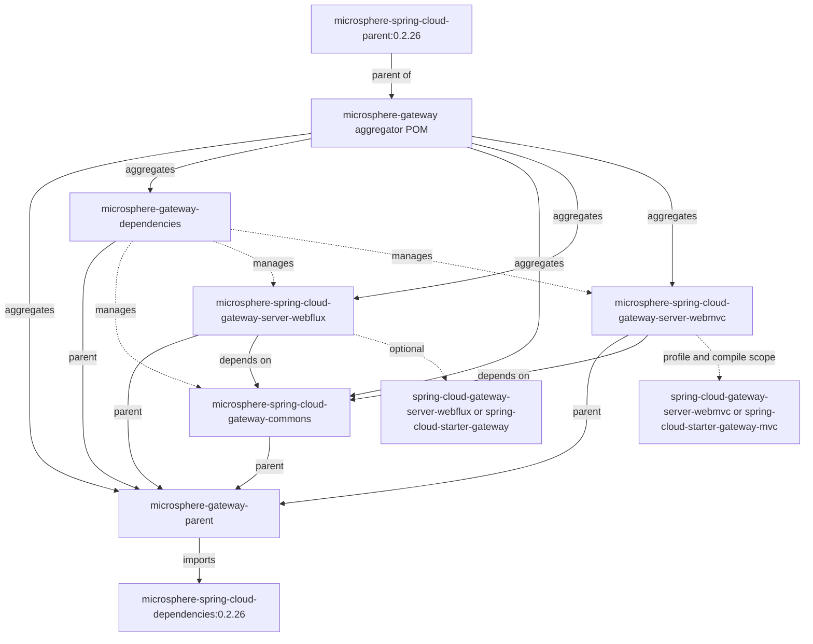

# Microsphere Gateway 用户指南（当前版本，`0.2.x`）

本指南记录 Microsphere Gateway 的 **`release` 分支**，即 `0.2.x` 版本线。该分支的 Maven `revision`
为 `0.2.19-SNAPSHOT`；分支 `release-notes.md` 中的最新条目（也就是 Maven Central
上已发布的最新版本）是 **`0.2.18`**，所属组为 `io.github.microsphere-projects`。
以下全部内容均取自该分支的 POM、源码、测试、`META-INF` 资源与发布说明，因此类名、配置项键名与默认值都与你依赖的 `0.2.x`
构件一致。

Microsphere Gateway 在 Spring Cloud Gateway 之上扩展了自定义的 `we://`（web-endpoint）路由 URI scheme、基于服务发现与配置事件的路由刷新，以及按路由生效的 `metadata.web-endpoint.excludes`
过滤能力。

## 模块

| 文档 | 构件 | 类型 | 用途 |
|---|---|---|---|
| [microsphere-gateway-parent](microsphere-gateway-parent.md) | `io.github.microsphere-projects:microsphere-gateway-parent` | `pom` | 构建父 POM：导入 Microsphere Spring Cloud BOM，承载 `java.version` / `revision`。 |
| [microsphere-gateway-dependencies](microsphere-gateway-dependencies.md) | `io.github.microsphere-projects:microsphere-gateway-dependencies` | `pom`（BOM） | 三个可部署构件的版本管理。 |
| [microsphere-spring-cloud-gateway-commons](microsphere-spring-cloud-gateway-commons.md) | `io.github.microsphere-projects:microsphere-spring-cloud-gateway-commons` | `jar` | 共享常量、条件注解、`WebEndpointConfig` 模型与路由元数据绑定。 |
| [microsphere-spring-cloud-gateway-server-webflux](microsphere-spring-cloud-gateway-server-webflux.md) | `io.github.microsphere-projects:microsphere-spring-cloud-gateway-server-webflux` | `jar` | 响应式网关集成：`WebEndpointMappingGlobalFilter`、带缓存的 `FilteringWebHandler`、刷新事件装配。 |
| [microsphere-spring-cloud-gateway-server-webmvc](microsphere-spring-cloud-gateway-server-webmvc.md) | `io.github.microsphere-projects:microsphere-spring-cloud-gateway-server-webmvc` | `jar` | Servlet 网关集成：`we://` 的 `HandlerSupplier`、`WebEndpointMappingHandlerFilterFunction`、刷新装配。 |

每个模块文档都遵循同一结构：用途、版本信息、兼容范围、安装、API（或依赖管理）参考、配置参考、取自模块自身测试的代码示例，以及常见坑。

## 模块关系



实线的 `depends on` 是真实的 compile 作用域 Maven 依赖；`optional`
虚线表示模块以 `<optional>` 声明、**需要你自己添加**的构件。WebMVC 模块额外以 compile
作用域声明了 `spring-cloud-starter-gateway-mvc` 与 `spring-cloud-gateway-proxyexchange-webmvc`，因此在添加自己的网关依赖之前，请先阅读它的[安装章节](microsphere-spring-cloud-gateway-server-webmvc.md#4-安装)。

## 前置条件

| 要求 | 值 | 依据 |
|---|---|---|
| JDK | 以 17 为基线；CI 同时验证 21 与 25 | 聚合 POM 中的 `java.version=17`；`maven-build.yml` 矩阵 |
| 构建工具 | Maven 3.9.16（仓库自带 wrapper，`only-script` 分发类型，wrapperVersion 3.3.4） | `.mvn/wrapper/maven-wrapper.properties` |
| Spring Cloud 版本列车 | `spring-cloud-2022`、`spring-cloud-2023`、`spring-cloud-2024`、`spring-cloud-2025`（`2025` 为 `activeByDefault`） | 模块 POM 的 profile；CI 矩阵 |
| 网关 starter | 由你提供的 Spring Cloud Gateway 构件（见上方图示）——这些模块的第三方依赖几乎都是 `<optional>` | 模块 POM |
| 服务发现 | Spring Cloud 的 `DiscoveryClient` / `ReactiveDiscoveryClient`，加上 Spring Cloud LoadBalancer | 自动配置条件 |
| 被路由服务 | 必须发布 Microsphere 的 `WebEndpointMapping` 元数据 | 两个过滤器中对 `WebEndpointMapping` 的使用 |

## 快速开始

```xml
<dependencyManagement>
    <dependencies>
        <dependency>
            <groupId>org.springframework.cloud</groupId>
            <artifactId>spring-cloud-dependencies</artifactId>
            <version>2025.0.0</version>
            <type>pom</type>
            <scope>import</scope>
        </dependency>
        <dependency>
            <groupId>io.github.microsphere-projects</groupId>
            <artifactId>microsphere-gateway-dependencies</artifactId>
            <version>0.2.18</version>
            <type>pom</type>
            <scope>import</scope>
        </dependency>
    </dependencies>
</dependencyManagement>

<dependencies>
    <dependency>
        <groupId>io.github.microsphere-projects</groupId>
        <artifactId>microsphere-spring-cloud-gateway-server-webflux</artifactId>
    </dependency>
    <dependency>
        <groupId>org.springframework.cloud</groupId>
        <artifactId>spring-cloud-starter-gateway</artifactId>
    </dependency>
    <dependency>
        <groupId>io.github.microsphere-projects</groupId>
        <artifactId>microsphere-spring-cloud-commons</artifactId>
    </dependency>
</dependencies>
```

然后声明一条 `we://` 路由。`we://all` 订阅全部已发现服务；`we://orders-service` 或
`we://orders-service,payments-service` 用于缩小订阅范围。谓词必须暴露 `{application}` 变量：

```yaml
spring:
  cloud:
    gateway:
      routes:
        - id: web-endpoint-mapping
          uri: we://all
          predicates:
            - Path=/{application}/**
          metadata:
            web-endpoint:
              excludes:
                - patterns: /internal/**
                  methods: GET
```

所有能力默认开启。如需关闭：

```yaml
microsphere:
  spring:
    cloud:
      gateway:
        enabled: false
      web-endpoint-mapping:
        enabled: false
```

## 配置项索引

| 键 | 归属模块 | 默认值 | 作用 |
|---|---|---|---|
| `microsphere.spring.cloud.gateway.enabled` | commons | `true` | 所有 Microsphere 网关扩展的总开关。 |
| `microsphere.spring.cloud.web-endpoint-mapping.enabled` | commons | `true` | `we://` web-endpoint 映射能力的开关。 |
| `spring.cloud.gateway.server.webflux.enabled` | webflux（`GatewayProperties.PREFIX` + `.enabled`） | `true` | 上游响应式网关开关，被 `@ConditionalOnGatewayAvailable` 尊重。 |
| `spring.cloud.gateway.server.webmvc.enabled` | webmvc（`GatewayMvcProperties.PREFIX` + `.enabled`） | `true` | 上游 MVC 网关开关，被 `@ConditionalOnGatewayServerMvcAvailable` 尊重。 |

后两个键按各模块 Javadoc 中的写法列出；两个模块都是从上游的 `PREFIX`
常量派生这些键，而不是硬编码，因此请结合你使用的 Spring Cloud Gateway
版本确认前缀（历史上是 `spring.cloud.gateway`，较新版本线是 `spring.cloud.gateway.server.webflux` / `spring.cloud.gateway.server.webmvc`）。

## 如何选择模块

| 场景 | 使用 |
|---|---|
| 响应式网关（`spring-boot-starter-webflux`、`ReactiveDiscoveryClient`） | `microsphere-spring-cloud-gateway-server-webflux` |
| Servlet 网关（Spring MVC、阻塞式 `DiscoveryClient`） | `microsphere-spring-cloud-gateway-server-webmvc` |
| 只需要 `we://` 常量、`WebEndpointConfig` 或特性开关 | `microsphere-spring-cloud-gateway-commons` |
| 希望统一为三个构件做版本管理 | `microsphere-gateway-dependencies` |
| 希望复用与本项目相同的受管依赖版本与构建配置 | `microsphere-gateway-parent` |

## 自行构建该分支

```bash
./mvnw --batch-mode -Drevision=0.0.1-SNAPSHOT -Ptest,spring-cloud-2025 package
./mvnw test -Ptest,spring-cloud-2025
```

## 更多文档

- [开发者指南](../../developer-guide/README.md) —— 同一 `0.2.x`
  版本线的内部设计、扩展点与测试策略。
- [1.x 用户指南](../../../1.x/user-guide/README.md) —— 较早的 `1.x` 版本线。
- [仓库 README](../../../../README.md) —— 项目概览、徽章、获取帮助的方式与许可证。

## 许可证

Apache License 2.0，见聚合 POM 与仓库中的 `LICENSE` 文件。

## English

- [User Guide](../README.md)
