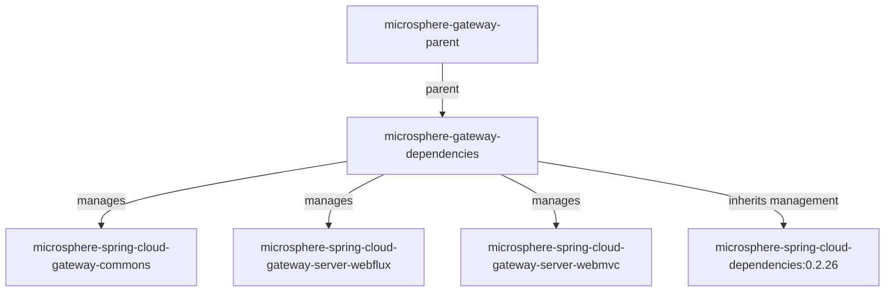

# `microsphere-gateway-dependencies`

## 1. 用途

`microsphere-gateway-dependencies` 是 Microsphere Gateway 的物料清单（BOM）：一个 `pom`
构件，其唯一内容是一份 `<dependencyManagement>`，把本项目的三个可部署模块（`commons`、`server-webflux`、`server-webmvc`）固定到与
BOM 自身相同的版本。使用 Microsphere Gateway 的应用应在自己的 `<dependencyManagement>` 中导入它，这样网关模块就能不带版本地声明、并且永远不会彼此漂移；同时发布多个网关相关内部库的团队也应导入它，以便消费者拿到的是一致的一组版本。

## 2. 版本信息

| 条目 | 值 |
|---|---|
| Group id | `io.github.microsphere-projects` |
| Artifact id | `microsphere-gateway-dependencies` |
| 版本线 | `0.2.x` |
| 分支版本（`release`） | `0.2.19-SNAPSHOT`（Maven `revision`） |
| 已发布的最新版本 | `0.2.18`（分支 `release-notes.md` 中的最新条目） |
| 打包类型 | `pom` |
| 发布位置 | Maven Central，组 `io.github.microsphere-projects`（由 `.github/workflows/maven-publish.yml` 发布） |
| 父级 | `io.github.microsphere-projects:microsphere-gateway-parent:${revision}`（`<relativePath>../microsphere-gateway-parent/pom.xml</relativePath>`） |

由于被管理的版本写作 `${revision}`，BOM 中这三条记录永远与 BOM 本身发布在同一版本：导入 `0.2.18` 就把每个模块管理为 `0.2.18`。

## 3. 兼容范围

| 维度 | 支持范围 | 快照中的依据 | 超出范围会坏什么 |
|---|---|---|---|
| 被管理构件的 JDK | 以 17 为基线；CI 验证 17 / 21 / 25 | 聚合 POM 的 `<java.version>17</java.version>`；`maven-build.yml` 矩阵 | BOM 自身不编译任何东西，但它固定的 jar 无法在 JDK 8/11 运行 |
| Maven | 3.9.16（wrapper） | `.mvn/wrapper/maven-wrapper.properties` | `pom` 类型 + `import`
作用域是标准用法，但更旧的 Maven 版本未在此测试 |
| Spring Cloud 版本列车 | `spring-cloud-2022`、`spring-cloud-2023`、`spring-cloud-2024`、`spring-cloud-2025` | `maven-build.yml` 的 profile 矩阵；profile 声明在服务模块中 | BOM **不会**按 profile 切换网关构件——starter
仍由你选择；见 [WebFlux](microsphere-spring-cloud-gateway-server-webflux.md#3-兼容范围) 与 [WebMVC](microsphere-spring-cloud-gateway-server-webmvc.md#3-兼容范围)
两页 |
| 上游受管版本栈 | 通过父级继承：`microsphere-spring-cloud-dependencies:0.2.26` | `microsphere-gateway-parent/pom.xml` | 若你的构建同时导入 Spring Boot 或 Spring Cloud 自己的
BOM，谁在前谁生效 |
| Spring Cloud Gateway starter | 本 BOM 不管理 | BOM 的 `<dependencyManagement>` 只列出三个 Microsphere 构件 | 你仍然必须自己添加 `spring-cloud-starter-gateway`、`spring-cloud-gateway-server-webflux`、`spring-cloud-starter-gateway-mvc`
或 `spring-cloud-gateway-server-webmvc`，通常借助 Spring Cloud BOM |

在 reactor 中的位置：



## 4. 安装

```xml
<dependencyManagement>
    <dependencies>
        <dependency>
            <groupId>io.github.microsphere-projects</groupId>
            <artifactId>microsphere-gateway-dependencies</artifactId>
            <version>0.2.18</version>
            <type>pom</type>
            <scope>import</scope>
        </dependency>
    </dependencies>
</dependencyManagement>

<dependencies>
    <dependency>
        <groupId>io.github.microsphere-projects</groupId>
        <artifactId>microsphere-spring-cloud-gateway-server-webflux</artifactId>
    </dependency>
</dependencies>
```

导入 BOM 不会往你的 classpath 添加任何 jar——它只管理版本。

## 5. 依赖管理界面（纯 POM 模块的 API 参考）

### 5.1 本 BOM 直接管理的构件

三者都是 `io.github.microsphere-projects`、`jar`、版本 `${revision}`：

| Artifact id | 管理范围 | 你仍需自己提供的传递依赖 |
|---|---|---|
| `microsphere-spring-cloud-gateway-commons` | 仅版本（没有 `<type>`/`<scope>` 覆盖） | 它声明的一切都是 `<optional>`：`microsphere-spring-cloud-commons`、`spring-boot-starter`、`spring-boot-starter-actuator`、`spring-cloud-commons`、`spring-cloud-loadbalancer`、`spring-web`、`jakarta.validation-api` |
| `microsphere-spring-cloud-gateway-server-webflux` | 仅版本 | `commons` 会传递过来（compile 作用域）；`microsphere-spring-cloud-commons`、`microsphere-spring-boot-webflux`、`spring-cloud-commons`、`spring-cloud-loadbalancer`、`spring-boot-starter-webflux` 都是 `<optional>`，并且网关 server 构件是 profile 作用域且 `<optional>` |
| `microsphere-spring-cloud-gateway-server-webmvc` | 仅版本 | `commons` 会传递过来；该模块自身以 compile 作用域声明了 `spring-cloud-starter-gateway-mvc` 与 `spring-cloud-gateway-proxyexchange-webmvc`，而 `microsphere-spring-cloud-commons`、`microsphere-spring-boot-webmvc`、`spring-cloud-commons`、`spring-cloud-loadbalancer`、`spring-boot-starter` 是 `<optional>` |

### 5.2 从父级继承而来的管理

`microsphere-gateway-dependencies` 的父级是 `microsphere-gateway-parent`，而后者导入了
`io.github.microsphere-projects:microsphere-spring-cloud-dependencies:0.2.26`。因此导入本 BOM
后你拿到的*有效*管理，还会涵盖那个 BOM 所管理的 Microsphere Spring Cloud 家族成员（例如网关模块运行时需要、但只以
`<optional>` 声明的 `microsphere-spring-cloud-commons`）。请把具体成员清单归属于
`microsphere-spring-cloud-dependencies` 而不是本构件，并在你自己的构建中确认：

```bash
mvn -DincludeGroupIds=io.github.microsphere-projects dependency:tree
mvn help:effective-pom | grep -A2 microsphere-
```

### 5.3 覆盖某个受管版本

两种受支持的方式。

把你自己的条目写在 `import` **之前**（Maven 保留先出现的声明）：

```xml
<dependencyManagement>
    <dependencies>
        <!-- pin one module to a specific release -->
        <dependency>
            <groupId>io.github.microsphere-projects</groupId>
            <artifactId>microsphere-spring-cloud-gateway-server-webflux</artifactId>
            <version>0.2.17</version>
        </dependency>

        <dependency>
            <groupId>io.github.microsphere-projects</groupId>
            <artifactId>microsphere-gateway-dependencies</artifactId>
            <version>0.2.18</version>
            <type>pom</type>
            <scope>import</scope>
        </dependency>
    </dependencies>
</dependencyManagement>
```

或者继承父级并覆盖属性（这会改变被导入的 Microsphere Spring Cloud BOM，而不会改变网关条目本身，因为它们始终跟随
`${revision}`）——见
[`microsphere-gateway-parent`](microsphere-gateway-parent.md#52-可覆盖的属性)。

### 5.4 本 BOM 刻意*不*包含的内容

- Spring Cloud Gateway server 构件（`spring-cloud-starter-gateway`、`spring-cloud-gateway-server-webflux`、
  `spring-cloud-starter-gateway-mvc`、`spring-cloud-gateway-server-webmvc`）——它们在模块 POM 中按 profile
  选择，此处不管理。
- Spring Boot 与 Spring Cloud BOM——由 Microsphere Spring Cloud BOM 链管理。
- 测试基础设施（`microsphere-spring-boot-test`）——唯一的例外是 WebFlux 模块没有把它声明为 `<scope>test</scope>`；见
  [WebFlux 常见坑](microsphere-spring-cloud-gateway-server-webflux.md#8-常见坑--faq)。

## 6. 配置参考

本构件不定义任何 `microsphere.*`
应用配置项（它不打包资源）。这里所列构件在运行期读取的属性键记录在 [commons
配置参考](microsphere-spring-cloud-gateway-commons.md#6-配置参考)、[WebFlux 配置参考](microsphere-spring-cloud-gateway-server-webflux.md#6-配置参考)
与 [WebMVC 配置参考](microsphere-spring-cloud-gateway-server-webmvc.md#6-配置参考)。

## 7. 代码示例

### 7.1 按本项目测试的方式搭建网关应用

WebFlux 与 WebMVC 的测试都以 `spring.profiles.active=simple-service-registry,gateway`
运行，并依赖 Microsphere 的 simple service registry，因此下面这组依赖是复现该行为的最小集合。源自
`WebEndpointMappingHandlerFilterFunctionTest`（WebMVC）与 `WebEndpointMappingGlobalFilterTest`（WebFlux）：

```xml
<dependencyManagement>
    <dependencies>
        <dependency>
            <groupId>org.springframework.cloud</groupId>
            <artifactId>spring-cloud-dependencies</artifactId>
            <version>2025.0.0</version>
            <type>pom</type>
            <scope>import</scope>
        </dependency>
        <dependency>
            <groupId>io.github.microsphere-projects</groupId>
            <artifactId>microsphere-gateway-dependencies</artifactId>
            <version>0.2.18</version>
            <type>pom</type>
            <scope>import</scope>
        </dependency>
    </dependencies>
</dependencyManagement>

<dependencies>
    <dependency>
        <groupId>io.github.microsphere-projects</groupId>
        <artifactId>microsphere-spring-cloud-gateway-server-webmvc</artifactId>
    </dependency>

    <!-- <optional> in the modules: must be declared by you -->
    <dependency>
        <groupId>io.github.microsphere-projects</groupId>
        <artifactId>microsphere-spring-cloud-commons</artifactId>
    </dependency>
    <dependency>
        <groupId>org.springframework.cloud</groupId>
        <artifactId>spring-cloud-starter-loadbalancer</artifactId>
    </dependency>
    <dependency>
        <groupId>org.springframework.boot</groupId>
        <artifactId>spring-boot-starter-web</artifactId>
    </dependency>
</dependencies>
```

其中的 `spring-cloud-dependencies`
版本只是一个示例值，对应 CI 使用的 `spring-cloud-2025` 版本列车名称；请按你实际目标版本列车调整。

### 7.2 本 BOM 的 `<dependencyManagement>`（逐字）

```xml
<dependencyManagement>
    <dependencies>

        <dependency>
            <groupId>io.github.microsphere-projects</groupId>
            <artifactId>microsphere-spring-cloud-gateway-commons</artifactId>
            <version>${revision}</version>
        </dependency>

        <dependency>
            <groupId>io.github.microsphere-projects</groupId>
            <artifactId>microsphere-spring-cloud-gateway-server-webflux</artifactId>
            <version>${revision}</version>
        </dependency>

        <dependency>
            <groupId>io.github.microsphere-projects</groupId>
            <artifactId>microsphere-spring-cloud-gateway-server-webmvc</artifactId>
            <version>${revision}</version>
        </dependency>

    </dependencies>
</dependencyManagement>
```

## 8. 常见坑 / FAQ

**“我导入了 BOM，但 Maven 解析不到 `microsphere-spring-cloud-gateway-server-webflux`。”**
确认你用的是 `0.2.18`（或其他已发布版本），而不是分支版本 `0.2.19-SNAPSHOT`——后者并不在 Maven Central 上。

**“我的网关模块把我没要的 `spring-cloud-starter-gateway-mvc` 拖了进来。”**
确实如此，且只发生在 WebMVC 模块：该 POM 把 `spring-cloud-starter-gateway-mvc` 与
`spring-cloud-gateway-proxyexchange-webmvc` 声明为 compile（非 optional），而 WebFlux
模块的网关依赖是 `<optional>`。如需抑制，请 exclude 它，并按你的 Spring Cloud 版本列车添加对应网关构件。

**“BOM 没有固定 Spring Cloud Gateway 版本，于是我的网关版本来源不明 / 发生冲突。”**
这是设计使然：请把本 BOM 与 `spring-cloud-dependencies`（或 Boot 父 POM）搭配，让网关 server
构件版本在那里被管理。本 BOM 的父级链只管理 Microsphere Spring Cloud 家族。

**“把 `0.2.18` 的模块与另一个 `microsphere-spring-cloud-commons` 版本混用，导致 `we://` 路由失效。”**
服务模块是基于 `io.microsphere.spring.web.metadata.WebEndpointMapping` 与
`io.microsphere.spring.cloud.client.*` 编译的，而这些是通过*optional* 的
`microsphere-spring-cloud-commons` 依赖到位的。请让该版本与你的网关发布版本所对齐的
`microsphere-spring-cloud-dependencies` 版本保持一致（当前 `0.2.x` 线为 `0.2.26`），并用 `dependency:tree` 复核。

**“我可以同时导入本 BOM 并把 `microsphere-gateway-parent` 作为父级吗？”**
可以——该父级已经导入了 Microsphere Spring Cloud BOM，本 BOM
再加上三个网关模块的版本。对同一构件的重复管理是无害的，先声明者生效。

## 相关文档

- [用户指南索引](README.md)
- [microsphere-gateway-parent](microsphere-gateway-parent.md)
- [microsphere-spring-cloud-gateway-commons](microsphere-spring-cloud-gateway-commons.md)
- [仓库 README](../../../../README.md)

## English

- [User Guide (English)](../microsphere-gateway-dependencies.md)
