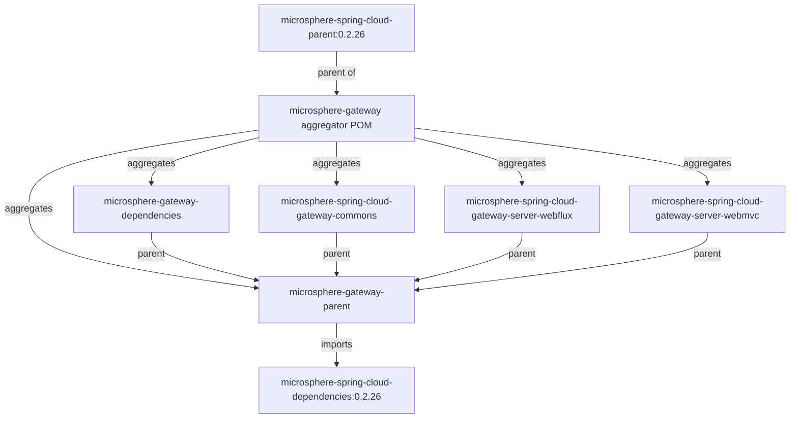

# `microsphere-gateway-parent`

## 1. 用途

`microsphere-gateway-parent` 是 Microsphere Gateway 的构建父 POM。它不提供任何类，也不携带任何资源——它的全部职责就是通过导入
Microsphere Spring Cloud BOM，为 reactor 中的所有模块（以及把 `<parent>` 指向它的任何消费者 POM）提供一份统一、自洽的依赖管理界面。当你希望自己的内部服务或库模块使用与本项目相同的那套
Microsphere Spring Cloud、Spring Boot、Spring Cloud 与 Spring Cloud Alibaba 受管版本时，就把它作为 `<parent>`；如果你只想*导入*版本管理、不希望继承构建配置，请改用
[`microsphere-gateway-dependencies`](microsphere-gateway-dependencies.md)。

## 2. 版本信息

| 条目 | 值 |
|---|---|
| Group id | `io.github.microsphere-projects` |
| Artifact id | `microsphere-gateway-parent` |
| 版本线 | `0.2.x` |
| 分支版本（`release`） | `0.2.19-SNAPSHOT`（Maven `revision`） |
| 已发布的最新版本 | `0.2.18`（分支 `release-notes.md` 中的最新条目） |
| 打包类型 | `pom` |
| 发布位置 | Maven Central，组 `io.github.microsphere-projects`（由 `.github/workflows/maven-publish.yml` 发布） |
| 继承的父级 | `io.github.microsphere-projects:microsphere-gateway:${revision}`（聚合 POM），该聚合 POM 自身的父级是 `io.github.microsphere-projects:microsphere-spring-cloud-parent:0.2.26` |

POM 声明了 `<version>${revision}</version>` 与 `<packaging>pom</packaging>`，并通过
`<relativePath>../pom.xml</relativePath>` 指向聚合 POM。`revision`（`0.2.19-SNAPSHOT`）与 `java.version`（`17`）定义在该聚合
POM 中，因此凡是继承本父 POM 的内容，也会一并继承 `revision` 属性。

## 3. 兼容范围

| 维度 | 支持范围 | 快照中的依据 | 超出范围会坏什么 |
|---|---|---|---|
| JDK | 以 17 为基线，CI 在 17 / 21 / 25 上验证 | 聚合 POM 的 `<java.version>17</java.version>`；`maven-build.yml` 矩阵 | 子模块把 `maven.compiler.source/target` 设到 17
以下不在父级链配置的支持范围内 |
| 构建工具 | Maven 3.9.16（wrapper，`only-script` 分发类型，wrapperVersion 3.3.4） | `.mvn/wrapper/maven-wrapper.properties`、`./mvnw` | 更旧的 Maven 版本未被 CI 覆盖 |
| Spring Cloud 版本列车 | `spring-cloud-2022`、`spring-cloud-2023`、`spring-cloud-2024`、`spring-cloud-2025` | CI 矩阵中的 profile 名以及服务模块 POM 中的 profile | 版本列车的选择由导入的 BOM 与父级链完成；不受支持的列车不会被管理 |
| Microsphere Spring Cloud | BOM `io.github.microsphere-projects:microsphere-spring-cloud-dependencies:0.2.26` | 本 POM 中的 `<microsphere-spring-cloud.version>0.2.26</microsphere-spring-cloud.version>` 与 `import` 条目 | 使用不同取值又不覆盖该属性，会导致受管版本混用 |
| Spring Cloud Gateway starter | 本 POM 不管理也不声明——由每个服务模块通过自己的 profile 选择 | `microsphere-gateway-parent/pom.xml` 只有一条 `dependencyManagement` 记录 | 指望本父 POM 带来网关依赖会落空：starter 必须你自己加 |

在 reactor 中的位置：



## 4. 安装

作为父 POM（继承构建配置与依赖管理）：

```xml
<parent>
    <groupId>io.github.microsphere-projects</groupId>
    <artifactId>microsphere-gateway-parent</artifactId>
    <version>0.2.18</version>
    <relativePath/> <!-- lookup parent from the repository -->
</parent>
```

更常见的是在本项目自己的 reactor 内，作为聚合 POM 的兄弟模块：

```xml
<parent>
    <groupId>io.github.microsphere-projects</groupId>
    <artifactId>microsphere-gateway-parent</artifactId>
    <version>${revision}</version>
    <relativePath>../microsphere-gateway-parent/pom.xml</relativePath>
</parent>
```

如果你只需要版本管理，请改为导入 BOM——见
[`microsphere-gateway-dependencies`](microsphere-gateway-dependencies.md)。

## 5. 依赖管理界面（纯 POM 模块的 API 参考）

本构件不暴露 Java API。它的“API”就是你的 POM 通过它能触达的那些内容。

### 5.1 导入的 BOM

| 导入项 | 作用域 / 类型 | 版本属性 | 说明 |
|---|---|---|---|
| `io.github.microsphere-projects:microsphere-spring-cloud-dependencies` | `pom` / `import` | `microsphere-spring-cloud.version` = `0.2.26` | 本 POM 中唯一直接声明的 `<dependencyManagement>` 条目。通过它你会拿到受管的
Microsphere Spring Cloud 构件（`microsphere-spring-cloud-commons`、`microsphere-spring-boot-*` 等），以及该 Microsphere BOM
自身所管理的 Spring Boot / Spring Cloud / Spring Cloud Alibaba 版本。 |

### 5.2 可覆盖的属性

| 属性 | 声明值 | 声明位置 | 在子 POM 中覆盖后的效果 |
|---|---|---|---|
| `microsphere-spring-cloud.version` | `0.2.26` | `microsphere-gateway-parent/pom.xml` | 重新指向被导入的 BOM，例如
`<microsphere-spring-cloud.version>0.2.25</microsphere-spring-cloud.version>`。在继承本父 POM 的前提下，这是整体升降 Microsphere 受管版本栈的推荐做法。 |
| `revision` | `0.2.19-SNAPSHOT` | 聚合 `pom.xml` | 继承父级链时你自己的版本；CI 构建使用 `-Drevision=0.0.1-SNAPSHOT`，发布工作流使用 `-Drevision=<major>.<minor>.<patch>` 的正式版本。 |
| `java.version` | `17` | 聚合 `pom.xml` | 父级链编译配置所携带的 JDK 基线。 |
| `spring-boot.version`、`spring-cloud.version`、`spring-cloud-alibaba.version` | 本 POM 中未设置 | 仅在 `microsphere-spring-cloud-gateway-server-webmvc` 的 profile 中按 profile 设置 | 在继承本父 POM 的子模块中覆盖它们，会改变被导入 BOM
解析出的版本；参见 [WebMVC 兼容性说明](microsphere-spring-cloud-gateway-server-webmvc.md#3-兼容范围)。 |

### 5.3 继承而来的坐标

这里设置了 `groupId` `io.github.microsphere-projects` 与 `<version>${revision}</version>`，因此子模块可以省略二者——正如
`microsphere-spring-cloud-gateway-commons`、`-server-webflux`、`-server-webmvc`
所做的那样（它们仍然显式重复了 `<version>${revision}</version>`）。

### 5.4 由父级链驱动的构建与发布命令

```bash
# full reactor, the profile CI uses by default
./mvnw --batch-mode -Drevision=0.0.1-SNAPSHOT -Ptest,spring-cloud-2025 package

# one module and its dependencies
./mvnw --batch-mode -Drevision=0.0.1-SNAPSHOT \
  -pl microsphere-spring-cloud-gateway-commons -am \
  -Ptest,spring-cloud-2025 test
```

reactor 构建顺序由聚合 POM 的 `<modules>` 列表决定：`microsphere-gateway-parent`、
`microsphere-gateway-dependencies`、`microsphere-spring-cloud-gateway-commons`、
`microsphere-spring-cloud-gateway-server-webflux`、`microsphere-spring-cloud-gateway-server-webmvc`。

## 6. 配置参考

本模块没有任何 `microsphere.*` 应用配置项：它是一个不含资源的 `pom` 构件。它的配置界面就是
[5.2](#52-可覆盖的属性) 中的 Maven 属性表。至于受管构件在运行期读取的开关，见
[commons 配置参考](microsphere-spring-cloud-gateway-commons.md#6-配置参考)。

## 7. 代码示例

### 7.1 继承受管版本栈的消费者 POM

```xml
<project>
    <modelVersion>4.0.0</modelVersion>

    <parent>
        <groupId>io.github.microsphere-projects</groupId>
        <artifactId>microsphere-gateway-parent</artifactId>
        <version>0.2.18</version>
        <relativePath/>
    </parent>

    <groupId>com.example</groupId>
    <artifactId>my-gateway</artifactId>
    <version>1.0.0</version>

    <properties>
        <!-- move the whole Microsphere Spring Cloud stack -->
        <microsphere-spring-cloud.version>0.2.26</microsphere-spring-cloud.version>
    </properties>

    <dependencies>
        <!-- versions come from the imported BOM plus the gateway BOM -->
        <dependency>
            <groupId>io.github.microsphere-projects</groupId>
            <artifactId>microsphere-spring-cloud-gateway-server-webflux</artifactId>
        </dependency>
        <dependency>
            <groupId>org.springframework.cloud</groupId>
            <artifactId>spring-cloud-starter-gateway</artifactId>
        </dependency>
    </dependencies>
</project>
```

注意 `microsphere-spring-cloud-gateway-server-webflux` **不是**由本父 POM 管理的——它由
`microsphere-gateway-dependencies` 管理。因此在继承本父 POM 之外，还要导入那个 BOM（或自行固定版本）。

### 7.2 本 POM 实际贡献的 `dependencyManagement` 块（逐字）

```xml
<dependencyManagement>
    <dependencies>

        <!-- Microsphere Spring Cloud Dependencies -->
        <dependency>
            <groupId>io.github.microsphere-projects</groupId>
            <artifactId>microsphere-spring-cloud-dependencies</artifactId>
            <version>${microsphere-spring-cloud.version}</version>
            <type>pom</type>
            <scope>import</scope>
        </dependency>

    </dependencies>
</dependencyManagement>
```

## 8. 常见坑 / FAQ

**“我继承了 `microsphere-gateway-parent`，结果网关构件没有版本。”**
这是设计如此。本父 POM 只导入 `microsphere-spring-cloud-dependencies`；三个网关构件由
`microsphere-gateway-dependencies` 管理。两个都要。

**“我只 *导入* BOM，能覆盖 `microsphere-spring-cloud.version` 吗？”**
不能。属性随继承传递，不随 `import` 作用域传递。导入
`io.github.microsphere-projects:microsphere-gateway-dependencies`
只会给你带来解析后的版本，而不是属性。想按属性覆盖，就把本构件作为 `<parent>`；想按版本覆盖，就在 `import`
**之前**声明你自己的 `<dependency>` 管理条目（先声明者生效）。

**“使用已发布的父 POM 时 `<relativePath/>` 是必需的。”**
是的。Maven Central 上的 POM 没有 `../pom.xml`；保留默认 relative path 会让 Maven
先在文件系统里找，然后报父 POM 缺失。请写空的 `<relativePath/>`。

**“父级链带来了我不想要的构建插件。”**
本 POM 之上的一切来自 `microsphere-spring-cloud-parent:0.2.26`（编译、发布与 profile
配置）。如果你只想要版本管理而不要那套构建配置，请改为导入
[`microsphere-gateway-dependencies`](microsphere-gateway-dependencies.md)。

## 相关文档

- [用户指南索引](README.md)
- [microsphere-gateway-dependencies（BOM）](microsphere-gateway-dependencies.md)
- [microsphere-spring-cloud-gateway-commons](microsphere-spring-cloud-gateway-commons.md)
- [仓库 README](../../../../README.md)

## English

- [User Guide (English)](../microsphere-gateway-parent.md)
