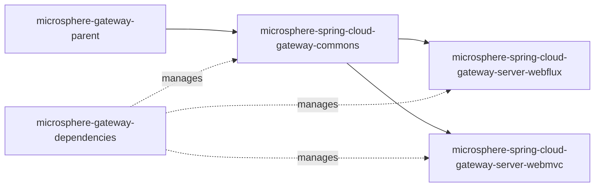

# `microsphere-spring-cloud-gateway-commons`

## 1. 用途

`microsphere-spring-cloud-gateway-commons` 是 Microsphere Gateway 的共享层，与具体网关技术栈无关。它承载了整个项目围绕的核心词汇：`we://`（web-endpoint）路由 URI scheme、`metadata.web-endpoint`
下的路由元数据键、`microsphere.spring.cloud.*` 特性开关、描述按路由 `excludes` 的 `WebEndpointConfig` 模型，以及把原始路由元数据绑定成该模型的属性绑定监听器。任何需要在不依赖响应式或 Servlet
网关实现的前提下感知 Microsphere 网关路由元数据的应用都应依赖本模块——实践中你通常是从
`microsphere-spring-cloud-gateway-server-webflux` 或 `microsphere-spring-cloud-gateway-server-webmvc`
传递获得它；只有当你希望把常量与绑定逻辑放进一个非网关服务的 classpath（例如以编程方式构造路由元数据，或在控制面校验 `excludes` 结构）时，才显式声明它。

## 2. 版本信息

| 条目 | 值 |
|---|---|
| Group id | `io.github.microsphere-projects` |
| Artifact id | `microsphere-spring-cloud-gateway-commons` |
| 版本线 | `0.2.x` |
| 分支版本（`release`） | `0.2.19-SNAPSHOT`（根 POM 中的 Maven `revision`） |
| 已发布的最新版本 | `0.2.18`（分支 `release-notes.md` 中的最新条目） |
| 打包类型 | `jar` |
| 发布位置 | Maven Central，组 `io.github.microsphere-projects`（由 `.github/workflows/maven-publish.yml` 发布） |
| 源码模块 | `microsphere-spring-cloud-gateway-commons` |

版本并未硬编码在模块 POM 中：模块声明的是 `<version>${revision}</version>`，而 `revision`
只在聚合 POM 里定义一次（`release` 分支上为 `0.2.19-SNAPSHOT`）。发布流水线（`.github/workflows/maven-publish.yml`）从
`release` 分支以 `-Drevision=<major>.<minor>.<patch>` 部署，这就是为何已发布构件是形如 `0.2.18`
的正式版本，而分支本身是 `-SNAPSHOT`。

## 3. 兼容范围

| 维度 | 支持范围 | 快照中的依据 | 超出范围会坏什么 |
|---|---|---|---|
| JDK | 以 17 为基线；CI 验证 17、21、25 | 聚合 POM 的 `<java.version>17</java.version>`；`maven-build.yml` 矩阵 `java: ['17','21','25']` | 在 JDK 8/11 上编译或运行不受支持，CI 从未覆盖 |
| Spring Boot | 由导入的 `microsphere-spring-cloud-dependencies:0.2.26` BOM 针对所选 Spring Cloud 版本列车决定的那一套 | 根 POM 的父级 `microsphere-spring-cloud-parent:0.2.26`；`microsphere-gateway-parent` 导入该 BOM | `spring-boot-starter`、`spring-boot-starter-actuator`
以及两个注解处理器在本模块都是 `<optional>`，因此 Boot 版本不匹配是你构建的问题，本模块不会替你解决 |
| Spring Cloud 版本列车 | `spring-cloud-2022`、`spring-cloud-2023`、`spring-cloud-2024`、`spring-cloud-2025`（Maven profile，`2025` 默认激活） | `maven-build.yml` 矩阵 `maven-profile-spring-cloud` | 这些 profile 声明在服务模块而非本模块；本模块完全没有网关依赖，其兼容性由 `spring-cloud-commons` 决定 |
| Spring Cloud | `spring-cloud-commons`、`spring-cloud-loadbalancer`（`<optional>`） | 模块 POM 依赖块 | 缺少 `spring-cloud-commons` 时，`io.microsphere.spring.cloud.gateway.commons.config.WebEndpointConfig`
仍可加载，但引用 `WebEndpointMapping`（来自 `microsphere-spring-cloud-commons`）的类会失败 |
| Microsphere Spring Cloud | `io.github.microsphere-projects:microsphere-spring-cloud-commons`（`<optional>`） | 模块 POM；导入的 BOM 版本为 `0.2.26` | `CommonsPropertyConstants` 与 `WebEndpointConfig`
都是基于它编译的；classpath 上没有它就会因 `io.microsphere.spring.web.metadata.WebEndpointMapping` 抛 `NoClassDefFoundError` |
| Bean Validation | `jakarta.validation:jakarta.validation-api`（`<optional>`）；Hibernate Validator 仅 test 作用域 | 模块 POM | `WebEndpointConfig` 带有 `@Validated`、`@NotNull`、`@Valid`；没有校验实现时这些 exclude 约束不会被执行 |
| Spring Web | `org.springframework:spring-web`（`<optional>`） | 模块 POM（`WebEndpointConfig.Mapping` 使用 `RequestMethod`） | `Mapping.getMethods()` 返回 `RequestMethod[]`；缺少 `spring-web` 时该类无法初始化 |

模块依赖形态：



## 4. 安装

先导入 BOM，再声明本模块且不写版本：

```xml
<dependencyManagement>
    <dependencies>
        <dependency>
            <groupId>io.github.microsphere-projects</groupId>
            <artifactId>microsphere-gateway-dependencies</artifactId>
            <version>0.2.18</version>
            <type>pom</type>
            <scope>import</scope>
        </dependency>
    </dependencies>
</dependencyManagement>

<dependencies>
    <dependency>
        <groupId>io.github.microsphere-projects</groupId>
        <artifactId>microsphere-spring-cloud-gateway-commons</artifactId>
    </dependency>
</dependencies>
```

由于本模块的所有 compile 依赖都是 `<optional>`，你需要把真正用到的那些自己加上。一个贴近实际的独立依赖集合：

```xml
<dependencies>
    <dependency>
        <groupId>io.github.microsphere-projects</groupId>
        <artifactId>microsphere-spring-cloud-gateway-commons</artifactId>
    </dependency>

    <!-- Not optional in this module: Microsphere Spring Cloud commons -->
    <dependency>
        <groupId>io.github.microsphere-projects</groupId>
        <artifactId>microsphere-spring-cloud-commons</artifactId>
    </dependency>

    <dependency>
        <groupId>org.springframework.boot</groupId>
        <artifactId>spring-boot-starter</artifactId>
    </dependency>

    <dependency>
        <groupId>org.springframework</groupId>
        <artifactId>spring-web</artifactId>
    </dependency>

    <dependency>
        <groupId>org.springframework.cloud</groupId>
        <artifactId>spring-cloud-commons</artifactId>
    </dependency>

    <!-- Validation provider: required for the @NotNull / @Valid constraints -->
    <dependency>
        <groupId>org.hibernate.validator</groupId>
        <artifactId>hibernate-validator</artifactId>
    </dependency>
    <dependency>
        <groupId>org.apache.tomcat.embed</groupId>
        <artifactId>tomcat-embed-el</artifactId>
    </dependency>
</dependencies>
```

如果 `microsphere-spring-cloud-commons` 在你的构建中没有被管理版本，请显式固定它（版本族与导入的 Microsphere Spring Cloud BOM 一致，即
`0.2.26`），或者在本 BOM 之外再导入 `io.github.microsphere-projects:microsphere-spring-cloud-dependencies:0.2.26`。用
`mvn dependency:tree` 复核。

## 5. API 参考

### 5.1 `io.microsphere.spring.cloud.gateway.commons.constants.RouteConstants`

`public interface RouteConstants` —— `we://` scheme 的词汇表。所有成员都是 `String`
常量（`since 1.0.0`）。

| 成员 | 值 | 行为 / 何时使用 |
|---|---|---|
| `SCHEME` | `"we"` | 标识一条路由为 web-endpoint 路由的 URI scheme。两个服务模块都只为 `uri` 的 scheme 等于该值的路由构建映射缓存。当你自己过滤 `RouteDefinition`/`RouteProperties` 时使用它。 |
| `ALL_SERVICES` | `"all"` | host 取该值表示“订阅全部已发现服务”，即 `we://all`。其他值按逗号分隔解析为服务 id 列表（`we://orders-service,payments-service`）。 |
| `ID_KEY` | `"id"` | 用于在 `EnvironmentChangeEvent` 中感知路由 id 变化的路由属性片段。 |
| `METADATA_KEY` | `"metadata"` | 绑定监听器所监听的路由属性片段。 |
| `WEB_ENDPOINT_KEY` | `"web-endpoint"` | 存放 `WebEndpointConfig` 的元数据子键；解析出的配置也会以该键写回元数据 Map。 |
| `WEB_ENDPOINT_REWRITE_PATH_ATTRIBUTE_NAME` | `"msgw-we-rewrite-path"` | 转发前暂存“已去掉前导 `/{application}`
片段的路径”所使用的 exchange/request 属性名。若你自己的过滤器需要下游路径，就读它。 |

由 `RouteConstantsTest.testConstants` 验证。

### 5.2 `io.microsphere.spring.cloud.gateway.commons.constants.CommonConstants`

`public interface CommonConstants`

| 成员 | 值 | 行为 / 何时使用 |
|---|---|---|
| `APPLICATION_NAME_URI_TEMPLATE_VARIABLE_NAME` | `"application"` | 网关据此读取目标服务 id 的 URI 模板变量名。你的路由谓词必须声明 `{application}`（例如 `Path=/{application}/**`）——否则 web-endpoint 过滤器会原样透传请求。 |

由 `CommonConstantsTest.testConstants` 验证。

### 5.3 `io.microsphere.spring.cloud.gateway.commons.constants.CommonsPropertyConstants`

`public interface CommonsPropertyConstants` —— 只有两个 `enabled` 键带有
`@ConfigurationProperty(type = boolean.class, defaultValue = DEFAULT_MICROSPHERE_GATEWAY_ENABLED, source = APPLICATION_SOURCE)`
注解；两个前缀常量与 `"true"` 默认值常量只是普通的 `String` 字段。

| 成员 | 值 | 行为 / 何时使用 |
|---|---|---|
| `MICROSPHERE_GATEWAY_SPRING_CLOUD_PROPERTY_NAME_PREFIX` | `"microsphere.spring.cloud.gateway."` | 本模块开关的前缀。 |
| `DEFAULT_MICROSPHERE_GATEWAY_ENABLED` | `"true"` | 共享默认值；服务模块在自己的 `enabled` 键上也复用它。 |
| `MICROSPHERE_GATEWAY_ENABLED_PROPERTY_NAME` | `"microsphere.spring.cloud.gateway.enabled"` | Microsphere 网关全部行为的总开关（`matchIfMissing = true`）。 |
| `MICROSPHERE_WEB_ENDPOINT_MAPPING_PROPERTY_NAME_PREFIX` | `"microsphere.spring.cloud.web-endpoint-mapping."` | web-endpoint 映射能力的前缀。 |
| `MICROSPHERE_WEB_ENDPOINT_MAPPING_ENABLED_PROPERTY_NAME` | `"microsphere.spring.cloud.web-endpoint-mapping.enabled"` | 只控制 `WebEndpointMapping` 的路由转换，其余网关扩展仍开启。 |

由 `CommonsPropertyConstantsTest.testConstants` 验证。

### 5.4 注解

| 类型 | 声明 | 行为 |
|---|---|---|
| `io.microsphere.spring.cloud.gateway.commons.annotation.ConditionalOnMicrosphereGatewayEnabled` | `@Target({TYPE, METHOD})`、`@Retention(RUNTIME)`、`@Documented`，元注解 `@ConditionalOnProperty(name = "microsphere.spring.cloud.gateway.enabled", matchIfMissing = true)` | 将被标注的配置类或 `@Bean` 方法标记为仅在 Microsphere 网关开启时生效。属性缺失即视为开启。 |
| `io.microsphere.spring.cloud.gateway.commons.annotation.ConditionalOnMicrosphereWebEndpointMappingEnabled` | 同样的 target/retention；元注解为 `@ConditionalOnMicrosphereGatewayEnabled` **以及** `@ConditionalOnProperty(name = "microsphere.spring.cloud.web-endpoint-mapping.enabled", matchIfMissing = true)` | 要求两个开关同时满足。当你的 Bean 是 web-endpoint 路由能力的扩展时使用它，这样 `microsphere.spring.cloud.gateway.enabled=false` 也会把它一并关掉。 |

### 5.5 `config.WebEndpointConfig`

`@Validated public class WebEndpointConfig` —— `metadata.web-endpoint` 的类型化模型。

| 成员 | 签名 | 行为 |
|---|---|---|
| `getExcludes` / `setExcludes` | `List<Mapping> getExcludes()` | 新建实例中永不为 `null`（初始化为空 `LinkedList`）；标注 `@NotNull @Valid`，因此显式置 `null` 会导致绑定失败。 |

嵌套类 `public static class Mapping`（`@see WebEndpointMapping`）：

| 属性 | 签名 | 键缺失时的默认值 | 说明 |
|---|---|---|---|
| `patterns` | `String[] getPatterns()` / `setPatterns(String[])` | `null` | `@NotNull @Valid` —— 没有 `patterns` 的 exclude 条目会使绑定失败。 |
| `methods` | `RequestMethod[] getMethods()`（`@Nonnull`） | `RequestMethod.values()`（全部方法） | setter 可为空；空数组或缺失会被归一为*所有* HTTP
方法，因此不写 `methods` 的 exclude 会对所有动词生效。 |
| `params` | `String[] getParams()`（`@Nullable`） | `null` | 直接传给 `RequestMappingInfo.paths(...).params(...)`。 |
| `headers` | `String[] getHeaders()`（`@Nonnull`） | `EMPTY_STRING_ARRAY` | 为空或缺失会归一为空数组，不会是 `null`。 |
| `consumes` | `String[] getConsumes()`（`@Nullable`） | `null` | 媒体类型限制。 |
| `produces` | `String[] getProduces()`（`@Nullable`） | `null` | 媒体类型限制。 |

### 5.6 `config.ConfigUtils`

`public abstract class ConfigUtils implements Utils` —— 构造器为私有，只提供静态入口。

| 方法 | 签名 | 行为 |
|---|---|---|
| `getWebEndpointConfig(Environment, String)` | `@Nullable static WebEndpointConfig getWebEndpointConfig(Environment environment, String configPrefix)` | 使用被 `ValidationBindHandler`（内部持有静态初始化块创建的 `LocalValidatorFactoryBean`）包裹的 `Binder`
把 `configPrefix` 绑定为 `WebEndpointConfig`。没有绑定到内容时返回 `null`。 |
| `getWebEndpointConfig(Map<String, Object>)` | `@Nullable static WebEndpointConfig getWebEndpointConfig(Map<String, Object> metadata)` | 读取 `web-endpoint`
键，**并且仅当该值已经是 `WebEndpointConfig` 实例时**才返回；该键下是原始 `Map` 时返回 `null`。这正是下面那个绑定监听器存在的理由。 |

### 5.7 `config.WebEndpointConfigurationPropertiesBindListener`

`public class WebEndpointConfigurationPropertiesBindListener implements BindListener, EnvironmentAware`

| 成员 | 签名 | 行为 |
|---|---|---|
| `BEAN_NAME` | `public static final String BEAN_NAME = "webEndpointConfigurationPropertiesBindListener"` | 两个服务模块的 initializer 所注册的 Bean 名。 |
| 构造器 | `WebEndpointConfigurationPropertiesBindListener(String gatewayRoutesPropertyNamePrefix)` | 前缀为空立即失败（`assertNotBlank`）。WebFlux
模块传入 `GatewayProperties.PREFIX + ".routes"`，WebMVC 模块传入 `GatewayMvcProperties.PREFIX + ".routes"`。 |
| `onFinish` | `void onFinish(ConfigurationPropertyName name, Bindable<?> target, BindContext context, Object result)` | 当被绑定的属性名以路由前缀开头**且**以 `metadata`
结尾且结果非 `null` 时，把 `<...>metadata.web-endpoint` 绑定成 `WebEndpointConfig`，成功则写入元数据 `Map` 的 `web-endpoint`
键。非路由的 metadata 以及不含 `web-endpoint` 的 metadata 不受影响。 |
| `setEnvironment` | `void setEnvironment(Environment environment)` | 供 `onFinish` 使用的标准 `EnvironmentAware` 注入。 |

### 5.8 `META-INF/config/default/features.yaml`

本模块只有一份特性声明：

```yaml
microsphere:
  spring:
    cloud:
      features:
        abstract:
          microsphere-spring-cloud-gateway-commons:
            - io.microsphere.spring.cloud.gateway.commons.config.WebEndpointConfigurationPropertiesBindListener
```

`WebEndpointConfigurationPropertiesBindListener` 被登记为*抽象*特性（参与 Microsphere Spring Cloud
特性机制、但由服务模块负责实例化，而不是原样注册的类）。本模块**没有** `spring.factories`，也**没有**
`AutoConfiguration.imports`：它不提供任何自己的自动配置。

## 6. 配置参考

本模块拥有的配置项键（逐字取自 `CommonsPropertyConstants`）：

| 键 | 类型 | 默认值 | 作用 |
|---|---|---|---|
| `microsphere.spring.cloud.gateway.enabled` | `boolean` | `true` | 总开关（`matchIfMissing = true`）。关闭后，所有 `@ConditionalOnMicrosphereGatewayEnabled` 与 `@ConditionalOnMicrosphereWebEndpointMappingEnabled` 元素都不再生效，包括两个服务模块中的网关自动配置。 |
| `microsphere.spring.cloud.web-endpoint-mapping.enabled` | `boolean` | `true` | 只关闭 `we://` web-endpoint 映射能力；总开关仍然控制一切。 |
| `microsphere.spring.cloud.gateway.` | 前缀 | — | 上述开关所在的命名空间；本模块不再读取其他键。 |
| `microsphere.spring.cloud.web-endpoint-mapping.` | 前缀 | — | 上述映射开关的命名空间。 |

路由元数据键（真正会被绑定进 `WebEndpointConfig` 的结构，逐字取自 `src/test/resources` 中的 YAML）：

| 键（相对于一条路由条目） | 类型 | 默认值 | 作用 |
|---|---|---|---|
| `uri` | scheme 为 `we` 的 URI | — | `we://all` 订阅全部已发现服务；`we://a,b` 订阅列出的服务 id。 |
| `predicates` | 列表 | — | 必须暴露 `{application}` URI 模板变量，重写才会发生。 |
| `metadata.web-endpoint` | 对象 | 缺失 | 它的存在会触发 `WebEndpointConfig` 绑定。 |
| `metadata.web-endpoint.excludes` | 映射条目列表 | 空列表 | 命中任一条目的请求不做 web-endpoint 转换，保持普通网关行为。 |
| `metadata.web-endpoint.excludes[].patterns` | `String[]` | 必填 | Ant 风格路径模式。 |
| `metadata.web-endpoint.excludes[].methods` | `String[]`（`RequestMethod`） | 全部方法 | 省略即匹配所有动词。 |
| `metadata.web-endpoint.excludes[].params` | `String[]` | `null` | 请求参数表达式，如 `p=1`。 |
| `metadata.web-endpoint.excludes[].headers` | `String[]` | 空 | 请求头表达式，如 `h=1`。 |
| `metadata.web-endpoint.excludes[].consumes` | `String[]` | `null` | 内容类型限制。 |
| `metadata.web-endpoint.excludes[].produces` | `String[]` | `null` | Accept 限制。 |

本模块没有 `@ConfigurationProperties` 类；以上所有内容都是通过 `Binder` 调用绑定的，因此这些键不会出现在该构件产出的
`spring-configuration-metadata.json` 中。

## 7. 代码示例

### 7.1 带 excludes 的路由元数据（源自 `ConfigUtilsTest` 与 `commons/src/test/resources/META-INF/config/default/test.yaml`）

```yaml
spring:
  cloud:
    gateway:
      routes:
        - id: web-endpoint-mapping
          uri: we://all
          predicates:
            - Path=/{application}/**
          metadata:
            web-endpoint:
              excludes:
                - patterns: /test-1/**
                  methods: GET
                  params: p=1
                - patterns: /test-2/**
                  methods: POST
                  headers: h=1
```

测试断言了绑定结果：第 0 项为 `patterns=["/test-1/**"]`、`methods=[GET]`、`params=["p=1"]`，且 `headers`
等于空数组；第 1 项为 `patterns=["/test-2/**"]`、`methods=[POST]`、`headers=["h=1"]`，`params` 为 `null`。来源：
`io.microsphere.spring.cloud.gateway.commons.config.ConfigUtilsTest#testGetWebEndpointConfig`。

### 7.2 部分填写的 exclude 条目的默认值（同一测试，共享 YAML 的第三项）

```yaml
metadata:
  web-endpoint:
    excludes:
      - patterns: /test-3/abc/**
        consumes: application/json
        produces: plain/text
```

`ConfigUtilsTest.assertWebEndpointConfig` 断言 `methods` 为 `RequestMethod.values()`（所有动词）、`params` 为 `null`、
`headers` 为空数组，`consumes`/`produces` 携带两个媒体类型。

### 7.3 运行时绑定路由元数据（源自 `WebEndpointConfigurationPropertiesBindListenerTest`）

```java
Environment environment = createEnvironment(); // a MockEnvironment with the YAML above attached

WebEndpointConfigurationPropertiesBindListener bindListener =
        new WebEndpointConfigurationPropertiesBindListener("spring.cloud.gateway.routes");
bindListener.setEnvironment(environment);

Map<String, Object> metadata = bind(environment, "spring.cloud.gateway.routes[0].metadata",
        LinkedHashMap.class, bindListener);

WebEndpointConfig config = ConfigUtils.getWebEndpointConfig(metadata);
assertNotNull(config);
```

同一测试还绑定了 `routes[1].metadata`（一条没有 `web-endpoint` 的路由）以及 `spring.cloud`（在路由前缀之外）——两者都是空操作。来源：
`io.microsphere.spring.cloud.gateway.commons.config.WebEndpointConfigurationPropertiesBindListenerTest#testApply`。

### 7.4 为你的配置加开关（源自 `ConditionalOnMicrosphereGatewayEnabledTest` / `ConditionalOnMicrosphereWebEndpointMappingEnabledTest`）

```java
@ConditionalOnMicrosphereWebEndpointMappingEnabled
static class Config {
}
```

不设置任何属性时该 Bean 存在；设置 `microsphere.spring.cloud.web-endpoint-mapping.enabled=false`（或
`microsphere.spring.cloud.gateway.enabled=false`）后，同一测试断言注入的 Bean 为 `null`。来源：
`io.microsphere.spring.cloud.gateway.commons.annotation.ConditionalOnMicrosphereWebEndpointMappingEnabledTest`。

## 8. 常见坑 / FAQ

**`metadata.web-endpoint` 明明在 YAML 里，但 `getWebEndpointConfig(Map)` 返回 `null`。**
`Map` 重载做的是 `instanceof WebEndpointConfig` 判断——它从不执行绑定。`web-endpoint`
键下是普通 `LinkedHashMap` 时返回 `null`（`ConfigUtilsTest` 已断言）。请改用带完整属性前缀的 `Environment`
重载，或者确保该路由是在 `WebEndpointConfigurationPropertiesBindListener` 已注册的情况下完成绑定的（两个服务模块都通过各自的
`WebEndpointApplicationContextInitializer` 注册它）。

**没有 `patterns` 的 exclude 条目会让整条路由绑定失败。**
`Mapping.patterns` 是 `@NotNull`，而 `ConfigUtils` 经由 `ValidationBindHandler` 绑定。表现为路由（或应用）以绑定校验错误启动失败，而不是路由未命中。

**不写 `methods` 的 exclude 比你想象的更宽。**
`getMethods()` 在数组为空时用 `RequestMethod.values()` 代替，因此只写 `/internal/**`
就会阻断该路径上的 GET、POST、PUT、DELETE 及其他所有动词。

**`WebEndpointMapping` 或 `RequestMethod` 抛 `ClassNotFoundException` / `NoClassDefFoundError`。**
本模块 POM 中 `microsphere-spring-cloud-commons`、`spring-web`、`spring-cloud-commons`、`jakarta.validation-api` 全是
`<optional>`，compile 作用域不会传递任何依赖。需要什么就自己加什么。

**校验约束被静默忽略。**
compile 作用域没有声明校验实现（Hibernate Validator 与 `tomcat-embed-el` 在本模块是 `test` 作用域）。classpath
上没有实现时，`WebEndpointConfig` 上的 `@NotNull`/`@Valid` 无法被执行。

**看起来该匹配的 exclude 没生效。**
排除模式是针对请求进入路由时的路径匹配的——在 `/{application}` 片段被剥离**之前**。WebFlux
测试配置中路由谓词是 `Path=/{application}/**`，模式写 `/test-1/**`；WebMVC 配置中谓词是 `Path=/we/{application}/**`，模式写
`/we/test-app/**`。请在模式里保留路由自身的路径前缀。

**`microsphere.spring.cloud.*` 这些键是从哪来的？**
`MICROSPHERE_GATEWAY_SPRING_CLOUD_PROPERTY_NAME_PREFIX`
由 Microsphere Spring Cloud commons 的前缀（`microsphere.spring.cloud.`）加上 `gateway.`
拼成；这些字符串被 `CommonsPropertyConstantsTest` 逐字断言固定，请从本页复制而不是自行拼接。

## 相关文档

- [用户指南索引](README.md)
- [WebFlux 服务模块](microsphere-spring-cloud-gateway-server-webflux.md)
- [WebMVC 服务模块](microsphere-spring-cloud-gateway-server-webmvc.md)
- [仓库 README](../../../../README.md)

## English

- [User Guide (English)](../microsphere-spring-cloud-gateway-commons.md)
