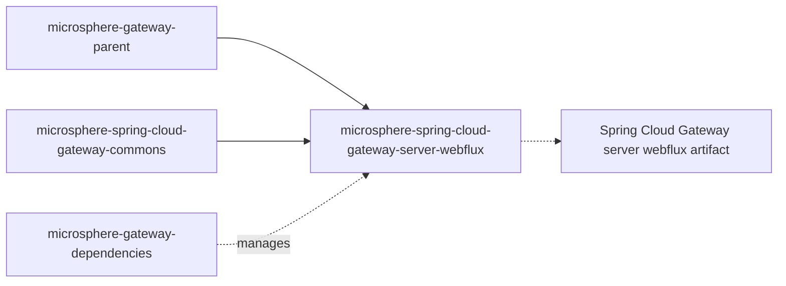

# `microsphere-spring-cloud-gateway-server-webflux`

## 1. 用途

`microsphere-spring-cloud-gateway-server-webflux` 把响应式的 Spring Cloud Gateway（WebFlux server）变成一台
Microsphere web-endpoint 网关。它通过自动配置引入 `we://`
路由 scheme，使一条路由就能基于各服务发布的 web endpoint 元数据把流量转发到*已发现的*服务，而不必为每个服务写一条路由。它还用上带缓存的变体替换 Spring Cloud Gateway 的
`FilteringWebHandler`，阻止服务发现心跳反复冲刷路由缓存，并在配置或服务实例变化时刷新由路由派生的映射缓存。请在使用响应式网关应用（Spring Boot +
`spring-cloud-starter-gateway` 或 `spring-cloud-gateway-server-webflux`）、并且使用 Spring Cloud `ReactiveDiscoveryClient` 与
Spring Cloud LoadBalancer 的项目中依赖本模块；Servlet 应用请使用
[`microsphere-spring-cloud-gateway-server-webmvc`](microsphere-spring-cloud-gateway-server-webmvc.md)——两者是同一能力集面向两种网关运行时的互斥实现。

## 2. 版本信息

| 条目 | 值 |
|---|---|
| Group id | `io.github.microsphere-projects` |
| Artifact id | `microsphere-spring-cloud-gateway-server-webflux` |
| 版本线 | `0.2.x` |
| 分支版本（`release`） | `0.2.19-SNAPSHOT`（Maven `revision`） |
| 已发布的最新版本 | `0.2.18`（分支 `release-notes.md` 中的最新条目） |
| 打包类型 | `jar` |
| 发布位置 | Maven Central，组 `io.github.microsphere-projects`（由 `.github/workflows/maven-publish.yml` 发布） |
| Javadoc | `https://javadoc.io/doc/io.github.microsphere-projects/microsphere-spring-cloud-gateway-server-webflux` |
| 父级 | `io.github.microsphere-projects:microsphere-gateway-parent:${revision}` |

## 3. 兼容范围

| 维度 | 支持范围 | 快照中的依据 | 超出范围会坏什么 |
|---|---|---|---|
| JDK | 以 17 为基线；CI 验证 17、21、25 | `<java.version>17</java.version>`；`maven-build.yml` `java: ['17','21','25']` | 17 以下不编译也不测试 |
| Spring Cloud `2022` / `2023` / `2024`（Maven profile `spring-cloud-2022`、`spring-cloud-2023`、`spring-cloud-2024`） | 出现在构建/测试矩阵中；profile 以 `<optional>` 方式加入 `org.springframework.cloud:spring-cloud-starter-gateway` | 本模块 POM 的 profile 块 | starter 必须你自己添加；若所用 `GatewayProperties` 的版本在包结构/字段布局上不同，可能让 `ConditionalOnGatewayAvailable` 退避，或让 `CachingFilteringWebHandler` 反射读取 `globalFilters` 失败 |
| Spring Cloud `2025`（profile `spring-cloud-2025`，**`activeByDefault` true**） | 该 profile 以 `<optional>` 加入 `org.springframework.cloud:spring-cloud-gateway-server-webflux`——注意 artifact id 不同 | 本模块 POM 的 profile 块 | 用 `2025` 构建却依赖 `spring-cloud-starter-gateway`（或反之），会得到与已编译代码路径不匹配的网关 server 构件 |
| 响应式网关 server | `spring-cloud-gateway-server-webflux` / `spring-cloud-starter-gateway`，需提供 `org.springframework.cloud.gateway.config.GatewayProperties` | `@ConditionalOnClass(name = "org.springframework.cloud.gateway.config.GatewayProperties")` | 缺少该类时本模块的**全部**自动配置都会静默退避——没有 `we://` 路由，也没有报错 |
| 响应式 Web 栈 | `spring-boot-starter-webflux` 与 `io.github.microsphere-projects:microsphere-spring-boot-webflux`（均为 `<optional>`）；后者提供 `io.microsphere.spring.boot.webflux.autoconfigure.condition.ConditionalOnWebFluxAvailable` | 本模块 POM 中的 `<optional>` 条目 + 注解的元条件 | Servlet 应用从本模块拿不到任何 Bean |
| 服务发现 | 提供 `ReactiveDiscoveryClient` 的 `spring-cloud-commons`（`<optional>`），以及来自 `microsphere-spring-cloud-commons` 的 `ReactiveDiscoveryClientAdapter` Bean | `WebEndpointMappingGatewayAutoConfiguration` 中的 `@ConditionalOnClass`、`@ConditionalOnBean(..., search = CURRENT)` | 没有 `WebEndpointMappingGlobalFilter` Bean：`we://` 路由会被匹配却永远不会被转换 |
| 负载均衡 | 提供 `LoadBalancerClientFactory` 的 `spring-cloud-loadbalancer`（`<optional>`） | 同样的条件；与 `ReactiveLoadBalancerClientFilter` 的排序关系 | 无法完成实例挑选（`choose`）；过滤器退避 |
| Microsphere Spring Cloud | `microsphere-spring-cloud-commons`（`<optional>`）——`WebEndpointMapping`、`ServiceInstanceUtils`、`ServiceInstancesChangedEvent`、`ReactiveDiscoveryClientAdapter` | 源码中大量 import | 刷新阶段抛 `NoClassDefFoundError` |

在 reactor 中的位置：



## 4. 安装

```xml
<dependencyManagement>
    <dependencies>
        <dependency>
            <groupId>org.springframework.cloud</groupId>
            <artifactId>spring-cloud-dependencies</artifactId>
            <version>2025.0.0</version>
            <type>pom</type>
            <scope>import</scope>
        </dependency>
        <dependency>
            <groupId>io.github.microsphere-projects</groupId>
            <artifactId>microsphere-gateway-dependencies</artifactId>
            <version>0.2.18</version>
            <type>pom</type>
            <scope>import</scope>
        </dependency>
    </dependencies>
</dependencyManagement>

<dependencies>
    <dependency>
        <groupId>org.springframework.cloud</groupId>
        <artifactId>spring-cloud-starter-gateway</artifactId>
    </dependency>

    <dependency>
        <groupId>io.github.microsphere-projects</groupId>
        <artifactId>microsphere-spring-cloud-gateway-server-webflux</artifactId>
    </dependency>

    <!-- everything below is <optional> in the module and must be provided -->
    <dependency>
        <groupId>io.github.microsphere-projects</groupId>
        <artifactId>microsphere-spring-cloud-commons</artifactId>
    </dependency>
    <dependency>
        <groupId>org.springframework.cloud</groupId>
        <artifactId>spring-cloud-starter-loadbalancer</artifactId>
    </dependency>
    <dependency>
        <groupId>org.springframework.boot</groupId>
        <artifactId>spring-boot-starter-webflux</artifactId>
    </dependency>
</dependencies>
```

`microsphere-spring-cloud-gateway-commons` 是本模块的 compile 依赖，会传递进来。

## 5. API 参考

已注册的扩展点（`src/main/resources`）：

| 文件 | 内容 |
|---|---|
| `META-INF/spring/org.springframework.boot.autoconfigure.AutoConfiguration.imports` | `io.microsphere.spring.cloud.gateway.server.webflux.autoconfigure.GatewayAutoConfiguration`、`io.microsphere.spring.cloud.gateway.server.webflux.autoconfigure.WebEndpointMappingGatewayAutoConfiguration` |
| `META-INF/spring.factories` | `org.springframework.context.ApplicationContextInitializer=io.microsphere.spring.cloud.gateway.server.webflux.context.WebEndpointApplicationContextInitializer` |
| `META-INF/config/default/features.yaml` | 抽象特性：`CachingFilteringWebHandler`、`WebEndpointMappingGlobalFilter`、`DisabledHeartbeatEventRouteRefreshListenerInterceptor`、`PropagatingRefreshRoutesEventApplicationListener`；具名特性：`WebEndpointApplicationContextInitializer=...context.WebEndpointApplicationContextInitializer` |

### 5.1 `autoconfigure.GatewayAutoConfiguration`

`@Configuration(proxyBeanMethods = false)`，条件为 `@ConditionalOnGatewayAvailable` +
`@ConditionalOnMicrosphereGatewayEnabled`，并带 `@EnableEventExtension`、
`@AutoConfigureAfter(name = "org.springframework.cloud.gateway.config.GatewayAutoConfiguration")`，同时
`@Import` 了 `DisabledHeartbeatEventRouteRefreshListenerInterceptor`、
`PropagatingRefreshRoutesEventApplicationListener`、`FilteringWebHandlerBeanDefinitionRegistryPostProcessor`。它自己不声明任何
Bean：它是打开这三项扩展的总开关。用 `microsphere.spring.cloud.gateway.enabled=false` 可将其全部关闭。

### 5.2 `autoconfigure.WebEndpointMappingGatewayAutoConfiguration`

`@Configuration(proxyBeanMethods = false)`。条件（必须全部成立）：`@ConditionalOnGatewayAvailable`、
`@ConditionalOnDiscoveryEnabled`、`@ConditionalOnReactiveDiscoveryEnabled`、
`@ConditionalOnMicrosphereWebEndpointMappingEnabled`、`@ConditionalOnClass({"...ReactiveDiscoveryClient",
"...LoadBalancerClientFactory"})`；并且排在 `GatewayAutoConfiguration`（Microsphere 与上游两个同名类）、
`WebFluxAutoConfiguration`、`ReactiveDiscoveryClientAutoConfiguration`、`LoadBalancerAutoConfiguration`、
`ReactiveCompositeDiscoveryClientAutoConfiguration` 之后。

| Bean | 签名 | 条件 | 说明 |
|---|---|---|---|
| `webEndpointMappingGlobalFilter` | `WebEndpointMappingGlobalFilter webEndpointMappingGlobalFilter(ReactiveDiscoveryClientAdapter reactiveDiscoveryClient, LoadBalancerClientFactory loadBalancerClientFactory, GatewayProperties gatewayProperties)` | `@ConditionalOnEnabledGlobalFilter` 以及 `@ConditionalOnBean(value = {ReactiveDiscoveryClientAdapter.class, LoadBalancerClientFactory.class}, search = CURRENT)` | 明确要求 `ReactiveDiscoveryClientAdapter`
类型（来自 `microsphere-spring-cloud-commons`）——仅有普通的 `ReactiveDiscoveryClient` Bean 并不够。 |

### 5.3 `annotation.ConditionalOnGatewayAvailable` / `annotation.ConditionalOnGatewayEnabled`

| 类型 | 组合 | 何时使用 |
|---|---|---|
| `@ConditionalOnGatewayEnabled` | `@ConditionalOnProperty(name = GatewayPropertyConstants.GATEWAY_ENABLED_PROPERTY_NAME, matchIfMissing = true)` | 只希望你的 Bean 跟随上游网关开关。 |
| `@ConditionalOnGatewayAvailable` | `@ConditionalOnGatewayEnabled` + `@ConditionalOnWebFluxAvailable` + `@ConditionalOnClass(name = "org.springframework.cloud.gateway.config.GatewayProperties")` | 你的 Bean 确实需要响应式网关类在 classpath 上。可标注在类型和方法上；均为 `@Retention(RUNTIME)`、`@Documented`。 |

### 5.4 `constants.GatewayPropertyConstants`

`public interface GatewayPropertyConstants`（相应成员带 `@ConfigurationProperty(type = boolean.class, defaultValue = "true", source = APPLICATION_SOURCE)`）：

| 成员 | 值 | 行为 |
|---|---|---|
| `GATEWAY_ENABLED_PROPERTY_NAME` | `GatewayProperties.PREFIX + "." + "enabled"`——类的 Javadoc 将其写作 `spring.cloud.gateway.server.webflux.enabled`，本模块自己的测试也正是关闭这个键 | 上游响应式网关开关，同时被 `@ConditionalOnGatewayEnabled` 使用。前缀取决于你所用 Spring Cloud Gateway 版本，请查看该版本的 `GatewayProperties.PREFIX`。 |
| `GATEWAY_ROUTES_PROPERTY_NAME_PREFIX` | `GatewayProperties.PREFIX + "." + "routes"` | 传给路由元数据绑定监听器的前缀，也是与 `EnvironmentChangeEvent` 键比对的前缀。 |

`GatewayPropertyConstantsTest.testConstants`
是拿这两个常量与上游 `PREFIX` 做断言的，也就是说它们是派生值，而非 Microsphere 自己拥有的字面量。

### 5.5 `filter.WebEndpointMappingGlobalFilter`

`public class WebEndpointMappingGlobalFilter implements GlobalFilter, SmartApplicationListener, ApplicationContextAware,
EnvironmentAware, DisposableBean, Ordered`。

| 成员 | 签名 | 行为 |
|---|---|---|
| 构造器 | `WebEndpointMappingGlobalFilter(DiscoveryClient discoveryClient, LoadBalancerClientFactory clientFactory, GatewayProperties gatewayProperties)` | 注意参数类型是阻塞式 `DiscoveryClient`，而自动配置传入的是 `ReactiveDiscoveryClientAdapter`（同时实现两种接口的适配器）。 |
| `filter` | `Mono<Void> filter(ServerWebExchange exchange, GatewayFilterChain chain)` | 读取 `GATEWAY_REQUEST_URL_ATTR`；scheme 不是 `we` 就原样继续。读取 `application` URI 模板变量；为空也原样继续。否则解析匹配的 `RequestMappingContext`，通过负载均衡器挑选 `ServiceInstance`，把 `GATEWAY_REQUEST_URL_ATTR` 替换为 `instanceUri + rewritePath`，添加携带命中映射 id 的 `WebEndpointMapping.ID_HEADER_NAME` 请求头，然后继续链。 |
| `getOrder` | `int getOrder()` | `ReactiveLoadBalancerClientFilter.LOAD_BALANCER_CLIENT_FILTER_ORDER - 1`——紧挨在负载均衡过滤器**之前**运行。`WebEndpointMappingGatewayAutoConfigurationIntegrationTest` 在被测的 Spring Cloud Gateway 版本上断言具体值为 `10149`。 |
| `supportsAsyncExecution` | `boolean supportsAsyncExecution()` | `false`。 |
| `supportsEventType` | `boolean supportsEventType(Class<? extends ApplicationEvent>)` | 仅 `ContextRefreshedEvent`、`RefreshRoutesResultEvent`、`EnvironmentChangeEvent`、`ServiceInstancesChangedEvent`。 |
| `onApplicationEvent` | `void onApplicationEvent(ApplicationEvent)` | 分派到上述四类处理；`ServiceInstancesChangedEvent`（以及其他被接受的类型）触发一次无条件的 `refresh()`。 |
| `getSubscribedServices` | `Collection<String> getSubscribedServices(URI routeUri)`（包级私有） | `we://all` → `discoveryClient.getServices()`；其他值 → 按逗号切分 host。`WebEndpointMappingGlobalFilterTest` 断言 `we://test-app` → `["test-app"]`。 |
| `destroy` | `void destroy()` | 清空两个缓存。 |
| 缓存字段 | `volatile Map<String, Collection<RequestMappingContext>> routedRequestMappingContextsCache`、`volatile Map<String, Collection<RequestMappingInfo>> routedExcludedRequestMappingInfoCache` | 整表重建后在 `synchronized` 块内整体替换；按路由 id 分桶。 |
| 静态辅助 | `static String buildPath(ServiceInstance, URI)`、`static void clear(Map<?,?>)` | 存在实例元数据 `WEB_CONTEXT_PATH_METADATA_NAME` 时，`buildPath` 会去掉路径中前导的 `/{serviceId}/` 并用该 context path 重新加前缀。`WebEndpointMappingGlobalFilterStaticTest`
断言：针对 `test-app` 实例，`we://all/test-app/test-path` 得到 `/test-path`。 |

与配置密切相关的匹配规则：

- `metadata.web-endpoint.excludes` 的模式是在**进入时**的路径上求值的，即在 `/{application}` 片段被剥离之前。
- 服务发布的 `WebEndpointMapping` 模式是在**重写后**的路径（去掉 `/{application}` 前缀）上求值的，重写路径存放在 exchange 属性
  `msgw-we-rewrite-path` 中。
- 在所有命中的映射中，通过 `RequestMappingInfo.compareTo` 选出最优者，其 id 会通过
  `WebEndpointMapping.ID_HEADER_NAME` 请求头发给下游。
- `refresh()` 读取 `gatewayProperties.getRoutes()`，只保留 URI scheme 为 `we` 的路由。

### 5.6 `handler.CachingFilteringWebHandler`

`public class CachingFilteringWebHandler extends FilteringWebHandler implements DisposableBean`。

| 成员 | 签名 | 行为 |
|---|---|---|
| 构造器 | `CachingFilteringWebHandler(List<GlobalFilter> globalFilters)` | 委托父类。 |
| `handle` | `Mono<Void> handle(ServerWebExchange exchange)` | 从 `GATEWAY_ROUTE_ATTR` 取出命中的 `Route`，用其预先算好的过滤器数组通过 `DefaultGatewayFilterChain` 执行，而不是每次请求重建列表。 |
| `onRefreshRoutesResultEvent` | `@EventListener(RefreshRoutesResultEvent.class) public void onRefreshRoutesResultEvent(RefreshRoutesResultEvent event)` | 当 `GatewayUtils.isSuccessRouteLocatorEvent(event)` 为真时整体重建缓存。 |
| `getRoutedGatewayFilters` | `GatewayFilter[] getRoutedGatewayFilters(Route route)`（包级私有） | 首次成功刷新之前、或未知路由 id 时返回 `EMPTY_FILTER_ARRAY`。 |
| `EMPTY_FILTER_ARRAY` | `static final GatewayFilter[]` | 共享空数组，`CachingFilteringWebHandlerTest` 使用它。 |
| `destroy` | `void destroy()` | 清空缓存。 |

其内部通过反射读取上游 `FilteringWebHandler` 的私有字段 `globalFilters`（`getFieldValue(true, this, "globalFilters")`），用
`AnnotationAwareOrderComparator` 对全局过滤器与路由过滤器一起排序，并按路由 id 缓存一个数组。

### 5.7 `handler.FilteringWebHandlerBeanDefinitionRegistryPostProcessor`

`implements BeanDefinitionRegistryPostProcessor`。在 `postProcessBeanFactory`
中查找所有类型为 `FilteringWebHandler` 的 bean name，移除其定义，并以相同 bean name 重新注册为
`CachingFilteringWebHandler`。它由 `GatewayAutoConfiguration` 导入，因此在 Microsphere 网关开启时替换是自动完成的。

### 5.8 `filter.DefaultGatewayFilterChain`

`public class DefaultGatewayFilterChain implements GatewayFilterChain`。

| 成员 | 签名 | 行为 |
|---|---|---|
| 构造器 | `DefaultGatewayFilterChain(GatewayFilter... gatewayFilters)` | 数组为 `null` 或元素为 `null` 时以 `IllegalArgumentException`
拒绝（`assertNotNull` / `assertNoNullElements`），`DefaultGatewayFilterChainTest` 已断言。 |
| `filter` | `Mono<Void> filter(ServerWebExchange exchange)` | 每次调用推进一个过滤器（`Mono.defer`），并把 `this` 作为 chain 传入；数组走完后返回 `Mono.empty()`。 |

可在不启动完整网关上下文的情况下驱动某个过滤器做测试（`WebEndpointMappingGatewayAutoConfigurationIntegrationTest` 搭配
`NoOpGatewayFilter` 正是这样用的）。

### 5.9 `event.DisabledHeartbeatEventRouteRefreshListenerInterceptor`

`implements ApplicationListenerInterceptor`。当监听器**恰好**是
`org.springframework.cloud.gateway.route.RouteRefreshListener`、事件**恰好**是 `HeartbeatEvent` 或
`ParentHeartbeatEvent` 时，拦截到此为止（事件不再投递），并输出一条 `trace` 日志；其余情况继续走链。效果：服务发现的周期性心跳不再触发路由刷新。它依赖
`@EnableEventExtension` 机制（由 `GatewayAutoConfiguration` 开启）。

### 5.10 `event.PropagatingRefreshRoutesEventApplicationListener`

`implements ApplicationListener<EnvironmentChangeEvent>`，构造器
`PropagatingRefreshRoutesEventApplicationListener(ApplicationContext context)`。只要有任意变化键以
`GatewayProperties.PREFIX` 开头，它就发布 `new RefreshRoutesEvent(this)`——也就是说，配置中心的刷新只要触及*任意*网关属性，就会重新加载路由。
`PropagatingRefreshRoutesEventApplicationListenerTest` 断言发布事件的 source 就是该监听器本身，且变更非网关键时不会发布任何事件。

### 5.11 `context.WebEndpointApplicationContextInitializer`

`extends ConfigurableApplicationContextInitializer`，通过 `spring.factories` 注册。在上下文刷新之前，它以
`GATEWAY_ROUTES_PROPERTY_NAME_PREFIX` 为构造参数注册 Bean
`webEndpointConfigurationPropertiesBindListener`（即 commons 模块的
`WebEndpointConfigurationPropertiesBindListener`）。正是它让 `metadata.web-endpoint` 在路由元数据中变成一个真正的
`WebEndpointConfig`。

### 5.12 `util.GatewayUtils`

`public abstract class GatewayUtils implements Utils`（私有构造器，全静态方法）：

| 方法 | 签名 | 行为 |
|---|---|---|
| `getGatewayProperties` | `@Nonnull static Map<String,Object> getGatewayProperties(ConfigurableEnvironment environment)` | `GatewayProperties.PREFIX` 下的全部属性，展平并去掉前缀。没有配置时返回空 Map。 |
| `getRouteProperties` | `@Nonnull static Map<String,Object> getRouteProperties(ConfigurableEnvironment environment, String routeId)` | 在展平的网关属性中查找**值**等于 `routeId` 的条目，取其键的父前缀，返回该前缀下的所有属性（不可修改）。未知路由 id → 空
Map。`GatewayUtilsTest` 已断言。 |
| `isSuccessRouteLocatorEvent` | `static boolean isSuccessRouteLocatorEvent(RefreshRoutesResultEvent event)` | `event != null && event.isSuccess() && event.getSource() instanceof RouteLocator`。`CachingFilteringWebHandler`
与 `WebEndpointMappingGlobalFilter` 都用它决定是否重建缓存。 |

## 6. 配置参考

Microsphere 自有键（逐字取自 `CommonsPropertyConstants`，为方便网关应用查阅在此重述）：

| 键 | 类型 | 默认值 | 作用 |
|---|---|---|---|
| `microsphere.spring.cloud.gateway.enabled` | `boolean` | `true` | 关闭 `GatewayAutoConfiguration`、`WebEndpointMappingGatewayAutoConfiguration` 以及上文列出的全部拦截器/缓存替换。 |
| `microsphere.spring.cloud.web-endpoint-mapping.enabled` | `boolean` | `true` | 只关闭 `WebEndpointMappingGatewayAutoConfiguration`，即 `we://` 转换，保留过滤器链缓存、心跳抑制与环境变更传播。 |

本模块读取的上游派生键（见 `GatewayPropertyConstants`）：

| 键 | 类型 | 默认值 | 作用 |
|---|---|---|---|
| `<GatewayProperties.PREFIX>.enabled`（文档写作 `spring.cloud.gateway.server.webflux.enabled`） | `boolean` | `true`（`matchIfMissing = true`） | 上游响应式网关开关，被 `@ConditionalOnGatewayEnabled`/`@ConditionalOnGatewayAvailable` 尊重。 |
| `<GatewayProperties.PREFIX>.routes`（即 `GATEWAY_ROUTES_PROPERTY_NAME_PREFIX`） | 路由定义列表 | — | `we://` 路由及其 `metadata.web-endpoint` 所在地；也是与 `EnvironmentChangeEvent` 键比对的前缀。 |
| `<GatewayProperties.PREFIX>.routes[n].uri` | URI | — | `we://all`、`we://orders-service` 或 `we://orders-service,payments-service`。 |
| `<GatewayProperties.PREFIX>.routes[n].predicates` | 列表 | — | 必须暴露 `{application}`。 |
| `<GatewayProperties.PREFIX>.routes[n].metadata.web-endpoint.excludes[]` | 列表 | 空 | `patterns`（必填）、`methods`、`params`、`headers`、`consumes`、`produces`。 |
| `<...>.excludes[].patterns` | `String[]` | 必填 | 针对进入时的路径匹配。 |
| `<...>.excludes[].methods` | `String[]` | 全部动词 | `RequestMethod` 名称。 |
| `<...>.excludes[].params` | `String[]` | `null` | 例如 `p=1`。 |
| `<...>.excludes[].headers` | `String[]` | 空 | 例如 `h=1`。 |
| `<...>.excludes[].consumes` | `String[]` | `null` | 媒体类型。 |
| `<...>.excludes[].produces` | `String[]` | `null` | 媒体类型。 |

模块测试 YAML 中出现的测试辅助键（不由本模块拥有，由 `microsphere-spring-cloud-commons` 提供）：

| 键 | 类型 | 默认值 | 作用 |
|---|---|---|---|
| `microsphere.spring.cloud.service-registry.auto-registration.simple.enabled` | `boolean` | `false` | 配合 `spring.profiles.active=simple-service-registry` 在模块测试中本地注册 `test-app`，使 `we://` 路由有可转发的目标。 |

## 7. 代码示例

### 7.1 带按路由 excludes 的 `we://` 路由（源自 `WebEndpointMappingGlobalFilterTest` 与 `src/test/resources/META-INF/config/default/test.yaml`）

```yaml
spring:
  application:
    name: test-app
  cloud:
    gateway:
      routes:
        - id: web-endpoint-mapping
          uri: we://all
          predicates:
            - Path=/{application}/**
          metadata:
            web-endpoint:
              excludes:
                - patterns: /test-1/**
                - patterns: /test-2/**
                  methods: GET
                - patterns: /test-3/abc/**
                  consumes: application/json
                  produces: plain/text
        - id: request_size_route
          uri: http://localhost:8080/upload
          predicates:
            - Path=/upload
          filters:
            - name: RequestSize
              args:
                maxSize: 5000000
          metadata:
            a: 1
```

随后测试用绑定到应用上下文的 `WebTestClient` 驱动网关：

```java
this.webTestClient = bindToApplicationContext(context).build();

// routed through we:// to the locally registered "test-app" instance
this.webTestClient.get().uri("/test-app/test/helloworld")
        .exchange()
        .expectStatus().isOk()
        .expectBody(String.class)
        .isEqualTo(testController.helloWorld());

// excluded by metadata.web-endpoint.excludes -> ordinary gateway behaviour
this.webTestClient.get().uri("/test-1/test/helloworld").exchange().expectStatus().isOk();
```

来源：`io.microsphere.spring.cloud.gateway.server.webflux.filter.WebEndpointMappingGlobalFilterTest`（以
`spring.profiles.active=simple-service-registry,gateway`、`webEnvironment = RANDOM_PORT` 运行）。

### 7.2 响应实例与配置变化（同一测试）

```java
// a service-instance change refreshes the mapping cache
context.publishEvent(new ServiceInstancesChangedEvent(registration.getServiceId(), ofList(registration)));

// an environment change whose key ends with ".id" and matches a we:// route id refreshes it
Map<String, Object> subProperties = getSubProperties(environment, PREFIX);
Set<String> keys = subProperties.keySet().stream()
        .map(key -> PREFIX + DOT + key)
        .collect(toSet());
context.publishEvent(new EnvironmentChangeEvent(keys));

// an unrelated environment change is ignored
context.publishEvent(new EnvironmentChangeEvent(emptySet()));
```

### 7.3 不启服务器直接驱动过滤器（源自 `WebEndpointMappingGatewayAutoConfigurationIntegrationTest`）

```java
MockServerWebExchange exchange = from(get("/we/test-app/test").build());
exchange.getAttributes().put(GATEWAY_REQUEST_URL_ATTR, exchange.getRequest().getURI());

DefaultGatewayFilterChain chain = new DefaultGatewayFilterChain(new NoOpGatewayFilter());
assertNotNull(webEndpointMappingGlobalFilter.filter(exchange, chain));
assertEquals(10149, webEndpointMappingGlobalFilter.getOrder());
```

`NoOpGatewayFilter` 是测试自带的、返回 `Mono.empty()` 的 `GatewayFilter`。

### 7.4 单元测试你自己的过滤器链（源自 `DefaultGatewayFilterChainTest`）

```java
MockServerWebExchange exchange = from(get("/test").build());
DefaultGatewayFilterChain chain = new DefaultGatewayFilterChain(new NoOpGatewayFilter(), new NoOpGatewayFilter());
assertNotNull(chain.filter(exchange));
assertSame(empty(), chain.filter(exchange)); // chain exhausted
```

### 7.5 检查本模块会装配什么（源自 `GatewayAutoConfigurationTest`）

```java
@SpringBootTest(classes = GatewayAutoConfigurationTest.class)
class MyGatewayAutoConfigurationTest extends ReactiveWebAutoConfigurationTest<GatewayAutoConfiguration> {

    @Override
    protected void configureAutoConfiguredClasses(Set<Class<?>> autoConfiguredClasses) {
        autoConfiguredClasses.add(DisabledHeartbeatEventRouteRefreshListenerInterceptor.class);
        autoConfiguredClasses.add(PropagatingRefreshRoutesEventApplicationListener.class);
        autoConfiguredClasses.add(FilteringWebHandlerBeanDefinitionRegistryPostProcessor.class);
    }

    @Override
    protected void configureGlobalDisabledPropertyValues(Set<String> globalDisabledPropertyValues) {
        globalDisabledPropertyValues.add("spring.cloud.gateway.server.webflux.enabled=false");
        globalDisabledPropertyValues.add("microsphere.spring.cloud.gateway.enabled=false");
        globalDisabledPropertyValues.add("microsphere.spring.boot.webflux.enabled=false");
    }
}
```

其中 `ReactiveWebAutoConfigurationTest` 来自 `microsphere-spring-boot-test`。

## 8. 常见坑 / FAQ

**既没有 `we://` 路由，也没有报错。**
这里的每个入口都是条件化的。请按顺序检查：classpath 上是否有 `GatewayProperties`
（`@ConditionalOnGatewayAvailable`）、是否为响应式 Web 应用、`spring.cloud.gateway.enabled`
是否为 `false`、`microsphere.spring.cloud.gateway.enabled` / `microsphere.spring.cloud.web-endpoint-mapping.enabled`
是否为 `false`、发现与响应式发现是否启用、`ReactiveDiscoveryClient` 与 `LoadBalancerClientFactory` 类是否存在，以及**当前**上下文中是否有
`ReactiveDiscoveryClientAdapter` Bean（`search = CURRENT`，父上下文中的 Bean 不算）。最快的定位方式是 `-Ddebug`（条件报告）。

**WebFlux 构件把 `microsphere-spring-boot-test` 带进了你的生产 classpath。**
确实如此——本模块 POM 中 `io.github.microsphere-projects:microsphere-spring-boot-test`
**没有**写 `<scope>test</scope>`，这与 commons 和 WebMVC 模块中的同一依赖不同。介意的话请 exclude：

```xml
<dependency>
    <groupId>io.github.microsphere-projects</groupId>
    <artifactId>microsphere-spring-cloud-gateway-server-webflux</artifactId>
    <exclusions>
        <exclusion>
            <groupId>io.github.microsphere-projects</groupId>
            <artifactId>microsphere-spring-boot-test</artifactId>
        </exclusion>
    </exclusions>
</dependency>
```

**网关 server 构件要你自己加。**
它是 `<optional>` 且属于某个 profile：`spring-cloud-2022`/`2023`/`2024`
profile 加 `spring-cloud-starter-gateway`，默认激活的 `spring-cloud-2025` profile 加
`spring-cloud-gateway-server-webflux`。完全不带 profile 构建时得到的是 `2025` 变体。

**换用本模块后路由刷新没有以前那么频繁。**
`DisabledHeartbeatEventRouteRefreshListenerInterceptor`
会刻意丢弃面向 `RouteRefreshListener` 的 `HeartbeatEvent`/`ParentHeartbeatEvent`。现在的路由刷新来自
`RefreshRoutesEvent`（由 `PropagatingRefreshRoutesEventApplicationListener`
在任意网关属性变更时发布）、显式调用刷新端点，以及 `ServiceInstancesChangedEvent`。如果你原先依赖心跳驱动刷新，这就是变化点。

**`spring.cloud.gateway.routes` 还是 `spring.cloud.gateway.server.webflux.routes`？**
本模块自己的测试 YAML 同时配置了这两块，因为路由前缀是 `GatewayProperties.PREFIX + ".routes"`，而这个前缀在 Spring Cloud Gateway
的代际之间发生过变化（历史上是 `spring.cloud.gateway`，较新的版本线是
`spring.cloud.gateway.server.webflux`）。请针对你的版本确认 `GatewayProperties.PREFIX`——`GatewayPropertyConstantsTest`
是拿它与常量做比较而非写死字面量——并把 `we://` 路由放在你运行时真正绑定的那个前缀下，否则过滤器根本看不到它们。

**升级 Spring Cloud Gateway 后 `CachingFilteringWebHandler` 行为异常。**
它通过反射读取 `FilteringWebHandler` 的私有字段 `globalFilters`。上游改名后得到的不会是编译错误，而是
`null`/错误的过滤器列表（本项目 0.2.17 的发布说明就记录了 “Fix global filter lookup in webflux handler”）。请固定网关版本，并在升级时用手头的测试覆盖路由过滤器的排序行为。

**重写后的下游路径不对。**
前导 `/{application}` 是用 `substringAfter(path, "/" + applicationName)` 去掉的——匹配第一次出现。如果你的路由谓词把应用名放在路径更靠后的位置（例如
`Path=/we/{application}/**`），那么 `metadata.web-endpoint.excludes` 中的模式必须包含 `/we`
前缀，而服务自身的映射要匹配剥离后的路径。对比 `WebEndpointMappingGlobalFilterTest`（`Path=/{application}/**`，excludes
`/test-1/**`）与 WebMVC 的测试（`Path=/we/{application}/**`，excludes `/we/test-app/**`）。

**访问未知应用的请求仍然有响应。**
`application` 变量为空、没有命中的映射、请求被 exclude、缓存尚未初始化——这些都意味着“继续走链”，过滤器自身从不产生
404。请把这些路径按普通网关结果预期。

**过滤器内部的阻塞。**
`choose()` 在请求过滤过程中会对 `loadBalancer.choose()` 阻塞（`MonoUtils.getValue`），并且
`supportsAsyncExecution()` 返回 `false`。另外注意：WebMVC 模块在构建缓存时会对 `null`
服务实例做判空保护，而本模块的 `buildRequestMappingContexts`
是把挑到的实例直接交给 `getWebEndpointMappings(...)`，因此“服务已注册但没有可用实例”这种情形在本模块的容错性更弱。

## 相关文档

- [用户指南索引](README.md)
- [microsphere-spring-cloud-gateway-commons](microsphere-spring-cloud-gateway-commons.md)
- [microsphere-spring-cloud-gateway-server-webmvc](microsphere-spring-cloud-gateway-server-webmvc.md)
- [microsphere-gateway-dependencies](microsphere-gateway-dependencies.md)
- [仓库 README](../../../../README.md)

## English

- [User Guide (English)](../microsphere-spring-cloud-gateway-server-webflux.md)
