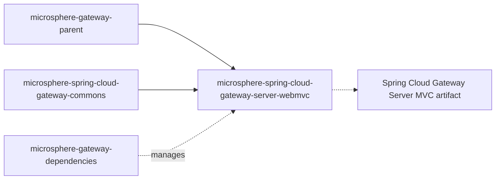

# `microsphere-spring-cloud-gateway-server-webmvc`

## 1. 用途

`microsphere-spring-cloud-gateway-server-webmvc` 把 `we://`（web-endpoint）路由 scheme
带到 Spring Cloud Gateway 的 servlet / Spring MVC 形态。它不使用 WebFlux 模块那样的响应式
`GlobalFilter`，而是接入 Gateway Server MVC 的 `HandlerSupplier` SPI：URI scheme 为 `we`
的路由由 `HandlerFunctions.http()` 提供处理器、外面包一层 `WebEndpointMappingHandlerFilterFunction`，该过滤器读取已发现服务发布的
`WebEndpointMapping` 元数据、遵守按路由配置的 `metadata.web-endpoint.excludes`、剥离前导的 `/{application}`
片段，并把请求交给负载均衡过滤器函数。请在 servlet 网关应用（Spring Boot Web 栈 + Spring Cloud Gateway Server
MVC）、并且使用阻塞式 `DiscoveryClient` 与 Spring Cloud LoadBalancer 的项目中依赖本模块。不要把
[`microsphere-spring-cloud-gateway-server-webflux`](microsphere-spring-cloud-gateway-server-webflux.md)
与它用在同一个应用里：二者是同一能力集面向两种网关运行时的替代实现。

## 2. 版本信息

| 条目 | 值 |
|---|---|
| Group id | `io.github.microsphere-projects` |
| Artifact id | `microsphere-spring-cloud-gateway-server-webmvc` |
| 版本线 | `0.2.x` |
| 分支版本（`release`） | `0.2.19-SNAPSHOT`（Maven `revision`） |
| 已发布的最新版本 | `0.2.18`（分支 `release-notes.md` 中的最新条目） |
| 打包类型 | `jar` |
| 发布位置 | Maven Central，组 `io.github.microsphere-projects`（由 `.github/workflows/maven-publish.yml` 发布） |
| Javadoc | `https://javadoc.io/doc/io.github.microsphere-projects/microsphere-spring-cloud-gateway-server-webmvc` |
| 父级 | `io.github.microsphere-projects:microsphere-gateway-parent:${revision}` |

## 3. 兼容范围

| 维度 | 支持范围 | 快照中的依据 | 超出范围会坏什么 |
|---|---|---|---|
| JDK | 以 17 为基线；CI 验证 17、21、25 | `<java.version>17</java.version>`；`maven-build.yml` `java: ['17','21','25']` | 17 以下不编译也不测试 |
| Maven profile `spring-cloud-2022` | **与名字不符。** 该 profile 在 POM 中注有 `<!-- actual : spring-cloud-2023 -->`，并固定 `spring-boot.version=3.3.13`、`spring-cloud.version=2023.0.6`、`spring-cloud-alibaba.version=2023.0.3.2`，同时以 `<optional>` 加入 `spring-cloud-starter-gateway-mvc` | 本模块 POM 的 profile 块 | 在本模块上选择 `-Pspring-cloud-2022` 实际是针对 Spring Boot 3.3 / Spring Cloud 2023 构建，而不是 2022 版本列车。不要把这里的 profile id 当作 2022 列车 |
| Maven profile `spring-cloud-2023`、`spring-cloud-2024` | 以 `<optional>` 加入 `org.springframework.cloud:spring-cloud-starter-gateway-mvc`；版本来自父级链 | 本模块 POM 的 profile 块 | classpath 上没有 starter 时 MVC 网关类缺失，下文所有条件都会退避 |
| Maven profile `spring-cloud-2025`（**`activeByDefault` true**） | 以 `<optional>` 加入 `org.springframework.cloud:spring-cloud-gateway-server-webmvc`——与其他 profile 的 artifact id 不同 | 本模块 POM 的 profile 块 | 把 starter（2023/2024）与 `spring-cloud-gateway-server-webmvc`（2025）混用，可能得到两个网关 server 构件，或一个都不匹配已编译代码路径 |
| Gateway Server MVC 类 | 需要 `org.springframework.cloud.gateway.server.mvc.config.GatewayMvcProperties` | `ConditionalOnGatewayServerMvcAvailable` 中的 `@ConditionalOnClass(name = "...GatewayMvcProperties")` | 若你的 MVC 网关构件用的是另一个包（`gateway.mvc` 而非 `gateway.server.mvc`），自动配置会静默无效 |
| Servlet Web 栈 | `spring-boot-starter` 与 `io.github.microsphere-projects:microsphere-spring-boot-webmvc`（均为 `<optional>`）；后者提供 `io.microsphere.spring.boot.webmvc.autoconfigure.condition.ConditionalOnWebMvcAvailable` | 本模块 POM 中的 `<optional>` 条目 + 注解的元条件 | 响应式应用从本模块拿不到任何 Bean |
| 服务发现 | 提供 `DiscoveryClient` 的 `spring-cloud-commons`（`<optional>`）；`@ConditionalOnDiscoveryEnabled` + `@ConditionalOnBlockingDiscoveryEnabled` | `WebEndpointMappingGatewayServerMvcAutoConfiguration` | 没有 `WebEndpointMappingHandlerConfig` Bean，因此映射缓存不会刷新 |
| 负载均衡 | 提供 `LoadBalancerClientFactory` 的 `spring-cloud-loadbalancer`（`<optional>`）；代码中使用 `LoadBalancerFilterFunctions.lb(...)` | 同一个类 | 无法通过过滤器函数完成实例选择 |
| Microsphere Spring Cloud | `microsphere-spring-cloud-commons`（`<optional>`）——`WebEndpointMapping`、`ServiceInstanceUtils`、`ServiceInstancesChangedEvent`、`DiscoveryClientAutoConfiguration` | 源码中大量 import | 请求被处理时抛 `NoClassDefFoundError` |

在 reactor 中的位置：



与 WebFlux 模块不同，本 POM 在 `<dependencies>` 主块中以 **compile**（非 optional）作用域声明了两个网关构件：
`org.springframework.cloud:spring-cloud-starter-gateway-mvc` 与
`org.springframework.cloud:spring-cloud-gateway-proxyexchange-webmvc`。它们会传递进入你的
classpath，而 profile 块再以 `<optional>` 重复声明一个网关依赖。切换 profile 后请用 `mvn dependency:tree` 核对有效依赖图。

## 4. 安装

```xml
<dependencyManagement>
    <dependencies>
        <dependency>
            <groupId>org.springframework.cloud</groupId>
            <artifactId>spring-cloud-dependencies</artifactId>
            <version>2025.0.0</version>
            <type>pom</type>
            <scope>import</scope>
        </dependency>
        <dependency>
            <groupId>io.github.microsphere-projects</groupId>
            <artifactId>microsphere-gateway-dependencies</artifactId>
            <version>0.2.18</version>
            <type>pom</type>
            <scope>import</scope>
        </dependency>
    </dependencies>
</dependencyManagement>

<dependencies>
    <dependency>
        <groupId>io.github.microsphere-projects</groupId>
        <artifactId>microsphere-spring-cloud-gateway-server-webmvc</artifactId>
    </dependency>

    <!-- <optional> in the module: must be provided by you -->
    <dependency>
        <groupId>io.github.microsphere-projects</groupId>
        <artifactId>microsphere-spring-cloud-commons</artifactId>
    </dependency>
    <dependency>
        <groupId>org.springframework.cloud</groupId>
        <artifactId>spring-cloud-starter-loadbalancer</artifactId>
    </dependency>
    <dependency>
        <groupId>org.springframework.boot</groupId>
        <artifactId>spring-boot-starter-web</artifactId>
    </dependency>
</dependencies>
```

如果你想完全自己掌控网关构件，可以把传递来的那两个 exclude 掉：

```xml
<dependency>
    <groupId>io.github.microsphere-projects</groupId>
    <artifactId>microsphere-spring-cloud-gateway-server-webmvc</artifactId>
    <exclusions>
        <exclusion>
            <groupId>org.springframework.cloud</groupId>
            <artifactId>spring-cloud-starter-gateway-mvc</artifactId>
        </exclusion>
        <exclusion>
            <groupId>org.springframework.cloud</groupId>
            <artifactId>spring-cloud-gateway-proxyexchange-webmvc</artifactId>
        </exclusion>
    </exclusions>
</dependency>
```

## 5. API 参考

已注册的扩展点（`src/main/resources`）：

| 文件 | 内容 |
|---|---|
| `META-INF/spring/org.springframework.boot.autoconfigure.AutoConfiguration.imports` | `io.microsphere.spring.cloud.gateway.server.webmvc.autoconfigure.WebEndpointMappingGatewayServerMvcAutoConfiguration` |
| `META-INF/spring.factories` | `org.springframework.cloud.gateway.server.mvc.handler.HandlerSupplier=io.microsphere.spring.cloud.gateway.server.webmvc.filter.WebEndpointMappingHandlerSupplier` 以及 `org.springframework.context.ApplicationContextInitializer=io.microsphere.spring.cloud.gateway.server.webmvc.context.WebEndpointApplicationContextInitializer` |
| `META-INF/config/default/features.yaml` | 具名特性：`WebEndpointApplicationContextInitializer=io.microsphere.spring.cloud.gateway.server.webmvc.context.WebEndpointApplicationContextInitializer` |

### 5.1 `autoconfigure.WebEndpointMappingGatewayServerMvcAutoConfiguration`

`@Configuration(proxyBeanMethods = false)`，条件为 `@ConditionalOnGatewayServerMvcAvailable`、
`@ConditionalOnDiscoveryEnabled`、`@ConditionalOnBlockingDiscoveryEnabled`、
`@ConditionalOnMicrosphereWebEndpointMappingEnabled`、`@ConditionalOnClass({"...DiscoveryClient",
"...LoadBalancerClientFactory"})`，并排在 `WebMvcAutoConfiguration`、`DiscoveryClientAutoConfiguration`、
`LoadBalancerAutoConfiguration`、`GatewayServerMvcAutoConfiguration`、
`ConfigurationPropertiesRebinderAutoConfiguration`、`CompositeDiscoveryClientAutoConfiguration` 之后。它 import 了自己的嵌套配置：

`@ConditionalOnBean({GatewayMvcProperties.class, DiscoveryClient.class, LoadBalancerClientFactory.class}) static class WebEndpointMappingHandlerConfig implements SmartApplicationListener`

| 成员 | 签名 | 行为 |
|---|---|---|
| 构造器 | `WebEndpointMappingHandlerConfig(GatewayMvcProperties gatewayMvcProperties, ConfigurableApplicationContext context)` | 保存环境对象，供后续按键查找属性值。 |
| `supportsEventType` | 通过 `isAssignableFrom` 接受 `ContextRefreshedEvent` / `EnvironmentChangeEvent` / `ServiceInstancesChangedEvent` 及其子类型 | 比 WebFlux 的过滤器更宽（后者匹配的是精确事件类）。 |
| `onContextRefreshedEvent` | `void onContextRefreshedEvent(ContextRefreshedEvent)` | 收集 `we://` 路由，并逐个刷新过滤器函数，同时把应用上下文注入其中。 |
| `onEnvironmentChangeEvent` | `void onEnvironmentChangeEvent(EnvironmentChangeEvent)` | 只刷新由变化键定位到的路由。 |
| `onServiceInstancesChangedEvent` | `void onServiceInstancesChangedEvent()` | 刷新全部 `we://` 路由。 |
| `refresh` | `void refresh(List<RouteProperties> routes, ApplicationContext context, Consumer<WebEndpointMappingHandlerFilterFunction> handlerFilterFunctionInitializer)`（包级私有） | 按路由 id 找到缓存中的过滤器函数并对其调用 `refresh(routeProperties, context)`；未知路由 id 被忽略。`WebEndpointMappingGatewayServerMvcAutoConfigurationIntegrationTest` 直接调用了它。 |
| `findWebEndpointMappingRouteProperties` | `List<RouteProperties> findWebEndpointMappingRouteProperties(Set<String> keys)`（包级私有） | 对每个以 `GATEWAY_ROUTES_PROPERTY_NAME_PREFIX` 开头且包含 `id`
的键，解析其属性值，返回 id 相同的 `we://` 路由。 |
| `getWebEndpointMappingRouteProperties`（私有） | — | 取 `gatewayMvcProperties.getRoutes()` 并按 `RouteConstants.SCHEME`（`we`）过滤为不可变列表。 |

### 5.2 `annotation.ConditionalOnGatewayServerMvcAvailable` / `ConditionalOnGatewayServerMvcEnabled`

| 类型 | 组合 | 何时使用 |
|---|---|---|
| `@ConditionalOnGatewayServerMvcEnabled` | `@ConditionalOnProperty(name = GatewayPropertyConstants.GATEWAY_ENABLED_PROPERTY_NAME, matchIfMissing = true)` | 只跟随上游 MVC 网关开关。 |
| `@ConditionalOnGatewayServerMvcAvailable` | `@ConditionalOnGatewayServerMvcEnabled` + `@ConditionalOnWebMvcAvailable` + `@ConditionalOnClass(name = "org.springframework.cloud.gateway.server.mvc.config.GatewayMvcProperties")` | 你的 Bean 需要 MVC 网关类在 classpath 上。`@Target({TYPE, METHOD})`、`@Retention(RUNTIME)`、`@Documented`。 |

### 5.3 `constants.GatewayPropertyConstants`

`public interface GatewayPropertyConstants`：

| 成员 | 值 | 行为 |
|---|---|---|
| `GATEWAY_ENABLED_PROPERTY_NAME` | `GatewayMvcProperties.PREFIX + "." + "enabled"`——文档写作 `spring.cloud.gateway.server.webmvc.enabled`，也正是本模块测试所关闭的键 | 上游 MVC 网关开关，由 `@ConditionalOnGatewayServerMvcEnabled` 使用。 |
| `GATEWAY_ROUTES_PROPERTY_NAME_PREFIX` | `GatewayMvcProperties.PREFIX + "." + "routes"` | 用于元数据绑定、环境变更匹配以及路由查找的前缀。 |

`GatewayPropertyConstantsTest.testConstants` 是将两者与上游 `PREFIX`
做断言的——它们是派生值，不是字面量。

### 5.4 `filter.WebEndpointMappingHandlerSupplier`

`implements org.springframework.cloud.gateway.server.mvc.handler.HandlerSupplier`，通过 `spring.factories` 注册。

| 成员 | 签名 | 行为 |
|---|---|---|
| `get` | `Collection<Method> get()` | 把本类的 public 方法交给 Gateway Server MVC
的处理器发现机制，从而让方法名与路由 URI scheme 相匹配。 |
| `we` | `static Result we(RouteProperties routeProperties)` | scheme 为 `we` 的处理器。按路由 id 创建（或复用）一个
`WebEndpointMappingHandlerFilterFunction`，并返回 `new Result(http(), ofList(function), emptyList())`：即由该过滤器包装的标准
HTTP 处理器函数。 |
| `getWebEndpointMappingHandlerFilterFunction` | `static WebEndpointMappingHandlerFilterFunction getWebEndpointMappingHandlerFilterFunction(String routeId)` | 缓存查找入口，供 `WebEndpointMappingHandlerConfig.refresh(...)` 与测试使用。 |

缓存是该类上的一个**静态 `HashMap<String, WebEndpointMappingHandlerFilterFunction>`**，以路由 id 为键。

### 5.5 `filter.WebEndpointMappingHandlerFilterFunction`

`implements HandlerFilterFunction<ServerResponse, ServerResponse>`，构造器
`WebEndpointMappingHandlerFilterFunction(String routeId)`。

| 成员 | 签名 | 行为 |
|---|---|---|
| `filter` | `ServerResponse filter(ServerRequest request, HandlerFunction<ServerResponse> next)` | 先把当前 `request.uri()`
放入 `MvcUtils.GATEWAY_REQUEST_URL_ATTR`；若 `application` 路径变量为空则委托 `next`。否则解析命中的映射，对重建后的请求（URI
为重写后的路径，请求头携带 `WebEndpointMapping.ID_HEADER_NAME` = 命中的映射 id）施加
`LoadBalancerFilterFunctions.lb(applicationName)`，并更新 `GATEWAY_REQUEST_URL_ATTR`。 |
| `setApplicationContext` | `void setApplicationContext(ApplicationContext context)` | 保存上下文并从中解析 `DiscoveryClient` Bean。 |
| `refresh` | `void refresh(RouteProperties routeProperties, ApplicationContext context)` | 上下文或路由 id
不匹配时不做事；匹配则在 `synchronized` 块内重建两个缓存。 |
| `buildRequestMappingContexts` | `Collection<RequestMappingContext> buildRequestMappingContexts(RouteProperties)`（包级私有） | 对每个被订阅的服务，取**任意一个**实例（`discoveryClient.getInstances(id).stream().findAny()`），读取其
`WebEndpointMapping` 元数据并构造 `RequestMappingInfo`。没有实例的服务会被跳过（有判空）。 |
| `buildExcludedRequestMappingInfoSet` | `Set<RequestMappingInfo> buildExcludedRequestMappingInfoSet(RouteProperties)`（包级私有） | 当 `metadata.web-endpoint`
缺失或还不是 `WebEndpointConfig` 时返回 `emptySet()`。 |
| `getSubscribedServices` | `Collection<String> getSubscribedServices(URI)`（包级私有） | `all` →
`discoveryClient.getServices()`；否则按逗号切分 host。已用 `we://test-app` → `["test-app"]` 断言。 |
| `getMatchingRequestMappingContext` | `RequestMappingContext getMatchingRequestMappingContext(String applicationName, String routeId, ServerRequest)`（包级私有） | 先做排除检查，再重写：`substringAfter(path, "/" + applicationName)`
写入属性 `msgw-we-rewrite-path`，把已解析的请求路径替换为重写后的路径，最后用 `RequestMappingInfo.compareTo` 选最优匹配。 |
| `isExcludedRequest` | `boolean isExcludedRequest(HttpServletRequest)`（包级私有） | 首次刷新之前 `excludedRequestMappingInfoSet`
为 `null` 时返回 `false`。 |
| 字段 | `volatile Collection<RequestMappingContext> requestMappingContexts`、`volatile Collection<RequestMappingInfo> excludedRequestMappingInfoSet` | 为测试保留包级可见性。 |

匹配规则：排除模式匹配**进入时**的路径（含路由自身前缀，例如 `/we/test-app/**`）；服务发布的映射匹配**重写后**的路径（`/{application}` 已去除）。

### 5.6 `context.WebEndpointApplicationContextInitializer`

`extends ConfigurableApplicationContextInitializer`，注册在 `spring.factories` 中。它以
`GATEWAY_ROUTES_PROPERTY_NAME_PREFIX` 注册 commons 的 Bean
`webEndpointConfigurationPropertiesBindListener`，正是它把 `...routes[n].metadata.web-endpoint` 转换成路由元数据里的
`WebEndpointConfig` 对象。

### 5.7 复用的 commons API

`RouteConstants.SCHEME`（`we`）、`RouteConstants.ALL_SERVICES`（`all`）、`RouteConstants.ID_KEY`（`id`）、
`RouteConstants.WEB_ENDPOINT_KEY`（`web-endpoint`）、
`RouteConstants.WEB_ENDPOINT_REWRITE_PATH_ATTRIBUTE_NAME`（`msgw-we-rewrite-path`）、
`CommonConstants.APPLICATION_NAME_URI_TEMPLATE_VARIABLE_NAME`（`application`）、
`@ConditionalOnMicrosphereWebEndpointMappingEnabled`、`WebEndpointConfig` / `WebEndpointConfig.Mapping`、`ConfigUtils`、
`WebEndpointConfigurationPropertiesBindListener` —— 见
[commons 模块参考](microsphere-spring-cloud-gateway-commons.md#5-api-参考)。

## 6. 配置参考

Microsphere 自有键（逐字取自 `CommonsPropertyConstants`）：

| 键 | 类型 | 默认值 | 作用 |
|---|---|---|---|
| `microsphere.spring.cloud.gateway.enabled` | `boolean` | `true` | 总开关；`@ConditionalOnMicrosphereWebEndpointMappingEnabled` 通过 `@ConditionalOnMicrosphereGatewayEnabled` 依赖它。 |
| `microsphere.spring.cloud.web-endpoint-mapping.enabled` | `boolean` | `true` | 只启用/禁用 `WebEndpointMappingGatewayServerMvcAutoConfiguration`。 |

本模块读取的上游派生键：

| 键 | 类型 | 默认值 | 作用 |
|---|---|---|---|
| `<GatewayMvcProperties.PREFIX>.enabled`（文档写作 `spring.cloud.gateway.server.webmvc.enabled`） | `boolean` | `true`（`matchIfMissing = true`） | 上游 MVC 网关开关，被 `@ConditionalOnGatewayServerMvcEnabled` 尊重。 |
| `<GatewayMvcProperties.PREFIX>.routes`（`GATEWAY_ROUTES_PROPERTY_NAME_PREFIX`） | `RouteProperties` 列表 | — | `we://` 路由与 `metadata.web-endpoint` 所在地；也用于与 `EnvironmentChangeEvent` 键比对。 |
| `<...>.routes[n].uri` | URI | — | `we://all` / `we://service-id` / `we://a,b`。scheme 必须恰好是 `we`，`HandlerSupplier` 才会接管。 |
| `<...>.routes[n].predicates` | 列表 | — | 必须暴露 `{application}`，例如 `Path=/we/{application}/**`。 |
| `<...>.routes[n].metadata.web-endpoint.excludes[]` | 列表 | 空 | `patterns` 必填；`methods` 默认为全部；`params`、`headers`、`consumes`、`produces` 可选。 |

本模块测试配置（`src/test/resources/application.yaml`）中可见的键，可作为可用的起点，并以其精确拼写列出：

| 键 | 测试中的值 | 用途 |
|---|---|---|
| `spring.application.name` | `test-app` | 注册进服务发现的应用名。 |
| `server.port` | `8080` | 本地端口。 |
| `eureka.client.enabled` | `false` | 测试中关闭注册中心客户端。 |
| `microsphere.spring.cloud.service-registry.auto-registration.simple.enabled` | 在 profile `simple-service-registry` 下为 `true` | 注册本地实例，使 `we://` 有可转发的目标（该键属于 `microsphere-spring-cloud-commons`，不属于本模块）。 |
| `spring.profiles.active` | `TestApplication` / `WebEndpointMappingHandlerFilterFunctionTest` 用 `simple-service-registry,gateway`；自动配置集成测试用 `gateway` | 激活路由配置块。 |

## 7. 代码示例

### 7.1 同时给出两种 MVC 属性前缀的路由（源自 `src/test/resources/application.yaml`）

```yaml
spring:
  cloud:
    gateway:
      mvc:
        routes:
          - id: add_response_header_route_all
            uri: https://example.org
            predicates:
              - Path=/*
            filters:
              - AddResponseHeader=test-header-name, test-header-value
            metadata:
              a: 1
          - id: web-endpoint-mapping
            uri: we://all
            predicates:
              - Path=/we/{application}/**
            metadata:
              web-endpoint:
                excludes:
                  - patterns: /we/test-app/**
                    consumes: application/json
                    produces: plain/text
      server:
        webmvc:
          routes:
            - id: web-endpoint-mapping
              uri: we://all
              predicates:
                - Path=/we/{application}/**
              metadata:
                web-endpoint:
                  excludes:
                    - patterns: /we/test-app/**
                      consumes: application/json
                      produces: plain/text
```

这两块是同一组路由写在两个 MVC 属性前缀之下（`spring.cloud.gateway.mvc` 与
`spring.cloud.gateway.server.webmvc`）——原因见下文关于你的 Spring Cloud Gateway 版本究竟绑定哪个前缀的常见坑。

### 7.2 经由 `we://` 的端到端路由（源自 `WebEndpointMappingHandlerFilterFunctionTest`）

```java
@SpringBootTest(
        classes = {
                TestController.class,
                WebEndpointMappingHandlerFilterFunctionTest.class,
                WebEndpointMappingHandlerFilterFunctionTest.TestConfig.class
        },
        properties = {
                "spring.profiles.active=simple-service-registry,gateway"
        },
        webEnvironment = RANDOM_PORT)
@EnableAutoConfiguration
class GatewayRoutingTest {

    @Autowired private WebApplicationContext webApplicationContext;
    @Autowired private TestController testController;
    @Autowired private Registration registration;

    @Test
    void routeThroughWebEndpointMapping() throws Exception {
        MockMvc mockMvc = webAppContextSetup(webApplicationContext).build();

        // direct call, no gateway involved
        String content = new RestTemplate()
                .getForObject(registration.getUri() + "/test/helloworld", String.class);
        assertEquals(testController.helloWorld(), content);

        // /we/{application}/** -> we://all -> rewritten to /test/helloworld
        mockMvc.perform(get("/we/test-app/test/helloworld"))
                .andExpect(status().isOk())
                .andExpect(content().string(testController.helloWorld()));

        // matched by metadata.web-endpoint.excludes -> no web-endpoint translation
        assertThrows(Exception.class, () -> mockMvc.perform(get("/we/test-app/test/helloworld")
                .header(CONTENT_TYPE, "application/json")
                .header(ACCEPT, "plain/text")));

        // a routes[..].id environment change re-refreshes the route
        webApplicationContext.publishEvent(
                new EnvironmentChangeEvent(ofSet(GATEWAY_ROUTES_PROPERTY_NAME_PREFIX + "[0].id")));
    }
}
```

同一测试还会注销实例并发布 `ServiceInstancesChangedEvent`，此后请求会抛异常——这证明实例事件会触发缓存重建。

### 7.3 像测试那样注册自己的实例（源自测试的 `TestConfig`）

```java
@ConditionalOnBlockingDiscoveryEnabled
static class TestConfig {

    private final SimpleDiscoveryProperties simpleDiscoveryProperties;

    TestConfig(SimpleDiscoveryProperties simpleDiscoveryProperties) {
        this.simpleDiscoveryProperties = simpleDiscoveryProperties;
    }

    @EventListener(RegistrationPreRegisteredEvent.class)
    public void onRegistrationPreRegisteredEvent(RegistrationPreRegisteredEvent event) {
        int localServerPort = environment.getProperty("local.server.port", int.class);
        DefaultRegistration registration = (DefaultRegistration) event.getRegistration();
        registration.setHost("127.0.0.1");
        registration.setPort(localServerPort);
        simpleDiscoveryProperties.getInstances()
                .computeIfAbsent(registration.getServiceId(), k -> new ArrayList<>())
                .add(registration);
    }
}
```

### 7.4 在单元测试中驱动刷新簿记（源自 `WebEndpointMappingGatewayServerMvcAutoConfigurationIntegrationTest`）

```java
RouteProperties routeProperties = new RouteProperties();
routeProperties.setId("unknown-route-id");
webEndpointMappingHandlerConfig.refresh(ofList(routeProperties), context, handlerFilterFunction -> {
});

Set<String> keys = ofSet(GATEWAY_ROUTES_PROPERTY_NAME_PREFIX + "[2].id",
        GATEWAY_ROUTES_PROPERTY_NAME_PREFIX + "[2].metadata");
assertFalse(webEndpointMappingHandlerConfig.findWebEndpointMappingRouteProperties(keys).isEmpty());
```

### 7.5 最小应用类（源自 `TestApplication`）

```java
@EnableAutoConfiguration
public class TestApplication {

    public static void main(String[] args) {
        new SpringApplicationBuilder(TestApplication.class, TestController.class)
                .properties("spring.profiles.active=simple-service-registry,gateway")
                .run(args);
    }
}
```

## 8. 常见坑 / FAQ

**在本模块上用 `-Pspring-cloud-2022` 得到的并不是 2022 版本列车。**
该 profile 在 POM 中被注为 `<!-- actual : spring-cloud-2023 -->`，并固定
`spring-boot.version=3.3.13`、`spring-cloud.version=2023.0.6`、`spring-cloud-alibaba.version=2023.0.3.2`。若你确实需要真正的
2022 列车，请不要使用本模块的这个 profile：在你自己的 POM 中管理版本。这是该分支上已存在的命名不一致，并非官方别名。

**自动配置已加载，但 `we://` 路由被忽略。**
请确认你的 Spring Cloud Gateway 版本实际绑定的是哪个 MVC 路由前缀。本模块自己的测试配置把路由写了两遍——一次在
`spring.cloud.gateway.mvc.routes` 下，一次在 `spring.cloud.gateway.server.webmvc.routes` 下——因为
`GATEWAY_ROUTES_PROPERTY_NAME_PREFIX` 派生自 `GatewayMvcProperties.PREFIX`，而该前缀在代际之间发生过变化。
`GatewayPropertyConstantsTest` 之所以与该常量比较而不是写死字面量，正是为了让模块跟随运行时使用的前缀；你的 YAML
必须使用同一个前缀。

**没有 `WebEndpointMappingHandlerConfig` Bean。**
它的条件是
`@ConditionalOnBean({GatewayMvcProperties.class, DiscoveryClient.class, LoadBalancerClientFactory.class})`。缺少
`DiscoveryClient`（没有发现 starter，或 `spring.cloud.discovery.enabled=false` /
`spring.cloud.discovery.blocking.enabled=false`）、缺少负载均衡器，或 Microsphere 的 MVC/Tomcat 栈被关闭（`microsphere.spring.boot.webmvc.enabled=false`），都会让它消失。本模块的
`WebEndpointMappingGatewayServerMvcAutoConfigurationIntegrationDisabledTest`
正是通过 `microsphere.autoconfigure.exclude` 排除 `LoadBalancerAutoConfiguration`、
`CompositeDiscoveryClientAutoConfiguration`、`SimpleDiscoveryClientAutoConfiguration` 并设置
`microsphere.spring.boot.webmvc.enabled=false` 来演示这一点。

**看起来该被排除的路径仍然到达了服务（或相反）。**
排除模式是在剥离 `/{application}` **之前**对进入路径求值的，因此当谓词是 `Path=/we/{application}/**`
时，模式必须写成 `/we/test-app/**` 而不是 `/test-app/**`。参见上文的
`application.yaml`。而服务自身发布的映射则是对剥离后的路径求值。

**路由 id 在不同应用上下文之间串了。**
`WebEndpointMappingHandlerSupplier` 把过滤器函数保存在以路由 id 为键的**静态
HashMap** 中。同一 JVM、同一 classloader 内，两个 Spring 上下文若使用相同路由 id，就会共享（并覆盖）缓存中的函数，而且该
Map 没有同步。这在需要多个 `@SpringBootTest` 上下文的测试里会暴露出来（本模块的测试普遍使用 `@DirtiesContext`）；单个网关应用在生产中不受影响，但共享
classloader 的部署方式不安全。

**传递来的 `spring-cloud-starter-gateway-mvc` 与你自己选的网关构件冲突。**
与 WebFlux 模块不同，本 POM 以 compile 作用域声明了 `spring-cloud-starter-gateway-mvc` 与
`spring-cloud-gateway-proxyexchange-webmvc`。若想改用 `spring-cloud-gateway-server-webmvc`（`spring-cloud-2025`
profile 的构件），请使用第 4 节中的排除片段。

**`microsphere-spring-cloud-commons` 仍然要你自己负责。**
它在包括本模块在内的所有模块中都是 `<optional>`，但代码会调用 `ServiceInstanceUtils.getWebEndpointMappings(...)`、
`InstanceConstants.WEB_CONTEXT_PATH_METADATA_NAME` 与 `ServiceInstancesChangedEvent`。缺少它时，`we://`
请求会在刷新/处理阶段失败，而不是在启动时失败。

**`we://` 路由完全没有反应。**
`HandlerSupplier` 是通过 `META-INF/spring.factories` 中的
`org.springframework.cloud.gateway.server.mvc.handler.HandlerSupplier`
键被发现的，且处理器方法名为 `we` 以匹配 URI scheme。如果你的 Gateway Server MVC 版本不支持该
SPI，或者 jar 并非提供 `...server.mvc.config.GatewayMvcProperties` 的那个构件，路由就永远无法解析。请用
`mvn dependency:tree` 与 Spring Boot 条件报告（`-Ddebug`）确认。

## 相关文档

- [用户指南索引](README.md)
- [microsphere-spring-cloud-gateway-commons](microsphere-spring-cloud-gateway-commons.md)
- [microsphere-spring-cloud-gateway-server-webflux](microsphere-spring-cloud-gateway-server-webflux.md)
- [microsphere-gateway-dependencies](microsphere-gateway-dependencies.md)
- [仓库 README](../../../../README.md)

## English

- [User Guide (English)](../microsphere-spring-cloud-gateway-server-webmvc.md)
