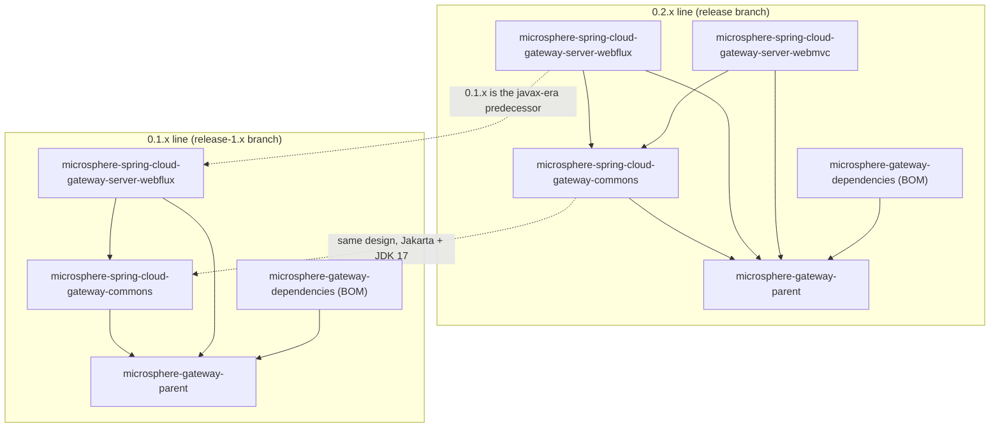

# Microsphere Gateway 文档

[`microsphere-gateway`](../README.md) 的文档。该项目是对 Spring Cloud Gateway 的扩展，提供 `we://`
Web 端点路由方案、基于服务发现的动态路由以及路由刷新能力。

本套文档**只覆盖两个已发布的版本线**，分析来源为 `release` 分支与 `release-1.x` 分支，不涉及 `main` 或 `dev` 分支。

## 选择你的版本线

| 版本线 | 分支 | 状态 | 最新发布版本 | JDK | Spring Cloud 版本系列 | 模块数 | WebMVC 模块 |
|---|---|---|---|---|---|---|---|
| `0.2.x` | `release` | 当前版本线 | `0.2.18`（reactor 中为 `0.2.19-SNAPSHOT`） | 17 / 21 / 25 | `2022`、`2023`、`2024`、`2025` | 5 | 有 |
| `0.1.x` | `release-1.x` | 维护线（Jakarta 之前） | `0.1.18`（reactor 中为 `0.1.19-SNAPSHOT`） | 8 / 11 / 17 / 21 / 25 | `Hoxton`、`2020`、`2021` | 4 | 无 |

## 文档集

### 当前版本线 —— `release`（`0.2.x`）

- [使用者指南](../current/user-guide/README.md) —— 按模块给出安装方式、API 说明、配置项、代码示例与兼容范围。
- [开发者指南](../current/developer-guide/README.md) —— 架构设计、源码分析、设计模式，并用 Mermaid
  图示展示请求处理、路由刷新、缓存与配置绑定等流程。

### 维护版本线 —— `release-1.x`（`0.1.x`）

- [使用者指南](../1.x/user-guide/README.md)
- [开发者指南](../1.x/developer-guide/README.md)

## 每个版本线包含的文档

每个文档集都按 Maven 模块拆分文档，索引结构一致：

| 文档 | 模块类型 | 内容 |
|---|---|---|
| `microsphere-gateway-parent.md` | 父 POM | 构建架构、`${revision}`、BOM 导入链、profile |
| `microsphere-gateway-dependencies.md` | BOM | 受管构件、版本覆盖、消费方用法 |
| `microsphere-spring-cloud-gateway-commons.md` | 库 | 常量、条件注解、`WebEndpointConfig`、配置绑定 |
| `microsphere-spring-cloud-gateway-server-webflux.md` | 运行时 | 自动配置、`we://` 路由、过滤器链、路由缓存、刷新事件 |
| `microsphere-spring-cloud-gateway-server-webmvc.md` | 运行时 | 基于 Servlet 的网关集成（仅 `0.2.x`） |

## 模块之间的关系

实线箭头表示同一版本线内部的 compile 作用域依赖；虚线箭头只是两条版本线之间的对照关系，并非依赖。

## 推荐阅读顺序

1. 先读[仓库根 README](../../README.md)，了解项目总览与最短的上手路径。
2. 用上表确定你的版本线，再读该版本线的**使用者指南**索引。
3. 阅读你所依赖构件对应的模块文档，通常是 `microsphere-spring-cloud-gateway-server-webflux`（`0.2.x`
   上也可能是 `...-server-webmvc`）。
4. 若要参与贡献或定位问题，再读同一模块对应的**开发者指南**文档。

## 语言

英文为默认语言，位于上述路径。中文镜像保持完全相同的文件名，存放在每个英文文档旁边的 `zh/` 子目录中：

| 语言 | 入口 |
|---|---|
| 英文 | [../README.md](../README.md) |
| 中文 | 本文件 |

每篇文档的结尾都会指向自己的另一语言版本。

## English

英文文档入口：[../README.md](../README.md)
